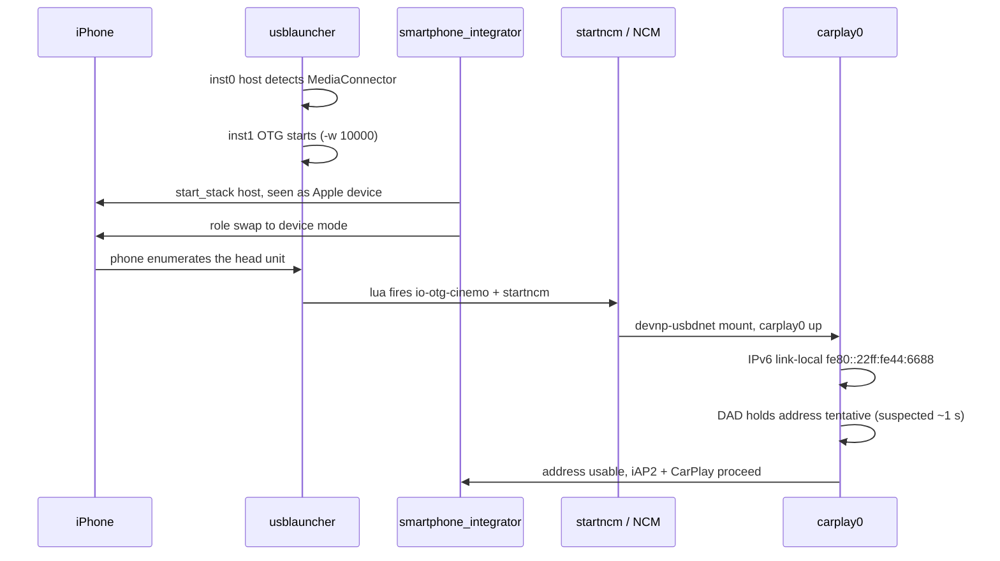

# USB and NCM Connect

*The healthy stock connect path from plug to `carplay0`, its suspected timing cost, and the levers that were investigated and proven not to matter.*

---

## 🌐 The stock connect path

The phone never talks to us as a plain USB device. The head unit runs two `usblauncher` instances and a role swap so the phone ends up enumerating the head unit, after which an NCM gadget interface carries iAP2 and CarPlay. **[decompile]** from re-reading the stock chain in `Firmwares/HU/MHI2Q_US_AUG22_P5087_MU1316/extracted`; full write-up `docs-obsidian/Sources/reference/NCM_AND_FIREWALL_IDEAL_START.md`.

The NCM scripts on the unit are **stock** — the release map ships no `startncm.sh`, `stopncm.sh` or `usblauncher_otg.lua` (`docs-obsidian/Sources/RELEASE_ARTIFACTS.md:13-29`). Modified copies exist only under `deploy/experimental/usb_replug_recovery/`.

## ⚡ The suspected cost — IPv6 DAD

The visible connect delay is HU-side addressing, not the phone. Phone-side iAP2 auth is only ~330 ms; the phone reports `No Remote IP` while the head unit finishes bringing the link up. **[open]** the leading suspect is IPv6 Duplicate Address Detection.

- Stock `startup.sh` sets no `net.inet6.*` sysctl — its only sysctls are `kern.sbmax`, `net.inet.ip.forwarding` and `net.inet.tcp.{recv,send}space` (`Firmwares/.../extracted/system/etc/boot/startup.sh:999-1002,1071-1072`) — so `ip6_dad_count = 1`.
- Decompiled `nd6_dad_start`: `if (flags&1 || !ip6_dad_count) { clear TENTATIVE; return; }` — with `dad_count = 0` the link-local address is usable immediately; otherwise it stays tentative for one `RETRANS_TIMER`, ~1 s.
- `in6if_do_dad` has no per-interface opt-out and `ndp -i` only *displays* `retrans`, so the sole lever is the global `net.inet6.ip6.dad_count`.

> ⚠️ This is an **[open]** hypothesis, not an HU-side measurement. The 330 ms auth and `No Remote IP` are measured phone-side; the ~1 s DAD is inferred from the decompiled netstack, and no HU-side timing has confirmed it.

The candidate lever (no USB impact): `sysctl -w net.inet6.ip6.dad_count=0` before `start_network`, plus dropping `usblauncher`'s default `-vv`. **Not implemented** in the current code **[code]**: no `dad_count` or `sysctl` appears in `deploy/`, `install_MoreIncredibleBash/mod/custom.sh` or `deploy/smartphone_integrator/carplay_startup.sh` (the wrapper does only file checks, an owner publish, a monitor fork and `exec dio_manager`, `carplay_startup.sh:21-95`).

## ✅ Levers proven harmless — do not re-investigate

Three things looked like connect-speed suspects and were each cleared by decompile. **[decompile]**

| Lever | Why it costs nothing |
|---|---|
| `usblauncher -w 10000` | Timeout waiting for a *previous* instance to release the ctrl path. `start_usb_ctrl_thread` polls `eaccess` every 50 ms and breaks the moment the path is absent — instant on a clean boot. |
| en-dashes in `startncm.sh` | `if_up` main computes `v7 = argc - optind; if (!v5) v7 = 1;` — without `-a`, one matching interface exits 0 regardless. The stock script on the unit still carries the UTF-8 en-dashes (`deploy/experimental/usb_replug_recovery/bundle_mu1316_p5087/stock/startncm.sh:23`); only the unshipped experimental copy uses ASCII `-s 2 -r 1` (`deploy/experimental/usb_replug_recovery/startncm.sh:173`). Harmless either way. |
| `connect_poll = 100` | Already a stock CarPlay optimisation — the stock `usblauncher_otg.lua` comment literally says "poll 100ms in order to improve CarPlay connection times" (`Firmwares/.../extracted/system/etc/usblauncher_otg.lua:106`). |

<strong>OTG stack ownership — why poking PPS is not enough</strong>

The OTG `usblauncher` owns the device stack. Its `usblauncher_otg.lua` declares `Device_Stack` with `cmd = /etc/scripts/start_usb_device_stack.sh`, `path = /dev/io-usb/otg_dev`, `connect_poll = 100` (`Firmwares/.../extracted/system/etc/usblauncher_otg.lua:104-106`), and the gadget descriptors `{usbdesc_carlife, usbdesc_carplay, rndis}`. The launcher starts `io-usb-dcd` itself, chooses the gadget descriptor, and mounts NCM via `startncm.sh` when the gadget appears.

The two OTG stacks are mutually exclusive (one controller, one mode): `start_otg_stack_host_mode.sh` → `start_stack::host` → `/dev/io-usb/otg`; `start_otg_stack_device_mode.sh` → `start_stack::device,2` → `/dev/io-usb/otg_dev`. `usblauncher` does not create a stack, it attaches to one — the stack comes from `io-usb-dcd`. This ownership is exactly why [[USB Replug Recovery]] cannot just re-poke the PPS node.

---

Related: [[USB Replug Recovery]], [[PF Firewall]], [[Landmines]].
