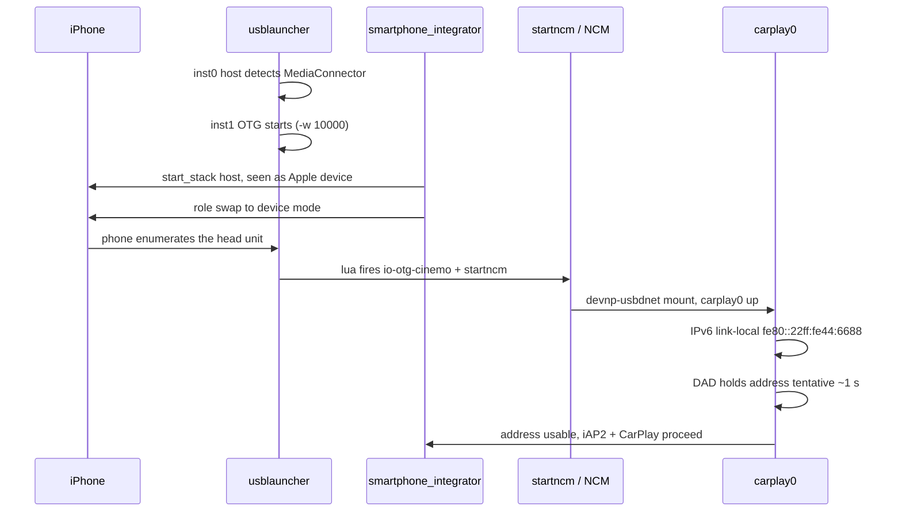

# USB and NCM Connect

*The healthy stock connect path from plug to `carplay0`, its real timing cost, and the levers that were investigated and proven not to matter.*

---

## 🌐 The stock connect path

The phone never talks to us as a plain USB device. The head unit runs two `usblauncher` instances and a role swap so the phone ends up enumerating the head unit, after which an NCM gadget interface carries iAP2 and CarPlay. **[decompile]** from re-reading the stock chain in `Firmwares/HU/MHI2Q_US_AUG22_P5087_MU1316/extracted`; full write-up `docs/reference/NCM_AND_FIREWALL_IDEAL_START.md`.

## ⚡ The real cost — IPv6 DAD

The visible connect delay is **HU-side addressing**, not the phone. Phone-side iAP2 auth is only ~330 ms; the phone reports `No Remote IP` while the head unit finishes bringing the link up. **[open]** the leading suspect is IPv6 Duplicate Address Detection.

- `startup.sh` sets no `net.inet6.*` sysctl, so `ip6_dad_count = 1`.
- Decompiled `nd6_dad_start`: `if (flags&1 || !ip6_dad_count) { clear TENTATIVE; return; }` — with `dad_count = 0` the link-local address is usable immediately; otherwise it stays **tentative for one RETRANS_TIMER**, ~1 s.
- `in6if_do_dad` has **no per-interface opt-out** and `ndp -i` only *displays* `retrans`, so the sole lever is the global `net.inet6.ip6.dad_count`.

> ⚠️ This is a **[open]** hypothesis, not an HU-side measurement. The 330 ms auth and `No Remote IP` are measured phone-side; the ~1 s DAD is inferred from the decompiled netstack, and no HU-side timing has confirmed it. Keep it honest.

The candidate lever (Tier 1, no USB impact): `sysctl -w net.inet6.ip6.dad_count=0` before `start_network`, plus dropping `usblauncher`'s default `-vv`.

## ✅ Levers proven harmless — do not re-investigate

Three things looked like connect-speed suspects and were each cleared by decompile. **[decompile]**

| Lever | Why it costs nothing |
|---|---|
| `usblauncher -w 10000` | Timeout waiting for a *previous* instance to release the ctrl path. `start_usb_ctrl_thread` polls `eaccess` every 50 ms and breaks the moment the path is absent — instant on a clean boot. |
| en-dashes in `startncm.sh` | `if_up` main computes `v7 = argc - optind; if (!v5) v7 = 1;` — without `-a`, one matching interface exits 0 regardless. The UTF-8 en-dash was cosmetically fixed to ASCII `-s 2 -r 1`, but it was never the fault. |
| `connect_poll = 100` | Already a stock CarPlay optimisation — the stock `usblauncher_otg.lua` comment literally says "improve CarPlay connection times". |

OTG stack ownership — why poking PPS is not enough

The OTG `usblauncher` **owns** the device stack. Its `usblauncher_otg.lua` declares `Device_Stack` with `cmd = start_usb_device_stack.sh`, `path = /dev/io-usb/otg_dev`, `connect_poll = 100`, and the gadget descriptors `{usbdesc_carlife, usbdesc_carplay, rndis}`. The launcher starts `io-usb-dcd` itself, chooses the gadget descriptor, and mounts NCM via `startncm.sh` when the gadget appears.

The two OTG stacks are **mutually exclusive** (one controller, one mode): `start_otg_stack_host_mode.sh` → `start_stack::host` → `/dev/io-usb/otg`; `start_otg_stack_device_mode.sh` → `start_stack::device,2` → `/dev/io-usb/otg_dev`. `usblauncher` does not create a stack, it attaches to one — the stack comes from `io-usb-dcd`. This ownership is exactly why [[USB Replug Recovery]] cannot just re-poke the PPS node.

---
