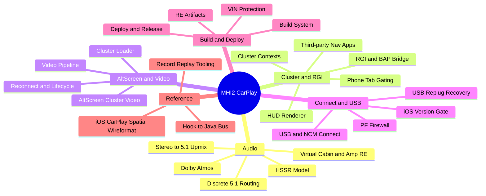
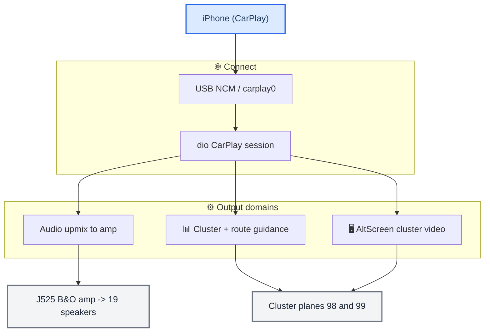

# Home

_The MHI2 CarPlay knowledge base — every domain of the project, linked and diagrammed. Start here._

---

## 🏠 What this vault is

This is the whole project's documentation as a navigable Obsidian vault: the audio
upmix and amplifier reverse-engineering, the instrument cluster and route guidance,
the alternate-screen video, the USB/connect path, the build and deploy system, and a
cross-cutting index of traps. Each domain has a **map-of-content (MOC)** note that
links its topic notes; every note carries Mermaid diagrams and Obsidian wikilinks.

Truth levels are tagged throughout: **[code]** verified in the current source (cited
`path:line`), **[car]** confirmed on the unit, **[model]** / **[decompile]** static
reverse-engineering or offline modelling, **[open]** not yet verified. The current
source code is the ground truth for what the system does.

> 📌 **Before you touch a subsystem, read [[Landmines]]** — the traps that already cost days.

---

## 📚 The domains

_Mindmap of the vault: the six domains and their notes._

| Domain | Map of content | Covers |
| --- | --- | --- |
| **Audio** | [[Audio MOC]] | stereo→5.1 upmix, the HSSR AI, the J525 amp / Virtual Cabin, Dolby, discrete 5.1 |
| **Cluster and RGI** | [[Cluster and RGI MOC]] | cluster contexts, BAP route guidance, HUD renderer, third-party nav, phone tab |
| **AltScreen and Video** | [[AltScreen and Video MOC]] | cluster video (stream 111), OMX pipeline, boot loader, reconnect lifecycle |
| **Connect and USB** | [[Connect and USB MOC]] | NCM connect, USB replug recovery, PF firewall, iOS version gate |
| **Build and Deploy** | [[Build and Deploy MOC]] | Docker QNX build, hand-assembled release, VIN protection, RE artifacts |
| **Reference** | — | [[iOS CarPlay Spatial Wireformat]], [[Hook to Java Bus]], [[Record Replay Tooling]] |
| **Traps** | [[Landmines]] | cross-project rules that break, slow, or mislead |

---

## 🌐 The system at a glance

_High-level flow from the phone to the cluster and speakers; each block links to its domain._

- **Audio** → [[Stereo to 5.1 Upmix]] · [[HSSR Model]] · [[Virtual Cabin and Amp RE]]
- **Cluster** → [[Cluster Contexts]] · [[RGI and BAP Bridge]] · [[HUD Renderer]]
- **AltScreen** → [[AltScreen Cluster Video]] · [[Video Pipeline]]
- **Connect** → [[USB and NCM Connect]] · [[USB Replug Recovery]]
- **Build/Deploy** → [[Build System]] · [[Deploy and Release]]
- Everything talks over the [[Hook to Java Bus]].

---

## 🔗 A–Z index

Every note in the vault, alphabetical:

- [[AltScreen and Video MOC]]
- [[AltScreen Cluster Video]]
- [[Audio MOC]]
- [[Build and Deploy MOC]]
- [[Build System]]
- [[Cluster and RGI MOC]]
- [[Cluster Contexts]]
- [[Cluster Loader]]
- [[Connect and USB MOC]]
- [[Deploy and Release]]
- [[Discrete 5.1 Routing]]
- [[Dolby Atmos]]
- [[HSSR Model]]
- [[HUD Renderer]]
- [[Hook to Java Bus]]
- [[iOS CarPlay Spatial Wireformat]]
- [[iOS Version Gate]]
- [[Landmines]]
- [[PF Firewall]]
- [[Phone Tab Gating]]
- [[RE Artifacts]]
- [[RGI and BAP Bridge]]
- [[Reconnect and Lifecycle]]
- [[Record Replay Tooling]]
- [[Stereo to 5.1 Upmix]]
- [[Third-party Nav Apps]]
- [[USB and NCM Connect]]
- [[USB Replug Recovery]]
- [[VIN Protection]]
- [[Video Pipeline]]
- [[Virtual Cabin and Amp RE]]

---

## 📌 Provenance

The deep source material lives in the repo: `docs/research/` (the audio white papers),
`docs/` and `docs/reference/` (the detailed audits), `assets/` (the reverse-engineering
working sets), and `memory/` (the distilled notes). This vault synthesizes and links
them. Every code-state claim was reconciled against the current source on 2026-09-22
(the code is authoritative); training history, listening verdicts and on-car
measurements keep the provenance of the doc that recorded them.
