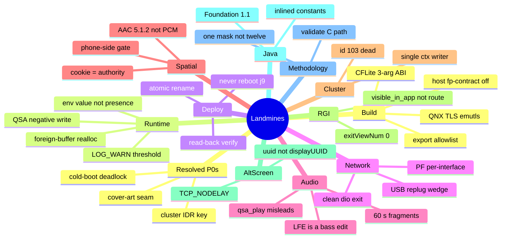

# Landmines

*The rules that break, slow, or mislead — each with the symptom, how it was found, its provenance, and where the current code enforces it. Read this before touching a subsystem you don't own.*

---

## 📋 How to read this

Every entry is a **rule** (imperative) · what goes wrong · how it was found · provenance. Many are also distilled in `MEMORY.md` / `memory/*.md`; this is the one-page cross-project index. The source code is canonical: where a memory note disagrees with the code, the code wins and the conflict is flagged inline. Rules the code already obeys stay listed, with the enforcing `path:line`, so nobody undoes them. `[open]` marks a claim that could not be checked against the tree. For the hub see [[Home]].

*The thirteen trap families and where each one bites.*

---

## ⚙️ Build, toolchain and compile

Domain: [[Build System]].

**Never use `__thread` / `static __thread` in an LD_PRELOAD'd .so on QNX 6.5.** GCC emits emulated TLS (`__emutls_*`); any access from a thread that existed before the .so was preloaded crashes in libc — dio_manager has ~48 such threads, so the first RouteGuidance message is a deterministic SIGSEGV. Use heap or one static + mutex; `#define STBI_NO_THREAD_LOCALS`. · on-car crash 2026-05-12 + audit · `memory/qnx_tls_emutls_trap.md`. Enforced by the build: `scripts/build_hook_common.sh:162-164` (hook) and `:241-242` (APAC) fail on any `emutls` symbol.

**Build host-side float/DSP render tools with `-ffp-contract=off` (no fast-math).** The ARMv7 target has no FMA; a host compiler contracts `a·b+c` into one rounding and diverges bit-for-bit from the S16 reference. The on-target hook build passes only `-mfpu=neon -mfloat-abi=softfp` (`scripts/build_hook_common.sh:68`) — there is nothing to fuse there — so the flag lives in the host tools: `tools/stereo-upmix-render/bench/build_host.sh:9-11`, `tools/stereo-upmix-render/README.md:43-48`. · release runtime audit · `docs-obsidian/Sources/UPMIX_RELEASE_RUNTIME_AUDIT.md`.

**Declare stock CFLite exports with their real 3-arg ABI.** `CFArrayAppendCString(arr,str,-1)` and `CFDictionaryGetInt64(dict,key,NULL)` are 3-arg; a 2-arg proto leaves ARM r2 garbage → arbitrary overread / arbitrary write. · IDA decompile · `memory/cflite_abi_3arg_trap.md`. Current prototypes: `hook/altscreen/altscreen_hook.c:62,70`.

**Keep `.init_array` compiler-only (size 000004); no eager module constructors.** A constructor that reaches `LOG_INFO → pthread_create` under the QNX loader lock makes cold start depend on scheduler timing. · production audit @9295b04 · `memory/production_full_audit_9295b04.md`. Enforced: `scripts/build_hook_common.sh:228-229` (hook), `:249-250` (APAC).

**The hook's dynamic export set is an exact allowlist — don't widen it.** Hidden visibility + version script + an `nm -D` diff reject any accidental export (`scripts/build_hook_common.sh:192-220`); the build also rejects exception/RTTI symbols (`:166-168`), C++ runtime/STL symbols (`:170-172`) and libstdc++ in DT_NEEDED (`:174-176`). APAC is linked with GCC, not G++, and `-fno-threadsafe-statics` avoids the `__cxa_guard` this libstdc++ lacks (`scripts/apac_flags.sh:12-19`). · build discipline.

**Rust std for QNX 6.5 armv7 needs `+strict-align` (procnto runs SCTLR.A=1).** Unaligned loads SIGBUS — std's integer-format LUT read faults, so `println!("{}",n)` crashes while string printing works. · QEMU bring-up · `memory/rust_qnx65_armv7_feasible.md`.

**Go cross-built for QNX commits its heap reservation — patch `MAP_LAZY`.** QNX commits anonymous maps, so Go's 512 MB reservation is real RAM (`GOMEMLIMIT`/`GOGC` don't touch the startup reservation); reclaimed ~516 MB. Add `_qnxMAP_LAZY=0x80` in `runtime/mem_bsd.go`. · on-car FreeMem 183→704 MB · `memory/qnx_go_map_lazy.md`.

**C builds go through the Docker `qnx65-armv7-toolchain` image; pick the right tag.** `:4.9` = GCC 4.9.4 (C++11), `:8.5` / `:8.5-full` (= `:latest`) = GCC 8.5 (C++17, Go, Rust); stock 4.4.2/qcc is reference-only (`../../Tools/qnx-65-sdp-docker/README.md:16-20`). The hook build selects the tag via `QNX_TOOLCHAIN_VARIANT` (`scripts/build_hook_common.sh:49`). BSP libs export only on-unit → the scripts auto-generate import stubs.

**Never call `std::fmin` / `std::fmax` on floats with the QNX GCC 8.5 toolchain — use `::fminf` / `::fmaxf`.** The QNX 6.5 `xtgmath` float templates recurse into themselves (the call compiles to a `b .` self-branch) and the renderer hangs. Use the libm float entry points throughout (`maneuver_render/scene/lane_panel.cpp:10-11`). · disassembly · [[Lane Guidance]].

**`--gc-sections` silently drops an unreferenced protector slot — keep it alive with a volatile self-read.** Nothing references the slot by symbol, so a `-fdata-sections` / `--gc-sections` link removes it; `protector/carplay_prot.c:14-16` forces retention, and any new slot owner must do the same. · build audit · [[VIN Protection]].

**`strchr(allowed, c)` matches the string terminator when `c == 0` — test `p[i] == 0` explicitly.** A proposed VIN validator accepted 17 NUL bytes or an embedded NUL this way; a charset scan alone can also latch onto the byte before the field and shift the result by one. · code review · [[VIN Protection]].

**A compile-time-false trace flag still costs — delete the call sites, don't just gate them.** `traceBap` / `traceDescriptor` were off yet still built every argument string; they were removed with the standalone `Log.d` sites. Two `Log.d` calls remain in `java_patch/com/luka/carplay/core/AltScreenNavStatusGate.java:82,136` [open]. · 2026-08-15 cleanup audit · [[Production Audits]].

**The VIN is an identifier, not a secret — the lock stops casual cloning, not a determined owner.** Everything derived from one substitutable VIN source can be reproduced, and no hardware root of trust was confirmed; don't describe it as more. Keep the wrong-VIN path failing open to stock instead of decoding garbage. · protection handoff · [[VIN Protection]].

---

## 🔧 QNX runtime

**Never return a negative from the QSA write interposer to stock dio.** Stock `CQNXSoundIF::write` treats any negative as an unsigned byte count → `memset(-47)` SIGSEGV in libc (our `-ECANCELED` crashed dio_manager). Failure → 0, cancel → full size, never negative. · QNX core dump 2026-09-19 · `memory/stock_qsa_write_negative_return_crash.md`; `docs-obsidian/Sources/AUDIO_CALL_ROUTING.md`. Enforced by `spa_stock_write_result()` in `hook/audio/audio_hook.c:3769-3774`, used on every error return (e.g. `:6247-6293`).

**Never realloc/free a buffer owned by the hooked library unless its allocator is proven, and always keep the skip-on-doubt guard.** The Identify patcher once corrupted the heap and CarPlay wouldn't start (on-unit 2026-07-11). The current code *does* grow Cinemo's `NmeArray` with `realloc`, and documents why that is sound: `NmeIAP2Message::Encode` (libNmeBaseClasses `0x11ffe8`) grows the same buffer with libc `realloc`, and the patch runs inside the Encode interpose. Any failed invariant (NULL base, `len>cap`, size > 8192) skips the append with no heap touch (`hook/routeguidance/rgd_hook.c:1505-1545`). The older memory claim that the buffer is C++ `new[]` contradicts this code comment. · `memory/hook_identify_realloc_corruption.md`.

**Env gates must check the VALUE (`env_on()`), never bare `getenv()!=NULL`.** `export FOO=0` left the gate truthy → the feature stayed ON; cost a full debug session. On-unit env changes only take effect after a dio-supervisor relaunch; a redeployed `.so` is per-fork and needs none. · on-unit debug · `memory/hook_getenv_presence_check_trap.md`. Current helper: `hook/altscreen/altscreen_hook.c:700-712`.

**Instrument with `LOG_WARN`, not `LOG_INFO` — the live threshold is WARN.** Every `LOG_INFO` is dropped at runtime, so a new counter looks dead; cost a car session. Default `min_level = LOG_LEVEL_WARN` (`hook/framework/logging.h:72`); `touch /mnt/app/carplay_verbose` (or `/tmp/carplay_verbose`) lifts to INFO without a rebuild (`hook/framework/logging.c:187-198`); `LOG=0` compiles logging and captures out (`scripts/build_hook_common.sh:75`). · on-car · `memory/hook_log_is_warn_only.md`.

**Launch the renderers with `GRAPHICS_ROOT=/proc/boot` or EGL SIGSEGVs.** Adreno `libEGL` getenv's it; unset → null-deref in `eglGetDisplay`. This now applies to *both* renderers: `altscreen_render` presents through Screen/EGL too (`altscreen_render/screen_egl_present.c`), so the older "altscreen_render has no EGL" note is stale. The supervisor sets it for every renderer it spawns (`deploy/smartphone_integrator/carplay_monitor.sh:93`). Renderer /tmp logs need `setvbuf(_IONBF)`. · live test 2026-07-31 · `memory/graphics_root_egl_trap.md`.

**An exported symbol is not automatically interposable — check the PLT/GOT call path, and `DT_SYMBOLIC`.** `LD_PRELOAD` only wins where the caller goes through the PLT. Stock 210 libairplay routes even its own internal calls through PLT → GOT (`j_AirPlayCopyServerInfo`), which is why the hook can preempt them ([[AltScreen RE History]]). A `DT_SYMBOLIC` library binds its own calls internally: MU1439 `ipod-drvr-iap2.so` never sees an interposed `link_handle_iap2pkt`, so there only a binary patch works ([[MHI2 MU1439 Port]]). · decompile + `.dynamic` dump.

**Renderers must reopen stderr in append mode (`"a"`), or supervisor truncation never bounds the log.** With `"w"` the file offset survives truncation and the log grows straight back (614,400 → 143 → 614,419 bytes). Fixed: `altscreen_render/main.c:484`. · audit repro · [[Production Audits]].

---

## 📦 Deploy and SSH

Domain: [[Deploy and Release]].

**NEVER reboot / kill j9 / restart the unit yourself — ask every single time.** The user is usually in the car; killing j9 blacks the screen ~50 s. Approval to deploy is not approval to reboot, and approval once is not approval next time. · standing directive · `memory/feedback_never_reboot_unit.md`.

**Deploying `carplay_hook.jar` = a full unit reboot (j9 `-Xbootclasspath`).** The jar does nothing until the JVM restarts, and killing j9 is a critical-process death → whole-system restart (~50 s, SSH drops). Contrast the C hook: only dio_manager needs a new generation (per-fork, invisible). The build writes `build/carplay_hook.jar` (`scripts/build_java.sh:29`); on-unit path `/mnt/app/eso/hmi/lsd/jars/carplay_hook.jar` after `mount -uw /mnt/app`. · measured 2026-08-22 · `memory/java_jar_deploy_reboots_unit.md`.

**SSH to the head unit has no scp/tar/cksum on the far side — read back to verify.**

1. No remote `scp` / `tar` / `sha256sum`; push via `ssh "cat > f.new" < local` + chmod + mv + sync; verify by read-back + local `cmp`.
2. sshd rate-limits password auth → use one ControlMaster with a SHORT `ControlPath` (`/tmp/audi-cm/sock`, not a scratchpad path >104 B).
3. `ssh` in a `while read` eats the loop's stdin → `ssh -n`.
4. zsh won't word-split unquoted `$OPTS` → put deploy snippets in a `#!/bin/bash` script.

`/mnt/app` is read-only until `mount -uw`; the login banner prints on stdout even for `ssh host cmd`. · each cost a failed attempt · `memory/audi_ssh_transport_traps.md`.

**The password in `audi_ssh.sh` (outside this repo, at the `AUDI_2` root) is STALE — the working root password is supplied by the user; never write it into the tree.** Deploys failed on auth until the correct password was used, and repeated wrong attempts make the unit reject even the right password for a while — do one careful login check before any transfer ([[Upmix Listening and Deploy Log]]). The old in-repo deploy helpers (`package_mib.py`, `package_protected.sh`, `deploy_over_ssh.sh`, `package_cabin_candidate.py`) were deleted. · `memory/audi_ssh_transport_traps.md`.

**Activate a release by same-partition rename, published last; renderers are persistent services.** The SI JSON is published last by a same-partition rename, which is atomic per file, not a transaction (`docs-obsidian/Sources/DEPLOYMENT.md:48`). Don't add renderer processes as `servicemgr external:true` services — that breaks the generation model (`docs-obsidian/Sources/DEPLOYMENT.md:30`). Never overwrite the stock `/etc/scripts/carplay_cleanup.sh`; the custom cleanup calls it only for mdnsd/PPS (`docs-obsidian/Sources/DEPLOYMENT.md:27-28`, `deploy/smartphone_integrator/README.md:29-31`). · deployment design.

**Deploy matched halves together: hook with jar, jar with `maneuver_render`.** An old hook sends no `route_generation`, so a new jar's slot identity breaks; an old renderer doesn't understand the jar's half-degree angles (flag `0x04`) or icons 8/9. The new renderer accepts old commands, not the reverse. · on-car · [[RGI and BAP Bridge]], [[HUD Renderer]].

---

## 🌐 Networking, USB and connect

Domains: [[USB Replug Recovery]], [[PF Firewall]], [[Reconnect and Lifecycle]].

**The live PF ruleset is per-interface (`pf.ecm0.conf` on the LTE car) — verify via `pfctl -sr`.** Four profiles ship; patching `pf.conf` alone silently does nothing (6031/6032 stay blocked, no error). Patch all four; check the ACTIVE ruleset, not the file. · verified 2026-08-28 · `memory/pf_profile_per_interface_trap.md`. The installer widens `6030` → `6030:6032` in all four profiles (`install_MoreIncredibleBash/mod/custom.sh:35,95-100`).

**A fast USB replug can leave CarPlay dead until reboot — `carplay0` without RUNNING is a stack/SI problem, not our code.** After the replug `/dev/io-usb/otg_dev` goes missing → `carplay0` UP but not RUNNING (no carrier) → iAP2 never starts → dio misses its budget → SI relaunches it (~500 `TIMEOUT_STARTUP`). A missing `io-usb-dcd` after a failed reconnect is **not** proof that the device stack crashed: it is SI's terminal cleanup state — once the setup retries are spent, final cleanup issues `SwitchPort(direction=0)` with no matching start and waits for a connector event that never comes (the hub is soldered in). · on-car 2026-09-03 + SI decompile 2026-09-04 · `memory/usb_device_stack_replug_wedge.md`, [[SI Stack and Replug Race]], [[USB Replug Recovery]]. Current state: the shipping `deploy/smartphone_integrator/smartphone_integrator` **is** the re-arm-patched SI image (SHA-256 `606236a8…`, `docs-obsidian/Sources/RELEASE_ARTIFACTS.md:80`; patcher `deploy/experimental/usb_replug_recovery/patch_si_rearm.py:15`), whose final cleanup re-arms the stack instead of leaving it stopped. The production `carplay_startup.sh` contains no USB guard. Only the NCM generation fence (`startncm.sh`/`stopncm.sh`, `usblauncher_otg.lua.patch`) remains an offline candidate in `deploy/experimental/usb_replug_recovery/` ("nothing in this directory deploys to the head unit by itself", `README.md:3-4`); whether a unit runs the fence is [open].

**A clean dio exit spares the USB stack; ERROR/TIMEOUT makes SI destroy `carplay0`.** Only `ERROR_RUNTIME` / `TIMEOUT_*` / `ERROR_SETUP` exits escalate SI → `RestartDeviceStack` → `stopncm` → `carplay0` destroyed. A `DEINITIALIZED` exit runs `softPath_noStackRestart()`. ERROR/TIMEOUT ⇒ the fix belongs in dio/hook (exit cleanly), not the USB/firewall layer; diagnose via slog `[CSIStateRunning]` `oldAppState`. · IDA RE of SI · `memory/si_stack_restart_kills_carplay0.md`.

**Debounce the CarPlayApp inactive edge — a fast replug bounces state.** Each ACTIVATING↔INVALID↔ACTIVE edge used to do a full BAPBridge teardown + cluster ctx flap, and a dio reconnect landing mid-teardown collapsed the session. Implemented: `DEACTIVATE_DEBOUNCE_MS = 400L`; `lifecycleLoop` waits on an inactive edge and drops it if a newer edge arrives (`java_patch/com/luka/carplay/core/CarPlayApp.java:228-268`). Don't remove the wait. · on-car build 34c4c9d · `memory/reconnect_flak_lifecycle_debounce.md` (its "proposed" wording is stale).

**Don't re-investigate `-w 10000` or startncm en-dashes — proven harmless by decompile.** IPv6 DAD costs ~1 s/connect; the only lever is the global `net.inet6.ip6.dad_count` (set 0 before `start_network`). · decompile 2026-08-24 · `memory/ncm_connect_speed_stock.md`.

**Don't patch SI `verifyPortReset` 12 → 14 — it is the wrong branch for CarPlay.** The verifier returns immediately for CarPlay (app ID 0), which follows the connector-type cleanup branch instead; the patch would not fix CarPlay and could regress other apps. The 2026-08-04 reading was superseded on 2026-09-04. · SI decompile · [[SI Stack and Replug Race]].

**Don't raise SI `maxSetupRetries` (2) as a fix.** More stop/delay/start cycles remove neither race and turn a permanent failure into a long restart storm. · SI decompile · [[SI Stack and Replug Race]], [[USB Replug Recovery]].

**Never use `reset port 3 250 1` or switch media port 1 to OTG as recovery.** The port reset made it worse (`drivers_running` 1 → 0); switching port 1 to the OTG hub stopped the phone enumerating, and switching back did not restore it — the command is reversible, the state was not. · on-car · [[USB Replug Recovery]].

**`/proc/<pid>/cmdline` is empty for `usblauncher` on QNX — read argv with `pidin -F "%a %A"`.** The first relaunch guard silently did nothing because of this; `usblauncher` is also not on `PATH` (it lives in `/mnt/app/armle/bin/`). · on-car · [[USB Replug Recovery]].

**Never let two listeners share the negative preferred port `-6030`.** Stock `ServerSocketOpen` treats a negative port as "preferred, fall back to dynamic"; two listeners race, one silently falls back, and main 110 hits the stock 10 s accept timeout → teardown. Type 111 opens `-6031` (`hook/altscreen/altscreen_hook.c:1659-1661`). · decompile + on-car · [[Session Lifecycle]].

**A `0x5001` now-playing update with an unchanged media item is invisible to the HMI.** Cinemo calls the listener only when `MediaItem::compare` reports a change; a fresh `0x5000` is what rebuilds the phone-side state. · decompile · [[Now Playing Cold Start]].

---

## ⚡ Audio — upmix tuning and measurement

Domain: [[HSSR Model]].

**Never tune on 6-second prefixes; use ≥60 s fragments.** Short prefixes understate bass/mid tilt by ~1.5 dB mean (up to 4.8 dB); quiet intros attribute nothing. All 6 s conclusions were withdrawn. · 60 s one-variable grid · `memory/upmix_long_onevar_2026-09-21.md`, `docs-obsidian/Sources/UPMIX_LONG_ONEVAR_2026-09-21.md`.

**Treat any LFE-default change as a bass edit and re-verify.** The 18.09 build silently raised the LFE assist default 4096→12288 = +9.5 dB sub — the "bass everywhere" complaint. Fixed via `AUDIO_STEREO_LFE_GAIN` (dB re 4096); production pins it to `0` (`deploy/smartphone_integrator/carplay_startup.sh:67-68`). · on-car root-trace 19.09 · `memory/upmix_second_scene_formulation.md`.

**LFE is not a monotonic sub-volume knob.** In the corrected linear chain LFE sums destructively with other bass — zeroing it can *raise* modelled sub. "Sub only from LFE / no LFE = silent sub" is false. · corrected re-render · `docs-obsidian/Sources/UPMIX_MATRIX_RERENDER_2026-09-20.md`.

**Front bass is the only bass lever, and it moves the modelled sub too.** Front bass −3→0 raised woofer +2.9 dB *and* sub +3.3 dB; the "front woofers only" comment is wrong. Retention does not touch bass (it's a mid/front restore). · one-variable grid · `memory/upmix_long_onevar_2026-09-21.md`.

**Retention lifts the front broadband — apply it with an HF taper, not flat.** Retention 0.5 raised the front +1.3 dB across 0.5–8 kHz (bright objects drag their treble forward). The 1000:2500 Hz taper is the *library default* (`hook/audio/stereo_upmix.h:42-43`, applied at `hook/audio/stereo_upmix.c:507`); production sets retention 0.5 and does not export `AUDIO_HSSR_RETENTION_HF`, which only overrides the default (`deploy/smartphone_integrator/carplay_startup.sh:75-82`). The taper only acts with `AUDIO_HSSR_BED_ATTACK` on: with attack off, retention falls back to the flat time-domain transfer and the taper is ignored (`hook/audio/stereo_upmix.h:93-95`, `hook/audio/hssr_dsp.c:1583-1590`), so turning only `BED_ATTACK` off brings the bright front back. The legacy renderer needs all three scene flags off **and** retention 0. See [[Stereo to 5.1 Upmix]]. · deploy 2026-09-22 · `docs-obsidian/Research/HSSR_UPMIX_MODEL.md §3.6`, `docs-obsidian/Sources/UPMIX_DOLBY_DISTRIBUTION_PLAN_2026-09-21.md §7`.

**The float "candidate" is a bass increase, not a tilt reduction — don't ship it.** Its −0.46 dB "tilt" was actually a +1.9 dB bass rise + mid restore + rear cut. The whole float/cabin/quiet path was deleted, S16 byte-identical. · re-attribution · `memory/upmix_long_onevar_2026-09-21.md`.

**The input-EQ bank choice dwarfs every other bass lever.** bank10 vs bank7 moved bass ~+6 dB — more than surround/front-bass/LFE combined; but the live bank isn't proven in-car, so don't draw bass conclusions without pinning it. · offline re-render · `docs-obsidian/Sources/UPMIX_MATRIX_RERENDER_2026-09-20.md`.

**Don't vectorize the branchy mask/slot loops.** They're ~60% of `run_hop` but per-bin with slot decisions; vectorizing means rewriting the decisions, which already flipped tracker decisions once. · profiling · `docs-obsidian/Sources/UPMIX_STATUS_2026-09-22.md §5`.

**The realtime deadline budget (8/10 ms) was invented, not measured.** There is no established free 75–80% budget; under contention P99 hit ~21.15 ms of the 21.333 ms period. Current in-car figures are estimates; the real period-time distribution is still uncaptured. · R1 budget audit · `docs-obsidian/Sources/UPMIX_R1_RUNTIME_BUDGET.md`, `docs-obsidian/Sources/UPMIX_STATUS_2026-09-22.md`.

**Don't trigger the realtime guard on real `deviceUnderruns`.** Correct in principle, but it reaches into the QSA record intercept that once crashed dio_manager, and can't be tested now. Stay on a time threshold; gather the histogram first. · design review · `docs-obsidian/Sources/UPMIX_STATUS_2026-09-22.md §5`.

**SoundCheck gain runs after the S16 cabin guard, with its limiter off — a positive gain is not re-guarded.** Order: upmix incl. S16 guard → SoundCheck gain → optional limiter (`hook/audio/audio_hook.c:3402-3409`); production exports `AUDIO_SOUNDCHECK_LIMITER=off` (`deploy/smartphone_integrator/carplay_startup.sh:91`), so a + gain can push a bus past the guard's limit. · code audit · [[Stereo to 5.1 Upmix]].

**Host renderer defaults are not the car's (surround 0.18, LFE off, no guard) — pass every knob, or `--scene` on the ARM bench.** The earlier bench measured library defaults, a path the car never runs. · status 2026-09-22 · [[Upmix Calibration and Tuning]].

**The upmix makes the front ~3 dB quieter; it does not make the rear louder — level-match before judging.** Level-matched, startup is ≈ 3 dB quieter broadband than dry while the rear-door band stays at dry level. Never declare the quieter variant better. · 60 s grid · [[Upmix Calibration and Tuning]].

---

## 🔧 Audio — amp and 5.1 routing

Domains: [[Virtual Cabin and Amp RE]], [[Discrete 5.1 Routing]].

**Mirror `mpl5_dio_ent` caps to `mpl1` exactly — you cannot fix 5.1 from the PCM side.** `deva_update_session_info_from_list` copies the record *minima* (min_voices/min_fragsize) into the active CSD session, built at route-attach 14 s before the PCM channel exists; `2/0x1800` truncated each 6ch fragment and tore at 62.5 Hz. · IDA + on-car 2026-09-02 · `memory/carplay_51_fault_is_virtual_channel.md`.

**"Widening the minima breaks stereo" is FALSE — QSA inserts a channel conversion.** This belief cost a month; `mpl1` served stereo at `min==max==6` all along. · `memory/carplay_51_fault_is_virtual_channel.md`.

**Verify audio through CarPlay, never with `qsa_play`.** `qsa_play` sets no SAD, so it inherits the last session's `asad=0xc0` and plays L/R only; reading that as "amp innocent" sent a 2-day search into ADSP/MOST/SHARC — all correct. The fix was in the hook (announce `asad=0xfc`; see the SAD note at `hook/audio/audio_hook.c:5126-5130`). · 2 days lost · `memory/carplay_sad_header.md`, `memory/deva_stock_pcm_dump.md`.

**The amp input matrix is OUTPUT-rows / INPUT-columns — don't transpose it.** Older readings had it backwards; re-inserting the transpose shifts sub ~+15 dB. The per-speaker bass claims from the old orientation ("sub only from LFE", "front woofers sum L/Ls/C/LFE") are withdrawn — cite the corrected re-render for any bass/LFE decision. Also withdrawn: "the amp returns 0.708·Ls into the front (a 12 ms comb)" and "the centre is a third door playing mono bass". In the corrected matrix Ls does not reach the front bus; instead **L reaches the rear bus at −3 dB**, so restoring the front mid raises the rear speakers too (see [[Upmix Calibration and Tuning#The corrected matrix changed the diagnosis]]). · static decompile 2026-09-20 · `docs-obsidian/Sources/SHARC_MATRIX_CONTROL_2026-09-20.md`, `docs-obsidian/Sources/UPMIX_MATRIX_RERENDER_2026-09-20.md`.

**Internal (non-B&O) amp has NO 6-channel route — gate `AUDIO_SPATIAL` on E2P 0xFC.** E2P 0xFC==01 routes CarPlay media → `eSNK_SPEAKERS` stereo (BlockWidth 4); a PCM6 stream loses C/LFE/Ls/Rs and HSSR thins the fronts. `AUDIO_STEREO_UPMIX=off` alone still rides the 6-voice path. Read: `on -f rcc /usr/apps/modifyE2P r fc 1` (02=external). · RCC MIBRoot RE · `memory/internal_amp_no_51_path.md`, `docs-obsidian/Sources/INTERNAL_AMP_MIBROOT_ROUTING.md`. The checked-in startup hardcodes `AUDIO_SPATIAL=1` for this (external-amp) unit and states the E2P gate "belongs to the installer" (`deploy/smartphone_integrator/carplay_startup.sh:56-60`); no installer code reads E2P 0xFC yet — [open] for internal-amp installs.

**`eSNK_SPEAKERS_MC` (=31) is a DEAD alias of stereo — never target it for 6ch.** 0 of 143 resource records, 0 connections; `CMainAmp` aliases it to stereo sink 1. The correct internal 6ch pair is `{0x46f, eSNK_DTCP51(2)}`. · audioprocess RE · `memory/internal_amp_no_51_path.md`, `docs-obsidian/Sources/INTERNAL_AMP_6CH_PATCH_PLAN.md`.

**Never code an internal-amp car as `Sound_System=2` — keep 1 and patch the MIBRoot pair.** `2` makes `collectConfigData` pass `--amptype=EXT`; `CMainAmp` then ignores internal area 51 and waits for a MOST amp that doesn't exist — no audio at all. · RCC RE · [[Internal Amp Path]].

**`MIB_AudioTable_*.xml` must stay gzip-compressed, well-formed XML.** The loader (`gzopen` + libxml2) only warns on DTD errors but rejects malformed XML. · RCC RE · [[Internal Amp Path]].

**The `0x10be3` COPP topology A/B is a no-op — use `0x1031b`.** It shares RX descriptor `0xc04e981c` with `0x10314`, i.e. the same 11-module graph. · ADSP RE · [[QNX Audio Topology]].

**Don't hand-edit the AudioProcess src-7 width byte at file `0x1d3f94`.** MIBRoot's `mov r8,#0x1a` is shared by sources 2 and 7 and the NAL resources still say 26, so a one-byte edit is inconsistent (and not needed). · RCC RE · [[QNX Audio Topology]].

**`Sources/acdb/Speaker_cal.acdb` is the PATCHED `0x10312` variant, not stock** (stock SHA `a203ec5c…`) — never diff against it as the baseline. · ACDB audit · [[QNX Audio Topology]].

**Amp mute sentinels differ per block — never apply one block's sentinel to another.** Matrix −100 dB clamps to −99 dB (a small leak); gain-lookup −100 dB is exact float zero. · SHARC RE · [[SHARC DSP Blocks]].

**Level-EQ bank 0 ("disabled") is not flat** (−3.5 dB @ 10 kHz, −3 dB @ 4.5 kHz); flat is bank 7. · SHARC RE · [[SHARC DSP Blocks]].

**"SHARC control 0x10 / 0x13" are the B-library API16 / API19 in hex, not new controls.** · V850 RE · [[SHARC B Processors]].

---

## 📊 Audio — spatial and codec wireformat

Domains: [[iOS CarPlay Spatial Wireformat]], [[Dolby Atmos]].

**The inline magic cookie is the codec authority — never switch decoders on a stream index field.** Reading TLV 8 (`spf`) or TLV 2 as the live format index overwrote the negotiated index on the first packet and muted every non-Atmos track. TLV 2 / SETUP index are advisory hints; drop unsupported ones, don't tear down a working decoder. · two vehicle captures · `memory/apap_no_format_index.md`. Code: TLV ids at `hook/audio/apap_crypto.h:53-67` (2 = format index, 8 = samples per frame, 18 = magic cookie); policy stated at `hook/audio/audio_hook.c:6-8`.

**CarPlay realtime spatial is AAC-ELD 48k 5.1.2 (bit 42), NOT PCM 5.1 (bit 44).** The phone never offers bit 44 on the realtime path; both bits were offered live and the phone chose stereo (0x8000) both times — advertising is not sufficient. `SPA_DEFAULT_BIT 44` still exists (`hook/audio/audio_hook.h:40-43`) but only as the retained realtime migration/debug path (`hook/audio/audio_hook.c:12-15`); shipped multichannel rides the buffered type-103 stream. · iOS 27 RE + live A/B · `memory/carplay_spatial_atmos_wireformat.md`, `docs-obsidian/Sources/reference/AUDIO.md §9-19`.

**Phone-side realtime spatial is gated by `ScreenSpatialAudioReceiver` — no HU advert can flip it.** `APAudioFormatIsScreenSpatialAudioReceiver` returns false unless a phone-side feature flag/device model is set; it never reads the accessory declaration. · iOS 27 beta 6 RE · `docs-obsidian/Sources/HANDOFF_SPATIAL_AUDIO.md`, `memory/carplay_spatial_atmos_wireformat.md`.

**The 8→6 fold is mandatory — there is no 8-channel route.** `deva_mib2_channel_map` switches on {1,2,3,6} only; `deva_csd_start_csd_session_playback` hardcodes 6; the amp declares positions 7/8 as BCL/BCR with no height codes, so 7.1.4 TopSide folds into the rears. The hook keeps QSA/SAD/CSD/MOST fixed at PCM6/48 kHz/S16 per session (`hook/audio/audio_hook.c:9-10`). · RE + on-car · `memory/carplay_sad_header.md`, `memory/carplay_spatial_atmos_wireformat.md`.

**210 libairplay is PCM-passthrough — don't add in-lib AAC/OMX/FDK decode.** `AudioConverterNew_compat` is a dead stub (−6735); 210 advertises PCM only; audio out is ALSA (OMX is video-only). Multichannel arrives through the hook's own buffered type-103 receive + optional APAC codec library instead (`hook/audio/audio_hook.h:102-122`, `libcarplay_apac.so`). · RE 2026-07-13 · `memory/audio_210_pcm_passthrough.md`, `memory/cinemo_audio_codec_abi.md`.

**Type-103 legacy `audioOutputFormats` must be ONE codec family (`0x400000`).** A mixed mask such as `0x1440800` is rejected by the phone with −6705 before endpoint activation and kills type 100 **and** 103 (`hook/audio/audio_hook.h:146`, `hook/audio/audio_hook.c:832`). · on-car · [[Buffered Audio Path]].

**Answer `mainBuffered` only when the phone proposed it, and always together with `/info` `mainBufferedInfo`.** Feature-without-key (or the reverse) returns −16720 → teardown 26–130 ms after `/info`. · iOS RE + on-car · [[Buffered Audio Path]].

**`audioBufferSize` is the maximum over the whole format offer.** A codec switch gets no new SETUP, so size for the largest (21,168,000 for [65,23]); 5,000,000 caused a 45 s stall (`spa103_audio_buffer_size`, `hook/audio/audio_hook.c:8321`). · on-car · [[Buffered Audio Path]].

**Hand the Cinemo decoder a heap ASC header and never free it after a successful Initialize.** The codec frees that pointer itself; freeing it too aborts (SIGABRT) at teardown. · on-car · [[Cinemo AAC Decoder]], `memory/cinemo_audio_codec_abi.md`.

**Never splice type-100 PCM into a period while type 103 owns media.** A period is either a complete buffered period or a complete silent one (`hook/audio/audio_hook.c:6330-6345`); splicing put item C under item B's Now Playing metadata. · on-car · [[Buffered Playback Lifecycle]].

**Don't blank `updateFeedback` — its `sr` is the sender clock.** Blanking it drops the phone to ~1 packet/s. · on-car · [[Buffered Audio Path]].

**Run the APAP receiver / QSA writer at `SCHED_RR` 18, not the default 10.** At 10 a CPU spike drained all fragments and libasound hid the underrun behind a full write return (`hook/audio/audio_hook.c:7782-7790`, `AUDIO_BUFFERED_THREAD_PRIO`). · on-car · [[Buffered Playback Lifecycle]].

**Never pull a full `sloginfo` during playback.** On a 94–100 % busy unit the 1.3 MB extraction froze playback. · on-car · [[Buffered Playback Lifecycle]].

**Don't scope the APAC codec by the substring "APAC".** Apple's DSP layer (`MDCT`, `DCT_IV`, `CacDecoder`, …) has no APAC in its names and components guessed droppable by name were live. · decompile · [[APAC Codec]].

---

## 🔍 Cluster contexts

Domain: [[Cluster Contexts]].

**DisplayManager id 103 is NOT creatable — reuse stock backings 101/102.** `createImageDisplayable(103)` silently no-ops (unregistered DSI id); reuse 101 (328×180) / 102 (210×153). The 101/102 constant *names* are inverted vs physical size. · on-car · `memory/carplay_cluster_context_architecture.md`. Current use: `java_patch/com/luka/carplay/cluster/ClusterLayerController.java:32-35`.

**Don't switch the altScreen advert off to fix a cluster flap — production ships it ON.** Earlier builds saw ctx 80↔74 flapping with the advert ON. The current code ships `ALTSCREEN_HANDLE_ALT=1` and `ALTSCREEN_ADVERT_DISPLAYS=1` (`deploy/smartphone_integrator/carplay_startup.sh:52-54`), and the advert is gated by `advert_preflight`, which proves the display tree can be fulfilled before `/info` publishes it (`hook/altscreen/altscreen_hook.c:714-722`). `ALTSCREEN_ADVERT_DISPLAYS=0` is the value-checked rollback. Whether the old flap is gone on the current build is a measurement question — [open]. · `memory/carplay_cluster_context_architecture.md`.

**`AltScreenModule` is the single cluster-context writer; the stock view-mode chain is dead on FPK.** Cluster map = FPK here, so `refreshViewMode`'s `if(!FPK&&!MMI)` guard skips `setFavoredViewMode(MAP)`. Two writers gave a black cluster / 30 s hang. In code, `republish()` computes 74 / 81 / 80 (`java_patch/com/luka/carplay/core/AltScreenModule.java:301-307`) and only `applySwitch` writes the DM (`:543-600`). The older "guarded by `i<80`" wording has no match in the current tree. · ClusterProbe 2026-08-01 · `memory/cluster_carplay_viewmode_design.md`, `memory/carplay_cluster_context_architecture.md`.

**`setActiveDisplayable` / encoder re-point fires only on a context CHANGE.** No-op without a ctx change, so the first grab of the cluster must bounce through a throwaway ctx. Code: bounce via ctx 72 only when the encoder is off (coming from 74 or unknown); 80↔81 switch directly (`java_patch/com/luka/carplay/core/AltScreenModule.java:553-571`). · decompile + on-car · `memory/lvds_video_pipeline.md` ([open]: that memory file is not present).

**KSS rejects MOST InfoStates=6 — patch KSSApplication @0x108F42C, or use the LVDS-map path.** `sub_108F42C` validation rejects 6 → VC never enters the compass/AIO-arrow FPK state. The prod LVDS-map path doesn't need it. · decompile · `memory/kss_infostates6_rejection.md`.

**Don't try to block the VC side drawers from the HU.** The drawer open is VC-local: FctID 54 points the wrong way (VC SetGet → HU Status, the drawer is already open), and empty FctID 43/44 don't stop it; both attempts were removed. · on-car + decompile · [[VC FPK State Machine]].

**Don't force KDK opacity from the phone's target View or a timer.** Stage comes from FctID 54, visibility from FctID 44 (the stock chain sets the maneuver/backing opacity). · decompile · [[KDK Geometry and Animation]].

**Don't clear MapVisibility (FctID 44) to hide the VC NavStatus bar.** Its LVDS-visible bit opens the KDK video hole, so clearing it hides altScreen too; a leftover translucent base belongs to the root `NavStatus` scene node. · decompile · [[AltScreen Cluster Video]].

---

## 🔧 RGI and BAP

Domain: [[RGI and BAP Bridge]].

**Never send exitViewNum=1 — it overwrites the maneuver icon (keep 0).** · on-car A/B + decompile · `MEMORY.md` §"FSG Sync & ExitView". Code: `exitViewNum = 0` (`java_patch/com/luka/carplay/rgd/BAPBridge.java:126`).

**Toggle the exitView variant EU↔NAR on every send.** Unchanged variant+num → FctID49 skipped → the FSG sync never closes (sync(1) stall). · on-car · `MEMORY.md` §"FSG Sync & ExitView". Code: `sendExitView()` (`java_patch/com/luka/carplay/rgd/BAPBridge.java:2352-2361`), called on every descriptor send (`:1046-1051`).

**Call `forceClusterRouteInfoState(true)` on start even for BAP-only routes** (sets rgActive/rgiValid/favoredViewMode=KDK). · decompile · `memory/carplay_cluster_context_architecture.md`. Code: `java_patch/com/luka/carplay/rgd/BAPBridge.java:722,2070`.

**Don't tear down RGI on `visible_in_app` (TLV 0x0F) == 0.** 0x0F = "guidance UI on screen", NOT route-active; iOS sends 0 for 3rd-party maps and when the nav app isn't foreground, mid-route. Real end = `routeState==NO_ROUTE_SET`. · decompile · `MEMORY.md` §"visible_in_app". Code: `java_patch/com/luka/carplay/rgd/RouteGuidance.java:492-518`.

**Don't clear per-slot data on transient `maneuver_count=0`.** iOS sends it at route start; drop only the cached order, and clear slots only on `route_state=0` / `source_supports_rg=0`. · on-car · `MEMORY.md`. Code: `java_patch/com/luka/carplay/rgd/RouteGuidance.java:961-990`.

**During CarPlay, keep the FctID18 distance model valid alongside the bargraph.** The stock guard `!showBargraph` is kept for stock navigation but bypassed while CarPlay is connected: `!this.showBargraph || AltScreenModule.isConnected()` (`java_patch/de/audi/tghu/navi/app/cluster/ClusterService.java:377-386`). Correction: the memory note says the guard was dropped outright at `:353` — it wasn't. The same comment warns that the VC firmware independently hides distance whenever `BargraphOn != 0` (predicate branch `hmi_app` `0x5ecaf4`, `docs-obsidian/Sources/reference/DISTANCE_BARGRAPH_CHAIN.md`), so "both always co-render on the cluster" is not guaranteed by the HU. `BargraphOnOff` values 2–254 are reserved — don't use them to dodge the predicate. Detail: [[Distance Bargraph]]. Model 64=distance, 65=bargraph; bargraph denom = `mDistance[firstIdx]`, guard −1/0. · decompile + on-car.

**LRU slot lookup must refresh seq on an existing-slot hit and guard active slots.** Otherwise icon/turn-text stick. Code: `rgd_is_active_index()` (`hook/routeguidance/rgd_hook.c:304`), `rgd_slot_for_iap_index()` with the active-slot eviction guard (`:339-367`). `MANEUVER_CACHE_SIZE=32` (`hook/routeguidance/rgd_tlv.h:230`), `MAX_MANEUVER_LIST=16` (`:219`). · audit 9295b04.

**Waze will never drive cluster RGI — don't chase it as an HU bug.** Waze never implements `mapTemplateShouldProvideNavigationMetadata:` → SourceSupportsRG=0; AMap opts in but sends typeless maneuvers; no images ever cross iAP2. Waze altScreen zoom is dropped *inside* Waze (not HU-fixable). · decompile · `memory/rgi_third_party_maneuvertype.md`.

**`CMD_ALT_ZOOM` is LIVE at `0x0110` — do not re-drop it.** `hook/framework/bus_protocol.h:92`, `java_patch/com/luka/carplay/bus/CarplayBus.java:54`, handler `zoom_on_cmd` registered at `hook/altscreen/altscreen_hook.c:2635`. `CMD_ALT_HID` / `CMD_KNOB` don't exist (only a stale comment in `hook/framework/bus.c:548` still names `CMD_KNOB`); the cluster has no HID path. · audit 9295b04.

**Keep the full 1440×542 view-area frame — a reduced visible frame is rejected at activation** (root cause unknown; blocks zoom-via-viewarea). · on-car · `memory/carplay_updateviewarea_cluster_zoom.md`.

**Keep FctID 22 at `timeInfoType = 1`; never toggle 1 ↔ 0.** The VC has no remaining-time widget and the toggle erased the clock on the car; remaining time goes into the FctID 19 text (`java_patch/com/luka/carplay/rgd/BAPBridge.java:1442-1457`). · on-car · [[RGI and BAP Bridge]], [[VC FPK State Machine]].

**Never publish `""` in FctID 19 — publish a neutral `…`.** An empty string makes the VC show its native circle / `---` placeholder. · on-car · [[RGI and BAP Bridge]].

**Never replace the outgoing iAP2 LocationInfo with `0x5200` — inject `0x5200` as an extra packet via stock `SendIAP2`.** Replacing it (`687596f`) made iOS answer STOP_LOCATION and AirPlay never reached control SETUP. Trigger: `hook/routeguidance/rgd_hook.c:1493-1500`. · on-car · [[iAP2 Route Guidance TLVs]].

**Keep the ±1000 angle sentinels and presence guards.** +1000 is the hook parser's missing-field default; clamping it to ±180 fabricated a U-turn (`java_patch/com/luka/carplay/rgd/ManeuverMapper.java:385-389`, `:439-445`). · on-car · [[Maneuver Mapping]].

**Ramps are slight TURNs: never send `EXIT_RIGHT/A0` or `EXIT_LEFT/60`, and don't restore the old CarPlay type table.** Those pairs make the HUD MCU return model 0 (no arrow, no roads); the old table mapped on-ramps to MERGE and off-ramps to EXIT and drew the S-shaped arrows the owner rejected. · decompile + on-car · [[Maneuver Mapping]], [[Production Audits]].

**The HUD arrow selector is the raw FD62 state index, not the `layout_pages.json` list index.** That JSON drops empty states, so its index is not a selector; V850 GP is `0xFEDFF8B4` (the old `0xFEDF78B4` put every RAM address off by `0x8000`). · decompile · [[Maneuver Mapping]].

**Use `glBlendFuncSeparate(SRC_ALPHA, ONE_MINUS_SRC_ALPHA, ONE, ONE_MINUS_SRC_ALPHA)`, not `glBlendFunc(SRC_ALPHA, …)`.** The plain form squares alpha (4,929 invalid pixels in one frame, hidden on a dark matte); captures assert `RGB <= A` (`maneuver_render/render.c:1082,1430`). · capture audit · [[Lane Guidance]].

---

## ⚡ AltScreen and video

Domain: [[AltScreen Cluster Video]].

**forceKeyFrame / cluster IDR must be keyed by `uuid`, NOT `displayUUID`.** iOS 26.6 reads `params["uuid"]` (displayUUID is a HID key) → a mis-keyed cluster IDR falls back to the primary screen → with showUI gated behind the first IDR the cluster stays BLACK. Fixed: `alt_request_cluster_idr()` builds params with `alt_params_new(1)`, which sets `uuid = CLUSTER_DISPLAY_UUID` (`hook/altscreen/altscreen_hook.c:2367,2502-2523`). · audit 9295b04 + decompile · `memory/production_full_audit_9295b04.md`.

**Keep TCP_NODELAY on the hook→renderer socket.** The hook still writes each frame as two records, `[u32 BE len]` then the access unit (`hook/altscreen/altscreen_av.c:222-250`); with Nagle on, the sub-MSS AU waited on the delayed-ACK timer → cluster rubber-banding (48→34 ms after the fix). `TCP_NODELAY` is set at `hook/altscreen/altscreen_av.c:135-142`; dropping it (or it failing) brings the stall back unless the writes are coalesced. Don't probe Nagle on macOS — QNX runs an old NetBSD stack. · on-car · `memory/altscreen_delivery_nagle.md`.

**The altScreen gate is the control-SETUP *response* `enabledFeatures` containing `"altScreen"` (+ `"viewAreas"`) — not `/info` `extendedFeatures`.** iOS 26.6 reads the negotiated set from the response key `enabledFeatures`; `carEndpoint_Activate` sets endpoint `+0x3E` = contains `"altScreen"`, and only then does `setupStreams` create stream 111. `/info` `extendedFeatures` is a separate message and does not set that flag; stock 210 writes no response `enabledFeatures`, so without the hook 111 never negotiates. The hook seeds from the receiver's existing response set and appends only the two contracts it implements; **never echo the phone's `features` proposal** — each string flips a sibling phone flag (`viewAreas` +0x3D, `uiContext` +0x3F, `enhancedSiri` +0x39) and would enable features stock doesn't implement (`hook/altscreen/altscreen_hook.c:1822-1881`). The `/info` interposer on `AirPlayCopyServerInfo` still adds `extendedFeatures` plus the `displays` tree (`:11-18`), but that is the display advert, not the gate. · iOS 26.6 disasm · `memory/altscreen_ios26_gate_verified.md` (its "/info extendedFeatures" wording is stale), [[AltScreen Cluster Video]], [[Session Lifecycle]].

**Cluster panel is 1440×542, NOT 1920×720** (wrong geometry mis-sizes the advert + OMX window; the phone encodes 111 at the advertised size). Code: `CLUSTER_W/H` (`hook/altscreen/altscreen_hook.c:226-230`). · firmware qcdisplaycfg · `memory/cluster_panel_resolution.md`.

**`main_disp_modernize` must use the REAL ScreenCopyMain uuid — never fabricate.** A fabricated main uid/UUID made iOS route main video on modern keys while the decoder waited on the real UUID → main 110 BLACK. iOS fetches /info ONCE at session start. Code: `hook/altscreen/altscreen_hook.c:367,547-551`. · on-car · `memory/reconnect_flak_lifecycle_debounce.md`.

**Don't remove `glFinish` / per-frame external-image rebind in altscreen_render "to look faster"** — both are load-bearing (stale-UV / green-frame fix). `glFinish` now sits in `altscreen_render/screen_egl_present.c:993`. · investigation · `docs-obsidian/Sources/ALTSCREEN_FRAME_RATE_INVESTIGATION.md`.

**Error codes:** −16721 = empty cluster URL list (no cluster-capable app); −6740 = advertised-but-unhandled; −6735 = viewArea before video up (self-heals). · `memory/altscreen_ios26_gate_verified.md`.

**Never add an output-age filter to `altscreen_render`.** The Qualcomm decoder holds ~4 pictures; a 200 ms decoded-output cutoff (`6d057db`, removed) starved a healthy decoder for up to 15.3 s. · on-car 2026-09-14 · [[AltScreen Frame Rate]].

**Never create a stock `ScreenStream` for 111.** It binds the main display and starts a second in-dio OMX decoder → black main + OMX `FreeBufferUnexpected` crash; the hook owns its own receiver (`hook/altscreen/altscreen_hook.c:1195-1203`). · on-car · [[AltScreen Cluster Video]].

**A per-stream TEARDOWN must not stop 111 unless its `streams` list contains 111.** Stopping on every teardown was the old "black after 30 s" (`hook/altscreen/altscreen_hook.c:1907-1935`). · on-car · [[AltScreen Cluster Video]].

**Accept an empty avcC VideoConfig (`bodySize 0`) and the 8-byte size-only cover-art Setup — both are valid.** Parser hardening in `13801f2` rejected them and the receiver closed before the first frame; an empty VideoConfig keeps the current avcC. · on-car · [[Video Pipeline]], [[Cover Art Pipeline]].

**Keep the 3-failure / 30 s cooldown on OMX decoder start.** Each failed `GetHandle` can hold a hardware slot; a starved pool made dio's own decoder fail into a CarPlay crash loop (`altscreen_render/sink_omx_qnx.c:949-968`). · on-car · [[Video Pipeline]].

**Don't patch libosal or raise `setUpdateRate` to 60 for a smoother cluster.** VC capture is an independent integer 33 ms timer in `videoencoderservice`; the change affects other timers and creates no phone frames. · decision 2026-09-15 · [[AltScreen Frame Rate]].

---

## 🔧 Java and HMI

Domains: [[Build System]], [[Deploy and Release]].

**Target Foundation Profile 1.1 (~J2SE 1.4): no generics/enum/enhanced-for/autoboxing/StringBuilder.** Runtime is IBM J9 CDC1.1+FP1.1, `-noverify`, bytecode major 48. Build: `-source 1.4 -target 1.4` (`scripts/build_java.sh:62`). · live core dump · `MEMORY.md` §"Java runtime".

**A 1.5 API method compiles then NoSuchMethodError on-unit — gate with the firmware JCL.** `-target 1.4` limits bytecode, not API surface (e.g. `Class.getSimpleName`). Gate with `Patches/jxe2jar/tools/recompile_check.py --jcl …/jcl.jar`; extract the .class from the firmware jar to see the real class. · on-car · `MEMORY.md` §"method-level 1.5 API trap".

**`"isNativeLittleEndian"` is a decompiler artifact for `""` — and javac INLINES it.** 36 poisoned `static final String = "isNativeLittleEndian"` in the compile jar get inlined by value, so a clean *source* grep misses them. After every Java build grep the JAR *bytecode* (`unzip -p … '*.class' | strings | grep -c isNativeLittleEndian` == 0); `scripts/build_java.sh` does not automate this check. · bytecode audit · `memory/isnativelittleendian_inlined_constant.md`.

**The only Java source tree is `java_patch/`.** `scripts/build_java.sh:25` sets `SRC_DIR="$PROJECT_DIR/java_patch"`; `java_patch_new_replace`, `java_patch_new_tab` and `build_variant.sh` do not exist. The `MEMORY.md` §"Canonical Java trees" entry is stale; the reconnect note that names `java_patch/` as live is correct. · repo state.

**Renderers are persistent supervised services — Java never spawns or kills them.** `carplay_startup.sh` forks `carplay_monitor.sh`, which (re)starts `maneuver_render` / `altscreen_render` (`deploy/smartphone_integrator/carplay_monitor.sh:85-95`). Java only listens: `RendererServer` on :19800 for `maneuver_render` (`java_patch/com/luka/carplay/rgd/RendererServer.java:44`) and `AltscreenControlServer` on :19832 (`java_patch/com/luka/carplay/core/AltscreenControlServer.java:32`); the renderers connect in. No `Runtime.exec`/`ProcessBuilder` exists under `java_patch/`. See [[Hook to Java Bus]].

**Never delete a replaced stock Java class.** Deleting it silently restores the stock class and the hook disappears; "unused" methods in it may still be called by stock code. · 2026-08-15 cleanup audit · [[Production Audits]].

**`IMMICombiScreenChangeManager` must not be a required service.** MU1316 has no implementation, so requiring it means a silent infinite retry; `SteeringWheelInputModule` treats it as optional (`java_patch/com/luka/carplay/core/SteeringWheelInputModule.java:59`). · decompile · [[Smartphone Tab and Kombi DSI]].

---

## 🔍 RE methodology

Domains: [[HSSR Model]], [[VIN Protection]].

**12-class supervised separation on 240 songs cannot work — the rear needs one mask, not twelve.** The model collapsed to ≈ mute+drums (raw-scalar control == init; disabled == mute); the band-power interface structurally can't separate lead/backing or keys/guitar. Mis-posed, not under-trained. A control arm that equals the model's init or equals mute proves nothing — a candidate must beat a static 2×2 Wiener mask and the TRAIN-fitted raw scalar ([[Upmix Training History]]). · independent Q2 audit · `memory/upmix_q2_independent_audit.md`, `docs-obsidian/Research/HSSR_UPMIX_MODEL.md`.

**Loading exported int8 weights into PyTorch is NOT the shipped C inference — validate against the C path.** Runtime = standardize→clamp±6→int8 GEMV with rational sigmoid/tanh + reset-after GRU. · training audit · `docs-obsidian/Sources/HSSR_DATASET_TRAINING_AUDIT.md`, `docs-obsidian/Research/HSSR_UPMIX_MODEL.md §3`.

**Don't refuse MPS over 3e-8 nondeterminism — it made the 4-core NAS the real bottleneck.** Research needs sealed weights after the fact, not bit-exact restart; the M3 Max (≈20–50× the NAS) was refused purely on that self-imposed contract, so iteration scale — not rigor — was the limit. · compute audit · `memory/upmix_compute_mac_vs_nas.md`.

**Don't fit amateur mic-sweep passbands as an EQ / filter bank.** Reported speaker ranges are author observations; fitting rectangular passbands and applying after the existing electronic EQ is an invented filter bank. They cross-check physical grouping only. Its embedded wiring chart also mislabels pin pairs 3/15, 13/14 and 24/32 — use the Audi connector page ([[J525 Wiring and Speakers]]). · workbook review · `docs-obsidian/Sources/B9_SPEAKER_WORKBOOK_EVIDENCE_2026-09-20.md`.

**Dolby's kernel call period is unknown — delays are not convertible to ms; don't hard-code the ms table.** If the real period is 1024 samples (not the 64-sample hypothesis) the delays are 64–660 ms (not decorrelation) and the borrowed delay table must be revised. · Dolby teardown · `docs-obsidian/Sources/UPMIX_DOLBY_DISTRIBUTION_PLAN_2026-09-21.md §5`, `docs-obsidian/Research/DOLBY_ATMOS_TEARDOWN.md`.

**"Dolby is better than HSSR" has never been tested — don't cite it as a reason to switch.** The Dolby principles were ported behind flags and never A/B'd in-car against plain HSSR. Note that production now enables the bed-delay/attack pieces (`AUDIO_HSSR_BED_DELAYS=on`, `AUDIO_HSSR_BED_ATTACK=owner`, `deploy/smartphone_integrator/carplay_startup.sh:71-78`) after a headphone A/B ("chosen by Luka after the headphone A/B", `:71-72`), not after an in-car measured comparison. · distribution plan status · `docs-obsidian/Research/DOLBY_ATMOS_TEARDOWN.md`.

**HSSR q6d slot order is defined by the cache builder: slot 4 = strings/winds + unknown background, slot 5 = keys** (`CLASS_OF`, `tools/stereo-upmix-render/q6_hssr_moises_cache.py:21`). Older copies of the long-form papers had 4/5 reversed — check the code. · code · [[Upmix Training History]].

**MoisesDB's "mix" is a unit-gain stem sum, not a master — simulate mastering before using it.** · dataset audit · [[Upmix Datasets and Teachers]].

**`audio-separator` normalises each stem to 0.9 independently, and BS-RoFormer runs natively at 44.1 kHz.** Per-stem rescaling moved fitted gains by up to ~3 dB; use one documented mixture gain, float outputs, and resample explicitly. · dataset audit · [[Upmix Datasets and Teachers]].

**AST and CLAP can't judge separated stems.** AST drops content above 8 kHz and CLAP reported a snare on silence — content audit only. · dataset audit · [[Upmix Datasets and Teachers]].

**FFT512 at 48 kHz leaves dead bands (60–90 / 125–170 / 220–280 Hz) — their rear targets were always zero.** 93.75 Hz bins put no bin in those bands. · dataset audit · [[Upmix Datasets and Teachers]].

**AlbumDB channel order comes from the paper's Table 2 — the WAVs have no channel mask; track 06 is PCM24.** · dataset audit · [[Upmix Datasets and Teachers]].

**Some `Sources/papers` files are failed downloads** (`bharitkar*.pdf`, `song_ambient_phase*.pdf`, `cupgan2026.bin`) — login pages or error JSON, never cite them. · literature review · [[Upmix Literature]].

**Validate a decompressor by content, not output size.** A hand-ported lzo1x reached the expected ~76 MB but produced garbage; the format was lzo1z. · MU1439 port · [[MHI2 MU1439 Port]].

---

## ✅ Resolved P0s (production audit @9295b04)

The full audit found three shipping blockers. All three are fixed in the current code; each stays here as a durable rule so it isn't reintroduced.

| P0 | Symptom | Rule | Fixed in code |
|---|---|---|---|
| Cold-boot deadlock | Whole-HU hang at start (ABBA `CarPlayApp.lock` ↔ `AltScreenNavStatusGate.class`) | Never hold `CarPlayApp.lock` across module `start()` or any external call | Lifecycle runs on a separate `lifecycleLock` worker; module start/stop happens outside `CarPlayApp.lock` (`java_patch/com/luka/carplay/core/CarPlayApp.java:38-39,184-222,328-331`) |
| Cover-art dead | No album art | The `NmeTransport::Recv` seam must have a live caller | Framework Recv interposition feeds `coverart_on_transport_recv` (`hook/coverart/coverart_hook.c:692-694,768,828`) |
| Cluster permanently black | Cluster never shows | Key cluster IDR by `uuid`, never `displayUUID` | `alt_params_new(1)` sets `uuid` (`hook/altscreen/altscreen_hook.c:2367,2502-2523`) |

Provenance: `memory/production_full_audit_9295b04.md`. `docs-obsidian/Sources/PRODUCTION_FULL_AUDIT.md` is no longer in the tree — [open] where the audit write-up now lives.

---

## 🔗 See also

- [[Home]] — vault hub.
- [[iOS CarPlay Spatial Wireformat]] — the audio wireformat RE behind the spatial group.
- [[Hook to Java Bus]] — the TCP bus and renderer channels behind the RGI/AltScreen groups.
- [[Record Replay Tooling]] — how the from-source stack is validated without a phone.
- [[Reconnect and Lifecycle]] — the debounce and lifecycle worker in context.
