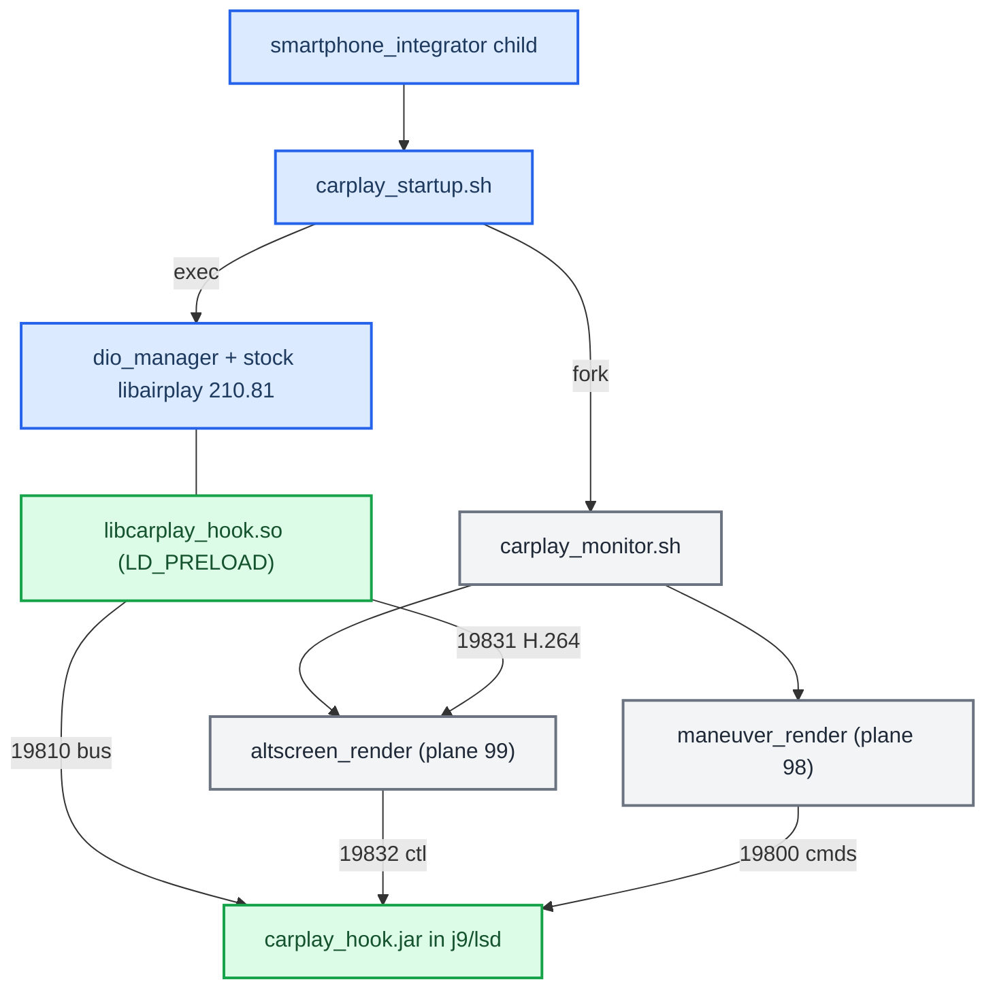

# Architecture

*How the shipping MHI2Q (MU1316) CarPlay mod is put together: stock binaries plus one `LD_PRELOAD` hook, one Java patch jar and two persistent renderers, which stock seams it rides, and who owns which process.*

---

## 📋 The shape of production

Production is **stock `dio_manager` + stock `libairplay.so` 210.81 + `LD_PRELOAD` `libcarplay_hook.so` + the Java patch + two external renderers**. Nothing from the from-source libairplay/dio experiments ships; they were excluded as an authority by the seam audit and live under `Patches/dio_asm_to_c/_legacy_attempt/` (see [[Record Replay Tooling]]). **[code]**

The four ports and their frame formats are in [[Hook to Java Bus]]. The only supported artifacts are the hook `.so` (plus the optional `libcarplay_apac.so`), the jar and the two renderers; variant and probe builds no longer exist ([[Build System]]).

Sources: [[Sources/ARCHITECTURE|ARCHITECTURE]], [[Sources/DEPLOYMENT|DEPLOYMENT]]

## ⚙️ Native hook: a module table over framework seams

`hook/main.c` is only the module table (`hook/main.c:27-35`): `rgd`, `coverart`, `altscreen`, and `audio` when `HOOK_AUDIO=1`. The framework never names a module. It registers the table in order through one `pthread_once` at the **first real Cinemo boundary** (`hook/framework/hook_framework.c:117`, `:582`) and logs one WARN, `lazy runtime init complete (constructor-free; first Cinemo boundary)` (`:608`). It tears the table down in reverse from its destructor. There is no ELF constructor, and the build enforces that ([[Build System]]). **[code]**

Each module declares its needs in one `hook_module_def_t` next to its code (`hook/framework/hook_framework.h:78-99`):

| Field | Seam |
|---|---|
| `on_init` / `on_shutdown` | framework lifecycle, reverse-order teardown |
| `on_identify` | patch the outgoing iAP2 Identify |
| `on_message` + `msg_filter` | incoming iAP2 messages |
| `on_state`, `on_transport_send` | session edges, outgoing transport frames |
| `on_transport_recv` / `_reset` | raw `NmeTransport::Recv` bytes, Identify boundary |
| `airplay.*` | AirPlay SETUP request/response (+final), `/info` (+final), TearDown |

The three AirPlay entry points that more than one module wants (`AirPlayReceiverSessionSetup`, `AirPlayCopyServerInfo`, `AirPlayReceiverSessionTearDown`) are interposed **once**, in `hook/framework/airplay_seams.c`, and fan out to subscribers in priority order. An ELF symbol has one definition per object, so before this the altScreen module owned all three and called the audio module's type-103 negotiation on its behalf. Single-consumer interposers (`SetNightMode`, `AirPlayReceiverServerPlatformCopyProperty`, the QSA writers) stay in the module that uses them. **[code]**

| Module | Priority (`.priority`) | Seams used |
|---|---|---|
| `routeguidance` | normal (`rgd_hook.c:453`) | Identify, 0x52xx messages, state, transport send |
| `coverart` | low (`coverart_hook.c:825`) | transport recv + reset |
| `altscreen` | normal (`altscreen_hook.c:2656`) | AirPlay setup response, `/info`, teardown |
| `audio` | high (`audio_hook.c:9091`) | setup request/response (+final), `/info` (+final), teardown |

The stream-111 H.264 path is self-contained in the hook and forwards Annex-B access units to `altscreen_render` on 19831; stock `libairplay.so` stays installed and loaded. See [[AltScreen Cluster Video]].

Open hardening item **[code]**: `hook_process_is_dio_manager()` still returns *true* when `/proc/self/cmdline` cannot be opened or read (`hook_framework.c:35-45`). The startup script only preloads into dio_manager, so this is dormant, but fail-closed would be safer if an environment regression ever let helpers inherit the hook.

Sources: [[Sources/ARCHITECTURE|ARCHITECTURE]], [[Sources/reference/STOCK_INTEGRATION_SEAM_AUDIT|STOCK_INTEGRATION_SEAM_AUDIT]]

## 🔍 Which stock seams LD_PRELOAD really reaches

The old blanket rule "a library's calls to its own exports always bypass `LD_PRELOAD`" is **false** for this binary. The correct rule: classify **every callsite** as PLT/GOT (interposable) or direct/local (not interposable). A symbol being exported proves nothing; check the exact caller instruction before accepting any new hook target. **[decompile]**

| Seam | Stock implementation | Stock caller | Result |
|---|---|---|---|
| `AirPlayCopyServerInfo` | libairplay `0x22254` | `_requestProcessInfo@0x30034` calls PLT `0x1abb4` / GOT `0xb9910` at `0x301ec` | Interposable even though the caller is libairplay itself; the working `/info` advert seam |
| `AirPlayReceiverSessionSetup` | `0x272b8` | `_requestProcessSetupPlist@0x2f198` calls PLT `0x18c04` / GOT `0xb8e80` at `0x2f79c` | Interposable; why control SETUP and stream-111 SETUP are visible |
| `AirPlayReceiverSessionTearDown` | `0x26b60` | PLT `0x19264` / GOT `0xb90a0`; setup-failure call `0x275fc`; dio imports it too | Interposable |
| `AirPlayReceiverSessionSetNightMode` | `0x28768` | dio `CDSICarPlay_requestNightMode@0x155848`, call at `0x15589c` | Genuine dio→libairplay boundary |
| `CinemoCreateIAP` | libNmeSDK `0x5848c` | dio PLT calls at `0x17d330`, `0x17d360` | Genuine dio→Cinemo boundary |

**Stock SETUP.** `AirPlayReceiverSessionSetup@0x272b8` loops over request `streams` and handles types 100, 101 and 110; type 111 reaches the unsupported branch at `0x27564–0x27580`. So the hook supplies a genuinely absent case, it does not duplicate hidden stock altScreen support. Stock `_ScreenSetup@0x26f9c` keeps one screen object per session (`session+5136/+5140`), derives screen crypto from the 16-byte session key at `session+456`, opens a server socket with QoS 12 and returns `{type:110, dataPort}`; the hook's 111 response has the same shape. **[decompile]**

### Cinemo NME and iAP2 injection ABI

| Stock symbol (libNmeBase) | Address | ABI fact |
|---|---|---|
| `NmeTransport::Recv` | `0x186ff8` | `NmeArray<u8>` = `{data@+0, len@+4, capacity@+8, growth@+12}`; returns 0 on success |
| `NmeTransport::Send` | `0x186e60` | returns 0 on success |
| `NmeIAP2Message::Decode` | `0x120880` | validates the `0x40 0x40` prefix and exact length |
| `NmeIAP2Message::Encode` | `0x11ffe8` | grows the same NmeArray with process-libc `realloc` |

libNmeVfs imports all four through its PLT (Recv `0x12af20`, Send `0x12af70`, Decode `0xe4924`, Encode `0xd834c`, `0xd84f8`, `0xdf49c`, `0xdf888`, `0xdf988`), so they are valid preemption seams. That is why the Identify resize may `realloc` Cinemo's buffer: it matches the stock allocator, and it still checks pointer, length, capacity and an 8192-byte ceiling first (`hook/routeguidance/rgd_hook.c:1516-1581`). **[code]** See the realloc trap in [[Landmines]].

`CinemoCreateIAP@0x5848c` returns an `ICinemoIAP` whose vtable has AddRef `0x9b60c` (slot 0), Release `0x9b620` (`+4`) and SendIAP2 `0x9b748` (`+60`, args `(self, session, data, size)`). The hook captures the object only after the real factory succeeds, keeps a persistent reference and takes a transient reference around every injected `SendIAP2`. The stock outbound frame is sent first; only after a successful stock Send does LocationInfo trigger the separate 0x5200 injection, so LocationInfo is never consumed or used as a carrier. The component-0x001E schema and 0x520x payloads are **operationally** verified on the car, not independently proven from the phone binary. **[decompile]** **[car]**

### iOS 26.6 altScreen addresses

The gate itself is explained in [[AltScreen Cluster Video]]; this table keeps the phone-side addresses the seam audit read (iPhone18,2 build 23G71, `AirPlaySender` + `CarKit`). **[decompile]**

| What | Where |
|---|---|
| Phone reads accepted features from response key `enabledFeatures` | `_apsession_ensureControlStreamSetup@0x22786db80`, lookup `0x22786dd2c` |
| `altScreen` → endpoint `+0x3e`; `uiContext` → `+0x3f`; `viewAreas` → `+0x3d` | `0x2277f977c`, `0x2277f97a8`, `0x2277f97d4` |
| Cluster URL fetch; NULL aborts activation | `APCarPlay_CRFetchInstrumentClusterURLs` at `0x2277f9ff4`, abort `0x2277f9ff8–0x2277fa000`; stored as `altScreenURLs` at `0x2277fa090` |
| All displays used only if count ≥ 2 and `+0x3e` set | `carEndpoint_setupStreams@0x2277ff304`, checks `0x2277ffa9c` / `0x2277ffaac` |
| 110 vs 111 chosen by UUID compare with display 0, not by the `type` field | `APEndpointStreamScreenCreate@0x227850b74`, `CINC` at `0x227850ed8` |
| Physical display needs `widthPixels/heightPixels`, `widthPhysical/heightPhysical`, `uid`, `properties`, `initialVideoStreams` | `CARDisplayInfo initWithPhysicalScreenDictionary@0x1cafbed6c` |
| Gauge-cluster predicate reads `displayPanels` | `CARSessionConfiguration@0x1cafba0dc`, `0x1cafbaf8c`, `0x1cafbb1d8` |
| `forceKeyFrame` reads params key `uuid` | `carEndpoint_handleEventCreatingReply@0x2276d8214`, `0x2276d86a4–0x2276d86bc` |
| `updateViewArea` reads `uuid`, `viewAreaIndex`, `adjacentViewAreas`, `animationDurationMillis` | `carEndpoint_updateViewArea@0x227802b90` |
| Night mode reads optional `uuid` + `nightMode` | `carEndpoint_setNightMode@0x22780305c` |
| 110 and 111 share screen crypto | sender `0x2276e5df8–0x2276e6080`; receiver `AirPlay_DeriveAESKeySHA512ForScreen@0x2d5fc` (labels `AirPlayStreamKey%llu` / `AirPlayStreamIV%llu`) |
| Frame wire: 128-byte header, opcode 0 = AES-CTR body, opcode 1 = clear codec config | stock `AirPlayReceiverSessionScreen_ProcessFrames@0x2b154` |

The HU never provides cluster app URLs; the phone fetches them from its own CarKit over XPC and hands them to the HU. `showUI` and `changeMapZoomLevel` were not traced to their final consumer; car behaviour is the proof for those.

Sources: [[Sources/reference/STOCK_INTEGRATION_SEAM_AUDIT|STOCK_INTEGRATION_SEAM_AUDIT]]

## 📦 Java patch

There is one Java tree, `java_patch/`, compiled against `MU1316-final.jar` as Java 1.4 bytecode ([[Build System]]). `CarPlayApp` keeps the bus transport alive for the process lifetime and runs an **ordered module chain**: `AltScreenModule` (cluster display context, steering-wheel map zoom) first, then `RgdModule` once the first is ready (RGI/BAP maneuver state). Activation and deactivation only record the desired state and wake a daemon lifecycle worker; module start/stop is serialized by `lifecycleLock`, and the general state lock is never held across `Module.start` (that was the cold-boot ABBA deadlock in [[Landmines]]). Deactivation is debounced 400 ms (`java_patch/com/luka/carplay/core/CarPlayApp.java:230`). **[code]** Details of the context state machine are in [[Cluster Contexts]] and [[Reconnect and Lifecycle]].

The tree has 41 sources: 27 new classes under `com/luka/carplay/` and 14 files that replace or extend stock classes (`ClusterService`, `AltScreenCombiBAPListener`, `DisplayManagerMIB2High`, `CombiMapController`, `TerminalModeBapCombi`, `CarplayDSILifecycleController`, `ExternalEventsListener`, `HighPriorityResourceTracker`, `AppConnectorTerminalMode` + `$CoverArtProvider` + `CoverArtProviderMux`, `ParkingPartialPopupHandler`, `ParkingSystemControllerComponentEvo`, `PartialPopupManagerEvoHigh`, `AudioDrawerContextImpl`). **[code]** The pure OPS parking popup `2100008` has a narrow `SMALL_STAGE` exception: CarPlay keeps `Resource.SCREEN`, while every other HMI deactivation and fullscreen camera takeover stays stock (`java_patch/de/audi/app/terminalmode/ExternalEventsListener.java:39`, `PartialPopupManagerEvoHigh.java:53`).

### Cluster composition

On non-G24 clusters (`kombiType != 4`) the patched DisplayManager declares two contexts (`java_patch/de/audi/tghu/fwhmi/DisplayManagerMIB2High.java:170-179`) **[code]**:

| Context | Displayables | Meaning |
|---|---|---|
| 80 | `98, 101, 102, 99` | CarPlay map plus maneuver (98) over the two stock KDK backings |
| 81 | `99` | plain CarPlay map |

98 belongs to `maneuver_render`, 99 to `altscreen_render`. `AltScreenModule` is the single writer of context changes ([[Cluster Contexts]]).

**Context 90 is deliberately not declared here.** It was briefly, for RetroArch, and was removed: `DisplayManagerMIB2High` is a patched stock class carried only by `carplay_hook.jar`, so RetroArch would have silently depended on this repo. RetroArch owns context 90 from its own repository (`luka-dev/audi-mib2q-retroarch`) by extending the table at runtime, the way its `RuntimeSmmInjector` already extends the state machine.

### Two deliberate policies that exceed the stock contract

- **Strong terminal-1 context ownership.** While `AltScreenModule.isConnected()` is true, `DisplayManagerMIB2High.switchContext` rejects every terminal-1 physical context write except the AltScreen worker's own (`DisplayManagerMIB2High.java:307`). `isConnected` is `connected || videoAvailable`, so it can also block a legitimate stock transition while video is recovering. Treat it as product policy and check warning/safety screens on the car. **[code]** **[open]**
- **Hidden map-scale sentinel.** `GatedCombiService` publishes `updateMapScale(15, false, 0xFFFF, 0xFF, false)` and a hidden altitude sentinel (`java_patch/com/luka/carplay/rgd/GatedCombiService.java:98`). Stock `CombiBAPListener.setMapScaleSetting` changes native map setup; the emitted hidden status does not. So the historical "Navigation currently unavailable" flashes during wheel zoom cannot be pinned on the sentinel from code alone. **[code]**

Sources: [[Sources/ARCHITECTURE|ARCHITECTURE]], [[Sources/reference/STOCK_INTEGRATION_SEAM_AUDIT|STOCK_INTEGRATION_SEAM_AUDIT]]

## 🔄 Process ownership

| Process | Owner | Rule |
|---|---|---|
| `carplay_startup.sh` | smartphone_integrator child | Writes its generation to the owner file atomically (stage file + `mv`, `deploy/smartphone_integrator/carplay_startup.sh:40-42`), forks the monitor with `LD_PRELOAD=` cleared (`:45`), exports `LD_PRELOAD` (`:50`) and `exec`s `dio_manager` (`:95`) so SI keeps the exact PID for its watchdog |
| `carplay_monitor.sh` | its own generation | Acts only while the owner file holds its dio PID and that PID is alive; waits 1 s before any `pidin`/EGL work so dio's 10 s SI startup budget is untouched; starts or adopts `altscreen_render` then `maneuver_render`; re-checks every 2 s; caps logs every 150 ticks (`carplay_monitor.sh:108-130`) |
| Renderers | the generation monitor | Launched with `LD_PRELOAD=` and `GRAPHICS_ROOT=/proc/boot` (`carplay_monitor.sh:93`). When dio exits the monitor **leaves them running** for the next generation to adopt. Never add them as `servicemgr external:true` services |
| `carplay_cleanup.sh` | SI `cleanupScript` | Does not know which generation it serves, so it only runs Audi's stock `/etc/scripts/carplay_cleanup.sh` for mdnsd/PPS (`carplay_cleanup.sh:21`); never overwrite that stock script |

The SI child is `deploy/smartphone_integrator/carplay_child.json`: keep `IPL_CONFIG_DIR_DIO_MANAGER=/etc/eso/production` in its env and keep `LD_PRELOAD` out of it; `restartDelay` is `3000` (`carplay_child.json:20`). **[code]**

Superseded: the seam audit's "zero scheduling margin" finding (old monitor waited 2 s, equal to a 2 s restart delay, then stopped renderers the new generation meant to adopt) no longer applies. The current monitor never stops renderers on exit and `restartDelay` is 3000 ms. **[code]**

Sources: [[Sources/DEPLOYMENT|DEPLOYMENT]], [[Sources/reference/STOCK_INTEGRATION_SEAM_AUDIT|STOCK_INTEGRATION_SEAM_AUDIT]]

## ✅ Release verification matrix (seam audit)

The seam audit (2026-08-11) confirmed the altScreen protocol and rendering, the hook ABI against MU1316 stock, and the Java outer-class ABI. It listed these focused on-car checks; status against today's code:

| Check | Status |
|---|---|
| Cold boot with phone connected: no worker/log activity before the first NME callback | Closed in code: constructor-free lazy init, enforced by the `.init_array` assert **[code]** |
| 20 quick replugs: no SETUP delay near 1.8 s | Closed in code: the same-slot reaper wait is gone; a new SETUP retires old generations and fails fast if all four slots are retiring (see [[Production Audits]]) **[code]** |
| Cold OMX start under socket pressure: no false disconnect at the 1000 ms send-stall limit | Still open: `AV_SEND_STALL_LIMIT_MS 1000L` (`hook/altscreen/altscreen_av.c:35`) **[open]** |
| Kill dio at the restart boundary: old monitor must not kill adopted renderers | Closed in code (see above) **[code]** |
| Forced EGL swap / plane-disown failures: VIDEO_OFF only after real failures | **[open]** on the car |
| Context guard does not hide cluster warnings while 111 is down | **[open]** |
| Only the intended interposes exported | Closed: exact allowlist, 26 in a quiet audio build ([[Build System]]) **[code]** |

---

## 📚 Sources

- [[Sources/ARCHITECTURE|ARCHITECTURE]]: the shipping-architecture summary (topology, module seams, Java chain, contexts, ports).
- [[Sources/DEPLOYMENT|DEPLOYMENT]]: SI child, process ownership, install/uninstall steps.
- [[Sources/reference/STOCK_INTEGRATION_SEAM_AUDIT|STOCK_INTEGRATION_SEAM_AUDIT]]: 2026-08-11 audit of every stock seam, Cinemo ABI, the iOS 26.6 contract, reconnect and supervisor risks.

See also [[Hook to Java Bus]], [[Build System]], [[Deploy and Release]], [[Production Audits]], [[AltScreen Cluster Video]], [[Cluster Contexts]], [[Home]], [[Landmines]].
