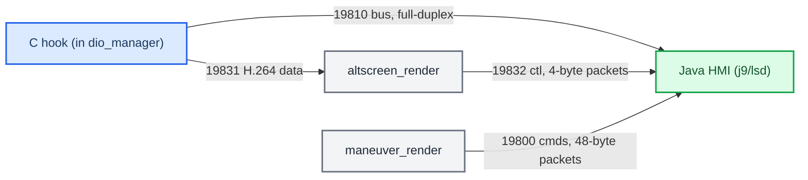
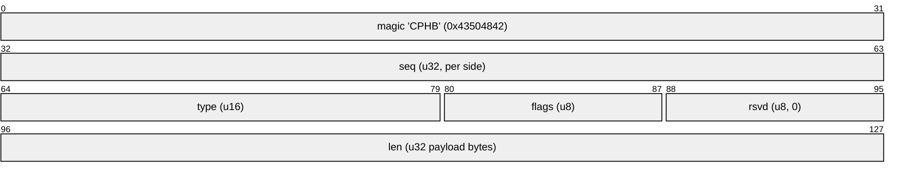

# Hook to Java Bus

*How the C hook, the Java HMI and the two renderers talk: a full-duplex TCP bus on 127.0.0.1:19810 plus three loopback renderer channels. PPS is gone.*

---

## 📋 What this is

The C hook (inside dio_manager) and the Java patch (inside j9/lsd) exchange route-guidance state, cluster commands and cover-art over **TCP loopback**, not PPS. The two renderer processes use their own TCP channels for pixels and control. This note is the wire map; for the semantics it carries see [[RGI and BAP Bridge]] (route guidance / BAP) and [[AltScreen Cluster Video]] (video). For the traps around TCP framing see [[Landmines]].

Provenance: `hook/framework/bus_protocol.h`, `hook/framework/bus.c`, `java_patch/com/luka/carplay/bus/CarplayBus.java`, `hook/routeguidance/rgd_hook.c`, `altscreen_render/protocol.h`, `maneuver_render/protocol.h`, `MEMORY.md` §"Hook→Java bus". Truth tags: **[code]** read in the current tree, **[car]** confirmed live, **[open]** unverified.

---

## 🌐 Topology

*Loopback TCP fabric: Java is the long-lived server on the control bus and on both renderer side-channels; altscreen_render is the server only for the video data the hook pushes to it.*

Arrows point from the connecting client to the listening server; traffic on every channel flows both ways unless noted.

| Channel | Port | Client → server | Payload | Evidence |
|---|---|---|---|---|
| Control bus | `127.0.0.1:19810` | hook → Java | RGI state, cover-art, cluster commands (full-duplex) | `bus_protocol.h:7,59`; `CarplayBus.java:34` **[code]** |
| AltScreen data | `127.0.0.1:19831` | hook → altscreen_render | Cluster stream-111 H.264, `[u32 BE len][AU]` | `altscreen_av.h:25-27`; `altscreen_render/protocol.h:24` **[code]** |
| AltScreen ctl | `127.0.0.1:19832` | altscreen_render → Java | Fixed 4-byte packets: `VIDEO_ON`/`VIDEO_OFF` up, `VIEW_AREA` down | `altscreen_render/protocol.h:30-43`; `AltscreenControlServer.java:32` **[code]** |
| Maneuver renderer | `127.0.0.1:19800` | maneuver_render → Java | Fixed 48-byte command packets; renderer heartbeat up | `maneuver_render/protocol.h:4,15`; `RendererServer.java:2,44` **[code]** |

Correction to the earlier version of this note: the hook does **not** talk to `maneuver_render`, and it is not an endpoint of 19832 — the renderers are clients of Java on 19800 and 19832. Renderers are persistent services started by the supervisor (`deploy/smartphone_integrator/carplay_monitor.sh:85-95`); Java only listens, it never spawns or kills them (see [[Landmines]]).

---

## ⚙️ Wire format and sticky state

Every control-bus message is one frame with a 16-byte big-endian header (`hook/framework/bus_protocol.h:9-19,59-62`) **[code]**:

*Control-bus frame header, 16 bytes, followed by 0..128 KB of payload.*

Payload defaults to text `key:type:value\n` lines; `BUS_FLAG_BINARY` (0x02) marks a packed struct. Event types (hook → Java) sit in `0x0000–0x00FF` — e.g. `EVT_COVERART 0x0010`, `EVT_RGD_UPDATE 0x0020`; commands (Java → hook) in `0x0100–0x01FF` — `CMD_SYNC_REQ 0x0100`, `CMD_PING 0x0101`, the altScreen set from `0x0110` (`bus_protocol.h:71-110`) **[code]**.

**Sticky replay is the reconnect mechanism.** A frame sent with `BUS_FLAG_STICKY` (0x01) is cached by the hook, one slot per type (`hook/framework/bus.c:374`). On connect the hook sends HELLO + the sticky snapshot; Java can also send `CMD_SYNC_REQ` after registering its listeners, and the hook replays every cached frame between `EVT_SYNC_BEGIN`/`EVT_SYNC_END` with `BUS_FLAG_REPLAY` set (`bus.c:12-14,406-441,574-582`) **[code]**. The protocol header still says "server caches"; in the current topology the caching side is the hook, which is the TCP client (`bus.c:6-10`).

**Keep `write_bus_snapshot_from_cache`.** It builds one `EVT_RGD_UPDATE` carrying route state, the maneuver list and slot data, sent sticky, so Java sees a coherent full state atomically rather than a delta history (`hook/routeguidance/rgd_hook.c:146,464-483,1179`) **[code]**. The old PPS delta-drop problem doesn't exist on TCP; the snapshot exists for coherence and reconnect, not packet loss.

**Cluster commands ride the same bus.** `CMD_ALT_ZOOM` is live at `0x0110` (`bus_protocol.h:92`, `CarplayBus.java:54`, handler `zoom_on_cmd` registered at `hook/altscreen/altscreen_hook.c:2635`); `CMD_ALT_ZONE 0x0111`, `CMD_ALT_ZONE_ACK 0x0112`, `CMD_ALT_APPEARANCE 0x0114`, `CMD_ALT_UICTX 0x0115`, `CMD_ALT_RGI 0x0116` follow. `CMD_ALT_HID` / `CMD_KNOB` do not exist (a stale comment in `bus.c:548` still names `CMD_KNOB`) — the cluster has no HID path; all cluster commands are BAP/semantic. **[code]**

---

## ⚠️ Framing landmine

**Keep `TCP_NODELAY` on every loopback socket, above all hook → altscreen_render.** The hook writes each video frame as two records, `[u32 BE len]` then the access unit (`hook/altscreen/altscreen_av.c:222-250`). With Nagle on, the sub-MSS access unit waited out the delayed-ACK timer behind the unacked header → cluster rubber-banding (48 → 34 ms after the fix) **[car]**. `TCP_NODELAY` is set at `altscreen_av.c:135-142`, and also on the bus (`bus.c:507`), `altscreen_render/main.c:441`, `altscreen_render/altctl.c:34` and `maneuver_render/server.c:133` **[code]**. Don't probe Nagle behaviour on macOS — QNX runs an old NetBSD stack. · `memory/altscreen_delivery_nagle.md`. See [[AltScreen Cluster Video]].

---

## 🔗 See also

- [[RGI and BAP Bridge]] — what the route-guidance messages mean once Java has them.
- [[AltScreen Cluster Video]] — the renderer channels and the video pipeline.
- [[HUD Renderer]] — the maneuver renderer on :19800.
- [[Home]] · [[Landmines]].
