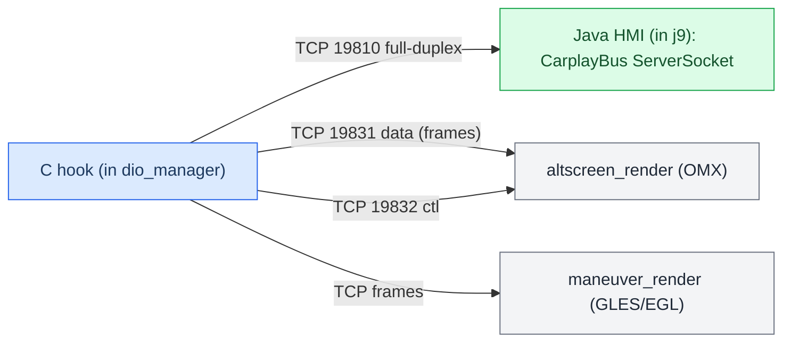

# Hook to Java Bus

*How the C hook and the Java HMI talk: a full-duplex TCP bus on 127.0.0.1:19810, plus the two renderer channels. PPS is gone.*

---

## 📋 What this is

The C hook (inside dio_manager) and the Java patch (inside j9) exchange route-guidance state, cluster commands and cover-art over **TCP loopback**, not PPS. Two renderer processes take their own TCP channels for pixels and control. This note is the wire map; for the semantics it carries see [[RGI and BAP Bridge]] (route guidance / BAP) and [[AltScreen Cluster Video]] (video). For the traps around TCP framing see [[Landmines]].

Provenance: `MEMORY.md` §"Hook→Java bus"; `hook/framework/bus.c` ↔ `com/luka/carplay/bus/CarplayBus.java`; `hook/routeguidance/rgd_hook.c`; `bus_protocol.h`. Truth tags: **[car]** confirmed live, **[decompile]** RE, **[open]** unverified.

---

## 🌐 Topology

*Loopback TCP fabric: one control bus plus two renderer channels; the hook is a client on all of them, the Java HMI is the server on the control bus.*

| Channel | Endpoint | Direction | Payload |
|---|---|---|---|
| Control bus | `127.0.0.1:19810` | Full-duplex | RGI state, cluster commands, cover-art metadata |
| AltScreen data | `127.0.0.1:19831` | Hook → renderer | Cluster video frames (`[len][frame]`) |
| AltScreen ctl | `127.0.0.1:19832` | Hook ↔ renderer | Renderer control / geometry |
| maneuver_render | TCP | Hook → renderer | Maneuver graphics frames |

Roles are fixed: the **hook is the client**, the **Java side is the `ServerSocket`**. Renderers are always-on framework services — the Java side only connects/reconnects, it never spawns or kills them (see [[Landmines]]).

---

## ⚙️ Wire format and the snapshot rule

The control bus carries **framed messages**. One framed message is a coherent full-state snapshot — `write_bus_snapshot_from_cache` in `rgd_hook.c` builds it and it must stay: it lets a late-connecting or reconnecting Java side recover full state from a single frame rather than replaying a delta history. **[car]**

**PPS delta-drop is a non-issue on TCP.** The old PPS transport could drop intermediate updates; TCP is a reliable ordered stream, so the framing itself guarantees delivery. Do not remove the snapshot builder on the theory that "TCP won't drop" — the snapshot solves *reconnection* state, not packet loss. **[car]**

Cluster commands ride the same bus. `CMD_ALT_ZOOM` is live at `0x0110` (`bus_protocol.h:93`, `CarplayBus.java:52`, handler `zoom_on_cmd`); `CMD_ALT_HID` / `CMD_KNOB` do not exist — the cluster has no HID path, all cluster commands are BAP/semantic. **[decompile]** · corrected by audit 9295b04.

---

## ⚠️ Framing landmine

**Set `TCP_NODELAY` on the hook→renderer socket, and never send `[len][frame]` as two writes.** Two records on a Nagle socket held the sub-MSS length prefix until the frame's ACK → cluster video rubber-banding (48→34 ms after the fix). Coalesce the length and frame into one write. Do not probe Nagle behaviour on macOS — QNX runs an old NetBSD stack that behaves differently. **[car]** · `memory/altscreen_delivery_nagle.md`. See [[AltScreen Cluster Video]].

---

## 🔗 See also

- [[RGI and BAP Bridge]] — what the route-guidance messages mean once Java has them.
- [[AltScreen Cluster Video]] — the renderer channels and the video pipeline.
- [[Home]] · [[Landmines]].
