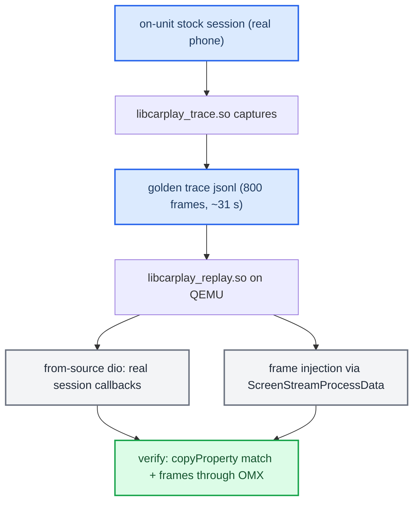

# Record Replay Tooling

*Capture a real on-unit CarPlay session, replay it into the from-source stack on QEMU with no phone — and what that does and does not prove about from-source vs stock parity.*

---

## 📋 What this is

The record/replay tooling (now in `logs/trace/`, formerly `c_hook_trace/`) records a live CarPlay session on the head unit (LD_PRELOAD over stock libs) and replays it into from-source `dio_manager` on QEMU, driving the real session callbacks with **no phone attached**. Proven end-to-end 2026-07-16. It exists to validate the from-source libairplay/dio rebuild against stock without a car. The honest ceiling: **dynamic parity is proven only on the video path**; audio, Siri, HID and full RTSP are static-only. Production does not use the from-source stack: it runs stock 210 binaries plus the LD_PRELOAD hook, and the from-source libairplay tree now sits under `Patches/dio_asm_to_c/_legacy_attempt/libairplay-mhi2q/`. For the audio path the replay does not exercise see [[iOS CarPlay Spatial Wireformat]].

Provenance: `memory/carplay_record_replay.md`, `memory/libairplay_functional_parity.md`, `logs/trace/README.md`, `logs/trace/REPLAY.md`, `Patches/dio_asm_to_c/_legacy_attempt/libairplay-mhi2q/FUNCTIONAL_PARITY.md` (outside this repo, under the `AUDI_2` tree), QEMU harness `Tools/qnx-carplay-emu/carplay/` (same). Truth tags: **[car]** captured on the unit, **[qemu]** proven in emulation, **[code]** read in the current tree, **[open]** needs the unit or a missing artefact.

---

## ⚙️ The two halves

| Piece | Builds | Runs where | Job |
|---|---|---|---|
| `logs/trace/carplay_trace.c` | `libcarplay_trace.so` | On-unit, LD_PRELOAD | Capture the session to `/tmp/carplay_<pid>.jsonl` (`carplay_trace.c:573-575`) **[code]** |
| `logs/trace/replay.c` | `libcarplay_replay.so` | QEMU, LD_PRELOAD into from-source dio | Replay the jsonl callbacks in sequence with ts pacing |

Capture records three boundaries: **L1 wire** (sockets, ciphertext reference — default OFF), **L2 lifecycle** (server delegate callbacks: copyProperty / sessionCreated / sessionScreenCreated / audioType / teardown), and **L2-media** (decoded frames via exported interpose: `ScreenStreamProcessData` → `cb.screenFrame`). Replay interposes `AirPlayReceiverServerCreate` + `ServerSetDelegate` to grab dio's real server, context and delegate table, then a driver thread replays the callbacks. **[car]**

---

## 🔍 The record → replay flow

The golden trace is `carplay_session_stable.jsonl` (25 MB, 800 frames = ~31 s live CarPlay @26 fps, clean teardown −6753, no crash; `logs/trace/REPLAY.md:11,435`). The file itself is not in this repo or anywhere under `AUDI_2` — [open] where it is archived. Incremental bring-up ran three configs, each 5/5 with identical observables: **stock dio + stock libairplay** → **stock dio + from-source libairplay** → **full from-source**. Result: 21/21 copyProperty byte-exact (incl bluetoothIDs), `ScreenStreamStart` EXECUTING, 391/391 frames through `OMX_EmptyThisBuffer`, 0 SIGSEGV. **[qemu]**

---

## ⚠️ Stability traps (the hook must not disrupt the live session)

All three were real, found by iterative on-unit capture:

1. **Only wrap delegate slots whose exact signature/return is known.** Wrapping the audio slots 8 (audioType) / 9 (waitAudioAvailableAck) with a guessed `void(int,void*)` trampoline corrupted audio negotiation → deterministic session death ~1 s in (the root −6722). Fix: pass slots 8/9 through unchanged; wrap only 3=copyProperty / 5=sessionCreated / 6=failed / 7=screenCreated. **[car]** Still enforced: `logs/trace/carplay_trace.c:164-166,343-361` **[code]**.
2. **Keep capture off the hot threads.** Full-hex L1 wire capture on the network threads → black screen; `PROBE_WIRE` default OFF (`logs/trace/carplay_trace.c:64,581`). An async writer drains a bounded drop-queue so `write()` + long locks never touch the real-time threads.
3. **Headless video needs `NVSS_VIDEO_OUTPUT_DEVICE=1`.** `OmxVideoImpl::configure` returns −6736 if unset — this, not platformLayer, was the headless blocker (`logs/trace/REPLAY.md:391-399`).

---

## 📊 Functional parity: proven vs unvalidated

Static parity of from-source `libairplay.dev.so` (SDK 280.33.8 + altScreen) vs stock MU1316 (210.81) is **strong**; dynamic parity is narrow.

| Surface | Status |
|---|---|
| Export set (58/58 dio-imported syms present) | Static ✅ **strong** |
| `/info` builder byte-identical to pristine SDK | Static ✅ |
| Video mirror path (setup → copyProperty → H.264 → teardown) | Dynamic ✅ replay-proven **[qemu]** |
| Audio / PCM-ALSA, Siri, HID, mode/night/limitedUI | ❌ **unvalidated** |
| Full RTSP verbs beyond setup/teardown, error injection | ❌ **unvalidated** |
| Live altScreen stream-111, on-unit OMX + i2c-MFi | ❌ **unvalidated** |
| `/info` features bitmask byte-diff | ❌ not captured |

**Inherent version delta:** from-source = SDK **280.33.8**, stock = **210.81** — ours is newer. This surfaced as real drop-in defects, all root-caused on-unit: an unresolved `g_message` (glib) from added 280 debug traces (fixed with a glib-free stub), a DT_NEEDED gap (fixed by linking the real platform libs), SDK placeholder paths (`/dev/i2c99`→`/dev/i2c8`, `~/Library/Keychains` tilde via getpwuid), and 280-only copyProperty keys (`extendedFeatures`, `oemIcons`, `VehicleInformation`) that dio-210 wraps NULL-unsafe in `UnicodeString8` → SIGSEGV. The **210-clamp** made the 280 source behave like stock-210 on every dio/phone-facing surface. On-unit the iAP2 Identify + MFi Auth now complete. **[car]** · `memory/libairplay_functional_parity.md`.

---

## 💡 Bottom line

From-source is functionally identical to stock on dio's entire used surface and all Apple-280-shared paths (static, by construction) plus the video-mirror path (dynamic, replay-proven); it adds altScreen and carries the inherent 210→280 base-version delta. To close "identical в целом" needs diverse on-unit captures (working audio, Siri, apps, error paths), a byte-captured stock `/info`, and the on-unit smoke test — QEMU validates frame *delivery*, not pixels. **[open]**

---

## 🔗 See also

- [[iOS CarPlay Spatial Wireformat]] — the PCM-only audio path the replay harness does not exercise.
- [[Home]] · [[Landmines]] — the QNX/build traps this tooling works around.
