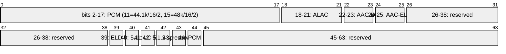
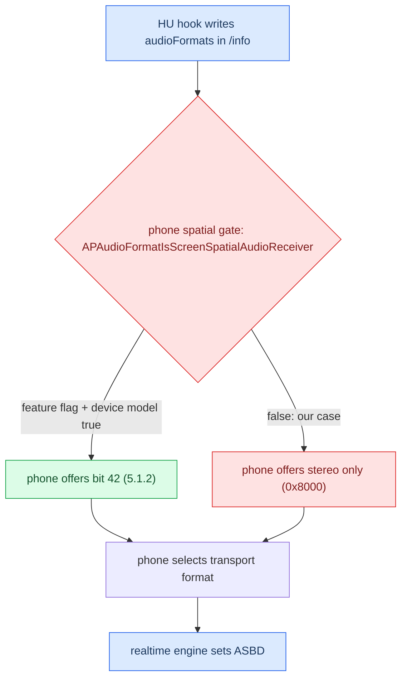

# iOS CarPlay Spatial Wireformat

*What CarPlay/AirPlay audio actually looks like on the wire: two streams, the format-mask bits, why Atmos is not Dolby on the link, and why the codec authority is the inline cookie — not any index.*

---

## 📋 What this settles

CarPlay audio was re-litigated for months. The RE below closes it: there are **two** audio streams, "spatial" on the realtime one is **AAC-LC 5.1.2** (a single format bit, 42), Atmos is a *content* tier not a transport, and the multichannel gate is entirely phone-side. Our own stack is genuinely PCM-only. For the surround target that we actually ship see [[Discrete 5.1 Routing]]; for what Atmos means here see [[Dolby Atmos]].

Provenance: `docs/reference/AUDIO.md §9-27`, `memory/carplay_spatial_atmos_wireformat.md`, `memory/apap_no_format_index.md`, `memory/audio_210_pcm_passthrough.md`. Truth tags: **[decompile]** = iOS 27 / libairplay RE, **[car]** = confirmed on the unit, **[open]** = unverified.

---

## 🌐 The two audio streams

`AirPlaySender` parses two `/info` keys and they carry different worlds.

| Stream | `/info` key | Type | Content | Who publishes it |
|---|---|---|---|---|
| Realtime | `audioOutputFormats` | 100 | PCM only, 48 kHz — the classic mirror stream | Our libairplay **[car]** |
| Buffered | `audioOutputFormatsExtended` | 103 | AAC-LC / ALAC / APAC music, lossless, spatial | Never published by us **[decompile]** |

The realtime path (type 100) is **ASBD-based, not bitmask-based**: `APAudioFormatSelectorRealTimeCreate@0x251049A1C` copies whole 40-byte ASBDs out of a `kSupportedPCMFormats` list, and `realTimeAudioEngine_setTransportAudioFormatInternal@0x2510431C8` takes an ASBD pointer. Channel count is just a field — no codec ladder. The buffered path (type 103) is where lossless/spatial/Atmos live; `airPlayDescription_copyCarPlayAudioFormatsExtended@0x25109C5DC` queries it behind a feature flag and publishes under key `"bufferStream"`. Volvo EX90 gets spatial because it implements the buffered stream. **[decompile]**

---

## 📊 The format mask bits

*The AirPlay audio-format bitmask, decoded from OUR libairplay `AirPlayAudioFormatToASBD@0x2bda0` literals (cross-check PASS) and iOS 27 AirPlaySupport log strings.*

Key readings **[decompile]**:

- **Bit 42 is the spatial delta.** `APAudioFormatGetSupportedTransportAudioFormatsForScreenReceiver` returns `0x1440800` (stereo AAC) and, when spatial is allowed, `0x40001440800` — the difference is exactly bit 42 = `AAC_LC/48000/5.1.2`.
- Bits 39/41 = "AAC-ELD/AAC-LC 48k **5.1**"; bits 40/42 = the **5.1.2** height variants.
- Bit 44 = `PCM/48000/16/5.1` — for *buffered* receivers (HomePod-class), never offered to CarPlay realtime.
- APAC (type 103) indices 64–92 are **extended-only**: `APAudioFormatIndexToAPAudioFormat` returns `1<<index` only below 64, so no APAC index has a legacy mask bit. 64 = APAC stereo, 65 = APAC 5.1. **[decompile]**

---

## 🔐 The codec authority: the inline magic cookie

Three keys announce a buffered (type 103) format; **only the inline magic cookie (TLV 18) is authoritative.** Apple changes codec inside one live session and every packet carries the cookie for the format it is in (AAC 39 bytes, APAC 33 bytes). **[car]**

| Field | What it is | Authority |
|---|---|---|
| TLV 18 — inline magic cookie | Per-packet decoder descriptor | **Decoder authority** — pick the decoder from this |
| TLV 2 — format index | 23 for AAC-LC, 65 for APAC | Advisory hint only |
| TLV 8 — `spf` | 1024 in both sessions | Never an index |
| SETUP index | Initial negotiated index | Initial hint only; never changes across a codec switch |

**The landmine:** reading TLV 8 (or TLV 2, pre-fix) as the live index overwrote the negotiated index on the first packet and **muted every non-Atmos track**. Rule: switch decoders on the cookie, drop an unsupported index hint, never tear down a working decoder. Downstream `spa_select_decoded_pcm_action` keys on none of them — it classifies the *decoded* PCM (codec_is_apac + channels/rate/layout). **[car]** · `memory/apap_no_format_index.md`.

---

## ⚙️ Format negotiation flow

**Tested live, both bits refused.** With the full rig on the unit (patched deva 6 voices + frag/buf, new hook, `SPATIAL_5_1=1`): bit 44 offered `0x100000008010` → phone chose `0x8000` (stereo); bit 42 offered `0x40000008010` → phone chose `0x8000` (stereo). Interposition provably works — the augmented mask reached negotiation — but **advertising is not sufficient**: iOS just doesn't pick multichannel on the realtime stream. The gate `APAudioFormatIsScreenSpatialAudioReceiver` is feature-flag + device-model only and never reads the accessory declaration. The gap is entirely phone-side. **[car]** · `memory/carplay_spatial_atmos_wireformat.md §25`.

---

## 💡 Atmos, PCM passthrough, and the 6-channel ceiling

**Atmos is a content brand, not a transport.** No EC3/DDPLUS bit is in the CarPlay screen-receiver mask; declaring `dolbyAtmosAudioSupported` (wire key `DCXEnabled`) will not make the phone send EC3. On the phone, `itemfig_isAtmosSupported` → HLS alternate selection fetches the Atmos rendition, and the phone renders it *into* whatever the route provides. Atmos = source tier; AAC 5.1.2 = wire. **[decompile]** See [[Dolby Atmos]].

**Our stack is genuinely PCM-only.** 210 libairplay never decodes AAC: `AudioConverterNew_compat@0x3ddf0` is a dead stub returning −6735, `ToASBD` rejects every ALAC/AAC bit, output is ALSA (OMX is video-only). Live measurement confirmed the realtime main stream as `lpcm | Ch=2 | SR=48000 | BPS=16`, type 100, on `mpl5_dio_ent`. Do **not** add in-lib AAC/OMX/FDK decode — that diverges from stock. **[car]** · `memory/audio_210_pcm_passthrough.md`.

**6 is a hard ceiling — the 8→6 fold is mandatory.** `deva_mib2_channel_map` switches on {1,2,3,6} only, `deva_csd_start_csd_session_playback` hardcodes 6, and the amp declares positions 7/8 as BCL/BCR with no height codes → 7.1.4 TopSide folds into the rears. deva's stream map `01 02 03 06 08 09` = Apple canonical `L R C LFE Ls Rs`, so no reorder is needed. **[car]**

Deep detail — the levers, and why the cheap one is exhausted

- **Two CarKit capability levers** (`-[CARSessionConfiguration initWithSessionStatusOptions:propertySupplier:]@0x1C2008F7C`): `dolbyAtmosAudioSupported` ← CFString key `DCXEnabled` (a plain Bool we declare, ivar +0x16); `spatialAudioSupported` ← derived by scanning the `audioFormats` array (ivar +0x15), not a flag. **[decompile]**
- **Amp side is settled at discrete 5.1.** B&O 3D Advanced is already a 5.1 renderer (16 MOST channels, 19 speakers, Symphoria upmix). Today the HU sends stereo and the amp upmixes; the win is to replace a synthetic upmix of a stereo downmix with the phone's real discrete 5.1. 5.1.2 is impossible — no height source over MOST on B9. Ideal wire format = **PCM 48k/16/6ch (bit 44)**, native end to end. **[decompile]**
- **Vehicle closure (2026-09-03):** discrete 5.1 now works end to end. Two final faults were both metadata announcing something other than the stream that existed — the SAD header announced 2ch while 6 PCM slots were present (fixed by sending the 6ch SAD/ASAD, `asad=0xfc`), and a blanked `updateFeedback` removed the sender clock reference (fixed by preserving the stock response). **[car]** · `docs/reference/AUDIO.md §27`.

---

## 🔗 See also

- [[Discrete 5.1 Routing]] — the shipping surround path this wireformat feeds.
- [[Dolby Atmos]] — content tier vs transport, and the phone-side block.
- [[Home]] · [[Landmines]] — the spatial/codec traps distilled.
