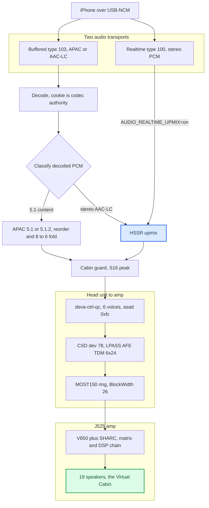
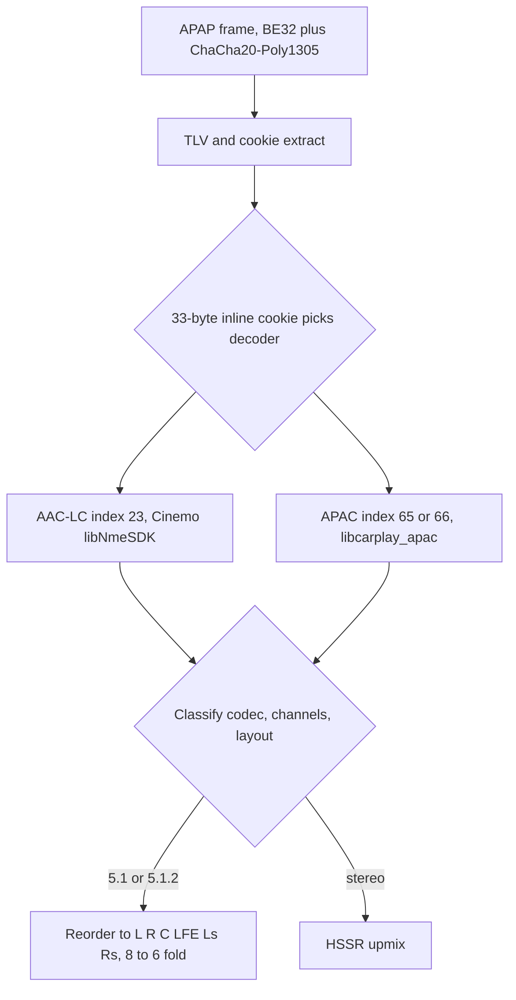
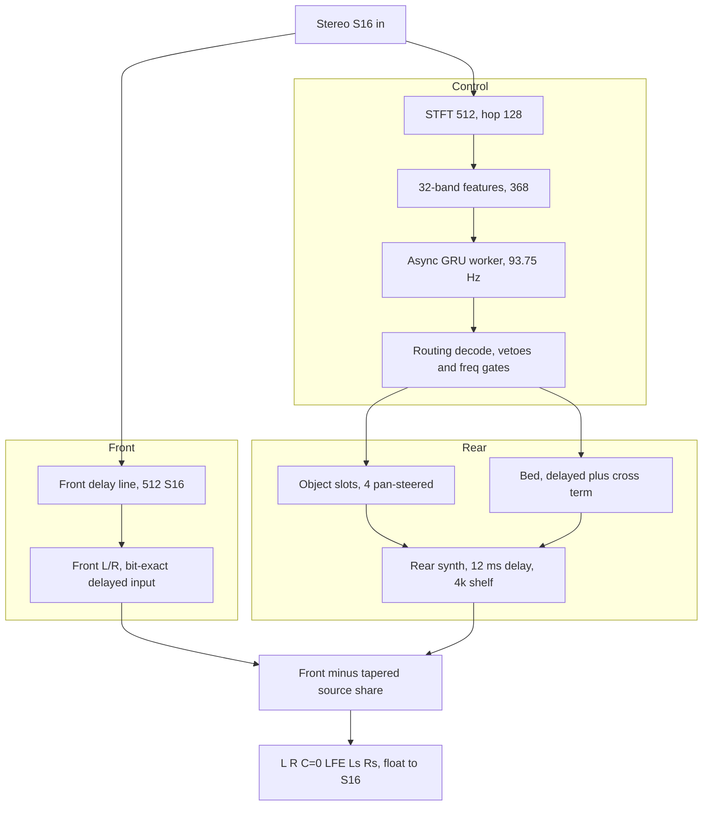
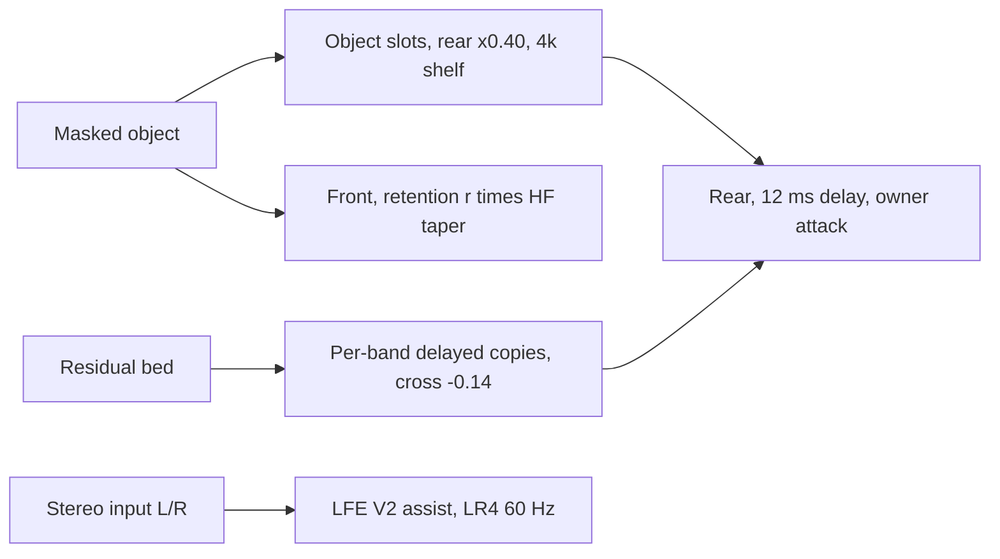
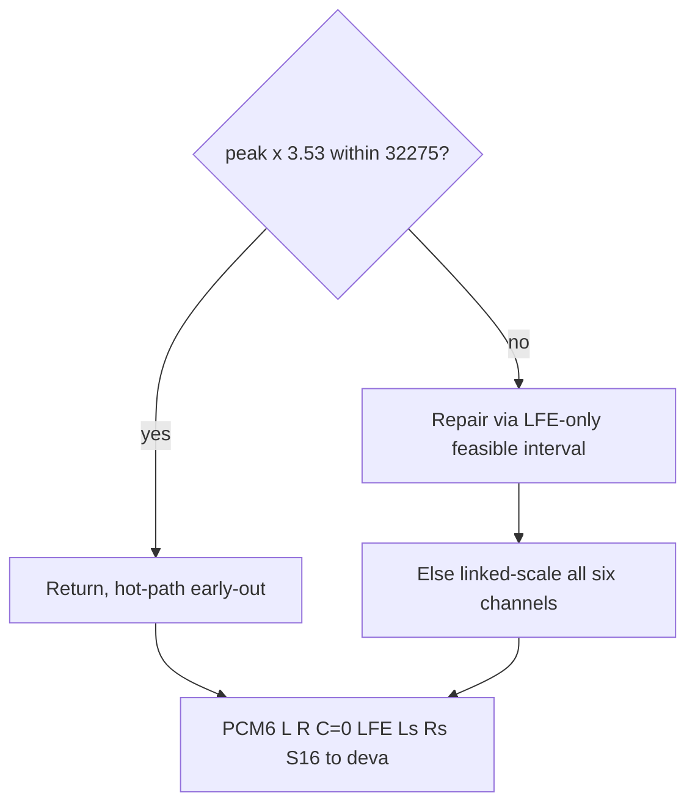
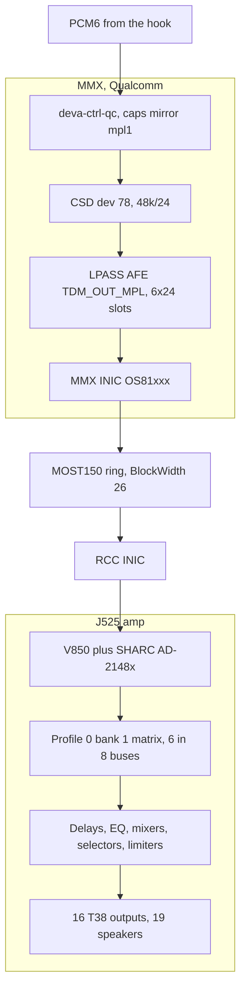

# UPMIX — the whole stereo→5.1 pipeline, end to end

*The master map from the phone's audio to the 19 speakers, every stage with a diagram; the deep detail lives in three companion papers.*

---

This paper ties the companion papers together:

- **The AI** → [HSSR_UPMIX_MODEL.md](HSSR_UPMIX_MODEL.md)
- **The amp / Virtual Cabin** → [VIRTUAL_CABIN.md](VIRTUAL_CABIN.md)
- **Dolby Atmos teardown** → [DOLBY_ATMOS_TEARDOWN.md](DOLBY_ATMOS_TEARDOWN.md)
- **Traps** → [LANDMINES.md](../Landmines.md)

> Truth levels are marked **[car]** (confirmed on the unit), **[model]** (offline
> render / static RE), **[open]** (unverified). Code-state claims cite `path:line`
> against the current tree; the code is ground truth for what the hook does.

## 🔍 The big picture

Two things had to be built: **get the right six PCM channels**, and **synthesize
them for stereo content**. The amp (J525 B&O) is a complete 5.1 renderer — the
"Virtual Cabin" — so the head unit only feeds it `L R C LFE Ls Rs` and lets it do
the acoustics.

Discrete 5.1 bypasses the upmix; the upmix output is `[ L R C=0 LFE Ls Rs ]`. The
rest of this doc walks each stage top to bottom.

## 🔄 Ingest — where the audio comes from, and what triggers the upmix

There are **two** CarPlay audio streams (`docs-obsidian/Sources/reference/AUDIO.md §21`):

| /info key | Stream | Content |
|---|---|---|
| `audioOutputFormats` | type 100 **realtime** | PCM only → 48k/16/**stereo** on the car [car] |
| `audioOutputFormatsExtended` | type 103 **buffered** | AAC-LC (23) / APAC 5.1 (65) / 5.1.2 (66); lossless and spatial live here; **our hook supplies it** |

The stock realtime stream never carries multichannel, and phone-side spatial over
it is blocked by a phone feature flag (`ScreenSpatialAudioReceiver`) — see the
[Dolby paper](DOLBY_ATMOS_TEARDOWN.md). So all multichannel content rides the
**buffered type-103** path. Stereo can arrive on either stream: the shipped startup
also runs HSSR on the realtime type-100 media stream (`AUDIO_REALTIME_UPMIX=on`,
`deploy/smartphone_integrator/carplay_startup.sh:86`; see the realtime section
below). On the buffered path:

The cookie, not the APAP index hint, decides the decoder **[car]**
(`hook/audio/aac_bridge.c:7-12`). iOS may alternate AAC-LC ↔ APAC **inside one
session**; the cookie authority makes that switch seamless. iOS never sends ordinary
stereo as APAC 5.1, so normal music decodes as stereo and is upmixed on our side.
**[car]** for the 5.1 case end to end.

## ⚙️ HSSR upmix — the core

HSSR is a **causal routing controller**, not a separator: it decides, per frequency
band 93.75×/s, how much of the signal belongs behind the listener and where. A
deterministic DSP builds the field from that decision. One 128-sample hop:

The routing decode applies the vetoes `lead_keep⁴`, `bass_keep⁵`, `guard²` and the
frequency gates (0 below 220 Hz, ramp to 350 Hz, roll-off above 15 kHz)
(`hook/audio/hssr_dsp.c:659-758`). The bed uses delayed copies with a **−0.14** cross
term (`hook/audio/hssr_dsp.c:1193,1228`). The front subtracts
`(1 − retention_eff(f))·source`, with the retention HF taper at 1000:2500 Hz
(`hook/audio/hssr_dsp.c:1579-1590`).

Key design choices (detail in [HSSR_UPMIX_MODEL.md](HSSR_UPMIX_MODEL.md) §"How the
runtime works"):

- **The front is a bit-exact delayed copy of the input** (S16 delay line,
  `hook/audio/hssr_dsp.h:94`), not the STFT output — only the rear is synthesized
  float.
- **Second scene, by precedence.** The rear is delayed **12 ms**
  (`SPA_SCENE_REAR_DELAY_FRAMES = 576`, `hook/audio/stereo_upmix.h:30`) so the
  louder, earlier front anchors the image (Haas) and the rear reads as distinct
  objects, not an echo. This is the deliberate departure from Dolby, which never
  sends the dominant object rearward.
- **C = 0 on purpose** — the amp derives the centre from L+R (see below).

### The controller network

| Stage | Detail |
|---|---|
| Features (368) | 32 bands × 9 + 64 shape + 16 global; standardize, clamp ±6, int8 at 127/6 (`hook/audio/hssr_neon.c:378`) |
| Network | int8 GEMV, rational σ/tanh, reset-after GRU (`hook/audio/hssr_neon.h:17-19`) |
| Outputs (264) | 32 bands × [6 class logits (softmax), rearability (σ→smoothstep), pan (tanh)] + 8 global (k=3..7 used) |

451,464 params; the 6 classes are the MoisesDB stems (0 vocals, 1 bass, 2 drums,
3 guitar, 4 strings/unknown background, 5 keys) — 4/5 are the "safe rear" classes. **Two models ride
together:** primary **q6d** (real-stem trained, `models/hssr-q6d-moises-a/hssr_model.bin`)
+ a **V11 guard** (`models/hssr-selection-v11/hssr_guard.bin`) whose vocal posterior
protects voices q6d mislabels as keys. Full lineage V9→…→q6d in the HSSR paper
§"The model iterations".

### Rear-scene construction

Every extra below is env-flagged with a **code default of off** that is bit-exact to
the legacy renderer (`hook/audio/stereo_upmix.c:502-508`, `hook/audio/stereo_upmix.h:86-89`);
the shipped startup turns the scene-bed set **on** (`carplay_startup.sh:75-78`).

- **Owner attack** collapses a band toward its owner on a transient
  (`hook/audio/hssr_dsp.c:1585-1588`).
- **Front retention** `r·(1 − smoothstep(f, 1000, 2500))` (`hook/audio/hssr_dsp.c:1579-1582`).
- **LFE V2 assist**: LR4 low-pass (60 Hz corner, `hook/audio/stereo_upmix.c:23-30`),
  correlation-driven L±R fold, dynamic gain 0.96..1.10 (`hook/audio/stereo_upmix.c:279-281`),
  default 4096 = 0 dB, max 16384 = +12 dB (`hook/audio/stereo_upmix.h:35-36`).

## 🔐 Cabin guard → PCM6 out

Before output, an S16 **cabin guard** predicts each amp bus peak (using a linear
copy of the amp's profile-0/bank-1 matrix) so no bus clips. It is a **peak-detection
model, not acoustics** (`hook/audio/stereo_upmix.c:327-410`):

The LFE repair never synthesizes or flips LFE. Constants: `kCabinSampleLimit = 32275`
(0.985 FS) and `kCabinMatrixMaxColumnNorm = 3.53` (`hook/audio/stereo_upmix.c:55,64`).

## 🌐 Down to the amp — deva / MOST / J525

Getting six channels here took two months and two independent fixes (LANDMINES +
[VIRTUAL_CABIN.md](VIRTUAL_CABIN.md) §"Why six channels was hard"). Both are
**[car]**-confirmed:

`createMetadata` is interposed to announce `asad=0xfc` / 6ch / 24-bit; the mirrored
caps record gives 6 voices with minimum == active geometry
(`deploy/deva-ctrl-qc/patch_deva_mirror_mpl1.sh:36-46`).

What the amp does for us (so the hook doesn't): **derives the centre** (C bus fed
from L and R at **−8 dB**, `hook/audio/stereo_upmix.c:67-68`), **manages the sub**
(LFE input onto its own bus at +3 dB, a bus that L/R at −8 dB, C at −10 dB and Ls/Rs
at −14 dB also feed, `hook/audio/stereo_upmix.c:67-72`), crosses over every driver,
and fans out to 19 speakers. That is the Virtual Cabin. The bus→speaker binding and
per-driver EQ are **[model]/inferred**, not recovered — see
[VIRTUAL_CABIN.md](VIRTUAL_CABIN.md) §"Inside the amp".

Two gates decide whether any of this runs:

- **`AUDIO_SPATIAL`** gated on **E2P 0xFC** — only B&O (external) cars have a
  6-channel route; internal-amp cars get stereo only (LANDMINES). This unit's startup
  sets `AUDIO_SPATIAL=1` (`carplay_startup.sh:56-60`); the E2P gate belongs to the
  installer.
- **Realtime vs buffered** — both run the upmix. The buffered type-103 stream is the
  main path; the realtime type-100 media stream (Spotify and every app without
  type 103) is upmixed too, on its own DSP state and controller, under a 10 ms
  deadline guard (`carplay_startup.sh:83-86`, `hook/audio/audio_hook.c:3885-3893`,
  `hook/audio/rt_upmix_guard.h:24`). It falls back to plain L/R while a phone, Siri or
  alert stream is tracked or while type 103 owns the rail.

## 📌 The knobs — frozen production calibration

Luka, 2026-09-21: *current calibration is OK — do not tune.* The frozen calibration is
the **scene-bed variant** Luka chose after the 2026-09-21 headphone A/B
(`carplay_startup.sh:71-78`, commit `3676324`). Values below are what the shipped
startup exports:

| Parameter | Value | Env flag / evidence |
|---|---|---|
| Render path | **S16** | — |
| Rear / surround gain | **0.40** (ceiling 0.50) | `AUDIO_STEREO_SURROUND=0.40` (`carplay_startup.sh:65`; ceiling `hook/audio/audio_hook.c:170`) |
| Front bass shelf | **−3 dB** @200 Hz (front L/R) | `AUDIO_STEREO_FRONT_BASS_DB=-3` (`carplay_startup.sh:70`) |
| LFE assist | **0 dB re 4096**, assist mode | `AUDIO_STEREO_LFE_GAIN=0`, `AUDIO_STEREO_LFE=assist` (`carplay_startup.sh:66,68`) |
| Front retention | **0.5** | `AUDIO_STEREO_FRONT_RETENTION=0.5` (`carplay_startup.sh:75`) |
| Retention HF taper | **1000:2500 Hz** (library default, not exported) | `AUDIO_HSSR_RETENTION_HF=LO:HI` override (`hook/audio/stereo_upmix.h:42-43`) |
| Bed delays | **on** | `AUDIO_HSSR_BED_DELAYS=on` (`carplay_startup.sh:76`) |
| Bed attack | **owner** | `AUDIO_HSSR_BED_ATTACK=owner` (`carplay_startup.sh:77`) |
| Attack collapse | **0.75** | `AUDIO_HSSR_ATTACK_COLLAPSE=0.75` (`carplay_startup.sh:78`) |
| Realtime upmix | **on** | `AUDIO_REALTIME_UPMIX=on` (`carplay_startup.sh:86`) |
| Rear delay | **12 ms** (576 frames) | baked in (`hook/audio/stereo_upmix.h:30`) |
| Models | q6d `96abe57d…` + guard V11 `ab01463e…` | `AUDIO_HSSR_MODEL` (`carplay_startup.sh:64`); the guard is found as `hssr_guard.bin` beside it, `AUDIO_HSSR_GUARD_MODEL` only overrides (`hook/audio/audio_hook.c:1754-1770`) |
| Object slots | 4 (2/side), 250 ms hold | single path (`hook/audio/hssr_dsp.h:20`) |

Earlier drafts of this paper listed front retention 0 and the scene-bed flags as
"parked, not shipped"; that predates commit `3676324`.

## 📦 What ships, and where the files live

Deployed 2026-09-22 (repo at commit `b021ec9`), each verified by read-back **[car]**:

| On-unit path | Files |
|---|---|
| `/mnt/app/root/hooks/` | `libcarplay_hook.so` (upmix + all interposers), `libcarplay_apac.so` (APAC decoder, dlopen'd), `hssr_model.bin` (q6d), `hssr_guard.bin` (V11), `maneuver_render`, `altscreen_render`, `flag_atlas.rgba`, `carplay_{startup,monitor,processes,cleanup}.sh` |
| `/mnt/app/eso/hmi/lsd/jars/` | `carplay_hook.jar` (needs a unit restart to load) |
| `/mnt/app/eso/bin/apps/` | `smartphone_integrator` (firmware, whole-file) |
| `/mnt/app/armle/lib/dll/` | `deva-ctrl-qc.so` (the 6-voice mirror driver, `deploy/deva-ctrl-qc/BUILD_CHAIN.md:11`) |

Source homes for a manual build (models in `models/`, firmware in `deploy/`) are in
`docs-obsidian/Sources/RELEASE_ARTIFACTS.md`. The `.so` files come from `build/unprotected/`
(`scripts/build_hook.sh:20`) and the renderers and jar from `build/`
(`scripts/build_renderers.sh:11`, `docs-obsidian/Sources/RELEASE_ARTIFACTS.md:15-19`). There is no
packaging script; a release is assembled by hand.

## ⚠️ The honest gaps

- **No real on-car realtime distribution** — the type-100 upmix numbers are
  instruction-count estimates; the stop-line `ms_hist` (logged at
  `hook/audio/audio_hook.c:4014-4030`) is uncaptured. **[open]**
- **No Krait full-chain loaded trace** — the release-acceptance TARGET gate is
  unverified. **[open]**
- **No blind listening / cabin acoustic evidence** — all tuning is on a conditional
  *electrical* model, never SPL. **[open]**
- **Phone-side spatial (Atmos)** — blocked phone-side; lever exhausted. **[car]**
- **Amp DSP model** — static RE, not bit-exact, bus→speaker binding inferred. **[model]**
- **Known misses** — processed vocal intros read as keys, wide synth-bass read as
  keys (semantic, not frequency). **[car]**

## 📚 Where to go deeper

| Question | Read |
|---|---|
| How the model works, every iteration, calibration, realtime | [HSSR_UPMIX_MODEL.md](HSSR_UPMIX_MODEL.md) |
| How the amp was reversed, why 6ch was hard, the Virtual Cabin | [VIRTUAL_CABIN.md](VIRTUAL_CABIN.md) |
| What Atmos is on CarPlay, why it's blocked, what we borrowed | [DOLBY_ATMOS_TEARDOWN.md](DOLBY_ATMOS_TEARDOWN.md) |
| Traps not to re-hit | [LANDMINES.md](../Landmines.md) |
| Assemble/deploy a release by hand | `docs-obsidian/Sources/RELEASE_ARTIFACTS.md` |
| The runtime code | `hook/audio/{hssr_dsp,hssr_neon,hssr_control_worker,stereo_upmix}.{c,h}`, `hook/audio/rt_upmix_guard.h` |
