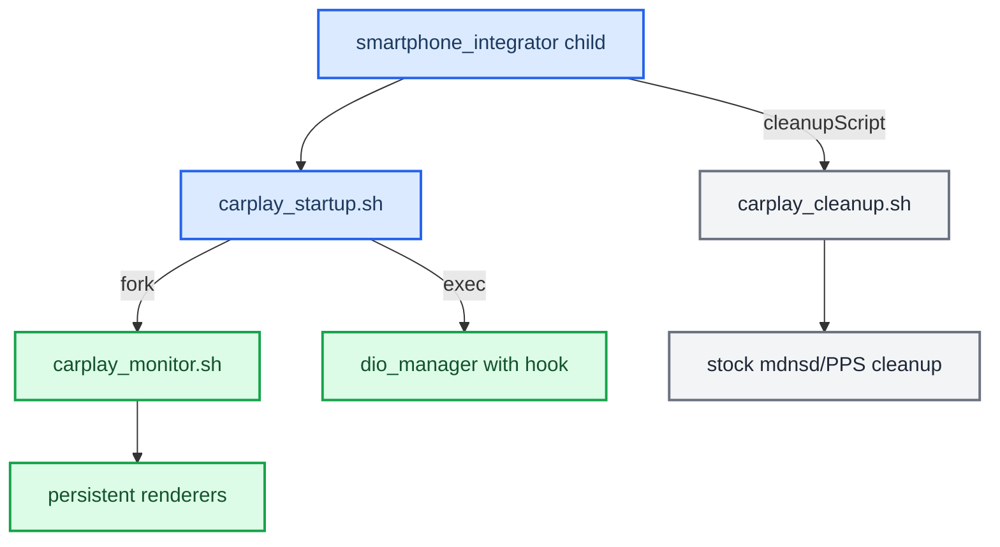

# Deployment and process ownership

*Which process owns what at runtime on the unit, which files are installed together, and how the M.I.B. installer and uninstaller put them there.*

---

## ⚙️ The SI child and `LD_PRELOAD`

The production child definition is `deploy/smartphone_integrator/carplay_child.json`. Keep `IPL_CONFIG_DIR_DIO_MANAGER=/etc/eso/production` in that child's environment, and keep `LD_PRELOAD` out of it. `carplay_startup.sh` adds `LD_PRELOAD` only to its final `dio_manager` process (`deploy/smartphone_integrator/carplay_startup.sh:48-50`). The monitor and the renderers are started with `LD_PRELOAD` cleared (`carplay_startup.sh:45`, `carplay_monitor.sh:93`).

The runtime files are installed together under `/mnt/app/root/hooks/`:

```text
libcarplay_hook.so
libcarplay_apac.so      (absent in a HOOK_AUDIO=0 build)
hssr_model.bin
hssr_guard.bin
maneuver_render
altscreen_render
flag_atlas.rgba
carplay_startup.sh
carplay_monitor.sh
carplay_processes.sh
carplay_cleanup.sh
```

`carplay_hook.jar` goes to `/mnt/app/eso/hmi/lsd/jars/`. The full source-to-destination map is in [RELEASE_ARTIFACTS.md](RELEASE_ARTIFACTS.md).

## 🔄 Process ownership



- **Startup.** The startup wrapper records its generation atomically in an owner file (`carplay_startup.sh:39-43`). It then forks the monitor (`:45`) and `exec`s `dio_manager`, so smartphone_integrator keeps the exact PID for its watchdog.
- **Monitor.** The monitor starts any renderer that is missing and keeps healthy ones running when `dio_manager` is replaced. It acts only while its own generation owns the owner file. When `dio_manager` exits, it leaves the persistent renderers running and exits itself.
- **Cleanup.** The cleanup script does not know which generation it is cleaning up for. It only runs Audi's stock `/etc/scripts/carplay_cleanup.sh` for the mdnsd/PPS cleanup (`carplay_cleanup.sh:21`). It does not touch shared renderer state, and it must not overwrite that stock script.
- **Renderers.** Do not also add the renderer processes as `servicemgr external:true` services. The generation monitor is their only runtime owner.

See `deploy/smartphone_integrator/README.md` for the installation paths and the exact child JSON replacement.

## 💾 Install and uninstall

There are two SD folders:

- **Install:** copy the contents of `install_MoreIncredibleBash/` over the root of the M.I.B. card. Then stage the release under `mod/carplay/`: the files go in `mod/carplay/root/<on-unit path>`, and `carplay_child.json` goes in `mod/carplay/` next to `root/`. The layout is in [RELEASE_ARTIFACTS.md](RELEASE_ARTIFACTS.md).
- **Uninstall:** copy the contents of `uninstall_MoreIncredibleBash/` over the card root. Removal needs no build files and no marker.

Both run from *Advanced Settings → Run Custom Script* with CarPlay disconnected. No SSH deploy script exists: `scripts/deploy_over_ssh.sh` has been deleted, and pushing over SSH is done by hand.

What `install_MoreIncredibleBash/mod/custom.sh` does, in order:

1. If it was started on the RCC, it hands itself over to the MMX (`:25-27`).
2. It remounts `/mnt/app` and `/mnt/system` read-write (`:114-115`).
3. It copies each file under `mod/carplay/root/` to the same path under `/` through a temporary file, `chmod` and an atomic `mv`. Before overwriting a firmware file under `eso/bin/apps/` or `armle/lib/dll/`, it backs it up once as `*.carplay-stock` (`:121-133`).
4. It replaces the `"carplay"` child in `smartphone_integrator.json` by path (`:54-86`).
5. It widens the `carplay0` TCP rule to `6030:6032` in all four PF profiles (`:89-110`).
6. It runs `sync` and prints `DONE`.

It stops no processes and does not reboot. It does **not** check the running `dio_manager`, and it does **not** verify firmware SHA-256 identities, so check the staged images yourself against the hashes in [RELEASE_ARTIFACTS.md](RELEASE_ARTIFACTS.md). The install is atomic per file, not a transaction across both flash partitions. A manual reboot activates the release.

The uninstaller (`uninstall_MoreIncredibleBash/mod/custom.sh`) renames every `*.carplay-stock` under `/mnt/app` and `/mnt/system` back to the original, which covers the firmware, the SI JSON and the PF profiles. It then deletes a fixed list of owned files (`:22-53`).

> [open] `hssr_guard.bin` is not on that owned list. `custom.sh uninstall` from the install folder, run with the payload tree present, does remove it (`install_MoreIncredibleBash/mod/custom.sh:140-159`).

> [open] `install_MoreIncredibleBash/README_CARPLAY.md` has been deleted from the working tree, although it is still tracked in git. `uninstall_MoreIncredibleBash/README_CARPLAY.md` still describes the old generated uninstaller: `.orig` restore, log files, PF widening retained, and generation by `package_mib.py`. Neither README matches the current scripts. The scripts above are authoritative.
