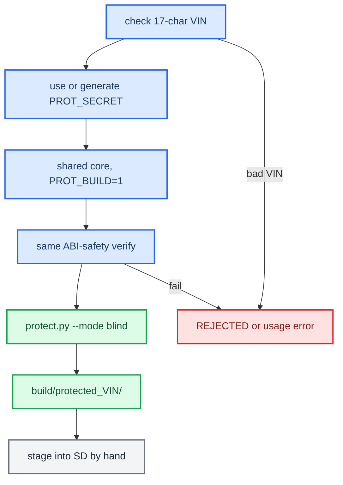

# Protector — VIN-locked builds

*How to bind a CarPlay build to one car. On the target VIN the mod runs; on any other VIN the hook stays inert (stock CarPlay) and the APAC codec refuses to run (fail-closed).*

---

## 📋 What it does

The VIN is read live on the unit, and the two native `.so` files are stamped at build time. No plaintext VIN appears in the artifacts.

- The mechanism's source is `protector/`: portable C with no OpenSSL.
- The full API and internals are in `protector/README.md`.
- This doc covers how to **use** the protector and how to **compile** a protected CarPlay build.

How it works:

- Both `.so` files (`libcarplay_hook.so`, `libcarplay_apac.so`) carry a small VIN gate and a stamped slot.
- On first use, the gate reads the **live VIN** from the MMX persistence store and checksums the `.so`'s own image on disk. The store is `/mnt/persist/var/fw/persistence.sqlite`, with `/var/fw/persistence.sqlite` as a fallback (`protector/prot_vin.c:89-90`). The gate reads the `/core/vin` and `/core/registeredVin` records; if both are present they must agree (`prot_vin.c:94-96`).
- The stamp is `KDF(secret, VIN, CRC)` over a sentinel. It verifies **only** when the unit's live VIN matches the VIN baked in at build time, and only if the `.so` has not been patched.
- The gate fails open. Any error (no VIN, disagreeing VINs, an unreadable image, an unstamped `.so`) leaves the unit inert and stock, and never bricks it (`protector/carplay_prot.h:8-12`).
- The gate sits at one choke point in each `.so`:
  - in the hook, module registration (`hook/framework/hook_framework.c:133-138`);
  - in the codec, the API entry (`hook/audio/apac_bridge.cpp:205-210`).

Deploy model (`install_MoreIncredibleBash/mod/custom.sh:6-11`):

- **Whole-file**, from the `mod/carplay/root/` tree: the hooks, `.so` files and jar, plus the firmware that is already patched (`smartphone_integrator`, `deva-ctrl-qc.so`).
- **In place** on the unit, done by `custom.sh`: `smartphone_integrator.json` (edited by path) and the PF profiles, which are mandatory.

## ✅ Prerequisites

- Docker with the QNX 6.5 armv7 image `qnx65-armv7-toolchain`, built from `../../Tools/qnx-65-sdp-docker` (relative to this repo). If the image is missing, the build stops and prints this command (`scripts/build_hook_common.sh:80-84`):

  ```bash
  docker build --platform=linux/amd64 -t qnx65-armv7-toolchain ../../Tools/qnx-65-sdp-docker
  ```

- `python3` on the host, to run `protector/protect.py` (the stamper).
- For a complete release, also run `./scripts/build_java.sh` and `./scripts/build_renderers.sh`. The models come from `models/`, and the firmware and scripts come from `deploy/`. See [RELEASE_ARTIFACTS.md](RELEASE_ARTIFACTS.md).

## 🔧 Build a protected CarPlay build

You give the VIN before the build; the script does the stamping as part of the build.

```bash
./scripts/build_hook_protected.sh WAUZZZF45HA149423          # stamped binaries -> build/protected_<VIN>/
HOOK_AUDIO=0 LOG=0 ./scripts/build_hook_protected.sh <VIN>   # beta: no audio, no logs
PROT_VIN=<VIN> ./scripts/build_hook_protected.sh             # VIN from the environment
```



`build_hook_protected.sh` compiles the two `.so` files and stamps them for the VIN into `build/protected_<VIN>/`. It produces binaries only (`scripts/build_hook_protected.sh:39-53`). Assemble the install tree by hand from those files plus the runtime assets (models, firmware, renderers, jar); the source-to-unit map is in [RELEASE_ARTIFACTS.md](RELEASE_ARTIFACTS.md).

`build_hook_protected.sh` and `build_hook.sh` share one compile+verify core, `scripts/build_hook_common.sh`, so the protected `.so` cannot drift from the shipping one. `build_hook.sh` on its own builds without protection and writes to `build/unprotected/`.

- **VIN:** the 17-character target VIN, given as argument 1 or as `PROT_VIN` (`build_hook_protected.sh:22-24`).
- **`PROT_SECRET`:** optional. If it is unset, the script generates a fresh random secret for this build and does not keep it (`:33-37`). The same value feeds both the runtime and the stamp, so a one-off build is self-consistent. Set it explicitly, and keep it out of the tree, only when you want one stable fleet secret across rebuilds, or when you want to verify the result locally (see [Verify a stamped .so](#-verify-a-stamped-so)).
- **Default builds** (`build_hook.sh`) never define `CARPLAY_PROT`, so they contain no gate code. Protection is opt-in.

For a different QNX cross-compiler: `QNX_TOOLCHAIN_VARIANT=4.9 ./scripts/build_hook_protected.sh <VIN>`. The default is `latest`, which is GCC 8.5; `8.5` is also accepted.

### Build flags

Set each one as `env=value` before the command.

| Flag | Default | Effect |
|---|---|---|
| `PROT_VIN` | — | The 17-character target VIN, used when argument 1 is not given. |
| `PROT_SECRET` | — | An optional build secret; keep it out of the tree. If unset, a random secret is generated for this build. |
| `HOOK_AUDIO` | `1` | `0` removes the type-103 audio path at **compile time**: no QSA/AirPlay audio interposers, no `hook/audio/*`, and `libcarplay_apac.so` is not built, so CarPlay audio is stock. `AUDIO_SPATIAL=0` only disables type 103 at runtime; `HOOK_AUDIO=0` takes it out of the binary. |
| `LOG` | `1` | `1` compiles logging in. `0` is for pre-production: it sets `-DENABLE_LOGGING=0`, which turns off logging and diagnostic captures. |
| `AUDIO_STATE_TRACE` | `0` | `1` turns on a compact lifecycle trace. It exports the two trace HID seams, and the build checks for its markers. |
| `ALTSCREEN_PACE_TRACE` | `0` | `1` turns on a stream-111 pacing trace. The build checks for its markers. |
| `LOG_RGD_PACKET_RAW` | `0` | `1` logs raw RGD packets. It requires `LOG=1`. |
| `QNX_TOOLCHAIN_VARIANT` | `latest` | `latest` (GCC 8.5), `8.5`, or `4.9` (GCC 4.9.4). |

`AUDIO_SPATIAL` is **not** a build flag. It is a runtime environment variable set in `carplay_startup.sh`, currently `export AUDIO_SPATIAL=1` (`deploy/smartphone_integrator/carplay_startup.sh:60`). With `HOOK_AUDIO=1` it gates type 103 at runtime; with `HOOK_AUDIO=0` the audio path is gone whatever it says.

Worked example, a build with type 103 removed, logs on, and locked to one VIN:

```bash
# A HOOK_AUDIO=0 build leaves any older libcarplay_apac.so in the output dir
# (build_hook_common.sh:277), and the stamp loop would stamp it too
# (build_hook_protected.sh:49-52). Delete it first so a stale codec never ships.
rm -f build/protected_WAUZZZF45HA149423/libcarplay_apac.so
HOOK_AUDIO=0 LOG=1 \
  ./scripts/build_hook_protected.sh WAUZZZF45HA149423
```

The result is `build/protected_<VIN>/libcarplay_hook.so` only. The verify step asserts that the hook exports 0 QSA symbols (`build_hook_common.sh:182-183`).

## 💾 Install and uninstall on the unit

Stage the release on the M.I.B. SD card as `mod/custom.sh`, with the files under `mod/carplay/root/<on-unit path>` and `carplay_child.json` in `mod/carplay/`. The layout is in [RELEASE_ARTIFACTS.md](RELEASE_ARTIFACTS.md). Then:

- **Install:** M.I.B. → Advanced Settings → Run Custom Script (`mod/custom.sh`). The script:
  1. remounts `/mnt/app` and `/mnt/system` read-write;
  2. copies `carplay/root/` onto `/`, with an atomic rename per file;
  3. patches `smartphone_integrator.json` by replacing the `"carplay"` child;
  4. widens the `carplay0` TCP rule in all four PF profiles to `6030:6032`, from `6030`, `6030:6031` or `6030:6033` (`custom.sh:98-101`);
  5. runs `sync`.

  Then reboot the HU manually.
- **Uninstall:** copy `uninstall_MoreIncredibleBash/` over the card and Run Custom Script. It restores every `*.carplay-stock` under `/mnt/app` and `/mnt/system` (firmware, JSON, PF), removes the files we own (hooks, `.so` files, jar), and then you reboot. [open] `hssr_guard.bin` is missing from that owned list (`uninstall_MoreIncredibleBash/mod/custom.sh:23-33`).

To verify after install, run on the unit:

```bash
grep carplay_startup.sh /mnt/system/etc/eso/production/smartphone_integrator.json
grep -o '6030:6032' /mnt/system/etc/pf.conf /mnt/system/etc/pf.ecm0.conf
```

On a car with the LTE modem the active profile is `pf.ecm0.conf`, not `pf.conf` (`deploy/pf/README.md`). The mod only becomes ACTIVE when the unit's live VIN matches the baked VIN.

> `carplay_child.json` MUST sit in `mod/carplay/` next to `root/`. Otherwise the JSON patch is skipped (`custom.sh` warns, `:57`) and the hook never loads. No build step places it any more, so include it when you assemble the SD card.

## 🔧 Protecting your own artifact (integration)

To VIN-lock another `.so` or binary, use the same three pieces. `protector/README.md` has the full API. The CarPlay wiring in `protector/carplay_prot.{c,h}` is the simplest example.

**a. Define the slot and the gate once** (`protector/carplay_prot.c`):

```c
#include "prot_rt.h"
PROT_DEFINE_SLOT();                 /* one slot per .so; kept against --gc-sections */

int carplay_prot_active(const char *self_path) {
    static int done = 0, active = 0;
    if (!done) {
        static const unsigned char none = 0;
        prot_arm_path(self_path, 0x5A, &none, 0);   /* live VIN + own image */
        active = prot_active();
        done = 1;
    }
    return active;
}
```

**b. Gate the feature** at its single choke point, falling open to stock:

```c
if (!carplay_prot_active("/mnt/app/root/hooks/libcarplay_hook.so"))
    return;                         /* wrong VIN -> inert, stock path runs */
```

**c. Compile the protector objects into the artifact.** Use hidden visibility so there are no new dynamic exports. The objects are plain C with no constructor, so a strict audit like APAC's stays green:

```bash
CC=arm-unknown-nto-qnx6.5.0eabi-gcc
for p in prot_rt prot_vin carplay_prot; do
  $CC -O2 -fPIC -fvisibility=hidden -std=gnu99 -Iprotector \
      -DPROT_SECRET="\"$PROT_SECRET\"" -c protector/$p.c -o $p.o
done
# link $p.o into your .so with -DCARPLAY_PROT on the gate TU
```

**d. Stamp the built artifact for the VIN** (blind sentinel gate). `protect.py` takes the secret from `--secret` or `$PROT_SECRET` (`protector/protect.py:89-95`):

```bash
printf '\x5a' > consts.bin
PROT_SECRET="$SECRET" python3 protector/protect.py your.so \
    --vin WAUZZZF45HA149423 --mode blind --payload-file consts.bin
```

`build_hook_protected.sh` already does steps (c) and (d) for the two CarPlay `.so` files (`build_hook_common.sh:115-122`, `build_hook_protected.sh:48-53`). This section is only for new artifacts. For a standalone app, `protector/build.sh <VIN> <out> [consts.bin]` does the compile and stamp in one step.

Gotcha: the runtime finds the slot by scanning the file, so nothing refers to `PROT_SLOT` by symbol, and a `-fdata-sections/--gc-sections` build will drop it unless something keeps it. `carplay_prot.c` keeps it alive with a volatile self-read (`carplay_prot.c:15-16`). Do the same in any new slot owner.

## 🔍 Verify a stamped .so

This needs the secret the build used, so build with a pinned `PROT_SECRET` if you mean to verify. A build that generated its own random secret cannot be checked this way. Locally, gate against a fake store (`PROT_MMX_STORE` overrides the store path, `prot_vin.c:86-87`), once with the right VIN and once with a wrong one:

```bash
printf '{"p":"\\/core\\/vin","d":"WAUZZZF45HA149423"}{"p":"\\/core\\/registeredVin","d":"WAUZZZF45HA149423"}' > /tmp/right.sqlite
cat > /tmp/v.c <<'C'
#include "carplay_prot.h"
#include <stdio.h>
int main(int c,char**v){printf("%d\n",carplay_prot_active(v[1]));return 0;}
C
cc -O2 -Iprotector -DPROT_SECRET="\"$SECRET\"" -DPROT_MMX_STORE='"/tmp/right.sqlite"' \
   -o /tmp/v /tmp/v.c protector/carplay_prot.c protector/prot_rt.c protector/prot_vin.c
/tmp/v build/protected_WAUZZZF45HA149423/libcarplay_hook.so   # -> 1
```

Point `PROT_MMX_STORE` at a store with a different VIN and the result is `0`. To confirm that no plaintext VIN leaked, `grep -c <VIN> <the .so>` should print `0`.

## ⚠️ Secret management and honest ceiling

- `PROT_SECRET` is compiled into the runtime and passed to `protect.py`. Keep it out of the repo, as a CI or provisioning secret, and use the same one across a fleet if you pin it.
- **Ceiling:** the secret lives in the image, so a rooted attacker who runs a provisioned image once can extract the derived key. `/mnt/persist` is writable, so the VIN records can be edited, but editing them only produces inert stock behaviour, never the mod. This protects against cloning and casual patching; it is not cryptographic secrecy. A real barrier needs a secret kept off the box, such as TrustZone or secure storage, or a server challenge. The code stays the same; only the source of `secret` changes.
- **OPSEC:** never describe the protection mechanism in files that ship on the SD card. Any marker you add should stay neutral: VIN, date and an install hint only. No script generates a `PROTECTED.txt` any more; the `.gitignore` entry for it is left over from the old packager.
