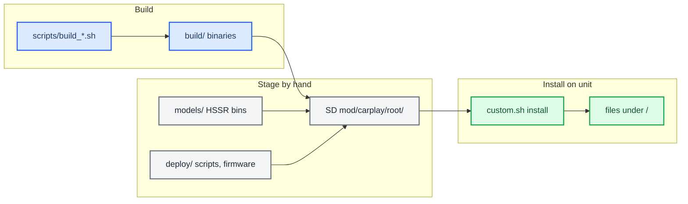

# CarPlay release artifacts — MU1316

*Where each release file comes from, where it lands on the unit, and how a release is staged by hand for the M.I.B. installer.*

---

## 📋 How a release is made

There is no packaging script. `package_mib.py`, `package_protected.sh`, `package_cabin_candidate.py` and `deploy_over_ssh.sh` have all been deleted. The build scripts write their outputs into `build/`, and you assemble a release **by hand** from three folders: `build/`, `models/` and `deploy/`.

The installer, `install_MoreIncredibleBash/mod/custom.sh`, copies every file under `mod/carplay/root/` to the same path under `/` (`custom.sh:29-32`, `:118-133`). Staging a release therefore means placing each file below at `mod/carplay/root/<on-unit path>`.



## 📦 Where each file comes from, and where it lands on the unit

| File | Source in the repo | On-unit path |
| --- | --- | --- |
| `libcarplay_hook.so` | `build/unprotected/`, or `build/protected_<VIN>/` for a stamped build | `/mnt/app/root/hooks/` |
| `libcarplay_apac.so` | `build/unprotected/` or `build/protected_<VIN>/`; leave it out of a `HOOK_AUDIO=0` build | `/mnt/app/root/hooks/` |
| `maneuver_render` | `build/` (`scripts/build_renderers.sh`) | `/mnt/app/root/hooks/` |
| `altscreen_render` | `build/` (`scripts/build_renderers.sh`) | `/mnt/app/root/hooks/` |
| `carplay_hook.jar` | `build/` (`scripts/build_java.sh`) | `/mnt/app/eso/hmi/lsd/jars/` |
| `hssr_model.bin` | `models/hssr-q6d-moises-a/hssr_model.bin` (q6d, the main control model) | `/mnt/app/root/hooks/` |
| `hssr_guard.bin` | `models/hssr-selection-v11/hssr_guard.bin` (the V11 vocal guard) | `/mnt/app/root/hooks/`, loaded from beside the main model (`hook/audio/audio_hook.c:1756`) |
| `flag_atlas.rgba` | `maneuver_render/resources/flag_atlas.rgba` | `/mnt/app/root/hooks/` (`maneuver_render/main.c:45`) |
| `carplay_startup.sh` | `deploy/smartphone_integrator/` | `/mnt/app/root/hooks/` |
| `carplay_monitor.sh` | `deploy/smartphone_integrator/` | `/mnt/app/root/hooks/` |
| `carplay_processes.sh` | `deploy/smartphone_integrator/` | `/mnt/app/root/hooks/` |
| `carplay_cleanup.sh` | `deploy/smartphone_integrator/` | `/mnt/app/root/hooks/` |
| `smartphone_integrator` | `deploy/smartphone_integrator/smartphone_integrator` | `/mnt/app/eso/bin/apps/smartphone_integrator` (replaces the whole file) |
| `deva-ctrl-qc.so` | `deploy/deva-ctrl-qc/deva-ctrl-qc.so.patched`, renamed to `deva-ctrl-qc.so` | `/mnt/app/armle/lib/dll/deva-ctrl-qc.so` (replaces the whole file) |
| `carplay_child.json` | `deploy/smartphone_integrator/carplay_child.json` | Not a file under `/`. It goes in `mod/carplay/` next to `root/`, and `custom.sh` splices it in as `children.carplay` (`custom.sh:54-86`) |
| `patch_si_rearm.py` | `deploy/experimental/usb_replug_recovery/patch_si_rearm.py` | A host-side tool for reproducing and reversing the patch; not needed on the HU |

Notes:

- The two `.so` files, `maneuver_render`, `altscreen_render` and `carplay_hook.jar` are compiled outputs, so build them first with `build_hook.sh` or `build_hook_protected.sh`, then `build_renderers.sh` and `build_java.sh`. Everything else is copied unchanged from the location shown above.
- `custom.sh` sets file modes itself: `755` for `.so` files, the renderers, `eso/bin/apps/*` and `*.sh`, and `644` for everything else (`custom.sh:37-45`).
- **PF firewall:** no patch file is installed. `custom.sh` edits the `carplay0` inbound TCP rule in place, widening ` 6030,` (or ` 6030:6031,` / ` 6030:6033,`) to ` 6030:6032,` in `pf.conf`, `pf.ecm0.conf`, `pf.mlan0.conf` and `pf.ppp0.conf` (`custom.sh:35`, `:89-110`). Because it does this in the shell, it needs no `patch`, Python or `sed` on the HU. The stock copies are in `deploy/pf/stock/`. `deploy/pf/patched/` is a reference result that `deploy/pf/patch_pf.sh` regenerates.

## 🔐 Firmware and model identities

`custom.sh` backs up each replaced firmware file once, as `<target>.carplay-stock`, before an atomic rename on the same partition (`custom.sh:47`, `:51`, `:127-131`). It does **not** check hashes, so staging the right image is up to you. Check the staged files against the values below with `shasum -a 256`. The repo copies matched them when this was checked.

| File | SHA-256 | Note |
| --- | --- | --- |
| `deploy/smartphone_integrator/smartphone_integrator` | `606236a81c7c4dafda6fdd08fe6eb27c43252796784da25d9760a7d552ee2af3` | Read back from the HU on 2026-09-16 (provenance as recorded; not re-verified on the unit) |
| `deploy/deva-ctrl-qc/deva-ctrl-qc.so.patched` | `398e7213be4e966719eed5ff9736fb9142f11e161033f01263f29db640e06355` | The final mirror build; the three-step build is in `deploy/deva-ctrl-qc/BUILD_CHAIN.md` |
| `deploy/deva-ctrl-qc/deva-ctrl-qc.so.stock` | `58dddcabaa94c2fecf989855a6f810ec219926f49669a0ed9482ed629fdc64b9` | The stock input |
| `models/hssr-q6d-moises-a/hssr_model.bin` | `96abe57d9ee703f2e39c0231de97580c303ce896ce044b7450c14240002b0a0e` | The q6d main model |
| `models/hssr-selection-v11/hssr_guard.bin` | `ab01463e9359f013c4b40f311d630bd20af48d761ad361563cb5246f6bd686ae` | The V11 guard |

## 💾 SD layout

Copy the contents of `install_MoreIncredibleBash/` over the root of the M.I.B. SD card, then stage the release under `mod/carplay/`:

```text
SD1/
  mod/custom.sh
  mod/carplay/carplay_child.json
  mod/carplay/root/mnt/app/root/hooks/            .so, renderers, models, atlas, carplay_*.sh
  mod/carplay/root/mnt/app/eso/hmi/lsd/jars/carplay_hook.jar
  mod/carplay/root/mnt/app/eso/bin/apps/smartphone_integrator
  mod/carplay/root/mnt/app/armle/lib/dll/deva-ctrl-qc.so
```

If `mod/carplay/root/` is missing, `custom.sh` exits with `no payload tree` (`:32`). If `carplay_child.json` is missing, the JSON patch is skipped with a `WARN` (`:57`) and the hook never loads. `.gitignore` keeps `mod/carplay/root/` and `mod/carplay/carplay_child.json` out of git.

To remove the mod, copy the contents of `uninstall_MoreIncredibleBash/` over the card instead, replacing `/mod/custom.sh`. Removal needs no build files. It restores every `*.carplay-stock` under `/mnt/app` and `/mnt/system` and deletes a fixed list of owned files (`uninstall_MoreIncredibleBash/mod/custom.sh:22-53`).


Both installers run from **GEM → M.I.B. → Advanced Settings → Run Custom Script** with CarPlay disconnected, and both leave the reboot to the owner.

For a VIN-locked (protected) release, assemble the same map by hand. The only difference is that the two `.so` files come from `build/protected_<VIN>/` (compiled and VIN-stamped by `build_hook_protected.sh`) instead of `build/unprotected/`. See [PROTECTOR.md](PROTECTOR.md).
