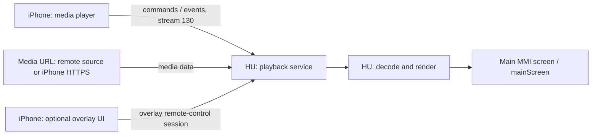

# CarPlay Video: транспорт, разрешение и экран

Дата: 2026-09-14. Продолжение [первой находки](CARPLAY_VIDEO_RE.md).
Статический анализ iOS 27 `24A5418b`, с сопоставлением декомпиляции iOS 26.1 `23B85`.
Проверено в IDA/Hex-Rays и по инструкциям из dyld cache; запуск на MHI2 не выполнялся.

Продолжение: [принимающий PlaybackV2, команды, TLS и проверка stock MU1316](CARPLAY_VIDEO_RECEIVER_2026_09_14.md).

Дополнение от 2026-09-15: [найденный плеер MHI2, окно 43 и штатный контроль видеовывода](CARPLAY_VIDEO_MHI2_PLAYER_2026_09_15.md).

## Короткий ответ

**Исследованный путь рассчитан на основной экран CarPlay (`mainScreen`).**
Головное устройство воспроизводит медиа по URL своим плеером. iPhone управляет
очередью и воспроизведением через отдельную remote-control сессию.
Для оверлеев iPhone явно проверяет, что основным экраном владеет автомобиль.

Это не путь нашего `altscreen_render` / stream 111 в приборку. В найденной
реализации фильм не упаковывается в обычный видеопоток интерфейса screen 110:
в playback-командах передаётся `Content-Location`.

Привязка к **логическому mainScreen доказана**. Вывод собственного плеера на
конкретную QNX-поверхность MMI должен реализовать приёмник. Из кода iPhone нельзя
установить ID этой поверхности или подтвердить работоспособность на нашем MHI2.
Отдельный физический экран найденный путь не требует.

| Вопрос из старого исследования | Результат |
|---|---|
| Кто формирует `AirPlayVideoPlaybackAudioOnlyMode`? | `AirPlaySender`: `carEndpoint_CopyProperty` читает своё состояние |
| Откуда разрешение видео? | `/info.videoPlaybackInfo.videoPlaybackAllowed`, затем `setVideoPlaybackAllowed.params` |
| Что несёт фильм? | URL playback: `insertPlayQueueItem` с адресом медиа; локальный файл iPhone может обслуживать через HTTPS |
| Какой stream? | Найден **130 для команд/событий remote control**. Старый bare define 120 не описывает этот путь |
| Основной экран или отдельный? | Управление связано с `mainScreen`, ресурсом 1; оверлеи активны при владельце accessory |
| Достаточен ли старый пустой `videoPlaybackInfo`? | Нет: видимость функции в CarKit не реализует разрешение, features и принимающий плеер |

## 1. Материалы и воспроизводимость

Адреса ниже — виртуальные адреса **iOS 27 24A5418b** без ASLR.

Корень cache:

```text
/Users/luka/Desktop/AUDI_2/Refferences/ios27_dsc/24A5418b__iPhone18,1
```

| Образ | Файл / база IDA | Base |
|---|---|---|
| AirPlaySender | `aps_out/AirPlaySender`, `aps_out/AirPlaySender.i64` | `0x250f35000` |
| APTransport | `APTransport.i64` | `0x24f331000` |
| AirPlaySupport | `extracted_dylibs/AirPlaySupport` | `0x226619000` |
| AirPlayOverlaysServer | локально извлечён в `output/carplay-video-re-20260914/dylibs/` | `0x250cde000` |

SHA256 исследованного AirPlaySender:
`379fb232ff228287d3b11d1253b1b942e6c50dd633d150cfab6acb9d063bead1`.
SHA256 AirPlaySupport:
`edf99982e576d46309471638f565a36e7eb326fb78bdb2bd75eba119a992c2a3`.

Корень текстовой декомпиляции 26.1, далее `ROOT26`:

```text
/Users/luka/Desktop/AUDI_2/Refferences/iPhone18-3_26.1_23B85_Restore/System/Library/PrivateFrameworks/CoreAccessories.framework/System/Library
```

Локальные доказательства:

- [AirPlaySender: 14 функций](../../output/carplay-video-re-20260914/airplaysender-idb-evidence.json).
- [Экран, оверлеи, bitmap features и инструкции](../../output/carplay-video-re-20260914/screen-and-features-evidence.json).
- [Инструкции инициализации](../../output/carplay-video-re-20260914/activation-excerpts.json).
- [42 разрешённые CFString-константы](../../output/carplay-video-re-20260914/cfstrings.json).
- [Чтение CFStrings из cache](../../output/carplay-video-re-20260914/read_cache.py).

Текстовая декомпиляция 26.1 теряет аргументы некоторых compiler-outlined helpers.
В IDB 27 встречаются неразрешённые внешние `MEMORY[...]` и raw cache pointers.
Поэтому ключи проверялись чтением CFStrings из cache, импорты — по stubs, а
значения аргументов — по инструкциям. Маркер адреса Hex-Rays иногда относится
к сохранению результата после вызова, а не к самой инструкции `BL`.

`read_cache.py` рассчитан на эту локальную v5-разметку: runtime offset из
34 младших битов указателя плюс начало shared region, с проверкой попадания
в mapping. Это вспомогательный reader конкретного cache, не общий IPSW parser.

## 2. Объявление поддержки: три разных состояния

Необходимо различать видимость функции, согласованную поддержку и разрешение
текущего воспроизведения.

1. **CarKit UI:** старое исследование доказало presence-check
   `EndpointInfo["videoPlaybackInfo"]`, с внутренним override `CarPlay/VideoBrowse`.
2. **AirPlay feature negotiation:** в 26.1 `Activate.mm:176` предлагает
   `videoPlayback`, использует pref `enableCarPlayVideoPlayback`, а около строки
   528 проверяет согласованное значение. AirPlaySender имеет отдельный флаг
   поддержки, которым ограждены playback-функции.
3. **Playback enabled / allowed:** в 27 есть отдельные флаги включённого URL
   playback и текущего разрешения видео. Они не эквивалентны UI capability.

Для derived storage CarPlay endpoint в **этом build 27**:

| Смещение, десятичное | Назначение | Доказательство |
|---|---|---|
| 68 | video playback supported | проверки в updater/overlay; `CopyProperty` возвращает для `AirPlayVideoV2Supported` и `UsesExternalPlaybackByDefault` |
| 220 | audio-only elected | back-button handler устанавливает; CopyProperty читает |
| 221 | video playback allowed | updater записывает; CopyProperty читает |
| 222 | URL playback enabled | `IsURLPlaybackEnabled`, gate `CreatePlaybackSession` |
| 223 | playback session active | `handlePlaybackSessionActivationChanged`, gate оверлеев |

`carEndpoint_UpdateFeaturesWithCompletionCallback` (`0x251080c34`) обновляет
enabled-состояние для feature bit 4 при наличии negotiated support.
Во время Activate, если поддержка согласована и
`AirPlay/CarPlayVideoPlayback_DestinationBanner` выключен, enabled устанавливается
сразу (`0x251082fb4` и далее). Это ещё одна причина не отождествлять presence
словаря с работающим playback.

### Содержимое videoPlaybackInfo

Начальная обработка в `__carEndpoint_Activate_block_invoke_2` (`0x251080ed8`):
около `0x251082f8c` получает словарь `videoPlaybackInfo` и вызывает
`carEndpoint_updateVideoPlaybackAllowed` с этим словарём.

`airPlayDescription_copyCarPlayVideoFeaturesInternal` (`0x251154628`) отдельно
извлекает **CFString `videoPlaybackInfo.featuresEx`**, затем вызывает
`APSFeaturesCreateFromStringRepresentation`.

AirPlaySupport (`0x22661ec08`) делает `Base64DecodeCopy` → `CFDataCreate`.
`APSFeaturesHasFeature` (`0x2266be888`) для неотрицательного номера `n` проверяет
бит `n % 8` в байте `n / 8`. Следовательно, `featuresEx` — Base64 bitmap,
а не строковый список и не массив negotiated `extendedFeatures`.

Прослеженные потребители video-specific bitmap:

- **70 → `SupportsOverlayUI`**: property dispatch `0x250f39de0`, helper
  `airPlayDescription_hasCarPlayVideoFeatureInternal` (`0x25109c150`).
- **73–76 → выбор режима управления громкостью** в
  `airPlayDescription_copyVolumeControlTypeEx` (`0x250f4b5fc`).

Отсутствующий/невалидный `featuresEx` приводит к ошибке этого getter; требование
ко всему SETUP из этого одного getter не следует. Полный набор обязательных
feature bits приёмника пока не установлен. Не следует объявлять их все подряд.

## 3. Разрешение и audio-only: writer найден

`carEndpoint_updateVideoPlaybackAllowed` — **`0x2511490a0`**.
Проверяет negotiated support и читает:

```c
FigCFDictionaryGetBooleanIfPresent(params, CFSTR("videoPlaybackAllowed"), &allowed);
```

Ключ точно разрешён: CFString `0x275b05b80` → `videoPlaybackAllowed`.
При отсутствующем или неподходящем значении updater возвращает ошибку.
При изменении записывает allowed, публикует
`kFigEndpointNotification_EndpointDescriptionChanged` и при запрете вызывает
helper перехода к audio-only.

Runtime route — `carEndpoint_handleEventCreatingReply` (`0x250f5109c`):
декодирует командный dictionary, читает `type`, получает вложенный `params`,
распознаёт `setVideoPlaybackAllowed` и вызывает тот же updater.

Восстановленная **структура словаря**, не полный сетевой пакет:

```json
{
  "type": "setVideoPlaybackAllowed",
  "params": {
    "videoPlaybackAllowed": false,
    "playbackStatus": "video"
  }
}
```

`carEndpoint_CopyProperty` — **`0x250f56970`**, ветка около `0x250f57500`:

```c
AirPlayVideoPlaybackAudioOnlyMode =
    !videoPlaybackAllowed ? "Forced" :
    audioOnlyElected ? "Elected" : "None";
```

Таким образом, искать writer в `airplayd` для объяснения этой ветки не требуется:
свойство вычисляет сам AirPlaySender из состояния endpoint.
В исследованной функции нет расчёта скорости/положения селектора: она принимает
Boolean от accessory. Связь с состоянием автомобиля должна обеспечиваться
на стороне HU; конкретный источник этого сигнала в MHI2 здесь не исследован.

`carEndpoint_sendChangeVideoPlaybackToAudioOnlyIfNeeded` — **`0x25114a4ec`**:

- В 27 отправляет `changeVideoPlaybackToAudioOnly`, если `playbackStatus`
  отсутствует либо равен `video`.
- В 26.1 (`AirPlaySender_22.mm:9270`) runtime-ветка дополнительно требует
  третий аргумент updater и присутствующий status, равный `video`.
- `videoPlayerBackButtonEvent` (`0x25114a1a0`) устанавливает elected audio-only
  и вызывает этот же helper. `Elected` и `Forced` имеют разные причины.

## 4. Транспорт: remote playback, URL и stream 130

Прослеженная цепочка iOS 27:

```text
carEndpoint_CreatePlaybackSession                 0x251148e8c
  createPlaybackSessionInternal block             0x2510916e4
    APEndpointPlaybackSessionRemoteControlCreate   0x2510e3fd4

session_Play                                     0x2510e525c
  session_insertPlayQueueItemInternal             0x2510e7520
    session_ensureRemoteControlSessionCreated     0x251178b9c
      APEndpointRemoteControlSessionCreate        0x25101c440
        ensureAndCopyTransportStreams            0x25101c9c8
```

Remote control создаётся с:

```text
clientTypeUUID = A6B27562-B43A-4F2D-B75F-82391E250194
sessionType = 1
controlType = 1
```

`ensureAndCopyTransportStreams`, statement `0x25101cf0c`, запрашивает
**stream type 130**, передавая `clientTypeUUID`, `clientUUID`, `channelID`,
`controlType` и опциональные `wantsDedicatedSocket` / `sendMessageAsIs`.
Далее sender читает **`streamID`** из ответа (логи называют это значение
«transport token»), выбирает общую связь или отдельный socket и создаёт
control/event transport streams. Отдельного поля `transportToken` здесь нет.

**130 — канал управления и событий. Сам фильм не является содержимым этого
потока в исследованной цепочке.**

`session_insertPlayQueueItemInternal` формирует dictionary:

```text
type = insertPlayQueueItem
item = playback parameters
itemAfter = optional queue item
metadata = optional metadata
```

Среди playback-параметров найдены `Start-Position`, `Content-Location`,
`Offline-HLS-Content-Location`, `IsTLSEnabled`.

Для локального пути на iPhone есть ветка:

```text
APLocalPlaybackServerMake
  APLocalPlaybackServerRegisterPathWithUUIDCreatingHostAndURL
    https://<host><URL>
      Content-Location / Offline-HLS-Content-Location
```

Создание playback-session передаёт `SupportsTLS_PSK`, вычисленное через endpoint
feature 35 либо `ExternalPlaybackCapabilities.supportsOfflineHLS`.
Это конкретное условие локальной TLS-ветки; номера feature здесь относятся
к соответствующему endpoint getter, их нельзя автоматически смешивать
с video-specific bitmap из предыдущего раздела.

Вывод из цепочки: **приёмник получает адрес медиа и должен реализовать
получение/воспроизведение контента**. При локальном контенте источником данных
может быть сам iPhone. Наличие URL-пути не устанавливает полный список кодеков,
HLS-профилей, DRM-возможностей или совместимых приложений.

## 5. Почему это основной экран

Здесь есть проверяемая цепочка, а не вывод из имени Video in Car.

1. `carEndpoint_takeActionOnModeChanges` (**`0x250f586f8`**) передаёт первый
   элемент старого и нового FigStarkMode в
   `carEndpoint_checkAndUpdateVideoOverlayActivation` (**`0x251149370`**).
2. `APStarkModeCreateDictionaryRepresentation` (**`0x251099448`**) сериализует
   первые два поля структуры как current/permanent entity ресурса
   **`resourceID = 1`**, инструкции `0x2510996cc`–`0x25109974c`.
3. Это **mainScreen**: локальный `Refferences/Carplay/Sources/AirPlayCommon.h:1602`
   определяет `kAirPlayResourceID_MainScreen = 1`.
4. **Внутренний Fig enum отличается от wire enum.** Сериализатор преобразует
   `Fig 1 → wire 2` и `Fig 2 → wire 1`. В том же header, строки 1569–1570:
   `Controller = 1`, `Accessory = 2`. Значит **Fig 1 означает accessory**.
5. Overlay helper активирует сессию при **новом owner = Fig 1 и активном
   playback**; при уходе из этого состояния деактивирует её.
6. `carEndpoint_handlePlaybackSessionActivationChanged` (**`0x25114ad20`**)
   вызывает тот же helper при старте/остановке playback.

Нельзя прочитать `owner == 1` в Fig-функции как «экран принадлежит iPhone»:
это даст противоположный результат из-за разных enum.

Дополнительное подтверждение из 26.1:
`ROOT26/PrivateFrameworks/DashBoard.framework/DashBoard/DBDashboard.mm:6594`,
метод `session:isPlayingVideoFromApp:`, сообщает NowPlaying observer о запуске
видео и создаёт activation settings с **`setTakeScreen:0`**. То есть обновляет
NowPlaying, не забирая экран для Dashboard. Это согласуется с локальным
плеером accessory на основном экране.



Диаграмма показывает архитектуру найденного пути. QNX-плеер и его подключение
к compositor MHI2 этой работой не реализованы.

### Оверлеи не являются отдельным экраном для фильма

APTransport `APCarPlayHelperActivateOverlaySession` (**`0x24f3a9ab8`**)
под feature flag `CarPlayVideoPlayback_Notifications` вызывает
`APOOverlaysServer.activateOverlaySessionOnEndpoint:figEndpoint:`
(**`0x250ce044c`** в AirPlayOverlaysServer).

Создаётся отдельная FigEndpointRemoteControlSession для overlay client
`E3DC3EA6-E6C3-4B30-847C-B7ACFEBEA654`. В AirPlayOverlaysServer есть обработчики
уведомлений, sensor indicator, vehicle status и climate. Это дополнительный UI
для playback-сценария; он не является найденным транспортом фильма.

Вызов overlay helper требует CarPlay session-info; для Bonjour discovery
выводится сообщение о неподдерживаемом CarPlay Video Overlay. Это ограничение
именно оверлеев, не доказательство запрета любого URL playback через Bonjour.

## 6. Значение для нашего MHI2 и оставшиеся вопросы

Старый probe `6207dfe8e04ab11e3cabb35d7656be5e5aefa191` добавлял пустой
`videoPlaybackInfo` и был отменён
`1471b3b138fbeb4969e81600b3f96376a312f7ad`. Найденный transport объясняет,
почему возврата этого probe самого по себе недостаточно.

Требуемые компоненты принимающей стороны теперь можно назвать конкретно:

- Согласование `videoPlayback`, осмысленный `videoPlaybackInfo` и корректное
  обновление `videoPlaybackAllowed` из состояния автомобиля.
- Поддержка SETUP remote-control stream 130 и playback client UUID;
  разбор очереди/команд и ответы/события состояния плеера.
- Получение медиа по URL, необходимая TLS-ветка для local playback,
  декодирование и синхронизация аудио/видео.
- Владение `mainScreen`, вывод на MMI, возврат из playback в CarPlay UI.
- Опционально отдельный overlay client и его UI-протокол.

**Ещё не установлено:** полный receiver-side schema аргументов и событий,
минимальный набор возможностей, codec/DRM требования, наличие пригодного
готового playback-сервиса в stock MHI2 и точная QNX-поверхность вывода.
Новый [receiver-анализ](CARPLAY_VIDEO_RECEIVER_2026_09_14.md) уже устанавливает
ветку PlaybackV2, dispatcher команд, вложенную сериализацию, TLS PSK и отсутствие
stream 130 в stock SETUP MU1316. Сам по себе статический анализ не заменяет
проверку плеера на HU.

Следующий предметный шаг — уточнить обязательные ответы/события плеера и найти
decoder/display API в HU. После этого можно подготовить протокольный эксперимент
с собственным незашифрованным роликом и проверить mainScreen handoff.

## 7. Какие приложения и кто выключает видео

Дополнение по следующему вопросу пользователя, 2026-09-14.

### Два способа допуска приложения

**Запуск с iPhone через AirPlay.** Apple прямо объясняет: существующее приложение
с AirPlay video streaming может отправлять видео на поддерживающий автомобиль
без специальной доработки для CarPlay. Пользователь выбирает автомобиль как
AirPlay destination в плеере на телефоне.
**Каталог/иконка на экране CarPlay** требует video entitlement и интерфейса
на CarPlay framework. Эти два случая описаны отдельно в
[WWDC26: Rev up your CarPlay app](https://developer.apple.com/videos/play/wwdc2026/212/).

Проверка в CarKit 27 (`carkit_out/CarKit.i64`):

- `+[CRCarPlayAppDeclaration declarationForBundleIdentifier:infoPropertyList:entitlementsPropertyList:bundlePath:]`
  — `0x1c2016660`.
- Ветка `0x1c2016e28` читает `boolForKey:` для
  **`com.apple.developer.carplay-video`**. CFString `0x1ed9d5c30`,
  строка `0x1c2077144`. При true вызывает `setSupportsVideo:1`
  и `setSupportsTemplates:1`.
- `-[CRCarPlayAppPolicyEvaluator effectivePolicyForAppDeclaration:inVehicleWithCertificateSerial:]`
  — `0x1c200b714`; ветка `0x1c200bb74` проверяет `supportsVideo`, затем
  `currentSession.configuration.videoPlaybackSupported` и учитывает результат
  в политике доступа. В функции также есть общие denylist/restriction-проверки.
- Аналогичные entitlement и capability-ветки присутствуют в текстовой
  декомпиляции 26.1: `CRCarPlayAppDeclaration.mm:539`,
  `CRCarPlayAppPolicyEvaluator.mm:714`.
- [Декомпиляция и проверенные selector stubs](../../output/carplay-video-re-20260914/app-eligibility-evidence.json).

Это устанавливает механизм допуска, но не список установленных/обновлённых
сторонних приложений. Наличие video entitlement для CarPlay UI не заменяет
поддержку AirPlay у медиаплеера приложения.

### Конкретные приложения: границы подтверждения

| Приложение | Что подтверждено |
|---|---|
| Apple TV на iPhone | Apple документирует AirPlay video; работа конкретного DRM-контента на MHI2 не тестировалась |
| «Фото» | Apple документирует отправку видео через AirPlay; подходящий источник собственного тестового ролика |
| Safari | В `DBDashboard.session:isPlayingVideoFromApp:` 26.1 явно преобразуется `com.apple.WebKit.GPU` в `com.apple.mobilesafari`. Это обработка источника NowPlaying, не гарантия для каждого сайта |
| Netflix | Официально не поддерживает AirPlay с iPhone/iPad; его нельзя считать автоматически совместимым с этим путём |

Источники для AirPlay в приложениях:
[Apple TV](https://support.apple.com/en-hk/guide/iphone/iphd29858fd3/ios),
[«Фото» и ограничения приложений](https://support.apple.com/en-ca/102661),
[Netflix](https://help.netflix.com/en/node/49).
На MHI2 ни одно из этих приложений пока не проверено в Video in Car.

### Кто принимает решение о запрете

**В прослеженной цепочке источник текущего разрешения — автомобиль/HU.**
Это также прямо подтверждено Apple: автомобиль может сообщить недоступность
видео, после чего воспроизведение продолжится как audio-only.
[WWDC26](https://developer.apple.com/videos/play/wwdc2026/212/)

```text
HU: текущее состояние автомобиля запрещает показ видео
  -> setVideoPlaybackAllowed.params.videoPlaybackAllowed = false
iPhone / AirPlaySender:
  -> состояние endpoint: AirPlayVideoPlaybackAudioOnlyMode = Forced
  -> уведомление об изменении доступности
  -> при необходимости команда HU: changeVideoPlaybackToAudioOnly
HU: принимающий плеер должен перейти к audio-only
```

Последняя строка описывает требуемое поведение принимающей стороны; её
реализация в stock MHI2 пока не найдена. В проверенном updater iPhone нет
самостоятельного расчёта скорости по GPS или положения селектора — он получает
готовый Boolean. Конкретные автомобильные сигналы, пороги и источник запрета
в прошивке HU данным анализом не установлены.

Разработчик приложения отдельно контролирует доступность AirPlay/внешнего
воспроизведения для своего контента. Пользователь может выйти из видео:
`videoPlayerBackButtonEvent` устанавливает `Elected`, а не `Forced`.
Следовательно, запрет автомобиля, ограничения приложения и действие пользователя
имеют разные причины, хотя могут приводить к отсутствию картинки.

## Проверка результата

- Сопоставлены функции sender, transport, support и overlays в IDA.
- Ключевые enum и аргументы проверены инструкциями, 42 CFStrings прочитаны
  из исходного cache; Base64 и CFData imports разрешены через stubs.
- Для permission и Dashboard сопоставлены реализации 26.1 и 27; различия
  runtime audio-only поведения записаны явно.
- Комментарии и уточнения аргументов добавлены в IDB. Изменения в репозитории
  ограничены документацией и локальными материалами исследования.
- Проверки на машине/воспроизведение фильма не выполнялись. Unit-тесты hook
  для документального исследования не запускались.
