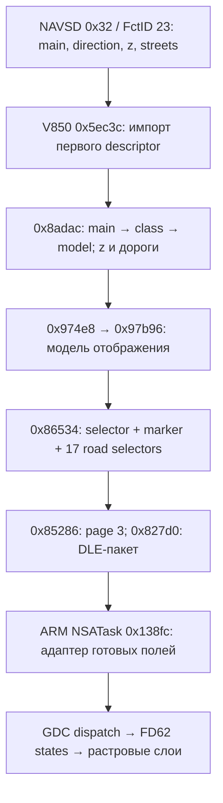

# HUD: BAP → MCU → 3D-стрелка и дороги

> Преобразователь HUD ниже остаётся проверенным эталоном. Примеры прежнего Java mapper-а сохранены как история; **текущий mapper уже использует базовые съезды s033/s036. Все решения: [CARPLAY_HUD_ICON_SELECTION.md](CARPLAY_HUD_ICON_SELECTION.md).**

Проверено 2026-09-11. Исследование офлайн; production Java/C и автомобиль не менялись.
Дистанция/bargraph остаются вне этой работы.

**Преобразователь найден в V850 MCU, FD51.** Исполнены оригинальные инструкции
для 829 уникальных BAP-дескрипторов на G1952 и M2325; результат совпадает
побайтно. Все 169 разных дескрипторов из матрицы 7 890 входов Java и все
12 разных дескрипторов из 216 дополнительных ramp-примеров входят в этот прогон.

Наблюдение изломанной стрелки на съезде объясняется штатной графикой HUD:
`EXIT_RIGHT + E0` выбирает **s35 / r0305**, а `TURN + E0` — **s32 / r0302**.
Direction сам по себе не определяет форму. Сложный путь уже нарисован внутри
одного ресурса; несколько участков не требуют нескольких BAP-манёвров.

**Поправка к предыдущей версии исследования:** привязка EXIT к s39 была
неверной гипотезой по форме. s39/r0309 — это SERVICE_ROAD_RIGHT=17.
Также исправлен runtime GP MCU: **0xFEDFF8B4**, а не 0xFEDF78B4.

Для выбора подходящей формы: [единый атлас всех 121 основных 3D-состояний,
z-маркеров и особых случаев](../../output/maneuver-audit/hud-all-maneuvers.png).
В каждой карточке указаны номер s, пример BAP main/direction, sideStreets и ресурс.
Атлас воспроизводится `python3 tools/build_hud_maneuver_atlas.py`; данные карточек
сохранены в [JSON](../../output/maneuver-audit/hud-all-maneuvers.json).


Изображения выше собраны из исходных ресурсов и координат FD62 по измеренным
selector-ам MCU. Это реконструкция навигационных слоёв в активном 3D-режиме 3,
не фотография HUD и не эмуляция всех режимов композиции/анимации.

## Какие поля мы отправляем

При exitAngle=+45°, junctionType=0, z=0, без junctionAngles:

| iAP2 | BAP main/direction HEX | sideStreets | MCU → основной ресурс | Наш renderer |
|---|---|---|---|---|
| OFF_RAMP 8 / HIGHWAY_OFF_RAMP_RIGHT 23 | 15 / E0 | 00 | s35 / r0305 | EXIT |
| ON_RAMP 9 | 13 / E0 | пусто | s32 / r0302 | MERGE |
| SLIGHT_RIGHT 50 / KEEP_RIGHT 14 | 13 / E0 | пусто | s32 / r0302 | TURN |
| CHANGE_HIGHWAY_RIGHT 53 | 12 / C0 | пусто | s25 / r0295 | EXIT |

Контракт первого слота: `main, direction, z, count, streets…`:

```text
съезд:               0f e0 00 01 00
въезд/slight/keep:    0d e0 00 00
смена магистрали:     0c c0 00 00
```

Это расчётные байты из реальных полей bridge, не CAN capture. У восстановленного
stock JAR есть артефакт пустых строк `isNativeLittleEndian`, описанный в общем
аудите; он не подставляется вместо sideStreets в MCU-прогон.

У съездов 8/22/23 боковая дорога 00 фиксирована независимо от junctionAngles.
ON_RAMP всегда получает пустые боковые дороги, SLIGHT/KEEP вычисляют их по входу.
Поэтому равенство въезда/slight/keep относится к одинаковым descriptor-ам,
а не ко всем возможным junctionAngles. RHT/LHT при явно заданном знаке угла
не меняют сторону; у OFF_RAMP без угла есть fallback по стороне движения.

Источники: [ManeuverMapper](../../../java_patch/com/luka/carplay/rgd/ManeuverMapper.java),
[SideStreets](../../../java_patch/com/luka/carplay/rgd/SideStreets.java),
[BAPBridge](../../../java_patch/com/luka/carplay/rgd/BAPBridge.java).

## Проверенная таблица съездов

В таблице z=0 и sideStreets=[00]. Номера road selectors — десятичные;
это внутренние поля HUD, не BAP direction.

| BAP | Основной selector / ресурс | Road selectors | Видимая форма |
|---|---|---|---|
| EXIT_RIGHT 15/00 | s33 / r0303 | 61,16 | Прямо → диагональный переход → продольный выход |
| EXIT_RIGHT 15/C0 | s34 / r0304 | 61,18,16 | Прямой вход и диагональный выход |
| EXIT_RIGHT 15/E0 | s35 / r0305 | 61,19,16 | Изломанный переход с дополнительным участком перед диагональным выходом |
| EXIT_RIGHT 15/A0 | **s0 / пусто** | пусто | **Нет 3D-стрелки и дорог** |
| EXIT_LEFT 16/00 | s36 / r0306 | 62,21 | Излом с продольным выходом |
| EXIT_LEFT 16/20 | s37 / r0307 | 62,22,21 | Излом перед диагональным выходом влево |
| EXIT_LEFT 16/40 | s38 / r0308 | 62,23,21 | Прямой вход и диагональный выход |
| EXIT_LEFT 16/60 | **s0 / пусто** | пусто | **Нет 3D-стрелки и дорог** |

Остальные направления из сетки 00,10,…,F0,FF тоже дают s0 для этих EXIT-семейств.
Для строгой совместимости допустимы RIGHT: 00/C0/E0, LEFT: 00/20/40.

**Подтверждённая проблема mapper-а:** `rampDirection` при ±135° выдаёт A0/60.
Для этих сочетаний таблица MCU возвращает model=0. Перед обновлением штатный
`0x8ab76` вызывает reset `0x8acb0`, очищающий модель, маркер и дороги, поэтому
это не наследование предыдущей геометрии. Утверждение комментария Java, что
sharp ramp получает «fuller arrow», неверно для проверенных прошивок HUD.

Это результат активного 3D-конвертера. Выбор другого режима панели при таких
входах не эмулирован; отсутствие стрелки на всём HUD во всех режимах не заявляется.

Для сопоставления всей семантики:
[все 35 определённых BAP mainElement](HUD_BAP_3D_SELECTORS.md),
[все 54 iAP2 типа RHT/LHT](MANEUVER_MAPPING_TABLE.md).

## Полная цепочка в прошивке



Адреса V850 ниже — linked VA, **file offset = VA − 0x20000**.

### 1. Импорт NAVSD FctID 23

`0x5ec3c` вызывает `0xa5ed6(0x32,0x17,&property,&length)` и читает 60 байт
из кэша свойства. Первые байты становятся:

| Поле | RAM |
|---|---|
| mainElement, u16 | 0xFEDFADD4 |
| direction, u16 | 0xFEDFADD6 |
| zLevel, u16 | 0xFEDFADD8 |
| признак sideStreets, count | 0xFEDFADDA / 0xFEDFADDB |
| до 16 байт sideStreets | 0xFEDFADDC |

Таблица объектов `0x23f64`: объект 9 указывает на этот 24-байтовый record.
`0x65b2a → 0x5e12a` копирует его конвертеру.

Особое правило: `FOLLOW_STREET(11)/00`, z=0, streets=[] очищает первый
record и переносит следующие три байта в другой record. Поэтому s0 для этого
входа в изолированном первом 3D-слоте нельзя трактовать как пустой HUD во время
обычного следования маршруту. Прежнее назначение ему s23 также было гипотезой.

### 2. Основная стрелка и серые дороги

`0x8ab76` вызывает пары reset/update из таблицы `0x27940`. Для манёвра это
`0x8acb0` и `0x8adac`. При разрешённой навигации update выполняет:

1. `0x8b32e`: 34 записи `main → class` в `0x27e24`.
2. `0x8b3b2`: 17 направлений в `0x27d54`, матрица 23×17 записей по 8 байт
   в `0x388e4`. Первый u32 — enum модели, записывается в `0xFEDFC270`.
3. При model=0 обработка геометрии заканчивается. Иначе `0x8b486` выбирает z-marker,
   `0x8b536` формирует массив дорог.

Семейства: TURN 13 и TURN_ON_MAINROAD 14 → class 6; EXIT_RIGHT 15 → 7;
EXIT_LEFT 16 → 8; SERVICE_ROAD 17/18 → 9/10. Именно class объясняет различный
рисунок при одинаковом direction. Плоского правила `E0 → одна стрелка` нет.

Дороги строятся отдельно от основной стрелки:

- `0x27d9c`: для каждого class — семейство дорог и индекс дороги входа.
- `0x27990`: enum и порядок отрисовки стандартного входа.
- `0x8b6fa`: добавляет дорогу выхода по direction, список u16 в `0x27d76`.
- Боковые дороги сопоставляются со списком byte-кодов в `0x27dfe`; выезд исключается.
- `0x39e24`: семейство × направление → enum дороги и ключ порядка.
- `0x8b798`: стабильная сортировка по ключу. Ёмкость — 17 элементов.

Следствие: `streets=[]` **не означает отсутствие серых дорог**.
TURN 13/E0 сам создаёт selectors 60,15; EXIT 15/E0 — 61,19.
Наш дополнительный sideStreet 00 добавляет третью дорогу 16.
Для CHANGE_LANE и SERVICE_ROAD часть серого рисунка встроена в основной ресурс;
нулевой road selector не создаёт дополнительной поверхности.

Z-таблица `0x27978` содержит всего четыре записи: class 7 + z1/z2 → markers1/2,
class 8 + z1/z2 → markers3/4. В этом конвертере z-marker специфичен для EXIT.
Обычный TURN при z1/z2 не получает такой маркер. Текущий hook обычно отправляет z=0.

### 3. Модель → байты страницы → транспорт

`0x974e8(mode=3/8) → 0x97b96` переносит модель в `0xFEDFC600`, дороги —
`0xFEDFC604`, count — `0xFEDFC648`, marker — `0xFEDFC649`.
`0x99a64 → 0x98378`, объект 2 таблицы `0x29030`, возвращает эти 76 байт.

`0x86534` в режиме 3/8 пакует 19 байт: main selector, marker, 17 дорог.
Таблицы позднего преобразования: `0x277ba` для main enum, `0x2749a` для marker,
`0x27890` для road enum. **Enum модели тоже не равен selector**:
например, EXIT15/E0 даёт model36, но selector35.

`0x85286` строит page3 длиной 119 байт, навигационные поля начинаются с payload[19].
`0x8508e` выбирает page builder и сохраняет payload в `0xFEDFC1E4`.
`0x8a984 → 0x81b9e → 0x81dea → 0x827d0` формирует внутренний кадр:

```text
10 02 + escape([01, payloadLengthLE16, sequence] + payload + xor(payload)) + 10 03
escape: каждый 10 удваивается
```

`0x82a8e → 0x83154` передаёт пакет через периферию/DMA. Это внутренний
последовательный транспорт, а не формат CAN/BAP. В ARM-ядре `0x80028d18`
вызывает инициализацию `0x8003f458(0x3f040000,160,2000000)`;
драйвер именует каналы SpiUsartDev0…5. NSATask открывает SpiUsartDev4.
Совпадают назначение канала и формат кадра; физическая проводка отдельно не исследовалась.

### 4. NSATask и GDC

NSATask G1952: FD61 text file offset 0xe2000, size 0x17ce4, linked 0x10000;
data file 0xf9ce4, linked 0x28000. Старое размещение NSA в combined IDB
0x80700000 нельзя использовать как link address приложения.

`0x10464` снимает DLE framing, `0x109fc` проверяет кадр,
`0x134d8 → 0x138fc` обрабатывает page3. Адаптер копирует 108 готовых байт
`frame+15 → state+18`; `0x13cd8 → 0x2297c` отправляет GDC пакет длиной 123.

| Поле | MCU payload | Декодированный NSA frame | GDC packet |
|---|---:|---:|---:|
| Page | 0 | 4 | 8 |
| Group mask | 1…4 | 5…8 | 9…12 |
| Main selector | 19 | 23 | 22 |
| Marker | 20 | 24 | 23 |
| 17 road selectors | 21…37 | 25…41 | 24…40 |
| 2D selector | 99 | 103 | 102 |

GDC использует group2, field9 для основной 3D-стрелки, field10 для marker,
fields11…27 для дорог. Узел main FD62 — `0x8da20`, 121 состояние с сохранением
пустого нулевого. State содержит ссылки на 44-байтовые surface records.
В них ресурс и координаты x/y/width/height по смещениям 30/32/34/36.
Дороги представлены парами outline/fill. Общие 3D-слои размещаются до основной
стрелки. Это готовые растровые ресурсы, не построение вектора из угла.

Проверка GDC dispatch/walker: 2 450 состояний на каждой прошивке, всего 4 900.
Проверка NSA page adapter: 768 случаев на G1952. MCU descriptor converter:
829 случаев на каждой прошивке, **7 207 899 оригинальных инструкций на прошивку**.

## Отличия от maneuver_render и следующий шаг

- `draw_exit` строит фиксированный трёхсегментный путь с продольным наконечником.
  Он ближе к EXIT/00. HUD меняет ресурс между 00/C0/E0; для A0/60 он возвращает
  пустую 3D-модель. Один наш ICON_EXIT этого различия не выражает.
- ON_RAMP при пустых junctionAngles отправляет тот же descriptor, что SLIGHT/KEEP,
  и HUD получает обычный TURN. Наш renderer выбирает отдельную MERGE-геометрию.
- CHANGE_HIGHWAY_RIGHT отправляет CHANGE_LANE/C0 и HUD рисует s25;
  renderer объединяет этот случай со съездом. SERVICE_ROAD — ещё одна отдельная форма.
- Даже одинаковое направление стрелки не гарантирует совпадения дорог:
  MCU добавляет вход/выход, использует семейства и сортировку, renderer работает
  с исходными junctionAngles.

Для 1:1 renderer должен получать **тот же resolved BAP descriptor**, что HUD,
и разделять семейство стрелки, направление, marker и дороги. Эталон преобразования
теперь есть: [hud_mcu_decoder.py](../../../tools/hud_mcu_decoder.py), сверенный с
оригинальным исполнением всех 829 случаев на обеих прошивках. Простая замена
всех ramp-ов на TURN разрушила бы штатную геометрию съезда.

Первое изменение отправителя, которое требует реализации: заменить неподдерживаемые
EXIT/A0 и EXIT/60 на согласованный допустимый fallback, с отдельными проверками
HUD и приборки. Выбор fallback меняет отправляемую семантику; в исследовании
такой выбор не подменён предположением. Затем объединить выбор слота/кэш двух
отправителей и переносить семейства HUD в renderer.

## Воспроизведение и границы

```sh
bash scripts/audit_maneuvers.sh
python3 tools/audit_hud_maneuver_mapping.py prepare
# В Ghidra: загрузить V850 FD51 на 0x20000, выполнить:
# tools/ghidra/HudManeuverChainAudit.java input.csv output.csv [FD51 override]
# Два запуска: G1952 -> mcu-chain-output.csv; M2325 -> mcu-chain-M-output.csv.
python3 tools/audit_hud_maneuver_mapping.py check
python3 tools/hud_mcu_decoder.py /path/to/G1952/blocks/FD_51FLASHDATA.bin
python3 tools/hud_mcu_decoder.py /path/to/M2325/blocks/FD_51FLASHDATA.bin
python3 tools/build_maneuver_comparison.py
python3 tools/build_hud_ramp_comparison.py
```

V850-прогон исполняет импорт, конвертер, перенос модели, упаковку selector-ов
и оригинальные memcpy/memset. Единственная подмена — accessor кэша BAP 0xa5ed6:
он возвращает подготовленное свойство 0x32/0x17 длиной 60. RAM очищается перед
случаем, навигация доступна, активный режим 3 задан явно, слоты 2/3 пусты.
Полный запуск MCU, CAN, выбор режимов, тайминги, оптика и весь композитор не эмулированы.
Сборщик DLE-пакета изучен статически; на CPU в этом прогоне исполнялась упаковка
19 навигационных полей, не весь аппаратный тракт.

Runtime: image base 0x20000, **GP 0xFEDFF8B4**, TP 0x28018, CTBP 0xB59C0.
Startup сначала загружает GP 0xFEDF78B4, затем дважды прибавляет 0x4000.
Этим объясняется прежняя ошибка адресов RAM на 0x8000. Корректный экспорт:
[mcu-verified](../../../output/r2/hud-ramps-2026-09-11/mcu-verified/0x8adac.c).
Обширный старый mcu-linked кэш с ошибочным GP не является доказательством.

Артефакты:

- [Проверки G/M, покрытие, SHA256 CSV](../../output/maneuver-audit/mcu-chain-checks.json).
- [829 входов](../../output/maneuver-audit/mcu-chain-input.csv),
  [результат G](../../output/maneuver-audit/mcu-chain-output.csv),
  [результат M](../../output/maneuver-audit/mcu-chain-M-output.csv).
- [Все 7 890 Java-входов с измеренными HUD-полями](../../output/maneuver-audit/java_mapping-hud.csv).
- [216 ramp-входов с HUD-полями](../../output/maneuver-audit/ramp_mapping-hud.csv).
- [Таблицы MCU G](../../output/maneuver-audit/mcu-tables-G1952.json),
  [M](../../output/maneuver-audit/mcu-tables-M2325.json).
- [Слои и координаты восьми изображений](../../output/maneuver-audit/hud-ramp-layer-composites.json).
- [NSA 768](../../output/maneuver-audit/nsa-navigation-transport.json),
  [RE-адреса и fingerprints](../../../output/r2/hud-ramps-2026-09-11/report.md).
