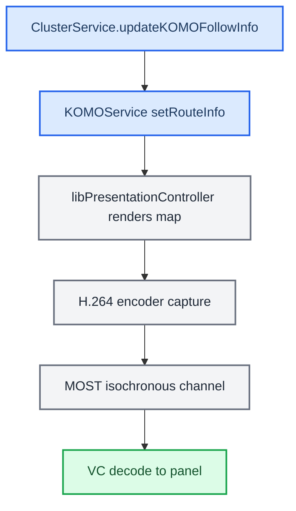
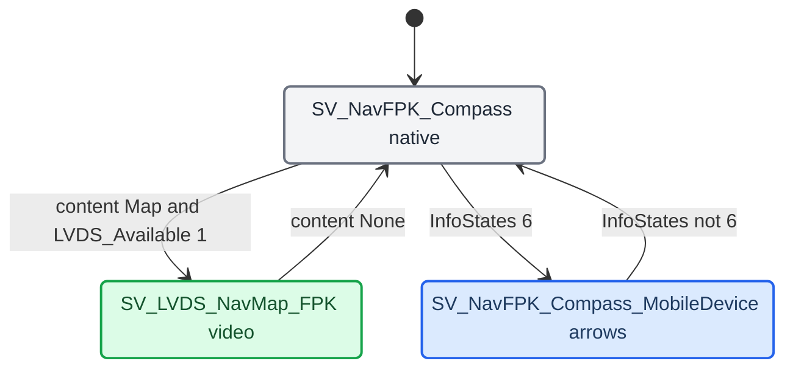

# HUD Renderer

*What actually draws the turn: the windshield HUD firmware, our procedural 3D arrow `maneuver_render` in the cluster (scene engine, wire protocol, fill and blink, camera, contact shadow), the stock KOMO video-map pipeline that CarPlay no longer feeds, and the VC FPK state machine.*

---

## 📋 Three things called "the renderer"

These are three different processes with three different jobs. `[car]`, `[code]`

| Name | What it is | How it is fed |
|---|---|---|
| HUD | The windshield head-up display. Its own firmware draws the icon and bargraph from raster layers | BAP via the stock `AppConnectorNavi`; no pixels from us. Chain in [[Maneuver Mapping]] |
| `maneuver_render` | Our procedural 3D arrow on displayable 98 in the cluster (EGL, 328×181) | Java commands over TCP `:19800` (Java is the server); it builds geometry, materials and animation itself |
| `altscreen_render` | The CarPlay map plane on the cluster (displayable 99) | The type-111 stream; see [[AltScreen Cluster Video]] |

`maneuver_render` does not push pixels to the HUD. `altscreen_render` is neither a BAP sender nor a maneuver engine. The maneuver displayable is 98, not the stock 20 (`maneuver_render/protocol.h:90-113`). Both renderers belong to the CarPlay supervisor, and Java never spawns one per maneuver (`java_patch/com/luka/carplay/rgd/BAPBridge.java:1983-1988`). `[code]`

The header comment in `protocol.h:99-104` still lists the old context composition `dc[80]={98,102,101}` / `dc[81]={98,102,101,33}`; the live tables are in [[Cluster Contexts]]. `[code]`

## 🔄 What is actually synchronized

"One synchronized animation" is the wrong description (Luka, 2026-09-13). `[code]`

| Thing | Contract |
|---|---|
| Maneuver | One current RGI maneuver and one agreed icon action for HUD and renderer |
| Lanes | One active lane event and one shared visibility decision (see [[Lane Guidance]]) |
| Progress target | BAP gets a percent; the renderer gets the matching remaining level 0…16 |
| Blink | One Java 600 ms high/low phase source; each phase goes to both outputs (`BAPBridge.java:58`, `:289-310`) |
| Renderer fill | Its own smooth animation toward the target, with its own speed and retreat |
| Camera travel | Its own native transition between scenes |
| Physical display moment | Transports and displays are asynchronous; frame-exact coincidence is not guaranteed |

The renderer has no blink-phase generator; it only smooths toward the received phase. The HUD draws its bargraph; the VC shows arrow fill; same target and phase, different presentation. `rendererManeuverPending` stops progress of a new maneuver being sent to the old arrow before the new geometry is accepted (`BAPBridge.java:352`, `:913`); it does not tie native travel speed to the HUD firmware.

Sources: `RGI_HUD_RENDERER_KNOWLEDGE`

## 🔧 The procedural arrow and scene engine

The target is a close match to the HUD icon's shape and action, not a pixel copy: materials, proportions and animation differ. Exact turn angles (including sharp > 100°), full roundabout rings, slight ramps with the forward road, and a separate lane strip are kept on purpose. The per-type rules are in [[Maneuver Mapping]]. `[car]`

- **Ownership:** `scene/scene.h` exposes a C ABI over a cached C++11 compiler. A scene takes only a maneuver, its generation and the settled projection. Current and next scenes own separate geometry and swap when the native motion engine commits; pending maneuvers are owned copies. The same semantic input reuses the scene; there is no rebuild or allocation while the camera travels. QNX builds use the C ABI with no libstdc++, exceptions, RTTI or emutls. `[code]` (`maneuver_render/scene/scene.h`, `scene/scene.cpp`)
- **Families:** simple turns use retained pavement with thin white curbs and longitudinal entry/exit fades. Complex families keep the built-in geometry in `maneuver.c`: junction branches, sharp turns, U-turn overlap lift, full roundabouts, exits, merges, `LANE_CHANGE` and arrival flags (own stage-dependent layout). `LANE_CHANGE` is a maneuver type; it never implies a multilane road. `[code]`
- **Native icon set:** `ICON_NONE 0, APPROACH 1, TURN 2, UTURN 3, MERGE 4 (legacy, no automatic iOS mapping), EXIT 5, ROUNDABOUT 6, ARRIVED 7, LANE_CHANGE 8, ROUNDABOUT_EXIT 9 (short arc, never selected by the bridge)`. UTURN uses the explicit direction first and falls back to driving side; ROUNDABOUT runs RHT counter-clockwise, LHT clockwise. `[code]` (`maneuver_render/maneuver.h:24-34`)
- **Shared style:** `visual_style.h` is the single source for road width 0.26, arrow width 0.14, shoulder 0.022, route base 0.002 / top 0.008, neutral `#646464` asphalt (0.392) and white curbs (0.98). FOV 40° (`render.c:56`). No extra outlines or decorative passes. `[code]` (`maneuver_render/visual_style.h`)
- **Where to change what:** TLV/present bits `hook/routeguidance/rgd_tlv.c`; caches and `route_generation` `rgd_hook.c`; State and presentation worker `RouteGuidance.java`; BAP, distance/blink, retry `BAPBridge.java`; HUD semantics `ManeuverMapper.java`, `SideStreets.java`; renderer semantics `RendererMapper.java` (not a "Java crutch": it holds the agreed ramp/slight/angle rules); raw lanes `LaneGuidanceSnapshot.java`; queue and readiness `RendererServer.java`; VC crop `ClusterLayerController.java`; scene `scene/scene.cpp`, `geometry.cpp`, `layout.cpp`; transitions and built-in families `maneuver.c`; fill `arrow_progress.h`, `route_progress.h`; lanes `scene/lane_panel.cpp`, `lane_guidance.h`; shadow `contact_shadow.h`; shader/alpha/FBO `render.c`.

Sources: `SCENE_ENGINE`, `RGI_HUD_RENDERER_KNOWLEDGE`

## ⚙️ Wire protocol on :19800

Fixed 48-byte packets `{cmd, flags, payload[46]}`, integers big-endian. Java is the TCP server (`RendererServer`, port 19800), the renderer connects in. `[code]` (`maneuver_render/protocol.h:15-52`)

| Command | ID | Payload |
|---|---|---|
| `CMD_MANEUVER` | 0x01 | `[0]` icon, `[1]` direction −1/0/+1, `[2..3]` exit angle, `[4]` driving side, `[5]` road count 0…18, `[6..41]` road angles, `[42]` progress state (flag 0x20), `[43]` perspective, `[44]` remaining level, `[45]` progress mode |
| `CMD_SCREENSHOT`, `CMD_SHUTDOWN`, `CMD_PERSPECTIVE`, `CMD_DEBUG` | 0x02…0x05 | tooling |
| `CMD_PROGRESS` | 0x06 | `[0]` remaining level 0…16, `[1]` mode, `[2]` phase (flag 0x20) |
| `CMD_CLEAR` | 0x07 | blank the popup, drop maneuver + progress, keep the link |
| `CMD_VISIBLE_AREA` | 0x08 | `[0..7]` x, y, w, h as BE u16 source pixels, top-left origin |
| retired scene-road | 0x09…0x0b | lane-road experiment only |
| `LANES_BEGIN/LANE/COMMIT` | 0x0c…0x0e | independent lane batch, see [[Lane Guidance]] |

| MANEUVER flag | Meaning |
|---|---|
| 0x01 `SET_PERSP` | apply perspective `[43]` after the transition (BAPBridge sends 1) |
| 0x02 `PROGRESS` | initial level/mode in `[44..45]` |
| 0x04 `BAP_GEOMETRY` | angles are signed **half-degrees** (−135 = −67.5°); no snap unless 0x10 |
| 0x08 `REFRESH` | replace the latest geometry (roads of the same slot/version), keep the transition |
| 0x10 `SNAP_TO_ROAD` | raw roundabout roads include the active exit, snap allowed |
| 0x20 progress state | explicit `0 OFF, 1 FILL, 2 BLINK_LOW, 3 BLINK_HIGH` (`maneuver_render/arrow_progress.h:5-9`) |

Only maneuver geometry uses half-degrees; lane angles are plain degrees; do not apply one conversion to every field. Legacy senders still work: without 0x04 angles are whole degrees with legacy snap; without 0x20, mode 1 fills and every other mode (including legacy mode 2, which has no phase) is the quiet arrow; unknown state or inconsistent mode is quiet; mode 2 never starts a native blink clock. When several packets coalesce, a later REFRESH never cancels an earlier maneuver's transition (`maneuver_render/maneuver_command.h:9`). NONE clears directly without an ARRIVED path; deferred perspective/progress still apply. **Deploy a new JAR and a new renderer together:** the new binary accepts old commands, but an old binary does not understand half-degrees or icons 8/9. `[code]`

Renderer → Java events: `EVT_HEARTBEAT` 0x80 every 1 s (Java treats 5 s of silence as dead), `EVT_READY` 0x81 after EGL init, `EVT_FRAME_READY` 0x82 after the first swapped maneuver frame, `EVT_FRAME_CLEARED` 0x83 after CLEAR (any older FRAME_READY belongs to the old content). `[code]` (`protocol.h:29-33`, `java_patch/com/luka/carplay/rgd/RendererServer.java:52-59`)

### Delivery and readiness

After `9720844` "dirty" means "still needs publishing", not "changed in the last frame". `[code]`

- `RendererServer` queue: 32 entries (`RendererServer.java:49`). Accepted MANEUVER and CLEAR are never evicted by progress; progress coalesces only after the last MANEUVER/CLEAR (never across an identity boundary), and a new maneuver carries its initial progress. Old viewport and lane snapshots are replaced by the newest. A fully critical queue returns failure and the worker retries after 500 ms (`RouteGuidance.java:63`); backpressure never drops a live socket.
- The geometry cache updates only on a successful enqueue, so an accepted geometry is not replayed as a second camera travel. A HUD or enqueue failure keeps its flags until a retry succeeds; a following distance-only frame does not erase a pending maneuver; the worker can replay the cached snapshot without new iOS activity.
- Losing the peer resets readiness; a new session gets a primer plus the cached snapshot. First entry to ctx 80 needs a successful publish **and** a ready frame; on peer loss ctx 81 returns. A temporary BAP error does not hide an already confirmed view while the renderer lives.
- Enqueue success is not hardware confirmation. There is no distributed HUD+VC atomic frame.
- The remaining-time estimate keeps its source timestamp; replay, reconnect or view changes do not rejuvenate `600 → 480` back to 600.

Sources: `RGI_HUD_RENDERER_KNOWLEDGE`, `MANEUVER_RENDERER_PARITY_FIXES`, `ARROW_PROGRESS_EXPERIMENT`

## 📈 Colour, fill and blink

Accepted OEM+ look: `[code]` (`maneuver_render/render.c:357-358`), `[car]`

| Element | Value |
|---|---|
| Asphalt | neutral `#646464` (`visual_style.h`) |
| Road outline | light neutral, no extra blue |
| Resting arrow | bright white; shader input `(1.000000, 0.980392, 0.909804)` compensates the cool lighting |
| Fill and blink high | the established HUD blue; shader input `(0.32, 0.77, 1.0)` |
| Blink low, off, empty fill | exactly the resting colour; there is no third colour |

These are material inputs, not promised output RGB after lighting. The earlier grey-blue base was hard to read on the cluster; red as a fill colour was rejected by Luka. White is brighter than blue, so blinking reads as a colour change, not a brightness increase (the name "glow" does not promise brightening). The approved comparison images under `output/oem-white-study/` were not preserved.

**Fill geometry:** progress runs along the visible projection of the centreline from its first entry into the actual VC crop to the tip, including bends and the head. World-distance tags keep path order at crossings; screen-distance mapping makes the 16 steps roughly equal in visible length (not equal area). Hidden entry/exit extensions consume no progress. Up to 481 cached centreline samples per mesh (`route_progress.h:6`, ≈ 7.5 KiB), one float per vertex (28.1 KiB per full mesh), plus a shared ≈ 5.7 KiB projection scratch map; one attribute and two scalar varyings cancel perspective interpolation inside long triangles. The soft edge spans 11% of the length (feather 0.055 each side, `route_progress.h:7`; Luka's choice 2026-09-12); at level zero it starts fully behind the visible entry, so the first non-zero step does not paint the whole tail. On the host, the first six steps measured 23/22/22/21/22/21 px on a 656×362 capture. Fill adds no texture, FBO, pass or progress-driven mesh rebuild; settled off/blink states skip the projection work. `[code]`, `[model]`

**Motion:** remaining level falls 16 → 0 while fill grows 0 → 1. A critically damped response keeps position and velocity on retarget (≈ 95% of a static step in 300 ms, no overshoot); duplicates never restart it. Blink tint rises in 100 ms and falls in 150 ms (`arrow_progress.h:164`, `:176`). `[code]`

*State of the progress controller across a maneuver handoff.*

```mermaid
stateDiagram-v2
  accTitle: Arrow progress handoff states
  accDescr: The outgoing arrow's fill retracts over 0.40 seconds, stays empty until the native engine commits the next maneuver, then refills to the latest held target; CLEAR resets everything.
  [*] --> filling
  filling: Filling toward target
  retract: Retract outgoing fill 0.40 s
  empty: Empty, new target held
  refill: Refill incoming arrow
  filling --> retract: engine push starts
  retract --> empty: fill reaches zero
  empty --> refill: engine commits next maneuver
  refill --> filling: target reached
  filling --> [*]: CLEAR or NONE
  classDef primary fill:#dbeafe,stroke:#2563eb,stroke-width:2px,color:#1e3a5f
  classDef warning fill:#fef9c3,stroke:#ca8a04,stroke-width:2px,color:#713f12
  class filling,refill primary
  class retract,empty warning
```

- Retract/refill begins and ends at the **actual** engine push/commit (`CR_PROGRESS_RETRACT_SECONDS .40f`, `arrow_progress.h:10`), not when a MANEUVER command arrives. Targets that arrive during travel are held; a third pending maneuver has separate ownership and cannot overwrite the entering one's target; an unusually early commit still finishes the retreat smoothly. Blink tint starts leaving during motion. A roads-only refresh does not start a handoff; CLEAR resets fill and tint. `[code]`
- This replaced the earlier experiment behaviour ("new maneuver keeps the visible tint and immediately blends to its own progress"), which Luka stopped after seeing the next fill appear during camera travel. `[car]`
- The old VC bargraph column is gone entirely; its right/left side logic is history (see [[Distance Bargraph]]).

Sources: `ARROW_PROGRESS_EXPERIMENT`, `SCENE_ENGINE`, `LANE_ROAD_EXPERIMENT`

## ⚙️ Viewport and camera

- Source size stays **328×181**: 180 content rows plus one ECC annotation row (`protocol.h:111-112`). Never fix placement by raising resolution, changing aspect/FOV or pulling the camera far back. `[code]`
- The small safe frame `(59,27,210,153)` (the "red frame" in the preview) is a composition guide, not a clip of the road. Classic/Sport and small/big stage are different axes; the real crop comes from `ClusterLayerController.maneuverViewport()` (popup crop or in-tube crop from the stock `Layout`, fallback `(59,27,210,153)` / `(0,0,328,180)`), never from a mode name; a big-screen layout can show the narrower popup. Write `210px` / `328px` explicitly in docs and tests. `[code]` (`java_patch/com/luka/carplay/cluster/ClusterLayerController.java:57-87`)
- Viewport changes animate over 250 ms (`visible_area.h`), move the lane row and visible area, and never restart the maneuver. Clipping the scene corners to the old small rectangle is forbidden; side roads fade to transparency instead of a hard cut. With lanes shown the camera dollies back 12–18% (details in [[Lane Guidance]]). `[code]`

Sources: `RGI_HUD_RENDERER_KNOWLEDGE`, `MANEUVER_BARGRAPH_VIEWPORT`

## 🔧 Contact shadow at self-overlaps

Sharp turns and U-turns lift the arrow over itself (\|angle\| > 150°). A narrow contact strip separates the upper arrow from the lower route face without changing path geometry, height ramps, tint or alpha. `[code]` (`maneuver_render/contact_shadow.h`)

- Uses real top-surface boundaries clipped to lower receiving triangles with positive clearance; adjacent sloping faces and internal triangulation edges are rejected geometrically; solid intersections (some accepted sharp meshes intersect instead of leaving an air gap) are handled.
- Radius max 0.025 world units (`CR_CONTACT_RADIUS`), weaker for larger gaps (`CR_CONTACT_MAX_GAP 0.140`). Width starts at **zero** at the crease and grows with clearance, normalized once per mesh; the first 15% also feathers opacity; width is evaluated per fragment. This replaced a constant-width strip and a source-distance cutoff that left the first quarter of the crease unshadowed.
- Geometry is cached with the mesh (fill/blink never rebuild it); coplanar meshes exit before edge hashing; bounded to 1,536 contact vertices per mesh (`CR_CONTACT_MAX_VERTS`); one multiplicative draw using the existing depth buffer, no texture or FBO. At most 396 vertices across a 73-angle sweep; ≈ 0.30 ms/build for a 160° turn on the host (not an HU figure). `[model]`

`tools/capture_contact_shadow.py --before|--origin|--taper <old-host-binary>` compares eight real GL scenes; ordinary 90° turns and the non-overlapping U-turn render identically (FXAA may move a few edge pixels). The capture folders under `output/arrow-progress/` were not preserved.

Sources: `ARROW_PROGRESS_EXPERIMENT`, `SCENE_ENGINE`

## ⚡ Watchdog and lifecycle

- `eglSwapBuffers` on the old Adreno/WFD stack has no timeout, and a wedged process still has a live PID. A watchdog thread only observes loop progress; after **5 s** without progress (15 s before the render loop starts) it writes `progress watchdog TIMEOUT phase=<stage>` to stderr and exits so the supervisor restarts it. Stages: startup, poll, commands, engine, lane-update, lane-framing, prepare, begin-frame, scene-draw, lane-draw, end-frame, screenshot, egl-swap, window-probe, heartbeat, sleep, idle. It never calls EGL or logs per frame (a blocked EGL client may hold libc locks). `[code]` (`maneuver_render/main.c:136-200`)
- The `lane-update` timeout on 2026-09-16 was the QNX `std::fmin` self-recursion, see [[Lane Guidance]]. `[car]`
- An earlier reconnect capture exposed a native bug: RST and event-write failures dropped TCP without clearing content or invalidating FRAME_READY. They now share the FIN cleanup path, and EINTR no longer tears down a healthy socket. `[code]`

Sources: `MANEUVER_QNX_LANE_MATH`, `ARROW_PROGRESS_EXPERIMENT`

## 🔍 Verification

All offline; none of these runs is an on-car proof of the current binaries (the `9720844` set was built and host-tested, not deployed). `[model]`

| Command | Covers |
|---|---|
| `bash scripts/test_route_info.sh` | Java 1.4 build, presentation (1,363 checks), maneuver parity (957–977), stock BAP serializer, blink phases, viewport, parser |
| `bash scripts/test_java_transports.sh` | loopback transport, backpressure, CLEAR ordering, 30 restarts |
| `python3 scripts/check_local_protocols.py` | 38 Java/C protocol constant matches |
| `bash scripts/test_maneuver_native.sh` | ASan/UBSan: all families, partial meshes, retraced paths, 40 Hz retargets, 200 Hz duplicates, 30/60 Hz equivalence, TCP FIN/RST, half-degrees, refresh, coalescing, NONE, ±160° lift |
| `make -C tools/maneuver-preview all test`, `capture.py`, `capture_lanes.py`, `test_lane_transport.py` | 32 scenes × 2 stages, 64 GPU stills, 10 camera/progress handoffs with exact settled endpoints and no recompilation during travel |
| `python3 tests/test_rgd_native_contract.py` | real TLV parser + reset/slot writer + Java + stock BAP sender |
| `bash scripts/build_renderers.sh`, `LOG=0 bash scripts/build_hook.sh`, `bash scripts/build_java.sh` | production ARM artefacts (ARM ELF, no emutls); 107 shipping classes at bytecode 48.0 |

Preview: `build/maneuver-preview/preview --lanes 0`; Left/Right next maneuver with travel, Up narrow/wide frame, Down lane events, P show/hide lanes, Space fill/blink, D red frame. Still needed on the car: both VC compositions, lanes appearing/hiding within one maneuver, blink, travel with fill retreat, reroute, reconnect, day/night readability of the white/blue arrow, real queue/BAP error rates and physical frame skew. `[open]`

Milestones: `3f87f64` forward road for exits and straight maneuvers; `d15e6bf` lane-road experiment and smooth progress handoff; `bc9a50d` scene engine and shared road style; `07e980d` lane-road topology removed, independent lane data, white/blue style; `dda63e4` bottom lane panel with HUD-consistent logic; `9720844` delivery and identity of the shared RGI state restored (queue loss, no retry after publish failure, reused slot/route fields, time-age reset). The arrow-fill work started on branch `experiment/arrow-progress` from `59646e9`. Java cleanup candidates still open: unused `lastDistanceToDestinationM`/`hexBytes`, extra lane-converter parameters; `keepLastColonPart(mAfterRoad)` and replacing a malformed intList token with 0 need a format/reachability check, not blind deletion. Acceptable BAPBridge refactor: split HUD output, renderer output, distance/blink and text/ETA while keeping one State and the shared resolvers. RE roots: `/Users/luka/Desktop/AUDI_2/Firmwares/HUD` and `/Users/luka/Desktop/AUDI_2/Refferences` (`catplay`, `showcase`, `airplay2`, `airplay2-receiver`, iOS builds).

Sources: `RGI_HUD_RENDERER_KNOWLEDGE`, `SCENE_ENGINE`

## ⚙️ KOMO / LVDS map pipeline (stock navigation)

On a MOST-map cluster, the stock navigator's cluster map is a video that the HU renders and streams to the VC. Java assembles `[followInfoRIE, nextManeuverRIE]` and hands it to KOMO. Native code renders, captures, H.264-encodes, and sends it over MOST. The VC decodes it to its panel. `[decompile]`

CarPlay code does not use this path. `BAPBridge` never calls `updateNextManeuver`/`setRouteInfo`, and the March 2026 "KOMO/PresentationController approach" (`startKOMO/updateKOMO/stopKOMO`, `activateClusterVideoPipeline()` with 74→0→72 and `setUpdateRate(1,10)`) no longer exists in the tree. `ClusterService.updateKOMOFollowInfo` is the stock-nav caller. `forceGfxAvailable` returns unless the cluster map is MOST, so on this FPK car it does nothing (it used to park the stock kombi map in a hidden context at ~10 fps after a disconnect, seen 2026-09-21). `[code]` (`java_patch/de/audi/tghu/navi/app/cluster/ClusterService.java:779-797`; `BAPBridge.java:2266-2276`)

The stock control path: `setKOMODataRate(2)` → hint 2 on `ChoiceModel(1,168)` → `CombiMapController` → `switchContext` + `DisplayManager.setUpdateRate`. Three DSI services carry it: `dsi.komoview` (route info), `dsi.komonavinfo` (text), and `dsi.komogfxstreamsink` (fade plus the `updateGfxState`/`updateDataRate` callbacks). On MU1316 only `DSIKOMOView` has a native provider (`libPresentationController.so`); `DSIKOMONavInfo` and `DSIKOMOGfxStreamSink` have none, which is why `updateGfxState(1,1)` never arrived natively. `[decompile]`

During CarPlay, the cluster terminal rate is set by `AltScreenModule` instead: `setUpdateRate(1, 30)` after each switch into ctx 80/81. The old "10 fps" figure applies to the stock path only. `[code]` (`java_patch/com/luka/carplay/core/AltScreenModule.java:50`, `:583`, `:585-599`)

Stock KOMO start and stop sequences

- **Start:** `enableKomoView(true)` + `notifyVisibility(true)` + `setKDKVisibility(true)` + `updateRgActive(true)` + `setKOMODataRate(2)`.
- **Stop:** `setKOMODataRate(0)` → `setKDKVisibility(false)` → `updateRgActive(false)` → `updateNextManeuver(empty)` → `enableKomoView(false)`.

`updateGfxState(1,1)` → `setGFXAvailable(true)`; `updateDataRate(2,1)` confirms full bandwidth. `[decompile]`

---

Inside the stock renderer: libPresentationController and videoencoderservice

- `libPresentationController.so` (9.8 MB ARM32 QNX C++, inside `PNavApp`, source path `…/PresentationController/Code/PresentationController/map/Control/SDK/MapRendering/`) is the only thing that renders maneuvers into the cluster video.
- `komoviewstyle.conf` selects the mode: `KVS_FPK` 210×153 or 328×181 (DSI 2/3), `KVS_Most` 800×252 (DSI 1), `KVS_RGI` 263×366 (legacy MIB1, DSI 255). "MoKo-Story for FPK display, one displayable for all single views, controlled by navigation, no HMI control possible."
- Render targets (`SDKRenderTarget`, `RTP_SHARED_RENDER_TARGET`, up to five `CREATE_MAP_RENDERER_RENDER_TARGET_ID0..4`): `CreateRenderKDKTarget` (intersection drawings from `resources/app/au/nar/intersectionmap/KDK*.kdx`), `CreateRenderExitViewTarget` (`resources/app/au/nar/exitview/`), `CreateRenderDefaultTarget` (map + route line). `ServiceProviderDSIKomoViewImpl` fills `RouteInfoElement[]` (turn type/angle, distance, street, `BapManeuverDescriptor` list). Rendering via `libRenderSystem.so` (RS2D for cluster, RS3D for main), `libLuaMap.so`, `libLuaMapOverlay.so`, `libLuaGraphicsOutput.so` (wraps QNX libscreen).
- `videoencoderservice`: `CASIVideoEncodingSrv` receives `setActiveDisplayable(displayID, displayable)` and `setUpdateRate(displayID, rate)`; `CDisplayTimer` captures; `CDisplayLink` requests the MOST link via `asi.videomanagement`; chain `QCVideoEncoderSrc` (`ipteCaptureDisplayable`) → `QCVideoEncoderH264` (`OMX.qcom.video.encoder.avc`) → `QCVideoEncoderTS` (MPEG-TS) → `QCVideoEncoderSink` → `CMLBISODriver` → `/dev/mlb/` isochronous TX. `videoovermost` is the receive side (TV `/dev/mlb/isoRX1`, AVDC `isoRX2`; channel_id 65558) and is not involved.
- Displays (`graphics_eifs_MMXF.conf`): display 1 main 1024×480, display 4 second 1024×480 mirroring; navigation renders to a displayable captured via IPTE.
- Cluster coding: `/mnt/app/eso/hmi/enableKombiMapFPK` (LVDS/FPK) or `enableKombiMapMOST`; neither = no cluster map. Scripts `clusterCodingLVDS.sh` / `clusterCodingMOST.sh` / `clusterCodingOFF.sh` use `dumb_persistence_writer -P -f 0 3221356656 {03=LVDS, 02=MOST}`. `videoovermost.sh` enables NVVS streaming only if `dumb_persistence_reader -O 412 -L 1 28442848 100` returns 0.
- Firmware paths (MU1316) are under `advanced/MU1316-appimg/navigation/` (libraries, `resources/app/au/nar/pcconfig/komoviewstyle.conf`, `mapprefs.xml`) and `advanced/MU1316-appimg/eso/bin/apps/` (`videoencoderservice`, `videoovermost`).
- Historical: three `libPresentationController` ARM32 patches — NOP StopDSIs at `0x60BE48`, force StartDrawing at `0x61C11C`, fps reads `0x68→0x54` at `0x5C75A0`/`0x5C75E4`/`0x5C783C` — plus `patch_libpresentationcontroller.py`. The script is not in this repo and whether the patches are still deployed is `[open]`.

---

Sources: `hu_maneuver_rendering_pipeline`

## ⚙️ VC FPK state machine

The VC runs a compiled EB GUIDE model (in the `fds` binary). BAP arrives over MOST (LSG 50) via `gssipc-kbd`, which writes dp items. The cluster nav sub-tree has two display targets that matter to CarPlay. `[decompile]`

The VC shows the LVDS map when `INTERN_Active_NavFPK_Content = Map(1)` and `LVDS_Available = 1`. This needs no `InfoStates = 6` and no KSS patch. The VC has no dp item for rgType. It switches on content and InfoStates. `[decompile]` During CarPlay, the HU picture on that link is the terminal-1 composition of ctx 80/81 (planes 98/99/101/102). See [[Cluster Contexts]]. `[code]`

The VC has two independent nav data paths: **BAP** (LSG 50 → MOST → `gssipc-kbd` → dp items → text overlays and HUD) and **MOST Class 46** (→ KSS → EclWrapper/Router → signal groups → KssIpc → EB GUIDE → AIO arrow dp items). They do not overlap for navigation data. `[decompile]`

InfoStates=6 rejection and the AIO-arrow path (not viable)

The AIO-arrow view (`SV_NavFPK_Compass_MobileDevice`) needs `BAP_NavSD_InfoStates_States = 6`. `KSSApplication.bin` `sub_108F42C` validates InfoStates from MOST 0x515 with `a1 <= 0xF && (a1 & 5) != 4 && (a1 & 0xA) != 8` (bit 2 needs bit 0, bit 3 needs bit 1). That rejects 6, because `(6 & 5) == 4` (the `BEQ` at `0x108f436`). Valid values: 0, 1, 2, 3, 5, 7, 10; rejected: 4, 6, 8, 9. The dp item is never set and the arrows never render, even though the `AIO_Arrow` dp items are populated. `[decompile]`

A RAM patch exists in principle: `sub_108F42C` at `0x108F42C` (file offset `0x8F42C`), `0F 28 07 D8` → `01 20 70 47` (`MOVS R0,#1; BX LR`), UDS `3D 14 01 08 F4 2C 04 01 20 70 47`. **It is not viable:** KSS is secure AUTOSAR, UDS WriteMemoryByAddress is RAM-only and lost on every reboot, and there is no persistent flash write from a diagnostic session. The script `archive/infostates6_patch.py` no longer exists in the repo. Production does not need this path.

KSS function map: `EclWrapper_MainTask` `0x10872F0`; `EclWrapper_ProcessMsgIds500_522` `0x1093BD4`; `EclBuildVcPacket_FromMsgId` `0x1093FD2`; `EclCache_UpdateFromQueue239` `0x1094208`; `Queue239_ConsumeToEclCache` `0x105ADA2`; `Queue238_BuildAndSendQueue233` `0x105AD7A`; `Class46_Mode0_PublishQueue239` `0x1069824`; `Class34_Mode0_PublishQueue238` `0x1069790`; `Class34_46_49_Router_Consume238_239_241` `0x105B902`; `KssIpc_SendCmd` `0x1062ABA`; arrow handler `sub_108EB66` (msg 0x2289); InfoStates handler `sub_108EC68` (msg 0x515); validator `sub_108F42C`; init/reset `sub_108ECDE` (0x98F).

Queues: Class 46 → 239 → ECL cache and Router (0x515, 0x2289, 0x98F); Class 34 → 238 → Router and `EclBuildVcPacket` → 233; Class 49 → 241 (0x374/0x375 maneuver distance).

Class 46 nav messages (12 bytes each, 6 hi/lo pairs): 0x500/0x501 ManeuverDescriptor parts (SG 58/61), 0x504 distance (variant-dependent), 0x505 TurnTo street, 0x506 current street, 0x509 route info (SG 58 + 61), 0x50C lane guidance (5 lanes, byteswap, KssIpc dest 0x301D), 0x50F unknown, 0x510 distance to destination, 0x522 RG status (1 byte).

Msg 0x2289 (5 bytes: arrows 0–3 + extra): 0 = no arrow, 1–208 valid, 209–254 rejected (abort), 255 = disabled; an enable bitmask at `off_108EBCC[108]` forces 0xFF for inactive arrows. Stored at `off_108EF40[0..4]`, InfoStates at `[5]`, all in signal group 29. AIO enum: NoArrow 0, Straight 1, StraightLeft 2, Left 3, SharpLeft 4, UturnLeft 5, UturnRight 6, SharpRight 7, Right 8, StraightRight 9; the byte → enum mapping lives in the compiled EB GUIDE model. Other Class 34 messages: 0x108, 0x1105 (compass/gyro), 0x22AE, 0x22AF (16 × u16 nav coords), 0x22B0, 0x516B.

---

Sources: `kss_aio_arrow_analysis`, `hu_maneuver_rendering_pipeline`

## ⚙️ LVDS video link

LVDS is the physical wire from the HU cluster terminal to the VC panel path. The VC switches to `SV_LVDS_NavMap_FPK` when `INTERN_Active_NavFPK_Content = 1` and `LVDS_Available = 1`. The content bit is set by the VC's own EB GUIDE model. `[decompile]`

Renderer side, `setActiveDisplayable` fires only on a real context change. The current code handles this in the `AltScreenModule` worker: when entering ctx 80/81 from a non-CarPlay context, it first switches to ctx 72, waits 180 ms, and then switches to the target. `[code]` (`AltScreenModule.java:47-48`, `:556-582`)

Historical notes, not current code:

- The old `switchContext(0)→72→setActiveDisplayable(4,33)` recipe.
- The `BAPBridge.forceGfxAvailable(true)` unblock. On FPK it now returns early (`BAPBridge.java:2276`).

## 🔗 Related

- [[Maneuver Mapping]]: what the arrow should show for each CarPlay type, and the HUD firmware chain.
- [[Lane Guidance]]: the lane strip, its wire batch and the QNX `fmin` trap.
- [[Distance Bargraph]]: why the VC hides the distance number, and the old bargraph column.
- [[VC Layout and Fonts]]: VC text budget and Classic/Sport.
- [[RGI and BAP Bridge]]: the BAP and renderer outputs that feed this.
- [[Cluster Contexts]]: where displayables 98/99 land on the panel.
- [[Third-party Nav Apps]]: why `ManeuverMapper` gets no maneuverType from some apps.
- [[VC FPK State Machine]]: the VC states the HUD and KDK depend on.
- [[iAP2 Route Guidance TLVs]]: the wire fields behind every maneuver packet.
- [[Cluster Video Encoder]]: the stock cluster video path next to the HUD.
- [[Archive and History]]: earlier HUD/renderer designs and why they were dropped.

## 📚 Sources

Merged originals were removed from the tree after this note absorbed them; they remain in git history (commit 23972aa).

- `RGI_HUD_RENDERER_KNOWLEDGE`: 2026-09-13 master summary of the HUD/renderer decisions.
- `SCENE_ENGINE`: scene compiler ownership, palette, lanes panel, verification.
- `ARROW_PROGRESS_EXPERIMENT`: arrow fill, blink wire, contact shadow history.
- `MANEUVER_RENDERER_PARITY_FIXES`: protocol flags and deploy-together rule.
- `MANEUVER_BARGRAPH_VIEWPORT`: visible-area command and 250 ms animation.
- `MANEUVER_QNX_LANE_MATH`: the watchdog event that exposed the `fmin` hang.
- `LANE_ROAD_EXPERIMENT`: alpha-blend fix and progress retreat origin.
- `hu_maneuver_rendering_pipeline`: stock libPresentationController → MOST video chain.
- `kss_aio_arrow_analysis`: KSS InfoStates=6 rejection and Class 46 messages.
- Memory notes `komo_lvds_architecture`, `vc_fpk_state_machine`, `kss_infostates6_rejection`, `bapbridge_architecture`, `libpresentationcontroller_patches` (outside the vault).
