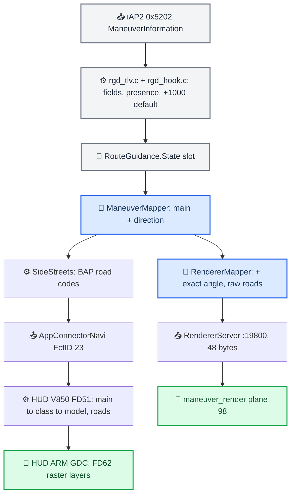
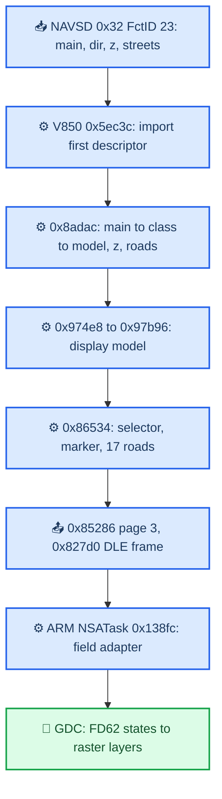

# Maneuver Mapping

*How one iAP2 maneuver becomes a HUD icon (BAP FctID 23 → V850 MCU → GDC raster layers) and a procedural arrow (`RendererMapper` → `maneuver_render`): the 54-type table, the angle sentinels, what iOS really sends, and the HUD firmware chain that was emulated to prove the icon choices.*

---

## 📋 One maneuver, two outputs

`BAPBridge` resolves the current maneuver (`maneuverOrder[0]`, never the next filled slot) once. `ManeuverMapper` turns it into BAP `mainElement` + `direction`, which is the HUD's semantics. `RendererMapper.map` starts from that same resolved BAP pair and adds only raw geometry (exact angle, original roads) for the procedural renderer. There is no second, independent interpretation any more. `[code]` (`java_patch/com/luka/carplay/rgd/BAPBridge.java:2149`, `:2453-2458`; `RendererMapper.java:37-41`)

The goal agreed with Luka: the renderer matches the HUD icon's **shape and action**, not its pixels. The HUD has a finite raster catalogue; our path builder does not have to be limited by it (exact sharp angles, full roundabout rings). `[car]`

## 📊 iAP2 input fields

| iAP2 TLV (0x5202) | Meaning | Java State |
|---|---|---|
| `0x0003` | ManeuverType 0…53 | `mType` |
| `0x0008` | Driving side 0 = RHT, 1 = LHT | `mDrivingSide` |
| `0x0009` | Junction type 0 = intersection, 1 = roundabout | `mJunctionType` |
| `0x000A` | Signed BE16 array, JunctionElementAngle (roads) | `mJunctionAngles` |
| `0x000B` | Signed BE16 JunctionElementExitAngle | **both** `mTurnAngle` and `mExitAngle` |
| `0x0005` | Step length `distance_between` | `mDistance` (bargraph denominator, see [[Distance Bargraph]]) |

- `turn_angle` is a historical name for the same exit angle. The hook publishes `man->exit_angle` under both keys; when both arrive with different values, explicit `exit_angle` wins. `[code]` (`hook/routeguidance/rgd_hook.c:493-496`, `hook/routeguidance/rgd_tlv.h:118`)
- An indexed maneuver without TLV `0x000B` gets **+1000 and the present bit** from our C parser, so an old angle is never inherited on the real input path. `[code]` (`hook/routeguidance/rgd_tlv.c:617-619`)
- An absent field is not a numeric zero or an empty list. The parser keeps presence; Java parses only present keys as a delta. `[code]`
- `z_level` is accepted by the Java parser but `write_slot_data_keys` does not publish it, so BAP always sends z = 0. The renderer draws no z-marker; its overlap lift is decoration. `[code]`, `[decompile]`
- Before a slot is filled Java holds `mTurnAngle = -1`, `mJunctionType = -1`. The boolean `mTurnAnglePresent` separates a received −1° from that default. `[code]` (`java_patch/com/luka/carplay/rgd/RouteGuidance.java:167`, `:1191-1193`)

Sources: `MANEUVER_HUD_RENDERER_AUDIT`, `MANEUVER_RENDERER_PARITY_FIXES`, `RGI_HUD_RENDERER_KNOWLEDGE`

## ⚠️ Angle sentinels

These guards must survive every "simplification". `[code]`, `[decompile]`

| Input | Meaning and handling |
|---|---|
| `+1000` | Unknown angle. Our C parser creates it for an indexed maneuver with no exit-angle TLV (MHI3-compatible default) |
| `-1000` | Kept as a defensive case. Never read its sign as a direction |
| `0` | A real straight angle. It cannot choose left/right on its own |
| `-1` with presence | A real −1° (it is a valid signed16 on the wire) |
| `-1` without presence | Legacy default of an unfilled slot |
| Malformed numeric angle in Java | Safe fallback `+1000` |
| Any other value outside ±180 | Generic types keep the old left/right-by-sign fallback, not straight |

Where the guards live in the code:

- `hasDirectionalTurnAngle` treats `0`, `+1000`, `-1000` as non-directional (U-turn and ramp side fall back to traffic side). `[code]` (`ManeuverMapper.java:385-394`)
- `directionFromAngle16` (roundabout) returns straight for ±1000 **before** the ±180 clamp; otherwise the sentinel became a fabricated U-turn exit. `[code]` (`ManeuverMapper.java:439-450`)
- `directionFromTurnAngle` (generic 11/16/51) checks ±1000 before quantization. The resulting "straight" is a safe icon, not a claim that 1000 means straight ahead. `[code]` (`ManeuverMapper.java:475-490`)
- `SideStreets` drops both +1000 and −1000 (exit and road angles). The older asymmetric `== 1000` check (type 28 RHT −1000 produced roads `60 40 20 00 e0 c0 a0`) is fixed. `[code]` (`java_patch/com/luka/carplay/rgd/SideStreets.java:87-99`)
- The lane→HUD converter returns `0xFF` for both sentinels before quantization; the lane panel buckets every value outside ±180 as unknown. See [[Lane Guidance]]. `[code]`
- The 4-argument `ManeuverMapper.map()` keeps the legacy "−1 is missing" contract; the bridge uses the presence-aware 5-argument overload. U-turn / LHT / received −1° → left loop; the same U-turn without the field → right loop by traffic side. `[code]` (`ManeuverMapper.java:155-163`)

Sources: `IOS_MANEUVER_ANGLE_SENTINELS`, `MANEUVER_RENDERER_PARITY_FIXES`, `RGI_HUD_RENDERER_KNOWLEDGE`

## 🔍 What iOS actually sends

Apple never synthesizes 1000. If no role-2 junction element exists, the exit angle is simply not set and the TLV is absent. The sign is preserved end to end. `[decompile]`

- **iOS 26.1 (23B85):** provided decompiled `.mm` bodies (`CarClusterUpdateManeuverInfo.mm` lines 248–280 and 342–366; `CPManeuver.mm` 636–643 binds `junctionExitAngle` to parameter 11 in `NSUnitAngle.degrees`; `CPAccNavUpdate.mm` 303–377 resets object properties to nil). This was a check of the supplied decompilation, not a fresh disassembly.
- **iOS 26.6 (23G71, iPhone18,2):** Maps and CarPlay Mach-O re-derived. Both maneuver builders (`maneuverUpdateWithStep:component:` at `Maps:0x1010b3d9c`, `maneuverUpdateWithGuidanceEvent:routeStep:component:` at `Maps:0x1010b42a0`) pick the role-2 element and write a signed `NSNumber` through `setJunctionElementExitAngle:`. `ACCNavigationInfoBuilder` (`Maps:0x100da87f0`) forwards it without clamp or absolute value.
- **iOS 27.0 (24A5418b, iPhone18,1):** accessoryd `_iap2_navigation_routeGuidanceManeuverUpdateHandler` (`0x1001755a0`) looks up key 11 and calls `__addU16NumberParameterToMsg`; helper `0x1000038d0` returns without a TLV on nil, otherwise `CFNumberGetValue(kCFNumberSInt16Type)` → `iAP2MsgAddU16Param`. No ±1000 substitution, no ±180 range check.

U-turn family, forced by the 26.6 binary (`+[CarClusterUpdateManeuverInfo _enumProperties]`, block `sub_1010B3424`):

| accNav | Name | GEO sources (table `Maps:0x101388934`) |
|---:|---|---|
| 4 | `U_TURN` | GEO 4, GEO 86 `RESUME_ROUTE_WITH_U_TURN`, GEO 88 `TURN_AROUND` |
| 18 | `START_ROUTE_WITH_U_TURN` | GEO 25 |
| 19 | `U_TURN_AT_ROUNDABOUT` | stays a roundabout maneuver |
| 26 | `U_TURN_WHEN_POSSIBLE` | GEO 35 |

For GEO 4 only, Apple normalizes the sign by driving side (`FNEG` at `0x1010b4158` / `0x1010b44f4`): RHT (0) → negative (left U-turn), LHT (1) → positive (right U-turn). `CPManeuver _descriptionForTrafficSide:` (`CarPlay:0x23d91c7e8`) confirms 0 = right, 1 = left traffic. GEO 25/35/86/88 forward their signed angle unchanged. **Verdict:** read the sign first for accNav 4/18/26, fall back to traffic side when absent (or 0/±1000), keep 19 on the roundabout path. The current code does exactly this. `[decompile]`, `[code]` (`ManeuverMapper.java:309-323`)

Binary identities and iOS 27 CarPlay addresses

- 26.6 `Maps`: arm64e UUID `79CFEB20-5456-34E9-92F8-006F902D7B77`, SHA-256 `86ede9b3b76f3784883c87deb1bd4ceb5c56fd77c2899a0081d2354f457c8fe4`.
- 26.6 `CarPlay.framework/CarPlay` (from the dyld cache): UUID `1602A652-319F-3FF9-9879-6D9C6919F901`, SHA-256 `064993976618cd75b0c6561bfd43aa255a319985de1c27954564ba80f05578ae`.
- 27.0 CarPlay: `0x2471643f4` selector `junctionExitAngle`; `0x24716440c`/`0x247164410` key 11 / `paramKey:`; `0x247164424`/`0x247164438` `degrees` / `copySettingDimension:`; `0x247123e0c` nil on reset; `0x24712508c` missing value skips conversion; `0x247124f54`/`0x247124f60` `measurementByConvertingToUnit:` / `doubleValue`; `0x247124f7c` `NSNumberForCPAccNavTypeFromDouble`.
- 26.6 fine addresses: step path role-2 select `0x1010b40e0–e4`, GEO-4 test `0x1010b4108–0c`, RHT positive→negate `0x1010b4114–28`, LHT negative→negate `0x1010b4130–48`, setter call `0x1010b4180`; event path role 2 `0x1010b4494–98`, GEO 4 `0x1010b44a4–a8`, side tests `0x1010b44b0–e4`, setter `0x1010b451c`; enum names at `Maps:0x1010b35cc/3700/3728/37b0` (keys `0x101875448/598/5b0/658`); GEO table entries `0x10138893a=04`, `…964=12`, `…978=1a`, `…9de=04`, `…9e2=04`; builder block `Maps:0x100da88c8` calls `setInfo:data:` directly.
- User-provided restores: `Refferences/iPhone18-3_26.1_23B85_Restore`, `Refferences/iPhone18,1_27.0_24A5418b_Restore.ipsw` under `/Users/luka/Desktop/AUDI_2/`. The hash/disassembly dumps were under `output/ios-sentinel/`, which was not preserved.

---

Sources: `IOS266_MANEUVER_DECOMPILE`, `IOS_MANEUVER_ANGLE_SENTINELS`

## ⚙️ The 54 types today

BAP is `main / direction` (hex); `sN` is the internal HUD selector in GDC `packet[22]`, measured by running the V850 converter (active 3D mode 3). The renderer column is what `RendererMapper` sends. `[code]` (`ManeuverMapper.java:161-380`, `RendererMapper.java:44-127`), selectors `[decompile]`

| MT | CarPlay type | BAP RHT (LHT) | HUD | Renderer |
|---:|---|---|---|---|
| 0, 5 | NO_TURN, FOLLOW_ROAD | 11/00 FOLLOW_STREET | first-slot s0, see note | APPROACH |
| 1 | LEFT_TURN | 13/40 | s28 | TURN, exact angle if it is left |
| 2 | RIGHT_TURN | 13/C0 | s31 | TURN, exact angle if it is right |
| 3 | STRAIGHT_AHEAD | 13/00 | s26 | TURN 0° (confirms the straight road) |
| 4, 18, 26 | U_TURN family | 25/40 or 25/C0 by sign; else RHT 40, LHT C0 | s110 / s111 | UTURN, same side |
| 6 | ENTER_ROUNDABOUT | 13/C0 (13/40) | s31 (s28) | full ring, raw angle + roads |
| 7 | EXIT_ROUNDABOUT (junction 1) | 26/C0 (27/40) | s112 (s113) | full ring, raw angle + roads |
| 8 | OFF_RAMP | 13/20 or 13/E0 by sign; else by side | s27 / s32 | slight TURN + forward road |
| 9 | ON_RAMP | 13/20 or 13/E0 | s27 / s32 | slight TURN, no forward road |
| 10, 12, 27 | arrive (centre) | 3/00 | s120 | ARRIVED centre flag |
| 11, 16, 51 | START_ROUTE, EXIT_FERRY, CHANGE_HIGHWAY | 13 + nearest of 7 directions | s26…s32 | TURN, exact angle |
| 13, 49 | KEEP_LEFT, SLIGHT_LEFT | 13/20 | s27 | TURN |
| 14, 50 | KEEP_RIGHT, SLIGHT_RIGHT | 13/E0 | s32 | TURN |
| 15, 17 | ENTER_FERRY, CHANGE_FERRY | 11/00 | first-slot s0 | APPROACH |
| 19 | U_TURN_AT_ROUNDABOUT | 21/80 (22/80) | s54 (s70) | ring, fixed 180° exit, never snapped |
| 20 | LEFT_TURN_AT_END | 13/20, 13/40, 13/60 | s27 / s28 / s29 | TURN |
| 21 | RIGHT_TURN_AT_END | 13/E0, 13/C0, 13/A0 | s32 / s31 / s30 | TURN |
| 22 | HIGHWAY_OFF_RAMP_LEFT | 13/20 (type wins over angle) | s27 | slight TURN + forward road |
| 23 | HIGHWAY_OFF_RAMP_RIGHT | 13/E0 | s32 | slight TURN + forward road |
| 24, 25 | ARRIVE_DESTINATION_LEFT/RIGHT | 3/40, 3/C0 | s2, s3 | ARRIVED left / right |
| 28…46 | ROUNDABOUT_EXIT_1…19 | 21 (22) + 16-step direction | s46…s61 (s62…s77) | full ring, raw angle, snap allowed |
| 47, 48 | SHARP_LEFT/RIGHT | 13/60, 13/A0 | s29, s30 | TURN |
| 52, 53 | CHANGE_HIGHWAY_LEFT/RIGHT | 12/40, 12/C0 CHANGE_LANE | s24, s25 | LANE_CHANGE, no main-road continuation |

Rules behind the table: `[code]`

- **Junction-type gate (MHI3 `tbt_renderer sub_2B9C90` parity):** types −1, 0, 5, 6, 10, 11, 12, 15, 16, 17, 19, 27, 51, 52, 53 map first, regardless of junction type. After that, junction 1 allows only 7 and 28…46; junction 0 allows the switch; anything else → `NO_INFO` (1). `NO_INFO` makes the renderer draw nothing (`ICON_NONE`).
- **Generic 11/16/51:** |angle| 0…22 straight, 23…67 slight, 68…112 normal, 113…180 sharp; outside ±180 left/right by sign; ±1000 straight. TURN has no direction 80; U-turn is its own type.
- **End of road 20/21:** left: −67…−1 slight, −112…−68 normal, < −112 sharp; right: 1…67 slight, 113…180 sharp; missing or conflicting sign → plain turn to the type's side.
- **Roundabout exits 28…46:** nearest of 17 bins (−180…180 step 22.5°) → codes `128,112,96,80,64,48,32,16,0,240,224,208,192,176,160,144,128`. The exit number itself is never sent (not in BAP, not in the renderer packet); EXIT_3 carries no direction without the angle.
- **DSINavBap override:** every type except roundabout, U-turn, ramps, keep, slight, sharp and end-of-road is coarsened to straight/left/right/U-turn (MHI3 behaviour).
- **FOLLOW_STREET 11/00 with z = 0 and no side streets** has a special importer rule in the HUD MCU: the first record is cleared and the next bytes move to another record. So s0 in an isolated first-slot run does not mean an empty HUD while cruising. `[decompile]`
- ManeuverMapper also has a stock rule `PREPARE_TURN(28)` + direction 64/192 → `CHANGE_LANE`, but the mapper never emits 28, so it has no effect. `[code]`

Sources: `CARPLAY_HUD_ICON_SELECTION`, `MANEUVER_MAPPING_TABLE`, `HUD_BAP_3D_SELECTORS`

## ✅ Renderer parity rules

The renderer receives the resolved HUD semantics plus raw CarPlay geometry, directly (no BAP side-street round trip). `[code]` (`RendererMapper.java:37-127`)

| Case | Rule |
|---|---|
| Type LEFT/RIGHT but angle 0 or opposite sign | Type decides the side; renderer draws the same side as the HUD |
| TURN with an angle agreeing with the resolved side | Exact angle kept, including sharp > 100° and ~160°. The HUD has only 0/±45/±90/±135 (s26…s32); we are not limited to that |
| Self-overlapping sharp turn or U-turn (\|angle\| > 150°) | Arrow lift and contact shadow kept (see [[HUD Renderer]]) |
| OFF_RAMP 8/22/23 | One slight bend in both outputs. If the raw roads have no 0°, a forward road is added; when all 18 wire slots are full, the last slot is reserved for it (`withForwardRoad`) |
| ON_RAMP 9 | Slight TURN; the old MERGE icon is not chosen automatically. No invented forward road |
| CHANGE_HIGHWAY_LEFT/RIGHT 52/53 | `ICON_LANE_CHANGE` (8), not a multilane road and not the EXIT continuation |
| ENTER/EXIT_ROUNDABOUT 6/7 | Full ring with the received angle and roads (Luka's decision). The short-arc `ICON_ROUNDABOUT_EXIT` (9) stays in the native protocol but the bridge never selects it |
| Roundabout exits 28…46 | Raw angle without rounding (−67° stays −67°). `snapToRoad` is set only for a valid angle; native snaps to the nearest raw road if the difference is strictly below 30° (`maneuver_render/maneuver.c:1107-1128`). Missing fallback and MT19 never snap |
| APPROACH / TURN / ROUNDABOUT roads | Original valid angles −180…180 including the active exit, up to 18; BAP filtering applies to the HUD only |
| Only the roads of the same maneuver changed | `MAN_FLAG_REFRESH` (0x08): replaces geometry, keeps the running transition and progress |
| Repeated ARRIVED with the same geometry | Flag animation is not restarted (version excluded from the key) |

Wire details: angles travel as signed **half-degrees** under `MAN_FLAG_BAP_GEOMETRY` (0x04), so all 16 BAP 22.5° bins survive (−135 on the wire = −67.5°); `MAN_FLAG_SNAP_TO_ROAD` (0x10) keeps snap allowed in those units. The slot index and roads are part of the renderer cache key (array content, not reference). The geometry cache updates only after a successful enqueue. The full packet layout is in [[HUD Renderer]]. `[code]` (`maneuver_render/protocol.h:54-81`, `maneuver_render/maneuver_command.h:17-25`)

Why ramps are slight TURN and not EXIT: even the base HUD resources s33/s36 draw three segments (straight → diagonal → straight). CarPlay's single angle does not describe that extra geometry, and Luka rejected the three-segment arrow. The sharp variants are worse: `EXIT_RIGHT/A0` and `EXIT_LEFT/60` (sent at ±135° by the old `rampDirection`) return **model 0 = no arrow and no roads** in the HUD. `[decompile]`, `[car]`

Sources: `MANEUVER_RENDERER_PARITY_FIXES`, `HUD_RAMP_3D_CHAIN`, `RGI_HUD_RENDERER_KNOWLEDGE`

## ❌ Alternatives not chosen

| Alternative | Why not |
|---|---|
| SERVICE_ROAD s39/s40 for ON_RAMP | A separate parallel road does not follow from one type |
| FORK_2/FORK_3 s41…s45 for KEEP | The type does not guarantee a specific fork; TURN + side streets is the general form |
| SQUARE s78…s109 for roundabouts | No square-junction signal in our chain |
| MICHIGAN/DOUBLE_TURN s116…s119 | Cannot be built from one exit angle; later slots do not define such geometry |
| PREPARE_U_TURN s114/s115 for U_TURN_WHEN_POSSIBLE | "When possible" is not a preview phase |
| EXIT s33…s38 for ramps | Three-segment shape; A0/60 variants render nothing |
| Returning MERGE for ON_RAMP | Rejected by Luka: ramps must look like the HUD slight arrow |
| Short arc s112/s113 in the renderer | A firmware resource does not prove iOS sends MT7 on a real drive |
| Renderer reduced to discrete BAP icons | Over-constrained; different drawing is not an error |

Only 13 of the 35 defined BAP `mainElement` values are used (0, 1, 3, 11, 12, 13, 15, 16, 21, 22, 25, 26, 27). The other 22 (2, 4…10, 14, 17…20, 23, 24, 28…31, 34, 35, 38) are supported by the HUD but have no CarPlay source. `[code]`, `[decompile]`

Sources: `CARPLAY_HUD_ICON_SELECTION`, `MANEUVER_HUD_RENDERER_AUDIT`

## 🔍 HUD firmware chain

The HUD draws from BAP with its own firmware; `maneuver_render` pixels never reach it. The converter lives in the **V850/RH850 MCU (FD51)**, not in the ARM GDC. It was executed instruction by instruction for 829 unique descriptors on both firmware versions **G1952** and **M2325** (7,207,899 original instructions per firmware); results are byte-identical and cover all 169–173 descriptors the Java matrix produces. `[decompile]`

### BAP FctID 23 wire

`ManeuverDescriptor_Status`, three slots, each `u8 mainElement, u8 direction, u8 zLevelGuidance, BAPString(length + side-street bytes)`. Side streets are an **array of direction codes**, not a bitmask and not text; length 0…17 uses a one-byte length. `MAX_BAP_MANEUVERS = 1`: only slot 1 is filled; the stock `AppConnectorNavi` packs absent slots 2/3 as `NO_SYMBOL/0/0`. Example (LEFT_TURN, −90°, roads [−90, 0, +90], z 0): `0d 40 00 02 00 c0 | 00 00 00 00 | 00 00 00 00`. `maneuverCount = 0` → `NO_SYMBOL`. `[code]`, `[decompile]`

First-slot contracts after the ramp fix: slight/keep/ramp `0d 20|e0 00 00` (plus `01 00` road for off-ramps), change highway `0c 40|c0 00 00`. These are computed from bridge fields, not a CAN capture. The reconstructed stock JAR has a string artefact: the empty-string literal serializes as the 20-byte `isNativeLittleEndian`; that is a JXE reconstruction bug, not car traffic. `[decompile]`

Direction codes: 00 straight, 20 slight left, 40 left, 60 sharp left, 80 U-turn/back, A0 sharp right, C0 right, E0 slight right. Roundabouts use 16 directions (step 16 = 22.5°). For UTURN (25), 40/C0 mean the side of the loop, not the final heading.

### SideStreets (BAP only)

| Types | BAP side streets |
|---|---|
| 6 ENTER_ROUNDABOUT | One fixed code: RHT `40`, LHT `C0` |
| 7 EXIT_ROUNDABOUT | Empty |
| 8/22/23 off-ramps | One fixed `00`, regardless of roads |
| 11/16/19/51 | Dynamic if junction type allows |
| 1/2/3/13/14/20/21/47…50 | Dynamic at junction 0 |
| 28…46 | Dynamic at junction 1 |
| Others | Empty |

Intersections use 7 bins (45°), roundabouts 22.5°; the exit is removed, roads are quantized and de-duplicated, and overflow can drop roads. `NO_SYMBOL`/`NO_INFO` get empty side streets. `[code]` (`SideStreets.java`)

### Inside the MCU

- **Import:** `0x5ec3c` calls `0xa5ed6(0x32, 0x17, …)` and reads 60 bytes. RAM: main `0xFEDFADD4`, direction `0xFEDFADD6`, z `0xFEDFADD8`, street flag/count `0xFEDFADDA/DB`, up to 16 street bytes `0xFEDFADDC`. Object 9 in table `0x23f64`; `0x65b2a → 0x5e12a` copies it to the converter.
- **Convert:** `0x8ab76` runs reset/update pairs from `0x27940` (`0x8acb0` reset clears model, marker and roads first, so an empty result is not inherited geometry). `0x8b32e`: 34 `main → class` entries at `0x27e24`. `0x8b3b2`: 17 directions at `0x27d54`, a 23×17 matrix of 8-byte records at `0x388e4`; the first u32 is the model enum (`0xFEDFC270`). Model 0 stops. `0x8b486` picks the z-marker; `0x8b536` builds roads.
- **Classes:** TURN 13 and TURN_ON_MAINROAD 14 → 6; EXIT_RIGHT 15 → 7; EXIT_LEFT 16 → 8; SERVICE_ROAD 17/18 → 9/10. The class is why the same direction draws differently; there is no flat "E0 = one arrow" rule.
- **Roads** are built separately: `0x27d9c` family + entry road per class, `0x27990` standard entry order, `0x8b6fa` adds the exit road (`0x27d76`), side streets matched against `0x27dfe` (exit removed), `0x39e24` family × direction → road enum + order key, `0x8b798` stable sort, capacity 17. So `streets = []` still draws grey roads: TURN 13/E0 creates road selectors 60, 15; EXIT 15/E0 creates 61, 19; our extra side street 00 adds road 16.
- **Z-markers:** table `0x27978` has four entries only: class 7 + z1/z2 → markers 1/2, class 8 + z1/z2 → markers 3/4. A normal TURN never gets a marker.
- **Pack:** `0x974e8(mode 3/8) → 0x97b96` moves model to `0xFEDFC600`, roads `0xFEDFC604`, count `0xFEDFC648`, marker `0xFEDFC649`; `0x99a64 → 0x98378` (object 2 of `0x29030`) returns 76 bytes. `0x86534` packs 19 bytes (selector, marker, 17 roads) via late tables `0x277ba` (main), `0x2749a` (marker), `0x27890` (road). **Model enum ≠ selector:** EXIT 15/E0 is model 36 but selector 35.
- **Frame:** `0x85286` builds page 3 (119 bytes, nav fields from payload[19]); `0x8508e` stores it at `0xFEDFC1E4`; `0x8a984 → 0x81b9e → 0x81dea → 0x827d0` frames `10 02 + escape([01, lenLE16, seq] + payload + xor(payload)) + 10 03` (every `10` doubled); `0x82a8e → 0x83154` sends via peripheral/DMA (SpiUsartDev4, not CAN/BAP).
- **Runtime:** V850 linked VA, file offset = VA − `0x20000`; image base `0x20000`, **GP `0xFEDFF8B4`** (startup loads `0xFEDF78B4` then adds `0x4000` twice; the old `0xFEDF78B4` put every RAM address off by `0x8000`), TP `0x28018`, CTBP `0xB59C0`.

### EXIT family (why ramps changed)

| BAP | Selector / resource | Road selectors | Visible shape |
|---|---|---|---|
| EXIT_RIGHT 15/00 | s33 / r0303 | 61, 16 | straight → diagonal → longitudinal exit |
| EXIT_RIGHT 15/C0 | s34 / r0304 | 61, 18, 16 | straight entry, diagonal exit |
| EXIT_RIGHT 15/E0 | s35 / r0305 | 61, 19, 16 | kinked, extra segment before diagonal |
| EXIT_RIGHT 15/A0 | **s0, empty** | none | **no arrow, no roads** |
| EXIT_LEFT 16/00 | s36 / r0306 | 62, 21 | kink with longitudinal exit |
| EXIT_LEFT 16/20 | s37 / r0307 | 62, 22, 21 | kink before diagonal left |
| EXIT_LEFT 16/40 | s38 / r0308 | 62, 23, 21 | straight entry, diagonal exit |
| EXIT_LEFT 16/60 | **s0, empty** | none | **no arrow, no roads** |

The earlier "EXIT → s39" hypothesis was wrong: s39/r0309 is SERVICE_ROAD_RIGHT (17). `[decompile]`

### NSATask and GDC

NSATask (G1952): FD61 text file offset `0xe2000` (size `0x17ce4`, linked `0x10000`), data `0xf9ce4` (linked `0x28000`). `0x10464` strips DLE, `0x109fc` checks the frame, `0x134d8 → 0x138fc` handles page 3 and copies 108 bytes `frame+15 → state+18`; `0x13cd8 → 0x2297c` sends a 123-byte GDC packet. `[decompile]`

| Field | MCU payload | NSA frame | GDC packet |
|---|---:|---:|---:|
| Page | 0 | 4 | 8 |
| Group mask | 1…4 | 5…8 | 9…12 |
| Main 3D selector | 19 | 23 | 22 |
| Marker | 20 | 24 | 23 |
| 17 road selectors | 21…37 | 25…41 | 24…40 |
| 2D selector | 99 | 103 | 102 |

GDC (ARM, FD61; states/resources in FD62): group 2 field 9 = main 3D arrow (FD62 node `0x8da20`, **121 states 0…120**, 0 empty), field 10 = marker (`0x8f2c0`, 5 states), fields 11…27 = roads (two 65-state tables each, outline + fill pairs), group 20 field 89 = 2D symbol (`0x95ae8`, **72 states**), destination overlay `0x8040c`. A state points to 44-byte surface records (resource + x/y/w/h at offsets 30/32/34/36). These are ready raster layers, not vectors built from an angle. Checked functions: `0x808f9e68` dispatch, `0x808f9fb8` state select, `0x808fae9c` selector read, `0x808fa984` surface hand-off. 2,450 states per firmware (4,900 total) matched table parsing byte for byte. `[decompile]`

- **Empty states must not be dropped when numbering.** The old `RE/layout_pages.json` lists only non-empty states, so a list index is not a selector.
- Resources: 57 standalone 2D arrows r0212…r0268, 3D layers r0270…r0515, lane guidance r0516…r0673. The old `named_3d` folder is **FctID 24 lanes**, not FctID 23.
- 2D PNG names were recovered by alpha-mask matching; the name suffix is not a BAP direction (selector 37 `r0239 roundabouttrsright_c0` shows a left arrow).

All BAP mainElement → 3D selector results (V850, z 0, no side streets, mode 3)

Directions tried: 00, 10 … F0 and FF; unlisted directions give s0.

| Main | BAP | Direction → selector |
|---:|---|---|
| 0, 1 | NO_SYMBOL, NO_INFO | empty |
| 2, 4 | DIRECTION_TO_DESTINATION, NEAR_DESTINATION | all → s1 |
| 3, 5 | ARRIVED, ARRIVED_DESTINATION_OFFMAP | 00 → s120; 40 → s2; C0 → s3; others → s4 |
| 6…10, 38 | OFF_ROAD, OFF_MAP, NO_ROUTE, CALC_ROUTE, RECALC_ROUTE, DIRECTION_TO_WAYPOINT | 00…F0 → s5…s20 |
| 11 | FOLLOW_STREET | 40 → s21; C0 → s22 |
| 12 | CHANGE_LANE | 40 → s24; C0 → s25 |
| 13, 14 | TURN, TURN_ON_MAINROAD | 00 s26, 20 s27, 40 s28, 60 s29, A0 s30, C0 s31, E0 s32 |
| 15 | EXIT_RIGHT | 00 s33, C0 s34, E0 s35 |
| 16 | EXIT_LEFT | 00 s36, 20 s37, 40 s38 |
| 17, 18 | SERVICE_ROAD_RIGHT/LEFT | all → s39 / s40 |
| 19 | FORK_2 | 40 s41, C0 s42 |
| 20 | FORK_3 | 00 s43, 40 s44, C0 s45 |
| 21 | ROUNDABOUT_TRS_RIGHT | 00…F0 → s46…s61 |
| 22 | ROUNDABOUT_TRS_LEFT | 00…F0 → s62…s77 |
| 23, 24 | SQUARE_TRS_RIGHT/LEFT | s78…s93 / s94…s109 |
| 25 | UTURN | 40 s110, C0 s111 |
| 26, 27 | EXIT_ROUNDABOUT_TRS_RIGHT/LEFT | all → s112 / s113 |
| 28…30 | PREPARE_TURN/ROUNDABOUT/SQUARE | 00 s23, 40 s21, C0 s22 |
| 31 | PREPARE_U_TURN | 40 s114, C0 s115 |
| 34, 35 | MICHIGAN_TURN, DOUBLE_TURN | 40/C0 → s116/s117, s118/s119 |

ARRIVED 3/00 selects s120, not the earlier assumed s1.

---

Sources: `HUD_RAMP_3D_CHAIN`, `HUD_BAP_3D_SELECTORS`, `MANEUVER_HUD_RENDERER_AUDIT`, `MANEUVER_MAPPING_TABLE`

## 📊 Regression evidence

All of this is offline (host Java, reconstructed stock serializer, firmware emulation). None of it is a CAN capture or an optical HUD check. `[model]`

| Check | Result |
|---|---|
| `ManeuverChainAudit`, 7,890 bridge inputs (all 54 types, RHT/LHT, angles, roads, z) vs saved reference and vs a fresh build of `BAPBridge` at `07e980d` | **0 differences** in main, direction, z, side streets |
| Old vs new `sendLaneGuidance`, every angle −180…180, status 0/1/2, extras 0/45/90 | **1,083** cases identical |
| Sentinel matrix: 54 types × 2 sides × 3 junction types × 3 sentinels | 972 cases, 1,944 main/direction checks |
| Icon selection change | 8 types refined, 46 kept; 430 changed rows only in those 8; no new empty 3D results |
| C `rgd_tlv_test`: every signed16 −32768…32767 plus missing, 120,000 malformed inputs | ASan/UBSan pass |
| Renderer captures | all 54 types RHT/LHT in real macOS OpenGL, NONE checked for zero pixels |

Pre-parity divergences (audit at `28327b6`, all resolved by the rules above): BAP stopped at an invalid first slot while the renderer skipped to the next one; roads-only changes did not refresh the renderer; ENTER_ROUNDABOUT drew a ring vs HUD TURN; START_ROUTE/EXIT_FERRY/CHANGE_HIGHWAY drew APPROACH ignoring the angle; LEFT_TURN with 0/+90 drew straight/right; MT19 used the raw angle; ramps at ±135 blanked the HUD while the renderer drew EXIT; ON_RAMP drew MERGE and 52/53 drew EXIT; junction type was ignored by the renderer; legacy −1 flipped U-turn sides.

Bug found on the real C→Java path (fixed in `9720844`): a reused slot with a new known angle inherited the old roads, name and step (`angle=90, inherited roads=[-90, 0, 90], road=Old road, step=6000` → HUD `sideStreets=[64, 0]` vs fresh `[]`). Java now clears the previous owner's fields on a new `mN_ver` **before** parsing the delta, and a C `route_generation` marks native resets. The first Java-only probe that "proved" a stale exit angle was wrong: it skipped the C +1000 default. The old `crosscheck_native_input.py` and `output/java-rgi-audit-2026-09-13/run.sh` intentionally expect the old defects; they are observation probes, not acceptance tests. Use `python3 tests/test_rgd_native_contract.py`. `[code]`

Reproduce: `bash scripts/audit_maneuvers.sh`, `python3 tools/build_hud_icon_selection.py [--prepare]`, `python3 tools/hud_mcu_decoder.py <FD_51FLASHDATA.bin>` (reference decoder checked against all 829 emulated cases), Ghidra `tools/ghidra/HudManeuverChainAudit.java` (FD51 loaded at `0x20000`), `python3 tools/audit_hud_maneuver_mapping.py prepare|check`, `python3 tools/build_maneuver_comparison.py`, `python3 tools/build_hud_ramp_comparison.py`, `python3 tools/build_hud_maneuver_atlas.py`. The CSV/JSON/PNG evidence under `output/maneuver-audit/`, `output/maneuver-selection/`, `output/maneuver-parity/` and `output/r2/hud-ramps-2026-09-11/` was not preserved.

Sources: `CARPLAY_HUD_REGRESSION_CROSSCHECK_2026_09_13`, `IOS_MANEUVER_ANGLE_SENTINELS`, `CARPLAY_HUD_ICON_SELECTION`

## 🔗 Related

- [[HUD Renderer]]: the renderer that draws these mappings, and its wire protocol.
- [[Lane Guidance]]: lanes are a separate event, not part of the maneuver descriptor.
- [[RGI and BAP Bridge]]: FctID 23 delivery, slot LRU and the BAP session.
- [[Third-party Nav Apps]]: apps that send no `maneuverType` at all.

## 📚 Sources

Merged originals were removed from the tree after this note absorbed them; they remain in git history (commit 23972aa).

- `MANEUVER_MAPPING_TABLE`: first executed iAP2 → BAP → renderer table (pre-parity snapshot).
- `MANEUVER_HUD_RENDERER_AUDIT`: 2026-09-11 divergence audit, BAP wire, GDC selector RE.
- `MANEUVER_RENDERER_PARITY_FIXES`: the agreed parity rules now in `RendererMapper`.
- `CARPLAY_HUD_ICON_SELECTION`: per-type icon decisions and rejected alternatives.
- `HUD_BAP_3D_SELECTORS`: full mainElement → selector table.
- `HUD_RAMP_3D_CHAIN`: V850 MCU → NSA → GDC chain with addresses.
- `IOS_MANEUVER_ANGLE_SENTINELS`: iOS 26.1/27.0 sentinel check.
- `IOS266_MANEUVER_DECOMPILE`: iOS 26.6 U-turn and signed exit angle.
- `CARPLAY_HUD_REGRESSION_CROSSCHECK_2026_09_13`: 0-diff BAP regression and the stale-roads bug.
- `RGI_HUD_RENDERER_KNOWLEDGE`: the 2026-09-13 master summary.
