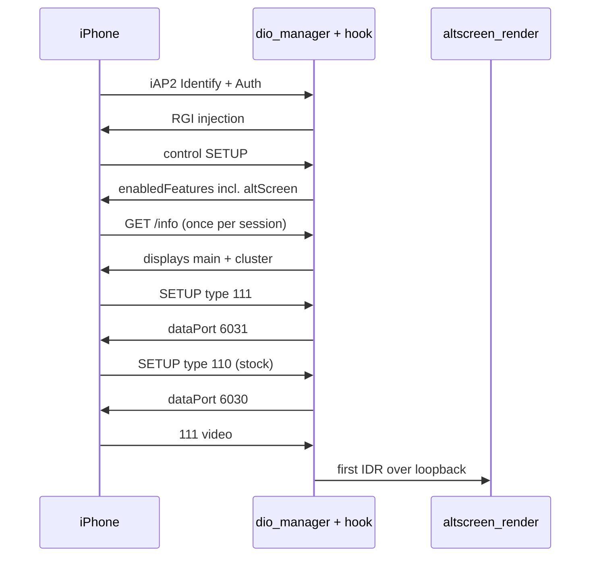

# Session Lifecycle

*One CarPlay session from control SETUP to teardown on stock `dio_manager` + stock `libairplay.so` 210.81 + `libcarplay_hook.so` — the healthy timeline, the port collision that killed main video, and the generation rules every transport now follows.*

---

## 📋 Scope and status

The August audit covered the production stack only: stock `dio_manager`, stock `libairplay.so` 210.81 with our hook, and the two external renderers. The from-source `libairplay-mhi2q` tree is not evidence here. Remediation landed in the worktree on 2026-08-12 and was verified off-unit (QNX builds, Java 1.4 build, `emutls=0`, shell syntax, `git diff --check`). The owner confirmed on 2026-09-17 that connection, reconnection and mode transitions are closed on the current car (`TODO.md:5-10`); the fault-replay recipes below are history, not release blockers.

The USB and SI side of a session (before any control SETUP) lives in [[USB and NCM Connect]] and [[SI Stack and Replug Race]]. The Java side of activation lives in [[Reconnect and Lifecycle]]. Audio start-up on a cold connect lives in [[Now Playing Cold Start]].

## 📊 Healthy activation timeline

`log/live_20260812_0004/carplay_hook.log` shows the hook adds no multi-second latency. **[car]**

| Time | Event |
|---|---|
| `00:00:47.093-.112` | iAP2 Identify accepted and patched |
| `00:00:47.433` | authentication path active |
| `00:00:48.016-.041` | initial RGI injection queued and succeeds |
| `00:00:48.563` | control SETUP response gets `enabledFeatures` (`:32`) |
| `00:00:48.614` | `/info` gets the display arrays (`:35-39`) |
| `00:00:48.680-.685` | type-111 SETUP built (`:40`) |
| `00:00:48.808` | phone connects to the 111 listener (`:48`) |
| `00:00:48.864` | stock type-110 SETUP |
| `00:00:48.931` | first 111 IDR (`:54`) |

Control negotiation, `/info`, 111 and 110 SETUP are milliseconds apart. Delay before this block belongs to USB/SI/iAP2; delay after it belongs to the phone's data connection, the stock screen decoder or the external renderer.

## ❌ Root cause of the black-110 teardown loop: shared port −6030

**[decompile]** + **[car]**. The captured "main screen black → ten seconds → whole session torn down" loop had one sufficient cause: our type-111 listener asked for the same preferred port as stock type 110.

- Stock 210's type-110 `_ScreenSetup` passes `-6030` to `ServerSocketOpen` at `0x270e4-0x27118`.
- Native MHI3 `AirPlayReceiverSessionSetup` separates them: `0x63eb0` compares the type with 110, `0x63eb4` loads `-6031`, `0x63ebc` conditionally increments for 110, `0x63ed8` calls `ServerSocketOpen`. So main 110 = `-6030`, cluster 111 = `-6031`.
- Stock `ServerSocketOpen@0x7fb00` treats a negative port as *preferred with dynamic fallback*: absolute value at `0x7fb84-0x7fb90`, bind at `0x7fbd8`, retry with port 0 at `0x7fc04-0x7fc24` only when the input was negative. Two listeners on `-6030` race, and one silently falls back.
- Stock `_ScreenThread@0x24220` calls `SocketAccept(listener, 10, …)` at `0x242a0-0x242b0`; the error path reaches StopSession through `0x242b8 → 0x24460 → 0x243f0` (StopSession at `0x24400`).

The failed run `log/live_20260812_black110_restart/`: 111 got port 6030 (`carplay_hook.log:818`), 111 SETUP returned at `00:18:24.732` (`:822`), stock 110 SETUP at `00:18:25.039` (`:824`), 111 accepted and closed its listener only at `00:18:25.059` (`:825`). Stock 110 entered `INITIALIZING` (`sloginfo.txt:3014`), exactly ten seconds later its accept path stopped the screen session (`:3939-3941`), and that took down the whole AirPlay session with error `-6753` (`:3943-3968`). The later `Shutdown signaled: 1` is a consequence. The successful retry confirms the timing dependency: 111 accepted at `00:18:44.852` before 110 SETUP at `00:18:45.080`, and 110 reached READY (`sloginfo.txt:5486`).

**[code]** Fixed: type 111 opens `-6031` (`hook/altscreen/altscreen_hook.c:1659-1661`), and the non-native 500 ms `alt_wait_for_main_port_handoff` delay was deleted. Expected steady state: 110 = 6030, 111 = 6031 (which also requires the PF widening, [[PF Firewall]]).

Sources: `CARPLAY_SESSION_LIFECYCLE_AUDIT`, `MAIN_HMI_CONTEXT_78_STARTUP`

## 🔧 Other defects the audit fixed

| # | Defect (pre-remediation) | Current code **[code]** |
|---|---|---|
| 1 | **Non-atomic advert.** `altScreen`/`viewAreas` were appended at control SETUP (`48.563`) whenever the gate was on, before `/info` (`48.614`) proved a two-display tree could be built. `ALTSCREEN_ADVERT_DISPLAYS=0`, a missing symbol, a cold `/info` without a stock main display, or an allocation failure all negotiated a contract `/info` could not honour — a session-killer | `advert_preflight()` builds and retains the exact display tree first; a monotonic `g_advert_sequence` stops a delayed old SETUP replacing the new session's tree (`altscreen_hook.c:107,717-770`, call at `:1842`) |
| 2 | **Inconsistent fabricated main fallback.** With no stock uuid, `uid` got `A000…0A1` but `initialVideoStreams` got `A000…0001` — a direct black-110 candidate | fallback deleted; no real uuid ⇒ no altScreen for that activation (`altscreen_hook.c:547-581`) |
| 3 | **Stock command under `alt_lock`.** `AirPlayReceiverSessionSendCommand` ran with `alt_lock` held while full TearDown first takes that lock; stock 210 builds a POST `/command` and calls `HTTPClientSendMessage` at `0x28584`/`0x28618` and dereferences `session+704` at `0x28468` before its own retain at `0x28548` — deadlock and use-after-free edge, the strongest code-forced candidate for SI `TIMEOUT_WATCHDOG` | bounded 32-entry worker queue; the sole worker retains the live session under the lock, releases it, calls stock, then releases (`ALT_CMD_QUEUE_CAPACITY` `:974`, `alt_command_worker_main` `:2147`, `alt_send_async_for_gen` `:2185`) |
| 4 | **Infinite 111 accept** relied on cross-thread close waking QNX `SocketAccept`; four stuck slots would make later 111 SETUP fail `-6728` | one-second accept tick rechecking the stop flag, non-blocking accepted fd, receivers reaped only after `threadExited` (`:1520-1533`, `alt_reap_exited_thread` `:1110`); reads poll with a 60 ms stop tick (`read_exact` `:1207`) |
| 5 | **Night-mode refresh on the receive thread** called the stock server at first IDR and could outlive a teardown that gives up waiting | receiver uses the night-mode value cached from `/info`/SetNightMode (`g_alt_night_mode`, `:110,817-821`) |
| 6 | **Loader→video handoff** held `gl_lock` across `eglSwapBuffers`, then the OMX `FillBufferDone` callback joined the loader unboundedly — a live-PID renderer that can never present | loader publishes `loader_exited`; the stop waits `ALT_LOADER_STOP_WAIT_MS 750` then `_exit(87)` (`altscreen_render/pipeline_timing.h:6`, `screen_egl_present.c:878-902`) |
| 7 | **Back-pressure shorter than decoder start.** OMX Loaded→Idle may take 10 s on the sole TCP path while the hook drops the link after 1 s of `EAGAIN` on a 512 KiB buffer | renderer drains into a queue capped at 1024 records / 24 MiB (`altscreen_render/main.c:99-100`); hook send still bounded at 1 s (`hook/altscreen/altscreen_av.c:35,131`) |
| 8 | **Java writes on stock callbacks** (`CombiMapController` → `setViewAreaMode`, steering-wheel BAP → hook bus) with no write deadline | `CarplayBus` and `AltscreenControlServer` use bounded drop-oldest writer queues |
| 9 | **Hook logger** formatted and wrote on the caller; an overlong message made `write()` read past the stack buffer | fixed 1024-byte records into a 64-record ring drained by one writer, drop-oldest, terminal-flag shutdown (`hook/framework/logging.c:13-14`) |
| 10 | **Stale-renderer replacement** waited 4 s + 1 s EGL settle before `exec dio`, half the 10 s SI budget | wrapper does no renderer work; kill grace defaults to 1 s (`deploy/smartphone_integrator/carplay_processes.sh:149`), renderer watchdogs `_exit(86-93)` |

Two audit items are **superseded** by the current code: the wrapper's guarded `reset port 3 250 1` (audit item 7) and its once-per-boot runtime PF ruleset (item 10). Neither exists in `deploy/smartphone_integrator/` today; USB recovery moved to the SI re-arm image ([[USB Replug Recovery]]) and PF to the installer ([[PF Firewall]]).

Cleared as primary session killers at the time: the bounded altScreen teardown join; C hook bus writes (writer thread, 500 ms `SO_SNDTIMEO`, `hook/framework/bus.c:509-514`); RGI `SendIAP2` retry (process-lifetime worker, no framework lock across the stock call); fast-reconnect altav ownership (monotonic generation owner, slot GC); Java activation (hot callbacks only publish state); SI timings (`stopTimeout 8000`, `restartDelay 3000`, no longer the old 2 s / 500 ms thrash); `maneuver_render` transport (dedicated Java writer). No `TIMEOUT_WATCHDOG` appears in the `live_20260812*` logs.

A separate pre-RTSP failure class also showed up (`log/live_20260812_dynamic_port_failed/sloginfo.txt:7646-7648`, `:7764-7766`: EHCI control-transfer timeout, then SI `FAILED_OTHER` at `:7772`; control SETUP began only after SI `CONNECTED` at `:11017`). It must never be "fixed" by resetting USB after an RTSP failure — that would hide the port defect.

Sources: `CARPLAY_SESSION_LIFECYCLE_AUDIT`

## 🔄 Generation rules for every transport

The 2026-09-11 transport review (base `6fe1aa0`) generalised one rule: **a stop→start must never let an old thread, socket or queued message act on the new generation.** **[code]**

| Area / trigger | Defect | Fix |
|---|---|---|
| Java bus and maneuver server: stop → start before old threads finish | shared `running` went true again; old accept/reader/writer threads could take the port or the new queue; stop could null references to new threads | per-start generation, ownership check before publishing a socket or taking a command, stop takes only its own threads; bus bind serialized with stop (`CarplayBus.java:79-116`) |
| Bus: old packet finishes reading after a connection swap | payload dispatched to the new session's listener; old producer could evict a new command | generation + exact-socket check right before dispatch, callbacks serialized across readers, enqueue rechecks connection generation, sequence assigned in queue order, length/type/flags validated |
| AltScreen control: old EOF/close after a new `VIDEO_ON` | old disconnect published `VIDEO_OFF` over new video | owner check and callback ordering after closing the old socket; accept holds no lock during the HMI callback (`AltscreenControlServer.java:115-122`) |
| RGD bus numeric list: empty, non-numeric or huge value | `out[idx++] = parseInt(…)` incremented before the exception and the catch incremented again → `ArrayIndexOutOfBoundsException`, delta aborted | parse into a local, increment exactly once; bad value stays 0 in place |
| Maneuver renderer: CLEAR, MANEUVER, CLEAR with delayed ACKs | one boolean allowed `FRAME_READY` after the first CLEAR ACK; a full queue could lose a CLEAR and wait forever | count of pending CLEARs; queue keeps every CLEAR and order, evicts only normal commands; an all-CLEAR full queue returns false |
| Native RGD `0x5201/0x5202/0x5204` with a valid head and a corrupt later TLV | partial delta applied to route/maneuvers/lanes | header, total length, every TLV and nested `LaneInformations` validated first; corrupt message publishes nothing and does not touch debounce/first-response |
| Supervisor: owner change, dio death, stop, or another monitor's renderer during the 5 s backoff | monitor started a renderer anyway; an old monitor kept changing state | owner PID, dio liveness and stop marker checked before and after the wait; losing monitor exits |
| Supervisor: renderer replaced during the 3 s dio stop | PID files read after the wait named the replacement | renderer PIDs snapshotted when stop arrives |

Reproducers proved each fix (e.g. `intList FAILED: ArrayIndexOutOfBoundsException: 6` → `intList length=6 second=2`; `frameReady after first of two CLEAR acknowledgments=true` → `false`; the AltScreen test failed with `old disconnect hid new video` before). Host checks: `scripts/test_java_transports.sh` (30 bus start/stop, 30 maneuver connect/dispose, one-byte fragmentation), `scripts/test_route_info.sh` (1363 BAP checks + `RouteGuidanceDeltaTest`), `tests/rgd_tlv_test.c` (120,000 random/corrupt inputs under ASan/UBSan), `scripts/test_supervisor_lifecycle.sh`, `scripts/check_local_protocols.py` (31 Java/C constants; all JAR classes version 48.0), `scripts/test_usb_replug_recovery.sh`, `scripts/test_usb_replug_bundle.sh`. Logs and artefact hashes: `LocalLogs/reviews/mhi2-lifecycle-2026-09-11/`.

> ⚠️ Limits: constants matching and builds passing prove local consistency, not what is installed on the HU; there is no automatic wire-protocol version negotiation. Host tests mock QSA/OMX/HMI and do not replace Qualcomm/QNX runs.

Sources: `LIFECYCLE_TRANSPORT_REVIEW`

## ✍️ On-unit fault replay (historical plan)

1. Cold boot + ten rapid replugs: every response must report 110 on 6030 and 111 on 6031, with no stock 10 s `_ScreenThread` accept timeout.
2. Delay the phone's 111 TCP connect, then TEARDOWN repeatedly: the finite accept loop must publish `threadExited`, all four slots stay reusable, SETUP hook time stays under the SI budget.
3. Kill/restart each renderer during video and during OMX start: `dio_manager` and 110 survive; a renderer may exit with watchdog codes 86-93 and restart after backoff.
4. Stall/disconnect Java ports 19810/19832 while spinning steering-wheel controls: HMI callbacks and the SI watchdog stay responsive; stale commands are dropped on reconnect.
5. (Superseded with the wrapper reset) reproduce the exact USB PPS mismatch three times before any RTSP marker and require one `reset port 3 250 1`.

| Phase | Verdict at audit close |
|---|---|
| USB attach and SI classification | recovery now = SI re-arm image, see [[USB Replug Recovery]] |
| Wrapper before `exec dio_manager` | no pre-exec work at all |
| iAP2 Identify/Auth/RGI | no blocker; generation-aware, bounded |
| RTSP control negotiation | transactional and monotonic |
| RTSP 111/110 listener setup | native port mapping restored |
| Active 111 video | reader/decoder split; EGL/OMX watchdogs |
| Per-stream and full teardown | bounded in dio; no stock call under `alt_lock` |
| Fast reconnect ownership | old generation cannot reclaim advert, transport or commands |
| Java/HMI lifecycle | callback I/O moved to bounded daemon writers |

---

## 📚 Sources

Merged originals were removed from the tree after this note absorbed them; they remain in git history (commit 23972aa).

- `CARPLAY_SESSION_LIFECYCLE_AUDIT` — the −6030 collision with addresses and log lines, the ten remediations, R1-R4, cleared components, validation plan.
- `LIFECYCLE_TRANSPORT_REVIEW` — generation-ownership fixes across Java bus, AltScreen control, RGD, maneuver renderer and supervisor, with the host test suite.

Related: [[Reconnect and Lifecycle]], [[AltScreen Cluster Video]], [[PF Firewall]], [[SI Stack and Replug Race]], [[Landmines]].
