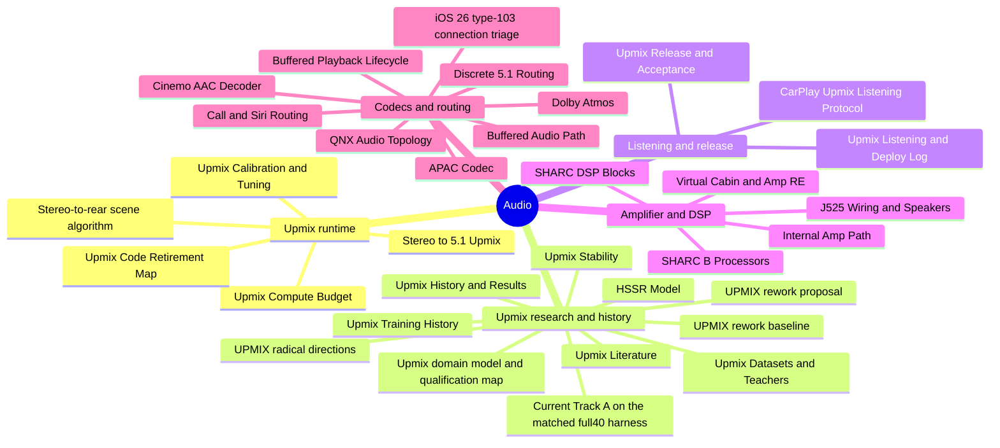
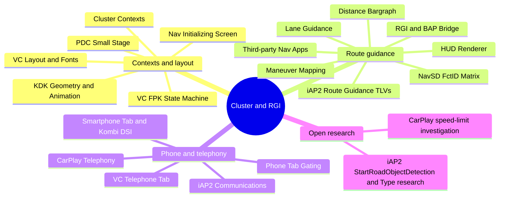
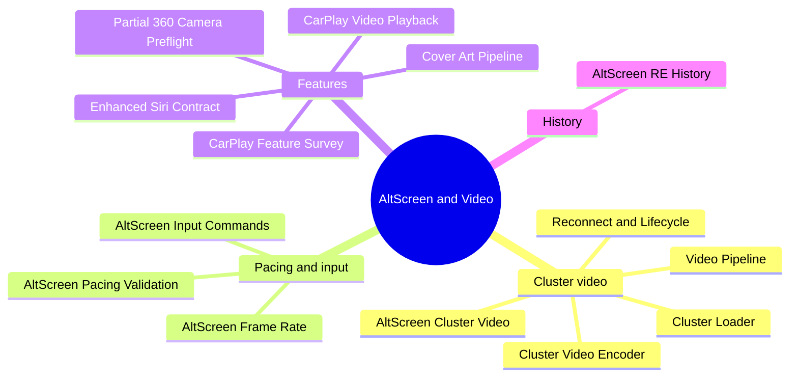
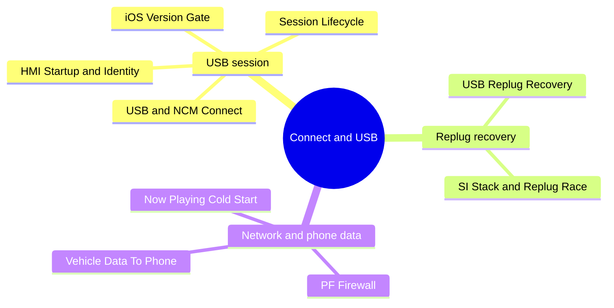
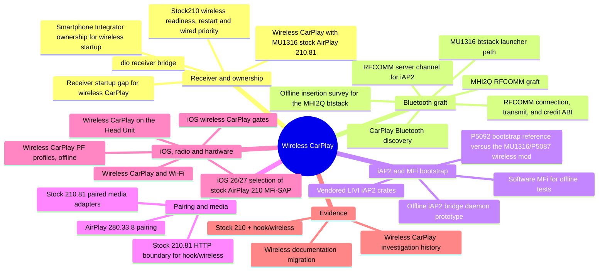
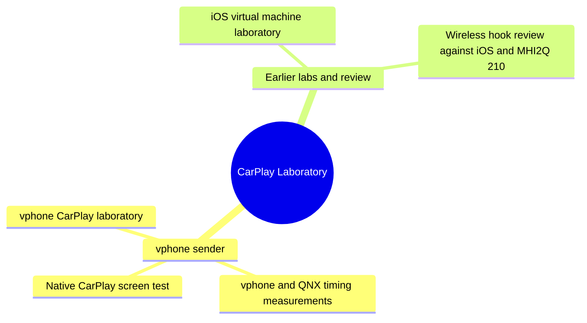
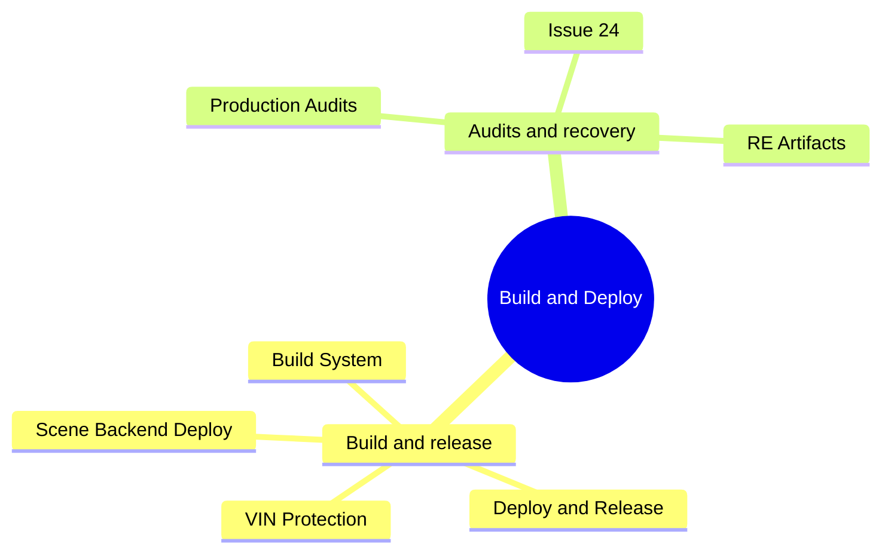
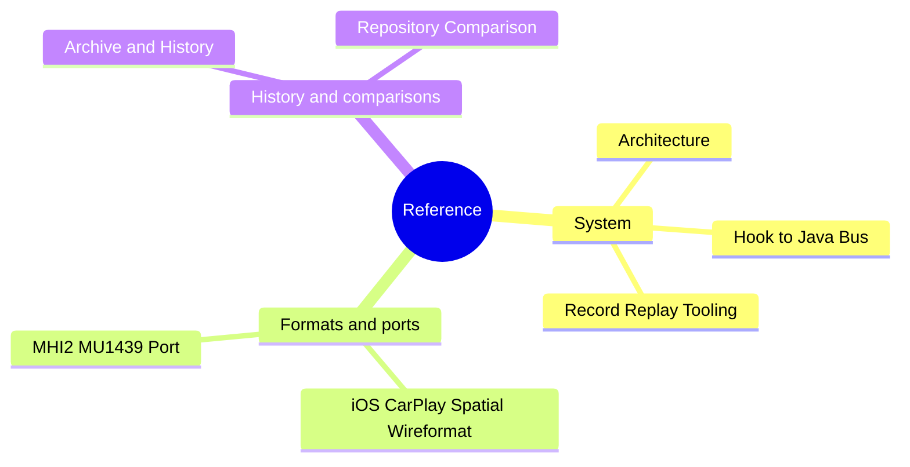

# Documentation map

_Every curated note, grouped by domain and topic. Generated by `scripts/gen_docs_map.py`; rerun it after adding or moving a note._

---

[Documentation home](README.md) · [Landmines](LANDMINES.md)

## 🗺️ How to use this map

Each domain has one mindmap of its notes, followed by the same notes as links. The [documentation home](README.md#-the-domains) shows all of them in one mindmap; the repository README shows each topic group with its note count and lead note. 122 notes in 8 domains.

## 🔊 Audio

Map of content: [Audio overview](audio/README.md)

| Topic | Notes |
| --- | --- |
| Upmix runtime | [Stereo to 5.1 Upmix](audio/STEREO_TO_5_1_UPMIX.md) · [Stereo-to-rear scene algorithm](audio/UPMIX_SCENE_ALGORITHM_2026-10-08.md) · [Upmix Calibration and Tuning](audio/UPMIX_CALIBRATION_AND_TUNING.md) · [Upmix Compute Budget](audio/UPMIX_COMPUTE_BUDGET.md) · [Upmix Code Retirement Map](audio/UPMIX_CODE_RETIREMENT_2026-10-09.md) |
| Upmix research and history | [Upmix History and Results](audio/UPMIX_HISTORY_AND_RESULTS_2026-10-09.md) · [UPMIX rework baseline](audio/UPMIX_REWORK_BASELINE_2026-10-07.md) · [UPMIX rework proposal](audio/UPMIX_REWORK_PROPOSAL_2026-10-07.md) · [UPMIX radical directions](audio/UPMIX_RADICAL_DIRECTIONS_2026-10-07.md) · [Upmix Stability](audio/UPMIX_STABILITY_2026-09-25.md) · [Current Track A on the matched full40 harness](audio/UPMIX_TRACKA_MATCHED40_2026-09-30.md) · [Upmix Training History](audio/UPMIX_TRAINING_HISTORY.md) · [Upmix Datasets and Teachers](audio/UPMIX_DATASETS_AND_TEACHERS.md) · [Upmix Literature](audio/UPMIX_LITERATURE.md) · [Upmix domain model and qualification map](audio/UPMIX_DOMAIN_MODEL.md) · [HSSR Model](audio/HSSR_MODEL.md) |
| Listening and release | [CarPlay Upmix Listening Protocol](audio/UPMIX_CARPLAY_LISTENING_PROTOCOL.md) · [Upmix Listening and Deploy Log](audio/UPMIX_LISTENING_AND_DEPLOY_LOG.md) · [Upmix Release and Acceptance](audio/UPMIX_RELEASE_AND_ACCEPTANCE.md) |
| Amplifier and DSP | [Virtual Cabin and Amp RE](audio/VIRTUAL_CABIN_AND_AMP_RE.md) · [J525 Wiring and Speakers](audio/J525_WIRING_AND_SPEAKERS.md) · [SHARC B Processors](audio/SHARC_B_PROCESSORS.md) · [SHARC DSP Blocks](audio/SHARC_DSP_BLOCKS.md) · [Internal Amp Path](audio/INTERNAL_AMP_PATH.md) |
| Codecs and routing | [APAC Codec](audio/APAC_CODEC.md) · [Cinemo AAC Decoder](audio/CINEMO_AAC_DECODER.md) · [Dolby Atmos](audio/DOLBY_ATMOS.md) · [Discrete 5.1 Routing](audio/DISCRETE_5_1_ROUTING.md) · [Buffered Audio Path](audio/BUFFERED_AUDIO_PATH.md) · [Buffered Playback Lifecycle](audio/BUFFERED_PLAYBACK_LIFECYCLE.md) · [Call and Siri Routing](audio/CALL_AND_SIRI_ROUTING.md) · [QNX Audio Topology](audio/QNX_AUDIO_TOPOLOGY.md) · [iOS 26 type-103 connection triage](audio/IOS26_TYPE103_CONNECTION_TRIAGE_2026-10-03.md) |

## 📊 Cluster and RGI

Map of content: [Cluster and RGI overview](cluster-and-rgi/README.md)

| Topic | Notes |
| --- | --- |
| Contexts and layout | [Cluster Contexts](cluster-and-rgi/CLUSTER_CONTEXTS.md) · [KDK Geometry and Animation](cluster-and-rgi/KDK_GEOMETRY_AND_ANIMATION.md) · [VC Layout and Fonts](cluster-and-rgi/VC_LAYOUT_AND_FONTS.md) · [VC FPK State Machine](cluster-and-rgi/VC_FPK_STATE_MACHINE.md) · [PDC Small Stage](cluster-and-rgi/PDC_SMALL_STAGE.md) · [Nav Initializing Screen](cluster-and-rgi/NAV_INITIALIZING_SCREEN.md) |
| Route guidance | [RGI and BAP Bridge](cluster-and-rgi/RGI_AND_BAP_BRIDGE.md) · [iAP2 Route Guidance TLVs](cluster-and-rgi/IAP2_ROUTE_GUIDANCE_TLVS.md) · [Maneuver Mapping](cluster-and-rgi/MANEUVER_MAPPING.md) · [Lane Guidance](cluster-and-rgi/LANE_GUIDANCE.md) · [Distance Bargraph](cluster-and-rgi/DISTANCE_BARGRAPH.md) · [HUD Renderer](cluster-and-rgi/HUD_RENDERER.md) · [NavSD FctID Matrix](cluster-and-rgi/NAVSD_FCTID_MATRIX.md) · [Third-party Nav Apps](cluster-and-rgi/THIRD_PARTY_NAV_APPS.md) |
| Phone and telephony | [CarPlay Telephony](cluster-and-rgi/CARPLAY_TELEPHONY.md) · [iAP2 Communications](cluster-and-rgi/IAP2_COMMUNICATIONS.md) · [VC Telephone Tab](cluster-and-rgi/VC_TELEPHONE_TAB.md) · [Phone Tab Gating](cluster-and-rgi/PHONE_TAB_GATING.md) · [Smartphone Tab and Kombi DSI](cluster-and-rgi/SMARTPHONE_TAB_AND_KOMBI_DSI.md) |
| Open research | [CarPlay speed-limit investigation](cluster-and-rgi/CARPLAY_SPEED_LIMIT.md) · [iAP2 StartRoadObjectDetection and Type research](cluster-and-rgi/IAP2_ROAD_OBJECT_DETECTION.md) |

## 🖥️ AltScreen and Video

Map of content: [AltScreen and Video overview](altscreen-and-video/README.md)

| Topic | Notes |
| --- | --- |
| Cluster video | [AltScreen Cluster Video](altscreen-and-video/ALTSCREEN_CLUSTER_VIDEO.md) · [Video Pipeline](altscreen-and-video/VIDEO_PIPELINE.md) · [Cluster Loader](altscreen-and-video/CLUSTER_LOADER.md) · [Cluster Video Encoder](altscreen-and-video/CLUSTER_VIDEO_ENCODER.md) · [Reconnect and Lifecycle](altscreen-and-video/RECONNECT_AND_LIFECYCLE.md) |
| Pacing and input | [AltScreen Frame Rate](altscreen-and-video/ALTSCREEN_FRAME_RATE.md) · [AltScreen Pacing Validation](altscreen-and-video/ALTSCREEN_PACING_VALIDATION.md) · [AltScreen Input Commands](altscreen-and-video/ALTSCREEN_INPUT_COMMANDS.md) |
| Features | [Cover Art Pipeline](altscreen-and-video/COVER_ART_PIPELINE.md) · [Enhanced Siri Contract](altscreen-and-video/ENHANCED_SIRI_CONTRACT.md) · [CarPlay Video Playback](altscreen-and-video/CARPLAY_VIDEO_PLAYBACK.md) · [CarPlay Feature Survey](altscreen-and-video/CARPLAY_FEATURE_SURVEY.md) · [Partial 360 Camera Preflight](altscreen-and-video/PARTIAL_360_CAMERA_PREFLIGHT.md) |
| History | [AltScreen RE History](altscreen-and-video/ALTSCREEN_RE_HISTORY.md) |

## 🔌 Connect and USB

Map of content: [Connect and USB overview](connect-and-usb/README.md)

| Topic | Notes |
| --- | --- |
| USB session | [USB and NCM Connect](connect-and-usb/USB_AND_NCM_CONNECT.md) · [Session Lifecycle](connect-and-usb/SESSION_LIFECYCLE.md) · [iOS Version Gate](connect-and-usb/IOS_VERSION_GATE.md) · [HMI Startup and Identity](connect-and-usb/HMI_STARTUP_AND_IDENTITY.md) |
| Replug recovery | [USB Replug Recovery](connect-and-usb/USB_REPLUG_RECOVERY.md) · [SI Stack and Replug Race](connect-and-usb/SI_STACK_AND_REPLUG_RACE.md) |
| Network and phone data | [PF Firewall](connect-and-usb/PF_FIREWALL.md) · [Vehicle Data To Phone](connect-and-usb/VEHICLE_DATA_TO_PHONE.md) · [Now Playing Cold Start](connect-and-usb/NOW_PLAYING_COLD_START.md) |

## 📶 Wireless CarPlay

Map of content: [Wireless CarPlay overview](wireless-carplay/README.md)

| Topic | Notes |
| --- | --- |
| Receiver and ownership | [Wireless CarPlay with MU1316 stock AirPlay 210.81](wireless-carplay/STOCK210_ARCHITECTURE.md) · [Stock210 wireless readiness, restart and wired priority](wireless-carplay/STOCK210_RECEIVER_LIFECYCLE.md) · [Receiver startup gap for wireless CarPlay](wireless-carplay/RECEIVER_START.md) · [dio receiver bridge](wireless-carplay/RECEIVER_BRIDGE.md) · [Smartphone Integrator ownership for wireless startup](wireless-carplay/DIO_OWNERSHIP.md) |
| Bluetooth graft | [MHI2Q RFCOMM graft](wireless-carplay/BTSTACK_GRAFT.md) · [Offline insertion survey for the MHI2Q btstack](wireless-carplay/GRAFT_INSERTION_PLAN.md) · [MU1316 btstack launcher path](wireless-carplay/GRAFT_LAUNCHER_LIFECYCLE.md) · [RFCOMM server channel for iAP2](wireless-carplay/RFCOMM_CHANNEL_LAYOUT.md) · [RFCOMM connection, transmit, and credit ABI](wireless-carplay/RFCOMM_DUPLEX.md) · [CarPlay Bluetooth discovery](wireless-carplay/BLUETOOTH_DISCOVERY.md) |
| iAP2 and MFi bootstrap | [Offline iAP2 bridge daemon prototype](wireless-carplay/IAP2_DAEMON.md) · [Vendored LIVI iAP2 crates](wireless-carplay/IAP2_VENDOR_PROVENANCE.md) · [Software MFi for offline tests](wireless-carplay/TEST_SOFTWARE_MFI.md) · [P5092 bootstrap reference versus the MU1316/P5087 wireless mod](wireless-carplay/BOOTSTRAP_COMPARISON.md) |
| Pairing and media | [Stock 210.81 HTTP boundary for hook/wireless](wireless-carplay/STOCK210_HTTP_PAIRING_ABI.md) · [Stock 210.81 paired media adapters](wireless-carplay/STOCK210_MEDIA_CRYPTO_ABI.md) · [AirPlay 280.33.8 pairing](wireless-carplay/AIRPLAY280_PAIRING_RECIPE.md) |
| iOS, radio and hardware | [iOS 26/27 selection of stock AirPlay 210 MFi-SAP](wireless-carplay/IOS_AUTH_SELECTION.md) · [iOS wireless CarPlay gates](wireless-carplay/IOS_WIRELESS_SESSION_GATES.md) · [Wireless CarPlay and Wi-Fi](wireless-carplay/WIFI_AND_DISCOVERY.md) · [Wireless CarPlay on the Head Unit](wireless-carplay/HARDWARE_AND_DONORS.md) · [Wireless CarPlay PF profiles, offline](wireless-carplay/FIREWALL.md) |
| Evidence | [Stock 210 + hook/wireless](wireless-carplay/STOCK210_VALIDATION.md) · [Wireless CarPlay investigation history](wireless-carplay/history/README.md) · [Wireless documentation migration](wireless-carplay/history/MIGRATION.md) |

## 🧪 CarPlay Laboratory

Map of content: [CarPlay Laboratory overview](carplay-lab/README.md)

| Topic | Notes |
| --- | --- |
| vphone sender | [vphone CarPlay laboratory](carplay-lab/VPHONE_LAB.md) · [vphone and QNX timing measurements](carplay-lab/VPHONE_TIMING.md) · [Native CarPlay screen test](carplay-lab/NATIVE_SCREEN_TEST.md) |
| Earlier labs and review | [iOS virtual machine laboratory](carplay-lab/IOS_VM_LAB.md) · [Wireless hook review against iOS and MHI2Q 210](carplay-lab/IOS210_CODE_REVIEW.md) |

## 📦 Build and Deploy

Map of content: [Build and Deploy overview](build-and-deploy/README.md)

| Topic | Notes |
| --- | --- |
| Build and release | [Build System](build-and-deploy/BUILD_SYSTEM.md) · [Deploy and Release](build-and-deploy/DEPLOY_AND_RELEASE.md) · [Scene Backend Deploy](build-and-deploy/SCENE_BACKEND_DEPLOY.md) · [VIN Protection](build-and-deploy/VIN_PROTECTION.md) |
| Audits and recovery | [Production Audits](build-and-deploy/PRODUCTION_AUDITS.md) · [Issue 24](build-and-deploy/ISSUE24_RCC_MMX_RECOVERY.md) · [RE Artifacts](build-and-deploy/RE_ARTIFACTS.md) |

## 📚 Reference

| Topic | Notes |
| --- | --- |
| System | [Architecture](reference/ARCHITECTURE.md) · [Hook to Java Bus](reference/HOOK_TO_JAVA_BUS.md) · [Record Replay Tooling](reference/RECORD_REPLAY_TOOLING.md) |
| Formats and ports | [iOS CarPlay Spatial Wireformat](reference/IOS_CARPLAY_SPATIAL_WIREFORMAT.md) · [MHI2 MU1439 Port](reference/MHI2_MU1439_PORT.md) |
| History and comparisons | [Archive and History](reference/ARCHIVE_AND_HISTORY.md) · [Repository Comparison](reference/REPOSITORY_COMPARISON_MHI2Q_EVO_2026-10-10.md) |
