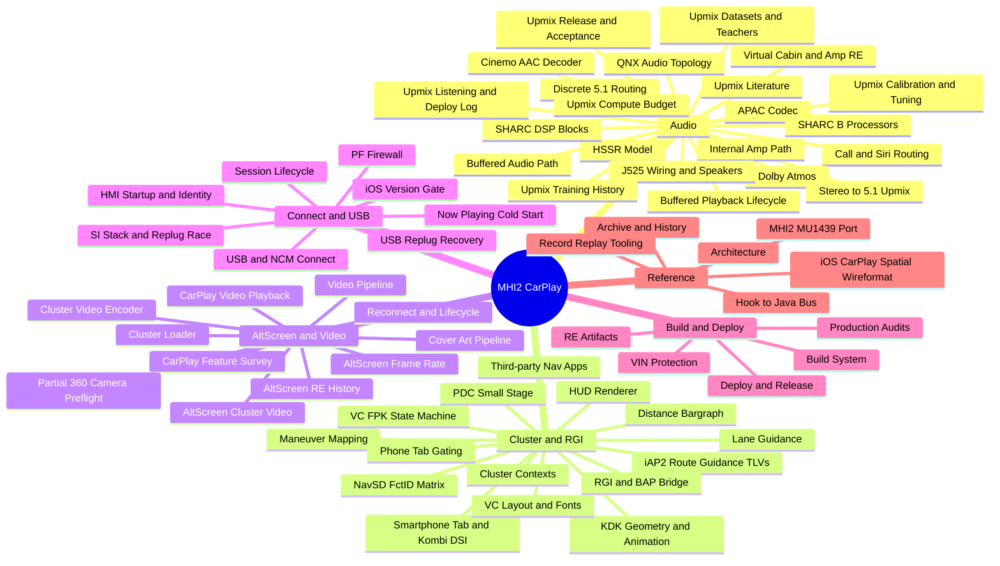
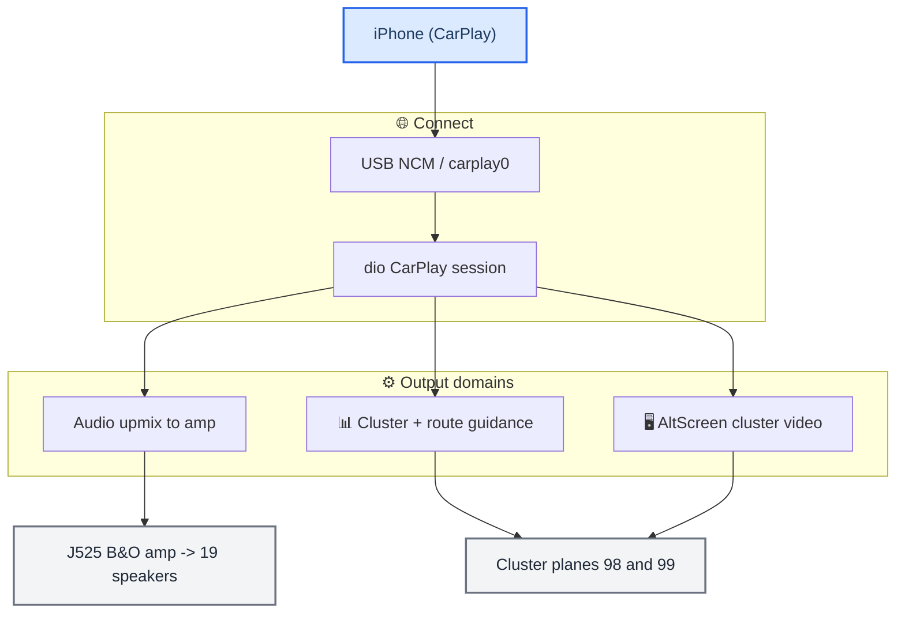

# Home

_The MHI2 CarPlay knowledge base — every domain of the project, linked and diagrammed. Start here._

---

## 🏠 What this vault is

This is the whole project's documentation as a navigable Obsidian vault: the audio
upmix and amplifier reverse-engineering, the instrument cluster and route guidance,
the alternate-screen video, the USB/connect path, the build and deploy system, and a
cross-cutting index of traps. Each domain has a **map-of-content (MOC)** note that
links its topic notes; every note carries Mermaid diagrams and Obsidian wikilinks.

Truth levels are tagged throughout: **[code]** verified in the current source (cited
`path:line`), **[car]** confirmed on the unit, **[model]** / **[decompile]** static
reverse-engineering or offline modelling, **[open]** not yet verified. The current
source code is the ground truth for what the system does.

> 📌 **Before you touch a subsystem, read [[Landmines]]** — the traps that already cost days.

---

## 📚 The domains

_Mindmap of the vault: the six domains and every curated note in them._

| Domain | Map of content | Covers |
| --- | --- | --- |
| **Audio** | [[Audio MOC]] | stereo→5.1 upmix, the HSSR AI, the J525 amp / Virtual Cabin, Dolby, discrete 5.1 |
| **Cluster and RGI** | [[Cluster and RGI MOC]] | cluster contexts, BAP route guidance, HUD renderer, third-party nav, phone tab |
| **AltScreen and Video** | [[AltScreen and Video MOC]] | cluster video (stream 111), OMX pipeline, boot loader, reconnect lifecycle |
| **Connect and USB** | [[Connect and USB MOC]] | NCM connect, USB replug recovery, PF firewall, iOS version gate |
| **Build and Deploy** | [[Build and Deploy MOC]] | Docker QNX build, hand-assembled release, VIN protection, RE artifacts |
| **Reference** | — | [[Architecture]], [[Archive and History]], [[Hook to Java Bus]], [[iOS CarPlay Spatial Wireformat]], [[MHI2 MU1439 Port]], [[Record Replay Tooling]] |
| **Traps** | [[Landmines]] | cross-project rules that break, slow, or mislead |
| **Sources** | [[#📚 Sources and research]] | the original audits, handoffs, papers and data files, verbatim |

---

## 🌐 The system at a glance

_High-level flow from the phone to the cluster and speakers; each block links to its domain._

- **Audio** → [[Stereo to 5.1 Upmix]] · [[HSSR Model]] · [[Virtual Cabin and Amp RE]]
- **Cluster** → [[Cluster Contexts]] · [[RGI and BAP Bridge]] · [[HUD Renderer]]
- **AltScreen** → [[AltScreen Cluster Video]] · [[Video Pipeline]]
- **Connect** → [[USB and NCM Connect]] · [[USB Replug Recovery]]
- **Build/Deploy** → [[Build System]] · [[Deploy and Release]]
- Everything talks over the [[Hook to Java Bus]].

---

## 🔗 A–Z index

Every curated note in the vault, alphabetical:

- [[AltScreen and Video MOC]]
- [[AltScreen Cluster Video]]
- [[AltScreen Frame Rate]]
- [[AltScreen RE History]]
- [[APAC Codec]]
- [[Architecture]]
- [[Archive and History]]
- [[Audio MOC]]
- [[Buffered Audio Path]]
- [[Buffered Playback Lifecycle]]
- [[Build and Deploy MOC]]
- [[Build System]]
- [[Call and Siri Routing]]
- [[CarPlay Feature Survey]]
- [[CarPlay Video Playback]]
- [[Cinemo AAC Decoder]]
- [[Cluster and RGI MOC]]
- [[Cluster Contexts]]
- [[Cluster Loader]]
- [[Cluster Video Encoder]]
- [[Connect and USB MOC]]
- [[Cover Art Pipeline]]
- [[Deploy and Release]]
- [[Discrete 5.1 Routing]]
- [[Distance Bargraph]]
- [[Dolby Atmos]]
- [[HMI Startup and Identity]]
- [[Hook to Java Bus]]
- [[HSSR Model]]
- [[HUD Renderer]]
- [[iAP2 Route Guidance TLVs]]
- [[Internal Amp Path]]
- [[iOS CarPlay Spatial Wireformat]]
- [[iOS Version Gate]]
- [[J525 Wiring and Speakers]]
- [[KDK Geometry and Animation]]
- [[Landmines]]
- [[Lane Guidance]]
- [[Maneuver Mapping]]
- [[MHI2 MU1439 Port]]
- [[NavSD FctID Matrix]]
- [[Now Playing Cold Start]]
- [[Partial 360 Camera Preflight]]
- [[PDC Small Stage]]
- [[PF Firewall]]
- [[Phone Tab Gating]]
- [[Production Audits]]
- [[QNX Audio Topology]]
- [[RE Artifacts]]
- [[Reconnect and Lifecycle]]
- [[Record Replay Tooling]]
- [[RGI and BAP Bridge]]
- [[Session Lifecycle]]
- [[SHARC B Processors]]
- [[SHARC DSP Blocks]]
- [[SI Stack and Replug Race]]
- [[Smartphone Tab and Kombi DSI]]
- [[Stereo to 5.1 Upmix]]
- [[Third-party Nav Apps]]
- [[Upmix Calibration and Tuning]]
- [[Upmix Compute Budget]]
- [[Upmix Datasets and Teachers]]
- [[Upmix Listening and Deploy Log]]
- [[Upmix Literature]]
- [[Upmix Release and Acceptance]]
- [[Upmix Training History]]
- [[USB and NCM Connect]]
- [[USB Replug Recovery]]
- [[VC FPK State Machine]]
- [[VC Layout and Fonts]]
- [[Video Pipeline]]
- [[VIN Protection]]
- [[Virtual Cabin and Amp RE]]

---

## 📚 Sources and research

The vault is one tree. Curated notes (the domain folders above) are the synthesis and
carry every durable fact. Beside them:

| Folder | What it holds |
| --- | --- |
| `Research/` | the long-form white papers — [[Research/UPMIX\|UPMIX]], [[Research/HSSR_UPMIX_MODEL\|HSSR_UPMIX_MODEL]], [[Research/VIRTUAL_CABIN\|VIRTUAL_CABIN]], [[Research/DOLBY_ATMOS_TEARDOWN\|DOLBY_ATMOS_TEARDOWN]] |
| `Sources/papers/` | upmix papers and SHARC manuals (PDF + extracted text), J525 wiring, connector and speaker-layout images |
| `Sources/` | primary evidence kept verbatim: the B9 speaker workbook (xlsx), SHARC matrix CSV, the frozen v2 acceptance protocol, the upmix run journals, the MIBRoot routing tables, the replug runbook |
| `Sources/reference/` | KDK 60 Hz samples (CSV), the SHARC disassembler source, the Pioneer APAC symbol table |
| `Sources/research/` | the MHI3 reference altScreen hook (C) and the decompiled stock Java + diffs for MU1316/1326/1439 |
| `Sources/acdb/`, `Sources/captures/` | the patched ACDB and its script, the APAC live-capture manifest |

Each of these is linked from the curated note that relies on it, at the point where it is used.
The legacy prose docs (audits, handoffs, plans, RE reports) were merged into the curated notes
and removed; every note's **Sources** section still names the originals it absorbed, and they
remain in git history (commit `23972aa`). Other RE working sets live outside the vault in
`assets/` (see [[RE Artifacts]]).

Every code-state claim was reconciled against the current source on 2026-09-22 (the code is
authoritative); training history, listening verdicts and on-car measurements keep the
provenance of the doc that recorded them.
