# MHI2Q CarPlay documentation

Technical documentation for the current implementation. For compatibility, installation and everyday settings, start with the [project README](../README.md).

## 🧭 Start here

| Area | Read this for |
| --- | --- |
| [Architecture](reference/ARCHITECTURE.md) | Processes, modules and ownership |
| [Audio](audio/README.md) | SCENE UpMix, discrete 5.1, codecs and amplifier routing |
| [Cluster and RGI](cluster-and-rgi/README.md) | Route guidance, maneuver graphics, HUD and telephony |
| [AltScreen and video](altscreen-and-video/README.md) | Cluster video, rendering, input and frame pacing |
| [Connect and USB](connect-and-usb/README.md) | Wired startup, reconnect and diagnostics |
| [Stock patches](stock-patches/README.md) | Exact binary changes, fingerprints and supported inputs |
| [Build and deploy](build-and-deploy/README.md) | Toolchain, packaging, installation and recovery |
| [CarPlay laboratory](carplay-lab/README.md) | Native iOS/QNX fixtures and validation procedures |
| [Wireless implementation](wireless-carplay/README.md) | SI-owned wireless sessions and remaining integration work |
| [Engineering constraints](LANDMINES.md) | Requirements to preserve when changing the implementation |

The working source defines runtime behavior. Vehicle reports and laboratory measurements apply to the builds they identify. Stock firmware RE is labeled separately from observations on a vehicle.

<a id="notes-by-topic"></a>

## 📚 Current technical references

<!-- BEGIN generated:notes-by-topic -->
**🔧 Stock component patches** · [overview](stock-patches/README.md)

- Libraries: [devnp-mrvl_wlan-sdiorm.so](stock-patches/devnp-mrvl_wlan-sdiorm.so.md) · [libairplay.so](stock-patches/libairplay.so.md) · [deva-ctrl-qc.so](stock-patches/deva-ctrl-qc.so.md)
- Executables and configuration: [smartphone_integrator](stock-patches/smartphone_integrator.md) · [MCD](stock-patches/mcd.md) · [Конфигурация и библиотеки проекта](stock-patches/CONFIGURATION_AND_HOOKS.md)
- Evidence and decisions: [Результаты измерений и границы выводов](stock-patches/PERFORMANCE.md) · [Отклонённые концепции и ошибки промежуточных версий](stock-patches/REJECTED_CONCEPTS.md)

**🔊 Audio** · [overview](audio/README.md)

- Upmix runtime: [Stereo to 5.1 Upmix](audio/STEREO_TO_5_1_UPMIX.md) · [SCENE stereo-to-surround algorithm](audio/UPMIX_SCENE_ALGORITHM_2026-10-08.md) · [SCENE compute budget](audio/UPMIX_COMPUTE_BUDGET.md)
- Research references: [Upmix Datasets and Teachers](audio/UPMIX_DATASETS_AND_TEACHERS.md) · [Upmix Literature](audio/UPMIX_LITERATURE.md)
- Amplifier and DSP: [Virtual Cabin and Amp RE](audio/VIRTUAL_CABIN_AND_AMP_RE.md) · [Audi B&O J525 — ODIS-E ODX & V850 Firmware Mapping](audio/ODIS_AMP_MAPPING.md) · [J525 Wiring and Speakers](audio/J525_WIRING_AND_SPEAKERS.md) · [SHARC B Processors](audio/SHARC_B_PROCESSORS.md) · [SHARC DSP Blocks](audio/SHARC_DSP_BLOCKS.md) · [Internal Amp Path](audio/INTERNAL_AMP_PATH.md)
- Codecs and routing: [APAC Codec](audio/APAC_CODEC.md) · [Cinemo AAC Decoder](audio/CINEMO_AAC_DECODER.md) · [Dolby Atmos](audio/DOLBY_ATMOS.md) · [Discrete 5.1 Routing](audio/DISCRETE_5_1_ROUTING.md) · [Buffered Audio Path](audio/BUFFERED_AUDIO_PATH.md) · [Buffered Playback Lifecycle](audio/BUFFERED_PLAYBACK_LIFECYCLE.md) · [Call and Siri Routing](audio/CALL_AND_SIRI_ROUTING.md) · [QNX Audio Topology](audio/QNX_AUDIO_TOPOLOGY.md)

**📊 Cluster and RGI** · [overview](cluster-and-rgi/README.md)

- Contexts and layout: [Cluster Contexts](cluster-and-rgi/CLUSTER_CONTEXTS.md) · [KDK Geometry and Animation](cluster-and-rgi/KDK_GEOMETRY_AND_ANIMATION.md) · [VC Layout and Fonts](cluster-and-rgi/VC_LAYOUT_AND_FONTS.md) · [VC FPK State Machine](cluster-and-rgi/VC_FPK_STATE_MACHINE.md) · [PDC Small Stage](cluster-and-rgi/PDC_SMALL_STAGE.md) · [Navigation initializing screen](cluster-and-rgi/NAV_INITIALIZING_SCREEN.md) · [Stock Navigation Readiness](cluster-and-rgi/STOCK_NAV_READINESS.md)
- Route guidance: [RGI and BAP Bridge](cluster-and-rgi/RGI_AND_BAP_BRIDGE.md) · [iAP2 Route Guidance TLVs](cluster-and-rgi/IAP2_ROUTE_GUIDANCE_TLVS.md) · [Maneuver Mapping](cluster-and-rgi/MANEUVER_MAPPING.md) · [Lane Guidance](cluster-and-rgi/LANE_GUIDANCE.md) · [Distance Bargraph](cluster-and-rgi/DISTANCE_BARGRAPH.md) · [HUD Renderer](cluster-and-rgi/HUD_RENDERER.md) · [NavSD FctID Matrix](cluster-and-rgi/NAVSD_FCTID_MATRIX.md) · [Third-party Nav Apps](cluster-and-rgi/THIRD_PARTY_NAV_APPS.md)
- Phone and telephony: [CarPlay Telephony](cluster-and-rgi/CARPLAY_TELEPHONY.md) · [iAP2 Communications](cluster-and-rgi/IAP2_COMMUNICATIONS.md) · [VC Telephone Tab](cluster-and-rgi/VC_TELEPHONE_TAB.md) · [Smartphone Tab and Kombi DSI](cluster-and-rgi/SMARTPHONE_TAB_AND_KOMBI_DSI.md)
- Open research: [CarPlay speed-limit investigation](cluster-and-rgi/CARPLAY_SPEED_LIMIT.md) · [iAP2 StartRoadObjectDetection and Type research](cluster-and-rgi/IAP2_ROAD_OBJECT_DETECTION.md)

**🖥️ AltScreen and Video** · [overview](altscreen-and-video/README.md)

- Cluster video: [AltScreen Cluster Video](altscreen-and-video/ALTSCREEN_CLUSTER_VIDEO.md) · [Video Pipeline](altscreen-and-video/VIDEO_PIPELINE.md) · [Cluster Loader](altscreen-and-video/CLUSTER_LOADER.md) · [Cluster Video Encoder](altscreen-and-video/CLUSTER_VIDEO_ENCODER.md) · [Reconnect and Lifecycle](altscreen-and-video/RECONNECT_AND_LIFECYCLE.md)
- Pacing and input: [AltScreen Frame Rate](altscreen-and-video/ALTSCREEN_FRAME_RATE.md) · [AltScreen Pacing Validation](altscreen-and-video/ALTSCREEN_PACING_VALIDATION.md) · [AltScreen Input Commands](altscreen-and-video/ALTSCREEN_INPUT_COMMANDS.md) · [Wired AltScreen 30 fps investigation](altscreen-and-video/WIRED_30FPS_INVESTIGATION.md) · [Maps frame-rate vehicle profile mechanism](altscreen-and-video/MAPS_FRAME_RATE_PROFILE_MECHANISM.md) · [Maps 30 FPS profile in the HU hook](altscreen-and-video/MAPS_30FPS_PROFILE.md) · [CarPlay PPID profiles and capability settings](altscreen-and-video/PPID_PROFILE_COMPARISON.md) · [Stock decoder queue patch](altscreen-and-video/DECODER_QUEUE_PATCH.md) · [Wired AltScreen performance —](altscreen-and-video/WIRED_PERFORMANCE_2026-10-21.md)
- Features: [Cover Art Pipeline](altscreen-and-video/COVER_ART_PIPELINE.md) · [Enhanced Siri Contract](altscreen-and-video/ENHANCED_SIRI_CONTRACT.md) · [CarPlay Video Playback](altscreen-and-video/CARPLAY_VIDEO_PLAYBACK.md) · [CarPlay Feature Survey](altscreen-and-video/CARPLAY_FEATURE_SURVEY.md) · [Partial 360 Camera Preflight](altscreen-and-video/PARTIAL_360_CAMERA_PREFLIGHT.md)

**🔌 Connect and USB** · [overview](connect-and-usb/README.md)

- USB session: [USB and NCM Connect](connect-and-usb/USB_AND_NCM_CONNECT.md) · [Session Lifecycle](connect-and-usb/SESSION_LIFECYCLE.md) · [HMI Startup and Identity](connect-and-usb/HMI_STARTUP_AND_IDENTITY.md)
- Replug recovery: [USB Replug Recovery](connect-and-usb/USB_REPLUG_RECOVERY.md) · [SI Stack and Replug Race](connect-and-usb/SI_STACK_AND_REPLUG_RACE.md)
- Network and phone data: [PF Firewall](connect-and-usb/PF_FIREWALL.md) · [Vehicle Data To Phone](connect-and-usb/VEHICLE_DATA_TO_PHONE.md) · [Now Playing Cold Start](connect-and-usb/NOW_PLAYING_COLD_START.md)

**📶 Wireless CarPlay** · [overview](wireless-carplay/README.md)

- Receiver and ownership: [Wireless CarPlay with MU1316 stock AirPlay 210.81](wireless-carplay/STOCK210_ARCHITECTURE.md) · [Stock210 receiver lifecycle](wireless-carplay/STOCK210_RECEIVER_LIFECYCLE.md) · [Stock210 first physical wireless test](wireless-carplay/STOCK210_HU_TEST.md) · [Receiver startup gap for wireless CarPlay](wireless-carplay/RECEIVER_START.md) · [dio receiver bridge](wireless-carplay/RECEIVER_BRIDGE.md) · [Smartphone Integrator ownership for wireless startup](wireless-carplay/DIO_OWNERSHIP.md) · [SI wireless design references](wireless-carplay/SI_WIRELESS_EXTENSION_PLAN.md) · [Сравнительный RE Smartphone Integrator](wireless-carplay/SI_MH2P_COMPARATIVE_RE.md) · [SI stage 1](wireless-carplay/SI_STAGE1_HU_TEST.md) · [SI-owned wireless implementation](wireless-carplay/SI_STAGE2_OFFLINE.md)
- Bluetooth graft: [MHI2Q RFCOMM graft](wireless-carplay/BTSTACK_GRAFT.md) · [Offline insertion survey for the MHI2Q btstack](wireless-carplay/GRAFT_INSERTION_PLAN.md) · [MU1316 btstack launcher path](wireless-carplay/GRAFT_LAUNCHER_LIFECYCLE.md) · [RFCOMM server channel for iAP2](wireless-carplay/RFCOMM_CHANNEL_LAYOUT.md) · [RFCOMM connection, transmit, and credit ABI](wireless-carplay/RFCOMM_DUPLEX.md) · [CarPlay Bluetooth discovery](wireless-carplay/BLUETOOTH_DISCOVERY.md)
- iAP2 and MFi bootstrap: [Offline iAP2 bridge daemon prototype](wireless-carplay/IAP2_DAEMON.md) · [Vendored iAP2 and JSON crates](wireless-carplay/IAP2_VENDOR_PROVENANCE.md) · [Software MFi for offline tests](wireless-carplay/TEST_SOFTWARE_MFI.md) · [P5092 bootstrap reference versus the MU1316/P5087 wireless mod](wireless-carplay/BOOTSTRAP_COMPARISON.md)
- Pairing and media: [Stock 210.81 HTTP boundary for hook/wireless](wireless-carplay/STOCK210_HTTP_PAIRING_ABI.md) · [Stock 210.81 paired media adapters](wireless-carplay/STOCK210_MEDIA_CRYPTO_ABI.md) · [AirPlay 280.33.8 pairing](wireless-carplay/AIRPLAY280_PAIRING_RECIPE.md) · [Wireless AltScreen, iAP2 and ASI ownership](wireless-carplay/WIRELESS_PRODUCTION_CHANNELS.md)
- iOS, radio and hardware: [iOS 26/27 selection of stock AirPlay 210 MFi-SAP](wireless-carplay/IOS_AUTH_SELECTION.md) · [iOS wireless CarPlay gates](wireless-carplay/IOS_WIRELESS_SESSION_GATES.md) · [Wireless CarPlay and Wi-Fi](wireless-carplay/WIFI_AND_DISCOVERY.md) · [Wireless CarPlay on the Head Unit](wireless-carplay/HARDWARE_AND_DONORS.md) · [Wireless CarPlay PF profiles, offline](wireless-carplay/FIREWALL.md)
- Evidence: [Stock210 validation profiles and evidence](wireless-carplay/STOCK210_VALIDATION.md) · [WCP0627 developer source review](wireless-carplay/WCP0627_SOURCE_REVIEW.md) · [Wireless CarPlay investigation history](wireless-carplay/history/README.md) · [Wireless documentation migration](wireless-carplay/history/MIGRATION.md)

**🧪 CarPlay Laboratory** · [overview](carplay-lab/README.md)

- vphone sender: [vphone CarPlay laboratory](carplay-lab/VPHONE_LAB.md) · [vphone and QNX timing measurements](carplay-lab/VPHONE_TIMING.md) · [Native wireless CarPlay with the QNX Rust daemon](carplay-lab/NATIVE_WIRELESS_QNX.md) · [Native CarPlay screen test](carplay-lab/NATIVE_SCREEN_TEST.md) · [Concurrent media transport stress](carplay-lab/MEDIA_STRESS_TEST.md) · [Wireless media and native HMI validation](carplay-lab/WIRELESS_MEDIA_VALIDATION.md) · [Wireless implementation and acceptance ledger](carplay-lab/WIRELESS_COMPLETION_PLAN.md)
- Laboratory references: [Historical Inferno / iOS 14 laboratory](carplay-lab/IOS_VM_LAB.md) · [Historical iOS / stock210 interoperability review](carplay-lab/IOS210_CODE_REVIEW.md)

**📦 Build and Deploy** · [overview](build-and-deploy/README.md)

- Build and release: [Repository workflow](build-and-deploy/REPOSITORY_WORKFLOW.md) · [Build System](build-and-deploy/BUILD_SYSTEM.md) · [Deploy and Release](build-and-deploy/DEPLOY_AND_RELEASE.md) · [Scene Backend Deploy](build-and-deploy/SCENE_BACKEND_DEPLOY.md)
- Audits and recovery: [Issue 24](build-and-deploy/ISSUE24_RCC_MMX_RECOVERY.md) · [RE Artifacts](build-and-deploy/RE_ARTIFACTS.md)

**📚 Reference**

- System: [Architecture](reference/ARCHITECTURE.md) · [Hook to Java Bus](reference/HOOK_TO_JAVA_BUS.md) · [Record Replay Tooling](reference/RECORD_REPLAY_TOOLING.md)
- Formats and ports: [iOS CarPlay Spatial Wireformat](reference/IOS_CARPLAY_SPATIAL_WIREFORMAT.md) · [MHI2 MU1439 Port](reference/MHI2_MU1439_PORT.md) · [AirPlay / CarPlay status codes](reference/CARPLAY_STATUS_CODES.md)

Across every domain: [Landmines](LANDMINES.md).

```mermaid
mindmap
  root((MHI2Q CarPlay docs))
    Stock component patches
      Libraries
        devnp-mrvl_wlan-sdiorm.so
        libairplay.so
        deva-ctrl-qc.so
      Executables and configuration
        smartphone_integrator
        MCD
        Конфигурация и библиотеки проекта
      Evidence and decisions
        Результаты измерений и границы выводов
        Отклонённые концепции и ошибки промежуточных версий
    Audio
      Upmix runtime
        Stereo to 5.1 Upmix
        SCENE stereo-to-surround algorithm
        SCENE compute budget
      Research references
        Upmix Datasets and Teachers
        Upmix Literature
      Amplifier and DSP
        Virtual Cabin and Amp RE
        Audi B&O J525 — ODIS-E ODX & V850 Firmware Mapping
        J525 Wiring and Speakers
        SHARC B Processors
        SHARC DSP Blocks
        Internal Amp Path
      Codecs and routing
        APAC Codec
        Cinemo AAC Decoder
        Dolby Atmos
        Discrete 5.1 Routing
        Buffered Audio Path
        Buffered Playback Lifecycle
        Call and Siri Routing
        QNX Audio Topology
    Cluster and RGI
      Contexts and layout
        Cluster Contexts
        KDK Geometry and Animation
        VC Layout and Fonts
        VC FPK State Machine
        PDC Small Stage
        Navigation initializing screen
        Stock Navigation Readiness
      Route guidance
        RGI and BAP Bridge
        iAP2 Route Guidance TLVs
        Maneuver Mapping
        Lane Guidance
        Distance Bargraph
        HUD Renderer
        NavSD FctID Matrix
        Third-party Nav Apps
      Phone and telephony
        CarPlay Telephony
        iAP2 Communications
        VC Telephone Tab
        Smartphone Tab and Kombi DSI
      Open research
        CarPlay speed-limit investigation
        iAP2 StartRoadObjectDetection and Type research
    AltScreen and Video
      Cluster video
        AltScreen Cluster Video
        Video Pipeline
        Cluster Loader
        Cluster Video Encoder
        Reconnect and Lifecycle
      Pacing and input
        AltScreen Frame Rate
        AltScreen Pacing Validation
        AltScreen Input Commands
        Wired AltScreen 30 fps investigation
        Maps frame-rate vehicle profile mechanism
        Maps 30 FPS profile in the HU hook
        CarPlay PPID profiles and capability settings
        Stock decoder queue patch
        Wired AltScreen performance —
      Features
        Cover Art Pipeline
        Enhanced Siri Contract
        CarPlay Video Playback
        CarPlay Feature Survey
        Partial 360 Camera Preflight
    Connect and USB
      USB session
        USB and NCM Connect
        Session Lifecycle
        HMI Startup and Identity
      Replug recovery
        USB Replug Recovery
        SI Stack and Replug Race
      Network and phone data
        PF Firewall
        Vehicle Data To Phone
        Now Playing Cold Start
    Wireless CarPlay
      Receiver and ownership
        Wireless CarPlay with MU1316 stock AirPlay 210.81
        Stock210 receiver lifecycle
        Stock210 first physical wireless test
        Receiver startup gap for wireless CarPlay
        dio receiver bridge
        Smartphone Integrator ownership for wireless startup
        SI wireless design references
        Сравнительный RE Smartphone Integrator
        SI stage 1
        SI-owned wireless implementation
      Bluetooth graft
        MHI2Q RFCOMM graft
        Offline insertion survey for the MHI2Q btstack
        MU1316 btstack launcher path
        RFCOMM server channel for iAP2
        RFCOMM connection, transmit, and credit ABI
        CarPlay Bluetooth discovery
      iAP2 and MFi bootstrap
        Offline iAP2 bridge daemon prototype
        Vendored iAP2 and JSON crates
        Software MFi for offline tests
        P5092 bootstrap reference versus the MU1316/P5087 wireless mod
      Pairing and media
        Stock 210.81 HTTP boundary for hook/wireless
        Stock 210.81 paired media adapters
        AirPlay 280.33.8 pairing
        Wireless AltScreen, iAP2 and ASI ownership
      iOS, radio and hardware
        iOS 26/27 selection of stock AirPlay 210 MFi-SAP
        iOS wireless CarPlay gates
        Wireless CarPlay and Wi-Fi
        Wireless CarPlay on the Head Unit
        Wireless CarPlay PF profiles, offline
      Evidence
        Stock210 validation profiles and evidence
        WCP0627 developer source review
        Wireless CarPlay investigation history
        Wireless documentation migration
    CarPlay Laboratory
      vphone sender
        vphone CarPlay laboratory
        vphone and QNX timing measurements
        Native wireless CarPlay with the QNX Rust daemon
        Native CarPlay screen test
        Concurrent media transport stress
        Wireless media and native HMI validation
        Wireless implementation and acceptance ledger
      Laboratory references
        Historical Inferno / iOS 14 laboratory
        Historical iOS / stock210 interoperability review
    Build and Deploy
      Build and release
        Repository workflow
        Build System
        Deploy and Release
        Scene Backend Deploy
      Audits and recovery
        Issue 24
        RE Artifacts
    Reference
      System
        Architecture
        Hook to Java Bus
        Record Replay Tooling
      Formats and ports
        iOS CarPlay Spatial Wireformat
        MHI2 MU1439 Port
        AirPlay / CarPlay status codes
```

<!-- END generated:notes-by-topic -->

<details>
<summary>Visual map of current technical references</summary>

<!-- BEGIN generated:full-mindmap -->

<!-- END generated:full-mindmap -->

</details>

## 🗃️ Historical material

[The archive](archive/README.md) contains retired implementations, closed investigations, earlier deployment records and research journals. Current guides describe the resulting behavior; the archive retains how it was established. Firmware tables, captures and model inputs remain under `sources/`, linked from the technical reference that uses them. External RE assets are described in [RE Artifacts](build-and-deploy/RE_ARTIFACTS.md).

## 🛠️ Maintain the documentation

Describe current behavior, configuration, code contracts and reproducible checks. Keep a resolved bug's lasting constraint where it matters; put its chronology, old hashes and superseded commands in the archive. Reserve open issues for limitations that still apply to the current implementation.

After adding or moving a topic, update `scripts/gen_docs_map.py` and run:

```sh
python3 scripts/gen_docs_map.py
python3 scripts/gen_docs_map.py --check
python3 scripts/check_docs.py
```

The checker covers local targets and anchors, including the archive. Public export uses tracked files, so review and add new documentation before exporting.
