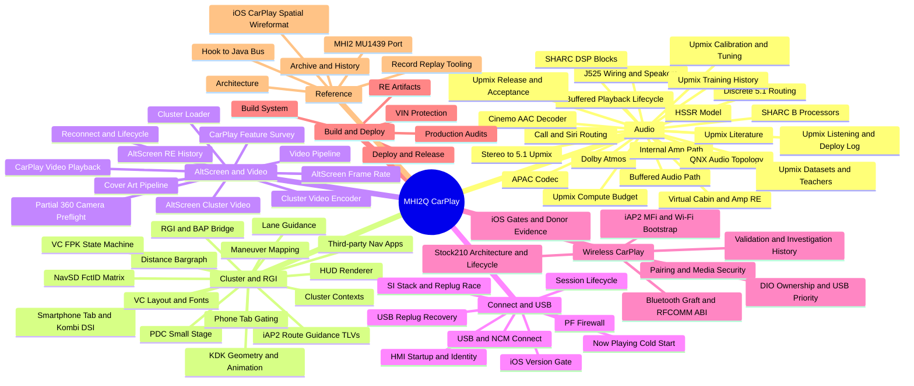
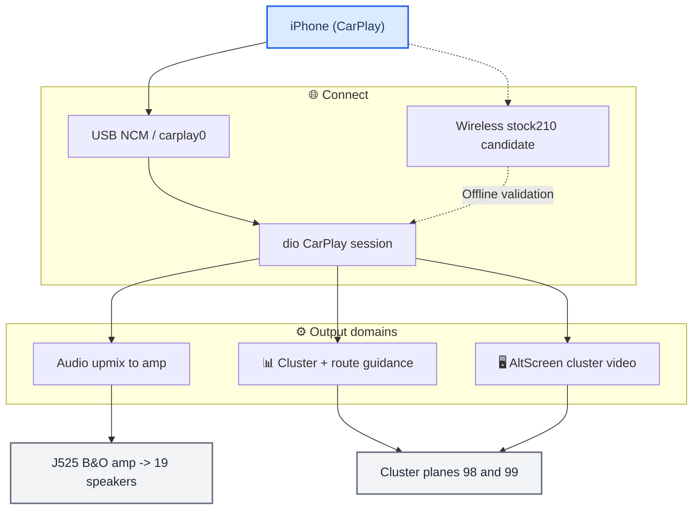

# MHI2Q CarPlay documentation

_The MHI2Q CarPlay knowledge base — every domain of the project, linked and diagrammed. Start here._

---

## 🏠 What this is

This is the whole project's documentation as one linked tree of Markdown notes: the audio
upmix and amplifier reverse-engineering, the instrument cluster and route guidance,
the alternate-screen video, the USB/connect path, wireless CarPlay, the build and deploy system, and a
cross-cutting index of traps. Each domain folder has a `README.md` map that
links its topic notes; notes carry Mermaid diagrams and relative links, and render on GitHub
(the folder can also be opened as an Obsidian vault).

Truth levels are tagged throughout: **[code]** verified in the current source (cited
`path:line`), **[car]** confirmed on the unit, **[model]** / **[decompile]** static
reverse-engineering or offline modelling, **[open]** not yet verified. The current
source code is the ground truth for what the system does.

> 📌 **Before you touch a subsystem, read [Landmines](LANDMINES.md)** — the traps that already cost days.

---

## 📚 The domains

_Mindmap of the docs: the seven domains and their curated notes._

| Domain | Map of content | Covers |
| --- | --- | --- |
| **Audio** | [Audio overview](audio/README.md) | stereo→5.1 upmix, the HSSR AI, the J525 amp / Virtual Cabin, Dolby, discrete 5.1 |
| **Cluster and RGI** | [Cluster and RGI overview](cluster-and-rgi/README.md) | cluster contexts, BAP route guidance, HUD renderer, third-party nav, phone tab |
| **AltScreen and Video** | [AltScreen and Video overview](altscreen-and-video/README.md) | cluster video (stream 111), OMX pipeline, boot loader, reconnect lifecycle |
| **Connect and USB** | [Connect and USB overview](connect-and-usb/README.md) | NCM connect, USB replug recovery, PF firewall, iOS version gate |
| **Wireless CarPlay** | [Wireless CarPlay overview](wireless-carplay/README.md) | stock210 hook, btstack graft, iAP2/MFi, receiver readiness, wired priority and offline evidence |
| **Build and Deploy** | [Build and Deploy overview](build-and-deploy/README.md) | Docker QNX build, hand-assembled release, VIN protection, RE artifacts |
| **Reference** | — | [Architecture](reference/ARCHITECTURE.md), [Archive and History](reference/ARCHIVE_AND_HISTORY.md), [Hook to Java Bus](reference/HOOK_TO_JAVA_BUS.md), [iOS CarPlay Spatial Wireformat](reference/IOS_CARPLAY_SPATIAL_WIREFORMAT.md), [MHI2 MU1439 Port](reference/MHI2_MU1439_PORT.md), [Record Replay Tooling](reference/RECORD_REPLAY_TOOLING.md) |
| **Traps** | [Landmines](LANDMINES.md) | cross-project rules that break, slow, or mislead |
| **Sources** | [📚 Sources and research](#-sources-and-research) | the original audits, handoffs, papers and data files, verbatim |

---

## 🌐 The system at a glance

_High-level flow from the phone to the cluster and speakers; each block links to its domain._

- **Audio** → [Stereo to 5.1 Upmix](audio/STEREO_TO_5_1_UPMIX.md) · [HSSR Model](audio/HSSR_MODEL.md) · [Virtual Cabin and Amp RE](audio/VIRTUAL_CABIN_AND_AMP_RE.md)
- **Cluster** → [Cluster Contexts](cluster-and-rgi/CLUSTER_CONTEXTS.md) · [RGI and BAP Bridge](cluster-and-rgi/RGI_AND_BAP_BRIDGE.md) · [HUD Renderer](cluster-and-rgi/HUD_RENDERER.md)
- **AltScreen** → [AltScreen Cluster Video](altscreen-and-video/ALTSCREEN_CLUSTER_VIDEO.md) · [Video Pipeline](altscreen-and-video/VIDEO_PIPELINE.md)
- **Connect** → [USB and NCM Connect](connect-and-usb/USB_AND_NCM_CONNECT.md) · [USB Replug Recovery](connect-and-usb/USB_REPLUG_RECOVERY.md)
- **Wireless** → [Overview](wireless-carplay/README.md) · [Receiver lifecycle](wireless-carplay/STOCK210_RECEIVER_LIFECYCLE.md) · [History](wireless-carplay/history/README.md)
- **Build/Deploy** → [Build System](build-and-deploy/BUILD_SYSTEM.md) · [Deploy and Release](build-and-deploy/DEPLOY_AND_RELEASE.md)
- Everything talks over the [Hook to Java Bus](reference/HOOK_TO_JAVA_BUS.md).

---

## 🔗 A–Z index

Every curated note, alphabetical:

- [AirPlay 280.33.8 pairing: source recipe for the stock-210 extension](wireless-carplay/AIRPLAY280_PAIRING_RECIPE.md)
- [AltScreen and Video overview](altscreen-and-video/README.md)
- [AltScreen Cluster Video](altscreen-and-video/ALTSCREEN_CLUSTER_VIDEO.md)
- [AltScreen Frame Rate](altscreen-and-video/ALTSCREEN_FRAME_RATE.md)
- [AltScreen RE History](altscreen-and-video/ALTSCREEN_RE_HISTORY.md)
- [APAC Codec](audio/APAC_CODEC.md)
- [Architecture](reference/ARCHITECTURE.md)
- [Archive and History](reference/ARCHIVE_AND_HISTORY.md)
- [Audio overview](audio/README.md)
- [Buffered Audio Path](audio/BUFFERED_AUDIO_PATH.md)
- [Buffered Playback Lifecycle](audio/BUFFERED_PLAYBACK_LIFECYCLE.md)
- [Build and Deploy overview](build-and-deploy/README.md)
- [Build System](build-and-deploy/BUILD_SYSTEM.md)
- [Call and Siri Routing](audio/CALL_AND_SIRI_ROUTING.md)
- [CarPlay Bluetooth discovery: factory path and MHI2Q graft](wireless-carplay/BLUETOOTH_DISCOVERY.md)
- [CarPlay Feature Survey](altscreen-and-video/CARPLAY_FEATURE_SURVEY.md)
- [CarPlay Telephony](cluster-and-rgi/CARPLAY_TELEPHONY.md)
- [CarPlay Video Playback](altscreen-and-video/CARPLAY_VIDEO_PLAYBACK.md)
- [Cinemo AAC Decoder](audio/CINEMO_AAC_DECODER.md)
- [Cluster and RGI overview](cluster-and-rgi/README.md)
- [Cluster Contexts](cluster-and-rgi/CLUSTER_CONTEXTS.md)
- [Cluster Loader](altscreen-and-video/CLUSTER_LOADER.md)
- [Cluster Video Encoder](altscreen-and-video/CLUSTER_VIDEO_ENCODER.md)
- [Connect and USB overview](connect-and-usb/README.md)
- [Cover Art Pipeline](altscreen-and-video/COVER_ART_PIPELINE.md)
- [Deploy and Release](build-and-deploy/DEPLOY_AND_RELEASE.md)
- [dio receiver bridge: offline QNX build and QEMU verification](wireless-carplay/RECEIVER_BRIDGE.md)
- [Discrete 5.1 Routing](audio/DISCRETE_5_1_ROUTING.md)
- [Distance Bargraph](cluster-and-rgi/DISTANCE_BARGRAPH.md)
- [Dolby Atmos](audio/DOLBY_ATMOS.md)
- [HMI Startup and Identity](connect-and-usb/HMI_STARTUP_AND_IDENTITY.md)
- [Hook to Java Bus](reference/HOOK_TO_JAVA_BUS.md)
- [HSSR Model](audio/HSSR_MODEL.md)
- [HUD Renderer](cluster-and-rgi/HUD_RENDERER.md)
- [iAP2 Communications](cluster-and-rgi/IAP2_COMMUNICATIONS.md)
- [iAP2 Route Guidance TLVs](cluster-and-rgi/IAP2_ROUTE_GUIDANCE_TLVS.md)
- [Internal Amp Path](audio/INTERNAL_AMP_PATH.md)
- [iOS 26/27 selection of stock AirPlay 210 MFi-SAP](wireless-carplay/IOS_AUTH_SELECTION.md)
- [iOS CarPlay Spatial Wireformat](reference/IOS_CARPLAY_SPATIAL_WIREFORMAT.md)
- [iOS Version Gate](connect-and-usb/IOS_VERSION_GATE.md)
- [iOS wireless CarPlay gates: stock 210 requires a pairing/crypto extension](wireless-carplay/IOS_WIRELESS_SESSION_GATES.md)
- [J525 Wiring and Speakers](audio/J525_WIRING_AND_SPEAKERS.md)
- [KDK Geometry and Animation](cluster-and-rgi/KDK_GEOMETRY_AND_ANIMATION.md)
- [Landmines](LANDMINES.md)
- [Lane Guidance](cluster-and-rgi/LANE_GUIDANCE.md)
- [Maneuver Mapping](cluster-and-rgi/MANEUVER_MAPPING.md)
- [MHI2 MU1439 Port](reference/MHI2_MU1439_PORT.md)
- [MHI2Q RFCOMM graft: offline build (2026-09-27)](wireless-carplay/BTSTACK_GRAFT.md)
- [MU1316 btstack launcher path (offline, 2026-09-28)](wireless-carplay/GRAFT_LAUNCHER_LIFECYCLE.md)
- [Nav Initializing Screen](cluster-and-rgi/NAV_INITIALIZING_SCREEN.md)
- [NavSD FctID Matrix](cluster-and-rgi/NAVSD_FCTID_MATRIX.md)
- [Now Playing Cold Start](connect-and-usb/NOW_PLAYING_COLD_START.md)
- [Offline iAP2 bridge daemon prototype](wireless-carplay/IAP2_DAEMON.md)
- [Offline insertion survey for the MHI2Q btstack (2026-09-27)](wireless-carplay/GRAFT_INSERTION_PLAN.md)
- [P5092 bootstrap reference versus the MU1316/P5087 wireless mod](wireless-carplay/BOOTSTRAP_COMPARISON.md)
- [Partial 360 Camera Preflight](altscreen-and-video/PARTIAL_360_CAMERA_PREFLIGHT.md)
- [PDC Small Stage](cluster-and-rgi/PDC_SMALL_STAGE.md)
- [PF Firewall](connect-and-usb/PF_FIREWALL.md)
- [Phone Tab Gating](cluster-and-rgi/PHONE_TAB_GATING.md)
- [Production Audits](build-and-deploy/PRODUCTION_AUDITS.md)
- [QNX Audio Topology](audio/QNX_AUDIO_TOPOLOGY.md)
- [RE Artifacts](build-and-deploy/RE_ARTIFACTS.md)
- [Receiver startup gap for wireless CarPlay](wireless-carplay/RECEIVER_START.md)
- [Reconnect and Lifecycle](altscreen-and-video/RECONNECT_AND_LIFECYCLE.md)
- [Record Replay Tooling](reference/RECORD_REPLAY_TOOLING.md)
- [RFCOMM connection, transmit, and credit ABI (static RE, 2026-09-27)](wireless-carplay/RFCOMM_DUPLEX.md)
- [RFCOMM server channel for iAP2 (static RE, 2026-09-27)](wireless-carplay/RFCOMM_CHANNEL_LAYOUT.md)
- [RGI and BAP Bridge](cluster-and-rgi/RGI_AND_BAP_BRIDGE.md)
- [Session Lifecycle](connect-and-usb/SESSION_LIFECYCLE.md)
- [SHARC B Processors](audio/SHARC_B_PROCESSORS.md)
- [SHARC DSP Blocks](audio/SHARC_DSP_BLOCKS.md)
- [SI Stack and Replug Race](connect-and-usb/SI_STACK_AND_REPLUG_RACE.md)
- [Smartphone Integrator ownership for wireless startup](wireless-carplay/DIO_OWNERSHIP.md)
- [Smartphone Tab and Kombi DSI](cluster-and-rgi/SMARTPHONE_TAB_AND_KOMBI_DSI.md)
- [Stereo to 5.1 Upmix](audio/STEREO_TO_5_1_UPMIX.md)
- [Stock 210 + hook/wireless: offline validation, 2026-09-29](wireless-carplay/STOCK210_VALIDATION.md)
- [Stock 210.81 HTTP boundary for hook/wireless](wireless-carplay/STOCK210_HTTP_PAIRING_ABI.md)
- [Stock 210.81 paired media adapters](wireless-carplay/STOCK210_MEDIA_CRYPTO_ABI.md)
- [Stock210 wireless readiness, restart and wired priority](wireless-carplay/STOCK210_RECEIVER_LIFECYCLE.md)
- [Third-party Nav Apps](cluster-and-rgi/THIRD_PARTY_NAV_APPS.md)
- [Upmix Calibration and Tuning](audio/UPMIX_CALIBRATION_AND_TUNING.md)
- [Upmix Compute Budget](audio/UPMIX_COMPUTE_BUDGET.md)
- [Upmix Datasets and Teachers](audio/UPMIX_DATASETS_AND_TEACHERS.md)
- [Upmix Listening and Deploy Log](audio/UPMIX_LISTENING_AND_DEPLOY_LOG.md)
- [Upmix Literature](audio/UPMIX_LITERATURE.md)
- [Upmix Release and Acceptance](audio/UPMIX_RELEASE_AND_ACCEPTANCE.md)
- [Upmix Training History](audio/UPMIX_TRAINING_HISTORY.md)
- [USB and NCM Connect](connect-and-usb/USB_AND_NCM_CONNECT.md)
- [USB Replug Recovery](connect-and-usb/USB_REPLUG_RECOVERY.md)
- [VC FPK State Machine](cluster-and-rgi/VC_FPK_STATE_MACHINE.md)
- [VC Layout and Fonts](cluster-and-rgi/VC_LAYOUT_AND_FONTS.md)
- [VC Telephone Tab](cluster-and-rgi/VC_TELEPHONE_TAB.md)
- [Vendored LIVI iAP2 crates](wireless-carplay/IAP2_VENDOR_PROVENANCE.md)
- [Video Pipeline](altscreen-and-video/VIDEO_PIPELINE.md)
- [VIN Protection](build-and-deploy/VIN_PROTECTION.md)
- [Virtual Cabin and Amp RE](audio/VIRTUAL_CABIN_AND_AMP_RE.md)
- [Wireless CarPlay and Wi-Fi](wireless-carplay/WIFI_AND_DISCOVERY.md)
- [Wireless CarPlay on the Head Unit](wireless-carplay/HARDWARE_AND_DONORS.md)
- [Wireless CarPlay overview](wireless-carplay/README.md)
- [Wireless CarPlay PF profiles, offline](wireless-carplay/FIREWALL.md)
- [Wireless CarPlay with MU1316 stock AirPlay 210.81](wireless-carplay/STOCK210_ARCHITECTURE.md)
- [Wireless documentation migration](wireless-carplay/MIGRATION.md)
- [Wireless investigation history](wireless-carplay/history/README.md)

---

## 📚 Sources and research

The docs are one tree. Curated notes (the domain folders above) are the synthesis and
carry every durable fact. Beside them:

| Folder | What it holds |
| --- | --- |
| `research/` | the long-form white papers — [UPMIX](research/UPMIX.md), [HSSR_UPMIX_MODEL](research/HSSR_UPMIX_MODEL.md), [VIRTUAL_CABIN](research/VIRTUAL_CABIN.md), [DOLBY_ATMOS_TEARDOWN](research/DOLBY_ATMOS_TEARDOWN.md) |
| `sources/papers/` | upmix papers and SHARC manuals (PDF + extracted text), J525 wiring, connector and speaker-layout images |
| `sources/` | primary evidence kept verbatim: the B9 speaker workbook (xlsx), SHARC matrix CSV, the frozen v2 acceptance protocol, the upmix run journals, the MIBRoot routing tables, the replug runbook |
| `sources/reference/` | KDK 60 Hz samples (CSV), the SHARC disassembler source, the Pioneer APAC symbol table |
| `sources/research/` | the MHI3 reference altScreen hook (C) and the decompiled stock Java + diffs for MU1316/1326/1439 |
| `sources/acdb/`, `sources/captures/` | the patched ACDB and its script, the APAC live-capture manifest |

Each of these is linked from the curated note that relies on it, at the point where it is used.
The legacy prose docs (audits, handoffs, plans, RE reports) were merged into the curated notes
and removed; every note's **Sources** section still names the originals it absorbed, and they
remain in git history (commit `23972aa`). Other RE working sets live outside `docs/` in
`assets/` (see [RE Artifacts](build-and-deploy/RE_ARTIFACTS.md)).

Every code-state claim was reconciled against the current source on 2026-09-22 (the code is
authoritative); training history, listening verdicts and on-car measurements keep the
provenance of the doc that recorded them.
