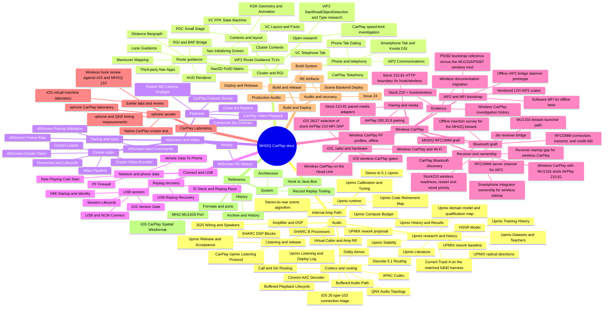
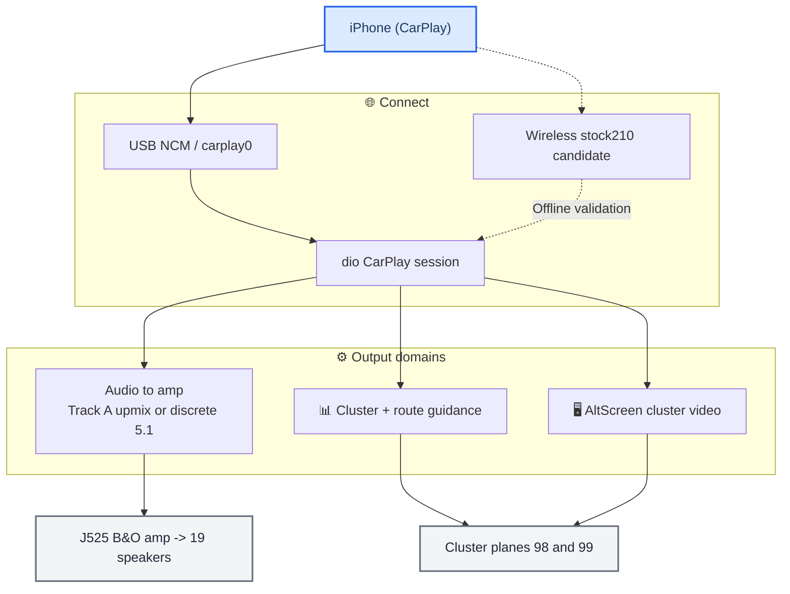

# MHI2Q CarPlay documentation

_The MHI2Q CarPlay knowledge base — every domain of the project, linked and diagrammed. Start here._

---

## 🏠 What this is

This is the whole project's documentation as one linked tree of Markdown notes: the audio
upmix and amplifier reverse-engineering, the instrument cluster and route guidance,
the alternate-screen video, the USB/connect path, wireless CarPlay, the build and deploy system, and a
cross-cutting index of traps. Each domain folder has a `README.md` map that
links its topic notes; notes carry Mermaid diagrams and relative links, and render on GitHub
(the folder can also be opened as an Obsidian vault).

Truth levels are tagged throughout: **[code]** verified in the current source (cited
`path:line`), **[car]** confirmed on the unit, **[model]** / **[decompile]** static
reverse-engineering or offline modelling, **[open]** not yet verified. The current
source code is the ground truth for what the system does.

> 📌 **Before you touch a subsystem, read [Landmines](LANDMINES.md)** — the traps that already cost days.

## 🧪 CarPlay emulator laboratory

The [CarPlay emulator laboratory](carplay-lab/README.md) has a separate source
tree under `tests/carplay_lab/` and its own runbooks. Native vphone/QNX video
and timing results are distinct from the [wireless implementation](wireless-carplay/README.md)
and on-unit radio measurements.

## 🧪 Current AltScreen pacing candidate

The 2026-10-06 source implements all six follow-up improvements: shared recovery,
idle EOF/presentation status, owned in-place AU conversion, vector I/O,
end-to-end compressed backlog age and decoded-output mailbox selection.
See [frame-rate evidence and validation](altscreen-and-video/ALTSCREEN_FRAME_RATE.md),
[pipeline, protocol and buffer ownership](altscreen-and-video/VIDEO_PIPELINE.md),
and [current pacing validation](altscreen-and-video/ALTSCREEN_PACING_VALIDATION.md).

The 2026-10-07 refactor validation passed 20 C sanitizer scenarios, 6 report
contract tests, 6 TSan suites, 4 Linux suites, Clang analysis, QNX ARM builds and
the full regression. AVC/state and shared-control fuzz targets completed
2,452,009 inputs in the final run, with 11,000,993 in the extended run. Captured APAC integration was skipped because its
capture is absent. The runner now writes atomic, source-hashed reports; queue
policy/control parsing are shared pure code, and compatibility APIs are test-only.
Application copies are 3 → 1 on the owned length-size-4 path;
complete known-v2 record I/O is 5 → 3 calls. These are operation counts, not
measured vehicle FPS. No candidate deployment occurred. **[code]** / **[model]**

The 2026-10-09 input changes add bounded paced zoom, reserved recovery/layout
priority and replacement of pending view/night/appearance states. The selected step keeps an immutable input timestamp, and CF
construction
errors preserve the previous pending state. The source-hashed final run passed
25 ASan/UBSan C suites, 6 report contracts, 10 TSan suites, 8 Linux suites and
5,644,380 fuzz inputs, plus Clang checks, QNX builds and full regression.
[Input commands](altscreen-and-video/ALTSCREEN_INPUT_COMMANDS.md) is the canonical
contract/configuration guide; [validation](altscreen-and-video/ALTSCREEN_PACING_VALIDATION.md)
records the exact evidence and limits.

---

## 📚 The domains

_Full mindmap: every curated note under its domain and topic group. The same notes as links, in the same order, are under [Notes by topic](#notes-by-topic)._

<!-- BEGIN generated:full-mindmap -->

<!-- END generated:full-mindmap -->

| Domain | Map of content | Covers |
| --- | --- | --- |
| **Audio** | [Audio overview](audio/README.md) | stereo→5.1, Track A runtime, Track B research/evidence, J525 / Virtual Cabin, Dolby, discrete 5.1 |
| **Cluster and RGI** | [Cluster and RGI overview](cluster-and-rgi/README.md) | cluster contexts, BAP route guidance, HUD renderer, third-party nav, phone tab |
| **AltScreen and Video** | [AltScreen and Video overview](altscreen-and-video/README.md) | cluster video (stream 111), OMX pipeline, boot loader, reconnect lifecycle |
| **Connect and USB** | [Connect and USB overview](connect-and-usb/README.md) | NCM connect, USB replug recovery, PF firewall, iOS version gate |
| **Wireless CarPlay** | [Wireless CarPlay overview](wireless-carplay/README.md) | stock210 hook, btstack graft, iAP2/MFi, receiver readiness, wired priority; parked after the 2026-10-13 on-unit radio check |
| **CarPlay Laboratory** | [CarPlay Laboratory overview](carplay-lab/README.md) | vphone sender, native video over Direct NCM, QNX timing, earlier iOS VM labs |
| **Build and Deploy** | [Build and Deploy overview](build-and-deploy/README.md) | Docker QNX build, hand-assembled release, RE artifacts |
| **Reference** | — | [Architecture](reference/ARCHITECTURE.md), [Archive and History](reference/ARCHIVE_AND_HISTORY.md), [Hook to Java Bus](reference/HOOK_TO_JAVA_BUS.md), [iOS CarPlay Spatial Wireformat](reference/IOS_CARPLAY_SPATIAL_WIREFORMAT.md), [MHI2 MU1439 Port](reference/MHI2_MU1439_PORT.md), [Record Replay Tooling](reference/RECORD_REPLAY_TOOLING.md) |
| **Traps** | [Landmines](LANDMINES.md) | cross-project rules that break, slow, or mislead |
| **Sources** | [📚 Sources and research](#-sources-and-research) | the original audits, handoffs, papers and data files, verbatim |

---

## 🌐 The system at a glance

_High-level flow from the phone to the cluster and speakers; each block links to its domain._

- **Audio** → [Stereo to 5.1 Upmix](audio/STEREO_TO_5_1_UPMIX.md) · [Upmix History and Results](audio/UPMIX_HISTORY_AND_RESULTS_2026-10-09.md) · [Virtual Cabin and Amp RE](audio/VIRTUAL_CABIN_AND_AMP_RE.md)
- **Cluster** → [Cluster Contexts](cluster-and-rgi/CLUSTER_CONTEXTS.md) · [RGI and BAP Bridge](cluster-and-rgi/RGI_AND_BAP_BRIDGE.md) · [HUD Renderer](cluster-and-rgi/HUD_RENDERER.md)
- **AltScreen** → [AltScreen Cluster Video](altscreen-and-video/ALTSCREEN_CLUSTER_VIDEO.md) · [Video Pipeline](altscreen-and-video/VIDEO_PIPELINE.md)
- **Connect** → [USB and NCM Connect](connect-and-usb/USB_AND_NCM_CONNECT.md) · [USB Replug Recovery](connect-and-usb/USB_REPLUG_RECOVERY.md)
- **Wireless** → [Overview](wireless-carplay/README.md) · [Receiver lifecycle](wireless-carplay/STOCK210_RECEIVER_LIFECYCLE.md) · [History](wireless-carplay/history/README.md)
- **Build/Deploy** → [Build System](build-and-deploy/BUILD_SYSTEM.md) · [Deploy and Release](build-and-deploy/DEPLOY_AND_RELEASE.md)
- Everything talks over the [Hook to Java Bus](reference/HOOK_TO_JAVA_BUS.md).

---

## 🔗 Notes by topic

Every curated note as a link, grouped like the mindmap above.

<!-- BEGIN generated:notes-by-topic -->
**🔊 Audio** · [overview](audio/README.md)

- Upmix runtime: [Stereo to 5.1 Upmix](audio/STEREO_TO_5_1_UPMIX.md) · [Stereo-to-rear scene algorithm](audio/UPMIX_SCENE_ALGORITHM_2026-10-08.md) · [Upmix Calibration and Tuning](audio/UPMIX_CALIBRATION_AND_TUNING.md) · [Upmix Compute Budget](audio/UPMIX_COMPUTE_BUDGET.md) · [Upmix Code Retirement Map](audio/UPMIX_CODE_RETIREMENT_2026-10-09.md)
- Upmix research and history: [Upmix History and Results](audio/UPMIX_HISTORY_AND_RESULTS_2026-10-09.md) · [UPMIX rework baseline](audio/UPMIX_REWORK_BASELINE_2026-10-07.md) · [UPMIX rework proposal](audio/UPMIX_REWORK_PROPOSAL_2026-10-07.md) · [UPMIX radical directions](audio/UPMIX_RADICAL_DIRECTIONS_2026-10-07.md) · [Upmix Stability](audio/UPMIX_STABILITY_2026-09-25.md) · [Current Track A on the matched full40 harness](audio/UPMIX_TRACKA_MATCHED40_2026-09-30.md) · [Upmix Training History](audio/UPMIX_TRAINING_HISTORY.md) · [Upmix Datasets and Teachers](audio/UPMIX_DATASETS_AND_TEACHERS.md) · [Upmix Literature](audio/UPMIX_LITERATURE.md) · [Upmix domain model and qualification map](audio/UPMIX_DOMAIN_MODEL.md) · [HSSR Model](audio/HSSR_MODEL.md)
- Listening and release: [CarPlay Upmix Listening Protocol](audio/UPMIX_CARPLAY_LISTENING_PROTOCOL.md) · [Upmix Listening and Deploy Log](audio/UPMIX_LISTENING_AND_DEPLOY_LOG.md) · [Upmix Release and Acceptance](audio/UPMIX_RELEASE_AND_ACCEPTANCE.md)
- Amplifier and DSP: [Virtual Cabin and Amp RE](audio/VIRTUAL_CABIN_AND_AMP_RE.md) · [J525 Wiring and Speakers](audio/J525_WIRING_AND_SPEAKERS.md) · [SHARC B Processors](audio/SHARC_B_PROCESSORS.md) · [SHARC DSP Blocks](audio/SHARC_DSP_BLOCKS.md) · [Internal Amp Path](audio/INTERNAL_AMP_PATH.md)
- Codecs and routing: [APAC Codec](audio/APAC_CODEC.md) · [Cinemo AAC Decoder](audio/CINEMO_AAC_DECODER.md) · [Dolby Atmos](audio/DOLBY_ATMOS.md) · [Discrete 5.1 Routing](audio/DISCRETE_5_1_ROUTING.md) · [Buffered Audio Path](audio/BUFFERED_AUDIO_PATH.md) · [Buffered Playback Lifecycle](audio/BUFFERED_PLAYBACK_LIFECYCLE.md) · [Call and Siri Routing](audio/CALL_AND_SIRI_ROUTING.md) · [QNX Audio Topology](audio/QNX_AUDIO_TOPOLOGY.md) · [iOS 26 type-103 connection triage](audio/IOS26_TYPE103_CONNECTION_TRIAGE_2026-10-03.md)

**📊 Cluster and RGI** · [overview](cluster-and-rgi/README.md)

- Contexts and layout: [Cluster Contexts](cluster-and-rgi/CLUSTER_CONTEXTS.md) · [KDK Geometry and Animation](cluster-and-rgi/KDK_GEOMETRY_AND_ANIMATION.md) · [VC Layout and Fonts](cluster-and-rgi/VC_LAYOUT_AND_FONTS.md) · [VC FPK State Machine](cluster-and-rgi/VC_FPK_STATE_MACHINE.md) · [PDC Small Stage](cluster-and-rgi/PDC_SMALL_STAGE.md) · [Nav Initializing Screen](cluster-and-rgi/NAV_INITIALIZING_SCREEN.md)
- Route guidance: [RGI and BAP Bridge](cluster-and-rgi/RGI_AND_BAP_BRIDGE.md) · [iAP2 Route Guidance TLVs](cluster-and-rgi/IAP2_ROUTE_GUIDANCE_TLVS.md) · [Maneuver Mapping](cluster-and-rgi/MANEUVER_MAPPING.md) · [Lane Guidance](cluster-and-rgi/LANE_GUIDANCE.md) · [Distance Bargraph](cluster-and-rgi/DISTANCE_BARGRAPH.md) · [HUD Renderer](cluster-and-rgi/HUD_RENDERER.md) · [NavSD FctID Matrix](cluster-and-rgi/NAVSD_FCTID_MATRIX.md) · [Third-party Nav Apps](cluster-and-rgi/THIRD_PARTY_NAV_APPS.md)
- Phone and telephony: [CarPlay Telephony](cluster-and-rgi/CARPLAY_TELEPHONY.md) · [iAP2 Communications](cluster-and-rgi/IAP2_COMMUNICATIONS.md) · [VC Telephone Tab](cluster-and-rgi/VC_TELEPHONE_TAB.md) · [Phone Tab Gating](cluster-and-rgi/PHONE_TAB_GATING.md) · [Smartphone Tab and Kombi DSI](cluster-and-rgi/SMARTPHONE_TAB_AND_KOMBI_DSI.md)
- Open research: [CarPlay speed-limit investigation](cluster-and-rgi/CARPLAY_SPEED_LIMIT.md) · [iAP2 StartRoadObjectDetection and Type research](cluster-and-rgi/IAP2_ROAD_OBJECT_DETECTION.md)

**🖥️ AltScreen and Video** · [overview](altscreen-and-video/README.md)

- Cluster video: [AltScreen Cluster Video](altscreen-and-video/ALTSCREEN_CLUSTER_VIDEO.md) · [Video Pipeline](altscreen-and-video/VIDEO_PIPELINE.md) · [Cluster Loader](altscreen-and-video/CLUSTER_LOADER.md) · [Cluster Video Encoder](altscreen-and-video/CLUSTER_VIDEO_ENCODER.md) · [Reconnect and Lifecycle](altscreen-and-video/RECONNECT_AND_LIFECYCLE.md)
- Pacing and input: [AltScreen Frame Rate](altscreen-and-video/ALTSCREEN_FRAME_RATE.md) · [AltScreen Pacing Validation](altscreen-and-video/ALTSCREEN_PACING_VALIDATION.md) · [AltScreen Input Commands](altscreen-and-video/ALTSCREEN_INPUT_COMMANDS.md)
- Features: [Cover Art Pipeline](altscreen-and-video/COVER_ART_PIPELINE.md) · [Enhanced Siri Contract](altscreen-and-video/ENHANCED_SIRI_CONTRACT.md) · [CarPlay Video Playback](altscreen-and-video/CARPLAY_VIDEO_PLAYBACK.md) · [CarPlay Feature Survey](altscreen-and-video/CARPLAY_FEATURE_SURVEY.md) · [Partial 360 Camera Preflight](altscreen-and-video/PARTIAL_360_CAMERA_PREFLIGHT.md)
- History: [AltScreen RE History](altscreen-and-video/ALTSCREEN_RE_HISTORY.md)

**🔌 Connect and USB** · [overview](connect-and-usb/README.md)

- USB session: [USB and NCM Connect](connect-and-usb/USB_AND_NCM_CONNECT.md) · [Session Lifecycle](connect-and-usb/SESSION_LIFECYCLE.md) · [iOS Version Gate](connect-and-usb/IOS_VERSION_GATE.md) · [HMI Startup and Identity](connect-and-usb/HMI_STARTUP_AND_IDENTITY.md)
- Replug recovery: [USB Replug Recovery](connect-and-usb/USB_REPLUG_RECOVERY.md) · [SI Stack and Replug Race](connect-and-usb/SI_STACK_AND_REPLUG_RACE.md)
- Network and phone data: [PF Firewall](connect-and-usb/PF_FIREWALL.md) · [Vehicle Data To Phone](connect-and-usb/VEHICLE_DATA_TO_PHONE.md) · [Now Playing Cold Start](connect-and-usb/NOW_PLAYING_COLD_START.md)

**📶 Wireless CarPlay** · [overview](wireless-carplay/README.md)

- Receiver and ownership: [Wireless CarPlay with MU1316 stock AirPlay 210.81](wireless-carplay/STOCK210_ARCHITECTURE.md) · [Stock210 wireless readiness, restart and wired priority](wireless-carplay/STOCK210_RECEIVER_LIFECYCLE.md) · [Receiver startup gap for wireless CarPlay](wireless-carplay/RECEIVER_START.md) · [dio receiver bridge](wireless-carplay/RECEIVER_BRIDGE.md) · [Smartphone Integrator ownership for wireless startup](wireless-carplay/DIO_OWNERSHIP.md)
- Bluetooth graft: [MHI2Q RFCOMM graft](wireless-carplay/BTSTACK_GRAFT.md) · [Offline insertion survey for the MHI2Q btstack](wireless-carplay/GRAFT_INSERTION_PLAN.md) · [MU1316 btstack launcher path](wireless-carplay/GRAFT_LAUNCHER_LIFECYCLE.md) · [RFCOMM server channel for iAP2](wireless-carplay/RFCOMM_CHANNEL_LAYOUT.md) · [RFCOMM connection, transmit, and credit ABI](wireless-carplay/RFCOMM_DUPLEX.md) · [CarPlay Bluetooth discovery](wireless-carplay/BLUETOOTH_DISCOVERY.md)
- iAP2 and MFi bootstrap: [Offline iAP2 bridge daemon prototype](wireless-carplay/IAP2_DAEMON.md) · [Vendored LIVI iAP2 crates](wireless-carplay/IAP2_VENDOR_PROVENANCE.md) · [Software MFi for offline tests](wireless-carplay/TEST_SOFTWARE_MFI.md) · [P5092 bootstrap reference versus the MU1316/P5087 wireless mod](wireless-carplay/BOOTSTRAP_COMPARISON.md)
- Pairing and media: [Stock 210.81 HTTP boundary for hook/wireless](wireless-carplay/STOCK210_HTTP_PAIRING_ABI.md) · [Stock 210.81 paired media adapters](wireless-carplay/STOCK210_MEDIA_CRYPTO_ABI.md) · [AirPlay 280.33.8 pairing](wireless-carplay/AIRPLAY280_PAIRING_RECIPE.md)
- iOS, radio and hardware: [iOS 26/27 selection of stock AirPlay 210 MFi-SAP](wireless-carplay/IOS_AUTH_SELECTION.md) · [iOS wireless CarPlay gates](wireless-carplay/IOS_WIRELESS_SESSION_GATES.md) · [Wireless CarPlay and Wi-Fi](wireless-carplay/WIFI_AND_DISCOVERY.md) · [Wireless CarPlay on the Head Unit](wireless-carplay/HARDWARE_AND_DONORS.md) · [Wireless CarPlay PF profiles, offline](wireless-carplay/FIREWALL.md)
- Evidence: [Stock 210 + hook/wireless](wireless-carplay/STOCK210_VALIDATION.md) · [Wireless CarPlay investigation history](wireless-carplay/history/README.md) · [Wireless documentation migration](wireless-carplay/history/MIGRATION.md)

**🧪 CarPlay Laboratory** · [overview](carplay-lab/README.md)

- vphone sender: [vphone CarPlay laboratory](carplay-lab/VPHONE_LAB.md) · [vphone and QNX timing measurements](carplay-lab/VPHONE_TIMING.md) · [Native CarPlay screen test](carplay-lab/NATIVE_SCREEN_TEST.md)
- Earlier labs and review: [iOS virtual machine laboratory](carplay-lab/IOS_VM_LAB.md) · [Wireless hook review against iOS and MHI2Q 210](carplay-lab/IOS210_CODE_REVIEW.md)

**📦 Build and Deploy** · [overview](build-and-deploy/README.md)

- Build and release: [Build System](build-and-deploy/BUILD_SYSTEM.md) · [Deploy and Release](build-and-deploy/DEPLOY_AND_RELEASE.md) · [Scene Backend Deploy](build-and-deploy/SCENE_BACKEND_DEPLOY.md)
- Audits and recovery: [Production Audits](build-and-deploy/PRODUCTION_AUDITS.md) · [Issue 24](build-and-deploy/ISSUE24_RCC_MMX_RECOVERY.md) · [RE Artifacts](build-and-deploy/RE_ARTIFACTS.md)

**📚 Reference**

- System: [Architecture](reference/ARCHITECTURE.md) · [Hook to Java Bus](reference/HOOK_TO_JAVA_BUS.md) · [Record Replay Tooling](reference/RECORD_REPLAY_TOOLING.md)
- Formats and ports: [iOS CarPlay Spatial Wireformat](reference/IOS_CARPLAY_SPATIAL_WIREFORMAT.md) · [MHI2 MU1439 Port](reference/MHI2_MU1439_PORT.md)
- History: [Archive and History](reference/ARCHIVE_AND_HISTORY.md)

Across every domain: [Landmines](LANDMINES.md).
<!-- END generated:notes-by-topic -->

---

## 📚 Sources and research

The docs are one tree. Curated notes (the domain folders above) are the synthesis and
carry every durable fact. Beside them:

| Folder | What it holds |
| --- | --- |
| `research/` | the long-form white papers — [UPMIX](research/UPMIX.md), [HSSR_UPMIX_MODEL](research/HSSR_UPMIX_MODEL.md), [VIRTUAL_CABIN](research/VIRTUAL_CABIN.md), [DOLBY_ATMOS_TEARDOWN](research/DOLBY_ATMOS_TEARDOWN.md) |
| `sources/papers/` | upmix papers and SHARC manuals (PDF + extracted text), J525 wiring, connector and speaker-layout images |
| `sources/` | primary evidence kept verbatim: the B9 speaker workbook (xlsx), SHARC matrix CSV, the frozen v2 acceptance protocol, the upmix run journals, the MIBRoot routing tables, the replug runbook |
| `sources/reference/` | KDK 60 Hz samples (CSV), the SHARC disassembler source, the Pioneer APAC symbol table |
| `sources/research/` | the MHI3 reference altScreen hook (C) and the decompiled stock Java + diffs for MU1316/1326/1439 |
| `sources/acdb/`, `sources/captures/` | the patched ACDB and its script, the APAC live-capture manifest |

Each of these is linked from the curated note that relies on it, at the point where it is used.
The legacy prose docs (audits, handoffs, plans, RE reports) were merged into the curated notes
and removed; every note's **Sources** section still names the originals it absorbed, and they
remain in git history (commit `23972aa`). Other RE working sets live outside `docs/` in
`assets/` (see [RE Artifacts](build-and-deploy/RE_ARTIFACTS.md)).

Every code-state claim was reconciled against the current source on 2026-09-22 (the code is
authoritative); training history, listening verdicts and on-car measurements keep the
provenance of the doc that recorded them.
