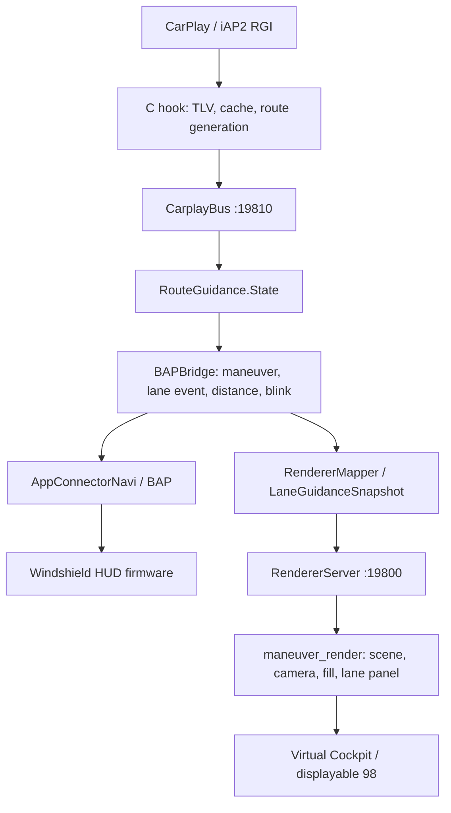

# CarPlay RGI → HUD и renderer: знания и принятые решения

Актуализировано **2026-09-13**, production-ревизия
`972084414c90f14d5a052f66fe8d2c7253b202aa` в `master` и `origin/master`.
Основная папка: `/Users/luka/Desktop/AUDI_2/Patches/mhi2-carplay`.

Это сводка для продолжения работы без восстановления всей переписки. Здесь
собраны текущая архитектура, договорённости по изображению, защита входных
данных, результаты проверок и границы доказанного. Детальные исследования
сохранены по ссылкам; исторические эксперименты не определяют нынешнее поведение.
Сведения об аудио и прочих параллельных задачах ведутся в своих документах.

## 1. Текущий статус

- Старый эксперимент с многополосной дорогой удалён. C++ scene engine,
  анимация проезда, заливка и контактные тени сохранены.
- Полосы принимаются независимо от манёвра и отображаются отдельной нижней
  строкой на прозрачном фоне. Обычные манёвры без полос полностью поддерживаются.
- Принятый стиль: яркая белая базовая стрелка, прежняя HUD-голубая заливка,
  нейтральный серый асфальт, светлая нейтральная обводка.
- Четыре ошибки аудита Java/RGI исправлены и запушены в `9720844`:
  потеря манёвра в очереди, отсутствие повтора при ошибке публикации,
  наследование полей переиспользованного слота/маршрута и сброс возраста времени.
- Последний проход проверял код, host-тесты и отдельную QNX-компиляцию
  `rgd_hook.c`. **Этот коммит не развёртывался и не проверялся на автомобиле.**
  Более ранние поездки и демонстрации не являются проверкой его бинарников.
- Чужая незавершённая работа audio/UI осталась в рабочем дереве; в RGI-коммит
  она не включалась. Не применять ко всему дереву reset/stash/массовый commit.

История основных этапов:

| Коммит | Результат |
| --- | --- |
| `3f87f64` | Продолжение дороги прямо для съездов и прямых манёвров |
| `d15e6bf` | Lane-road эксперимент и плавная передача прогресса при проезде |
| `bc9a50d` | Scene engine и общая стилистика дорог |
| `07e980d` | Удаление lane-road топологии, независимые данные полос, бело-голубой стиль |
| `dda63e4` | Нижняя панель полос с логикой, согласованной с HUD |
| `9720844` | Восстановление доставки и идентичности общего RGI-состояния |

## 2. Что здесь называется HUD, renderer и проекцией

**HUD — проекция на лобовое стекло.** Мы отправляем ему BAP через штатный
AppConnectorNavi; изображение строит его собственная прошивка.

**`maneuver_render` — наша процедурная 3D-стрелка в Virtual Cockpit (VC).**
Она получает команды Java по TCP и сама строит геометрию, материалы и анимацию.
Она не передаёт пиксели в HUD.

**`altscreen_render` — видео CarPlay для приборки**, отдельный процесс и
displayable. Это не отправитель BAP и не движок процедурных манёвров.



Java слушает оба локальных соединения: hook подключается к CarplayBus,
а native renderer — к RendererServer. Направление команд renderer остаётся
Java → native, события готовности идут обратно.

Подробнее: [архитектура процессов](ARCHITECTURE.md) и
[scene engine](SCENE_ENGINE.md).

## 3. Что действительно синхронизировано

Уточнение пользователя от 2026-09-13: нельзя называть всё изображение
«синхронизированной анимацией».

| Что | Контракт |
| --- | --- |
| Манёвр | Один текущий RGI-манёвр и согласованное действие иконки |
| Полосы | Один активный lane event и общее разрешение его показа |
| Цель прогресса | BAP получает проценты, renderer — соответствующий remaining level `0…16` |
| Мигание | Один Java-источник фаз high/low, интервал 600 мс; фаза отправляется в оба выхода |
| Заполнение renderer | Самостоятельная плавная анимация к цели, со своей скоростью и откатом |
| Проезд/камера | Самостоятельная native-анимация перехода между сценами |
| Физический момент показа | Транспорты и дисплеи асинхронны; покадровое совпадение не гарантируется |

Нативного генератора blink-фаз у renderer нет. Он только сглаживает переход
к присланной фазе. HUD рисует свой bargraph; VC рисует цветную заливку стрелки.
Даже при общей цели и фазе это разные способы отображения.

Защита `rendererManeuverPending` предотвращает отправку прогресса нового
манёвра на старую стрелку до принятия новой геометрии. Она не связывает
скорость native-проезда с анимацией прошивки HUD.

## 4. Вход CarPlay, delta и идентичность

Главные сообщения: `0x5201` — обновление маршрута, `0x5202` — данные
манёвра, `0x5204` — lane guidance. C-парсер сохраняет наличие полей;
отсутствующее поле не равно числовому нулю или пустому списку.

Native hook хранит bounded-кэш из 32 слотов, переводит iOS maneuver index
в локальный слот и публикует порядок манёвров вместе с доступными данными.
Отдельный кэш хранит composed lane-guidance events. C публикует собранные
снимки, а Java разбирает только присутствующие ключи как delta.

Текущий манёвр — `maneuverOrder[0]`. Если он ещё не готов/недопустим, нельзя
выбрать следующий заполненный слот: получится следующая стрелка с текущей
дистанцией. Изменение только массива боковых дорог всё равно должно дойти
до renderer; сравнивать нужно содержимое массива, а не ссылку.

Идентичность состоит из **поколения маршрута, слота и версии назначения**:

- При новом `mN_ver` Java очищает поля прежнего владельца **до** разбора
  пришедших полей. При той же версии отсутствующие поля сохраняются.
- Смена манёвра не очищает независимые `lgN_*` events.
- `route_generation` появляется в C → Java начиная с `9720844` и меняется
  при native reset. Это нужно, потому что reset обнуляет версии слотов,
  а кратковременный `route_state=0` может быть скрыт от Java debounce-механизмом.
- Новое поколение очищает устаревшее содержимое маршрута и lane-кэша.
  Нельзя заменять это безусловным удалением всех слотов на любом нуле iOS.
- Счётчик поколения использует monotonic time с дополнительным увеличением,
  если несколько reset попали в одну миллисекунду.

Для этого контракта необходимы обновлённые **hook и JAR вместе**.
Старый hook не предоставляет поколение; новая Java не может восстановить
непереданную границу маршрута по одному повторившемуся `mN_ver`.

## 5. Углы и sentinels — сохранить обязательно

| Вход | Значение и обработка |
| --- | --- |
| `+1000` | Неизвестный угол; наш C-парсер создаёт его для индексированного манёвра без exit-angle TLV |
| `-1000` | Поддерживаемый защитный случай; не трактовать знак как направление |
| `0` | Настоящий угол прямо |
| `-1` с presence | Настоящий угол −1° |
| `-1` без presence | Legacy default незаполненного поля |
| Некорректное числовое поле угла Java | Безопасный fallback `+1000` |

`mTurnAnglePresent` отличает реальный −1° от default. Настоящий bridge использует
mapper с явным наличием поля; legacy overload имеет старый контракт.
`turn_angle` и `exit_angle` — alias одного JunctionElementExitAngle.
При конфликте двух ключей явный `exit_angle` побеждает.

Явные guards `1000 / -1000` нельзя удалять при «упрощении». В lane→HUD
конвертере оба возвращают `0xFF` **до** квантования. Roundabout-квантизатор
проверяет их до clamp, чтобы sentinel не превратился в ±180°.
Straight fallback generic mapper означает выбранную безопасную иконку,
а не утверждение, что `1000` — реальная дорога прямо.

Что установлено в iOS:

- Для 26.1/23B85 исследовались предоставленные декомпиляции
  `CarClusterUpdateManeuverInfo`, `CPManeuver`, `CPAccNavUpdate`.
- Для 27.0/24A5418b проверены извлечённые Mach-O, dyld cache и signed16 serializer.
- Проверенные Apple-пути позволяют отсутствующее поле и передают signed16;
  обязательное Apple wire-значение ±1000 в них не доказано.
- Наш `+1000` для отсутствующего TLV доказан в C-парсере. Поддержка уже
  пришедших ±1000 остаётся необходимой независимо от происхождения значения.

Источники пользователя: `Refferences/iPhone18-3_26.1_23B85_Restore` и
`Refferences/iPhone18,1_27.0_24A5418b_Restore.ipsw` под `/Users/luka/Desktop/AUDI_2/`.
Хеши и границы исследования:
[iOS sentinels](reference/IOS_MANEUVER_ANGLE_SENTINELS.md).
Текущие исправления presence/aliases:
[согласование манёвров](reference/MANEUVER_RENDERER_PARITY_FIXES.md).

## 6. Сопоставление иконок HUD и renderer

Цель пользователя — близкие форма и действие иконки. Геометрию renderer
не нужно искусственно ограничивать всеми дискретными ресурсами HUD.

| Семейство / случай | Принятое решение |
| --- | --- |
| LEFT/RIGHT и конфликтующий знак/нулевой угол | Явный тип поворота определяет сторону |
| Совместимый допустимый TURN | Renderer сохраняет точный угол, включая sharp больше 100° и примерно 160° |
| Самоналожение sharp/U-turn | Подъём стрелки и контактная тень сохраняются |
| OFF_RAMP `8/22/23` | Одна slight-стрелка в обоих выходах; дорога прямо сохраняется |
| ON_RAMP `9` | Slight TURN; автоматический возврат старого MERGE не нужен |
| CHANGE_HIGHWAY_LEFT/RIGHT `52/53` | Самостоятельный `LANE_CHANGE`, не многополосная дорога |
| ENTER/EXIT_ROUNDABOUT `6/7` | Renderer показывает полное кольцо по решению пользователя |
| Номерные съезды `28…46` | Направление берётся из угла; номер съезда не определяет угол |
| U_TURN_AT_ROUNDABOUT `19` | Полный разворот на кольце |
| FOLLOW/APPROACH | Обычная поддерживаемая дорога; наличие lane data не обязательно |
| Обновились только дороги того же манёвра | Refresh сохраняет текущий проезд и прогресс |
| ARRIVED повторяется без изменения геометрии | Не перезапускается принятая анимация флага |

Причина отказа от старого EXIT для рамп: даже базовые HUD s33/s36 имеют
три участка «прямо → диагональ → прямо». Принято использовать TURN s27/s32
без последнего выпрямления. Старые s34/s35/s37/s38 и MERGE нельзя возвращать
только потому, что в названии CarPlay-типа написано ramp.

Renderer получает исходные допустимые боковые дороги, до 18 на команду,
а не восстановление из уже отфильтрованных BAP sideStreets. Для off-ramp
сохраняется продолжение прямо даже при отсутствии 0° во входном списке.
ON_RAMP и обычному повороту дорога прямо без основания не дорисовывается.

Для полных кругов с настоящим допустимым углом разрешено совместить выход
с ближайшей исходной дорогой при разнице строго меньше 30°. Missing fallback
и явный MT19 U-turn не должны случайно притягиваться к другой дороге.

Ресурс короткой дуги в прошивке HUD не доказывает, что он встречается
на реальном CarPlay-маршруте. Короткая native-команда может оставаться
в движке; это не основание назначать её bridge-ом вместо полного кольца.

Полная таблица и доказательства:

- [Актуальные правила сопоставления](reference/MANEUVER_RENDERER_PARITY_FIXES.md).
- [Все 54 типа: HUD рядом с renderer, RHT/LHT](../output/maneuver-parity/hud-renderer-54.png).
- [Рампы до/после](../output/maneuver-parity/ramps-hud-renderer.png).
- [Полная матрица с HUD selector-ами](../output/maneuver-parity/java_mapping-hud.csv).
- [MCU → 3D-стрелка и дороги](reference/HUD_RAMP_3D_CHAIN.md),
  [таблица BAP → selector](reference/HUD_BAP_3D_SELECTORS.md).

Это не попиксельная копия: материалы, пропорции и анимация различаются.
BAP z-level может передаваться HUD, но renderer не рисует отдельный z-marker.
Декоративный подъём при самоналожении не является z-level из навигационных данных.

## 7. Полосы: отдельный event и нижняя панель

Lane guidance не обязана принадлежать текущему maneuver descriptor.
Она может прийти, исчезнуть, вернуться или переключиться **внутри одного
манёвра**, в том числе во время его анимации. Наличие данных перед кольцом
не доказывает полосы движения на самом кольце.

Поэтому отменён подход «широкая 3D-дорога, стрелка по выбранной полосе,
остальные полосы поворачивают вместе с ней». Данные не дают надёжного
основания строить такую топологию. Правила этого эксперимента — snap к краю,
поворот дорожного полотна, ограничение видимых полос дороги — не переносить
обратно в current scene engine.

Общий HUD/renderer resolver выбирает активный event и применяет
`lane_guidance_showing`. Не добавлять gating по дистанции, prepare-зоне,
типу манёвра или завершению проезда. Prefetch другого event не выбирает его.
`count=0` действительно убирает полосы. Missing modern event не заимствует
legacy `mN_lane_*`; сами legacy-поля ещё поддерживаются для старого источника.

`LaneGuidanceSnapshot` копирует raw status, position, primary angle и список
направлений. Он не выбирает primary lane, не меняет манёвр, не угадывает
связность и не делает recommendation из пропущенного поля.

Текущий native panel:

- Прозрачная строка у нижней грани фактического viewport; шаг ячейки 36 source px.
- Viewport шириной 210 px вмещает 5 ячеек, 328 px — 8. Размер glyph не меняется.
  При переполнении одна крайняя ячейка заменяется `…`; это текущая панель,
  а не старые отвергнутые три точки на краю 3D-дороги.
- Сохраняется один конец упорядоченного списка. Выбор — по ближайшей лучшей
  рекомендации к краю, при равенстве/default справа, как в исследованном HUD fallback.
- Известные уникальные positions сортируют порядок. При неполных/повторяющихся
  positions сохраняется полученный порядок, без выдумывания отсутствующих полос.
- До трёх канонических направлений в ячейке. Только допустимый primary при
  `status=2` голубой; статусы 0/1 и дополнительные направления серые.
- Неизвестный primary не становится рекомендацией через запасную ветвь.
  Допустимая запасная ветвь может быть серой. Пустая ячейка — нейтральный штрих;
  event без единого допустимого направления скрывает всю панель.

Под **любой видимой панелью, даже одной полосой**, маска убирает RGB и alpha
сцены на всю ширину источника 328 px. Верхний feather 12 px, затухание
продолжается до физического конца 181-й строки. Стрелка не должна просачиваться
ни между glyph-ами, ни под панелью. Фон остаётся реально прозрачным;
premultiplied alpha сохраняется. Дополнительного непрозрачного прямоугольника нет.

Для lane-only update не нужен новый MANEUVER. Протокол `BEGIN/LANE/COMMIT`
атомарен; только полный принятый snapshot заменяет отображаемый event.
CLEAR/disconnect убирают accepted и staging данные. Обычный новый манёвр
сам по себе их не очищает.

Подробности и сохранённые кадры: [scene engine](SCENE_ENGINE.md),
[панель small/wide](../output/lane-panel/lane-panel.png),
[движение камеры](../output/lane-panel/lane-camera.gif).

## 8. Viewport, камера и геометрия

Исходный размер остаётся **328×181**: 180 строк содержимого плюс служебная
строка. Узкая безопасная рамка — `(59,27,210,153)`; это композиционный ориентир,
а не дополнительная обрезка самой дороги. Нельзя лечить размещение увеличением
разрешения, сменой aspect/FOV или сильным отдалением камеры.

Classic/Sport и small/big stage — разные понятия. Фактический crop берётся
из `ClusterLayerController.maneuverViewport()`. Название режима не заменяет
его координаты: big-screen layout может показывать более узкий popup манёвра.
В документации и тестах удобнее явно писать `210px` и `328px`.

При полосах камера всегда немного отъезжает: обычно на 12%, максимум на 18%.
Planner проверяет важную геометрию и полный наконечник **в узкой рамке для
обоих stage**, над панелью и её feather. Возможен небольшой lens shift.
Участвуют settled-сцены current и incoming, а существующая native-камера
продолжает свой проезд. Дополнительное framing анимируется за 250 мс;
скрытие полос возвращает обычное положение. Геометрия при этом не пересобирается.

Смена viewport тоже плавная. Она меняет размещение панели и область видимости,
но не должна перезапускать манёвр. Основной путь должен оставаться читаемым;
обрезать углы всей сцены по старому small rectangle запрещено. Боковые дороги
плавно заканчиваются прозрачностью; их нельзя резко обрезать по боковому fade
бывшей многополосной дороги.

Старый bargraph VC с переносом справа/слева полностью удалён. Решения о его
правой стороне, коллизии с exit tip и мгновенном переносе L/R — только история.
Документ [bargraph viewport](reference/MANEUVER_BARGRAPH_VIEWPORT.md)
не является заданием вернуть колонку.

## 9. Цвет, заливка, мигание и контактная тень

Принятое OEM+ оформление:

| Элемент | Текущее значение |
| --- | --- |
| Асфальт | Нейтральный `#646464`, общий `visual_style.h` |
| Обводка дороги | Светлая нейтральная, без лишней синевы |
| Базовая стрелка | Яркий белый; shader input `(1.0, 0.980392, 0.909804)` компенсирует холодное освещение |
| Заливка / blink high | Прежний HUD-голубой; shader input `(0.32, 0.77, 1.0)` |
| Blink low / off / пустая заливка | Один базовый endpoint; третьего цвета нет |

Это входы материала, а не обещание такого же RGB пикселя после освещения.
Старый серо-синий base признан плохо читаемым на приборке. Красный пользователь
не принял как замену HUD-голубой заливки. С текущим белым base blink визуально
является сменой цвета; название `glow` не обещает роста яркости.
[Принятое сравнение](../output/oem-white-study/oem-white.png).

Прогресс отсчитывается по видимой проекции осевой линии от входа до наконечника,
включая изгибы. Скрытый хвост не съедает первые сегменты. Шаги `0…16` примерно
равны по видимой длине, но не обязаны иметь равную площадь пикселей. В пересечениях
используется порядок пути, а не ближайшая точка на экране.

Remaining level убывает `16→0`, а fill растёт `0→1`. Граница растушёвана
на 11% длины; при нуле полностью вынесена за видимый вход, поэтому первый
ненулевой шаг не закрашивает внезапно весь хвост. Retarget сохраняет положение
и скорость, дубликаты не перезапускают движение; статическая цель достигается
примерно на 95% за 300 мс без overshoot.

При реальном начале проезда заливка уходящей стрелки откатывается назад,
переход проходит через пустое состояние, после чего новая стрелка доходит
до последней принятой цели. Пришедшие во время проезда новые цели сохраняются.
Blink tint начинает уходить во время движения, а не после остановки камеры.
Refresh дорог не запускает такой handoff; CLEAR очищает состояния.

Contact shadow у самоналожений использует реальные верхние границы и нижнюю
принимающую поверхность. Ширина начинается с нуля в начале crease и растёт
с clearance, без прежней задержки примерно на четверть складки. Есть мягкий
край; внутренние рёбра триангуляции и простые соседние наклонные грани не
должны давать ложную линию. Геометрия тени кэшируется с mesh, заливка/мигание
не перестраивают её. Нет нового shadow texture/FBO; для проверенных наложений
добавлен один draw. Host-время расчёта нельзя считать измерением ГУ.

Детальная история алгоритмов и визуальные доказательства:
[arrow progress](ARROW_PROGRESS_EXPERIMENT.md). Указанные там старые цвета
и промежуточный handoff заменены текущими решениями выше и в scene engine.

## 10. BAP: дистанция, пороги, текст и служебные действия

Реальная иконка показывается на любой дистанции. Расстояние меняет progress
и состояние prepare/action. Текущие эвристики Java:

- Prepare: город 1500 м; highway 3000 м.
- Участок `distanceBetweenManeuver > 2000 м` считается highway. При неизвестной
  длине используется эвристика по типу манёвра.
- Denominator bargraph: длина участка, ограниченная **15% prepare-порога**
  (225/450 м). Это не «15% длины участка». При неизвестной длине берётся предел.
- Blink при доле оставшегося расстояния **строго меньше 20%** denominator;
  фаза 600 мс. Это наши правила, не точное воспроизведение iOS maneuver_state.

Полезные FctID: 18 — distance/bargraph, 19 — основной текст, 20 — следующий
текст (у нас очищается), 21 — дистанция до цели, 22 — абсолютная ETA,
23 — maneuver descriptors, 24 — lanes, 46 — destination, 49 — ExitView.
Кнопка OK переключает представление текста/времени; FctID 22 остаётся ETA.

Уточнение пользователя 2026-09-13 после `9720844`: при отсутствии ExitInfo
название следующей улицы (`mAfterRoad`) или описание манёвра (`mName`)
получает префикс **`● `, U+25CF BLACK CIRCLE**: `● Main Street`.
ExitInfo остаётся `‹…›`, текущая улица выводится без префикса, ETA — с `◌`.
Круг и пробел занимают 4 байта из лимита FctID 19, для текста остаётся 92.
`●` есть во вспомогательных JP/KR/Chinese шрифтах; наличие fallback
в реальном VC-виджете ещё не подтверждено.

ExitView EU/NAR с номером 0 нельзя удалять как случайный toggle:
он обслуживает штатную FSG-синхронизацию 23/18/49. Так же сохраняются
presentation gate, OSGi service rebind и совместимость с реконструированным
stock JAR/BAPDistanceFormatter.

Число дистанции и bargraph физического HUD — отдельный исследовательский вопрос.
Исполнение оригинального ARM GDC двух прошивок подтвердило, что графический
код умеет рисовать их вместе. Но преобразование BAP в маску групп/селекторы
внутреннего GDC-пакета для реальной поездки полностью не восстановлено.
Из этого нельзя обещать решение одним флагом Java. Задача была оставлена
без изменения: [HUD distance/bargraph](reference/HUD_DISTANCE_BARGRAPH_CHAIN.md).

## 11. Доставка, очередь и готовность после `9720844`

`dirty` означает «ещё требует публикации», а не «изменилось только в последнем
кадре». Ошибка HUD или enqueue renderer сохраняет признаки до успешного повтора.
Следующий distance-only кадр не стирает pending-манёвр. Worker может повторить
cached snapshot без новой активности iOS; пауза повтора 500 мс предотвращает spin.

Уже подтверждённое представление не скрывается из-за временной ошибки BAP
при живом renderer. Первоначальный вход в контекст 80 требует успешной
публикации и готового frame; при потере peer возвращается контекст 81.
Context writes остаются сериализованы штатным Java coordinator.

Очередь RendererServer содержит максимум 32 записи:

- Принятые MANEUVER и CLEAR не вытесняются прогрессом.
- Progress объединяется только после последнего MANEUVER/CLEAR; границу
  идентичности пересекать нельзя. Новая команда манёвра несёт начальный progress.
- Старые viewport и lane snapshots заменяются последними соответствующими.
- При полностью критической очереди возвращается отказ, включается повтор.
  Живое TCP-соединение из-за backpressure не разрывается.
- Кэш геометрии обновляется только при успешном enqueue. Повтор уже принятой
  геометрии не должен запускать второй проезд.
- Потеря соединения сбрасывает готовность, новая сессия получает primer и
  актуальный cached snapshot. READY/FRAME_READY/CLEAR ACK защищают границу показа.

Успешный enqueue не равен аппаратному подтверждению показа каждой команды.
На всём пути нет распределённой транзакции с атомарным кадром HUD+VC.

Время оставшегося пути хранит timestamp исходного состояния. Replay, reconnect
и смена представления не омолаживают старую оценку `600→480` обратно до `600`.
Неизменившееся значение в полном cached C-снимке не считается свежим замером;
на этом входе нет отдельного source timestamp для повторной равной оценки.

Причины, воспроизведения и исправления:
[Java RGI audit](reference/JAVA_RGI_AUDIT_2026_09_13.md).

## 12. Wire-контракт и владение движком

TCP renderer: `:19800`, базовая команда 48 байт, big-endian integer fields.
`MANEUVER=0x01`, `PROGRESS=0x06`, `CLEAR=0x07`, `VISIBLE_AREA=0x08`.
Lane transaction: `0x0c/0x0d/0x0e`; до 8 полос, до 16 raw angles на запись.
Старые scene-road команды `0x09…0x0b` выведены из эксплуатации.

| Флаг манёвра | Назначение |
| --- | --- |
| `0x01` | Perspective |
| `0x02` | Initial progress level/mode |
| `0x04` | Геометрия signed half-degrees |
| `0x08` | Refresh дорог с сохранением перехода |
| `0x10` | Разрешение snap к исходной дороге круга |
| `0x20` | Явное состояние OFF/FILL/BLINK_LOW/BLINK_HIGH |

Half-degrees относятся к геометрии MANEUVER; lane angles передаются отдельно
в signed degrees. Не применять одну конверсию ко всем полям пакета.
Подробные byte offsets — в [protocol.h](../maneuver_render/protocol.h),
входной decoder — [maneuver_command.h](../maneuver_render/maneuver_command.h).

C++11 scene compiler имеет C ABI. Current и next владеют разной геометрией;
pending хранит собственную копию. Повтор того же semantic input переиспользует
сцену; во время camera travel нет rebuild/allocation сцены. Сложные семейства
используют built-in геометрию. Код C/C++ смешанный по архитектуре, переписывать
всё в C++ ради расширения файла не требуется. QNX-сборка не должна подтягивать
libstdc++, exceptions, RTTI или emutls.

Displayable манёвра — **98**, не старый stock 20. Java не спавнит renderer
при каждом манёвре: его lifecycle принадлежит startup/framework.
Таблицы context-ов брать из актуального Java-кода/ARCHITECTURE: отдельные
старые комментарии в headers ещё могут описывать прежнюю композицию.

## 13. Где менять код

| Ответственность | Основной файл |
| --- | --- |
| iAP2 TLV и present-биты | [rgd_tlv.c](../hook/routeguidance/rgd_tlv.c) |
| Native caches, reset, route_generation, bus snapshot | [rgd_hook.c](../hook/routeguidance/rgd_hook.c) |
| Java State, delta, presentation worker | [RouteGuidance.java](../java_patch/com/luka/carplay/rgd/RouteGuidance.java) |
| BAP, общие distance/blink/lanes, retry result | [BAPBridge.java](../java_patch/com/luka/carplay/rgd/BAPBridge.java) |
| HUD main/direction | [ManeuverMapper.java](../java_patch/com/luka/carplay/rgd/ManeuverMapper.java) |
| BAP боковые дороги | [SideStreets.java](../java_patch/com/luka/carplay/rgd/SideStreets.java) |
| Согласование смысла HUD с точной renderer-геометрией | [RendererMapper.java](../java_patch/com/luka/carplay/rgd/RendererMapper.java) |
| Raw независимые полосы | [LaneGuidanceSnapshot.java](../java_patch/com/luka/carplay/rgd/LaneGuidanceSnapshot.java) |
| Queue, TCP, события готовности | [RendererServer.java](../java_patch/com/luka/carplay/rgd/RendererServer.java) |
| Фактический crop VC | [ClusterLayerController.java](../java_patch/com/luka/carplay/cluster/ClusterLayerController.java) |
| Scene ownership и кэш | [scene.cpp](../maneuver_render/scene/scene.cpp), [scene.h](../maneuver_render/scene/scene.h) |
| Геометрия и layout | [geometry.cpp](../maneuver_render/scene/geometry.cpp), [layout.cpp](../maneuver_render/scene/layout.cpp) |
| Проезд и built-in семейства | [maneuver.c](../maneuver_render/maneuver.c) |
| Заливка и handoff | [arrow_progress.h](../maneuver_render/arrow_progress.h), [route_progress.h](../maneuver_render/route_progress.h) |
| Нижняя панель и framing | [lane_panel.cpp](../maneuver_render/scene/lane_panel.cpp) |
| Транзакция lane decoder | [lane_guidance.h](../maneuver_render/lane_guidance.h) |
| Тень при наложении | [contact_shadow.h](../maneuver_render/contact_shadow.h) |
| Шейдер, alpha, FBO, композиция | [render.c](../maneuver_render/render.c) |
| Общие размеры и нейтральная дорога | [visual_style.h](../maneuver_render/visual_style.h) |

## 14. Проверки и доказательства

Для `9720844` прошли Java 1.4 build, route-info и transport suites, 38 проверок
совпадения Java/C protocol constants, 107 shipping-классов bytecode version 48.0.
Отдельно `rgd_hook.c` скомпилирован production-флагами QNX/ARM toolchain.

Новые regressions используют настоящий Java parser, `onFrame`, bridge и
retry-worker; подставляются только endpoints/readiness. Проверяются отказ HUD,
отказ очереди, pending + новая дистанция, supersession новым манёвром,
show/hide полос, обе blink-фазы, отсутствие повторного проезда, холодное
подтверждение, пауза повторов и восстановление без следующего iOS delta.

`test_rgd_native_contract.py` исполняет настоящий TLV parser и извлечённые
без изменения reset/slot writer/text builder; затем Java и stock BAP sender.
Часы, назначение slot/version и lane lookup — fixture. C запускается с ASan/UBSan.
Для нового известного угла устаревшие roads/name/step больше не наследуются;
HUD sideStreets после reuse совпадают со свежим кэшем.

Первоначальный Java-only probe ошибочно создавал впечатление stale exit angle.
В реальной цепочке C заранее публикует +1000 при отсутствии угла. Этот вывод
исправлен в отчётах; подтверждённый defect касался других отсутствующих полей.

Матрица: **7 890 входов всех 54 типов — 0 изменений BAP** по сравнению со
свежей сборкой старого BAPBridge `07e980d` и принятым эталоном. Для полноценных
lane records — **1 083** комбинации angle/status без изменения вывода.
Это проверка numeric descriptors/stock serialization, не новый CAN-захват.
[Подробности сверки](reference/CARPLAY_HUD_REGRESSION_CROSSCHECK_2026_09_13.md).

Ранее для engine/panel выполнялись host CPU/ASan/UBSan и реальные GL captures:
32 сцены в двух рамках, camera handoff, retreat/refill, alpha маски, lifecycle
полос и framing полного exit tip. Их scope и артефакты — в
[SCENE_ENGINE.md](SCENE_ENGINE.md) и [preview README](../tools/maneuver-preview/README.md).
Не выдавать эти прежние прогоны за заново выполненную аппаратную проверку.

Практические команды из корня репозитория:

```sh
# Java + RGI lifecycle + native input contract
bash scripts/test_route_info.sh
bash scripts/test_java_transports.sh
python3 scripts/check_local_protocols.py

# После изменений native-движка
bash scripts/test_maneuver_native.sh
make -C tools/maneuver-preview all test
python3 tools/maneuver-preview/capture.py
python3 tools/maneuver-preview/capture_lanes.py
python3 tools/maneuver-preview/test_lane_transport.py

# Production artifacts
bash scripts/build_java.sh
LOG=0 bash scripts/build_hook.sh
bash scripts/build_renderers.sh
```

Preview: `build/maneuver-preview/preview --lanes 0`; стрелки Left/Right —
следующий манёвр с проездом, Up — узкая/широкая рамка, Down — lane events,
P — show/hide полос, Space — fill/blink, D — красная рамка.

`output/java-rgi-audit-2026-09-13/run.sh` и старый
`output/carplay-projection-crosscheck-2026-09-13/crosscheck_native_input.py`
намеренно ожидают старые дефекты. Они являются историческими observation
probes, не acceptance suite для исправленной ветки.

## 15. Что остаётся открытым и как продолжать

Последняя проверенная локальная поставка: Java JAR собран; изменённый native
RGI unit компилируется. Полная сборка hook после последнего исправления
не заявлялась: она включает параллельно изменяемый audio-код. Текущие файлы
`build/` сами по себе не доказывают, какой набор исходников установлен на ГУ.
Для установки сверить происхождение и хеши hook/JAR/renderer;
порядок описан в [DEPLOYMENT.md](DEPLOYMENT.md).

Аппаратная проверка последнего набора ещё нужна: обе VC-композиции, появление
и скрытие lanes в одном манёвре, blink, проезд с откатом заливки, reroute,
восстановление соединения и читаемость бело-голубой стрелки днём/ночью.
Частота исходных queue/BAP ошибок и физическое рассогласование кадров
на автомобиле не измерены.

Кандидаты на отдельную небольшую чистку Java: неиспользуемые
`lastDistanceToDestinationM`/`hexBytes`, лишние параметры lane converter,
устаревшие комментарии. `keepLastColonPart(mAfterRoad)` и замена некорректного
intList токена на 0 требуют проверки формата/достижимости, а не автоматического
массового удаления. Они не объявлены закрытыми четырьмя исправлениями выше.

Допустимое направление рефакторинга BAPBridge: отделить HUD-output,
renderer-output, вычисление distance/blink и текст/ETA, сохраняя единое
State и общие resolver-ы. Нельзя удалить RendererMapper как «Java-костыль»:
в нём живут согласованные семантика, ramp/slight и правила углов.

При следующих изменениях сохранить: ±1000/presence, полный круг, точные
совместимые sharp-углы, slight ramps с дорогой прямо у off-ramp, независимые
lane events, full-width alpha-mask даже для одной полосы, исходный размер,
native camera travel, retreat/refill и общий источник blink-фаз.

Корни исследований: `/Users/luka/Desktop/AUDI_2/Firmwares/HUD` и
`/Users/luka/Desktop/AUDI_2/Refferences` (`catplay`, `showcase`, `airplay2`,
`airplay2-receiver`, iOS builds). Более ранние обзоры этих каталогов не
заменяют конкретное доказательство для текущего RGI-входа. Адреса функций,
хеши образов и инструменты RE сохранены в тематических reference-отчётах.
