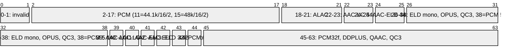
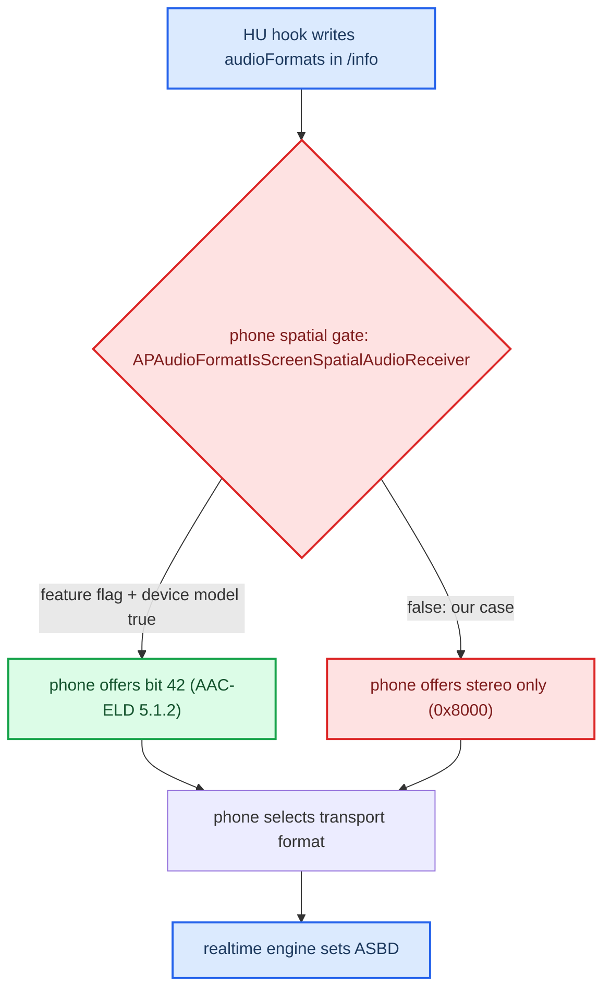
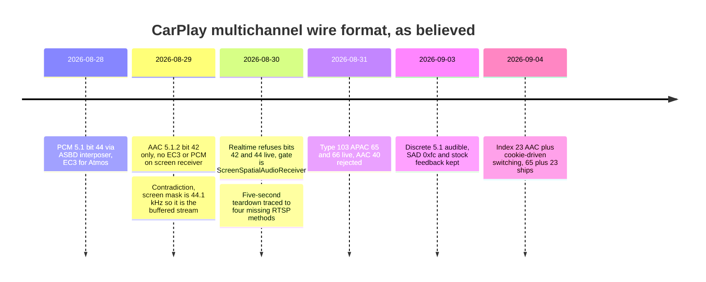

# iOS CarPlay Spatial Wireformat

*What CarPlay/AirPlay audio actually looks like on the wire: two streams, the format bits and extended indices, the phone-side gates, why Atmos is not Dolby on the link, and why the codec authority is the inline cookie — not any index.*

---

## 📋 What this settles

CarPlay audio was re-litigated for months. The RE below closes it: there are **two** audio streams; the realtime one (type 100) is PCM and refused every multichannel bit we offered; multichannel, lossless and "Dolby Atmos" content only exists on the **buffered** stream (type 103), which stock libairplay does not implement and the hook now does. "Atmos" is a *content* tier, not a transport. What ships is APAC 5.1 (index 65) plus AAC-LC stereo (index 23) on type 103, decoded in the hook to PCM6. The receiver: [[Buffered Audio Path]]; the shipping surround path: [[Discrete 5.1 Routing]]; what Atmos means here: [[Dolby Atmos]].

Truth tags: **[decompile]** = iOS 27 `24A5418b` (iPhone18,1 dyld cache) / libairplay RE, **[car]** = confirmed on the unit, **[code]** = read in the current tree, **[open]** = unverified.

---

## 🌐 The two audio streams

`AirPlaySender` parses two `/info` keys and they carry different worlds.

| Stream | `/info` key | Type | Content | Who publishes it |
|---|---|---|---|---|
| Realtime | `audioOutputFormats` (bitmask) | 100 main / 101 alt | PCM only, 48 kHz — the classic mirror stream | stock libairplay **[car]** |
| Buffered | `audioOutputFormatsExtended` (array of indices), exported as `{"bufferStream": […]}` | 103, `audioType` `media` | AAC-LC / ALAC / APAC music, lossless, spatial | the hook, when `AUDIO_SPATIAL=1` **[code]** |

The realtime path is **ASBD-based, not bitmask-based**: `APAudioFormatSelectorRealTimeCreate@0x251049A1C` copies whole 40-byte ASBDs (56-byte stride) out of a `kSupportedPCMFormats` list, and `realTimeAudioEngine_setTransportAudioFormatInternal@0x2510431C8` takes an ASBD pointer — channel count is just a field. The buffered path is where lossless/spatial live: `airPlayDescription_copyCarPlayAudioFormatsExtended@0x25109C5DC` copies the type-103/`media` array behind a feature flag and description byte `+65`. `APCarPlayAudioFormatsCreate@0x25107B82C` accepts stream types 100, 101, 103, 106, 107; the ordinary main stream is always created first and the buffered one added only when `mainBuffered` was negotiated, so advertising 103 never removes 100. Volvo EX90's "Spatial Audio powered by Dolby Atmos" (Bowers & Wilkins only, shipped as a car software update) is consistent with a car-side buffered implementation. **[decompile]**

Stock 210 libairplay publishes only type 100: `AirPlayReceiverServerPlatformCopyProperty@0x1fe08` builds two dicts (`'d'` = 100 main, `'e'` = 101 alt) whose `audioOutputFormats` come from `AudioSessionGetSupportedOutputFormats@0x497bc` as a full 64-bit value. Measured stock advert: main `0x8010` = bits {4, 15} (`PCM/16000/16/1` mic + `PCM/48000/16/2`), alt `0x10`. The live realtime stream is `'lpcm'` (`1819304813`) 48 kHz/16/stereo on `mpl5_dio_ent`, device 4. The hook appends the type-103 entry and negotiates `mainBuffered`/`mainBufferedInfo` — full contract in [[Buffered Audio Path]]. **[car]** · **[code]**

---

## 📊 The format bits and indices

Two numbering systems share one table: the **legacy 64-bit mask** used by `audioOutputFormats`, and the **extended `APAudioFormatIndex`** used by `audioOutputFormatsExtended` and SETUP. `APAudioFormatIndexToAPAudioFormat@0x226698434` is `index < 64 ? 1ULL << index : 0`, so below 64 an index *is* its bit and every APAC index (≥ 64) has no legacy bit at all. **[decompile]**

*Packet view of the legacy mask, from OUR libairplay `AirPlayAudioFormatToASBD@0x2bda0` literals (all 16 PCM cases cross-checked PASS) plus the iOS 27 index table; bit numbers equal index numbers below 64.*



Key readings **[decompile]** · **[code]**:

- **Bit 42 = `AAC-ELD/48000/5.1.2`, bit 40 = `AAC-LC/48000/5.1.2`; 39/41 are the LC/ELD 5.1 pair** (`hook/audio/audio_hook.h:127-128`; AUDIO.md §15 lines 595-597). Earlier text in this vault that labelled bit 42 as AAC-LC, or 39/41 the other way round, was wrong.
- **Bit 42 is the whole spatial delta.** `APAudioFormatGetSupportedTransportAudioFormatsForScreenReceiver@0x22669E3F4` returns `0x1440800` (bits 11/18/22/24 — 44.1 kHz PCM/ALAC/AAC-LC/AAC-ELD stereo) or `0x40001440800` when spatial is allowed. That mask is 44.1 kHz and does not intersect our realtime {4, 15}, so it describes the **buffered** stream, not ours.
- **The buffered selector's vocabulary is AAC/ALAC only.** `APAudioFormatSelectTransportFormatForAudioSourceInputFormat@0x22669C568`: early-out bit 22; 5.1.2 source tries 40 then 42; 5.1 source tries 39 then 41; stereo tries 21 (ALAC 48k, settings-gated) then 23; floor = error "Supported format does not include AAC-LC 48k stereo format". No PCM (38/44/47) or DD+ (50/53) bit can ever be selected there.
- **Bit 44 = `PCM/48000/16/5.1`** belongs to buffered HomePod-class receivers. The hook still defines `SPA_DEFAULT_BIT 44u` (`hook/audio/audio_hook.h:42`) and ORs it into the type-100 offer when armed (`hook/audio/audio_hook.c:451-461`) — a harmless retained migration probe; the phone keeps choosing stereo.
- **Multichannel PCM is an accept-side format.** `_APSAudioFormatDescriptionListCreateForBufferedReceiverWithAudioCapabilities` appends PCM 5.1/7.1 only for a peer that advertises `lpcm ≥ 6ch`; the buffered **sender** list (`…ForBufferedSender`) never offers raw multichannel PCM.

| Index | Descriptor | Role here |
|---:|---|---|
| 15 | PCM/48000/16/stereo | the live realtime format |
| 21 | ALAC/48000/24/stereo | tried as extra index — negotiation hangs |
| 22 | AAC-LC/44100/stereo | legacy type-103 bootstrap bit `0x400000`; selectable but needs a resampler |
| **23** | **AAC-LC/48000/stereo** | **production stereo** |
| 38 / 44 / 47 | PCM 16/5.1.2, 16/5.1, 32f/5.1 | buffered-receiver PCM, never offered to CarPlay |
| 39 / 40 | AAC-LC 5.1 / 5.1.2 | 40 advertised alone → phone fell back to type 100 |
| 41 / 42 | AAC-ELD 5.1 / 5.1.2 | 42 is the iOS spatial bit; refused on realtime |
| 50 / 53 | DDPLUS 5.1 / 9.1.6 | never selected; the hook no longer accepts them |
| 64 | APAC/48000/stereo | gated by `bufferedAPACStereo` (static default false) |
| **65** | **APAC/48000/5.1** | **production spatial** |
| 66 | APAC/48000/5.1.2 | experimental; 8 ch proven on the wire |
| 67 / 68 / 76 / 77 / 92 | APAC 7.1 / 7.1.4 / 5.1.4 / 7.1.2 / 9.1.6 | beyond the 6-channel ceiling |

APAC layout tags and the decoded channel order are in [[APAC Codec]].

<details>
<summary>The complete iOS 27 index table 0–94 (from `_APAudioFormatIndexToASBD@0x22669646c` + debug-string formatter)</summary>

0–1 invalid · 2 PCM/8000/16/mono · 3 PCM/8000/16/stereo · 4 PCM/16000/16/mono · 5 PCM/16000/16/stereo · 6 PCM/24000/16/mono · 7 PCM/24000/16/stereo · 8 PCM/32000/16/mono · 9 PCM/32000/16/stereo · 10 PCM/44100/16/mono · 11 PCM/44100/16/stereo · 12 PCM/44100/24/mono · 13 PCM/44100/24/stereo · 14 PCM/48000/16/mono · 15 PCM/48000/16/stereo · 16 PCM/48000/24/mono · 17 PCM/48000/24/stereo · 18 ALAC/44100/16/stereo · 19 ALAC/44100/24/stereo · 20 ALAC/48000/16/stereo · 21 ALAC/48000/24/stereo · 22 AAC-LC/44100/stereo · 23 AAC-LC/48000/stereo · 24 AAC-ELD/44100/stereo · 25 AAC-ELD/48000/stereo · 26 AAC-ELD/16000/mono · 27 AAC-ELD/24000/mono · 28 OPUS/16000/mono · 29 OPUS/24000/mono · 30 OPUS/48000/mono · 31 AAC-ELD/44100/mono · 32 AAC-ELD/48000/mono · 33 QC3/48000/5.1.2 · 34 QC3/48000/7.1.4 · 35 QC3/48000/9.1.6 · 36–37 invalid · 38 PCM/48000/16/5.1.2 · 39 AAC-LC/48000/5.1 · 40 AAC-LC/48000/5.1.2 · 41 AAC-ELD/48000/5.1 · 42 AAC-ELD/48000/5.1.2 · 43 AAC-ELD/32000/mono · 44 PCM/48000/16/5.1 · 45 PCM/48000/32f/mono · 46 PCM/48000/32f/stereo · 47 PCM/48000/32f/5.1 · 48 PCM/48000/32f/5.1.2 · 49 DDPLUS/48000/stereo · 50 DDPLUS/48000/5.1 · 51 DDPLUS/48000/5.1.2 · 52 DDPLUS/48000/7.1.4 · 53 DDPLUS/48000/9.1.6 · 54 QAAC/48000/stereo · 55 QAAC/48000/5.1 · 56 QAAC/48000/5.1.2 · 57 QAACHE/48000/stereo · 58 QAACHE/48000/5.1 · 59 invalid · 60 QAACHE/48000/5.1.2 · 61 QLAC/48000/24/stereo · 62 QC3/48000/stereo · 63 QC3/48000/5.1 · 64 APAC/48000/stereo · 65 APAC/48000/5.1 · 66 APAC/48000/5.1.2 · 67 APAC/48000/7.1 · 68 APAC/48000/7.1.4 · 69 PCM/48000/32f/7.1.4 · 70 QAAC/44100/stereo · 71 QAACHE/44100/stereo · 72 QAACHEV2/44100/stereo · 73 QLAC/44100/24/stereo · 74 MP3/44100/stereo · 75 MP3/48000/stereo · 76 APAC/48000/5.1.4 · 77 APAC/48000/7.1.2 · 78 PCM/48000/16/7.1 · 79 PCM/48000/32f/7.1 · 80 PCM/48000/16/5.1.4 · 81 PCM/48000/32f/5.1.4 · 82 PCM/48000/16/7.1.2 · 83 PCM/48000/32f/7.1.2 · 84 PCM/48000/16/7.1.4 · 85 ALAC/44100/20/stereo · 86 ALAC/48000/20/stereo · 87 QAC3/48000/5.1 · 88 QEC3/48000/7.1 · 89 PAAC/44100/stereo · 90 AAC-LC/48000/7.1 · 91 EAC3/48000/5.1 · 92 APAC/48000/9.1.6 · 93 PCM/48000/16/9.1.6 · 94 PCM/48000/32f/9.1.6

**Never derive an index from descriptor-string file order** — the early subset looks offset by two and later insertions break that. Use the formatter switch or `ToASBD` literals only. The source for AUDIO.md §9's early bit values (38/44/47/50/53) was this same table.

</details>

---

## 🔐 The codec authority: the inline magic cookie

Three things announce a buffered format; **only the inline magic cookie (TLV 18) is authoritative.** iOS changes codec inside one live session and every packet carries the cookie for its format (AAC 39 bytes, APAC 33 bytes). **[car]**

| Field | What it is | Authority |
|---|---|---|
| TLV 18 — inline magic cookie (with TLV 17 cookie ID) | per-packet decoder descriptor | **decoder authority** — try the hinted decoder, then the other |
| TLV 2 — format index | 23 for AAC-LC, 65 for APAC | hint: which decoder to try first |
| TLV 8 — `spf` | 1024 in both sessions | never an index |
| SETUP `audioFormatIndex` | initial negotiated index | initial hint only; stays stale across switches |

**The landmine:** reading TLV 8 (or TLV 2, pre-fix) as the live index overwrote the negotiated index on the first packet and **muted every non-Atmos track**. Rule: switch decoders on the cookie, drop an unsupported index hint, never tear down a working decoder. Downstream, `spa_select_decoded_pcm_action` keys on the *decoded* PCM kind — codec + channel count + rate + layout tag (`hook/audio/spatial_downmix.c:16-45`). TLV ids are fixed in `hook/audio/apap_crypto.h:53-67`; the full TLV map is in [[Buffered Audio Path]]. **[code]**

---

## 🔍 The phone-side gates

**`ScreenSpatialAudioReceiver` blocks realtime spatial, and no accessory can flip it.** `APAudioFormatIsScreenSpatialAudioReceiver@0x22669B1F4` takes no arguments:

```c
if (!APSSettingsIsFeatureEnabled(CFSTR("ScreenSpatialAudioReceiver"))) return 0;
v1 = MGGetProductType();
if (v1 != 0x5BD62321 && v1 != 0xA10F2923 && v1 != 0xFCBBE892) return IsAppleTV() != 0;
return 1;
```

`APSSettingsIsFeatureEnabled@0x2266529DC` checks, in order: a per-process mutex-guarded cache (not invalidated by `APSSettingsSetValue` — restart the process); integer app preference `ScreenSpatialAudioReceiver` in domain `com.apple.airplay` (non-zero wins); `_os_feature_enabled_impl("AirPlay", "ScreenSpatialAudioReceiver")` from `libsystem_featureflags.dylib` (shared memory `com.apple.featureflags.shm`, then `/System/Library/FeatureFlags/Unified`, `/System/Library/FeatureFlags`, `/Library/Preferences/FeatureFlags` `Domain/AirPlay.plist`, env `FEATUREFLAGS_ENABLED=AirPlay/ScreenSpatialAudioReceiver`). No accessory, MFi, vehicle, entitlement or network input reaches it; only a rooted phone could override it. The three product-type hashes are unlabelled and irrelevant to the decision. **[decompile]**

**CarKit capability ivars** (`-[CARSessionConfiguration initWithSessionStatusOptions:propertySupplier:]@0x1C2008F7C`; getters `LDRB W0,[X0,#0x15]` / `#0x16`) **[decompile]**:

| Ivar | Source | Shape |
|---|---|---|
| `spatialAudioSupported` (+0x15) | top-level `audioFormats` array | **derived**: set if any dictionary in the array has a non-null `audioOutputFormatsExtended` (type/contents unchecked). `W4 = 0x10` is the fast-enumeration batch size (16 objects), not a channel count |
| `dolbyAtmosAudioSupported` (+0x16) | `DCXEnabled` Bool inside `mainBufferedInfo` | plain Bool; read by `airPlayDescription_isDCXSupportedForSpatialAudio@0x2511545A8`; the hook leaves it absent |

`sessionStatusOptions` is a bitmask (`& 2/4/8`), not a dict; capabilities are keyed lookups on the `/info` dict (`CARkAPEndpointProperty_EndpointInfo`). The iOS 27 `extendedFeatures` vocabulary is `uiContext, focusTransfer, h.264Level5.1, mainBuffered, altScreen, enhancedSiri, hevc, fileTransfer, uiSync, vehicleStateProtocol, sessionManagement, videoPlayback, logTransfer` — no spatial/atmos string; iOS 26.1 CarKit has no spatial/atmos symbols at all.

**CarPlay spatial support** (`airPlayDescription_isCarPlaySpatialAudioSupported@0x2511541C8`) needs `bufferedAPACSurround` (default 1), description byte `+65`, and any of APAC 65/66/67/68/76/77/92 in the type-103 array. **App eligibility** is separate: MediaToolbox denies buffered registration for `com.spotify.client` and `com.espn.ScoreCenter` — see [[Buffered Audio Path]]. iOS never upmixes stereo into a spatial format; the "Dolby Atmos / Apple Spatial Audio / Stereo" badge is derived from the codec fourCC + channel count actually streamed (`APSBadgingFormatInfoCopyBadgeType@0x22663D760`).

---

## ⚙️ Realtime negotiation — tested live, refused



With the full rig (patched deva 6 voices + frag/buf, `SPATIAL_5_1=1` — now only a migration fallback, `hook/audio/audio_hook.h:25-28`) on an **iPhone 17 Pro Max, iOS 27 beta 6** **[car]**:

| Tuned bit | Offered (type 100) | Phone selected |
|---|---|---|
| 44 `PCM/48000/16/5.1` | `0x100000008010` | `0x8000` = bit 15, stereo |
| 42 `AAC-ELD/48000/5.1.2` | `0x40000008010` | `0x8000` = bit 15, stereo |

Interposition provably works (the augmented mask reached negotiation); advertising is not sufficient. Probe-only mode (`<bit>:0`: advertise but refuse in `ToASBD`) was essential — a selected bit 42 described by a 16-bit `lpcm` ASBD would have fed full-scale noise into a 19-speaker amp. Test any new bit that way. Also: never judge from the stock `Supported output formats:` log line, which prints before the interposer adds its bit.

**The live baseline** (`sloginfo -w`, stock `io-audio log_level=high`): `Supported output formats: 0X8010` / `0X10`; `Audio Format: (48000 | 16 | channels: 2)`; `Stream type: 100 | Format = 1819304813 | Ch = 2`; `nTFrames: 768, nTxFramesInBytes: 3072` (so 6 ch needs 9,216 B > stock `max_fragsize` 6,144 — why the deva patch moved fragsize too); and `session_csd_setup: … channels=6, bit_per_sample=24` on device 1 `mpl1_int_ent`, proving the 6-channel chain ran on the unit before CarPlay did. **[car]**

---

## 📈 How the target moved

*Timeline of the transport hypothesis: each entry is what the project believed the CarPlay multichannel wire format to be, and what replaced it.*



- **§5–§8 (2026-08-28):** "Spatial = multichannel PCM, Atmos = `EC3/48000/7`"; plan was from-source libairplay + a Dolby decoder. The format table was unreadable at first (Ghidra OOM, `ipsw dyld extract` dropping shared cstrings), so the bit was going to be found by probing.
- **§9–§11:** the pipeline is 64-bit clean — `AirPlayReceiverSessionSetup@0x276dc` reads `audioFormat` with `CFDictionaryGetInt64` and stores a QWORD at `stream+0x10`; the only blocker is `ToASBD@0x2bda0` (`if (HIDWORD(a1)) return -6735`). An older "32-bit truncation" claim was wrong. Channel count flows from the ASBD into `AudioStreamPrepare@0x4a9d0` → `CQNXSoundIF` → `mpl5_dio_ent`.
- **§12:** buffered-sender evidence said Apple Music surround is EC3/APAC, not PCM; then "CarPlay is realtime PCM" corrected it; both were later superseded by the two-stream picture (§21).
- **§15–§18:** bit 42 AAC-ELD 5.1.2 is the spatial bit; Dolby never crosses; "declare Dolby, send PCM" is impossible on that selector.
- **§19–§22a:** our own table rebuilt, the 44.1 kHz contradiction found → the screen mask governs the buffered stream; `FPSupport_GetMaxPhysicalOutputChannelCount` returns the real route count for non-buffered routes but `itemfig_isAtmosSupported` tests `count == 16` (a buffered-AirPlay sentinel), so a 6-channel route alone does not unlock the Atmos tier.
- **§24–§25a:** live baseline, then both bits refused, gate named.
- **§26–§27:** CSD width defect and SAD header fixed; APAC stereo index 64 exists after all.

---

## 💡 Atmos, PCM passthrough, and the 6-channel ceiling

**Atmos is a content brand, not a transport.** Declaring `dolbyAtmosAudioSupported` will not make the phone send EC3; on the phone it selects the Atmos *rendition* of a track. In the vehicle, Atmos-tier items arrived as **APAC** on type 103 (the UI showed "Dolby Atmos" with index 65), never as AAC 5.1.2. Details in [[Dolby Atmos]].

**Stock libairplay is genuinely PCM-only.** 210 libairplay never decodes AAC: `AudioConverterNew_compat@0x3ddf0` is a dead stub (−6735), `ToASBD` rejects every ALAC/AAC bit, output is ALSA/QSA (OMX is video-only). Do **not** add in-lib AAC/OMX/FDK decode. Buffered AAC/APAC is received, decrypted and decoded in the hook and rendered at a fixed PCM6/48 kHz/S16 contract through the existing DIO5 QSA handle (`hook/audio/audio_hook.c:1-10`). **[car]** · **[code]**

**6 is a hard ceiling — the 8→6 fold is mandatory.** `deva_mib2_channel_map@0x54ACC` switches on {1,2,3,6} only; `deva_csd_start_csd_session_playback@0x24F28` hardcodes 6 in its `voices > 2` branch (stream type 28); the amp's only 8-channel sink (`0x32 Entertainment_7.1_SAD`) declares positions 7/8 as `0x13/0x14` Back Left/Right of Centre, never height (`0x0D/0x0F`). deva's stream map `01 02 03 06 08 09` = `L R C LFE Ls Rs` (the device-side map `01 02 08 09 03 06` is its own reorder). **[car]**

**Early levers that turned out not to matter:** latency env in `dio_manager.json` (`ALL_OUT_LATENCY=80`, `ALL_IN_LATENCY=95` ms) is real but unrelated; 96/192 kHz is pointless (the TDM media bus is 48 kHz and every media device in the deva caps table is 48 kHz-only, rates mask `0x80`); `supportsMixableAudio` would overlay prompts instead of ducking only if the amp mixes two streams.

<details>
<summary>Stock libairplay and deva internals behind these conclusions (AUDIO.md §1–§11, §16)</summary>

- **Platform ceiling:** APQ8064 `io-audio -d qc default_device=six_channel_speakerp`, nodes `mono_/stereo_/six_channel_/stereo_to_all_speakersp`; 48 kHz TDM media bus with a `deva_srf_rate_match` hardware SRC (no 96/192 path); QSA up to S32 container, DAC ~24-bit. Cinemo's local codecs (`libNmeAudio*`: Dolby, DTS, FLAC, AAC, MP3, WMA, Vorbis) serve local media only, never CarPlay.
- **libairplay 210.81:** `_UpdateStreams` (`sub_1DFE8`) builds Main/Alt streams — its big format switch is logging only; `AirPlayAudioFormatToPCM@0x1b2bc` (32-bit `int` arg in stock) delegates to `ToASBD`; the hook interposes `ToASBD` for both callers (SETUP validation `0x2770c`, stream build `LDRD R0,R1,[R4,#0x10]` at `0x1e514`) and fills a 48 kHz/16/6-ch ASBD (`bpf 12`). `AudioStreamPrepare@0x4a9d0`: `get_audio_path@0x49398` (media → `mpl5_dio_ent`, phone → `tel2_dio_phone`, speech → `ann4_dio_voice`), then `setFormat(channels = *(a1+92), …)` — the channel count comes straight from the ASBD. Stream types: Main + Alt, plus an SDK `MainHighAudio` marked wireless-only.
- **deva mixer:** `build_playback_mixer` (inlined in `deva_setup_mixer@0x3C248`) picks a channel map by mask `(1<<voices)-1` — 1 → `unk_A5814`, 3 → `unk_A5424`, 63 → `unk_A5520` — but switches on `mix_config[6]`, hard-set to 1 by `deva_pcm_and_mixer_device_init_platform_mib@0x5707C`, so the card mixer never reads a device's voice count. `deva_parse_commandline_parameters` is a name→id `strcasecmp` chain with no voices knob: widths can only change in the caps table (details in [[QNX Audio Topology]] and [[Discrete 5.1 Routing]]). Rates per device: media `0x80` (48 kHz), `ann1_int_nav`/`ann2_int_sds` `0x1000` (24 kHz), `ann3…ann11`/`tel2…tel5` `0x8` (16 kHz). `snd_pcm_query_channel_map` has no importer in the whole image.
- **Dolby licence decode:** the expected IUDC values are embedded obfuscated as `enc ^ ~k2 ^ k1`; values in [[Dolby Atmos]].
- **Plan-era tooling wall (2026-08-28):** Ghidra headless OOM on the full cache, idalib could not open it, `ipsw dyld extract` dropped shared cstrings; the format strings sat at offset `~0x630E38A` of subcache `.36`. The table was later read from AirPlaySupport `_APAudioFormatCopyAudioFormatsToReadableString`.
- **iOS list/selection functions:** `_APSAudioFormatDescriptionCopyDebugString@0x2266d7438`, `_APSAudioFormatDescriptionGetLegacyFormatMask@0x2266d78b4`, `_APSAudioFormatDescriptionListAddSupportedFormatsForAPACToList@0x226654af0`, receiver builder `@0x226656144` (base 22/23, optional 20/86/21, spatial 39/40 + APAC 65/66, capability-dependent 67/76/77/68/92, never 64), `_APCarPlayAudioFormatsCopyFormatsForAudioType@0x25107b070` (drops index 23 when `carplayForce44kForBuffered`), `_audioStream_createSupportedAudioFormatList@0x2510224ac` (extended list wins, legacy only if absent), `_audioStream_copyTransportFormatDescriptionForSourceContentFormatDescription@0x251029dd0`, `___carEndpoint_activateInternal_block_invoke_2.134@0x2510873d8` (main stream first, buffered second). Extracted image hashes: AirPlaySupport `edf99982…c2a3`, AirPlaySender `fc18fcf6…1e`.

</details>

---

## 📚 Sources

Merged originals were removed from the tree after this note absorbed them; they remain in git history (commit 23972aa).

- `AUDIO` — master audio reference, §1–§27: hardware ceiling, libairplay internals, every transport hypothesis and its correction, live baselines.
- `CARPLAY_SPATIAL_DOLBY_PLAN` — the original 2026-08-28 feasibility plan (PCM-bit + EC3), superseded; kept for the tooling wall notes.
- `HANDOFF_SPATIAL_AUDIO` — the `ScreenSpatialAudioReceiver` gate and its APSSettings precedence, the `/info` shape, the live refusals.
- `APAC_FORMAT_INDEX_AUDIT` — the complete 0–94 index table and the legacy/extended rules.
- `DYNAMIC_BUFFERED_CODEC_SWITCH` — in-session format change and cookie authority.
- Research long-form: [[Research/UPMIX|UPMIX]] · [[Research/DOLBY_ATMOS_TEARDOWN|DOLBY_ATMOS_TEARDOWN]].

## 🔗 See also

- [[Buffered Audio Path]] — the hook's type-103 receiver and its SETUP/APAP contract.
- [[APAC Codec]] · [[Cinemo AAC Decoder]] — the two decoders.
- [[Discrete 5.1 Routing]] — the shipping surround path this wireformat feeds.
- [[Dolby Atmos]] — content tier vs transport, and the phone-side block.
- [[QNX Audio Topology]] — the QSA/deva/CSD side the decoded PCM enters.
- [[Home]] · [[Landmines]] — the spatial/codec traps distilled.
