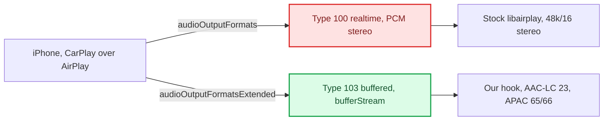
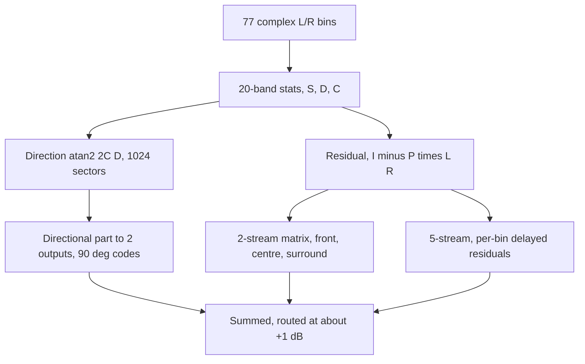

# Dolby Atmos — a teardown, and what we took from it

*Post-mortem: what "Dolby Atmos" actually is on CarPlay, why we can't get it phone-side, and what we learned from reverse-engineering Dolby's own spatial DSP and folded into HSSR.*

---

> **Scope & honesty.** This is analysis, **not** a redistribution of anything Dolby.
> No proprietary Dolby file, spec text, or binary is reproduced here; the numbers
> below are results of our *own* reverse-engineering (static disassembly + Unicorn
> emulation of extracted kernels) and our own design. Truth levels are marked:
> **CONFIRMED-on-car** (tested live), **inferred** (static RE, high confidence), and
> **hypothesis** (open). Code-state claims about our hook cite `path:line` against the
> current tree. Two very different "Dolby" questions live in this doc — keep them
> separate:
>
> 1. **The transport question** — what Atmos *is* on the CarPlay wire, and why we
>    can't make the phone send it to us in real time (§"What Dolby Atmos is on the
>    CarPlay transport" through §"Why 5.1.2 height is impossible").
> 2. **The DSP question** — how Dolby distributes objects to a surround field, and
>    what principles HSSR borrowed and where it deliberately diverges (§"The Dolby DSP
>    teardown" onward).

## 📋 TL;DR

"Dolby Atmos on CarPlay" is **not a wire codec**. It is a *content tier*: the phone
picks the Atmos rendition of a track and renders it **on-device** into an **AAC 5.1.2**
transport (format bit 42), carried on a **buffered media stream (type 103)**. Dolby
EC3/DDPLUS never crosses the CarPlay link, and raw multichannel PCM is never offered on
the realtime stream. We **cannot** get phone-side spatial over the realtime CarPlay
stream — it is gated by an argument-less phone-side feature flag
(`ScreenSpatialAudioReceiver`); we offered both the right and the wrong multichannel
bits live and the phone chose stereo both times. Our working multichannel path is the
buffered type-103 APAC/AAC stream (reorder + mandatory 8→6 fold); 5.1.2 height is
physically impossible on this amp.

Separately, we tore down Dolby's **desktop** spatial DSP (`DolbyAudioProcessing.dll`)
to understand *how* it distributes a stereo/object signal to a surround field, verified
the individual kernels' math by emulation, and borrowed three principles into HSSR:
an **energy-conservation ceiling** on object transfer (a design calculation), and — in
code and **on in the shipped startup** — **per-frequency bed delays with a delayed cross
term** and a **transient "collapse to one point" attack** detector
(`deploy/smartphone_integrator/carplay_startup.sh:75-78`). HSSR then deliberately
**diverges** from Dolby in its defining choice: it sends the dominant object to the
*rear* as a delayed "second scene", which Dolby never does. We have **not** shown Dolby
sounds better than HSSR — no listening comparison was made — and the single most
important Dolby number, the kernel call period, is still unknown, so Dolby's delays
cannot even be converted to milliseconds.

## 🔄 Two CarPlay audio streams (the frame for everything below)

| Stream | Content | Notes |
|---|---|---|
| type 100 **realtime** screen-receiver | PCM only, 48k/16/**stereo** on the car | stock libairplay publishes it; spatial gated OFF phone-side, multichannel refused live (§"Why phone-side spatial") |
| type 103 **buffered** media (`bufferStream`) | lossless / spatial / Atmos; AAC-LC (23) / APAC 5.1 (65) / 5.1.2 (66) | stock stack never opens it; **our hook supplies it** (§"How Atmos content reaches us") |

Source: `docs/Reference/iOS CarPlay Spatial Wireformat.md §21`. The realtime stream is PCM passthrough only —
stock 210 libairplay never decodes AAC (`AudioConverterNew_compat` is a dead stub
returning −6735; `AudioSessionGetSupportedOutputFormats` advertises PCM only)
(`memory/audio_210_pcm_passthrough.md`). **CONFIRMED-on-car:** realtime CarPlay =
`'lpcm'` 48 kHz/16/stereo on `mpl5_dio_ent` (`docs/Reference/iOS CarPlay Spatial Wireformat.md §24`). Our hook
does run the HSSR upmix on that stereo realtime PCM (`AUDIO_REALTIME_UPMIX=on`,
`carplay_startup.sh:86`), but that is a head-unit upmix, not phone-side spatial.

## 🔍 What "Dolby Atmos" is on the CarPlay transport

**It is a content tier the phone renders into AAC multichannel; the "Dolby" flag
switches content, not transport** (all `docs/Reference/iOS CarPlay Spatial Wireformat.md §15/§17/§18/§23`,
`memory/carplay_spatial_atmos_wireformat.md`; **inferred**, static RE of the iOS 27
shared cache, high confidence):

- The iOS 27 screen-receiver format mask is `0x1440800` (non-spatial) vs
  `0x40001440800` (spatial-allowed). The delta is **exactly one bit — 42**.
- The 48 kHz multichannel bits are all **AAC/ALAC**: bit 39 = AAC-LC 5.1, bit 40 =
  AAC-LC 5.1.2, bit 41 = AAC-ELD 5.1, **bit 42 = AAC-ELD 5.1.2 (the spatial bit)**
  (our hook carries the same table: `SPA_AAC_LC_48K_5_1_2 40`,
  `SPA_AAC_ELD_48K_5_1_2 42`, `hook/audio/audio_hook.h:127-128`). The realtime
  selector's entire emit vocabulary is bits {21,22,23,39,40,41,42} — **no PCM bit and
  no EC3/DDPLUS bit can ever be selected.** Dolby DDPLUS (bit 50) is **absent from the
  screen-receiver mask entirely**.
- The **`DCXEnabled`** accessory flag maps to `dolbyAtmosAudioSupported`; when set, the
  phone's media pipeline fetches the **Atmos rendition** of the track (HLS
  Atmos-alternate selection), renders that master **on-device**, and ships **AAC 5.1.2**
  on the screen branch. So: **Dolby = the source tier; AAC 5.1.2 = the wire.** The
  "Dolby Atmos"/"Spatial Audio" badge is derived from the running stream's codec +
  channel count, not from any declaration.

External corroboration: Volvo's CarPlay "Spatial Audio, powered by Dolby Atmos" ships as
a *car-side* software update on a premium system, consistent with a car-side buffered
implementation rather than a bit flip[^volvo].

## 📦 How Atmos content actually reaches us — the buffered type-103 path

Since spatial rides the buffered stream, and the stock stack never opens it, **our hook
supplies the type-103 buffered stream itself** (`docs/Audio/Buffered Audio Path.md`,
`hook/audio/aac_bridge.c`): APAP BE32 framing + ChaCha20-Poly1305 auth
(`hook/audio/apap_crypto.h:9-11`) + TLV/cookie extraction, then decode —

- **APAC** (Apple Positional Audio Codec) via optional `libcarplay_apac.so` (ABI v1,
  `SPA_APAC_CODEC_ABI_VERSION = 1`, `hook/audio/apac_bridge.h:52`);
- **AAC-LC** in-hook via Cinemo `libNmeSDK.so` for ordinary index-23 content
  (`hook/audio/aac_bridge.c:15`);
- **cookie-driven codec switch**: iOS alternates AAC-LC (index 23) ↔ APAC (index 65)
  *inside one session*, and the **inline magic cookie is the decoder authority** — not
  the APAP TLV index hint (`memory/apap_no_format_index.md`, `docs/Reference/iOS CarPlay Spatial Wireformat.md §27`,
  `hook/audio/aac_bridge.c:7-12`).

Channel handling (`hook/audio/spatial_downmix.h`, measured on live index-65 traffic):
the APAC decoder emits native order **C L R Ls Rs LFE**, permuted to the declared CarPlay
order **L R C LFE Ls Rs** (`hook/audio/spatial_downmix.h:82-83`) — which is exactly what
`deva` wants, so no further reorder to the amp. For 5.1.2 (index 66) an **8→6 fold**
applies (L/R/C unchanged, LFE −6 dB, each height folded into its matching surround at
−6 dB, `hook/audio/spatial_downmix.h:95-96`); the index-66 native order is
**UNVERIFIED** (`hook/audio/spatial_downmix.h:38`). **CONFIRMED-on-car** for the 5.1
case: discrete multichannel plays end to end via this path, both APAC and AAC
directions, no dropout (`docs/Audio/Discrete 5.1 Routing.md`).

## 🚫 Why phone-side spatial over the realtime stream is blocked (CONFIRMED)

The cheap lever — "advertise a multichannel bit on the realtime stream" — is **exhausted;
the gap is entirely phone-side** (`docs/Reference/iOS CarPlay Spatial Wireformat.md §25`,
`memory/carplay_spatial_atmos_wireformat.md`).

- **The hook aims at the wrong bit, and still does.** `SPA_DEFAULT_BIT` is **44** =
  `PCM/48000/16/5.1` (`hook/audio/audio_hook.h:42-43`), a *buffered/HomePod-class*
  format not present in the screen-receiver mask at all. The hook advertises it on the
  realtime stream whenever `AUDIO_SPATIAL` (or `AUDIO_SPATIAL_ATMOS`) is on
  (`hook/audio/audio_hook.c:377,406-411`), and the shipped startup sets
  `AUDIO_SPATIAL=1` (`carplay_startup.sh:60`). The advert is harmless: the phone ignores
  it and keeps stereo.
- **Both bits were offered live and refused.** With a full rig (patched deva, spatial
  advertised), the hook's own probe logged the augmented mask *and* the phone's choice:

  | tuned bit | offered realtime mask | phone selected |
  |---|---|---|
  | 44 `PCM/48000/16/5.1` | `0x100000008010` | `0x8000` = **stereo** |
  | 42 `AAC-ELD/48000/5.1.2` (iOS's own spatial bit) | `0x40000008010` | `0x8000` = **stereo** |

  Interposition provably reached negotiation; **advertising is not sufficient**.
- **The named gate.** `APAudioFormatIsScreenSpatialAudioReceiver` returns 0 unless the
  phone-side feature flag `ScreenSpatialAudioReceiver` is enabled — an **argument-less
  gate upstream of anything the accessory advertises**; there is also a device-model
  check. The handset was an iPhone 17 Pro Max on iOS 27 beta 6, so "device too old" is
  ruled out. Nothing in `/info` can flip that flag.

So multichannel on CarPlay lives only on the **buffered** stream (§"How Atmos content
reaches us"); the realtime lever cannot touch it. `DCXEnabled` was never live-tested but
drives *content*, not transport, so with the realtime transport refusing multichannel it
can't help alone (**inferred**).

## ❌ Why 5.1.2 height is impossible on this amp

6 channels is a hard ceiling; the 8→6 fold is mandatory (`docs/Reference/iOS CarPlay Spatial Wireformat.md §16/§20`,
`memory/carplay_sad_header.md`; **CONFIRMED-on-car + static**):

- **No 8-channel route in `deva`**, three independent stops: the caps table's
  `max_voices ∈ {1,2,3,6}`; `deva_mib2_channel_map` has no case 8; and
  `deva_csd_start_csd_session_playback` **hardcodes 6** in its multichannel branch.
- **The amp is a 5.1 system** (B&O 3D Advanced: 16 MOST channels, 19 speakers); its "3D"
  drivers are fed by upmix synthesis, not a discrete height layer, and it declares input
  positions 7/8 as **BCL/BCR with no height codes in any profile**.
- Folding therefore discards exactly the height layer the amp could not render
  discretely anyway — a phone-side cost, **not a musical loss**.

## 🔧 The Dolby DSP teardown — how Dolby distributes objects to a field

We reversed Dolby's **desktop** spatial component `DolbyAudioProcessing.dll` (PE32+
AMD64, "Dolby Audio Processing for Microsoft Spatial Audio", from the DolbyAccess
package) to learn its distribution math. **The Dolby binary, Dolby's own PDF, and our
raw RE dumps have been removed from the repo** — Dolby-proprietary material is not
kept here and this analysis is the only retained Dolby artifact. The work used two
evidence tiers:

- a cheap **string/PE-export scan** — proves feature *names* exist, nothing about
  behavior;
- a **kernel emulation teardown** — ran the surround-decoder DSP kernels in Unicorn on
  controlled complex inputs and reconstructed the actual math. This is what is trusted
  below. The Windows component was never run end-to-end, so individual-kernel math is
  verified but the active profile / full PCM path / channel names / LFE path are not.

The reconstructed distribution chain:

The band statistics are `S = EL + ER`, `D = EL − ER`, `C = Σ Re(L·conj R)`; the
direction pick selects the output pair and mix. The directional part carries the 90°
phase codes `[1,1,1,+j,−j]`. `P` is the covariance principal-direction projector,
scaled. The 2-stream matrix includes a cross term; the 5-stream mode adds 3 extra
streams from per-bin **delayed** residuals for decorrelation.

Key reconstructed facts (**our RE, verified by emulation**; no Dolby text reproduced):

- **Residual, not rear-only.** The residual is mixed into *five* outputs including front
  and centre; the surround pair carries a **negative cross term ≈ −0.18** (this is the
  decorrelation seed we borrowed). The directional signal is phase-rotated *before* the
  residual is added, so "surround = a 90° shift" is explicitly wrong.
- **Decorrelation by per-bin delay** (5-stream mode): three streams built from residuals
  delayed by frequency-dependent taps (larger at low frequency). **The kernel call period
  is unknown**, so these taps cannot be converted to milliseconds — the single biggest
  open number (§"Established vs hypothesis").
- **Attack/transient detector:** slow energy history `H ← βH + (1−β)E`; the transient
  weight is `clamp(0.5017·log2(0.5012·E/H), 0, 1)` — 0 at **+3 dB** (`0.5012` =
  10^(−3/10)) → 1 at +9 dB, as our port records it (`hook/audio/hssr_dsp.c:1167-1170`) —
  with `β ≈ 0.98169` at 48 kHz. On a transient, **front coefficients rise and surround
  coefficients fall** — Dolby pulls the transient toward the front to reduce spatial
  smear. The two matrices are crossfaded with a power-normalizing
  `M = (w·M_transient + b·M_steady)/sqrt(1+2ρwb)`, `b = sqrt(1−w²)` — the same
  energy-conservation form HSSR later reuses as `r* = sqrt(1−b²)`.

## 💡 What HSSR borrowed

From `docs/Audio/Upmix Calibration and Tuning.md`. Items 2 and 3 are implemented
behind env flags whose **code default is off and bit-exact when off**
(`hook/audio/stereo_upmix.c:502-506`, `hook/audio/stereo_upmix.h:86-89`), and the
**shipped startup turns both on** (`carplay_startup.sh:75-78`); item 1 is a design
calculation that no code enforces.

1. **Energy-conservation ceiling on object transfer** (calculation only; no code clamps
   to it). Splitting a masked object, front keeps `r`, rear gets `b`; the conserving
   point is `r* = sqrt(1−b²)`. At the current rear `b = 0.40`, `r* = 0.917` (−0.75 dB).
   Crucial reading: at `r*` the object localizes *back in front* by precedence, so
   **`r*` is an upper bound, not a target** — the goal is the largest `r` that still
   reads as "behind". The shipped front retention is `r = 0.5`
   (`carplay_startup.sh:75`), well below `r*`.
2. **Per-frequency bed delays + delayed cross term** (`AUDIO_HSSR_BED_DELAYS`, **on**,
   `carplay_startup.sh:76`). Only the *bed* (our residual-analogue) is delayed, via a
   16-hop per-bin ring (`SPA_HSSR_BED_RING = 16`, `hook/audio/hssr_dsp.h:24`), with
   tables decreasing with frequency and L≠R (12/15 hops = 32/40 ms at LF down to 1/2
   hops, `hook/audio/hssr_dsp.c:52-63`). The mix uses a Dolby-shaped but smaller cross
   term, with shares chosen for unit energy on uncorrelated copies
   (`hook/audio/hssr_dsp.c:1192-1194,1300-1303`):
   `bedL' = 0.79·bedL + 0.60·bedL[t−dL] − 0.14·bedR[t−dR]` (and mirrored for R). The
   object stays coherent.
3. **Attack "collapse to one point"** (`AUDIO_HSSR_BED_ATTACK`, **owner** mode,
   collapse depth `AUDIO_HSSR_ATTACK_COLLAPSE=0.75`, `carplay_startup.sh:77-78`). We
   ported Dolby's detector verbatim (`clamp(0.5017·log2(0.5012·E/H),0,1)`,
   `β = 0.9637` per hop = `0.98169²`, two Dolby units per hop,
   `hook/audio/hssr_dsp.c:65-66,1172-1188`).

Plus a **bonus fix** the deploy forced out: retention 0.5 was raising the front
*broadband* (measured +1.3 dB in the front 2–16 kHz, `hook/audio/hssr_dsp.c:1576-1578`)
because the front half of an object drags its own treble forward. The fix — a
frequency-dependent retention taper (default `1000:2500 Hz`,
`hook/audio/stereo_upmix.h:42-43`) — is the analogue of Dolby's front-vs-surround
voicing and is what ships today (see [HSSR_UPMIX_MODEL.md](HSSR_UPMIX_MODEL.md)
§"Front retention and the HF taper").

## ⚠️ Where HSSR deliberately differs from Dolby

- **The "second scene" — the dominant object is sent to the REAR.** Dolby never moves the
  dominant object backward; only the residual (plus antiphase) goes back. HSSR
  intentionally sends masked objects to the rear at ×0.40 with a **12 ms precedence
  delay** (`hook/audio/stereo_upmix.h:28-30`), keeping a front share of `r = 0.5` below
  ~1 kHz that tapers to none by 2.5 kHz — a consciously different product ("lead in
  front, separate parts as a second scene behind"). This is the fundamental divergence.
- **Attack direction is owner-conditional, not always-forward.** Dolby collapses the
  ownerless residual forward every time; HSSR's shipped OWNER mode collapses toward the
  *band owner* — rearward for a second-scene object, forward when unowned
  (`hook/audio/hssr_dsp.c:1193-1199,1585-1588`). The Dolby-reference FRONT mode exists
  but is not used (`hook/audio/hssr_dsp.h:31`).
- **Object stays coherent; only the bed is decorrelated/delayed** (precedence must hold).
- **Centre/front residual not copied** — HSSR keeps digital C = 0 (the Audi amp forms the
  centre) and uses an independent `front_retention` instead (0.5 shipped).
- **32 control bands vs Dolby's 20, and learned protection masks** — no semantic
  vocal/bass protection was found in the Dolby kernel; HSSR's differentiator is trained
  protection masks (see [HSSR_UPMIX_MODEL.md](HSSR_UPMIX_MODEL.md)).

## 📊 Established vs hypothesis

**Established (Dolby kernel math, verified by emulation):** the `(I−P)` residual
extraction and covariance-projector form; direction `= atan2(2C,D)` over 1024 sectors;
the two-stream residual matrix incl. the ≈ −0.18 cross term; the five-stream delayed
structure and relative tap magnitudes; the attack detector constants and response; the
power-normalized matrix crossfade; the ≈ +1 dB output gain.

**Hypothesis / open:**

- **Kernel call period** — the unit of every Dolby delay. If it is 64 samples the delays
  are ~32–43 ms (decorrelation); if 1024 samples they are 64–660 ms and are *not*
  decorrelation, which would invalidate our borrowed delay table. Unresolved; our table
  assumes 64-sample units (`hook/audio/hssr_dsp.c:52-55`).
- **Which distribution mode (2- vs 5-stream) is active** in a real user profile.
- **20-band frequency boundaries in Hz**, physical channel names, output order, and the
  LFE path — not proven.
- **Whether the Dolby chain is even active for ordinary stereo music**, whether it
  bypasses to stereo, and whether the DLL can be driven to emit plain multichannel PCM —
  only diagnostic *string names* exist for these; **not behavior**.
- **That Dolby is better than HSSR** — no listening comparison was done; superiority and
  gain magnitude are explicitly **not** established.

**Bottom line.** On the wire, "Dolby Atmos on CarPlay" is Atmos-tier *content* the phone
renders on-device into **AAC 5.1.2** (bit 42) over a **buffered type-103** stream — never
EC3/DDPLUS, never realtime multichannel PCM — and phone-side realtime spatial is blocked
by an accessory-invisible feature flag. As a *design source*, Dolby's spatial DSP taught
us residual distribution, decorrelation-by-delay, energy conservation and transient
collapse; HSSR ships two of them in code (bed delays with a cross term, the attack
detector) and uses the third as a design bound. But HSSR's second-scene rear routing is a
deliberate departure, and we have never demonstrated Dolby is the better renderer.

## 🔗 Source map

- **CarPlay Atmos transport:** `docs/Reference/iOS CarPlay Spatial Wireformat.md §9–27`,
  `memory/carplay_spatial_atmos_wireformat.md`, `docs/Audio/Discrete 5.1 Routing.md`,
  `docs/Audio/Buffered Audio Path.md`, `memory/audio_210_pcm_passthrough.md`,
  `memory/apap_no_format_index.md`, `memory/carplay_sad_header.md`; hook
  `hook/audio/audio_hook.{c,h}`, `hook/audio/spatial_downmix.h`, `hook/audio/aac_bridge.c`,
  `hook/audio/apac_bridge.{cpp,h}`, `hook/audio/apap_crypto.h`.
- **Dolby DSP teardown:** the Dolby binary, Dolby's PDF and our raw RE dumps were
  **removed** (Dolby-proprietary — not kept in the repo). This doc is the retained
  analysis; the principles borrowed into HSSR are in
  `docs/Audio/Upmix Calibration and Tuning.md`.
- **What HSSR borrowed & how it diverges:** `docs/Audio/Upmix Calibration and Tuning.md`,
  [HSSR_UPMIX_MODEL.md](HSSR_UPMIX_MODEL.md), `hook/audio/hssr_dsp.{c,h}`,
  `deploy/smartphone_integrator/carplay_startup.sh`.
- **Companion papers:** [UPMIX.md](UPMIX.md), [VIRTUAL_CABIN.md](VIRTUAL_CABIN.md).

[^volvo]: MacRumors, 2026-08-28, "Spatial Audio in CarPlay Now Rolling Out in Volvo Vehicles" (Volvo EX90, also EX60/ES90, via a car software update); recorded in `docs/Reference/iOS CarPlay Spatial Wireformat.md §13`. No URL is kept in the repo source.
