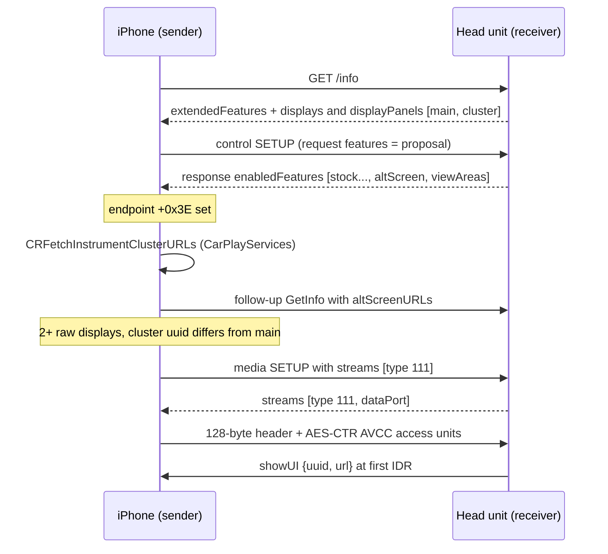

# AltScreen Cluster Video

*The gate that makes CarPlay offer the instrument cluster, the hook's own stream-111 receiver, and the wiring that puts its video on the MOST/LVDS cluster.*

---

## 🎯 What altScreen is

altScreen is CarPlay's **second display**, the Audi Virtual Cockpit instrument cluster. On the AirPlay wire the cluster pixels ride **screen stream type 111**; the main touchscreen is type 110. The phone offers 111 only when the head unit advertises a cluster display and negotiates the feature. Everything therefore starts with an advert the phone *believes*. **[decompile]**

The panel is **1440 × 542** visible pixels, the Audi Kombi (LVDS2) resolution. The source is firmware `ifs2/ifs_display/proc/boot/qcdisplaycfg_MMX2.xml` (`uVisWidth='1440' uVisHeight='542'`). The hook advertises exactly this geometry (`CLUSTER_W`/`CLUSTER_H`, `hook/altscreen/altscreen_hook.c:229-230`), so the phone encodes 111 at this size. It is also the renderer's default decode window (`ALTSCREEN_W`/`ALTSCREEN_H`, `altscreen_render/sink_omx_qnx.c:812-819`). It is **not** 1920×720 (that was Cosmin's MHI3 value). The physical size advertised is **292 × 110 mm** (12.3″ at ~125 dpi, `altscreen_hook.c:232-252`); the earlier 180 × 68 implied a 7.6″ panel and was corrected as a correctness fix, not as a known fix for old-iOS connect failures. **[car]** / **[code]**

The long road to this design (the April "impossible" verdict, the MHI3 reference, the URL-model detour, the GOT-rewrite verdict that proved unnecessary) is in [AltScreen RE History](ALTSCREEN_RE_HISTORY.md).

## 🔐 The activation gate

The chain below was re-derived from the iOS 26.6 (23G71) `AirPlaySender`, `CarKit`, `CarPlayServices` and `carkitd` binaries; the phone is the AirPlay sender. The hook side is verified in the current source. **[decompile]** / **[code]**

In words:

1. **`/info` advert.** The hook interposes stock `AirPlayCopyServerInfo` (`hook/framework/airplay_seams.c:98`). It adds `extendedFeatures = ["altScreen", "viewAreas"]` plus the `[main, cluster]` display tree, under both `displays` and `displayPanels`, to the dictionary stock returns. The cluster entry carries its own `uuid` and `uid` (same string, `C1057E12-A0D1-4E20-B0C0-1057E12A0D10`, `altscreen_hook.c:422`, `:2010`), `type: 111`, `name` and `properties: ["Instrument Cluster"]` (`altscreen_hook.c:11-28`, `:406-441`, `:790-870`). The advert goes out only when every primitive of the 111 receiver resolves and `advert_preflight` proves the tree can be fulfilled; a partial advert would restart the CarPlay session (`altscreen_hook.c:717-722`, `:785-799`). **[code]**
2. **Control-SETUP negotiation — the real gate.** iOS puts its proposal in the RTSP control-SETUP **request** under `features` (`_apsession_appendControlSetupRequest` @ `0x227785570`, key at `0x227785EA4`) but reads the accepted list from the **response** under **`enabledFeatures`** (`_apsession_ensureControlStreamSetup` @ `0x22786DB80`, typed-get at `0x22786DD14`-`0x22786DD2C`, key cstring `0x2278FE1DC`). There is no intersection with the proposal. `___carEndpoint_Activate_block_invoke_2` @ `0x2277F9014` then sets endpoint `+0x3E` for `altScreen` (store at `0x2277F977C`), `+0x3D` for `viewAreas`, `+0x3F` for `uiContext`, and `+0x39` for `enhancedSiri`. `/info` `extendedFeatures` alone does **not** set `+0x3E`, and stock 210 writes no `enabledFeatures`. The hook seeds from the receiver's existing response `enabledFeatures`, appends only `altScreen` and `viewAreas`, and never echoes the proposal, because every string in that array flips a sibling endpoint byte (`altscreen_hook.c:1822-1881`). **[decompile]** / **[code]**
3. **Cluster URLs (phone side).** With `+0x3E` set, the phone calls `_APCarPlay_CRFetchInstrumentClusterURLs` (`0x2277F9FF4`) through CarKit's `CARInstrumentClusterURLController` to the Mach service `com.apple.CarPlayApp.service`, implemented by `-[CRSAppHistoryService serviceFetchInstrumentClusterURLs:]` in `CarPlayServices` (`0x24A121C1C`). It returns a non-null array and nil error, **including an empty array** when no app library is available; only an error or null aborts (`0x2277FC088`/`0x2277FC090`, the historic **-16721**). Maps URLs appear only when Maps is present and geo-supported; third-party apps are selected by `supportsCarPlayInstrumentClusterScene`. There is **no certificate or entitlement check** on this path; the certificate serial belongs to the non-fatal scaled-display helper (`_CRFetchScaledDisplaysForCertificateSerialNumber` @ `0x1CAFFEBC0`, unscaled fallback at `0x22780013C`-`0x227800190`). The similarly named `carkitd` `fetchInstrumentClusterURLsWithReply:` (`0x1000724B0`) is not the connection used. This is why Apple Maps drives the cluster and Waze does not ([Third-party Nav Apps](../cluster-and-rgi/THIRD_PARTY_NAV_APPS.md)). **[decompile]**
4. **`altScreenURLs`.** The phone serialises the URL list into the **follow-up GetInfo request body** under `altScreenURLs` (`0x2277FA014`-`0x2277FA090`), not a SET_PARAMETER. Stock's GetInfo handler `sub_30034` @ `0x30034` ignores that key and still answers with `/info`, which the phone accepts. The earlier "must ACK within ~250 ms or -6740" model came from unverified MHI3 notes and is not observed on MHI2Q; the hook has no handler and needs none. **[decompile]**
5. **Stream count and 110/111 selection.** The phone requires at least two entries in the **raw** `/info` `displays` array when `+0x3E` is set, and at most one otherwise (`_carEndpoint_setupStreams` @ `0x2277FF304`, count test `0x2277FFAA0`); this display-count gate is what made the car refuse to add when the advert was on but negotiation failed. `_APEndpointStreamScreenCreate` @ `0x227850B74` then compares each display's raw `uuid` with display 0: equal → 110, different → 111 (`MOV W8,#0x6E; CINC` at `0x227850ED0`). The dictionary's own `type:111` is ignored by the selector. **[decompile]**
6. **Stream 111.** The phone sends a media SETUP with a `streams` entry of type 111; the hook answers exactly one descriptor `{type:111, dataPort}` and owns the receive/decrypt/AVCC→Annex-B path itself (see below). The codec is H.264/AVC; HEVC is chosen only if the negotiated `hevc` feature and screen-multicodec checks enable `UseCarPlayHEVC`, so the hook must never claim `hevc`. The renderer's decoder is `OMX.qcom.video.decoder.avc` (`altscreen_render/sink_omx_qnx.c:46`). **[decompile]** / **[code]**
7. **Scene selection (HU side).** Stock 210 has no policy layer for `suggestUI`, so the hook chooses the cluster scene. At the first IDR it sends `showUI {uuid, url}`, then night mode and the cached view area (`altscreen_hook.c:1407-1429`). The Maps URL depends on RGI state (`altscreen_hook.c:2551-2584`); [Third-party Nav Apps](../cluster-and-rgi/THIRD_PARTY_NAV_APPS.md) has the URL model. **[code]**

> [!NOTE]
> **CarKit semantics versus the stream gate**
> The iOS 26.1 decompile read `altScreen` as endpoint `+63` and said `properties: ["Instrument Cluster"]` sets `hasGaugeClusterScreen`. The 26.6 binary shows `altScreen` at `+0x3E` (62), `uiContext` at `+0x3F`, and that `Instrument Cluster` maps to `supportsInstrumentClusterContent` (`CARDisplayInfo` byte `+0xB`, parser `0x1CAFDE9CC`) while the `hasGaugeClusterScreen` predicate calls `supportsDDPContent` (`+0xA`). Neither CarKit flag is the low-level 111 gate. Whether 26.1 genuinely differed or the old decompile was off by one is **[open]**; the hook satisfies both readings.

### Display dictionary requirements

One dictionary shape is reused under `displays` (read by AirPlaySender, key `uuid`) and `displayPanels` (read by CarKit `-[CARDisplayInfo initWithPhysicalScreenDictionary:]` @ `0x1CAFBED6C`, key `uid`). **[decompile]**

| Key | Required? | Evidence |
|---|---|---|
| `uuid` | Yes: non-null, cluster ≠ display 0 | `0x227850E8C`-`0x227850ED8` |
| `uid` (string) | Yes for `displayPanels` | `0x1CAFBEDF0`-`0x1CAFBEE98` |
| `widthPixels`, `heightPixels` | Yes, non-zero, area within limit | `_CRSizeFromAirPlayDictionary` `0x1CAFBF110`; sender `0x2277FA8C4`-`0x2277FBA00` |
| `widthPhysical`, `heightPhysical` | Yes, valid | `_CRPhysicalSizeFromAirPlayDictionary` `0x1CAFBF590`; sender `0x2277FA58C`-`0x2277FBC10` |
| `initialVideoStreams` | Yes for `displayPanels`: a present, **non-empty** array | `0x1CAFBEF80`-`0x1CAFBEFD0`; an empty array passed the parser but gave a 0 s session on the car |
| `maxFPS`, `features`, `viewAreas`/`initialViewArea`/`adjacentViewAreas`, `primaryInputDevice`, `rotation`, `edid`, HDR keys, `overscanned`, `zoomFactor`, `cornerMasks`, `nightMode`, `limitedUI*`, `url`/`initialURL` | Not a 111 gate | property dispatch `0x2277BAE7C` |
| `type` | Ignored by the selector | UUID inequality chooses 111 |

Stock `CopyDisplaysInfo` emits the old 210 schema for main (`edid, features, maxFPS, widthPhysical, heightPhysical, widthPixels, heightPixels, uuid`, no `uid`, no `initialVideoStreams`), so the hook adds `uid` + `initialVideoStreams` to main using the **real** main uuid and refuses the advert if it is missing (`altscreen_hook.c:544-630`). The cluster also declares three view areas over the full 1440×542 frame with nested safe areas: fullscreen `(270, 90, 900×290)`, sport `(90, 90, 360×300)`, classic `(540, 90, 360×300)` (`altscreen_hook.c:280-295`, `:455-490`). **[code]**

### Where the advert is declared

Stock libairplay 210 contains **no** `extendedFeatures` support: the string occurs zero times in the binary. An earlier plan declared the key in a dio_manager patch through `AirPlayReceiverServerSetProperty`. On stock that path is a **no-op**; it works only on the 280/from-source lib (`altscreen_hook.c:11-18`, `:684-697`). Production therefore interposes the `/info` builder in the LD_PRELOAD hook with no dio binary patch, and adds the control-SETUP `enabledFeatures` injection. Two value-checked env gates control it, and the shipped startup script sets both to `1`: `ALTSCREEN_HANDLE_ALT` and `ALTSCREEN_ADVERT_DISPLAYS` (`altscreen_hook.c:704-712`, `:721`, `:792`; `deploy/smartphone_integrator/carplay_startup.sh:53-54`). Without the second one the raw display count stays 1 and 111 never appears. The old from-source attempts now live in `Patches/dio_asm_to_c/_legacy_attempt/`. **[code]**

Sources: `ALTSCREEN_IOS266_VERIFICATION`, `ALTSCREEN_HOOK_VERDICT`, `ALTSCREEN_FULL_HOOK_PLAN`

## ⚙️ The hook's own stream-111 receiver

Production uses the **self-contained** receiver design: the hook owns the listener, reads the phone's TCP stream, decrypts and depacketizes it itself, and never creates a stock `ScreenStream`. A stock alt ScreenStream binds the **main** display and starts a second in-dio OMX decoder; on the unit that gave a black main screen and an OMX `FreeBufferUnexpected` crash (`altscreen_hook.c:1195-1203`). SETUP and TEARDOWN reach the hook by ordinary symbol interposition (`hook/framework/airplay_seams.c:149-162`, `:271-278`). **[code]** / **[car]**

| Step | Detail |
|---|---|
| SETUP | Stock skips type 111 as "Unsupported stream type" without failing SETUP; the module then runs `alt_setup` and appends `{type:111, dataPort}` (`altscreen_hook.c:1575`, `:1892`). iOS requires exactly one matching descriptor and a mandatory `dataPort` (`0x2276e5ad0`-`0x2276e5b20`, `0x2278dafb8`). Failure is transactional: the descriptor is only published once the acceptor thread is live (`:1680-1700`). |
| Key | `AirPlay_DeriveAESKeySHA512ForScreen(session + 456, 16, streamConnectionID)`: SHA-512 of `"AirPlayStreamKey%llu"` / `"AirPlayStreamIV%llu"` + the 16-byte session key, first 16 bytes each. A missing `streamConnectionID` fails with -6715 (`:1640-1648`). The stream type is not a KDF input. |
| Listener | Preferred port **-6031**, like native MHI3 (`0x63eb0`-`0x63ed8`); stock 110 uses -6030, and a negative preferred port means "fall back to dynamic", so `dataPort` is authoritative (`:1658-1661`). QoS 12 unless the server disables it. |
| Wire | 128-byte header (`bodySize` LE u32 at 0, `opcode` at 4, `params[15]` u64 from 8) + body. Opcode 1 = unencrypted avcC (width/height as f32 at header 16/20); opcode 0 = AES-CTR video AU; 2/4/5 consumed and ignored; `bodySize` > 4 MiB fails closed (`:1201-1210`, `:1247`, `:1334-1360`). |
| Decrypt | One continuous AES-CTR context over opcode-0 bodies only, never the header or config, never re-initialised per AU (`AES_CTR_Update` in the loop, `:1394-1405`). |
| avcC | An opcode-1 record with `bodySize 0` (seen live as flags `0x56` at stream start) keeps the current avcC; a non-empty record must carry whole SPS/PPS (`:1362-1392`, `hook/altscreen/avcc_config.h`). |
| Forward | Owned AVCC → Annex-B buffers to `altscreen_render` on TCP `:19831`; negotiated v2 metadata or legacy `[u32 BE len][payload]` framing (`hook/altscreen/altscreen_av.h`). |
| Ownership | Every receiver has a transport generation; a superseded receiver exits before reading, forwarding or commanding (`:1320-1330`, `:1405-1408`). |

### IDR recovery

Stock `AirPlayReceiverSessionForceKeyFrame` @ `0x28a5c` sends a bare
`{type:"forceKeyFrame"}` via `SendCommand` @ `0x28ac4`. iOS 26.6's
`carEndpoint_handleEventCreatingReply` reads `params["uuid"]`, otherwise falling
back to the primary screen. The hook targets the cluster's `uuid`.
A type-5 NAL anywhere in a whole valid AU opens the decoder continuity gate;
an IDR AU can start with AUD/SEI. **[decompile]** / **[code]**

After continuity loss, dependent P-frames are decrypted and drained while the
forwarder requires a new IDR. That IDR reconnects and follows cached SPS/PPS.
The current candidate coordinates retry timing in
[recovery_policy.h](../../hook/altscreen/recovery_policy.h), rather than resetting
a receiver-local counter on each failed IDR. **[code]**

| Recovery rule | Current source behavior |
|---|---|
| Scope | One active episode per producer generation; stale generations cannot issue requests or restore health |
| IDR retries | Shared monotonic 2/4/8 s backoff, capped at 8 s between retries |
| Reconnect retries | 250/500/1000 ms backoff, capped at 1000 ms |
| Idle failure | Forwarder checks EOF/control every 100 ms while idle. QNX/Linux wait on a monotonic condition; macOS uses relative wait. Frame silence remains valid |
| New-peer success | HELLO capability 3 must complete within its deadline; the hook ACK enables STATUS. Unnegotiated STATUS ends the link. At least 1 s of sustained actual-present readiness clears the episode |
| Legacy-peer success | Successful transport send clears recovery when no status channel was negotiated |
| Startup/UI | Stream-start and first UI request have bootstrap exceptions; later healthy UI requests are limited to one per 500 ms |

These follow-up changes passed offline tests and QNX builds on 2026-10-06.
Earlier WAIT_IDR behavior was verified on the car; the new coordinator and status
channel have no vehicle measurement yet. A reconnect still depends on the phone
providing an IDR. See [protocol/readiness sequence](VIDEO_PIPELINE.md#negotiation-and-presentation-readiness),
[all six changes](ALTSCREEN_FRAME_RATE.md#-six-follow-up-improvements-implemented--2026-10-06),
and [completed boundary validation](ALTSCREEN_PACING_VALIDATION.md).

### Per-stream teardown preserves the cluster

In the first colour run (2026-08-03), at frame 2,062 stock issued a **per-stream** `AirPlayReceiverSessionTearDown` for an unrelated stream (full-session teardown came 82 s later), and the old wrapper stopped altScreen on every teardown: main CarPlay stayed alive while 111 went black. The framework seam now treats NULL, missing or empty `streams` as a full teardown (`hook/framework/airplay_seams.c:233-254`) and the module stops the receiver only for a full teardown or a `streams` entry of type 111, logging `action=preserve-alt` or `stop-alt` (`altscreen_hook.c:1907-1935`). Stock 210 parses per-stream teardown at `0x26be0`-`0x26d50`; the real ABI is `void(session, params, OSStatus, Boolean *outDone)`. The next natural generation ran 3,328 forwarded frames and 3,360 GPU swaps over more than 106 s with no `VIDEO_OFF`, disproving the old "black after 30 seconds". **[car]** / **[code]**

Sources: `ALTSCREEN_RECEIVE_VERDICT`, `ALTSCREEN_BLACK_DIAGNOSIS`, `ALTSCREEN_COVERART_LIVE_REGRESSIONS`

## ⚠️ Error codes

| Code | Layer | Meaning |
|---|---|---|
| `-16721` | phone | The cluster-URL fetch returned an error or null. On 26.6 an empty array passes; the real service returns nil error normally. The HU cannot fix a phone-side service failure. |
| `-16720` | phone | Generic activation failure (for example `/info` without `displays`). |
| `-6740` | libairplay | Historically "altScreen advertised but unhandled": seen when the cluster was advertised without working negotiation. `_ScreenSetup` also returns it for a NULL session. The hook's SETUP seam returns it if the real symbol cannot be resolved (`airplay_seams.c:163`). |
| `-6722` / `-6753` | libairplay | `kTimeoutErr` / `kConnectionErr` after the phone gave up on an advertised but unserviced cluster (23 s sessions on 2026-08-02). |
| `-6735` | HU (our hook) | Returned when there is no committed altScreen session yet (`altscreen_hook.c:2115-2118`). It reaches Java as the `viewArea` ack status and is harmless: the hook caches the zone mode and replays it at the first IDR (`altscreen_hook.c:1425`, `:2525-2528`). |
| `-6719` / `-6715` / `-6728` | HU (our hook) | `alt_setup` superseded or singleton-busy / missing `streamConnectionID` / allocation failure. |

## ✅ forceKeyFrame targets the cluster by `uuid` (resolved)

**History.** At audit `9295b04`, `alt_request_cluster_idr` built its IDR request with `alt_params_new(0)` + `set_str("displayUUID", ...)`. iOS 26.6 reads `params["uuid"]` for this command, and `displayUUID` is a **HID** key. Every cluster IDR-recovery request therefore fell back to the **primary** screen, and because the show-UI step waits for the first cluster IDR, the cluster could stay black for good. That was rated P0. See `memory/production_full_audit_9295b04.md`. **[decompile]**

**Current code.** `alt_request_cluster_idr` applies the shared generation/retry policy; `alt_send_cluster_idr_raw` builds `{type:"forceKeyFrame", params}` with `alt_params_new(1)`, which keys the cluster `uuid`. There is no `displayUUID` in it, and it logs `cluster forceKeyFrame uuid=...` (`hook/altscreen/altscreen_hook.c:2502-2523`). `alt_params_new(1)` presets `uuid` = the cluster display (`:2360-2368`). The other cluster commands use the same key: `showUI` (`:2581`), `setNightMode` (`:2407`), `changeMapZoomLevel {zoomDirection 0=in}` (`:2485-2486`), and `updateViewArea {uuid, viewAreaIndex}` (`:2277-2283`). The generic `SendCommand` @ `0x28460` has no command whitelist and dereferences `session+704`. See [Landmines](../LANDMINES.md). **[code]**

## 🔧 The cluster delivery sink

libairplay cannot render straight to the cluster. `screenstream.c` `_SelectDisplay` reaches only displays that QNX Screen enumerates, and the cluster is MOST/LVDS. The cluster is instead fed by DisplayManager-managed windows that `videoencoderservice` captures ([Cluster Video Encoder](CLUSTER_VIDEO_ENCODER.md)). Both renderers open one through the shared `common/cluster_surface.c` primitive (`common/cluster_surface.h:7-19`):

| Renderer | Displayable | Content |
|---|---|---|
| `altscreen_render` | `99` | CarPlay cluster video / PRISM loader (`altscreen_render/screen_egl_present.c:45`) |
| `maneuver_render` | `98` | Maneuver popup overlay (`maneuver_render/platform_qnx.c:4`) |

Java selects the context: `81 = {99}` when there is no navigation and `80 = {98, 101, 102, 99}` when navigation is active (`java_patch/com/luka/carplay/core/AltScreenModule.java:41-46`, `java_patch/de/audi/tghu/fwhmi/DisplayManagerMIB2High.java:170-172`). The two renderers are **layered in one context**, not a mode switch of one renderer. Ownership starts at `connected || videoAvailable` and waits for the renderer's first `VIDEO_OFF` or `VIDEO_ON`; the full state machine is in [Cluster Contexts](../cluster-and-rgi/CLUSTER_CONTEXTS.md). The old `c_render` name no longer exists in the tree. See [Video Pipeline](VIDEO_PIPELINE.md) and [Cluster and RGI overview](../cluster-and-rgi/README.md). **[code]**

Main-screen 110 black (fixed): the fabricated-UUID trap

---

iOS fetches `/info` **once** at session start and builds all display and stream config from that snapshot, with no re-fetch. Stock `AirPlayReceiverSessionScreen_CopyDisplayUUID` keys main-screen video on the **real** main display UUID. The hook's `main_disp_modernize` used to inject a **fabricated** main `uid` / `initialVideoStreams` UUID (`A0000000-…`). iOS then routed main video on the fabricated uid while the stock decoder waited on the real UUID, so main 110 stayed black. Cluster 111 worked because the hook owns both its descriptor and its receiver. **[car]**

Current code reads the real main uuid with `cf_getval(mainDisp, "uuid")` and sets `uid` + `initialVideoStreams` to it. If the stock uuid is missing it **refuses the altScreen advert** instead of fabricating one (`hook/altscreen/altscreen_hook.c:547-581`). See `memory/reconnect_flak_lifecycle_debounce.md`. **[code]**

---

## 📌 Input path (zoom / knob)

Cluster zoom uses the semantic `changeMapZoomLevel{uuid, zoomDirection}`
command: `0` zooms in and nonzero zooms out. `CMD_ALT_ZOOM = 0x0110` reaches
`zoom_on_cmd`; `ALTSCREEN_ZOOM_INVERT` flips the direction. The Java/BAP path
still returns the native `MapScale_SetGet` status reply. See
[Cluster and RGI](../cluster-and-rgi/README.md) for the stock status path.[^input]

The native worker stores bounded pending intent and paces one semantic zoom at
a time. A selected step has immutable input age, so a fresh same-direction input
cannot revive it after TTL. The worker retains the target before committing
under its command mutex; recovery/layout selection, state replacement, CF
failure handling and ACK rules are specified in
[AltScreen Input Commands](ALTSCREEN_INPUT_COMMANDS.md). The SDK call runs
outside both mutexes; committed work cannot be preempted.[^input]

## 🔍 The VC NavStatus bar over altScreen

The strip drawn over the cluster video is **not** part of the iOS picture. It is `SV_LVDS_FPK_NavMap.NavStatus` in the VC's `hmi_app.elf`, fed by separate BAP Navigation properties that the route-guidance gate did not originally cover. **[decompile]**

| Element | BAP | Clearing value (RE) | VC handler |
|---|---|---|---|
| Compass | FctID 16 | Java `angle = -1`, `symbolic = -1` → wire `0xFFFF`/`0xFF` ("not supported"); `symbolic = 255` would trigger `AppConnectorNavi`'s heading back-calculation (`AppConnectorNavi.java:144-149`); the old `361/16` left a visible `N` | `VC_RecomputeStatusbarCompass` `0x176474`-`0x176554` |
| Altitude | FctID 47 | altitude `0x7FFF`, unit `2` (any unit > 1 clears) | `VC_RecomputeAltitude` `0x177B1C`-`0x177C78` |
| Scale | FctID 45 | autoZoom `15`, scale `0xFFFF`, unit `0xFF` → `Nav_Map_Scale_visible = 0` | `VC_RecomputeMapScale` `0x177D10`; `VC_IsMapScaleUnitRenderable` `0x610768`-`0x61078C`; `VC_RecomputeMapScaleVisibility` `0x6121B8`-`0x6121D4` |
| Centre text | FctID 19/20 | CurrentPosition `""`; TurnTo/SignPost `"", ""` | `VC_UpdateNavStatusBarText` `0x178318`-`0x178688` |

**Current code.** `GatedCombiService` hides only **scale and altitude** (`15/false/0xFFFF/0xFF` and `0x7FFF, 2`) for the whole connected CarPlay session: the route-guidance gate that carries them is shut by `BAPBridge.engageTakeover()` at connect and reopened only by `disengageTakeover()` at disconnect (`java_patch/com/luka/carplay/rgd/BAPBridge.java:606-638`, `:876-881`). On release the last stock values are restored; the compass is passed through untouched (`java_patch/com/luka/carplay/rgd/GatedCombiService.java:76-99`, `:159`). Centre text, turn-to, distance/time-to-destination and destination are blocked by a separate current-position flag driven from `AltScreenNavStatusGate` (`GatedCombiService.java:101-119`, `:160-200`; `java_patch/com/luka/carplay/core/AltScreenNavStatusGate.java:75`, `:156-157`). The compass `-1/-1` clearing described in the source is therefore not what ships. **[code]**

The steering-wheel roller arrives as `MapScale_SetGet`; stock `BAPIndicationHandlerNavi.processMapScaleSetGet()` must end in `AppConnectorNavi.updateMapScale()` (the `MapScale_Status` reply). An old gate swallowed it, leaving `BAPFunctionPropertyFSG.setGetPending` unanswered, which pushed NAVSD into `INITIALIZING`. The gate now answers with the same hidden status; MU1316 `statusREQ()` sends even an unchanged status while `setGetPending` is set (`GatedCombiService.java:135-146`). The hook does not touch NAVSD `INITIALIZING`: after a cold boot the VC shows the NA "Initialising navigation system" screen over the CarPlay map until stock Navigation is ready, about 10–15 s after CarPlay is up on the owner's car. Every workaround (show/hide deferral, OP_State clamps) was removed; root cause and decisions in [Nav Initializing Screen](../cluster-and-rgi/NAV_INITIALIZING_SCREEN.md). Do **not** clear MapVisibility (FctID 44): the VC's MapViewAndOrientation handler uses its LVDS-visible bit to open the KDK video hole, so clearing it hides altScreen too. If an empty translucent base remains after all children are cleared, it belongs to the root `NavStatus` scene node and needs a VC scene gate, not FctID 44. **[decompile]** / **[code]**

Cold boot on 2026-09-16: about 1.5 s of black; `Screen/EGL open` took 1349 ms and Java had already selected 81 before the renderer connected; the first OMX start took 755 ms. The renderer-ready wait above removes the empty-plane selection. **[car]**

Sources: `ALTSCREEN_VC_NAV_STATUSBAR`

**Related:** [Session Lifecycle](../connect-and-usb/SESSION_LIFECYCLE.md) (SETUP, ports and teardown of stream 111) · [KDK Geometry and Animation](../cluster-and-rgi/KDK_GEOMETRY_AND_ANIMATION.md) and [VC Layout and Fonts](../cluster-and-rgi/VC_LAYOUT_AND_FONTS.md) (the VC frame around the video) · [Architecture](../reference/ARCHITECTURE.md) (where hook, renderer and Java sit).

---

## 📚 Sources

Merged originals were removed from the tree after this note absorbed them; they remain in git history (commit 23972aa).

- `ALTSCREEN_IOS266_VERIFICATION` — iOS 26.6 binary proof of the `enabledFeatures` response key, display rules and URL service.
- `ALTSCREEN_HOOK_VERDICT` — stock 210 has no negotiated feature array; the GetInfo `altScreenURLs` direction.
- `ALTSCREEN_RECEIVE_VERDICT` — screen wire format, KDF and the self-contained receiver spec.
- `ALTSCREEN_BLACK_DIAGNOSIS` — first pixels, per-stream teardown, IDR recovery.
- `ALTSCREEN_FULL_HOOK_PLAN` — live advert tests and the display-count gate.
- `ALTSCREEN_COVERART_LIVE_REGRESSIONS` — empty-body VideoConfig regression and fix.
- `ALTSCREEN_VC_NAV_STATUSBAR` — VC NavStatus bar fields, MapScale SetGet, cold-boot timing.
- `memory/altscreen_ios26_gate_verified.md`, `memory/cluster_panel_resolution.md`, `memory/production_full_audit_9295b04.md`.

Related: [AltScreen RE History](ALTSCREEN_RE_HISTORY.md), [Video Pipeline](VIDEO_PIPELINE.md), [AltScreen Frame Rate](ALTSCREEN_FRAME_RATE.md), [AltScreen and Video overview](README.md).

[^input]: [Input handler and SDK seam](../../hook/altscreen/altscreen_hook.c), [command policy](../../hook/altscreen/command_policy.h), [command worker](../../hook/altscreen/command_worker.h), [Java roller](../../java_patch/com/luka/carplay/core/AltScreenModule.java).
