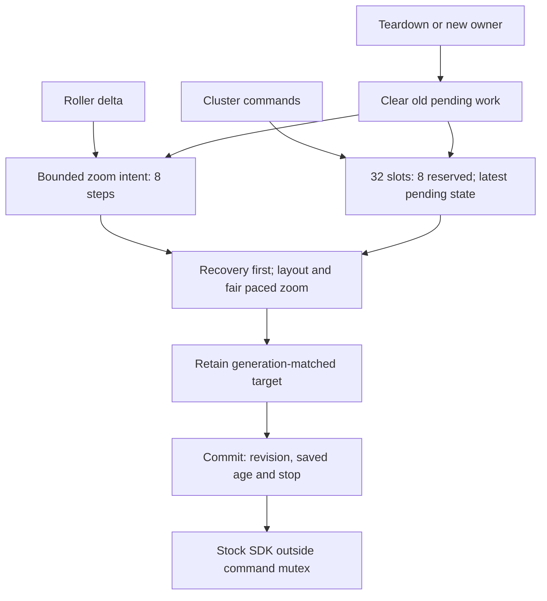
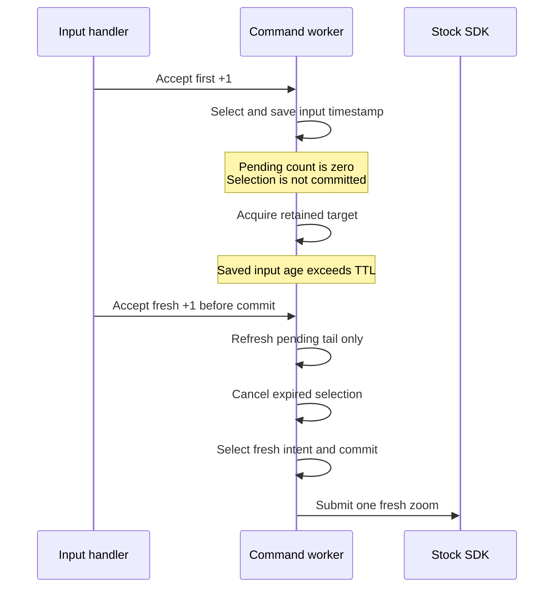

# AltScreen Input Commands

_Current native control path and offline-tested contracts, 2026-10-09._

---

## 🎯 Purpose and scope

The steering-wheel roller reaches the phone as the semantic
`changeMapZoomLevel` command for the cluster UUID. Java still completes the
stock BAP `MapScale_SetGet` status reply. The native scheduler changes command
delivery; iOS and the navigation app still determine the map animation and
whether the semantic command is acted on. App-specific observations are in
[Third-party Nav Apps](../cluster-and-rgi/THIRD_PARTY_NAV_APPS.md).[^integration]

[AltScreen Cluster Video](ALTSCREEN_CLUSTER_VIDEO.md) covers stream activation;
[Video Pipeline](VIDEO_PIPELINE.md) covers decoded pictures. The command worker
is separate from the owned video-forwarding worker. The current input candidate
has offline tests and QNX compile/link evidence; it was not deployed or measured
on the vehicle during this work.[^validation]

## 🧩 Scheduling and ownership

| Command class | Scheduling/admission contract |
|---|---|
| Zoom intent | At most 8 pending steps, separate from the 32 retained CF-command slots |
| `forceKeyFrame` | Highest selection priority; not replaced as an idempotent state |
| `showUI`, `updateViewArea` | Next priority; after 4 such selections, eligible normal/zoom work gets a turn |
| Other normal commands | Ready zoom gets a turn after at most 2 normal selections |
| Reserved capacity | Normal traffic admits below 24 total queued entries; urgent commands can use all 32 slots |
| `updateViewArea`, `setNightMode` | Keep only the latest pending command for each key |
| `mapAppearanceUpdate`, `uiAppearanceUpdate` | Keep separate latest pending values; one target never replaces the other |
| Actions such as `showUI`, `changeUIContext` | Preserve distinct pending actions; do not deduplicate them as state |

Priority is evaluated when the worker selects pending work. Priority alone
does not rewind a selection; its final guard can still cancel it before commit.
A committed SDK call cannot be preempted. Admission snapshots the current generation;
retirement clears that generation's pending commands and zoom, and final
selected-zoom validation rejects a revoked stamp. Older revocation cannot clear
a newer queue owner.[^policy]

## 🎛️ Zoom cadence and expiration

| Behavior | Current contract |
|---|---|
| First step | Immediately eligible, subject to already selected and higher-priority work |
| Same direction | Combine pending intent up to 8 steps; excess input is intentionally bounded |
| Reversal | Clear the old unsent direction and make new-direction intent immediately eligible |
| Pacing | Default 50 ms; after an attempted SDK submission returns, set the next deadline from that return time |
| Pending age | Default 250 ms since the latest accepted input |
| Selected age | Save that latest input timestamp into `alt_zoom_dispatch_t.input_us` at selection; later input cannot change it |
| TTL boundary | Exactly TTL remains eligible; greater than TTL fails the commit check |
| Clock validity | Missing clock rejects new input; commit requires valid nonnegative pending and selected ages |

The worker builds the CF command, acquires a retained target session, then
checks generation, direction revision, saved age and shutdown under the command
mutex. A successful check is the dispatch commit point. Reversal or retirement
accepted before it cancels the selected step. Once committed, one step is in
flight; later input changes the remaining tail. The SDK runs outside both
session and command mutexes. OS scheduling and SDK latency can still delay a
committed call; this is not a hard real-time or phone-response deadline.[^policy]

Fresh same-direction input can refresh the pending tail while an old step is
selected. It cannot revive that selected step after its saved input age exceeds
TTL, even if the pending count was zero. Cancellation before commit does not
advance the deadline used for completed SDK submission pacing.[^refresh]

## ⚙️ Runtime configuration

| Variable | Default | Accepted values | Read point |
|---|---|---|---|
| `ALTSCREEN_ZOOM_INTERVAL_MS` | `50` | Integer 20–100 ms | Once, when the command worker starts |
| `ALTSCREEN_ZOOM_TAIL_MS` | `250` | Integer 100–1000 ms | Once, when the command worker starts |
| `ALTSCREEN_ZOOM_INVERT` | Off | Unset/empty, `0`, `false`, `no`, `off` disable; other values enable | Each zoom input |

Invalid interval/tail values use defaults. These are hook-process runtime
variables, not renderer settings or build-time switches. The existing bus
command remains `CMD_ALT_ZOOM = 0x0110`, with a signed step in byte 0; the legacy
second byte is ignored. Zero input produces no action. Changing interval/tail
after the worker starts does not reconfigure that running worker.[^integration]

## 📡 State replacement, ACKs and CF lifetime

| Outcome | Pending state | Completion/ownership behavior |
|---|---|---|
| Valid newer state accepted | Replace the older pending entry for that key | Older view-area request completes with `-ECANCELED`, never fake success |
| Required field/value or array append fails | Preserve previous pending entry | Reject new construction; view-area caller sends an error ACK |
| Retained-command SDK send fails synchronously | Command was attempted, no successful SDK completion | Invoke registered error completion if present; release the owned command |
| SDK view-area completion succeeds | That submitted request has completed | ACK only for a current generation; matching desired mode may select its Maps scene |
| Generation retired | Drop its unsent queue and zoom | Release retired CF refs without delivering old-generation callbacks into a new session |

All mandatory command fields are checked before admission. `CFDictionarySetInt64`
returns `OSStatus`; `set_i64` propagates number-creation failures as well as key
creation failures. Each accepted queue entry owns one retain and one release;
callbacks and disposal run outside the command mutex. A command already submitted
to the SDK is not replaced by later state coalescing.[^cf]

## 🧪 Regression coverage and evidence

| Test | Contract exercised |
|---|---|
| Command policy | Cadence, direction reversal, bounds, priority, fairness, generation, TTL boundary and immutable selected age |
| Actual command worker | State/envelope allocation, key, number and array-append faults; preserved pending state, error/cancel ACKs and balanced CF refs |
| Native reversal boundary | Accepted reversal during target acquisition cancels the old selected direction |
| Native age/retirement/stop boundary | Final commit rejects expiration, revoked generation or shutdown during acquisition |
| Native same-direction refresh | After old TTL expires, fresh input yields one zoom; SDK hold barrier detects an extra send or hidden pending step |
| Command fuzz | Retain selected stamps across time/input/owner events; invalidated stamps never revive |
| Seeded mutation check | Removing immutable-age validation causes the retained-stamp fuzz assertion to reject the old behavior |

The full source-hashed run passed 25 ASan/UBSan C suites, 6 Python report-contract
cases, 10 TSan suites, 8 Linux suites, 3 fuzz campaigns (5,644,380 inputs), Clang
analysis, QNX builds and the project regression. Captured APAC integration was
skipped because its fixture is absent; the existing 13 audio expected failures
remain. See [Pacing Validation](ALTSCREEN_PACING_VALIDATION.md) for exact artifacts,
re-run commands and evidence limits.[^validation]

The separate diagnostics/analyzer proposal remains deferred. Current command
logs and offline reports cover these source contracts; real roller feel,
phone-to-glass latency and vehicle FPS still require physical measurement.

## 📚 Sources

[^integration]: [Hook command handlers and environment parsing](../../hook/altscreen/altscreen_hook.c), [bus IDs](../../hook/framework/bus_protocol.h), [Java roller and ACK path](../../java_patch/com/luka/carplay/core/AltScreenModule.java), [BAP listener](../../java_patch/de/audi/tghu/navi/app/cluster/AltScreenCombiBAPListener.java).
[^policy]: [Pure command policy](../../hook/altscreen/command_policy.h), [command worker](../../hook/altscreen/command_worker.h), [policy tests](../../tests/altscreen_command_policy_test.c), [reversal test](../../tests/altscreen_command_reversal_test.c), [age/retirement/stop test](../../tests/altscreen_command_age_test.c).
[^cf]: [CF builders and SDK integration](../../hook/altscreen/altscreen_hook.c), [actual-worker fault tests](../../tests/altscreen_command_worker_test.c), [CF/commit review resolutions](../../build/altscreen-input-fix-verified/review.json).
[^refresh]: [Refresh regression](../../tests/altscreen_command_refresh_test.c), [retained-stamp fuzzer](../../tests/altscreen_command_fuzz.c), [resolved refresh finding](../../build/altscreen-input-refresh-final/review.json), [seeded mutation result](../../build/altscreen-input-refresh-mutation/summary.json).
[^validation]: [Final runner result](../../build/altscreen-input-refresh-final/summary.json), [canonical result index](../../build/altscreen-pacing-validation/summary.json), [validation runner](../../scripts/altscreen_validation.py).
