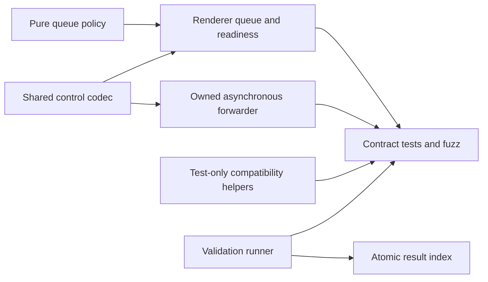
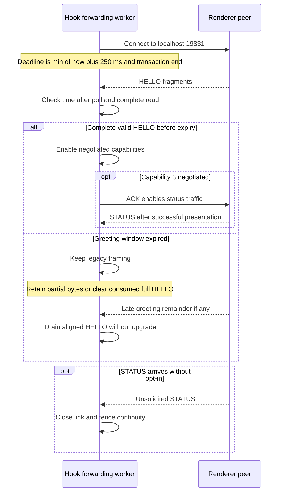
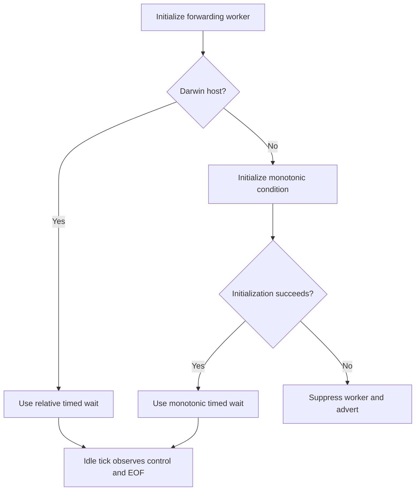

# AltScreen Pacing Validation

_Current video and input scheduling contracts, updated 2026-10-09._

---

## 🎯 Scope and current result

The six pacing changes, five review fixes, four follow-up refactors and three
input-command improvements, including all three input review fixes, are implemented
in the working tree. Validation uses shipping transport, queue and presenter code
with synthetic inputs and hardware fakes. It does not measure phone-to-glass
latency, actual vehicle FPS or the BSP's OMX/GPU reference behavior.[^results]

| Check | Recorded result |
|---|---|
| ASan/UBSan | 25 focused C scenarios passed, including command policy/worker, retained-session reversal/age boundaries, queue policy and shared-control codec cases |
| Report contracts | 6 Python cases cover stale PASS, initial/unavailable/removed source snapshots, invalid compiler configuration, partial/not-run coverage and failed-suite attribution |
| Differential/state fuzz | Current input run: command 1,297,724 + AVC/state 2,816,145 + control 1,530,511 = 5,644,380 inputs, 15 s per target. Earlier extended video/control run: 11,000,993 inputs, 31 s per target |
| TSan | 10 suites passed: command worker, reversal, age/retirement/stop boundaries, same-direction refresh, async transport, control, decode worker, negotiation, idle-clock recovery and mailbox |
| Linux ASan/UBSan | 8 suites passed: command worker, reversal, age/retirement/stop boundaries, same-direction refresh, idle-clock, negotiation, async and control |
| Clang analysis | Native command integration, forwarder, reader, decode queue, OMX sink and EGL presenter passed; one forwarder-only checker exception below |
| QNX ARM builds | Hook and renderer passed; hook retained 26 allowed exports, compiler-only constructors and no emutls |
| Full regression | `scripts/run_tests.sh` passed, including command policy/worker and standalone queue-policy/control codec cases |
| Fixture limits | Captured APAC integration skipped because the capture is absent; audio behavior retains 13 existing expected failures |
| Remaining review findings | None identified in the reviewed AltScreen scope |

These results are source/build evidence. The earlier on-car observations remain
historical evidence in [AltScreen Frame Rate](ALTSCREEN_FRAME_RATE.md); this
candidate was not deployed during the reviews.

## 🔧 Re-run the offline checks

`test_altscreen_pacing.sh` delegates to
`altscreen_validation.py`, which writes a fresh atomic result index before any
compiler/tool probe and finishes it as passed, failed or interrupted. Optional
checks remain explicitly `not_run`. Source changes during a run invalidate its
overall result.

Run commands from the repository root. The focused script needs Bash, Python 3,
`rg`, a C compiler with ASan/UBSan and a libFuzzer-capable compiler. On macOS it
selects the Homebrew LLVM compiler for fuzzing when available; `CC` and `FUZZ_CC`
can override the compilers.[^runner]

```sh
# Default: ASan/UBSan, report contracts, hostcheck, analysis and three fuzz targets
FUZZ_SECONDS=30 bash scripts/test_altscreen_pacing.sh

# Also run TSan, Linux checks, QNX builds and the full project regression
FUZZ_SECONDS=30 bash scripts/test_altscreen_pacing.sh --tsan --linux --qnx --regression

python3 scripts/compare_altscreen_static.py
```

The focused run ends with `AltScreen offline validation PASS`; it also prints
`Clang static analysis and QNX API hostcheck PASS`. `FUZZ_SECONDS` sets the budget
for each target: command scheduling, AVC/metadata/state and the shared
control parser. A focused selection such as `--suites wire policy --skip-fuzz --skip-analysis` reports the other suites/checks as `not_run`. A sanitizer,
assertion or compiler failure stops the script. Individual logs, corpus and
failure reproducers are written under `build/altscreen-pacing-validation/`.
`ALTSCREEN_TEST_OUT` selects a separate output directory.

For a local QNX build, use the existing Docker image described in
[Build System](../build-and-deploy/BUILD_SYSTEM.md):

```sh
bash scripts/build_hook.sh
bash scripts/build_renderers.sh
```

These scripts build local artifacts. The hostcheck and import-link checks do not
execute an ARM renderer against actual Screen/OMX hardware.

### Result artifacts

| Path | Purpose |
|---|---|
| `build/altscreen-pacing-validation/summary.json` | Runner-generated atomic index of requested checks, actual results, source hashes, artifacts and logs |
| `build/altscreen-input-refresh-final/summary.json` | Final all-option validation after the expired-selection refresh fix |
| `build/altscreen-input-fix-verified/summary.json` | Earlier validation of CF construction and pre-commit boundary fixes |
| `build/altscreen-input-final/summary.json` | Earlier input implementation validation before boundary/fault review |
| `build/altscreen-refactor-complete/summary.json` | Final all-option refactor validation, generated by the runner |
| `build/altscreen-refactor-validation/summary.json` | Extended fuzz campaign and earlier all-option refactor run |
| `build/altscreen-review2-validation/` | Main repeat-run logs, corpus, Linux/TSan evidence and resolved findings |
| `build/altscreen-review2-final/` | Focused validation after the final greeting-completion guard |
| `build/altscreen-static-comparison/comparison.json` | Earlier operation-count audit with its source hashes; rerun the comparison script for a current snapshot |
| `before-review-summary.json`, `before-review2-summary.json`, `before-input*-summary.json` | Earlier result snapshots in the canonical validation directory |
| `build/altscreen-input-refresh-final/review.json` | Latest input finding and its resolution |
| `build/altscreen-input-fix-verified/review.json` | Earlier two input findings and their resolutions |
| `build/altscreen-input-refresh-mutation/summary.json` | New fuzz assertion rejects the deliberately reintroduced expiry bug |

The runner refreshes `summary.json` for its selected output directory on every
run; a failed compile replaces stale PASS and attributes failure to the attempted
suite. TSan/Linux/QNX/full regression only become passed if requested and
completed. Build artifacts are local evidence and are not required to read the
source tests in a fresh checkout.

## 🎛️ Input command scheduling

[AltScreen Input Commands](ALTSCREEN_INPUT_COMMANDS.md) is the canonical reference
for roller delivery, runtime knobs, reserved priority, state replacement,
pre-commit cancellation and CF ownership. These are control-command changes;
they do not establish a change in video FPS.[^commands]

| Resolved input finding | Current behavior | Regression evidence |
|---|---|---|
| Reversal or TTL changes while target retention waits | Retain the target first, then validate generation/revision, saved age and stop under the command mutex | Native reversal and age/retirement/stop tests |
| Incomplete state command replaces valid pending state | Check required keys/values and array append before admission; propagate `CFDictionarySetInt64` OSStatus | Actual-worker allocation/key/number fault tests; rejected view gets an error ACK |
| Fresh same-direction input revives an expired selected step | Selected stamp has immutable `input_us`; pending-tail refresh cannot extend it | Policy TTL-boundary tests, native refresh test with SDK hold barrier, retained-stamp fuzz |

The command fuzzer keeps a selected stamp across subsequent input, time and
owner events. Its monotonic invalidation assertion rejects the seeded mutation
that removes the immutable age check. All SDK calls, callbacks and CF releases
remain outside the command mutex. The diagnostics/analyzer proposal remains
deferred; existing logs and the offline reports are the current diagnostic
surface.[^commands]

## 🧩 Refactored module boundaries

The four follow-up refactors keep the video wire bytes and ownership/lock order
contracts. The renderer policy is pure; the control codec has one incremental
parser shared by socket I/O and direct fuzzing. Transport, forwarding/recovery
and the reader's ownership snapshot have separate state objects, each protected
by its own existing mutex. Synchronous/copying compatibility helpers live only
in test fixtures; the production submission API transfers owned buffers.



| Boundary | Canonical source |
|---|---|
| Origin/freshness/startup/backlog predicates | [queue_policy.h](../../altscreen_render/queue_policy.h) |
| HELLO/ACK/STATUS encode/decode and fragmented input | [alt_control_wire.h](../../common/alt_control_wire.h) |
| Transport, forward queue/recovery, short owner snapshot | [altscreen_av.c](../../hook/altscreen/altscreen_av.c) |
| Production API | [altscreen_av.h](../../hook/altscreen/altscreen_av.h) |
| Removed production synchronous/copying seams | [test compatibility fixture](../../tests/altscreen_forward_compat.h) |
| Run-scoped reporting and optional checks | [altscreen_validation.py](../../scripts/altscreen_validation.py) |

Missing origin falls back to enqueue time; if both time sources are unavailable,
a shared backlog predicate cannot prove excessive age. This also removes the
previous discrepancy between enqueue-side and readiness-side handling of zero
age origins. The sole/final-AU protection remains in place.

## 🛡️ Startup promotion and continuity

Presentation readiness and steady-backlog activation are separate. The first
successful present may report ready while startup input is still old. Promotion
requires presentation readiness, at most four pending AUs, a latest input with
end-to-end age at most
250 ms, and that same freshness for every pending and any in-flight input.
Future/missing origin falls back to local enqueue time. An empty local queue
with an old last input stays in startup.[^startup]

```mermaid
stateDiagram-v2
    accTitle: Renderer compressed backlog policy states
    accDescr: Startup buffers old input; steady policy activates only after fresh end-to-end input and reports an accumulating multi-AU backlog as latency until the hook's IDR clears it. Presentation readiness is independent of this policy.

    state "Startup buffering" as startup_buffering
    state "Steady backlog policy" as steady_policy
    state "Backlog latency" as backlog_latency
    state "Session ended" as session_ended

    [*] --> startup_buffering: Renderer connection begins
    startup_buffering --> startup_buffering: Input still old or startup queue large
    startup_buffering --> steady_policy: Ready and input fresh
    steady_policy --> backlog_latency: Multiple pending AUs older than 1000 ms
    backlog_latency --> steady_policy: IDR drops every compressed frame queued before it
    startup_buffering --> session_ended: Session ends
    steady_policy --> session_ended: Session ends
    backlog_latency --> session_ended: Session ends
    session_ended --> [*]

    note right of startup_buffering
        Ready may already be true after a successful present.
        Empty local queue alone does not prove catch-up.
    end note
    note right of steady_policy
        A lone old/final picture remains protected.
        Decoded output has no age cutoff.
    end note
    note right of backlog_latency
        Picture stays, frames stay queued, STATUS 0 asks the hook for an IDR.
        Generation and link unchanged.
    end note
```



The transition regression covers three AUs with local age 0 ms and hook-origin
age 1900 ms, an old middle AU, an old in-flight AU, an empty local queue and fresh
busy input. Once steady, genuinely accumulating old input is a latency condition
(since 2026-10-09): the frames stay queued, the condition is logged once per
episode, the 100 ms tick reports STATUS 0 until the hook's IDR arrives, and that
IDR drops every compressed frame queued before it (`altscreen_render/main.c:411-486`,
`:556-581`). It never fails the generation and never drops arbitrary dependent
P-frames. Until 2026-10-09 this path ended continuity and reconnected with
config plus IDR, which cost a 1.6–1.8 s black cluster per ≥1 s stall on the
first car run of `ac992616`; see [Video Pipeline](VIDEO_PIPELINE.md#negotiation-and-presentation-readiness).

## 🔌 HELLO and status boundaries

The hook collects the complete eight-byte HELLO within one 250 ms monotonic
window (`hook/altscreen/altscreen_av.c:168`; 40 ms until 2026-10-09, when a
renderer main thread late to `accept()` dropped both reconnects to legacy
framing for the rest of the session), capped by the aggregate 1000 ms
transaction deadline. It checks time
again after `poll` and after the complete read before enabling capabilities.
A timed-out partial greeting remains aligned for idle parsing; a fully consumed
late greeting is cleared. Neither case upgrades a legacy connection later.[^wire]



| Review finding | Fix and regression |
|---|---|
| Local-only startup promotion rejected old hook backlog | Origin-aware transition preserves ready state and startup queue |
| First short `MSG_PEEK` forced premature legacy fallback | Complete fragmented HELLO collection within the same deadline |
| STATUS without negotiated capability changed health | Reject the record; leave presentation health unasserted |
| `poll` or final `recv` crossed the greeting deadline | Keep capabilities off; clear a consumed full late greeting without false EOF |
| Wall-clock correction postponed idle EOF observation | Independent monotonic/relative wait below |

HELLO capability 3 still uses AU version 2. The hook ACK opts into status traffic;
it is not a picture confirmation. STATUS reports the producer generation and
readiness; at least 1 s of sustained ready status clears recovery. HELLO 2 and
silent legacy renderers retain successful-send recovery semantics. The full
header and peer-compatibility tables are in [Video Pipeline](VIDEO_PIPELINE.md).

## ⏰ Idle observation timebase

Recovery backoff and the idle wait both ignore wall-clock corrections. The
worker samples control/EOF on its 100 ms idle tick; a quiet frame stream remains
valid. QNX/Linux initialize a separate monotonic condition once before worker
creation. If initialization fails, the worker/advert is suppressed and the
original default condition remains valid for shutdown. Darwin uses its relative
timed wait rather than `pthread_condattr_setclock`.[^idle]



The idle-clock test models a backward one-hour wall-clock correction between
building a deadline and entering a wait. It never changes the host clock.
EOF is observed promptly, recovery remains bounded and stop wakes the worker.
The Linux run exercises the monotonic-condition branch independently of the
Darwin relative-wait branch.

## 📋 Evidence limits

| Evidence | What it establishes | What remains unmeasured |
|---|---|---|
| Static operation counts | Owned LS4 application copies 3 → 1; known-v2 complete-record I/O 5 → 3 | Kernel/codec/GPU traffic, variable-size allocation cost and vehicle FPS |
| ASan/UBSan/fuzz | Tested parser/state contracts, ownership and fault handling | Untested inputs and hardware behavior |
| TSan | No race reported in exercised concurrent cases | All possible schedules and actual BSP callbacks |
| Linux host tests | Native monotonic-condition branch and portable transport contracts | QNX kernel scheduling |
| QNX compile/link checks | ARM ABI, import availability, export/constructor/emutls gates | Actual target runtime, GPU latency and OMX recycle/reference behavior |

The forwarder's `unix.BlockInCriticalSection` checker is excluded because it
flags tested nonblocking `recv`/`writev` under the writer mutex. Memory, lifetime,
null and arithmetic checks remain enabled; blocked-writer and aggregate-deadline
fault tests exercise the I/O contract. This exception is confined to the
forwarder. Stock capture clock, OMX allocation, per-frame external-image refresh
and `glFinish` remain in place.[^runner]

## 📚 Sources

[^results]: Latest runner result: [summary.json](../../build/altscreen-input-refresh-final/summary.json), also copied exactly to the [canonical index](../../build/altscreen-pacing-validation/summary.json); input resolutions: [refresh review](../../build/altscreen-input-refresh-final/review.json) and [CF/commit review](../../build/altscreen-input-fix-verified/review.json); earlier video repeat-review findings: [review.json](../../build/altscreen-review2-validation/review.json).
[^runner]: [Validation runner](../../scripts/altscreen_validation.py), [report contract tests](../../tests/test_altscreen_validation_report.py), [Offline pacing script](../../scripts/test_altscreen_pacing.sh), [full regression script](../../scripts/run_tests.sh), [static comparison](../../scripts/compare_altscreen_static.py).
[^startup]: [Pure queue policy](../../altscreen_render/queue_policy.h), [direct policy tests](../../tests/altscreen_policy_test.c), [Decode queue and readiness](../../altscreen_render/main.c), [queue-policy regression](../../tests/altscreen_queue_policy_test.c).
[^wire]: [Shared control codec](../../common/alt_control_wire.h), [control codec tests](../../tests/altscreen_control_wire_test.c), [control parser fuzz target](../../tests/altscreen_control_fuzz.c), [Hook negotiation and idle parser](../../hook/altscreen/altscreen_av.c), [greeting-boundary tests](../../tests/altscreen_negotiation_test.c), [fragmented control tests](../../tests/altscreen_health_wire_test.c).
[^idle]: [Worker condition initialization and wait](../../hook/altscreen/altscreen_av.c), [idle-clock regression](../../tests/altscreen_idle_clock_test.c).

[^commands]: [Pure command policy](../../hook/altscreen/command_policy.h), [command worker](../../hook/altscreen/command_worker.h), [hook integration](../../hook/altscreen/altscreen_hook.c), [monotonic condition](../../common/alt_monotonic_condition.h), [policy tests](../../tests/altscreen_command_policy_test.c), [actual-worker tests](../../tests/altscreen_command_worker_test.c), [retained-session reversal test](../../tests/altscreen_command_reversal_test.c), [age/retirement/stop test](../../tests/altscreen_command_age_test.c), [expired-selection refresh test](../../tests/altscreen_command_refresh_test.c), [command fuzz target](../../tests/altscreen_command_fuzz.c).
