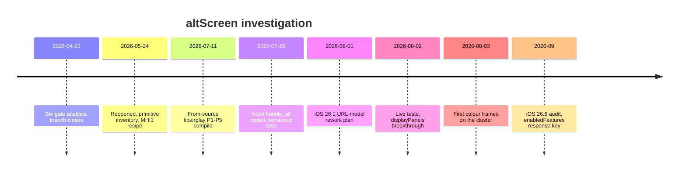

# AltScreen RE History

*How cluster altScreen went from "impossible" to shipping: every framing, gate theory, plan and verdict in order, what each got right, and what was later refuted. Current behaviour lives in [AltScreen Cluster Video](ALTSCREEN_CLUSTER_VIDEO.md); this note is the provenance.*

---

## 📋 The arc in one paragraph

April 2026 closed altScreen as impossible behind six gates, blaming the old Cinemo iAP2 stack. May reopened it as an engineering problem: stock libairplay 210.81 already contains a per-stream screen receiver, and a friend (Cosmin) had the 111 stream on MHI3. July built the 111 path twice, in a from-source libairplay and as a hook on stock. Early August chased an iOS 26.1 "URL model", then live tests found the real phone-side gates (`displayPanels`, `uid`, `initialVideoStreams`), two adversarial audits prescribed GOT rewrites and a self-contained receiver, and on 2026-08-03 the first readable Maps picture reached the cluster. The iOS 26.6 binary audit finally pinned the negotiation key: the control-SETUP **response `enabledFeatures`**. **[decompile]** / **[car]**

_Timeline of the altScreen work, from the closed verdict to first pixels and the 26.6 key fix._

---

## ❌ April: the six-gate "impossible" verdict

Pure static RE of iOS 26.1 (23B85), MHI3 and MHI2Q concluded that iOS would never activate altScreen on MU1316. **[decompile]**

| # | Gate | Where | Verdict then |
|---|---|---|---|
| 0 | Device feature bitmask | `carkitd/CRFeaturesAvailabilityAgent.mm:34`: modern chipset + HEVC → `v13 = 7` → `0x33F \| 0xC0 = 0x3FF`, bit 0 = altScreen set (not on t7000/s8000/s8003/t8010/t8011/t8012) | pass |
| 1 | `isCarPlayAllowed` / `isCarPlayThemeSupportEnabled` prefs | phone settings, default on | pass |
| 2 | Server `assetDisabler` for a `clusterAssetIdentifier` | Apple config | pass (we send no id) |
| 3 | `supportsThemeAssets` = accessory caps bit 21 from iAP2 Identification subparam 17 | `CRVehicleAccessoryManager.mm:530`, `ACCExternalAccessory.mm:2020`, `CoreAccessories_15.mm:8960` `_parseIdentificationParams_3` (ParamID 20/21, case 17 → struct `+131`), `CoreAccessories_19.mm:1512` | "blocks MHI2Q" |
| 4 | `clusterAssetIdentifier` in `CARCarPlayServiceMessageStartSession` | `CRThemeAssetLibrarian receivedClusterAssetIdentifier:` force-sets theme support | not required |
| 5 | Negotiated feature array containing `"altScreen"` | `Activate.mm:319` sets `derived + 63` | "blocks MHI2Q" |
| 6 | Stream type 111 handler | MHI2Q `AirPlayReceiverSessionSetup` @ `0x272B8` skips 111 as "Unsupported stream type" (rodata `0x9FBD0`) | "blocks MHI2Q" |

Gate 3's supposed fix was a 4-byte void subparam `00 04 00 11` inside ParamID 20 (USBDeviceTransportComponent) or 21 (WirelessCarplayTransportComponent). MHI3 `libesoiap2.so` emits it in `CIAP2ControlSessionModuleIdentMsgComposer::identificationInformation` @ `0x4F9A0` (size `0x6090`): Param 20 at `0x51620` with subparams 10 (32-byte), 12–18 (4-byte void family, vtable `off_A6508`); Param 21 at `0x519C4` with subparams 0 (2-byte), 1 (32-byte UUID), 17/18/20 (0-byte void, `off_A64E8`); emit helpers `sub_48370` (write BE subparam id) and `sub_4A400` (zero-init slot). MHI2Q has no `libesoiap2.so`; its iAP2 runs through Cinemo's `ICinemoIAP` (`SendIAP2`/`ReadIAP2`, libNmeSDK rodata `0x36834`/`0x36848`) with only two capability metas, `CINEMO_METANAME_IAP_SUPPORTS_IAP2_CONNECTION` and `..._SUPPORTS_CARPLAY` (dio_manager rodata `0x19F7E8`/`0x19F844`). Wire-level injection was estimated at 80–120 h and the branch was closed. `sourceVersion` (210.81 at `0x9DF2C`/`0x9E50C`) was shown to be telemetry only.

**What was later refuted.** Gate 3 is not a gate for cluster altScreen: altScreen is negotiated entirely in libairplay/RTSP, and iAP2 Param 20/21 was misidentified (MHI3 `libesoiap2.so` has zero altScreen/`enabledFeatures`; MHI2Q Cinemo already sends `USBHostTransportComponent carPlay=true`). `supportsThemeAssets` gates only the newer theme/Ultra layer. The 2026-05-23 re-verification also wrongly "corrected" Gate 5 to say iOS never uses the string `enabledFeatures`; the iOS 26.6 binaries show the phone reads exactly `response["enabledFeatures"]` (see [AltScreen Cluster Video](ALTSCREEN_CLUSTER_VIDEO.md)). Its other correction stands: the key is `clusterAssetIdentifier`, correctly spelled.

Sources: `gate_analysis`, `impl_plan_fromsource`

## 🔍 May: reopened as an engineering problem

The three feared walls fell: the AES key is **per stream** by `streamConnectionID`, 210.81 has a full **per-object** screen receiver, and a cluster sink existed (then assumed to be `maneuver_render`). Symbols are resolved with `dlsym`; the addresses below are for verification only (`.text` VA = file offset). **[decompile]**

| Symbol (MHI2Q 210.81) | VA | Notes |
|---|---|---|
| `AirPlayReceiverSessionSetup` | `0x272b8` | stream switch: 100/101 audio, 110 → `sub_26F9C`, else unsupported |
| `sub_26F9C` (`_ScreenSetup`) | `0x26f9c` | singleton: screen `s+5140`, listen socket `s+5144`, done flag `s+5136`; hardcodes 110; key master `s+456` |
| `sub_26EFC` | `0x26efc` | appends a stream entry to `respDict["streams"]` |
| `sub_24150` (`_ScreenStart`) | `0x24150` | spawns one receiver thread; flag `session+1288` |
| `sub_24220` (`_ScreenThread`) | `0x24220` | `SocketAccept` → `NetSocket_CreateWithNative` → `StartSession` → `ProcessFrames(screen, netSocket, s+456)` |
| `AirPlayReceiverSessionScreen_Create` | `0x2b044` | `calloc(1, 0x1F8)` + dispatch queue; `obj[122] = -1` |
| `..._Screen_Setup` | `0x2a868` | stores `latencyMs` (default 70) at `obj+16` |
| `..._Screen_SetSecurityInfo` | `0x2a9d8` | 3-arg (obj, key, iv): `AES_CTR_Init` at `obj+0xC8`; flag `obj+0x1E4` |
| `..._Screen_StartSession` | `0x2a3b8` | `ScreenStreamCreate` (→ `obj+492`) + props + `ScreenStreamStart` |
| `..._Screen_ProcessFrames` | `0x2b154` | recv/decrypt/depacketize/decode loop |
| `..._Screen_SetVisibility` | `0x29e80` | gated on `*(s+492)` |
| `..._Screen_UpdateState` | `0x29fa8` | state `obj[125]`, cb `obj[124]`: 0 NONE, 1 INIT, 2 READY, 3 STOPPING, 4 STOPPED |
| `..._Screen_CopyDisplaysInfo` | `0x2ab88` | one display dict from `ScreenCopyMain` |
| `AirPlayReceiverSessionPlatformCopyProperty` | `0x1d6c0` | `"displays"` → `[oneDisplay]` |
| `AirPlay_DeriveAESKeySHA512ForScreen` | `0x2d5fc` | `"AirPlayStreamKey%llu"` / `"AirPlayStreamIV%llu"` |
| `ScreenStreamProcessData` | `0x84fec` | per-object; decoder `+50/52`, Annex-B `+40/44`, NAL buf `+60` |
| `ScreenStreamCreate` / `ScreenStreamStart` | `0x85ce4` / `0x84da0` | |
| `AirPlayReceiverSessionSendCommand` | `0x28460` | `POST /command`, binary plist `{type, params}`, via `HTTPClientSendMessage(*(session+704))` |
| `AirPlayReceiverSessionRequestUI` / `ChangeModes` | `0x28884` / `0x28aec` | typed wrappers |
| `AirPlayReceiverSessionScreen_SendCommand` | `0x2a1cc` | 1-byte `writev` to loopback `s+488`, **not** the iOS channel |
| `AirPlayGetFeatures` | `0x1b904` | |

PLT thunks load from the GOT (`j_AirPlayReceiverSessionSetup` @ `0x18c04`; `j_ScreenStreamProcessData` @ `0x1a644`, GOT `0xb9740`; `j_AirPlayCopyServerInfo` @ `0x1abb4`, GOT `0xb9910`; `j_..._Screen_Setup` @ `0x1a818`, GOT `0xb97dc`), so an LD_PRELOAD symbol preempts even libairplay's own internal calls. CFDict keys: `streams` `0x9e930`, `streamConnectionID` `0x9e950`, `dataPort` `0x9e96c`, `timingPort` `0x9e980`, `latencyMs` `0xa00a0`, `displays` `0x9d468`/`0x9df74`; command keys `type` `unk_9E938`, `params` `unk_9EA94`. dio_manager has zero altScreen scaffolding: `s_sessionScreenCreatedCallback` @ `0x154cec`, `s_sessionCopyProperty` @ `0x157940`, `s_handleSessionControl` @ `0x157b7c`; its iOS-facing API set is pre-Ferrite (no `setScreenRecordingState`/`updateDisplayInfo`).

The May plan's iOS contract also listed `updateDisplayInfo` and `setScreenRecordingState = 1` events and a ~1–2 s "inactive" teardown (`screenstream_virtualDisplaySourceTerminated`, `AirPlaySender_19.mm:376`). Cosmin's working MHI3 hook sends none of those, so they were demoted to a fallback and never needed. Early plans also used TCP `:19830`, an inline ARM/Thumb patcher (dropped once PLT preemption was verified) and `ALTSCREEN_INJECT=0`.

Sources: `README`, `MASTER_KNOWLEDGE`, `feasibility`, `impl_plan`, `re_findings`

## 🎓 The MHI3 reference (Cosmin's platform)

MHI3 is aarch64 Linux (kernel 4.4.36, glibc 2.26, AppArmor enforce, `smartphone_integrator` + lazily spawned `dio_manager`, libairplay `srcvers=450.14.2`). It has the SDK surface MHI2Q lacks. **[decompile]** / **[car]** (on MHI3)

| MHI3 fact | Detail |
|---|---|
| Native altScreen symbols | `HasFeatureAltScreen` @ `0x58CE0` reads `*(session+0x18)+0x127`; `CopyAltScreenURLs` @ `0x58D00` reads `+0x128` (never written); `AirPlayAltScreenDictCreate` @ `0x5F860` `(out, name, maxFPS, w, h, wPhys, hPhys, urls)`; `AirPlayGetFeatures` @ `0x4EAA0` ORs `0x6104040280` |
| Alt dict | `{name, type:111, maxFPS, widthPixels, heightPixels, widthPhysical, heightPhysical, [altScreenURLs]}`; later audit adds `uuid` and `initialURL`. Cosmin's call `("Audi AltScreen", 60, 1920, 720, 180, 68, NULL)` |
| LD_PRELOAD | **Dead on MHI3 dio_manager**: even an empty constructor-only `.so` crashes it (AppArmor/enforcer). Binary patching only. |
| dio_manager v2 patch | `BL` at `0x2B57F4` redirected (`87 cc 00 94`) to a 216-byte thunk in unused `addAdjacentAreas` @ `0x2E8A10` that appends an alt dict plus `addAlternateViewAreas` @ `0x2E8800` |
| libairplay patches | `HasFeatureAltScreen` → `MOV W0,#1; RET`; `SessionSetup` @ `0x63390` `B.EQ → B` at `0x63DF0`; LogHTTP enable: `gLogCategory_HTTPRequests/Responses.defaultLevel` @ VA `0x178cb4`/`0x178d14` (file = VA − `0x10000`) `0xff → 0x14` |
| Result | `[AirPlay] ### Alt Screen supported: Y`, then a clean iOS teardown about 6 ms after session start (`Reason=0/0x0 noErr`); stuck there |
| Error codes seen | −16720 generic activation, −16721 empty cluster URLs, −6740 session not prepared |
| Traps | reload **both** AppArmor profiles after swapping a binary; `MOV Xd, SP` must be `ADD Xd, SP, #0`; `altScreenURLs`/`uiContextURLs` CFStrings have zero xrefs |

MHI3 symbol and offset reference (450.14.2 and its dio_manager)

| Binary | Symbol | VA | Note |
|---|---|---|---|
| dio_manager | `dio::createMainDisplaysDictionary` | `0x2B5610` (size `0x330`) | builds `/info` displays; patched `BL CFArrayAppendValue` at `0x2B57F4` (original `23 93 fc 97`, v1 `a3 ca 00 94`, v2 `87 cc 00 94`) |
| dio_manager | `dio::CDIOManager::getDisplays` | `0x2B70F0` | platform plug entry |
| dio_manager | `dio::display::addMainDisplay` / `addAltDisplay` | `0x2E81E0` / `0x2E8280` (`0xA4`, unused, v1 cave) | |
| dio_manager | `dio::view::addMainViewAreas` / `addAlternateViewAreas` / `addAdjacentAreas` | `0x2E8550` / `0x2E8800` / `0x2E8A10` (`0xEC`, v2 cave) | |
| dio_manager | `infoResponse` / `s_sessionCopyProperty` | `0x2BDB20` / `0x2BF200` | |
| libairplay | `AirPlayCopyServerInfo` / `AirPlayReceiverServerPlatformCopyProperty` | `0x4F900` / `0x4D630` | plug callback `server->cb[+0x30]("displays")` |
| libairplay | `AirPlayReceiverSessionPlatformSetProperty` / `SessionSetProperty` / `SessionCopyProperty` | `0x4DD40` / `0x59150` / `0x58DF0` | CopyProperty special-cases only clientOSBuildVersion, ipAddress, TransportType, statistics |
| libairplay | `AirPlayReceiverSessionTearDown` / `SendiAPMessage` | `0x61C10` / `0x5E800` | |
| libairplay | `ScreenStreamProcessData` | `0x103120` | |
| libairplay | RTSP handler `sub_50990` | `0x50990` | SET_PARAMETER dispatch at `0x511F8`; writes `+0x127` from SETUP |
| libairplay | `LogHTTP` / `LogCategory_Initialize` / `j_LogPrintF` | `0xB0DC0` / `0xB57C0` / `0x41EC0` | category `+0` level, `+4` default level (patched), gate `level > 40` suppresses |
| libairplay | `"altScreenURLs"` / `"uiContextURLs"` CFStrings | `0x115338` / `0x115350` | zero xrefs |
| libairplay | platformData `+0x288` | – | transport type 1 Enet, 2 Wi-Fi, 8 USB, 16 Direct, 32 BTLE, 64 WFD |

MHI3 libairplay rodata also holds `altScreen` `0x1153D0`, `uiContext` `0x1153E8`, `cornerMasks` `0x115400`, `focusTransfer` `0x115418`, `enabledFeatures` `0x115478`; `AirPlayInfoArrayAddScreen` `0x5FEC0`; SETUP handler `0x63390`. Flipping `enabledFeatures.altScreen:true` in stock MHI3 `dio_manager.json` tore the session down at once with -6740. The MHI3 log showed only two CopyProperty queries (`modes`, `initialPermanentEntity`) before teardown, then a BT→Wi-Fi iAP2 migration failing auth (a symptom). Open MHI3 items were a writer for `+0x128`, a 111 H.264 sink, ESO display registration (`Virtual_Display_Cluster_ETH`, `Layer_Map_Route_Guidance_Native`, probe `dmdt-ivi -i/-l`) and cluster HID routing.

---

Cosmin's earlier working hook (`mhi3_libaltscreen_hook_ultra.c`) forced `HasFeatureAltScreen`, captured sessions via `SessionSetDelegate`, interposed `gfx::Decoder::feed` to forward NALs to TCP `:19820` (command socket `:19821`), advertised a 960×440 "Audi AltScreen", and injected a fake 96-byte displayable when `dint_create_displayable_media` failed so dio would not deactivate. It used an AArch64 `/proc/self/mem` trampoline and `__thread`, neither of which ports to QNX ARMv7. Its ScreenStream offsets (`+72` type, `+16/+24` Annex-B) differ from MHI2Q (`+40/+44`, `+52` length size). The reusable part was the AVCC→Annex-B forwarding logic.

Sources: `mhi3_MASTER_KNOWLEDGE`, [mhi3_libaltscreen_hook_ultra.c](../sources/research/altscreen/reference/mhi3_libaltscreen_hook_ultra.c)

## 📦 July: two builds of the 111 path

### From-source libairplay (280.33.8 leak), P1–P5

Implemented and compiled 2026-07-11 in `Patches/libairplay-mhi2q` (now `Patches/dio_asm_to_c/_legacy_attempt/`): P1 `kAirPlayStreamType_AltScreen 111` + SETUP case; P2 `altScreen*` slots; P3 `_AltScreen{Setup,TearDown,Start,Thread}` clones; P4 a second display in `_CopyDisplayDescriptions` (1920×720, phys 180×68, `properties:["Instrument Cluster"]`); P5 `boundScreen` + `SetAltScreen()` and a per-stream backend (main 110 decoded in-process, alt 111 forwarded to `SS_FWD_PORT_ALT` 19831). The leak has no `kAirPlayFeature_AltScreen` bit. Stock `dio::CScreenRender::selectDisplay` @ `0x8aa80` only reaches QNX-Screen-enumerated panels (`DISPLAY_COUNT` 59, `DISPLAYS` 60, `SCREEN_PROPERTY_DISPLAY` 11), so the MOST cluster needs a separate sink. Decision **B** (2026-07-29): alt 111 goes over loopback TCP to `altscreen_render`, for one-decoder-per-process, fault isolation and the existing Java stack. Gotcha: the Apple source tree is non-ISO extended ASCII, so plain `grep` silently prints nothing — use `LC_ALL=C grep -a`. The from-source path is a legacy experiment, not production. **[decompile]**

Sources: `impl_plan_fromsource`, `LIBAIRPLAY_ALTSCREEN`

### The 450.14.2 feature map

Three IDA passes (2026-07-13) of MHI3 450.14.2 found that nearly every newer feature rides the SETUP feature latch plus `SendCommand`. **[decompile]**

| `features` key | aarch64 ctx offset | Getter |
|---|---|---|
| `viewAreas` | `+0x125` | `HasFeatureViewAreas` @ `0x58ca0` |
| `enhancedSiri` | `+0x126` | `HasFeatureEnhancedSiri` |
| `altScreen` | `+0x127` | `HasFeatureAltScreen` |
| `uiContext` | `+0x130` | `HasFeatureUIContext`; `CopyUIContextURLs` reads `+0x138` |
| `cornerMasks` | `+0x148` | `HasFeatureCornerMasks` |
| `focusTransfer` | `+0x149` | `HasFeatureFocusTransfer` |
| `h.264Level5.1` | `+0x14A` | `HasFeatureH264Level51` |

| Command wrapper | 450 VA | Wire `{type, params}` |
|---|---|---|
| `ShowUI` / `StopUI` | `0x5f2e0` / `0x5f430` | `showUI {uuid, url?}` / `stopUI {uuid}` |
| `ChangeUIContext` | `0x5f610` | `changeUIContext {url}` |
| `UIAppearanceUpdate` / `MapAppearanceUpdate` | `0x5e310` / `0x5e4c0` | `{uuid, appearanceMode, appearanceSetting}` |
| `ChangeMapZoomLevel` | `0x5e670` | `changeMapZoomLevel {uuid, zoomDirection}` |
| `ViewAreaUpdate` | `0x5f0e0` | `updateViewArea {uuid, animationDurationMillis, viewAreaIndex, adjacentViewAreas[]}`; fire-and-forget, the phone re-sends a VideoConfig at the new geometry |
| `AccessoryAcquireFocus` / `GiveFocus` | `0x5dff0` / `0x5e090` | no params / `{widthPixels, heightPixels, originXPixels, originYPixels, focusHeading}` |
| Siri (via `sub_593A0`) | – | `requestSiri {siriAction 0..4, siriTriggerTimestamp?, siriTriggerZone?}` |
| `SendHIDReport` | `0x5eb80` | `hidSendReport {uuid:"%X", hidReport}` |

`AirPlayScreenDictSetViewAreas` @ `0x5f990` emits `viewAreas` = `[{widthPixels ← idx1, heightPixels ← idx0, originXPixels, originYPixels, safeArea{same}}]` (height/width swapped in the 7×u32 struct), plus `initialViewArea` and `adjacentViewAreas`; type-110-only extras are `viewAreaTransitionControl`, `viewAreaStatusBarEdge`, `viewAreaSupportsFocusTransfer`, `drawUIOutsideSafeArea`. The per-frame view-area rect arrives as floats in the VideoConfig header (bytes `+32/+36/+40/+44`), stored by `ScreenStreamSetViewArea` @ `0x102b20` at `+56..+68`. `ScreenStreamSetCornerMask` @ `0x102db0` is a `return 0` stub even in 450. HID descriptors were recovered too (`HIDDPadCreateDescriptor` @ `0x10dd50`, 39 bytes `05 0C 09 01 A1 01 15 00 25 01 75 01 0A 23 02 0A 24 02 95 02 81 02 95 06 81 01 19 40 29 46 95 07 81 02 95 01 81 01 C0`; pointing, multitouch, multi-trackpad), but the production cluster has no HID path.

Sources: `450_feature_port_plan`

### Hook on stock: `handle_alt` (the path that shipped)

Locked approach (2026-07): everything in the LD_PRELOAD hook on stock 210, rendering in a separate `altscreen_render`. `alt_setup` cloned `_ScreenSetup` from exports, `alt_thread_main` cloned `_ScreenThread`, and a `ScreenStreamProcessData` tap told main from alt by **thread identity**. Stock session offsets recovered then (MU1316 210.81): server `+12` (qosDisabled `+452`, timeoutDataSecs `+456`, screenStreamOptions `+464`), transportType `+80`, peer `sa_family` `+85`, sessionUUID `+112`, clientDeviceID `+136`, sessionID `+152`, AES session key `+456`. The data transport to the renderer was chosen as TCP over SHM: compressed H.264 is ~1 MB/s, loopback costs ~0.2–1 % of a core, and SHM locks would wedge when a per-session dio dies.

The same plan made the bus bidirectional and designed a cluster HID knob (`HIDDeviceCreateVirtual` bound to the cluster `displayUUID`, `CMD_KNOB`), a working-zone switch via `updateViewArea` with a `CMD_ALT_ZONE_ACK` confirmation (completion `(status, resp, ctx)` from stock `sub_28CF0`), appearance and UI-context commands, and skipped FocusTransfer. Payloads as designed: `CMD_ALT_ZONE 0x0111` `[u8 viewAreaIndex][u16 LE durationMillis]` (default 250), `CMD_ALT_ZONE_ACK 0x0112` `[u8 index][i32 LE status]` (status 0 = accepted; synchronous `SendCommand` failure acked inline), `CMD_ALT_APPEARANCE 0x0114` `[u8 target 0=ui/1=map][u8 mode][u8 setting]`, `CMD_ALT_UICTX 0x0115` UTF-8 url; CarKit's handler (`CARSession.mm:1250`) reads only `uuid`, `viewAreaIndex` (fallback `viewArea`) and `animationDurationMillis`, resets an out-of-range index to 0 and ignores `adjacentViewAreas`. The knob was dropped (2026-07-26); `0x0110` is now the live `CMD_ALT_ZOOM` (`hook/framework/bus_protocol.h:92-108`). The Java design (cluster tab `ChoiceModel(67)` values COMPASS 0 / RGI 1 / KDK 2 / MAP 3, menu pick `ChoiceModel(400140)`, `VirtualButtonModel` rotary) is superseded by the view-mode chain in [Cluster Contexts](../cluster-and-rgi/CLUSTER_CONTEXTS.md). **[code]**

Sources: `handle_alt_plan`, `BEHAVIOR_SPEC`, `BEHAVIOR_IMPL_PLAN`

### Behaviour spec (2026-07-28)

Two renderers, two outputs: `maneuver_render` → plane 98 (KDK popup content during CarPlay RGI); `altscreen_render` → plane 99 (full cluster video). BAP maneuvers are a separate output to the projection and must **never** be cancelled; only the stock navigator's RG is cancelled, and BAP lifetime equals the navigation lifetime, not popup visibility. Final context model: `dc[81] = {99}` without RGI, `dc[80] = {98, …, 99}` with confirmed RGI; the earlier third `dc[82]` was removed. The 4th RE pass settled tab availability: `MenuState.smartPhone` **is** the BAP `MMI_Status` SmartPhone bit (byte 5 bits 6–7; AVAILABLE = 2, greyed 1, hidden 3), emitted natively at boot when coding sysConst 4237 (isAppleDIO, byte 51 bit 0) or 4238 (isGoogleGAL, byte 43 bit 7) is set; on the AU491 VC the dp is `MMI_Status_Stat_Smartphone` `0x20002f9`. The real blocker was video routing (`LVDS_Available` `0x20002d7` = 1, plus `KombiSync_MainContext = 117`; otherwise the VC shows `SV_LVDS_Smartphone_NA_*`); the VC's `SV_LVDS_Smartphone` view carries no nav-map chrome. Stock-nav cancel was `csRef.setRouteGuidanceAborted()` + `RouteManager.stopRouteGuidance()` (guarded by `getRoute() != null`), then `gatedService.blockRouteGuidance = true` until shutdown; stock nav writes through `CombiBAPListener.combiservice` (wrapped, gated) while our maneuvers go through `appConnectorNavi` (never gated). The 2026-07 bounce driver was `switchContext(72)` → 180 ms → target + `setUpdateRate(1, 10)` (arg order confirmed against `CombiMapController.updateFrameRate`: hint & 2 → 10, ctx 75 → 0); release `setUpdateRate(1, 0)` → ctx 74. The two scene URLs: RGI off `maps:/car/instrumentcluster?showETA=yes&maneuverLayout=rightAligned&showSpeedLimit=no`, RGI on `maps:/car/instrumentcluster/map?showETA=no&maneuverLayout=no&showSpeedLimit=no`. Current context and scene-URL behaviour: [Cluster Contexts](../cluster-and-rgi/CLUSTER_CONTEXTS.md), [Third-party Nav Apps](../cluster-and-rgi/THIRD_PARTY_NAV_APPS.md). **[decompile]**

## 🔄 August: from the URL model to first pixels

### 2026-08-01 — iOS 26.1 rework plan (a detour)

A first read of `Activate.mm` found `altScreenURLs` built with no stream construction, and concluded that iOS 26.1 sends cluster-scene URLs over control instead of pushing 111. A correction the same day found `apsession_setupStreamCreatingResponseInternal` (`AirPlaySender_01.mm:2453`) whitelists special streams **{111, 120, 130}** (mask `0x80201`), so push-111 stayed. HEVC is gated by `enableCarPlayEncodingStreamTypeHEVC` (`Activate.mm:147`); AVC by default. Two concurrent `OMX.qcom.video.decoder.avc` instances are safe: `libmmkiVdec_asic_AF.so` `sub_99F8` (`MMKIVdecIo.cpp:153`) allows 4 clients (`gMMKIVdecInstances <= 3`), the 5th gets "too many clients opened". The plan added a `SetProperty("altScreenURLs")` ACK (seam `AirPlayReceiverSessionSetProperty` @ `0x28e20`, `(session, 1, key, qualifier, value)`, 0 → HTTP 200, nonzero → 422, called from `_requestProcessSetProperty` @ `0x30cd8` via PLT `0x194e0`/GOT `0xb9174`), an HTTP URL opener (`ALTSCREEN_OPEN_URL`) and a chessboard test pattern (`ALTSCREEN_TESTPATTERN`). All three are gone from the tree: iOS sends `altScreenURLs` in the follow-up GetInfo request body, not SET_PARAMETER. **[decompile]**

Sources: `IOS26_ALTSCREEN_REWORK_PLAN`

### 2026-08-02 — live tests on stock 210

| `/info` advert | `initialVideoStreams` | Result |
|---|---|---|
| none (baseline) | – | stable 8 min+ |
| main + cluster, `uuid` only | missing | 8 s loop, main screen never started |
| main + cluster + `uid` | 1 bogus-uuid stream | 23 s session, main decoder started, then `kTimeoutErr -6722` / `carplay0 is not running` / `kConnectionErr -6753` |
| main + cluster | empty `[]` | 0 s, instant teardown |

The phone only polled `Property: features` and never sent `altScreenURLs` or a 111 SETUP. Re-pairing with the advert on made the car fail to add at all. That was the iOS **display-count gate** (`Activate.mm:844-859`): altScreen flag ⇒ ≥ 2 displays, no flag ⇒ ≤ 1. The breakthrough was also injecting **`displayPanels`** (the physical-panel list `CARSessionConfiguration` builds `_displays` from) with `uid`, sizes, `properties:["Instrument Cluster"]` and `initialVideoStreams`: the car added to CarPlay on stock 210 for the first time. `CARSessionConfiguration` also reads `displayPlugins`, `altScreenSuggestUIURLs` (for `CARHandleSuggestUI`), and with options bit 4 calls `fetchCarCapabilitiesWithIdentifier:`; carkitd keys scaled displays by certificate serial. MHI3's full flat display key set is `widthPixels, heightPixels, widthPhysical, heightPhysical, maxFPS, uuid, type, primaryInputDevice, primaryHidInterface, cornerMasks, limitedUI, limitedUIElements, nightMode, features, safeArea, viewAreas, viewAreaStatusBarEdge, viewAreaSupportsFocusTransfer`. iOS 26.1 references used: `CARSessionConfiguration.mm:915/956`, `CARDisplayInfo.mm:200,409,433,640`, `Activate.mm:627/649/660`, `CRCarKitServiceAgent.mm:1274`. A logical-screen schema chase (`initWithLogicalScreenDictionary`, `{Width, Height}` sub-dicts, `ScreenID`) turned out to be a detour; MHI3's `displays` dicts are flat. **[car]**

Sources: `ALTSCREEN_FULL_HOOK_PLAN`

### Two adversarial verdicts, and what production did instead

| Verdict | Claim | Outcome |
|---|---|---|
| Hook verdict | Stock never writes a negotiated feature array (`features` CFL `0x9dff0` has no xref; numeric `AirPlayGetFeatures` @ `0x20d24` ORs `0x0000000144440b80`); internal SETUP/frames/teardown calls bypass LD_PRELOAD, so rewrite GOT words `base+0xb8e80` (SETUP, orig `b8 72 02 00`), `base+0xb9740` (frames, `ec 4f 08 00`), `base+0xb90a0` (teardown, `60 6b 02 00`); `.got` at `0xb8d40` is in the RW segment, no RELRO. Also: `0x27580` BNE→NOP is only a parser smoke test because `_ScreenSetup` is a 110 singleton (`-6719` if `+5136` set, type 110 hard-coded at `0x2714c`). | The missing-response-array diagnosis was right (key corrected to `enabledFeatures` later). **The GOT rewrite was never needed:** production interposes by symbol (`hook/framework/airplay_seams.c:149-162`, `:271-278`) and it works on the car. **[code]** / **[car]** |
| Receive verdict | Four defects: frame interposer bypassed, forwarder on 19830 vs renderer 19831, `NetSocket_Delete(&netSock)` and no `StopSession`, teardown ABI and scope wrong. Recommended a self-contained reader (128-byte header, opcodes, continuous AES-CTR) that avoids a third decoder. | All adopted: self-contained receiver, no stock ScreenStream (`altscreen_hook.c:1195-1210`), port 19831 (`altscreen_av.h:27`), per-stream teardown classification. A stock alt ScreenStream bound the **main** display and created a second in-dio decoder → black main + OMX `FreeBufferUnexpected` crash (verified on-unit). **[code]** |

Sources: `ALTSCREEN_HOOK_VERDICT`, `ALTSCREEN_RECEIVE_VERDICT`

### 2026-08-03 — first pixels, and September's key fix

The black/green diagnosis run decoded real Maps video at 1440×542 and swapped more than 2,040 RGBA frames with readable road labels; details in [Video Pipeline](VIDEO_PIPELINE.md) and [AltScreen Cluster Video](ALTSCREEN_CLUSTER_VIDEO.md). The iOS 26.6 adversarial audit then showed the hook was writing `response["features"]` while the phone reads `response["enabledFeatures"]`, and that `Instrument Cluster` sets `supportsInstrumentClusterContent`, not `hasGaugeClusterScreen`. Both are fixed in the current hook.

Sources: `ALTSCREEN_BLACK_DIAGNOSIS`, `ALTSCREEN_IOS266_VERIFICATION`

---

## 📚 Sources

Merged originals were removed from the tree after this note absorbed them; they remain in git history (commit 23972aa).

- `README` — index of the research/altscreen folder (paths inside it are stale: `c_hook/` is now `hook/`).
- `MASTER_KNOWLEDGE` — May 2026 knowledge base: the walls that fell, locked architecture.
- `feasibility` — primitive inventory, iOS 26.1 contract, phases, MHI3 port map.
- `impl_plan` — interposer table and resolved `handle_alt` chain.
- `re_findings` — raw IDA addresses, offsets and CFDict keys.
- `gate_analysis` — the April six-gate verdict and its May re-verification.
- `impl_plan_fromsource` — from-source P1–P5 and the Gate-3 correction.
- `450_feature_port_plan` — MHI3 450 feature latch, HID, view areas, command wrappers.
- `handle_alt_plan` — the stock-hook plan, bus, zone and Java design.
- `BEHAVIOR_SPEC` — renderer roles, behaviour matrix, context mapping.
- `BEHAVIOR_IMPL_PLAN` — availability RE (MenuState = MMI_Status), bounce driver, state table.
- `mhi3_MASTER_KNOWLEDGE` — MHI3 binary-patching campaign.
- [mhi3_libaltscreen_hook_ultra.c](../sources/research/altscreen/reference/mhi3_libaltscreen_hook_ultra.c) — Cosmin's MHI3 hook source (reference only).
- `LIBAIRPLAY_ALTSCREEN` — decision B and the port map.
- `IOS26_ALTSCREEN_REWORK_PLAN` — the URL-model detour.
- `ALTSCREEN_FULL_HOOK_PLAN` — August live tests and the `displayPanels` breakthrough.
- `ALTSCREEN_HOOK_VERDICT` — negotiation verdict and the (unneeded) GOT-rewrite set.
- `ALTSCREEN_RECEIVE_VERDICT` — receive-path defects and the self-contained receiver spec.
- `ALTSCREEN_BLACK_DIAGNOSIS` — first pixels and the fixes around them.
- `ALTSCREEN_IOS266_VERIFICATION` — the iOS 26.6 negotiation audit.

Related: [AltScreen Cluster Video](ALTSCREEN_CLUSTER_VIDEO.md), [Video Pipeline](VIDEO_PIPELINE.md), [AltScreen and Video overview](README.md).
