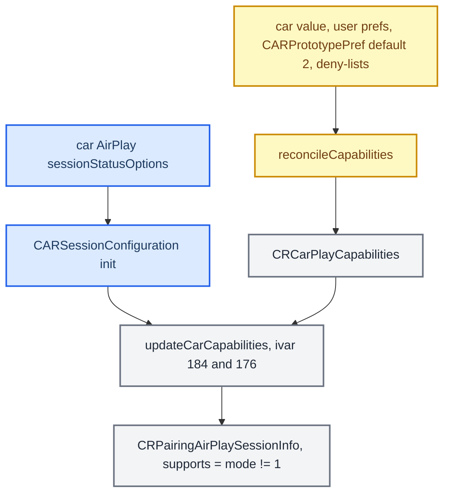

# CarPlay Feature Survey

*Which CarPlay capabilities stock Audi already provides, which ones this project added, which ones could still be added, and the full LOD widgets / Live Activities gating chain.*

---

## 📋 Baseline: what stock already does

Stock `dio_manager` + libairplay 210.81 provide far more than a screen. The live message allowlist in `dio_manager.json` (the `##` lines are a legend; the arrays below them are active) includes main-screen video, audio out, main-screen touch/HID, Siri, telephony (CallState `0x4154/56`, Communications `0x4157/59`), power updates (`0xAE00`-`03`), **NowPlaying + metadata** (`0x5000/0x5001`; `CIAP2ServiceCinemo` logs title/album/artist/genre/composer/elapsed/shuffle/repeat/appName), **Media Library** browsing (`0x4C00`-`05`), and **LocationInformation with dead reckoning** (sent `0xFFFB`, received `0xFFFA/0xFFFC`; `nmea` block `deadReckoning: true`, bitmask `0x0003` = GPGGA + GPRMC, the "China No GNSS" `CNMEAProvider` path). This project adds two things on top: **RGI** (cluster turn-by-turn, [RGI and BAP Bridge](../cluster-and-rgi/RGI_AND_BAP_BRIDGE.md)) and **altScreen** (cluster stream 111, [AltScreen Cluster Video](ALTSCREEN_CLUSTER_VIDEO.md)). **[code]** (config) / **[decompile]**

> 📌 Correction (2026-08-28): LocationInformation/dead reckoning and NowPlaying metadata were first listed as features to add. Both are already stock-active; only the album-art image render (`DSICarplay` `coverArtUrl`) was ever finicky ([Cover Art Pipeline](COVER_ART_PIPELINE.md)).

## 🎯 What could still be added

The capability names are phone-side flags from carkitd/accessoryd 23G71 (iOS 26.6). Whether stock already advertises each one on the car side was not checked exhaustively against a live stock `/info`; each item needs its own advertisement and message confirmation before work starts. **[decompile]**

| Tier | Capability | Phone flag(s) | Note |
|---|---|---|---|
| 1 | Road objects / speed-limit signs | `ACCNavigationRoadObjectDetectionInfo` (RoadSign type + value) | Not in the stock allowlist; needs an advertised detection component + ego speed/yaw (GPRMC already supplies speed) |
| 1 | Raw vehicle IMU to phone | `ForwardAccel`, `LateralAccel` | Only if road-object detection needs more than GPRMC |
| 2 | Now Playing + album art on cluster/HUD | `AccessoryNowPlaying`, `nowPlayingAlbumArt`, `NowPlayingUpdate` | Same lane as the cover-art work |
| 2 | Dashboard | `Dashboard`, `dashboardRoundedCorners` | A distinct screen mode that could ride the same video path |
| 2 | Mixable audio | `supportsMixableAudio`, `supportsSiriMixable` | Prompts mix instead of hard-ducking |
| 2 | Siri hardware button + enhanced voice | `supportsSiriZLLButton`, `supportsEnhancedSiriVoice` | Steering-wheel Siri routing |
| 3 | Destination / route sharing | `SupportsDestinationSharing`, `supportsRouteSharing` | Route sharing is read via `CAFASCTree` `CAFServiceTypeRouteSharing` |
| 3 | Electronic toll collection | `supportsElectronicTollCollection` | |
| 3 | Dolby Atmos / spatial audio | `supportsDolbyAtmos`, `supportsSpatialAudio` | See the Audio domain |
| 3 | DND while driving | `SupportsDNDWhileDriving` | Phone-side, gated by a car flag; cheap if the advert place is found |
| 3 | In-car video playback | `supportsVideoPlayback` | Not planned: partial only (clear H.264 via stock Cinemo); DRM needs Apple's FairPlay receiver module, no HEVC decoder; see [CarPlay Video Playback](CARPLAY_VIDEO_PLAYBACK.md) |
| – | Wireless CarPlay | `supportsWirelessCarPlay` | Offline mod candidate: btstack graft + Rust iAP2 daemon + pairing/media hook around stock210. QEMU lifecycle passes; real iPhone/media/USB validation remains. See [wireless status](../../wireless/README.md) |
| – | Car Keys | `supportsCarKeys` | Out of scope: UWB/NFC |
| – | High-fidelity touch on the cluster | `supportsHighFidelityTouch` | The cluster has no touch panel and advertises no `primaryInputDevice` |

Sources: `CARPLAY_FEATURE_SURVEY`

## 🔍 LOD widgets and Live Activities

The survey first called these "low effort", then "not feasible" (neither 210.81 nor the 280.33.8 SDK has any widget/dashboard feature bit: the AirPlay feature enum is Audio / AudioAAC_LC / AudioPCM / Car / CarPlayControl / Screen / Rotate / Pairing / UnifiedBonjour), then "prototype-gated", and finally "**default ON, reachability open**". The chain, from carkitd and CarKit of iOS 27.0 (24A5418b): **[decompile]**

| Step | Detail |
|---|---|
| Consumer | `-[CRPairingAirPlaySessionInfo initWithSession:]` @ `0x10002e06c` reads `[session configuration]`: `supportsLodWidgets = (lodWidgetsMode != 1)`, `supportsLiveActivities = (liveActivitiesMode != 1)`, plus `dolbyAtmosAudioSupported`, `spatialAudioSupported`, `supportsSiriMixable` → mixable audio, `supportsSiriZLL` → enhanced voice, `videoPlaybackSupported`. `-[CRVehicle updateWithAirPlaySessionInfo:]` @ `0x10002de14` copies them (with an Apple bug: several branches call `setSupportsEnhancedSiriVoice:` by mistake). |
| Where it lives | `CARSessionConfiguration` is defined in **CarKit** (`0x1e8938ce0`, extracted from the dyld cache with `ipsw dyld extract`), not in carkitd, accessoryd, caraccessoryd or CoreAccessories. `-[CARSession initWithFigEndpoint:sessionStatusOptions:nightModeProvider:]` receives the car's **`sessionStatusOptions`**; `-[CARSessionConfiguration initWithSessionStatusOptions:propertySupplier:]` @ `0x1c2008f7c` reads keys such as `LodWidgetsKey`, `LodWidgetsMode`, `LodWidgets` and the LiveActivities equivalents. It is the same layer as altScreen's session configuration, not a new protocol or feature bit. |
| Who writes the mode | Not the initialiser: only `-[CARSessionConfiguration updateCarCapabilities]` @ `0x1c200af60` writes ivar `+184` (lodWidgetsMode) and `+176` (liveActivitiesMode) as `disabledCheck ? 1 : carCaps.mode`, with `carCaps` a `CRCarPlayCapabilities` (`off_1E1766960`). |
| Reconcile | `-[CRCarPlayCapabilitiesManager reconcileCapabilities]` @ `0x10002992C` blends the car's value, per-vehicle user prefs, `+[CARPrototypePref lodWidgets]` / `liveActivities`, and the server deny-lists `CarPlayWidgetDenyList` / `CarPlayLiveActivityDenyList` (`com.apple.carkit.liveactivity.denylist-changed`). Coding keys `CapabilitiesLodWidgetsKey`, `CapabilitiesLiveActivitiesKey`, plus a `disabledFeature` bitmask. |
| Default | The prototype-pref factory (block `0x1c204fef0`) defaults to an `NSConstantIntegerNumber` **2** (`unk_1ED9EB928`). Modes: 1 = off, 2 = default on, -1 = use car value, 0 = unset. With no user override the manager sets `mode = 2` → **supported by default**. |

Remaining real gates, in order: the server deny-list (Apple can exclude unknown cars), the `disabledFeature` path forcing mode 1, and the car actually surfacing the Dashboard/widget UI that the phone draws widgets into — plus the old AirPlay session version our 210.81 stack advertises. Our stack emits none of these session-status fields today; the accessory-side wire byte lives one layer further out in AirPlaySupport/MediaToolbox and was not chased. Verdict: not a categorical "no", but low yield on a 210.81 stack. **[decompile]** / **[open]**

Sources: `LODWIDGETS_LIVEACTIVITIES_RE`

---

## 📚 Sources

Merged originals were removed from the tree after this note absorbed them; they remain in git history (commit 23972aa).

- `CARPLAY_FEATURE_SURVEY` — stock baseline from `dio_manager.json` and the tiered menu of addable features.
- `LODWIDGETS_LIVEACTIVITIES_RE` — the widgets / Live Activities gating chain, with its three reversals.
- `memory/lodwidgets_liveactivities_re.md`.

Related: [CarPlay Video Playback](CARPLAY_VIDEO_PLAYBACK.md), [AltScreen Cluster Video](ALTSCREEN_CLUSTER_VIDEO.md), [AltScreen and Video overview](README.md).
