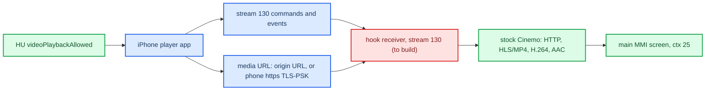
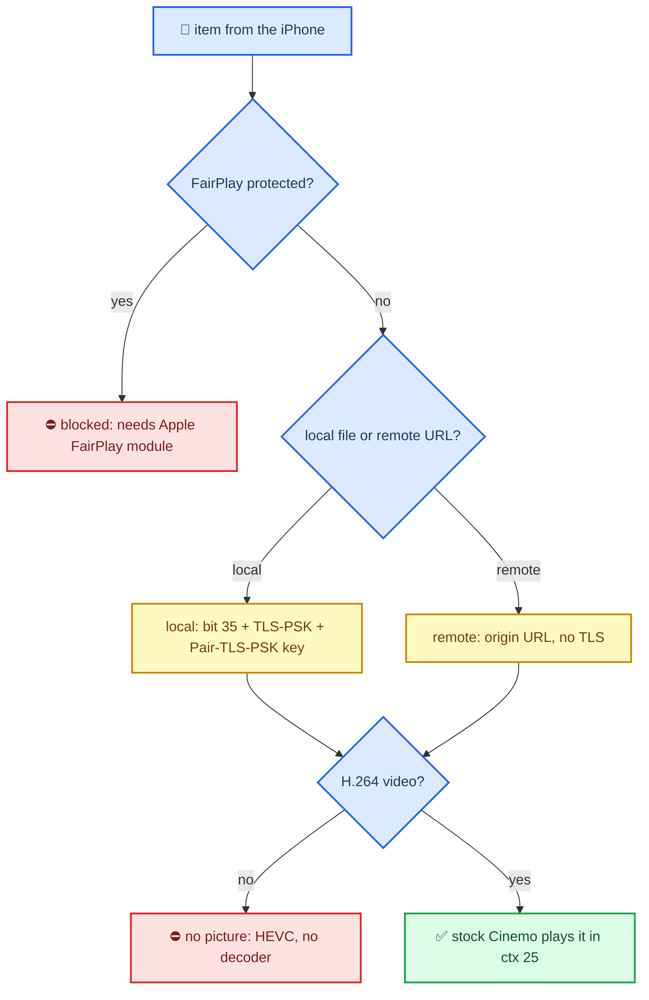
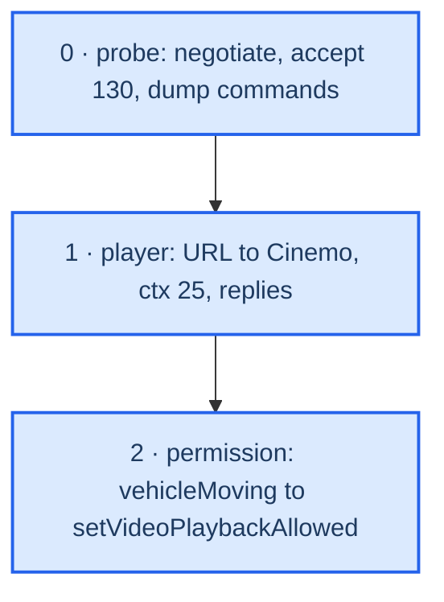

# CarPlay Video Playback

*"Video in Car" ([Apple: Play videos with CarPlay](https://support.apple.com/guide/iphone/xykemxkw6he5/ios)): how iOS 27 plays films on a CarPlay head unit, what the car must advertise and implement, what stock MHI2Q already has (Cinemo, window 43, ctx 25), and why it stays a partial, unplanned feature here. Research branch: `feature/carplay-video-probe`.*

> [!IMPORTANT]
> **Status: not planned.** A **partial** implementation is technically possible: clear H.264 content, played by stock Cinemo. The full feature is not. DRM video (Apple TV+, Netflix, Disney+, iTunes purchases) needs Apple's receiver FairPlay module, which only Apple-licensed receivers get; the car's MFi chip does not provide it. iPhone camera clips are HEVC, which this hardware cannot decode. Everything below is static RE kept as a recipe; nothing was played on the car. See [Verdict](#-verdict-partial-only-not-planned).

---

## 📋 Summary

CarPlay Video is **not** stream 111 and not the main screen stream 110. The iPhone controls a **receiver-side media player** over a remote-control stream (**type 130**) and hands it a **media URL** (`Content-Location`); the head unit fetches and decodes the media itself and shows it on the logical **mainScreen**. The car also owns the permission: it tells the phone whether video is currently allowed. Stock MHI2Q libairplay 210.81 has no stream-130 handler and no playback code, so the hook must build the **receiver** (negotiation, stream 130, command dispatch, replies). The **player** already exists: stock Cinemo can fetch the URL over plain HTTP, parse HLS/MP4, decode H.264 + AAC and draw into window 43 (ctx 25). Four things decide feasibility: iOS 27 proposes the feature to every car; FairPlay content needs Apple's receiver module; the phone sends clips as recorded (HEVC) and the unit has **no HEVC decoder**; and local files need feature bit 35, which also forces TLS-PSK. All of this is static RE; nothing was played on the HU. **[decompile]** / **[open]**

| Piece | State |
|---|---|
| iPhone proposes `videoPlayback` | iOS 27: always; iOS 26.x: behind an `os_feature` flag (see *Who proposes*) |
| Negotiation (`enabledFeatures` + `/info videoPlaybackInfo`) | not built; same seam as altScreen |
| Stream 130 SETUP + `/command` dispatch + replies | not built; hook seams exist (SETUP, `AirPlayReceiverSessionControl`, `SendCommand`) |
| Fetch, demux, decode, show | stock Cinemo; the URL → Cinemo entry (`setPlaybackURL`) still to wire |
| Resume point, audio-only while driving | phone-owned; the HU reports state and sends `setVideoPlaybackAllowed` |



---

## 🚦 Verdict: partial only, not planned

The receiver side can be built from stock pieces, but what it could play is a narrow slice of what users expect from "video in the car".



| Content | Without Apple's receiver FairPlay module | Why |
|---|---|---|
| Apple TV+ / TV app, Netflix, Disney+, other studio DRM | ⛔ never | FairPlay Streaming: the **receiver** generates the SPC with its own FairPlay stack and the phone wraps the exchange (see *FairPlay*) |
| iTunes purchases and rentals | ⛔ never | legacy Store FairPlay (`authorizeItem`, `PIC-Request`, `fpSessionID`) |
| iPhone camera clips (HEVC) | ⛔ picture; sound at best | the phone serves the original file; no HEVC decoder on the unit |
| Edited / slo-mo Photos clips | ⛔ | compositions have no URL; the phone fails them with -17226 |
| Own H.264 clips from Photos or Files | ⚠️ only with bit 35 | needs our own TLS-PSK client and the unresolved `Pair-TLS-PSK` derivation |
| Clear web HLS / MP4 with an H.264 variant | ✅ | origin URL, stock Cinemo; car internet or the phone's PSK proxy |
| HLS AES-128 (key over https or the `unhandledURL` relay) | ✅ | a clear key, no FairPlay |

Why the MFi chip is not enough:

- **The CarPlay MFi coprocessor authenticates the accessory** and sets up MFi-SAP, the AES-128-CTR key for the CarPlay streams[^apple-mfi]. That key already works on stock (`APSMFiSAP_DeriveAESKey`). It is a transport key, not a content key.
- **Third-party AirPlay 2 TVs have the same limit.** They mirror and play audio, but FairPlay video over AirPlay ("AirPlay Streaming") plays only on Apple devices such as Apple TV and Mac, where the key is delivered and decrypted inside the device[^doverunner]. Open receivers block protected video even in mirroring[^phairplay].
- **The known FairPlay reverse engineering is the other FairPlay.** Commercial and open receivers (AirServer, Reflector, rPlay, later playfair in RPiPlay/UxPlay) pass the `fp-setup` challenge for the mirroring/audio stream key. They do it by lifting Apple's obfuscated `airtunesd`/`fairplayd` code, running it in an emulator, or calling it on a remote server[^re-se][^rpiplay]. None of that yields a FairPlay Streaming client. UnFairPlay decrypts App Store binaries on macOS, a third system again[^unfairplay]. Recreating an FPS client would be DRM circumvention and is out of scope for this project.
- **Apple plans DRM content for CarPlay Video.** iOS 26.4 already carries Apple TV app flows for CarPlay, including a prompt to subscribe on the iPhone. Automakers have to integrate the feature and be in the MFi program[^macrumors][^9to5mac]. Certified head units presumably get the receiver FairPlay module the way Apple TV has it. That part is inferred; nothing public states it.

Decision: **not planned.** A partial build would advertise "video in the car", then fail on the content most users try first: their own HEVC videos and every subscription service. The research stays here as a recipe; the plan in *Status and plan* is what a partial build would take.

---

## 🔐 Capability, negotiation and permission are three states

Evidence: CarKit, CoreMedia, MediaToolbox, AirPlaySender, APTransport, AirPlaySupport and AirPlayOverlaysServer from the iOS 27 `24A5418b` dyld cache (unslid VAs), cross-checked with the iOS 26.1 `23B85` text decompile. **[decompile]**

1. **CarKit UI capability.** `-[CARSessionConfiguration initWithSessionStatusOptions:propertySupplier:]` sets `videoPlaybackSupported` (ivar `+15`) to `EndpointInfo["videoPlaybackInfo"] != NULL` (`CMP X0,#0 / CSET NE`), unless the Apple-internal `os_feature_enabled("CarPlay","VideoBrowse")` forces it. `EndpointInfo` is the AirPlay **`/info` response** (`CARkAPEndpointProperty_EndpointInfo`, `CARkAPEndpointInfoResponseKey_VideoInfo = "videoPlaybackInfo"`, `..._MainBufferedInfo = "mainBufferedInfo"`). The string appears once in CarKit and is presence-only for this check. Chain: `CRPairingAirPlaySessionInfo` → `supportsVideoPlayback` → `-[CRVehicle updateWithAirPlaySessionInfo:]`. iOS reads these `/info` keys: `AudioFormats`, `FileTransfer`, `LogTransfer`, `MainBufferedInfo`, `VehicleStateProtocolInfo`, `VideoInfo`.
2. **AirPlay negotiation.** 26.1 `Activate.mm:176` proposes `videoPlayback` (pref `enableCarPlayVideoPlayback`) and checks the negotiated value around line 528. `carEndpoint_UpdateFeaturesWithCompletionCallback` @ `0x251080c34` updates the enabled state for feature bit 4; when support is negotiated and `AirPlay/CarPlayVideoPlayback_DestinationBanner` is off, Activate enables it immediately (`0x251082fb4`).
3. **Current permission.** Endpoint storage in this build: `+68` supported (returned for `AirPlayVideoV2Supported`, `UsesExternalPlaybackByDefault`), `+220` audio-only elected, `+221` allowed, `+222` URL playback enabled (`IsURLPlaybackEnabled`, gates `CreatePlaybackSession`), `+223` playback session active.

### Who proposes `videoPlayback` (2026-09-23)

The SETUP feature list comes from carkitd, not AirPlaySender. AirPlaySender (26.1 `Activate.mm:120-176`) calls `APCarPlay_FetchSessionFeatureKeysWithIdentifier(pairedVehicleIdentifier)`, and carkitd answers with `CRCarPlayFeaturesAsAirPlayFeatures(-[CRFeaturesAvailabilityAgent supportedCarPlayFeaturesForVehicleIdentifier:])` (CarKit `CarKit.mm:3692`, where bit **0x40 = `videoPlayback`**). **[decompile]**

- **iOS 26.1:** `-[CRFeaturesAvailabilityAgent _deviceFeatures]` (`CRFeaturesAvailabilityAgent.mm:34`) adds 0x40 only when an `os_feature` flag is on (`192` vs `128`). No `CarPlayVideoPlayback` flag ships in 27's `FeatureFlags/Domain/CarPlay.plist`, so 26.x phones most likely never propose video.
- **iOS 27 `24A5418b`:** the method is now `_deviceFeaturesForThemeAssetID:` (`0x10007bbc0`). It returns `x | 0x3d0` with no flag check (`0x10007bed4`), so **0x40 is always set**.
- **Per-vehicle filter:** only the user's per-vehicle "disabled features" preference and the theme-asset mask remove bits. `CRCarPlayFeaturesAllFerriteFeatures` = `0x28` in 27, which does not include 0x40.
- **Contract:** an iOS 27 phone proposes `videoPlayback` to every car. The HU accepts it by echoing it in the control-SETUP response `enabledFeatures` (the same place the hook adds `altScreen`) and must then also carry `videoPlaybackInfo` in `/info`. Otherwise `carEndpoint_validateInfoResponseKeyPresentForFeature` fails Activate (`Activate.mm:969-972`).
- **Do not echo it unproposed:** if `videoPlayback` is echoed without the phone proposing it, Activate fails with -6735 (`Activate.mm:528-541`).

`mainBuffered`/`mainBufferedInfo` is **buffered audio** (`enableCarPlayBufferedAudio`, stream 103), not a buffered video mode. There is no shortcut that puts the film into stream 110.

`videoPlaybackInfo.featuresEx` is a **Base64 bitmap** (`airPlayDescription_copyCarPlayVideoFeaturesInternal` @ `0x251154628`; AirPlaySupport `Base64DecodeCopy` → `CFDataCreate` @ `0x22661ec08`; `APSFeaturesHasFeature` @ `0x2266be888` tests bit `n % 8` of byte `n / 8`). Bit 70 → `SupportsOverlayUI`; bits 73–76 select the volume-control mode (`airPlayDescription_copyVolumeControlTypeEx` @ `0x250f4b5fc`). The full required bit set is unknown; do not advertise everything.

### Who turns video off

`carEndpoint_updateVideoPlaybackAllowed` @ `0x2511490a0` reads `videoPlaybackAllowed` (CFString `0x275b05b80`) from the initial `videoPlaybackInfo` (Activate block `0x251080ed8`, around `0x251082f8c`) and later from the HU command `{type: "setVideoPlaybackAllowed", params: {videoPlaybackAllowed: false, playbackStatus: "video"}}` routed by `carEndpoint_handleEventCreatingReply` @ `0x250f5109c`. On change it posts `kFigEndpointNotification_EndpointDescriptionChanged`. `carEndpoint_CopyProperty` @ `0x250f56970` computes `AirPlayVideoPlaybackAudioOnlyMode = !allowed ? "Forced" : electedAudioOnly ? "Elected" : "None"`, and `-[CARSession videoPlaybackAvailable]` @ `0x1c20071b8` is `mode != "Forced"`, broadcast via `CARSessionVideoPlaybackAvailabilityChangedNotification`. So the 2026-08-28 question "who writes AudioOnlyMode" is answered: AirPlaySender itself, from the Boolean the **car** sends; the phone computes no speed or gear. When forbidden it sends `changeVideoPlaybackToAudioOnly` (`carEndpoint_sendChangeVideoPlaybackToAudioOnlyIfNeeded` @ `0x25114a4ec`; 27 sends when `playbackStatus` is absent or `video`, 26.1 `AirPlaySender_22.mm:9270` also needs the status present). `videoPlayerBackButtonEvent` @ `0x25114a1a0` sets `Elected`, which is a user choice, not a car ban. Apple's model is degrade-to-audio, not a hard block.

Sources: `CARPLAY_VIDEO_RE`, `CARPLAY_VIDEO_TRANSPORT_2026_09_14`

## 🌐 Transport: stream 130 and URL playback

The August "two models" question (buffered AirPlay Video vs rendering into 110) is settled for the traced path: the film is **URL playback**, commands ride **stream 130**. The old bare `kAirPlayStreamType_Playback 120` define does not describe this path. **[decompile]**

```text
carEndpoint_CreatePlaybackSession           0x251148e8c
  createPlaybackSessionInternal block       0x2510916e4
    APEndpointPlaybackSessionRemoteControlCreate 0x2510e3fd4
session_Play                                0x2510e525c
  session_insertPlayQueueItemInternal       0x2510e7520
    session_ensureRemoteControlSessionCreated 0x251178b9c
      APEndpointRemoteControlSessionCreate  0x25101c440
        ensureAndCopyTransportStreams       0x25101c9c8  -> SETUP type 130
```

The remote-control session uses `clientTypeUUID = A6B27562-B43A-4F2D-B75F-82391E250194`, `sessionType = 1`, `controlType = 1`; the SETUP also carries `clientUUID`, `channelID`, optional `wantsDedicatedSocket`/`sendMessageAsIs`. The value the logs call "transport token" is the response key **`streamID`** (`0x275afc700`, statement `0x25101cf2c`), later passed as `StreamGroupID`; there is no `transportToken` field. `insertPlayQueueItem` carries `item` (with `Start-Position`, `Content-Location`, `Offline-HLS-Content-Location`, `IsTLSEnabled`), optional `itemAfter` and `metadata`. For local files the iPhone runs `APLocalPlaybackServerMake` → `APLocalPlaybackServerRegisterPathWithUUIDCreatingHostAndURL` and serves `https://<host><URL>`; `SupportsTLS_PSK` comes from endpoint feature 35 or `ExternalPlaybackCapabilities.supportsOfflineHLS`.

**It targets mainScreen.** `carEndpoint_takeActionOnModeChanges` @ `0x250f586f8` feeds the first element of old/new FigStarkMode to `carEndpoint_checkAndUpdateVideoOverlayActivation` @ `0x251149370`; `APStarkModeCreateDictionaryRepresentation` @ `0x251099448` serialises it as `resourceID = 1` = `kAirPlayResourceID_MainScreen` (`AirPlayCommon.h:1602`). The Fig enum is **inverted** relative to the wire (`Fig 1 → wire 2 = Accessory`, `AirPlayCommon.h:1569-1570`), so Fig owner 1 means the car owns the screen; overlays activate when the accessory owns mainScreen and playback is active. 26.1 `DBDashboard.mm:6594` `session:isPlayingVideoFromApp:` updates NowPlaying with `setTakeScreen:0`. Overlays (`APCarPlayHelperActivateOverlaySession` @ `0x24f3a9ab8` under `CarPlayVideoPlayback_Notifications`, `APOOverlaysServer.activateOverlaySessionOnEndpoint:` @ `0x250ce044c`, client `E3DC3EA6-E6C3-4B30-847C-B7ACFEBEA654`) are extra UI (notifications, sensors, vehicle status, climate), not the film transport; they need CarPlay session-info, not Bonjour discovery.

### Receiver side (AirPlayReceiver / AirPlayReceiverKit)

`AirPlayReceiverSessionSetup` @ `0x250e733d0`: for `type = 130` at `0x250e742ac`, a `clientTypeUUID` equal to the video UUID enters `PlaybackV2Setup` (new `streamID`, mandatory `clientUUID`) → `PlaybackV2Start` (`0x250e75090`: needs a UI controller, passes `deviceID`, `sessionID`, optional `networkClock`, installs `_PlaybackV2EventCallback` @ `0x250e7fc14` and `_PlaybackV2TLSInfoRequestCallback` @ `0x250e7fcf0`, calls UI-controller vtable slot `+48`). The response is `{type: 130, streamID}` (`0x250e75194`) with **no** `dataPort`; it rides the shared control/event connection. The branch also checks session state `+0x2c0 == 2` (the enum meaning is not recovered). Other UUIDs go to the generic remote-control branch at `0x250e74760`.

Images: AirPlayReceiver base `0x250d0d000`, AirPlayReceiverKit base `0x250ee8000` (extracted with `ipsw dyld extract --slide --objc --stubs`, SHA-256 `1f301254def11bc340604deaab31ce581347a842c4a9403bf8cc4532d19bc276`), AirPlaySender (base `0x250f35000`, SHA-256 `379fb232…ead1`), APTransport `0x24f331000`, AirPlaySupport `0x226619000` (SHA-256 `edf99982…c2a3`), AirPlayOverlaysServer `0x250cde000`; Hex-Rays loses some external-call arguments, so keys were confirmed from instructions and cache CFStrings. Commands arrive as `POST /command` with `X-Apple-StreamID`, outer plist `{params: {data: <serialized player dict>}}`, inner `{type: "insertPlayQueueItem", item: {...}}` — two serialisation layers. Path: `airplayReqProcessor_requestProcessCommand` @ `0x250e46cdc` → `AirPlayReceiverSessionControl` @ `0x250e6fa20` (branch `0x250e6fb00`, marks `URLflinging`) → `uiController_controlVideoPlayback` @ `0x250f091ac` (`kUIControllerVTable` `0x275ae86d0`, class vtable `0x275ae8748`; slots `+48` start @ `0x250f08fd8`, `+56` stop @ `0x250f090fc`, `+64` control) → `processMessageWithIDAndDictionarySync:messageSessionID:` @ `0x250eec420` → `_processMessageWithDictionaryInternal:` @ `0x250eec620`.

| Inner `type` | APRKMediaPlayer handler |
|---|---|
| `insertPlayQueueItem` / `removePlayQueueItem` | `_insert…` @ `0x250eed7d4` / `_remove…` |
| `setRate`, `seek`, `stop` | `_setRateWithDictionary:` etc. |
| `playbackInfo` | `_processPlaybackInfoRequestWithDictionary:` @ `0x250ef20b8` |
| `setProperty` / `property` | `_setProperty…` / `_getProperty…` |
| `unhandledURL`, `streamingKey`, `authorizeItem` | FairPlay and fallback paths |
| `playbackCoordinationMedium` | behind feature gate `CoordinatedAirPlayVideo` |

Item keys (case matters): `item`, `itemAfter`, `uuid` (required by the `APRKPlayerItem` ctor @ `0x250effa04`, which builds an `AVURLAsset`), `Content-Location`, `HLS-Content-Location`, `Start-Position`, `Start-Date`, `Start-Position-Seconds`, `IsTLSEnabled`, `audioOnly` (item flag `_isAudioOnly`, not the runtime ban), `Play-Info`, `fpSessionID`, `timeToPauseBuffering`, `timeToPausePlayback`. TLS for local playback: `IsTLSEnabled` → `mediaPlayerNeedsTLSInfo:` → core callback `0x250e7fcf0` returns a 16-byte PSK labelled **`Pair-TLS-PSK`** as `tlsPSK`/`tlsPSKClientIdentity` → `_SSLPropertiesforTLSInfo:` @ `0x250eed348` → `kCFStreamSSLPSKSharedSecret`/`kCFStreamSSLPSKIdentity`, cipher `0x00AE` = `TLS_PSK_WITH_AES_128_CBC_SHA256` (`0x250eed3b8`). The PSK is not a FairPlay key. Events go upstream through `UIControllerSendUpstreamMessage` @ `0x250f07d84` → `_PlaybackV2EventCallback` block `0x250e7fec0` → `AirPlayReceiverSessionSendCommandForObject` @ `0x250e72d0c` (`POST /command`, `CSeq`, `X-Apple-StreamID`, binary plist). `APRKStreamRenderer.processStartVideoPlaybackRequestWithWithSessionID:version:` @ `0x250efcac4` (version 2, `_ensureInternalPlayerFor:` @ `0x250efdc28`) selects streaming mode video 4 / screen 1 / audio 2 / none 0 (`0x250efe64c`) and notifies `didChangeStreamRendererModeTo:forRenderer:` (`0x250efe790`). No command named `changeVideoPlaybackToAudioOnly` or `setVideoPlaybackAllowed` exists in the checked receiver images: the car-side executor of the ban was not found.

### Responses the phone expects

`playbackInfo` reply: `{type: "playbackInfo", kind: "response", messageID?, info}` (base helper `0x250ee9414`). `_currentPlaybackInfoDictionary` @ `0x250eecb08` fills `item.uuid`, `readyToPlay`, `duration`/`position` as **CMTime dictionaries**, `rate`, `playbackState`, `playbackLikelyToKeepUp`, `playbackBufferFull`, `playbackBufferEmpty`, `seekableTimeRanges`/`loadedTimeRanges` (`{start, duration}` CMTimes), `stallCount`, `date`/`absoluteTime`/`estimatedDate`, conditional `isWaitingToSetRateFromSenderAfterSeek` and `interstitialInfo`. Events (`0x250ef284c`): `{type: "playbackState", name: "playing", item: {uuid}, params: <playbackInfo>}`, `{type: "playbackState", name: "stopped", reason: "ended" | "interrupted"}`, `{type: "error", error: {domain, code}}`. State strings (table `0x26938c080`, `0x250ef331c`): 0 `paused`, 1 `loading`, 2 `playing`, 3 `stopped` — an internal Kit enum, not a wire enum. The minimum mandatory field set is unknown.

Sources: `CARPLAY_VIDEO_RECEIVER_2026_09_14`, `CARPLAY_VIDEO_MHI2_PLAYER_2026_09_15`

## 🔍 What stock MHI2Q has and lacks

| Piece | Stock MHI2Q |
|---|---|
| Stream 130 | **Absent.** `AirPlayReceiverSessionSetup` @ `0x272b8` accepts 100/101/110 only (`0x27564`); anything above 101 goes to the unsupported branch at `0x27580`, logs and continues, then `AirPlayReceiverSessionPlatformControl`; a successful RTSP SETUP therefore proves nothing about 130. |
| `videoPlayback` strings | Zero in 210.81 and in the 280.33.8 SDK. |
| Video window | Cinemo in `media` (`app/eso/bin/apps/media`, base `0x100000`, SHA-256 `b18cf3cd…4c02c59`) opens QNX Screen window **class `media`, ID `43`** from `system/etc/eso/production/media.json` `cinemo.config.videoConfigs` (`windowClass`, `windowId`, `useOverlay: true`); config indices 362/363 read at `0x48ab9c` inside `CCinemoConfig::configure` @ `0x48ca5c`, mapped to paths at `0x21c0a0`–`0x21c150`. `libNmeVideoDevice.so` (SHA-256 `e99a67f1…41044`) creates the window at `0x10098` and sets `SCREEN_PROPERTY_CLASS` (call `0x104f8`) and `ID_STRING` (`0x10588`); helpers `0x2073c`/`0x20614` pick class/ID for HMI, video or subtitles. |
| Composition | Stock `DisplayManagerMIB2High`: ctx 0 `{16}`, **ctx 25 `{16, 43}`** (player 1), ctx 26 `{16, 44}` (player 2), ctx 58 `{36, 43}`; `DataPlayer.activate` picks 25 when `PHYSICAL_PLAYER_ID == 1`; `displaymanager.json` maps Main Display ID 0 to LVDS1, Cluster ID 4 to LVDS2. Our patched table keeps `dc[25] = {16, 43}` (`java_patch/de/audi/tghu/fwhmi/DisplayManagerMIB2High.java:94`). **[code]** |
| URL API | `JobPlayURL` → `FilePlayerContent.setPlaybackURL` → `MediaDSIPlayerControllerImpl.setPlaybackURL` → `DSIMediaPlayer.setPlaybackURL`; the job stops the old track, sets repeat mode, waits for URL/ready, applies scaling, then resumes or pauses by audio state. Native `DSIMediaPlayerImpl::setPlaybackURL` @ `0x32d030` needs an active source (`0x32abe8` uses stored deviceID/mediaID; `0x32799c` sends event **23** via `0x3274f8`; no source → async error). Cinemo `loadTrack` @ `0x4abbcc` (clears the queue, `ICinemoPlaylist::AppendTrack`), `enqueueTrack` @ `0x4aba00`, `playTrack` @ `0x4aad74` have no direct xrefs; the event-23 → Cinemo chain is not reconstructed. Existing file-player clients are boardbook and ringtone. |
| Audi video ban | `DSIGeneralVehicleStates` `TVVelocityThreshold` → `GeneralVehicleStateHandler.updateTVVelocityThreshold` (threshold id **2** = `TVVELOCITYTHRESHOLD`, an id not km/h; validity 1) → `ContentManager.setVehicleMoving` → `DataPlayer.vehicleMoving` → `enableVideoDisplayable(!moving)` → choice **200663** = 0 (HMI without the video layer). It hides the layer and calls no stop/pause. Cinemo `changeVideoOutput` @ `0x4a9e1c` toggles a `disabled` video param but has no found caller. Linking this to CarPlay's `setVideoPlaybackAllowed` is a proposal, not a found stock handler. |

**[decompile]**

## 🧰 What the HU already has for "fetch, demux, decode, show" (2026-09-23)

Survey of the MU1316 `P5087` image (`Tools/mhi2q-qemu/out/unpacked/…/MMX2QC/app/10/default/app`) and the iOS 26.1 sender. **[decompile]** / **[code]**

| Need | On the unit | Verdict |
|---|---|---|
| HTTP client | Cinemo `NmeVfsHTTP` (`libNmeVfs.so`, `NMEHTTPSTATE_*`); libcurl 7.56.0 (`armle/usr/lib/libcurl.so.2`) | yes |
| HTTPS | Cinemo Vfs links OpenSSL (`SSL_connect`); OpenSSL **1.0.2j** (`armle/usr/lib/libssl.so`) | yes, but see TLS-PSK |
| TLS-PSK | 1.0.2j has PSK callbacks but only `PSK-AES128-CBC-SHA` and similar; iOS uses `0x00AE` `TLS_PSK_WITH_AES_128_CBC_SHA256`, which 1.0.2 lacks | avoid it (next row) or bring our own TLS |
| Avoiding TLS | Sender sets `SupportsTLS_PSK` only when the receiver has **AirPlay feature bit 35** or `ExternalPlaybackCapabilities.supportsOfflineHLS` (26.1 `AirPlaySender_14.mm:9811-9833`, `_18.mm:2253-2271`). **But bit 35 also gates local files** (see *Formats the phone sends*): without it the phone likely reports `CannotFetchMediaFromSender` and rejects Photos/Files items. Bit 35 off = remote URLs only, no TLS | trade-off, see below |
| PSK if needed | `Pair-TLS-PSK` = KeyHolder `CreateDerivedKey("Pair-TLS-PSK", 12 B → 16 B)` (`AirPlaySender_19.mm:3590`, `_11.mm:4419`). Which KeyHolder a wired MFi-SAP CarPlay session uses (pairing vs shared-key; stock 210 has only `AirPlay_DeriveAESKeySHA512`/`APSMFiSAP_DeriveAESKey`) is **not yet resolved**; plus our own TLS stack (e.g. mbedTLS, which has `TLS_PSK_WITH_AES_128_CBC_SHA256`) | needed for local files |
| HLS | Cinemo Vfs parses `#EXTM3U` / `#EXT-X-` / `m3u8` | yes |
| MP4/MOV demux | Cinemo `NmeNav` (mp4 atoms), `NmeMuxMP4` on the encoder side | yes |
| H.264 decode | `OMX.qcom.video.decoder.avc` (Cinemo `NmeCodecOMX`, and our `altscreen_render`) | yes |
| **HEVC decode** | **none.** The Qualcomm OMX list: avc, mpeg2/4, h263, vc1, wmv, vp8, divx, mjpeg, spark | **blocker for camera clips:** the phone sends them as recorded (HEVC) |
| AAC decode | Cinemo `NmeCodecAAC` (the hook already uses it for type 103) | yes |
| Video out | Cinemo window `media/43`, ctx 25; or our `altscreen_render` EGL | yes |
| Audio out | Cinemo audio device (media source); or the hook's PCM sink to `mpl5_dio_ent` | yes, source arbitration open |

### Formats the phone sends

The phone never transcodes for the receiver. MT = MediaToolbox, APS = AirPlaySender, both iOS 26.1 `.mm` (key names confirmed in the 26.6 IDA decompile). **[decompile]**

| Source | What the receiver gets | Codec |
|---|---|---|
| Local file: Photos clip, Files, an app's file `AVURLAsset` | The **original bytes**. MT `itemairplay_setUpPlayParamDictionary` (`MediaToolbox_43.mm:2972`, `3606-3618`) sends the file path; APS `session_insertPlayQueueItemInternal` (`AirPlaySender_19.mm:3416-3703`) registers it with `APLocalPlaybackServer` and sends `Content-Location: https://<phone>/1/<uuid>.<ext>` with `IsTLSEnabled = true`. The server is GET-only, serves Range requests, reads the file with `APSHTTPOpenLocalFile` and uses TLS-PSK (`AirPlaySender_10.mm:2393-2845`). No export or transcode anywhere on this path | as recorded: iPhone camera = mostly **HEVC**, H.264 only with "Most Compatible" |
| Offline HLS (`.movpkg`) | Playlist + segments via `Offline-HLS-Content-Location` (`MediaToolbox_43.mm:3520-3574`); needs `supportsOfflineHLS` | the downloaded variant |
| Remote HLS (Safari, apps) | The **original origin URL** (`MediaToolbox_43.mm:3336-3350`; only `_HLS_primary_id` and iTunes rewrites) | the receiver picks the variant: we must choose `avc1` |
| Remote progressive MP4 | the original URL (`MediaToolbox_43.mm:3411-3423`) | as hosted |
| App with a custom resource loader | URL; the bytes come back through `UnhandledURLRequest`/`Response` via the phone (`MediaToolbox_118.mm:3490`) | as the app provides |
| AVComposition, edited or slo-mo Photos clips, items without a URL | the item **fails**: -17226 → `AVErrorExternalPlaybackNotSupportedForAsset` (`MediaToolbox_43.mm:3013-3031`). No fallback that streams decoded frames exists on this path | — |

- **Local media gate.** MT reads the route keys `ExternalPlaybackCannotFetchMediaFromSender` and `…DoesNotSupportEncryptedCRABS`: a local item on a route that cannot fetch from the sender fails with -17226. For CarPlay, `carEndpoint_CopyProperty` (`AirPlaySender.mm:10008-10020`) returns that property as TRUE unless the receiver has **features bit 35**. Bit 35 is also what switches on `SupportsTLS_PSK`. So local files ⇔ bit 35 ⇔ TLS-PSK. The symbol pairing is inferred from its GOT neighbour.
- **Remote URLs without internet on the car.** The phone can hand the car an HTTP CONNECT proxy through itself: command `setProxyParameters` with `proxyUrl`, `proxyPort`, `proxyPsk`, `proxyPskIdentity`, `proxyAuthorization` (`AirPlaySender_14.mm:9235`, `APHTTPProxyMonitorClient.mm:106-160`). The proxy is PSK-protected too.
- **When video goes over AirPlay at all.** It is decided per player (`allowsExternalPlayback`; with a screen route also `UsesAirPlayVideoWhileAirPlayScreenIsActive`, `MediaToolbox_43.mm:2465`, `2693`). Otherwise the video stays on the phone; it is not re-encoded into stream 110.

### FairPlay

FairPlay Streaming (Apple TV+, Netflix, Disney+ …) **cannot be played without Apple's receiver FairPlay module**. The phone does send the URL; the key is the problem. ARK = AirPlayReceiverKit, AR = AirPlayReceiver. **[decompile]**

1. The receiver's player hits an `skd://` key and sends `unhandledURL` to the phone (ARK `APRKContentKeyHelper.mm:247-270`).
2. The app's key request runs through `FigAirPlayCryptor` on the phone (MT `MediaToolbox_22.mm:4361`). The phone's own FairPlay library wraps it (`nS1Q9ljw9esy9`) and sends a `streamingKey` message (APS `AirPlaySender_19.mm:3155-3165`), waiting up to 8 s.
3. **The receiver generates the SPC** with its own FairPlay stack: `AVContentKeyRequest makeStreamingContentKeyRequestDataForApp:` (ARK `APRKContentKeyHelper.mm:153-197`).
4. The phone unwraps it (`f5zGmdURga6BZ`), the app gets the CKC from its key server, and the phone returns the CKC (APS `AirPlaySender_19.mm:3186-3195`).
5. Only the receiver unwraps the content key (`processContentKeyResponse`, ARK `:118-138`). The phone never decrypts or re-sends plaintext media.

Other paths:
- **iTunes purchases and rentals** use the legacy Store FairPlay: `authorizeItem` with `PIC-Request` → `PIC-Data`; `fpSessionID` and `Play-Info` on the item (AR `AirPlayReceiver_02.mm:5633-6226`, MT `FigCPEFPAirPlaySession.mm`). This is also Apple-only.
- **The FairPlay-SAP audio/screen key** (`_GetDecryptKey`, AR `AirPlayReceiver_09.mm:10440`) is a different system and is not used for URL video.
- **No FPS capability to decline.** Only `supportsFPSSecureStop` exists; FPS is assumed. On a failed or late `streamingKey` the item fails and the app decides what to show. No automatic fallback was found.
- **Plan:** advertise `supportsFPSSecureStop = false` and `supportsOfflineHLS = false`, and answer `streamingKey`/`authorizeItem` immediately with an error so FPS items fail fast instead of after 8 s.
- **Playable without FairPlay:** clear HLS/MP4/progressive; HLS AES-128 (and very likely SAMPLE-AES with a clear key) whose key comes from an https URI or through the `unhandledURL` relay.
- **Licensed AirPlay 2 TVs** play FPS because Apple ships them its receiver FairPlay module. Certified CarPlay Video head units presumably get the same (inferred).

### The HU cannot tell the phone its codecs

There is no codec or resolution negotiation for URL playback. The HU sends the phone three things, and none of them names a codec. **[decompile]**

- **`/info videoPlaybackInfo.featuresEx`.** The only bits the sender queries are 70 `SupportsOverlayUI` (`AirPlaySender.mm:7725-7730` → `airPlayDescription_hasCarPlayVideoFeatureInternal`, `_15.mm:5301`) and 73-76 for the volume mode (`_02.mm:6193`).
- **`/info playbackCapabilities`** (read by the sender as `ExternalPlaybackCapabilities`, `AirPlaySender.mm:8926-8928`). An Apple receiver fills it with Booleans only (`AirPlayReceiver_05.mm:3160-3212`): `supportsUIForAudioOnlyContent`, `supportsFPSSecureStop`, `supportsStopAtEndOfQueue`, `supportsOfflineHLS`, `supportsV2ArtworkMetadata`, `supportsCoordinatedAirPlayVideo`, `supportsAirPlayVideoWithSharePlay`.
- **The `hevc` / `hevcInfo` feature and `UseCarPlayHEVC`.** These govern the encoder of the **mirrored UI stream 110** (MediaToolbox `fvdp_start`, `CarPlayHEVC` / `AirPlayHEVC`, `MediaToolbox_52.mm:596-621`), not the film.

The phone sends the asset as it is. A local Photos clip is served by `APLocalPlaybackServer`, so an iPhone-recorded clip is most likely HEVC. For an HLS master playlist the **receiver** picks the variant (`CODECS`), so Cinemo's HLS variant selection decides. Apple's CarPlay Video receivers are evidently expected to decode HEVC.

Consequences for MHI2Q (no HEVC decoder; the Krait CPU cannot decode 1080p HEVC in software):

| Content | Expected |
|---|---|
| Own clip recorded as H.264 (Camera → Formats → Most Compatible) or any H.264 file | plays |
| iPhone camera clip in HEVC | served as the original HEVC file (no transcode). Cannot show the picture: check the sample entry (`hvc1`/`hev1` vs `avc1`) before playing; play audio only + `setVideoPlaybackAllowed false` (to try) or reply `{type: error}` |
| HLS with an AVC variant (many web and streaming sources) | plays if Cinemo picks the AVC variant (to verify) |
| FairPlay (Apple TV app, Netflix, Disney+, iTunes purchases) | no: the SPC is generated by the receiver's own FairPlay stack and the phone wraps the exchange (see *FairPlay*) |
| Offline HLS (downloaded content, `.movpkg`) | not offered: the phone gates it on `supportsOfflineHLS`, which we do not advertise |

So Cinemo covers the full chain "URL → HTTP → HLS/MP4 → H.264 + AAC → window 43" for H.264 content. Remote URLs need no TLS; local files need bit 35, TLS-PSK and the PSK derivation. The unknowns are that PSK path and the Java/DSI path that gives Cinemo a URL.

## ⏯️ Player lifecycle: stock MHI2Q vs what CarPlay Video needs (2026-09-23)

Stock evidence is the decompiled HMI in `Tools/jxe2jar/out/MU1316-vf/de/audi/app/media/` (paths below are relative to it). **[decompile]**

### How the stock media player behaves

| Topic | Stock behaviour |
|---|---|
| Source switch inside Media | `SourceController.activateSource()` (`source/SourceController.java:309-400`) deactivates the old content, then `DSIMediaPlayer.setActiveMedia(dev, media, 0)`. Native answers `updateActiveMedia(…, playerID, …)` → `DataPlayer.activate()` picks ctx 25 (player 1) or 26. Deactivate **pauses** (only if `pausePlaybackOnDeactivation()`, false for FilePlayer/Online/TV) and never stops (`content/media/AbstractMediaPlayer.java:268-291`). |
| Radio or CarPlay audio takes over | The media source stays active; only audio focus moves (media app 2, CarPlay app 48). The audio connection stops (state 5) → `dsiPlayer.pause()`; when focus returns, STARTED (state 2) → `resume()` (`AbstractMediaPlayer.java:2024-2132`). |
| Phone call | Connection paused (state 3) → the player **pauses**, it does not play muted. Whether a navigation prompt pauses or only ducks is decided natively. |
| Pause / resume / stop | `MediaDSIPlayerControllerImpl` 1:1 on `DSIMediaPlayer.pause/resume/stop` (`dsi/media/MediaDSIPlayerControllerImpl.java:320-371`). `stop` only in FilePlayer/Online jobs. |
| Resume from last position | **Not stored in Java.** `LastModeManager` keeps only the last source and slot (FilePlayer is skipped). After a source switch, an ignition cycle or re-inserting the medium, Java sends `setActiveMedia`, waits for READY_TO_PLAY and calls `resume()`. Native/Cinemo restores the track and position. |
| URL playback | `JobPlayURL` → `setPlaybackURL(url)` has **no start-position argument** and no resume. The Online player seeks after start with `setEntry(entryId, sec)` (`content/media/online/content/JobSeekToTime.java`), allowed only once playback runs (states 3, 5-9). |
| Position and events | `updatePlayPosition(entryId, ms, totalMs, valid)`; `updatePlaybackState`: 1 READY_TO_PLAY, 3 PLAYING, 4 STOPPED, 5 PAUSED, 6-9 SEEK, 11 STOPPED_WITH_ERROR, 13 DOWNLOADING. There is no end-of-track event (seen as state 4/11 or a new `entryId`). Absolute seek `setEntry(id, sec)` (sent as ms); speed seek `seek(dir, 2..64x)`; `setVideoRect`. |
| Video layer | `DataPlayer.enableVideoDisplayable` writes choice 200663 (25/26/6 or 0). The context is switched by `de/esolutions/hmi/widgets/audi/evo/DisplayControllerEvo.java` (`switchContext(choice)`) **only while a Media video screen is shown**. `vehicleMoving` hides the layer (choice 0) but keeps the sound. Audio-focus loss pauses but leaves the choice at 25. |

### What the phone expects (iOS side)

- **"Where it stopped" is the phone's Now Playing.** When the car starts showing video, DashBoard receives `session:isPlayingVideoFromApp:` (26.1 `DBDashboard.mm:6594-6630`) and brings the app's Now Playing up on the CarPlay UI (stream 110) with `setTakeScreen:0`. The progress and "continue from here" shown there come from **our** `playbackInfo` replies (`position`, `duration`, `rate`, `playbackState`). The resume point is the phone's: the next `insertPlayQueueItem` carries it in `Start-Position`. The HU needs no position storage.
- **Driving → audio-only.** The HU sends `setVideoPlaybackAllowed {videoPlaybackAllowed: false}`. The phone flips `AirPlayVideoPlaybackAudioOnlyMode` to `Forced`, `-[CARSession videoPlaybackAvailable]` becomes false (a banner and Now Playing without the picture), and it sends `changeVideoPlaybackToAudioOnly` back to the HU (see *Who turns video off*). In Apple's model the receiver keeps playing the same URL and drops only the picture; the reading is that audio stays on the HU player. **Not verified on the car.** AVPlayer has a separate *user* switch (`usesAudioOnlyModeForExternalPlayback` → Fig `UseAirPlayVideoAudioOnlyMode`, `AVPlayer.mm:7586-7658`), which is the "Elected" mode.

### Mapping for our receiver

| Phone → HU | HU action (stock DSI) |
|---|---|
| `insertPlayQueueItem` (`Content-Location`, `Start-Position`) | `setPlaybackURL(url)`; after PLAYING, `setEntry(id, Start-Position)` (the Online player pattern); show ctx 25 ourselves |
| `setRate 0` / `1` | `pause()` / `resume()` |
| `seek` | `setEntry(id, sec)` |
| `stop` | `stop()`, hide ctx 25 |
| `playbackInfo` request | reply from the last `updatePlayPosition` + `updatePlaybackState` |
| `changeVideoPlaybackToAudioOnly` | hide ctx 25 (choice 0), keep playing — what `vehicleMoving` already does |

| HU event | HU → phone |
|---|---|
| Car starts moving (`vehicleMoving(true)`) | `setVideoPlaybackAllowed false` (+ hide the layer) |
| Car stops | `setVideoPlaybackAllowed true` |
| HU pauses by itself (call, focus loss) | `playbackState` event `paused`, or the phone's progress keeps running |
| State 4 at the end | `playbackState stopped, reason: ended` |
| State 11 / `asyncException` | `{type: error}` |

Our side must: show ctx 25 itself (the stock `DisplayControllerEvo` only does it on the Media video screen), map the HU-initiated pauses back to the phone, and tie `vehicleMoving` to `setVideoPlaybackAllowed`. Open on the car: native behaviour at the end of a URL, and whether native keeps a per-URL position (we should not need it).

## 🛣️ Status and plan

**Not planned** (see *Verdict*). If a partial build is ever wanted, these are the steps. History: a probe that added only `videoPlaybackInfo` to `/info` (env `CARPLAY_VIDEO_PLAYBACK`, about 10 lines) was written in `6207dfe` and reverted in `1471b3b`: it raised the phone's capability while the car had no receiver, and an empty dictionary adds neither stream 130 nor a player. **[code]**



| Step | What | Done when |
|---|---|---|
| 0 · probe | Hook module behind an env flag, off by default: echo `videoPlayback` in `enabledFeatures` only when proposed, add `videoPlaybackInfo {videoPlaybackAllowed: true}` to `/info`, feature bit 35 selectable by env (off = remote URLs only; on = local files arrive as TLS-PSK URLs we cannot fetch yet, but we see them), accept SETUP type 130 with the video `clientTypeUUID` → `{type: 130, streamID}`, dump every incoming `/command` plist | an iOS 27 phone lists the CarPlay display in the AirPlay picker, and we hold a real `insertPlayQueueItem` (URL scheme, `IsTLSEnabled`, container, codec) |
| 1 · player | `setPlaybackURL` → Cinemo, `setEntry` for `Start-Position`, pause/resume/seek/stop, `playbackInfo` and `playbackState` replies, ctx 25 shown by our Java | a DRM-free H.264 clip plays with sound and the phone's Now Playing shows the right position |
| 2 · permission | `vehicleMoving` → `setVideoPlaybackAllowed`, hide ctx 25 on audio-only, report HU-side pauses | driving drops the picture, keeps the sound, and parking brings the picture back |

App eligibility: launching from the phone's own player over AirPlay needs no CarPlay app; a CarPlay-UI video app needs entitlement `com.apple.developer.carplay-video` (`+[CRCarPlayAppDeclaration declarationForBundleIdentifier:…]` @ `0x1c2016660`, branch `0x1c2016e28` → `setSupportsVideo:1` + `setSupportsTemplates:1`) and passes `-[CRCarPlayAppPolicyEvaluator effectivePolicyForAppDeclaration:inVehicleWithCertificateSerial:]` @ `0x1c200b714` (branch `0x1c200bb74` checks `supportsVideo` and `videoPlaybackSupported`, plus deny-lists); 26.1 equivalents `CRCarPlayAppDeclaration.mm:539`, `CRCarPlayAppPolicyEvaluator.mm:714`. Photos and Apple TV document AirPlay video; Safari's `com.apple.WebKit.GPU` is mapped to `com.apple.mobilesafari` for NowPlaying; Netflix does not support AirPlay from iPhone. No app has been tested on MHI2Q; a self-made DRM-free clip is the right first test.

<details>
<summary>Open questions and what would close them</summary>

| Question | Needed proof |
|---|---|
| How a URL reaches Cinemo | the full event 23 → source → track load chain, with source checks and errors; or a direct Cinemo entry |
| Which URL the phone sends | step-0 capture: scheme, `IsTLSEnabled`, HLS vs file |
| TLS from the iPhone | off without feature bit 35 (remote URLs only); with bit 35 on, OpenSSL 1.0.2j lacks cipher 0x00AE, so our own TLS-PSK client is needed |
| Codec | settled: the phone never transcodes; HEVC clips arrive as HEVC. Open: Cinemo HLS variant choice (`avc1`) |
| Local files | which KeyHolder derives `Pair-TLS-PSK` on a wired MFi-SAP session, and our own TLS-PSK client (bit 35) |
| Mandatory sender responses | sender-side reads for queue/rate/seek/stop replies and their order |
| Stream 130 in the live session | full SETUP/control/teardown lifecycle, session state, `streamID` |
| Showing the film and returning | mainScreen ownership transitions and composition with displayable 59 |
| Audio-only on the HU | a `changeVideoPlaybackToAudioOnly` handler tied to the car's permission and video output |
| Keeping sound while hiding video | decoder, audio and phone-message behaviour across a ban and back |
| Audio source | media (Cinemo) vs CarPlay audio focus during playback; a call or prompt must pause and be reported |

If the work is resumed, the next step is the step-0 probe on the car; the cheapest static pass is event 23 → source → Cinemo. None of this touches installed firmware. Evidence JSON under `output/carplay-video-re-20260914/` and `output/carplay-video-re-20260915/` is not preserved.

</details>

---

## 📚 Sources

Merged originals were removed from the tree after this note absorbed them; they remain in git history (commit 23972aa).

- `CARPLAY_VIDEO_RE` — the first pass (2026-08-28): capability ivar, key names, the reverted probe.
- `CARPLAY_VIDEO_TRANSPORT_2026_09_14` — sender: permission writer, stream 130, URL playback, mainScreen, app eligibility.
- `CARPLAY_VIDEO_RECEIVER_2026_09_14` — receiver: PlaybackV2, command dispatcher, TLS-PSK, stock MU1316 SETUP.
- `CARPLAY_VIDEO_MHI2_PLAYER_2026_09_15` — Cinemo window 43, URL API, the Audi video ban, playbackInfo schema.
- 2026-09-23 session (written directly here): who proposes `videoPlayback` (carkitd bit 0x40, iOS 27 unconditional), `mainBuffered` = audio, HU capability survey (Cinemo HTTP/HLS/MP4/AVC/AAC, OpenSSL 1.0.2j, no HEVC), formats the phone sends (no transcode; local files ⇔ bit 35 ⇔ TLS-PSK), FairPlay flow, stock player lifecycle, the phone's Now Playing / audio-only model, and the not-planned verdict.

Related: [CarPlay Feature Survey](CARPLAY_FEATURE_SURVEY.md), [AltScreen and Video overview](README.md).

[^apple-mfi]: Apple. "Verifying accessories for Apple devices and services." Apple Platform Security. https://support.apple.com/guide/security/verifying-accessories-sec70a4f377d/web
[^doverunner]: DoveRunner. "Can I play DRM video on Samsung Smart TV from iPhone with AirPlay function?" https://support.doverunner.com/hc/en-us/articles/47901600021273-Can-I-play-DRM-video-on-Samsung-Smart-TV-from-iPhone-with-AirPlay-function
[^phairplay]: PhairPlay, open-source AirPlay 2 receiver. https://github.com/mazer666/PhairPlay
[^re-se]: Reverse Engineering Stack Exchange. "AirPlay Mirroring decryption (FairPlay)" (2014-2017). https://reverseengineering.stackexchange.com/questions/6678/airplay-mirroring-decryption-fairplay
[^rpiplay]: RPiPlay, open-source AirPlay mirroring server. https://github.com/fd-/rpiplay
[^unfairplay]: UnFairPlay, macOS App Store binary decryption. https://github.com/subdiox/UnFairPlay
[^macrumors]: MacRumors (2026-02-16). "iOS 26.4 Lays Groundwork for CarPlay Video, Including Apple TV." https://www.macrumors.com/2026/02/16/ios-26-4-carplay-video-apple-tv/
[^9to5mac]: 9to5Mac (2026-05-06). "CarPlay in iOS 26 promises video playback feature, here's the latest." https://9to5mac.com/2026/05/06/carplay-video-ios-26/
