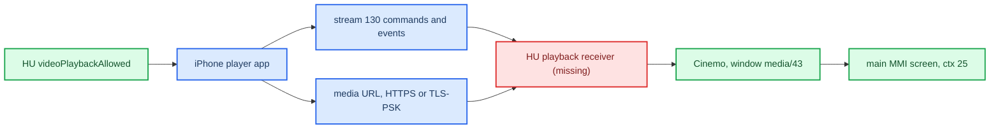

# CarPlay Video Playback

*"Video in Car": how iOS 27 plays films on a CarPlay head unit, what the car must advertise and implement, what stock MU1316 already has (Cinemo, window 43), and why none of it is enabled here.*

---

## 📋 Summary

CarPlay Video is **not** stream 111 and not the main screen stream 110. The iPhone controls a **receiver-side media player** over a remote-control stream (**type 130**) and hands it a **media URL** (`Content-Location`); the head unit fetches and decodes the media itself and shows it on the logical **mainScreen**. The car also owns the permission: it tells the phone whether video is currently allowed. Stock MU1316 libairplay 210.81 has no stream-130 handler and no playback code, so enabling the feature means building a receiver. All of this is static RE; nothing was played on the HU. **[decompile]** / **[open]**



---

## 🔐 Capability, negotiation and permission are three states

Evidence: CarKit, CoreMedia, MediaToolbox, AirPlaySender, APTransport, AirPlaySupport and AirPlayOverlaysServer from the iOS 27 `24A5418b` dyld cache (unslid VAs), cross-checked with the iOS 26.1 `23B85` text decompile. **[decompile]**

1. **CarKit UI capability.** `-[CARSessionConfiguration initWithSessionStatusOptions:propertySupplier:]` sets `videoPlaybackSupported` (ivar `+15`) to `EndpointInfo["videoPlaybackInfo"] != NULL` (`CMP X0,#0 / CSET NE`), unless the Apple-internal `os_feature_enabled("CarPlay","VideoBrowse")` forces it. `EndpointInfo` is the AirPlay **`/info` response** (`CARkAPEndpointProperty_EndpointInfo`, `CARkAPEndpointInfoResponseKey_VideoInfo = "videoPlaybackInfo"`, `..._MainBufferedInfo = "mainBufferedInfo"`). The string appears once in CarKit and is presence-only for this check. Chain: `CRPairingAirPlaySessionInfo` → `supportsVideoPlayback` → `-[CRVehicle updateWithAirPlaySessionInfo:]`. iOS reads these `/info` keys: `AudioFormats`, `FileTransfer`, `LogTransfer`, `MainBufferedInfo`, `VehicleStateProtocolInfo`, `VideoInfo`.
2. **AirPlay negotiation.** 26.1 `Activate.mm:176` proposes `videoPlayback` (pref `enableCarPlayVideoPlayback`) and checks the negotiated value around line 528. `carEndpoint_UpdateFeaturesWithCompletionCallback` @ `0x251080c34` updates the enabled state for feature bit 4; when support is negotiated and `AirPlay/CarPlayVideoPlayback_DestinationBanner` is off, Activate enables it immediately (`0x251082fb4`).
3. **Current permission.** Endpoint storage in this build: `+68` supported (returned for `AirPlayVideoV2Supported`, `UsesExternalPlaybackByDefault`), `+220` audio-only elected, `+221` allowed, `+222` URL playback enabled (`IsURLPlaybackEnabled`, gates `CreatePlaybackSession`), `+223` playback session active.

`videoPlaybackInfo.featuresEx` is a **Base64 bitmap** (`airPlayDescription_copyCarPlayVideoFeaturesInternal` @ `0x251154628`; AirPlaySupport `Base64DecodeCopy` → `CFDataCreate` @ `0x22661ec08`; `APSFeaturesHasFeature` @ `0x2266be888` tests bit `n % 8` of byte `n / 8`). Bit 70 → `SupportsOverlayUI`; bits 73–76 select the volume-control mode (`airPlayDescription_copyVolumeControlTypeEx` @ `0x250f4b5fc`). The full required bit set is unknown; do not advertise everything.

### Who turns video off

`carEndpoint_updateVideoPlaybackAllowed` @ `0x2511490a0` reads `videoPlaybackAllowed` (CFString `0x275b05b80`) from the initial `videoPlaybackInfo` (Activate block `0x251080ed8`, around `0x251082f8c`) and later from the HU command `{type: "setVideoPlaybackAllowed", params: {videoPlaybackAllowed: false, playbackStatus: "video"}}` routed by `carEndpoint_handleEventCreatingReply` @ `0x250f5109c`. On change it posts `kFigEndpointNotification_EndpointDescriptionChanged`. `carEndpoint_CopyProperty` @ `0x250f56970` computes `AirPlayVideoPlaybackAudioOnlyMode = !allowed ? "Forced" : electedAudioOnly ? "Elected" : "None"`, and `-[CARSession videoPlaybackAvailable]` @ `0x1c20071b8` is `mode != "Forced"`, broadcast via `CARSessionVideoPlaybackAvailabilityChangedNotification`. So the 2026-08-28 question "who writes AudioOnlyMode" is answered: AirPlaySender itself, from the Boolean the **car** sends; the phone computes no speed or gear. When forbidden it sends `changeVideoPlaybackToAudioOnly` (`carEndpoint_sendChangeVideoPlaybackToAudioOnlyIfNeeded` @ `0x25114a4ec`; 27 sends when `playbackStatus` is absent or `video`, 26.1 `AirPlaySender_22.mm:9270` also needs the status present). `videoPlayerBackButtonEvent` @ `0x25114a1a0` sets `Elected`, which is a user choice, not a car ban. Apple's model is degrade-to-audio, not a hard block.

Sources: `CARPLAY_VIDEO_RE`, `CARPLAY_VIDEO_TRANSPORT_2026_09_14`

## 🌐 Transport: stream 130 and URL playback

The August "two models" question (buffered AirPlay Video vs rendering into 110) is settled for the traced path: the film is **URL playback**, commands ride **stream 130**. The old bare `kAirPlayStreamType_Playback 120` define does not describe this path. **[decompile]**

```text
carEndpoint_CreatePlaybackSession           0x251148e8c
  createPlaybackSessionInternal block       0x2510916e4
    APEndpointPlaybackSessionRemoteControlCreate 0x2510e3fd4
session_Play                                0x2510e525c
  session_insertPlayQueueItemInternal       0x2510e7520
    session_ensureRemoteControlSessionCreated 0x251178b9c
      APEndpointRemoteControlSessionCreate  0x25101c440
        ensureAndCopyTransportStreams       0x25101c9c8  -> SETUP type 130
```

The remote-control session uses `clientTypeUUID = A6B27562-B43A-4F2D-B75F-82391E250194`, `sessionType = 1`, `controlType = 1`; the SETUP also carries `clientUUID`, `channelID`, optional `wantsDedicatedSocket`/`sendMessageAsIs`. The value the logs call "transport token" is the response key **`streamID`** (`0x275afc700`, statement `0x25101cf2c`), later passed as `StreamGroupID`; there is no `transportToken` field. `insertPlayQueueItem` carries `item` (with `Start-Position`, `Content-Location`, `Offline-HLS-Content-Location`, `IsTLSEnabled`), optional `itemAfter` and `metadata`. For local files the iPhone runs `APLocalPlaybackServerMake` → `APLocalPlaybackServerRegisterPathWithUUIDCreatingHostAndURL` and serves `https://<host><URL>`; `SupportsTLS_PSK` comes from endpoint feature 35 or `ExternalPlaybackCapabilities.supportsOfflineHLS`.

**It targets mainScreen.** `carEndpoint_takeActionOnModeChanges` @ `0x250f586f8` feeds the first element of old/new FigStarkMode to `carEndpoint_checkAndUpdateVideoOverlayActivation` @ `0x251149370`; `APStarkModeCreateDictionaryRepresentation` @ `0x251099448` serialises it as `resourceID = 1` = `kAirPlayResourceID_MainScreen` (`AirPlayCommon.h:1602`). The Fig enum is **inverted** relative to the wire (`Fig 1 → wire 2 = Accessory`, `AirPlayCommon.h:1569-1570`), so Fig owner 1 means the car owns the screen; overlays activate when the accessory owns mainScreen and playback is active. 26.1 `DBDashboard.mm:6594` `session:isPlayingVideoFromApp:` updates NowPlaying with `setTakeScreen:0`. Overlays (`APCarPlayHelperActivateOverlaySession` @ `0x24f3a9ab8` under `CarPlayVideoPlayback_Notifications`, `APOOverlaysServer.activateOverlaySessionOnEndpoint:` @ `0x250ce044c`, client `E3DC3EA6-E6C3-4B30-847C-B7ACFEBEA654`) are extra UI (notifications, sensors, vehicle status, climate), not the film transport; they need CarPlay session-info, not Bonjour discovery.

### Receiver side (AirPlayReceiver / AirPlayReceiverKit)

`AirPlayReceiverSessionSetup` @ `0x250e733d0`: for `type = 130` at `0x250e742ac`, a `clientTypeUUID` equal to the video UUID enters `PlaybackV2Setup` (new `streamID`, mandatory `clientUUID`) → `PlaybackV2Start` (`0x250e75090`: needs a UI controller, passes `deviceID`, `sessionID`, optional `networkClock`, installs `_PlaybackV2EventCallback` @ `0x250e7fc14` and `_PlaybackV2TLSInfoRequestCallback` @ `0x250e7fcf0`, calls UI-controller vtable slot `+48`). The response is `{type: 130, streamID}` (`0x250e75194`) with **no** `dataPort`; it rides the shared control/event connection. The branch also checks session state `+0x2c0 == 2` (the enum meaning is not recovered). Other UUIDs go to the generic remote-control branch at `0x250e74760`.

Images: AirPlayReceiver base `0x250d0d000`, AirPlayReceiverKit base `0x250ee8000` (extracted with `ipsw dyld extract --slide --objc --stubs`, SHA-256 `1f301254def11bc340604deaab31ce581347a842c4a9403bf8cc4532d19bc276`), AirPlaySender (base `0x250f35000`, SHA-256 `379fb232…ead1`), APTransport `0x24f331000`, AirPlaySupport `0x226619000` (SHA-256 `edf99982…c2a3`), AirPlayOverlaysServer `0x250cde000`; Hex-Rays loses some external-call arguments, so keys were confirmed from instructions and cache CFStrings. Commands arrive as `POST /command` with `X-Apple-StreamID`, outer plist `{params: {data: <serialized player dict>}}`, inner `{type: "insertPlayQueueItem", item: {...}}` — two serialisation layers. Path: `airplayReqProcessor_requestProcessCommand` @ `0x250e46cdc` → `AirPlayReceiverSessionControl` @ `0x250e6fa20` (branch `0x250e6fb00`, marks `URLflinging`) → `uiController_controlVideoPlayback` @ `0x250f091ac` (`kUIControllerVTable` `0x275ae86d0`, class vtable `0x275ae8748`; slots `+48` start @ `0x250f08fd8`, `+56` stop @ `0x250f090fc`, `+64` control) → `processMessageWithIDAndDictionarySync:messageSessionID:` @ `0x250eec420` → `_processMessageWithDictionaryInternal:` @ `0x250eec620`.

| Inner `type` | APRKMediaPlayer handler |
|---|---|
| `insertPlayQueueItem` / `removePlayQueueItem` | `_insert…` @ `0x250eed7d4` / `_remove…` |
| `setRate`, `seek`, `stop` | `_setRateWithDictionary:` etc. |
| `playbackInfo` | `_processPlaybackInfoRequestWithDictionary:` @ `0x250ef20b8` |
| `setProperty` / `property` | `_setProperty…` / `_getProperty…` |
| `unhandledURL`, `streamingKey`, `authorizeItem` | FairPlay and fallback paths |
| `playbackCoordinationMedium` | behind feature gate `CoordinatedAirPlayVideo` |

Item keys (case matters): `item`, `itemAfter`, `uuid` (required by the `APRKPlayerItem` ctor @ `0x250effa04`, which builds an `AVURLAsset`), `Content-Location`, `HLS-Content-Location`, `Start-Position`, `Start-Date`, `Start-Position-Seconds`, `IsTLSEnabled`, `audioOnly` (item flag `_isAudioOnly`, not the runtime ban), `Play-Info`, `fpSessionID`, `timeToPauseBuffering`, `timeToPausePlayback`. TLS for local playback: `IsTLSEnabled` → `mediaPlayerNeedsTLSInfo:` → core callback `0x250e7fcf0` returns a 16-byte PSK labelled **`Pair-TLS-PSK`** as `tlsPSK`/`tlsPSKClientIdentity` → `_SSLPropertiesforTLSInfo:` @ `0x250eed348` → `kCFStreamSSLPSKSharedSecret`/`kCFStreamSSLPSKIdentity`, cipher `0x00AE` = `TLS_PSK_WITH_AES_128_CBC_SHA256` (`0x250eed3b8`). The PSK is not a FairPlay key. Events go upstream through `UIControllerSendUpstreamMessage` @ `0x250f07d84` → `_PlaybackV2EventCallback` block `0x250e7fec0` → `AirPlayReceiverSessionSendCommandForObject` @ `0x250e72d0c` (`POST /command`, `CSeq`, `X-Apple-StreamID`, binary plist). `APRKStreamRenderer.processStartVideoPlaybackRequestWithWithSessionID:version:` @ `0x250efcac4` (version 2, `_ensureInternalPlayerFor:` @ `0x250efdc28`) selects streaming mode video 4 / screen 1 / audio 2 / none 0 (`0x250efe64c`) and notifies `didChangeStreamRendererModeTo:forRenderer:` (`0x250efe790`). No command named `changeVideoPlaybackToAudioOnly` or `setVideoPlaybackAllowed` exists in the checked receiver images: the car-side executor of the ban was not found.

### Responses the phone expects

`playbackInfo` reply: `{type: "playbackInfo", kind: "response", messageID?, info}` (base helper `0x250ee9414`). `_currentPlaybackInfoDictionary` @ `0x250eecb08` fills `item.uuid`, `readyToPlay`, `duration`/`position` as **CMTime dictionaries**, `rate`, `playbackState`, `playbackLikelyToKeepUp`, `playbackBufferFull`, `playbackBufferEmpty`, `seekableTimeRanges`/`loadedTimeRanges` (`{start, duration}` CMTimes), `stallCount`, `date`/`absoluteTime`/`estimatedDate`, conditional `isWaitingToSetRateFromSenderAfterSeek` and `interstitialInfo`. Events (`0x250ef284c`): `{type: "playbackState", name: "playing", item: {uuid}, params: <playbackInfo>}`, `{type: "playbackState", name: "stopped", reason: "ended" | "interrupted"}`, `{type: "error", error: {domain, code}}`. State strings (table `0x26938c080`, `0x250ef331c`): 0 `paused`, 1 `loading`, 2 `playing`, 3 `stopped` — an internal Kit enum, not a wire enum. The minimum mandatory field set is unknown.

Sources: `CARPLAY_VIDEO_RECEIVER_2026_09_14`, `CARPLAY_VIDEO_MHI2_PLAYER_2026_09_15`

## 🔍 What stock MU1316 has and lacks

| Piece | Stock MU1316 |
|---|---|
| Stream 130 | **Absent.** `AirPlayReceiverSessionSetup` @ `0x272b8` accepts 100/101/110 only (`0x27564`); anything above 101 goes to the unsupported branch at `0x27580`, logs and continues, then `AirPlayReceiverSessionPlatformControl`; a successful RTSP SETUP therefore proves nothing about 130. |
| `videoPlayback` strings | Zero in 210.81 and in the 280.33.8 SDK. |
| Video window | Cinemo in `media` (`app/eso/bin/apps/media`, base `0x100000`, SHA-256 `b18cf3cd…4c02c59`) opens QNX Screen window **class `media`, ID `43`** from `system/etc/eso/production/media.json` `cinemo.config.videoConfigs` (`windowClass`, `windowId`, `useOverlay: true`); config indices 362/363 read at `0x48ab9c` inside `CCinemoConfig::configure` @ `0x48ca5c`, mapped to paths at `0x21c0a0`–`0x21c150`. `libNmeVideoDevice.so` (SHA-256 `e99a67f1…41044`) creates the window at `0x10098` and sets `SCREEN_PROPERTY_CLASS` (call `0x104f8`) and `ID_STRING` (`0x10588`); helpers `0x2073c`/`0x20614` pick class/ID for HMI, video or subtitles. |
| Composition | Stock `DisplayManagerMIB2High`: ctx 0 `{16}`, **ctx 25 `{16, 43}`** (player 1), ctx 26 `{16, 44}` (player 2), ctx 58 `{36, 43}`; `DataPlayer.activate` picks 25 when `PHYSICAL_PLAYER_ID == 1`; `displaymanager.json` maps Main Display ID 0 to LVDS1, Cluster ID 4 to LVDS2. Our patched table keeps `dc[25] = {16, 43}` (`java_patch/de/audi/tghu/fwhmi/DisplayManagerMIB2High.java:94`). **[code]** |
| URL API | `JobPlayURL` → `FilePlayerContent.setPlaybackURL` → `MediaDSIPlayerControllerImpl.setPlaybackURL` → `DSIMediaPlayer.setPlaybackURL`; the job stops the old track, sets repeat mode, waits for URL/ready, applies scaling, then resumes or pauses by audio state. Native `DSIMediaPlayerImpl::setPlaybackURL` @ `0x32d030` needs an active source (`0x32abe8` uses stored deviceID/mediaID; `0x32799c` sends event **23** via `0x3274f8`; no source → async error). Cinemo `loadTrack` @ `0x4abbcc` (clears the queue, `ICinemoPlaylist::AppendTrack`), `enqueueTrack` @ `0x4aba00`, `playTrack` @ `0x4aad74` have no direct xrefs; the event-23 → Cinemo chain is not reconstructed. Existing file-player clients are boardbook and ringtone. |
| Audi video ban | `DSIGeneralVehicleStates` `TVVelocityThreshold` → `GeneralVehicleStateHandler.updateTVVelocityThreshold` (threshold id **2** = `TVVELOCITYTHRESHOLD`, an id not km/h; validity 1) → `ContentManager.setVehicleMoving` → `DataPlayer.vehicleMoving` → `enableVideoDisplayable(!moving)` → choice **200663** = 0 (HMI without the video layer). It hides the layer and calls no stop/pause. Cinemo `changeVideoOutput` @ `0x4a9e1c` toggles a `disabled` video param but has no found caller. Linking this to CarPlay's `setVideoPlaybackAllowed` is a proposal, not a found stock handler. |

**[decompile]**

## 📌 Why there is no code

A probe that added `videoPlaybackInfo` to `/info` from the `AirPlayCopyServerInfo` interposer (env `CARPLAY_VIDEO_PLAYBACK`, dark by default, about 10 lines) was written in `6207dfe` and reverted in `1471b3b`. It would only raise the phone's capability (surfacing `CRVideoSettingsApp`/onboarding) while claiming a player the car does not have; an empty dictionary adds neither stream 130 nor a URL player. **[code]**

App eligibility: launching from the phone's own player over AirPlay needs no CarPlay app; a CarPlay-UI video app needs entitlement `com.apple.developer.carplay-video` (`+[CRCarPlayAppDeclaration declarationForBundleIdentifier:…]` @ `0x1c2016660`, branch `0x1c2016e28` → `setSupportsVideo:1` + `setSupportsTemplates:1`) and passes `-[CRCarPlayAppPolicyEvaluator effectivePolicyForAppDeclaration:inVehicleWithCertificateSerial:]` @ `0x1c200b714` (branch `0x1c200bb74` checks `supportsVideo` and `videoPlaybackSupported`, plus deny-lists); 26.1 equivalents `CRCarPlayAppDeclaration.mm:539`, `CRCarPlayAppPolicyEvaluator.mm:714`. Photos and Apple TV document AirPlay video; Safari's `com.apple.WebKit.GPU` is mapped to `com.apple.mobilesafari` for NowPlaying; Netflix does not support AirPlay from iPhone. No app has been tested on MHI2Q; a self-made DRM-free clip is the right first test.

<details>
<summary>Open questions and what would close them</summary>

| Question | Needed proof |
|---|---|
| How a URL reaches Cinemo | the full event 23 → source → track load chain, with source checks and errors |
| Which URLs the HU accepts | HTTP/HLS transport and schemes; a successful fetch of a test file |
| TLS from the iPhone | a TLS-PSK client on the HU and a completed handshake |
| Mandatory sender responses | sender-side reads for queue/rate/seek/stop replies and their order |
| Stream 130 in the live session | full SETUP/control/teardown lifecycle, session state, `streamID` |
| Showing the film and returning | mainScreen ownership transitions and composition with displayable 59 |
| Audio-only on the HU | a `changeVideoPlaybackToAudioOnly` handler tied to the car's permission and video output |
| Keeping sound while hiding video | decoder, audio and phone-message behaviour across a ban and back |

The cheapest next static pass is event 23 → source → Cinemo. None of this touches installed firmware. Evidence JSON under `output/carplay-video-re-20260914/` and `output/carplay-video-re-20260915/` is not preserved.

</details>

---

## 📚 Sources

Merged originals were removed from the tree after this note absorbed them; they remain in git history (commit 23972aa).

- `CARPLAY_VIDEO_RE` — the first pass (2026-08-28): capability ivar, key names, the reverted probe.
- `CARPLAY_VIDEO_TRANSPORT_2026_09_14` — sender: permission writer, stream 130, URL playback, mainScreen, app eligibility.
- `CARPLAY_VIDEO_RECEIVER_2026_09_14` — receiver: PlaybackV2, command dispatcher, TLS-PSK, stock MU1316 SETUP.
- `CARPLAY_VIDEO_MHI2_PLAYER_2026_09_15` — Cinemo window 43, URL API, the Audi video ban, playbackInfo schema.

Related: [CarPlay Feature Survey](CARPLAY_FEATURE_SURVEY.md), [AltScreen and Video overview](README.md).
