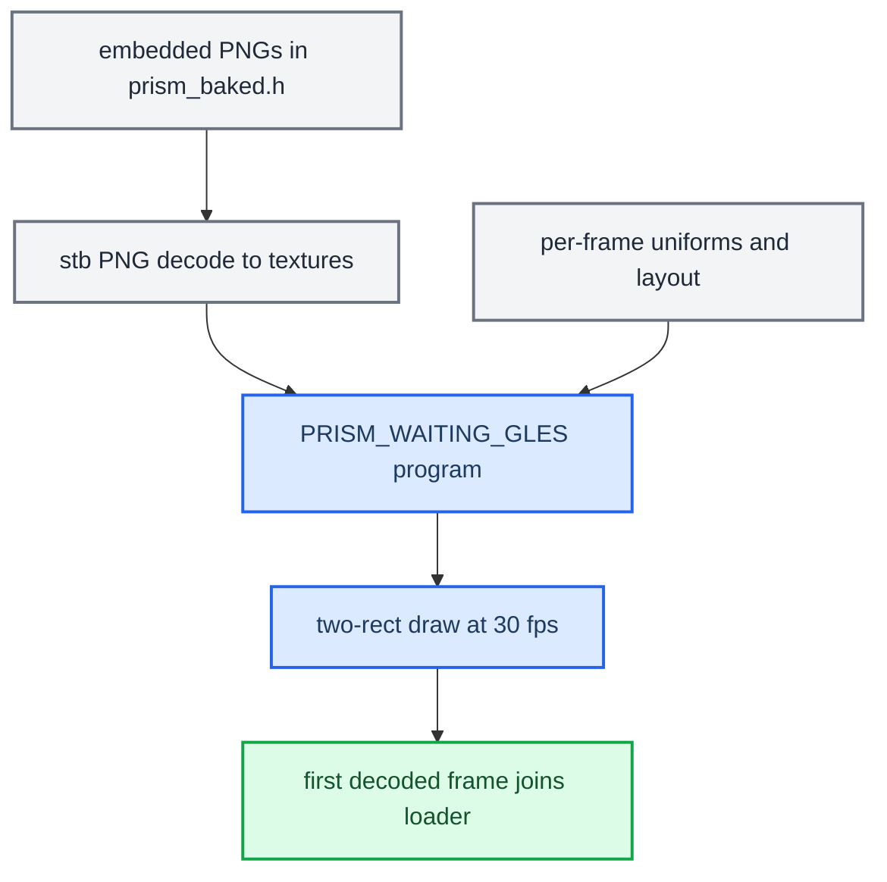

# Cluster Loader

*The CarPlay cluster waiting animation: PRISM, a glass Apple lit by moving spectral light, drawn by `altscreen_render` until the first decoded picture arrives.*

---

## 🎯 What it is

Before the first decoded video frame arrives, the cluster needs something on screen. The production loader is **PRISM**, a GLES2 fragment shader that draws a glass Apple silhouette whose light moves inside the material, plus the `@LuKa_dev` signature (`altscreen_render/loader/prism.frag:1-2`, `tools/loader_preview/PRISM.md:1-9`). The first decoded picture stops and joins the loader thread, and native video is then presented directly, with no transition (`altscreen_render/screen_egl_present.c:959-961`). **[code]**

It replaced the earlier Apple-boot loader (white logo, 12-segment HIG spinner, SF Pro signature, art baked into `common/loader_assets.h`). That shader loader was deployed and seen live at 30 fps with a clean `VIDEO_ON` takeover **[car]**. Its files no longer exist in the tree: there is no `common/loader_assets.h` and no `common/carplay_loader.*`. See `memory/loader_shader_altscreen_port.md` for the history.

## 📚 The look

- An opaque black window. Only two rectangles are drawn: the logo and the signature. No shader runs over the rest of the panel (`altscreen_render/loader/prism_waiting.h:5-7`).
- A glass Apple silhouette of constant size. Only its glass and lighting develop over time (`prism.frag:54`).
- Curved light volumes and soft internal caustics, with no external streak, orb or separate spinner (`prism.frag:1-2`, `:24-37`).
- The `@LuKa_dev` signature in SF Rounded Medium, 122×18 panel pixels (`altscreen_render/loader/prism_baked.h:9104-9105`, `PRISM.md:4-5`).

The artwork stays inside the selected VC safe area. The geometry comes from `altscreen_render/loader/loader_layout.h:30-42`: **[code]**

| View | View rectangle (px) | Content rectangle after padding (px) |
|---|---|---|
| Full, either style | `270, 90, 900, 362` | `270, 90, 900, 304` |
| Compact, Sport | `90, 135, 360, 317` | `90, 135, 360, 252` |
| Compact, Classic | `540, 135, 360, 317` | `540, 135, 360, 252` |

The view comes from the live view-area mode and the style from the VC layout style (`screen_egl_present.c:745-749`).

## ⚙️ Implementation

| Element | Detail |
|---|---|
| Shader | `PRISM_WAITING_GLES` in the generated `altscreen_render/loader/prism_baked.h:9339`. Its source is `altscreen_render/loader/prism.frag`. It is compiled as `loader_program` (`screen_egl_present.c:247-288`). |
| Uniforms | `iRes`, `iTime`, `uContent`, `uSigRect`, `uMaterial`, `uSig`, set each frame in `ep_loader_frame` (`screen_egl_present.c:738-784`). |
| Art | Two PNGs embedded in `prism_baked.h`: a 512×512 material and the signature. They are decoded from memory by a PNG-only `stb_image` (`STBI_NO_THREAD_LOCALS`, `altscreen_render/loader/prism.c:1-18`). There is no file IO at boot. |
| Timing | The loader starts on the completed silhouette at `t = 2.7 s` (`EP_PRISM_VISIBLE_MS`, `screen_egl_present.c:808-812`). It runs at a 33.3 ms period, and at 66.7 ms while a stream is pending decode (`altscreen_render/pipeline_timing.h:6-9`, `screen_egl_present.c:830-832`). |
| Stop | The stop request does not take `gl_lock`. If the join times out in an EGL/Adreno wedge, the renderer exits safely instead of freeing live images (`screen_egl_present.c:878-914`, `ALT_LOADER_STOP_WAIT_MS = 750`). |
| Build | `altscreen_render/Makefile` builds `loader/prism.c` into the QNX sink and depends on the four loader headers. |

## 🔧 Host preview and tuning

`tools/loader_preview/` holds `prism_preview.c`, the macOS preview, which uses the same loader implementation. Controls are **R** replay, **V** full/compact, **S** Sport/Classic, **G** guides, **Space** pause, and **Esc** close. Stills are captured with `--time`, `--capture`, `--frames`, `--view` and `--style`. `make bake` regenerates `prism_baked.h` from the material and signature generators (`bake_prism.py`, `prepare_material.py`, `prepare_signature.py`), which needs Python, Pillow, NumPy, SciPy and the local macOS font (`tools/loader_preview/PRISM.md:32-58`). **[code]**

## 🔄 Waiting-only lifecycle

The loader is a **waiting** animation, never a compositor over video. The rules as implemented and tested (2026-09-14 "PRISM cleanup" candidate): **[code]**

- One existing managed RGBA plane 99 at 1440×542; no new plane, process, Java context or shell monitor.
- A 30 Hz thread draws PRISM only while waiting. The shader has no video sampler, no zoom and no refraction of video.
- Each waiting frame clears to opaque black and draws the logo and signature rectangles in one batch. Shader coverage is **2.40 %** of the panel in the full layout and **1.67 %** in compact; these are areas, not a measured GPU speed-up.
- The first decoded picture stops and joins the thread before drawing; later pictures go straight from their native-32m EGLImage to the window, one draw and swap each, with no intermediate framebuffer, copy or queue. Only unused waiting-frame time is slept; video gets no added timer.
- Normal decoder teardown restarts the artwork after releasing its buffers. A caught-up or temporarily quiet stream does **not** restart the loader.
- The renderer's control loop to Java starts only after the first PRISM frame is published, so Java's first `VIDEO_OFF` means "loader ready, no video yet". Java holds the previous cluster context until that first `VIDEO_OFF` or `VIDEO_ON` ([Cluster Contexts](../cluster-and-rgi/CLUSTER_CONTEXTS.md)).

The video path around it keeps per-picture external-image rebinding, `glFinish` before buffer recycling, the 750 ms stop watchdog, the 1000 ms input deadline (`ALT_INPUT_WAIT_MS`, `pipeline_timing.h:8`), receipt-time diagnostics and no output-age dropping ([AltScreen Frame Rate](ALTSCREEN_FRAME_RATE.md)).

Cold boot on 2026-09-16 still showed about 1.5 s of black: `Screen/EGL open` took **1349 ms** and the first OMX start **755 ms**, and Java had selected ctx 81 before the renderer connected. The renderer-ready wait removes the empty-plane selection without adding a minimum loader duration; the visible duration after the next reboot is **[open]**. **[car]**

Sources: `ALTSCREEN_PRISM_WAITING_2026_09_14`, `ALTSCREEN_VC_NAV_STATUSBAR`

## ❌ The PRISM compositor that was removed

The intermediate design (commit `7fce1c4`) kept a compositor thread alive for a smooth, reversible PRISM↔video handoff. Each OMX callback submitted to `prism_queue` and waited for the compositor to copy the native source into an owned RGBA FBO, run PRISM and swap before `prism_queue_complete` released the callback: an extra rendezvous and a full-frame GPU pass per picture, tying OMX buffer recycling to compositor speed. Once the handoff reached 1 the shader had a cheap passthrough branch, but the cache copy and rendezvous stayed. **[code]** (historical)

On the car (2026-09-14) the user saw about **30 s of black**, repeated PRISM/video transitions and badly delayed pictures. `build/hu-log-review-20260914/altscreen_render.log` showed three input-buffer timeouts followed by transport reconnects and decoder generations 1–4, plus two renderer restarts; later logs reached 1800 posted pictures at about 64 ms interarrival and 2 ms average swap, which proves activity, not freshness. The old queue held up to 1024 compressed records / 24 MiB with no receipt timestamp. A follow-up candidate paced the compositor outside `gl_lock` on a 33.33 ms budget, raised the input deadline from 500 ms to a shared 1000 ms, carried socket receipt time through OMX `nTimeStamp`, and skipped decoded pictures older than 200 ms when a newer one had entered OMX. That age filter later proved harmful and was removed ([AltScreen Frame Rate](ALTSCREEN_FRAME_RATE.md)). Both HU addresses stopped answering SSH during this work. **[car]**

The user then cancelled the two-layer approach and asked for the old simple loader with immediate video takeover. Superseded candidates that must **not** be deployed: `altscreen-prism-waiting-20260914`, `altscreen-classic-loader-20260914` (the intermediate classic Apple + spinner build), `altscreen-latency-20260914`. The retained candidate was `build/releases/altscreen-prism-cleanup-20260914/`.

Sources: `ALTSCREEN_LATENCY_AUDIT_2026_09_14`, `ALTSCREEN_PRISM_WAITING_2026_09_14`

## 🏠 No main-screen startup loader

The HU cursor and main-screen startup overlay experiment was removed on 2026-09-14. Stock `libairplay.so` owns main stream 110 and displayable 59; HU context 78 is again `{16, 59}`; the hook does not interpose main-video config/render or publish an extra HU readiness protocol, and stock `TMDeviceControl` owns the Smartphone Integration identity and selected menu item. The MMI touchpad now drives CarPlay's native trackpad focus mode (the DPAD `TouchpadController` was removed on 2026-09-23; see [Architecture](../reference/ARCHITECTURE.md#mmi-touchpad)); touchscreen and console selection/rotation use stock DSI paths; there is no pointer plane, pointer transport or synthetic click. The supervisor starts only `maneuver_render` and `altscreen_render`; the card installer removes the old HU renderer executable on upgrade. That removal was verified locally, not on a physical HU at the time. **[code]**

Sources: `CARPLAY_STARTUP_LOADER_PLAN`

## ✅ Status

Offline checks: `make -C tools/loader_preview check check-bake` and `make -C altscreen_render hostcheck` (syntax-only against stub headers, `altscreen_render/Makefile:60-67`). The Docker ARM build via `scripts/build_renderers.sh` asserts `emutls = 0` (`scripts/build_renderers.sh:95-100`). **[code]**

Before the old shader was deleted, the production waiting artwork matched the original PRISM at stream-mix zero within **1/255 per channel** across four VC layouts and six phases. `test_prism_waiting.c` compares full-panel and bounded draws, the six artwork uniforms, black safe-area margins and opaque output. `altscreen_present_test.c` runs the real presenter against GL/Screen stubs: loader stop/join before video, no waiting redraw after the first frame, one draw per picture, external-image refresh, GPU completion before post, swap-failure reporting and reconnect, under ASan/UBSan. The ARM build is only a link/ABI check; Adreno 320 timing needs the car.

`PRISM.md` itself says that Adreno performance, Screen pacing and reconnect behaviour still need HU testing (`tools/loader_preview/PRISM.md:69`). The on-unit look and pacing of PRISM are therefore **[open]**. See `memory/graphics_root_egl_trap.md`, `memory/qnx_tls_emutls_trap.md`, and [Video Pipeline](VIDEO_PIPELINE.md) for the delivery path the loader hands over to.

---

## 📌 Related

`altscreen_render` is a persistent renderer. `carplay_monitor.sh` starts or adopts it, restarts it only when it is missing, and leaves it alive across ordinary `dio_manager` exits. Java never spawns or kills it (`deploy/smartphone_integrator/README.md:72-89`). See [Reconnect and Lifecycle](RECONNECT_AND_LIFECYCLE.md) and [AltScreen and Video overview](README.md); for the HMI start order that decides what appears first see [HMI Startup and Identity](../connect-and-usb/HMI_STARTUP_AND_IDENTITY.md), and for the renderer log audit [Production Audits](../build-and-deploy/PRODUCTION_AUDITS.md).

## 📚 Sources

Merged originals were removed from the tree after this note absorbed them; they remain in git history (commit 23972aa).

- `ALTSCREEN_PRISM_WAITING_2026_09_14` — the final waiting-only PRISM design and its tests.
- `ALTSCREEN_LATENCY_AUDIT_2026_09_14` — the removed compositor, the 30 s black report, superseded candidates.
- `CARPLAY_STARTUP_LOADER_PLAN` — removal of the HU main-screen overlay and cursor.
- `ALTSCREEN_VC_NAV_STATUSBAR` — renderer-ready ordering and cold-boot timings.
- `tools/loader_preview/PRISM.md`, `memory/loader_shader_altscreen_port.md`.
