# Cluster Video Encoder

*How the head unit turns a cluster display context into the H.264 stream the Virtual Cockpit shows: DisplayManager, `videoencoderservice`, and the stock KOMO widget renderer that the early cluster work fought with.*

---

## 📋 What this covers

Whatever the HU shows on the cluster is a **capture**: the DisplayManager composes the displayables of the active cluster context, `videoencoderservice` captures that composition on a timer, H.264-encodes it, and sends it as MPEG-TS over MOST to the VC, which shows it on LVDS. Our CarPlay planes 98/99/101/102 ride this same encoder; only the content source changed. This note keeps the encoder internals and the stock-navigation history. The VC-side view selection lives in [HUD Renderer](../cluster-and-rgi/HUD_RENDERER.md); the context table in [Cluster Contexts](../cluster-and-rgi/CLUSTER_CONTEXTS.md). **[decompile]**

```mermaid
flowchart LR
  accTitle: Cluster capture and encode chain
  accDescr: Java switches the cluster context and sets the update rate; the DisplayManager forwards the first displayable and the rate to videoencoderservice, whose timer captures, encodes and sends the picture over MOST to the VC.
  java["Java switchContext + setUpdateRate"]
  dm["libdm_modMain CContextManager"]
  asi["CASIMostEncoder over ASI"]
  ves["videoencoderservice event thread"]
  timer["CDisplayTimer 1000/fps ms"]
  enc["IPTE capture, QC OMX H.264, MPEG-TS"]
  most["MLB ISO, MOST, VC LVDS"]
  java --> dm
  dm --> asi
  asi --> ves
  ves --> timer
  timer --> enc
  enc --> most
  classDef primary fill:#dbeafe,stroke:#2563eb,stroke-width:2px,color:#1e3a5f
  classDef neutral fill:#f3f4f6,stroke:#6b7280,stroke-width:2px,color:#1f2937
  classDef success fill:#dcfce7,stroke:#16a34a,stroke-width:2px,color:#14532d
  class java primary
  class dm,asi,ves,timer neutral
  class enc,most success
```

## ⚙️ DisplayManager side (`libdm_modMain.so`)

| Function | Behaviour |
|---|---|
| `CDSIDisplaymanagement::setUpdateRate(display, rate)` | Receives the DSI from Java and posts an event. |
| `CDSIDisplaymanagement::evtSetUpdateRate` | Calls `CASIMostEncoder::setUpdateRate()` **only**; it never calls `setActiveDisplayable`. |
| `CASIMostEncoder::setActiveDisplayable(displayID, displayable)` | Stores the displayable in an RB-tree and forwards it over the ASI proxy. No gating. |
| `CASIMostEncoder::setUpdateRate(displayID, rate)` | Stores and forwards the rate. No gating. |
| `CContextManager::preContextSwitchHook()` | Runs on a context switch. A display **with** a terminal takes the hardware-displayables path; one **without** takes the MOST-encoder path and calls `setActiveDisplayable(displayID, firstDisplayable)`. |

Java terminal 1 → `getInternalDisplayID(1)` = **4** (cluster); `videoencoderservice` `mapDisplayId(4)` = **remoteDisplayId 0**; every other display maps to 1. **[decompile]**

### Root cause of the early blank cluster: no context change, no re-point

1. `setActiveDisplayable` is called **only** from `preContextSwitchHook`, never from `setUpdateRate`.
2. Java `DisplayManager.switchContext()` skips the DSI call when `confirmedActiveContext[terminal]` already equals the request.
3. So `switchContext(72)` while 72 is already active is a no-op, and the encoder keeps displayable **0** from its constructor: IPTE captures nothing.
4. `setKDKVisible(20, 1)` maps 72 → 74, which *is* a new context, but its first displayable is **20**, which only has content during native route guidance.

The fix that became the production rule: force a real context change through a throwaway context before the target. The historical recipe was `switchContext(0)` → 250 ms → `switchContext(72)` → 250 ms → `setUpdateRate(1, 10)`. Today `AltScreenModule.applySwitch` bounces through ctx 72 (or 74 if the target is 72), sleeps 180 ms, re-checks that the request is still current, then switches to 80/81 and calls `setUpdateRate(1, 30)`; 80↔81 switch directly because the encoder is already running; release does `setUpdateRate(1, 0)` then ctx 74. **[code]** (`java_patch/com/luka/carplay/core/AltScreenModule.java:44-50`, `:550-600`)

Verified in March 2026 (KOMOProbe): the PresentationController renders the map to displayable **33** at all times, including during CarPlay; the MOST video connection works (map flicker on the VC during switch tests); ctx 0 is safe as a temporary bounce. **[car]**

| Context | Displayables | First (sent to encoder) | Notes |
|---|---|---|---|
| 72 | `{33}` | 33 (base map) | FPK map, always has content |
| 74 | `{20, 102, 101, 33}` | 20 (KDK intersection) | 20 only has content during native RG |
| 76 | FPK split | varies | |
| 77 | FPK split + KDK | varies | |

## ⚙️ `videoencoderservice` internals

| Function | Address | Behaviour |
|---|---|---|
| `CASIVideoEncodingSrv::setActiveDisplayable` | `sub_10A0D0` | Enqueues `{displayID, displayable, fps=-1}`, signals the condition variable. |
| `CASIVideoEncodingSrv::setUpdateRate` | `sub_1078D8` | Enqueues `{displayID, -1, rate}`. |
| `CASIVideoEncodingSrv::threadLoop` | `sub_1072FC` | Pops the deque, calls `processEvent`. |
| `processEvent` | `sub_106EC4` | displayable > 0 and fps < 0 → `adjustDisplayable`; displayable < 0 and fps ≥ 0 → `adjustTimer`. |
| `CServiceController::mapDisplayId` | `sub_10A638` | display 4 → remoteDisplayId 0, else 1. |
| `CServiceController::adjustTimer` | `sub_10A694` / `0x10a694` | Looks up the pre-created timer, sets `1000/fps` ms (integer; 30 fps → 33 ms), stop + modify + start. fps capped at 60, no other gating. |
| `CDisplayTimer::process` | `sub_10B478` | Takes `array[remoteDisplayId]`; opens the encoder if closed and `m_encoder_reconnect`; if `m_current_state == 1` (ST_ACTIVE) runs `encodePicture` (`ipteCaptureDisplayable` → H.264 → TS); manages the `CDisplayLink` MOST connection. |
| `CServiceController` constructor | `sub_10AAE8` | Creates the TimerGroup and a 1000 ms idle timer as displayTimer id 0 (cluster); always pre-created. |

The exact timer chain down to `timer_settime`, and why the 33 ms period matters for frame repeats, is in [AltScreen Frame Rate](ALTSCREEN_FRAME_RATE.md). **[decompile]**

Sources: `lvds_video_pipeline`

## 💬 Stock KOMO widget renderer (historical)

Before altScreen, the plan was to make the **stock** PresentationController draw a CarPlay maneuver widget into the cluster video. That work is superseded: the CarPlay cluster picture is now the phone's stream 111 on plane 99 plus our `maneuver_render` on 98, and `BAPBridge` no longer feeds KOMO ([RGI and BAP Bridge](../cluster-and-rgi/RGI_AND_BAP_BRIDGE.md)). The facts are kept because the same encoder and VC states still apply.

### Widget sizes (`komoviewstyle.conf`)

| Style | Name | Resolution | Note |
|---|---|---|---|
| 0 | `KVS_Invalid` | – | unset |
| 1 | `KVS_RGI` | 285×276 | old MIB1 widget |
| 2 | `KVS_RGI2` | 363×260 | current MHI2Q widget |
| 3 | `KVS_FPK` | 800×480 | full FPK |
| 4 | `KVS_Most` | – | MOST video mode |
| 5 | `KVS_Debug_MoKoInMainDisplay` | – | debug |

`setKomoViewStyle` is accepted once at startup ("received SetKomoViewStyle after startup => will be ignored!").

### Why the widget stalled during CarPlay

`DSIKOMOView` is provided by `libPresentationController.so` (`ServiceProviderDSIKomoViewImpl`); its methods are `setRouteInfo(RouteInfoElement[])`, `enableKomoView(bool)`, `notifyVisibility(bool)`, `setKomoViewStyle(int)`, `selectManoeuvreView(int)`, with callback `updateKomoViewEnabled(bool, validFlag)`. Every command passes through `ManeuvreViewControllerRequestInterface` at `this+104` (`setRouteInfoTask` @ `0x6243D8`, vtable call at `0x624424`). That pointer is set only by `ManeuvreViewStartupController` during **native** guidance; while it is NULL, data is dropped with "no ManeuvreViewControllerRequestInterface available!". Even with data, the `GuidanceViewStateMachine` stays IDLE without `PC_MV_GV_START_DRAWING`, and the frame rate stays 0 without `SetFrameRateMode`. `enableKomoView(true)` (`UpdateEnableManeuvreStory` @ `0x621C50`) and `notifyVisibility(true)` only set flags. **[decompile]**

GuidanceView events: `IDLE`, `START_DRAWING`, `STOP_DRAWING`, `UPDATE_VIEW`, `UPDATE_MANOUVRE_VIEW`, `TOGGLE_COMPONENT`, `AUTOTRANSITION`, `SHUTDOWN`. `StartDrawing` @ `0x61C0D8` aborts with "Wrong activeMode - start drawing aborted" or sets `this+12 = 1` and fires event 501. Native guidance also emits BAP directly: maneuver descriptor/information FctID 23, state 24, distance 18, turn-to 25, lane guidance 22.

### The three-patch `libPresentationController.so` fix (Option A)

Persistent patch of `/apps/PresentationController/lib/libPresentationController.so` by `patch_libpresentationcontroller.py`. Whether it is still deployed on any unit is **[open]**.

| Patch | Address | Bytes | Purpose |
|---|---|---|---|
| 1 | `0x60BE48` `ManeuvreViewManager_StopDSIs` | `F0 40 2D E9 B0 30 9F E5` → `00 00 A0 E3 1E FF 2F E1` | `MOV R0,#0; BX LR`: keep the DSIs and offsets 104/116 alive after native guidance stops. Required first. |
| 2 | `0x61C11C` in `GuidanceView_StartDrawing` | `0A 00 00 1A` → `0A 00 00 EA` | BNE → B: skip the activeMode check (depends on patch 1). |
| 3a–c | `0x5C75A0`, `0x5C75E4`, `0x5C783C` in `StartNewFrame` | `68 60 90 E5` → `54 60 90 E5`; `68 10 95 E5` → `54 10 95 E5` (×2) | Read the stored fps (`+0x54`) instead of the active fps (`+0x68`) so Java's `setKOMODataRate` controls rendering. |

`MVCSDKMapDrawingManager` layout (ctor `0x5C8070` initialises all fields to 1): `+0x00` osal::Timer base, `+0x50` last frame timestamp, `+0x54` stored fps (written by `SetFrameRateMode` @ `0x5C7478`), `+0x58` configured rate (mode 2), `+0x5C` ChangeFrameRate sub-object, `+0x60` dirty flag, `+0x64` pending fps (`ChangeFrameRate` @ `0x5C79E8`), `+0x68` active fps (`DSIHasChanged` @ `0x5C7AF0`). The `0x54 → 0x64 → 0x68` propagation needs native guidance context. `GetFrameRateForMode` @ `0x5C706C`: mode 0 → 0, 1 → 15, 2 → config, 4 → 5, 5 → 10. Frame-rate config keys: `PC_MAP_CONTROL_BUSINESSLOGIC_FRAMERATE`, `framerateForeground`/`framerateBackground`, `FRAMERATEMODE_NORMAL_FRAMERATE`/`BOOST_FRAMERATE`.

Other libPresentationController addresses

| Address | Function |
|---|---|
| `0x60CAAC` | `ManeuvreViewManager_initStartupAndSetInterfaces` (sets offsets 104+116, starts DSIs) |
| `0x60CCF8` | `ManeuvreViewManager_Stop` |
| `0x60BF1C` | `ManeuvreViewManager_StartDSIs` |
| `0x6236E0` | `ServiceProviderDSIKomoViewImpl_setRouteInfo` entry (validates `riElements`) |
| `0x61BF90` | `GuidanceView_StopDrawing` |
| `0x6192C0` | `CheckCurrentRouteInfoElement` |
| `0x618C90` | `CheckForceUpdateOfRouteInfoBoxData` |
| `0x63A5A0` | `SetRouteInfoBoxData` |
| `0x63D8DC` | `GetManeuvreArrowIconId` |
| `0x5C7598` | `StartNewFrame` ("Frame rate is 0! Wait until new frame rate mode") |
| `0x6231A0` | `KomoViewProvider` ctor (sets offset 104 = 0) |
| `0x771288` | `ServiceProviderDSIKomoViewImpl` base ctor |
| `0x772044` | `handleStopDsiUnGuarded` |

State-machine source path: `PresentationController/map/ManeuvreView/src/Impl/PCMapManeuvreView/GuidanceView/StateMachine/GuidanceViewStateMachine_sm.cpp`.

---

### gfxAvailable never becomes true

`ClusterViewMode.gfxAvailable` gates `MOSTMapViewMode` (rgType 3) and `KDKViewMode`; `LVDSMapViewMode` (rgType 4) needs `kombiMapReady`, `RGIViewMode` (rgType 0) needs `descriptorValid` + `rgiStringValid`, compass needs nothing. The only setter chain is `videoencoderservice` → `DSIKOMOGfxStreamSink` stub → `ATTR_GFXSTATE` → `KOMOCaller.setNotification` (`KOMOCaller.java:144-157`) → `KOMOService.updateGfxState(i, j)` → `if (j == 1) setGFXAvailable(i == 1)` (`KOMOService.java:177-182`), wired by `AbstractNavigationActivator.addDSIKOMOGfxStreamSink`. **[decompile]**

On MHI2Q that DSI has **no native provider**: `libdsikomogfxstreamsinkproxy.so` (in `/mnt/app/eso/lib/factories/`) contains both stub and proxy, but nothing instantiates the stub; `videoencoderservice` and `libPresentationController.so` have zero references; no binary references the server UUID `7f54a915-2fc6-5ec3-81a7-a15e19315a24` (client proxy `e431fc99-c578-5fa8-b280-ce902809bd5d`). `DSIKOMONavInfo` has no provider either; `DSIKOMOView` does. How native RG still shows widget video was left **[open]**. The workaround was `BAPBridge.forceGfxAvailable(true)` with three strategies in order (`komoService.updateGfxState(1,1)`, reflective `setGFXAvailable(true)`, reflective field write), reversed in `stopKOMO()`. In the current tree it returns early on FPK (see [RGI and BAP Bridge](../cluster-and-rgi/RGI_AND_BAP_BRIDGE.md)). **[code]**

Historical VC chain the hack relied on: `gfxAvailable = true` → `CombiBAPListener` → BAP rgType 4 → VC `INTERN_Active_NavFPK_Content = Map(1)`; with MOST video present, `LVDS_Available = 1` → `SV_LVDS_NavMap_FPK`. The FPK has **no dedicated BAP RGI view**; `InfoStates = 6` (AIO arrows) is rejected by KSS `sub_108F42C` (see [HUD Renderer](../cluster-and-rgi/HUD_RENDERER.md)).

Sources: `gfx_available_root_cause`, `widget_video_architecture`

---

## 📚 Sources

Merged originals were removed from the tree after this note absorbed them; they remain in git history (commit 23972aa).

- `lvds_video_pipeline` — DisplayManager and `videoencoderservice` internals, the context-change root cause.
- `gfx_available_root_cause` — why `gfxAvailable` stays false (no DSI provider) and the reflection workaround.
- `widget_video_architecture` — KOMO widget renderer, GuidanceView state machine, the three PresentationController patches.

Related: [HUD Renderer](../cluster-and-rgi/HUD_RENDERER.md), [Cluster Contexts](../cluster-and-rgi/CLUSTER_CONTEXTS.md), [AltScreen Frame Rate](ALTSCREEN_FRAME_RATE.md), [AltScreen and Video overview](README.md).
