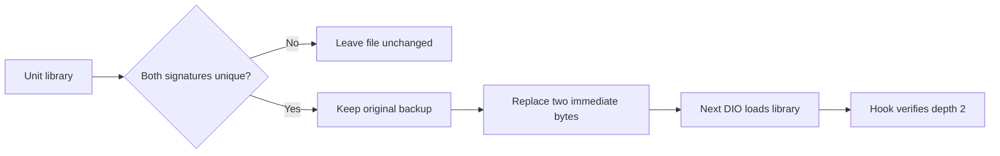

# Stock decoder queue patch

## 🔍 Physical HU diagnosis

On 2026-10-21, a standalone diagnostic on the physical QNX 6.5 HU reproduced
both reasons why the previous decoder optimization did not activate:

| Check | Observed result | Correction |
|---|---|---|
| Three anchors through `dlsym(RTLD_DEFAULT, ...)` | All returned NULL | Open `/mnt/app/eso/lib/libairplay.so` and resolve through its handle |
| Same anchors through the library handle | Correct offsets and deltas | Retain delta, ELF identity and signature gates |
| `mprotect` shared text to RWX | `EACCES` (13) | Patch the unit's library file before the next DIO process starts |
| `mprotect` shared text to RW | `EACCES` (13) | Removing execute permission does not solve this target's restriction |

The diagnostic ran in its own process and wrote no code bytes. Raw evidence
is retained in the integration checkout at `build/decoder_anchor_probe.log`.
These are observations on this HU, not claims about every QNX mapping.

## 🔧 Installed behavior

`deploy/binpatch/binpatch.py airplay_decoder` finds both instructions by unique
surrounding code and changes exactly two immediate bytes in the unit's own file:

| Queue | Stock 210.81 offset | Before | After |
|---|---|---|---|
| Present command queue | `0x8c694` | `MOV R0,#4` | `MOV R0,#2` |
| Decode feed queue | `0x8c6f4` | `MOV R3,#4` | `MOV R3,#2` |

P5087 US and P5092 EU match. K1004 CN has different code and is left unchanged.
Missing, ambiguous, corrupt or partly patched signatures produce no output.
An entirely patched file returns the existing patcher's status 3.

The M.I.B. installer uses MicroPython with an 8 MB heap, saves
`libairplay.so.carplay-stock` once, then activates a same-directory temporary
file by rename. Uninstall restores that backup. Reinstall keeps the original
backup. Existing processes retain their old mapping; a new CarPlay/DIO process
must load the replacement library.

The runtime module validates both complete depth-2 signatures and reports
`queue depth 2 already installed` without attempting `mprotect`. Mixed depths
or corrupt instructions are refused. Runtime patching remains a fallback for
compatible mappings that permit writes; it is not the deployment mechanism
on this physical HU.

## 🧪 Validation and limits

`tests/decoder_optimize_hook_test.c` covers explicit library scope, unreadable
memory, foreign ELF images, corrupt code, both mixed-depth directions,
protection failures and idempotent verification with protection writes denied.
It runs with logging disabled and with the production logger enabled.
`scripts/test_binpatch.sh` checks CPython and MicroPython on real US/EU/CN
firmware, exact two-byte changes, duplicates, corruption and partial patches.
`scripts/test_install_e2e.sh` checks install, reinstall and original restoration.

This reduces buffering in the stock main-screen decoder. AltScreen uses its
own decoder/render path. The patch does not command the iPhone encoder to
send 30 FPS and does not prove that the phone selected the Maps-30 profile.
A subsequent physical session confirmed activation and measured AltScreen
arrival near 30 FPS; see [wired performance measurements](WIRED_PERFORMANCE_2026-10-21.md).
The sessions had different workloads, so causal attribution and long-term
stability still need controlled validation.
