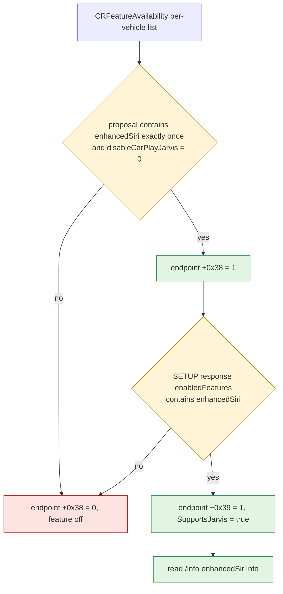
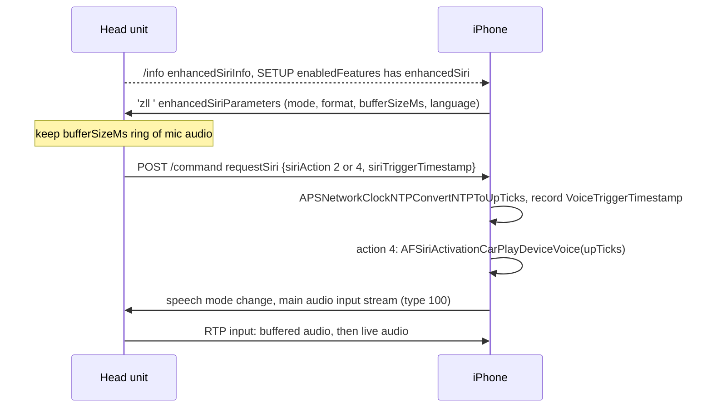

# Enhanced Siri Contract

*What an iPhone (iOS 26.6) expects from a head unit before it enables "Enhanced Siri", meaning zero-latency listening on the Siri button plus in-car voice trigger, and whether MHI2Q can provide it.*

---

## 🧭 Verdict

- **Zero-latency button (ZLL) is buildable in principle but not cheap.** It needs five hook pieces. Two of them cannot be decoded from the phone binary: the wire framing of the phone→car `'zll '` message, and the exact way buffered pre-trigger audio is fed into the speech input stream. Both need a car-side capture. **[decompile]** / **[open]**
- **Voice trigger ("Hey Siri" heard by the car microphone) is not practical on this unit.** The car must run its own keyword detector, in a language the phone selects from the car's list of voice models. It must also keep an always-open microphone ring buffer, 5,000 ms by default. We have no Apple keyword model, and stock owns `mic2_dio`. **[decompile]**
- Stock libairplay 210.81 has none of this vocabulary. It knows only the plain `requestSiri {siriAction}` (`AirPlayReceiverSessionRequestSiriAction`). Everything below would have to live in the hook. **[code]**

Background: [Call and Siri Routing](../audio/CALL_AND_SIRI_ROUTING.md), [CarPlay Feature Survey](CARPLAY_FEATURE_SURVEY.md) (tier entry "Siri hardware button + enhanced voice"), and the negotiation gate shared with altScreen in [AltScreen Cluster Video](ALTSCREEN_CLUSTER_VIDEO.md).

## 🔐 Activation gate

All addresses are from iOS 26.6 (23G71) `AirPlaySender`, image base `0x2276CE000`. Stub targets were resolved with `ipsw dyld disass` on the same cache.



1. **Proposal (phone side).** `___carEndpoint_Activate_block_invoke_2` @ `0x2277F9014` gets the proposal from `APCarPlay_FetchSessionFeatureKeysWithIdentifier` @ `0x227816A24`. That function calls CarKit `-[CRFeatureAvailability fetchSupportedAirPlayFeaturesForVehicleIdentifier:completion:]` with a 5 s timeout. At `0x2277F93D4`-`0x2277F9420` the phone reads `APSSettingsGetIntWithDefault("disableCarPlayJarvis", 0)` and `CFArrayGetCountOfValue(proposal, "enhancedSiri")`, then stores endpoint `+0x38` = (count == 1 && !disable). If the feature is disabled the string is removed from the proposal (`0x2277F9434`-`0x2277F945C`). **[decompile]**
2. **Negotiation (car side).** At `0x2277F97D8`-`0x2277F9808`, endpoint `+0x39` = `+0x38` && `CFArrayContainsValue(response enabledFeatures, "enhancedSiri")`. This is the same response key the hook already writes for altScreen. The phone then sets description property `SupportsJarvis` from `+0x39` (`0x2277F9888`). Unlike altScreen, this flag **also needs the phone's proposal**. A car cannot force it on by itself. **[decompile]**
3. **`/info` keys.** `airPlayDescription_copyPropertyInternal` @ `0x2276DD3F0` maps the description properties to the `/info` dictionary (`EndpointInfo`) through `airPlayDescription_copyEndpointInfoNestedCFData` @ `0x2278BB8B8`. That helper reads `info[outer]` as a dictionary, then `[inner]`. `airPlayDescription_isJarvisFeatureSupported` @ `0x2278BB81C` returns `CFBooleanGetValue(info.enhancedSiriInfo[key])`, but only when the description byte `+0x40` (negotiated `SupportsJarvis`) is already set. **[decompile]**

| `/info` key | Type | Phone property | Effect | Evidence |
|---|---|---|---|---|
| `enhancedSiriInfo` | dict | container | Holds the four keys below | cfstring `0x283824FA8` → `0x227946FF0` |
| `enhancedSiriInfo.enhancedSiriVoice` | bool | `SupportsJarvisVoice` ("HUSupportsVoice") | Car can do voice trigger | `0x2276DF5F4` |
| `enhancedSiriInfo.enhancedSiriNotMixable` | bool | `SupportsMixableSiriAudio` = !value | Siri audio not mixable | `0x2276DF5A4`-`0x2276DF5F0`, CSEL `0x2276DD9BC` |
| `enhancedSiriInfo.voiceModelSupportedLanguages` | array of string | `VoiceModelSupportedLanguages` | Keyword-model languages the car ships | `0x2276DF720`, `0x2276DF7B0` |
| `enhancedSiriInfo.voiceModelCurrentLanguage` | string | `VoiceModelCurrentLanguage` | Car's current model language | `0x2276DF738`, `0x2276DF7C4` |
| `extendedFeatures` ∋ `enhancedSiri` | string | — | Probably what feeds the CRFeatureAvailability list | **[open]** |
| SETUP response `enabledFeatures` ∋ `enhancedSiri` | string | `SupportsJarvis` | The negotiation itself | `0x2277F9808` |

CarKit then exposes `CARSessionInfoKeyEnhancedSiriButton/Voice/NotMixable/Info` as `CARSessionConfiguration.supportsSiriZLLButton/ZLL/Mixable`. Those are consumers, not gates. **[decompile]**

## 📨 `enhancedSiriParameters` (phone → car)

`carEndpoint_setParametersForJarvis` @ `0x2278B1B48` sends nothing unless endpoint `+0x39` is set. Its block `@0x22780168C` also requires that the endpoint is not dissociating (`+232`), is activated (`+233`), and has a sender session (`+296`). It skips sending when the parameters equal the cached copy at `+472`. Block 2 @ `0x2278018B8` then calls `APTransportStreamSendPlistMessage(transportControlStream, 'zll ' = 0x7A6C6C20, dict)`. The control stream comes from `kAPSenderSessionProperty_TransportControlStream` (`0x227801784`). That function serialises the dictionary as a **binary plist** (`CFPropertyListCreateData` format `0xC8`). **There is no reply callback.** The phone fires the message and moves on. **[decompile]**

```text
{ enhancedSiriParameters: {
    voiceActivationMode: int     // AirPlayVoiceTriggerMode, see below
    bufferAudioFormat:   int64   // 0x10 over USB, 0x10000000 over Wi-Fi
    bufferSizeMs:        int     // jarvisBufferSize pref, default 5000
    voiceModelLanguage:  string  // only when voiceActivationMode == 1
} }
reset form (Siri wakes during buffered audio): { enhancedSiriParameters: { burstPeriodMs: 0 } }
```

| Field | Source | Values | Evidence |
|---|---|---|---|
| `voiceActivationMode` | `carEndpoint_handleJarvisParametersChangedNotification` @ `0x227806864` | `1` when deviceUnlockedSinceBoot ∧ SpringBoard started ∧ Siri switch on ∧ `enhancedSiriVoice`; `2` when 1 was chosen but no language matched; otherwise `-1` (`0xFFFFFFFF`). Overridden by pref `jarvisVoiceTriggerMode` (default 1) | log string `0x2279410D1`; meaning of 2 and -1 **[open]** |
| `bufferAudioFormat` | endpoint `+0x28` = !`IsConnectedOverUSB` (`0x2277F67B8`) | `0x10` = bit 4 `PCM/16000/16/1` (wired); `0x10000000` = bit 28 `OPUS/16000/1` (wireless) | `0x2278B1BE0`; bit table in [Spatial Wire Format](../reference/IOS_CARPLAY_SPATIAL_WIREFORMAT.md) |
| `bufferSizeMs` | `APSSettingsGetIntWithDefault("jarvisBufferSize", 5000)` | ms of pre-trigger audio the car keeps | `0x227806864` |
| `voiceModelLanguage` | `APCarPlayGetJarvisLanguageFromList` @ `0x227817FF4` → `CSCoreSpeechServices voiceTriggerJarvisLanguageList:jarvisSelectedLanguage:completion:` | one entry of the car's `voiceModelSupportedLanguages` | **[decompile]** |
| `burstPeriodMs` | `___carEndpoint_resetBurstParamsIfSiriWakes_block_invoke_2` @ `0x227801614` (from `carEndpoint_takeActionOnModeChanges`) | `0` | meaning **[open]** |

Triggers for a resend: session activation, `com.apple.airplay.jarvisParametersChanged`, `com.apple.corespeech.voicetriggerassetchange`, a Siri-switch change and the first unlock. Each also posts `EnhancedSiriParametersChanged` locally. **What the car must do:** keep a ring of `bufferSizeMs` of microphone audio in `bufferAudioFormat`. When the mode is 1, it must also arm its keyword detector for `voiceModelLanguage`. **Reply:** none is consumed by `AirPlaySender`. How the HU's HTTP/RTSP layer must acknowledge the message (method, path, status) is **[open]**. `'comm'` messages from `metadataSender_sendMRMetadata` use the same call, and the repo already knows those arrive as `POST /command`, but `'zll '` has not been captured.

## 🎙️ Trigger and buffered audio



- **Command.** `carEndpoint_requestSiri` @ `0x2278B2154` is reached from `carEndpoint_handleEventCreatingReply` (`0x2276D8BC0`). It reads `siriAction` with `CFDictionaryGetInt64` and accepts values 1..4 (`(v-5) < 0xFFFFFFFC`). The values are 1 `Prewarm`, 2 `ButtonDown`, 3 `ButtonUp`, 4 `VoiceActivityStart`; the GOT table at `0x278395788`-`0x2783957A0` resolves to the `kFigEndpointSiriRequestedAction_*` symbols. **[decompile]**
- **Validation** (`___carEndpoint_requestSiri_block_invoke` @ `0x2278B2610`). Action 4 needs endpoint `+0x39`. It also needs a cached `voiceActivationMode` that is neither 0 ("Voice activation received before ready to process voice requests", `-16726`) nor `-1`. While the car is already in speech state the request is refused with `-16727` ("Ignoring voice trigger because Car is in speech state"). Actions 1-3 pass without the feature. **[decompile]**
- **Timestamp.** The phone reads `siriTriggerTimestamp` with `CFDictionaryGetInt64` and converts it with `APSNetworkClockNTPConvertNTPToUpTicks(endpoint+0x138, …)`. The clock at `+0x138` is created by `APSNetworkClockNTPServerCreate` in `___carEndpoint_activateInternal_block_invoke` @ `0x2277FD608`. So the value is a **64-bit NTP time on the session timeline that the phone serves**; the HU is the NTP client. It is stored only for actions 1, 2 and 4 (mask `0x16`), and only when no timestamp is pending (`+0x1F8 == 0`). It is published as `kAPEndpointProperty_VoiceTriggerTimestamp` (`0x2276E37BC`). The log "Siri action: %d; saving timestamp %lu, current time %lu, diff %u ms" prints the converted up-ticks. Stock exports `AirPlayNTPClient_GetSynchronizedNTPTime` and `AirTunesClock_GetSynchronizedNTPTime`, which can produce this value. Their exact NTP word layout (32.32 assumed) is **[open]**. **[decompile]**
- **Activation.** For action 4, `APCarPlayInitiateJarvisProcessing` @ `0x227817C20` calls `AFSiriActivationCarPlayDeviceVoice(upTicks, endpointID, 0, completion)`. After that, Siri drives the normal speech mode change. **[decompile]**
- **Audio path.** No separate stream type exists. The input side is the ordinary RTP path, `carAudioStream_processOneInputDataMessage` @ `0x2276EAE88`. It takes sample time from the RTP timestamp, and no Jarvis/buffer keyword appears anywhere in `carAudioStream_*`. The buffered audio must therefore ride the normal **type 100 main input (audioType speech)** in the format the car advertised. Over USB that is the same `PCM/16000/16/1` bit 4 that stock already offers for the microphone. That the stream must *start* with the buffered `bufferSizeMs`, with RTP time running back to the trigger point, is inferred, not decoded. **[open]**

## 🗣️ Voice trigger ("Hey Siri" via the car mic)

With mode 1 the **car** detects the keyword. The phone does not listen continuously. The phone picks one of the car's `voiceModelSupportedLanguages` through CoreSpeech and sends it back as `voiceModelLanguage`. The car then reports a detection as `requestSiri {siriAction: 4, siriTriggerTimestamp}`. Until that moment nothing is streamed: the car only buffers locally and continuously. After the request, the speech input stream carries the buffer plus live audio. That language list implies a set of Apple-supplied keyword models per language inside the car. Whether the phone re-verifies the keyword from the buffered audio is not visible in AirPlaySender **[open]**. **[decompile]**

## 🚧 Phone-side gates

| Gate | Where | Car can influence? |
|---|---|---|
| Per-vehicle feature list (`CRFeatureAvailability`, also `disablesCarPlayFeatures:forVehicleIdentifier:`) | `0x227816A24` | Only indirectly. Input source (likely `/info extendedFeatures` and/or an Apple allowlist) **[open]** |
| `disableCarPlayJarvis` pref | `0x2277F93E0` | No |
| Response `enabledFeatures` ∋ `enhancedSiri` | `0x2277F9808` | Yes (hook) |
| `enhancedSiriInfo.enhancedSiriVoice`, device unlocked since boot, SpringBoard up, Siri switch on | `0x227806864` | Only the first one |
| Developer/certification overrides `jarvisBufferSize`, `jarvisVoiceTriggerMode`, `jarvisOverrideLanguage`, `jarvisVoiceModelLanguage`, CarKit `CREnhancedSiriOverrides {language, timestampOffset, voiceTriggerMode}` | `0x227806864`, CarKit | No (phone settings) |
| Car in speech state, action 4 before parameters were sent | `0x2278B2610` | Yes (ordering) |

No certificate-serial deny list sits on this path in AirPlaySender. The MFi/vehicle allowlist question lives in CarKit/`carkitd` and was not decoded **[open]**.

## 🛠️ Feasibility on MHI2Q

| Piece | Seam in our hook | Status |
|---|---|---|
| `/info` `enhancedSiriInfo` (+ `extendedFeatures` entry) | `on_server_info` from `AirPlayCopyServerInfo` (`hook/framework/airplay_seams.c:98`) | Easy. Set voice false, language list empty |
| Negotiation | Control-SETUP `enabledFeatures` merge (`hook/altscreen/altscreen_hook.c:1822-1881`). Append `enhancedSiri` only when the request `features` contains it | Easy, but it is the switch that starts phone traffic |
| `'zll '` receipt | HTTP delegate interposition `connection_request` (`hook/framework/http210_seams.c:37`, `:48`). Parse, cache, answer 200 | Wire framing **[open]** |
| `requestSiri` with timestamp | Interpose exported `AirPlayReceiverSessionRequestSiriAction`. Send `AirPlayReceiverSessionSendCommand` (`0x28460`, `POST /command` `{type, params}`) with `siriAction` + NTP time from `AirPlayNTPClient_GetSynchronizedNTPTime` | Feasible. The clock-object argument is **[open]** |
| Pre-trigger microphone ring | `snd_pcm_open_name` interposer (`hook/audio/audio_hook.c:5367`) plus the stock read call on `mic2_dio`. Open the mic at button-down and serve stock's first reads from the ring | Hard: stock opens `mic2_dio` per speech session after the HMI ACK ([Call and Siri Routing](../audio/CALL_AND_SIRI_ROUTING.md)), and a double open may fail |
| Keyword detector + always-on mic | None | Not buildable: no Apple model, mic contention with telephony, CPU already spent on SCENE |

**Minimal plan, button ZLL only:** (1) advertise `enhancedSiriInfo {enhancedSiriVoice: false, enhancedSiriNotMixable: false, voiceModelSupportedLanguages: []}`; (2) negotiate `enhancedSiri` only when it was proposed; (3) accept and log `'zll '`, keep `bufferSizeMs`/`bufferAudioFormat`; (4) on the Siri button, start the hook's own 16 kHz mono ring and send `requestSiri {2, siriTriggerTimestamp}`; (5) when stock opens the speech input, prepend the ring. With voice false the mode should resolve to `-1`, so the phone never expects action 4.

**Risks:** the phone may never propose `enhancedSiri` for this vehicle, which is a hard stop that the HU cannot fix. An unanswered or 404'd `'zll '` might tear the session down, the same class as the `-6740` advertised-but-unhandled trap ([Landmines](../LANDMINES.md), [AltScreen RE History](archive/ALTSCREEN_RE_HISTORY.md)). Microphone double-open can break calls. RTP/NTP misalignment would cut the first word. The gain is only a few hundred ms of Siri start-up.

## 🔬 Smallest safe probe

1. **Zero behaviour change.** In the control-SETUP seam, log the request `features` array the hook already reads (`kReq`, `altscreen_hook.c`). If `enhancedSiri` is absent, the phone has not enabled it for this car. Stop there.
2. **If it is present:** env-gate an `enhancedSiriInfo` advert (voice false) in `/info` and log every incoming request in `connection_request`. That is still harmless, because the phone ignores these keys until `+0x40` is set.
3. Only then add `enhancedSiri` to `enabledFeatures` behind a separate env flag. Capture how `'zll '` arrives (method, path, plist) and answer it, then fix steps 4-5 of the plan from that capture. Deploying is fine; restarting the unit needs the owner's go-ahead every time.

## ❓ Open items

- How `'zll '` is framed toward a legacy RTSP receiver, and what acknowledgement it needs.
- What drives `CRFeatureAvailability` to propose `enhancedSiri` (`/info` `extendedFeatures`, an Apple allowlist, or MFi certification data).
- What `voiceActivationMode` 2 and -1 mean, and the semantics of `burstPeriodMs`.
- How the buffered audio aligns with the RTP timeline of the speech input, and whether the phone trims to `VoiceTriggerTimestamp`.
- Whether the phone runs a second-stage keyword check on the buffer.
