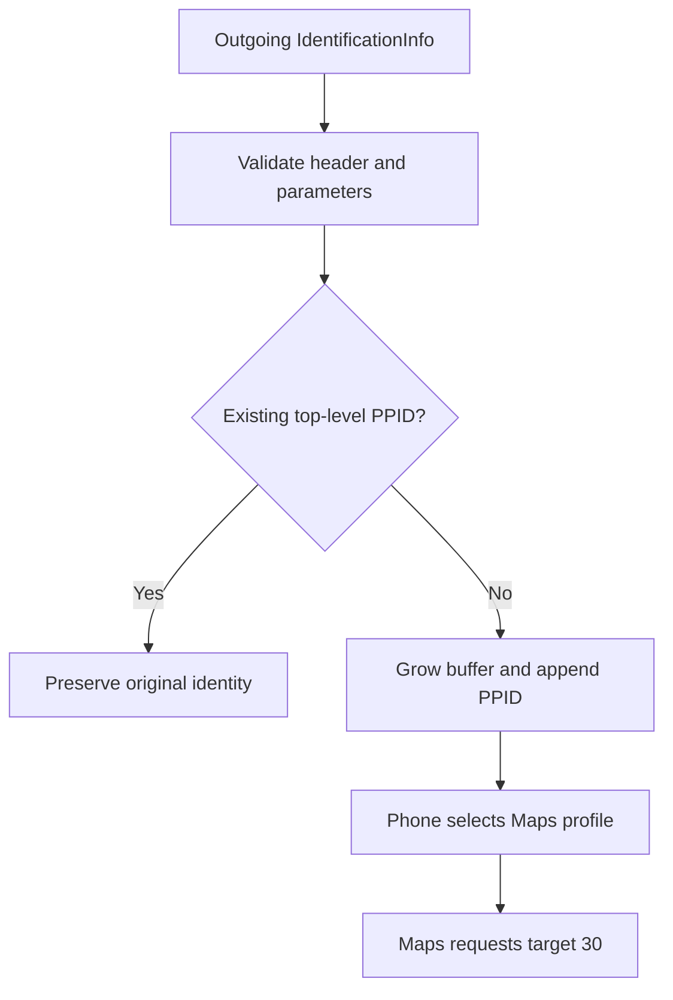

# Maps 30 FPS profile in the HU hook

_2026-10-21 · always enabled; native vphone verified; physical HU cadence remains unmeasured_

---

## 📋 Result and scope

The AltScreen module adds PPID `bf889dfdaea54096` to an outgoing iAP2
IdentificationInfo message (`0x1d01`) when it has no top-level PPID already.
In the inspected CarExperienceAssets content version 40, the matching row
contains exactly `features.userInfo.mapsRefreshRate=30`. This causes the
phone to request a Maps source target of 30 FPS.[^profile]

| Evidence | Observed result |
|---|---|
| Direct phone-side capability control | 1196 AltScreen AUs / 40 s = 29.9 AU/s |
| Accessory PPID-only control | 1189 AltScreen AUs / 40 s = 29.725 AU/s |
| Consecutive reconnect with PPID | 1179 AltScreen AUs / 40 s = 29.475 AU/s |
| Next reconnect without PPID, retaining the prior cache initially | Profile returned to empty userInfo; camera requested 15; 855 AUs / 40 s = 21.375 AU/s |
| Physical HU with this hook change | Not measured |

The controls used an owned native iOS 26.6.2 / 23G90 vphone. They establish
source-policy control, not perfectly spaced presentation on the instrument
cluster. Source gaps still occurred during the 30-target tests. The saved
physical logs do not establish CPU saturation or stable physical 30 FPS.[^controls]

## ⚙️ Implementation and fallback

`altscreen_module_def.on_identify` calls
`alt_maps_profile_identify` from `hook/altscreen/maps_profile.h`.
The existing Encode dispatcher owns buffer-length updates; the callback
uses `hook_identify_grow` when the Cinemo array needs additional capacity.

The appended parameter is 21 bytes: big-endian length `0x0015`, parameter
ID `0x0022` (34), then the 16-character ASCII PPID and a NUL terminator.
The callback changes only the control-message length and adds this parameter;
existing parameter bytes, authentication and certificates remain unchanged.

| Condition | Behavior |
|---|---|
| Valid Identify without PPID | Append the Maps-30 selector |
| Any existing top-level PPID, including the tested value | Preserve it; append no duplicate |
| Nested component parameter 34 | Does not count as a top-level PPID |
| Malformed/truncated parameter list or inconsistent frame header | Leave the message unchanged |
| Allocation failure or result above 8192 bytes | Leave the message unchanged |

Successful addition and skipped existing PPIDs are logged at WARN level.
An existing foreign PPID is deliberately not overwritten. Its presence can
therefore prevent this change from selecting Maps-30; inspect the log before
interpreting frame-rate results. The physical HU's original outgoing PPID
was not captured in the available saved logs.

There is no environment switch: the AltScreen module always attempts this
addition for each valid Identify without an existing PPID.

PPID is a profile selector, not a protocol-level FPS command. Asset updates,
other simultaneously matching profile rows and phone policy can affect the
effective result; a target of 30 is not a guaranteed encoder or panel rate.
Matching feature rows are not merged.[^profile]

## 🧪 Validation

`tests/altscreen_maps_profile_test.c` exercises the production callback with
AddressSanitizer and UndefinedBehaviorSanitizer. It checks exact wire bytes,
preservation of other identity parameters, nested IDs, existing/duplicate
PPIDs, malformed input, moving-buffer growth, allocation failure and size
bounds. It is part of `scripts/run_tests.sh`.

Validation on 2026-10-21 passed: the sanitizer test, the complete host test
script and the QNX/ARMv7 hook build with export/ABI checks. The host script
skipped APAC capture integration and install end-to-end checks because their
external fixtures were unavailable.

Build with `bash scripts/build_hook.sh`. The ordinary unprotected output is
`build/unprotected/libcarplay_hook.so`; no physical-HU deployment is part of
this change.

## 🔗 Sources

[^profile]: Reverse-engineering artifacts retained in the research checkout's `build/wired-altscreen-30fps-re/`: `hook-fps-policy/phone-CarPlayCapabilities.json` (content version 40, vehicles index 157) and `maps-profile-mechanism/` selector/persistence disassembly. The profile's only predicate is PPID and its only feature is Maps refresh rate 30.
[^controls]: Native case artifacts in the research checkout's `build/wired-altscreen-30fps-re/`: `hook-fps-policy/capabilities30/summary.json`, `hook-fps-policy/ppid34-only/summary.json`, and `maps-profile-mechanism/lifecycle-summary.json`, with wire, decoder and camera evidence alongside each case. All temporary guest capability/preferences changes were restored after the controls.
