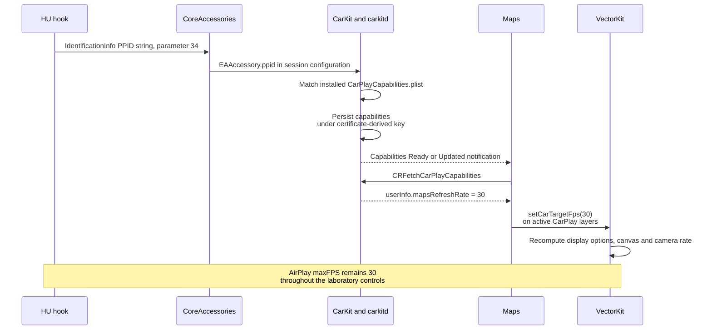

# Maps frame-rate vehicle profile mechanism

_2026-10-21 · native vphone 26.6.2 / 23G90, supplied 26.6 / 23G71 and 27.0 / 24A5418b binaries, 26.1 source comparison_

---

The [original identity and PPID feature comparison](PPID_PROFILE_COMPARISON.md)
adds the complete installed PPID catalog, exact cached-profile delta, Siri/
instrument consumers and the stock identity-composer investigation. The
physical HU's original PPID remains unverified by a wire capture.

## 🧾 Current status and reading guide

This report preserves the laboratory and reverse-engineering record. Later
implementation and physical measurements have the following status:

| Item | Status | Evidence |
|---|---|---|
| Maps-30 PPID hook | Deployed; always enabled when PPID is absent | [Production behavior](MAPS_30FPS_PROFILE.md) |
| Physical AltScreen arrival | 29.64 FPS in the saved short session | [Performance report](WIRED_PERFORMANCE_2026-10-21.md) |
| Concurrent workload | Both screens in motion; six-channel audio output | [Workload and CPU](WIRED_PERFORMANCE_2026-10-21.md#-simultaneous-workload) |
| Original pre-patch PPID / effective phone profile | Not wire-captured / not read back | [Measurement limits](WIRED_PERFORMANCE_2026-10-21.md#-setup-activation-and-remaining-validation) |
| Long-run stability / final panel FPS | Unverified | [Remaining validation](WIRED_PERFORMANCE_2026-10-21.md#-setup-activation-and-remaining-validation) |

Statements about no HU deployment below refer to the specific laboratory
experiments. Paths under `build/` and references marked as local research
sources identify retained evidence or unpublished helpers.

Read the [wire representation](#wire-representation),
[selection rules](#-profile-discovery-and-selection),
[reconnection behavior](#-persistence-notification-and-reconnection)
and [production integration](#%EF%B8%8F-hook-integration-boundary).

## 📋 Established behavior

The accessory can influence Maps' source frame-rate policy through **iAP2
IdentificationInfo parameter 34, `PPID`**. The phone uses that value while
selecting a vehicle profile from a locally installed Apple MobileAsset. The
selected profile's `features.userInfo.mapsRefreshRate` reaches Maps and then
VectorKit's CarPlay display-rate options. This is separate from AirPlay's
advertised `maxFPS` and from the HU's receive/decode/presentation capacity.[^controls]

The owned guest's version-40 asset has 165 vehicle rows. Row 157 contains:

```json
{
  "PPID": "bf889dfdaea54096",
  "features": {"userInfo": {"mapsRefreshRate": 30}}
}
```

This is the only `mapsRefreshRate` occurrence in that installed asset. Its
default `features.userInfo` is empty. The value is a **profile selector**;
it is not a generally defined iAP2 FPS command. A different installed asset
can change the result without changing the phone's firmware build.[^asset]



## 🔌 Accessory input and identity

### Wire representation

The tested semantic iAP2 message is `0x1d01` (IdentificationInfo). Its PPID
parameter is a normal string TLV:

```text
00 15 00 22 62 66 38 38 39 64 66 64 61 65 61 35 34 30 39 36 00
| len | id |                 UTF-8 string                    |NUL|
```

The length is 21 bytes including the four-byte TLV header; `0x22` is decimal
34. The enclosing control-message length is updated. Link/HID fragmentation
and checksums are handled below the semantic-message layer.[^accessory]

In the supplied 26.1 CoreAccessories code, the parameter-name function calls
34 `PPID`. The IdentificationInfo parser sends it to the generic CFString
parser and stores it at identification-info offset `+64`. On accepted
identification, this becomes accessory-info slot 7. The forwarding chain is:

```text
iAP2 IdentificationInfo[34]
  -> identification-info +64
  -> accessory-info slot 7
  -> ACCExternalAccessory.EAPPID
  -> kACCExternalAccessoryPPIDKey
  -> EAAccessory.ppid
  -> CRVehicleAccessory.vehicleAccessoryInfoKeys["ppid"]
  -> CARSessionConfiguration.PPID
```

The positive native control uses the same authentication certificate and
signer as baseline, and native authentication and identification both succeed.
This proves acceptance of that separate field in this guest; it does not
establish every physical-phone implementation's validation policy.[^accessory]

### PPID is different from the cache key

The CarKit comparison source constructs the capabilities identifier from the
MFi certificate serial's base64 representation, with
`CarCapabilitiesDefaultIdentifier` as fallback. PPID participates in profile
matching; it is not the dictionary key under which capabilities are cached.
The native controls retain the same vehicle cache identifier when PPID is
added and removed.[^cache]

The comparison source's IdentificationInfoUpdate parser supports its own
limited parameter set and has no PPID-34 case. It should not be assumed that
sending an update message with parameter 34 changes a running session.
The verified accessory intervention is in **initial IdentificationInfo**.[^accessory]

## 🧩 Profile discovery and selection

### Asset source and readiness

`CRCarPlayAppServiceAgent` requests
`com.apple.MobileAsset.CarExperienceAssets`. It resolves the asset's local
directory and supplies `CarPlayCapabilities.plist` to the capabilities manager.
The owned guest's file is under
`/private/var/MobileAsset/AssetsV2/com_apple_MobileAsset_CarExperienceAssets/`.
The observed version 40 is the plist's content version, not the iOS build.[^asset]

The manager waits for a usable session with accessory information and an
AirPlay info response. It observes both session and accessory events; a
partial session can be refreshed before lookup. Lookup also requires an asset
URL. If no URL exists, the comparison source requests an asset refresh through
`com.apple.carkit.capabilities-changed`. That notification is distinct from
the subsequent capabilities Ready/Updated notifications consumed by Maps.
Offline first-use behavior with no installed asset is not covered by the
positive controls.[^manager]

### Matching is constrained, case-insensitive and not a general glob

The installed asset declares 13 searchable properties: PPID, asset identifier,
AirPlay source version, model name, display count/sizes, and accessory vehicle
name/manufacturer/model/firmware/hardware strings. In the older state machine,
configuration values come through a safe-key allowlist. In iOS 27 they come
from the explicit query object described below. An arbitrary new `/info`
dictionary key does not become arbitrary `features.userInfo`.[^selector]

The checked string comparator:

- Requires strings; numeric values are not compared as integers.
- Uses localized case-insensitive equality first.
- Supports case-insensitive substring matching when exactly one string is
  wrapped in `*` on both ends and has at least three characters.
- Does not implement arbitrary prefix/suffix globs, regular expressions or
  unrestricted wildcard syntax.

For example `*MIB2*` matches `prefix-MIB2-suffix`; `MIB2*` is not a prefix
pattern. The read-only selector model (`tests/carplay_lab/vphone/capabilities_asset.py`, local research source)
deliberately supports ASCII only, rather than pretending to reproduce all
Foundation locale behavior.[^selector]

### There is no unconditional PPID priority

The state machine indexes vehicle rows by searchable **values**, not separate
property/value pairs. It gathers search-hit buckets for present configuration
properties. Each candidate is then checked against all its predicates;
`features` is excluded from the predicate count. A fully matching row with
more predicates wins **within that bucket**.[^selector]

The important implementation detail is that the best-score register is reset
to zero on every invocation of the bucket-selection block. The block writes
to a shared selected-row slot. Thus a later bucket can replace a more specific
row selected in an earlier bucket. The code enumerates dictionary keys and
sets without an explicit sort. Neither PPID priority, plist row order, nor a
global most-specific-rule policy follows from this implementation.[^selector]

This was checked in both the actual guest's 23G90 executable and the supplied
27.0 executable. It is not an inference from decompilation alone:

| Build | Selection block | Score reset | Compare / selected-row replacement |
|---|---|---|---|
| Native 23G90 | `0x10002f244` | `0x10002f308` | `0x10002f350`–`0x10002f374` |
| 27.0 / 24A5418b | `0x10002cf34` | `0x10002cff0` | `0x10002d038`–`0x10002d058` |

An actual asset collision illustrates the consequence:

| Configuration | Fully matching rows | Possible selected rows in the model |
|---|---|---|
| Existing synthetic MHI2 lab identity | None | Default features |
| Lab identity + tested PPID | 157 | 157 |
| `ALPINE / MIB2+ / AUDI MMI` | 6 | 6 |
| Same ALPINE identity + tested PPID | 6 and 157 | 6 or 157 |

Row 6 supplies view-area insets and RHD behavior; row 157 supplies Maps FPS.
The collision is a code-and-asset model result, not a live measurement of that
ALPINE identity or proof that the user's HU advertises those exact strings.
Its practical implication is to audit the real HU identity before treating
one PPID change as sufficient for deterministic selection.[^audit]

The local stock MU1316 `dio_manager.json` gives manufacturer **HARMAN**,
display name **AUDI MMI**, and firmware
`DEV_MMX2QC_AU_NAR_G22_061PROD`. That rejects the ALPINE-specific example.
A partial audit leaves rows requiring display sizes/count or asset identifier
undetermined, plus the tested PPID row. The stock file supplies no model or
PPID field in `accessoryIdentification`. These are extracted configuration
facts, not live iAP2/session readback from the user's HU.[^stock]

### One selected profile, not a merge of matching profiles

`performDoneCaptureResult` creates a new `CRCarPlayCapabilities` with the asset
version. It applies the selected row's `features`, or the asset's top-level
`features` when there is no selected row. It does not merge the feature
dictionaries of every matching vehicle. Missing values retain constructor
defaults, after which the manager performs reconciliation.[^selector]

The profile can affect more than Maps: album art, live activities/widgets,
interface style, view-area insets, rounded corners, zoom and other fields,
depending on build. The manager can subsequently apply prototype preferences,
vehicle user preferences, country policy and session interface style. In our
lab PPID control the final cached delta is exactly `mapsRefreshRate=30`;
that observed absence of other changes is specific to that lab identity.
It does not prove the same delta for a physical Audi profile.[^manager]

## 💾 Persistence, notification and reconnection

The cached path verified through the guest API is:

```text
.GlobalPreferences
  CarCapabilities
    CarCapabilitiesContentVersion = "40"
    <certificate-derived vehicle identifier>
      CRCapabilitiesVersionKey = "40"
      CRCapabilitiesUserInfoKey
        mapsRefreshRate = 30
```

CarKit reads/writes this domain and synchronizes it. The manager compares the
new capability object with the persisted object; a changed valid-version
object is persisted and causes `CARSessionCarCapabilitiesUpdatedNotification`.
Once capabilities are loaded/persisted it can also send
`CARSessionCarCapabilitiesReadyNotification`. The Maps task subscribes to
both Darwin notifications, plus session and scene/map lifecycle events.[^cache][^maps]

This allows an initially cached or default value to be replaced after the
asynchronous profile lookup finishes. A frame-rate value observed at the
first instant of connection is therefore not sufficient evidence of the
eventual selected policy.

The controlled reconnect test deliberately retains the automatically written
30-fps cache between two connections with the same lab identity/certificate.
The second connection omits PPID, and the phone automatically changes userInfo
back to `{}`. The new AltScreen canvas/camera read base/request **15/15** in
both snapshots. No capabilities write or artificial notification occurs
between the two measured sessions. This rules out a permanent unlock or
unconditionally sticky 30-fps cache in this tested lifecycle.[^lifecycle]

| Consecutive 40-second moving window | PPID present | Reconnect without PPID |
|---|---:|---:|
| UserInfo at case start | `{}` | `{"mapsRefreshRate":30}` |
| Automatically selected userInfo | `{"mapsRefreshRate":30}` | `{}` |
| AltScreen base / run-loop request | 30 / 30 | 15 / 15 |
| Received AUs | 1179 | 855 |
| Full-window cadence | 29.475 AU/s | 21.375 AU/s |
| Source submission counter mean | 29.7/s | 19.25/s |
| Sink overflow / encoder-queue drops | 0 / 0 | 0 / 0 |
| Delivery gaps over 100 ms | 6 | 15 |
| Strictly decoded short GOP / unique pictures | 63 / 63 | 45 / 45 |

Both windows contain passive probing, an explicit IDR and snapshots. The
positive repeat's maximum delivery gap is 192 ms, despite source policy 30;
this is further evidence to distinguish target-rate control from a perfectly
stable presentation result. These runs do not establish the cause of each
remaining gap. The prior direct-preference positive control has zero delivery
gaps over 100 ms in its unperturbed moving window; compare instrumentation
scope before drawing conclusions from the different maxima.

The repeat also separates source and delivery timing. At motion second 10.75,
an AltScreen AU has a 33.33 ms sender-PTS interval but a 123.16 ms delivery
interval. At second 29.275, **both** primary and AltScreen have approximately
133.33 ms sender intervals and 192 ms delivery intervals. The latter is a
shared disturbance in this lab capture, not evidence of an AltScreen-only
15-fps cap. The receiver advertises no zero TCP windows and native sink/queue
drop counters remain zero; those observations still do not locate every
stall or rule out all backpressure. None of these long-gap frame endpoints
falls within the passive observer's recorded execution window.[^gaps]

The actual outgoing IdentificationInfo payloads were compared: all other
parameters are identical, and the second payload contains no TLV34. The
no-PPID runner's unused `advertised_ppid` template field is not wire evidence;
`session.identification_sent` and `lifecycle-wire-proof.json` establish what
was emitted. The parent verifies exact final capabilities restoration; both
children restore USB/bandwidth/location, remove their helpers and stop their
private QEMUs (31727 and 47301). Shared QEMU/vphone remain running.[^lifecycle]

## 🗺️ Maps and VectorKit application

### The Maps task

In Maps 26.6 / 23G71, `CarTargetFpsAuxiliaryTask` calls
`CRFetchCarPlayCapabilities`, reads `CRCapabilitiesUserInfoKey`, and casts
`mapsRefreshRate` to a Swift integer. Missing/invalid data gives **-1**, with
the embedded log `No mapsRefreshRate in capabilities, using -1`.
Its cached value is protected by an unfair lock.[^maps]

Before applying the value it checks `CARSessionConfiguration.supportsHighFrameRateMaps`.
The inspected 26.6 and 27.0 CarKit constructors explicitly initialize that
gate to true. It is not a demonstrated missing `/info` feature bit.
If the gate is false the task applies -1 instead.[^maps]

The apply function enumerates `_maps_activeCarPlayMapViews`. The checked
implementation takes active/foreground CarPlay scenes, requires a chrome
controller whose map is not inactive, and returns that map's `_mapLayer`.
Consequently this is not an unconditional command to every live MapView.
The primary map staying at 15 in our heap snapshots does not establish a
separate global primary-FPS rule; selection and scene activity matter.[^maps]

### Target rate is a display-options input

VectorKit's `setCarTargetFps:` stores a CarPlay display-options override for a
positive target other than 15. A nonpositive value or 15 clears that override;
15 is the base calibration rather than an additional force-15 setting.
The setter invokes `_updateCameraThermalOptions`.[^vector]

The latter still selects options according to application, low-power/thermal
and camera/display state. For the eligible CarPlay path it scales configured
rates relative to 15, with a supported-rate quantizer:

```text
Supported rates: 1, 2, 3, 4, 5, 6, 10, 12, 15, 20, 30, 60
Approximate scaling: nearest_supported(base_rate * nearest_supported(target) / 15)
```

For target 30, examples are 5 → 10, 6 → 12, 10 → 20 and 15 → 30.
The checked multiplier is float32 `0.06666667014360428`; the actual code uses
float32 arithmetic and first-minimum selection. It is not an instruction to
ignore thermal state and repaint constantly at 30 under all conditions.
Configured base/max options propagate to the current canvas and selected
camera; the run-loop controller then schedules rendering.[^vector]

Even after source policy reaches 30, AirPlay can drop frames under sink or
encoder pressure, USB/TCP delivery can stall, and the HU can present fewer
pictures. For static scenes an FPS cap does not promise 30 different images.
Our moving controls separately check source request, submission counters,
wire AUs and a short independently decoded sample.[^controls]

## 🧬 iOS version comparison

| Component | 26.6 / native 23G90 | Supplied iOS 27 / 24A5418b |
|---|---|---|
| Profile input | Session configuration | `CRCarCapabilitiesQuery` snapshot |
| PPID source | Accessory/session configuration | Query constructor reads configuration `PPID` at `0x1000879d4` |
| Readiness | Session/accessory + info response | Same conditions, plus explicit query handling |
| Property lookup | Safe configuration key path | Query `objectForKeyedSubscript:` |
| Candidate selection | Per-bucket score reset | Same verified behavior |
| High-frame-rate Maps gate | Constructor sets true | Constructor sets true |
| VectorKit CarPlay target setter | Positive target other than 15 sets override | Same verified behavior at `0x1b6331dcc` |
| End-to-end profile30 video control | Verified native guest | Not executed on iOS 27 |

The 27.0 query includes certificate serial, display properties, asset
identifier, PPID, vehicle strings, info source version and readiness/style
state. Its constructor and manager add explicit asset-identifier/query paths.
This preserves the profile-selection architecture but does not establish
which MobileAsset a particular physical iOS 27 phone has installed, or verify
the 27.0 Maps application end to end.[^ios27]

## 🛠️ Hook integration boundary

The existing hook interposes `NmeIAP2Message::Encode` and invokes module
`on_identify` callbacks on semantic `0x1d01`. `hook_identify_grow` checks the
NmeArray and provides growth; IdentifyStart rearms patching for a new session.
This is the established insertion boundary, before lower-layer framing.[^hook]

A concrete physical diagnostic would preserve all existing TLVs, explicitly
handle an existing PPID, update both message and array lengths, and log the
original/effective selector. It needs to verify native Identify acceptance,
the eventual selected capabilities/camera request, opcode-5 source/drop
counters, AU cadence and final VC presentation. A PPID identifies a vehicle
profile, so an existing different value must not be silently appended as a
duplicate. The bounded lab transformer (`tests/carplay_lab/vphone/car_capabilities.py`, local research source)
rejects such a replacement; its bytes match the tested live payload.

The laboratory investigation did not deploy an identity change. The later
[production hook](MAPS_30FPS_PROFILE.md) appends the selector only when PPID is
absent and preserves existing values. The wireless transport/identity work is
separate; wireless behavior is not inferred from the wired vphone controls.

## 📚 Evidence and remaining limits

Source comparison, runtime controls and the selector model are intentionally
distinguished. The actual guest's carkitd binary was read through the official
guest API without changing system files; SHA-256 is
`0ab494994ff07714554e938063c06aad41490226c88964d5162e6645796689a1`.
Static extraction inputs retain their fingerprints in the earlier report and
the mechanism artifacts. The recorded laboratory validation passed 11 focused profile/selector tests.

The later physical session established near-30 arrival. Long-run stability,
final display cadence, actual Audi identity/profile collisions and a physical
iOS 27 asset/application combination remain unverified. Neither saved CPU
use nor mean presentation cost establishes those outcomes. See the [measurement report](WIRED_30FPS_INVESTIGATION.md)
for the baseline, source-rate controls and receiver candidate.

[^controls]: `build/wired-altscreen-30fps-re/hook-fps-policy/{source-chain.json,capabilities30/summary.json,ppid34-only/summary.json,ppid34-only/decode-result.json,ppid34-only/journal.json}`; [measurement report](WIRED_30FPS_INVESTIGATION.md).
[^asset]: `build/wired-altscreen-30fps-re/hook-fps-policy/{phone-CarPlayCapabilities.json,phone-asset-summary.json}`; installed asset canonical JSON SHA-256 `c82fc0e7940c561001d08d9d0ce6fa84af24690d2731994ebe39cc2f73173e71`; supplied 26.1 `usr/libexec/carkitd/CRCarPlayAppServiceAgent.mm` under the CoreAccessories restore tree.
[^accessory]: `build/wired-altscreen-30fps-re/hook-fps-policy/{ppid-source-excerpts.txt,ppid-source-record.json}`; comparison `CoreAccessories_08.mm` IdentificationInfo, string parser and Update parser; `ACCExternalAccessory.mm`, `CRVehicleAccessory.mm`, `CARSessionConfiguration.mm` in the supplied 26.1 restore tree. Native auth/control evidence: `ppid34-only/journal.json`.
[^cache]: Comparison `CarKit/CARSession.mm:_capabilitiesIdentifier`, `CarKit/CRCarPlayCapabilities.mm`; `hook-fps-policy/{CarKit-profile-storage.asm,CarKit-fetch-capabilities.asm}`; `maps-profile-mechanism/carkitd23G90-persist.asm` and native lifecycle journals.
[^manager]: Supplied 26.1 `CRCarPlayCapabilitiesManager.mm`, `carkitd.mm:sub_10001B01C`; checked current native persist function at `0x10002ba00`. The profile final delta is recorded in `hook-fps-policy/ppid34-only/journal.json`.
[^selector]: `build/wired-altscreen-30fps-re/maps-profile-mechanism/{carkitd23G90-select.asm,carkitd23G90-select-block.asm,carkitd23G90-satisfies.asm,carkitd27-capture-and-select.asm,carkitd27-satisfies.asm,carkitd27-compare.asm}`; supplied 26.1 `CRCarplayCapabilitiesStateMachine.mm`, `carkitd.mm:sub_10003C5EC,sub_10003CB18`.
[^audit]: `maps-profile-mechanism/installed-asset-selection-audit.json`; ASCII model (`tests/carplay_lab/vphone/capabilities_asset.py`, local research source) and focused tests (`tests/carplay_lab/vphone/test_capabilities_asset.py`, local research source). Multiple possible winners express collection-order uncertainty, not measured random selection frequencies.
[^stock]: `/Users/luka/Desktop/AUDI_2/Firmwares/HU/MHI2Q_US_AUG22_P5087_MU1316/extracted/system/etc/eso/production/dio_manager.json`; fingerprint, whitelisted fields and remaining candidate predicates in `maps-profile-mechanism/stock-hu-partial-identity-audit.json`. Generated `#` comment lines were removed before JSON parsing; the source file was not changed.
[^gaps]: `maps-profile-mechanism/lifecycle-pacing-gap-audit.json` and `lifecycle-ppid/motion-{6030,6031}.json`. Source and delivery gaps are for the same reassembled wire frames; they do not identify an upstream thread or physical transport as the cause.
[^lifecycle]: `build/wired-altscreen-30fps-re/maps-profile-mechanism/{run_lifecycle.py,lifecycle-journal.json,lifecycle-summary.json,lifecycle-wire-proof.json,lifecycle-ppid/journal.json,lifecycle-no-ppid/journal.json}` and each case's `maps-probe/full.log`, `motion-6031.json`, `decode-result.json`. The parent owns final capabilities restoration across both bounded sessions.
[^maps]: `hook-fps-policy/{maps-cap-read.asm,maps-apply-target.asm,maps-session-connect.asm,CarKit-config-init.asm,CarKit27-config-init.asm}`; `maps-profile-mechanism/{Maps266-task-init-body.asm,Maps266-active-carplay-mapviews.asm,Maps266-config-updated.asm}`. These Maps addresses refer to the supplied 23G71 executable; native policy readback is from the actual guest.
[^vector]: `vphone-source-policy/{vector266-car-target.asm,vector266-policy.asm}`; `maps-profile-mechanism/{vector266-thermal-full.asm,vector266-fps-table.json,VectorKit27-symbols.txt,VectorKit27-set-car-target.asm}`. Supplied VectorKit 26.6 fingerprint and exact guest run-loop validation are retained in the measurement report.
[^ios27]: Supplied `/Users/luka/Desktop/AUDI_2/Refferences/ios27_ff/24A5418b__iPhone18,1/usr/libexec/carkitd`; `maps-profile-mechanism/{carkitd27-objc.txt,carkitd27-set-session.asm,carkitd27-query-build.asm,carkitd27-query-key.asm,CarKit27-incache-objc.txt}`. ObjC query constructor is `0x100087cf8`, body `0x10008753c`; configuration-to-query PPID call is `0x1000879d4`.
[^hook]: [Encode callback and checked array growth](../../hook/framework/hook_framework.c); [module callback interface](../../hook/framework/hook_framework.h). The research used a shared working checkout; this document changes no framework behavior. See the production-hook report for the subsequently published callback.
