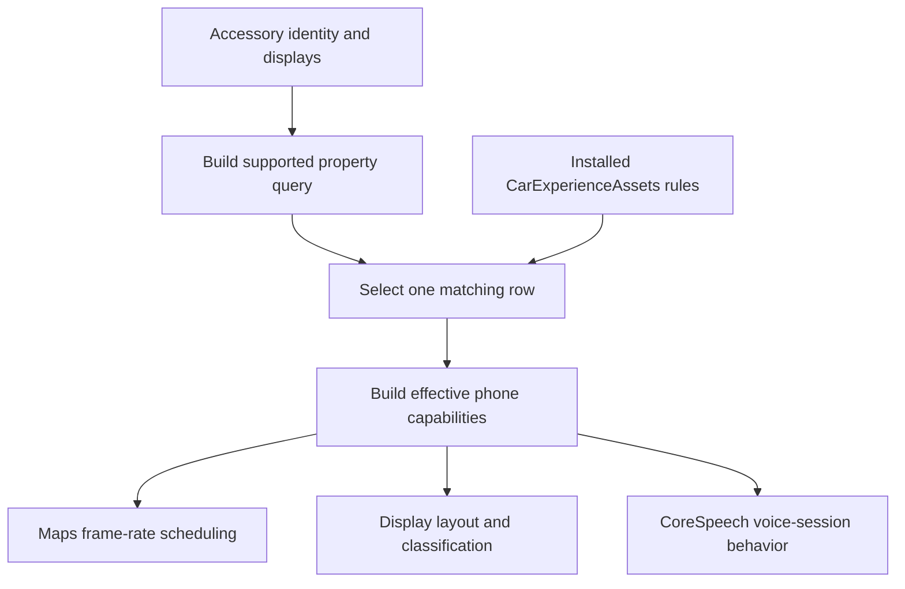

# CarPlay PPID profiles and capability settings

_2026-10-21 · installed CarExperienceAssets version 40; stock MU1316 firmware; supplied iOS 26.1 source comparison and iOS 27 binary checks_

---

## 🧾 Current status and reading guide

This report preserves the laboratory and reverse-engineering record. Later
implementation and physical measurements have the following status:

| Item | Status | Evidence |
|---|---|---|
| Maps-30 PPID hook | Deployed; always enabled when PPID is absent | [Production behavior](MAPS_30FPS_PROFILE.md) |
| Physical AltScreen arrival | 29.64 FPS in the saved short session | [Performance report](WIRED_PERFORMANCE_2026-10-21.md) |
| Concurrent workload | Both screens in motion; six-channel audio output | [Workload and CPU](WIRED_PERFORMANCE_2026-10-21.md#-simultaneous-workload) |
| Original pre-patch PPID / effective phone profile | Not wire-captured / not read back | [Measurement limits](WIRED_PERFORMANCE_2026-10-21.md#-setup-activation-and-remaining-validation) |
| Long-run stability / final panel FPS | Unverified | [Remaining validation](WIRED_PERFORMANCE_2026-10-21.md#-setup-activation-and-remaining-validation) |

Statements about no HU deployment below refer to the specific laboratory
experiments. Paths under `build/` and references marked as local research
sources identify retained evidence or unpublished helpers.

Read the [exact tested profile delta](#-exact-observed-comparison-for-the-tested-selector),
[capability settings](#%EF%B8%8F-other-interesting-capability-settings)
and [complete 90-PPID / 97-rule table](#-complete-ppid-rule-table).

## 📋 What is original, and what was changed

There are three different evidence scopes. They must not be collapsed into
one claim about the physical HU:

| Object | Original | Tested replacement | Evidence |
|---|---|---|---|
| Native laboratory IdentificationInfo | No top-level PPID TLV34 | `bf889dfdaea54096` | Actual emitted control-message bytes |
| Native laboratory cached capabilities | Empty userInfo | `mapsRefreshRate:30` in userInfo | Exact before/after dictionaries |
| Stock MU1316 JSON | No PPID setting | No production configuration change | Extracted original file |
| Stock MU1316 identity composer | Parameters 0–5; no PPID append in this function | No production binary change | ARM disassembly |
| Physical HU Identify / phone PPID | Original top-level PPID not wire-captured | Later hook log confirms Maps-30 PPID addition | Original PPID and effective phone capability row remain unverified; see publication status |

The stock findings support an original path without an explicitly advertised
PPID. They do not justify inventing an original hexadecimal value, deriving
one from the manufacturer or equating it with the MFi certificate serial.
The existing laboratory sender also has no PPID; that is a measured fact
about that sender, not a physical-HU capture.[^original]

Stock MU1316's `iap2.accessoryIdentification` contains only:

```json
{
  "manufacturer": "HARMAN",
  "firmwareVersion": "DEV_MMX2QC_AU_NAR_G22_061PROD",
  "displayName": "AUDI MMI"
}
```

The native identity builder is in stock `cinemo/libNmeVfs.so`, not the generic
transport plugin. `OnStartIdentification` at `0xe3e70` calls `Identify_Identity`
at `0xde1d4`. That function appends name, model, manufacturer, serial,
firmware and hardware as parameters 0–5. Its other dispatcher helpers build
message lists, power, EAP, language, transports, HID, location and vehicle
status. Their append sites were retained for review. No PPID-specific builder
or setting was identified; some nested component parameter IDs are computed,
so merely searching for the number 34 would not prove a top-level PPID.[^stock]

## 🔍 Exact observed comparison for the tested selector

The installed profile selected by `bf889dfdaea54096` contains exactly:

```json
{"features":{"userInfo":{"mapsRefreshRate":30}},"PPID":"bf889dfdaea54096"}
```

It has no additional predicates or feature entries in asset version 40.
The native lab before/after objects have 11 serialized fields each:

| Cached capability | Original | With tested PPID |
|---|---|---|
| `CRCapabilitiesUserInfoKey` | `{}` | `{"mapsRefreshRate":30}` |
| View-area insets | `{{0, 0}, {0, 0}}` | Same |
| Rounded corners | `{{13, 0}, {0, 0}}` | Same |
| Album-art mode | `2` | Same |
| Live Activities mode | `2` | Same |
| LOD widgets mode | `2` | Same |
| Interface-style mode | `2` | Same |
| Route-sharing mode | `2` | Same |
| Pinned messages | `0` | Same |
| Disabled-feature mask | `0` | Same |
| Profile version | `"40"` | Same |

This verifies **one changed cached field** for the lab identity. It is not a
measurement of every other service's internal state. In particular, PPID is
also exposed as accessory/vehicle metadata independently of the profile.
The tested profile does not supply `disableFlexibleFollowup`,
`showsInstrumentsIdentifier`, a zoom factor or a Smart Zoom setting.
It therefore does not select those behaviors through additional entries in
this particular row.[^diff]

## 🧩 All features found in PPID rules

Of 165 vehicle rows, **97 contain PPID predicates**, representing **90 distinct
case-insensitive PPID values**. Repeated PPIDs may require an additional
firmware or display-size predicate. These are the complete feature keys
present in those 97 rows of the installed version-40 asset:[^catalog]

The per-PPID distribution is:

| Rules per PPID | PPIDs | Associated rules |
|---|---:|---:|
| 1 | 85 | 85 |
| 2 | 3 | 6 |
| 3 | 2 | 6 |
| Total | 90 | 97 |

The repeated values are `e2c77d4b` (2), `6b0bb1d6`
(2), `c7290754b340458f` (2), `5bec6cc28dd347d5` (3), and
`fc8bc3fb0e104e52` (3). These are alternative matching records, not additive
feature bundles. A 90-PPID summary (`build/wired-altscreen-30fps-re/ppid-effects/ppid-summary.csv`, local research source)
lists the rule count, row numbers, distinct feature keys and exact rules for
each value. Counting feature keys across each PPID's rules (expanding
`userInfo`, while keeping per-display zoom as one setting), 81 PPIDs refer
to one distinct setting, seven to two settings, and two to three settings.
This union describes the catalog and does not mean all alternatives apply
to a single session.

| Feature | PPID rows containing it | Verified meaning / scope |
|---|---:|---|
| `viewAreaInsets` | 67 | Insets of the usable CarPlay area |
| `rightHandDriveFlip` | 5 | Flip configured insets for a right-hand-drive session |
| `zoomFactor` | 2 | UI zoom configuration |
| `zoomFactorByDisplayIndex` | 2 | Zoom configuration selected per display index |
| `hideSmartZoom` | 1 | Smart Zoom visibility/configuration flag |
| `userInterfaceStyle` | 2 | Interface-style policy; stored value `"0"` in these rows |
| `userInfo` | 29 | Extensible capability dictionary; its actual keys are below |

The 29 PPID user-info rows contain three distinct keys. Counts overlap because
one row can set more than one key:

| User-info key | PPID rows | Consumer and behavior |
|---|---:|---|
| `disableFlexibleFollowup` | 22 | CoreSpeech uses it as a fallback for disabling Siri barge-in |
| `showsInstrumentsIdentifier` | 7 | CarKit identifies the secondary display that shows instruments |
| `mapsRefreshRate` | 1 | Maps supplies the target rate to VectorKit |

There is no row in this asset that combines the Maps-30 key with the Siri or
instrument-identifier keys. The complete 97-row CSV catalog (`build/wired-altscreen-30fps-re/ppid-effects/ppid-catalog.csv`, local research source)
includes each PPID, its additional predicates and its exact feature dictionary.

### Concrete examples

| PPID | Additional conditions | Features in the installed row |
|---|---|---|
| `bf889dfdaea54096` | None | `mapsRefreshRate=30` |
| `39ea0365b04746c2` | None | `disableFlexibleFollowup=true` |
| `d2b97ed875654cf9` | None | `showsInstrumentsIdentifier="ClusterPanel"` |
| `98af313f544f4e54` | None | Insets, `zoomFactor="85"`, per-display zoom `{0:85}` |
| `8Aac641ec701C17d` | Specific primary view/physical sizes | `hideSmartZoom="1"`, zoom and per-display zoom |
| `6b0bb1d6` | Different physical display sizes | Different inset rows for the same PPID |

These entries are compatibility choices for particular accessory/display
combinations. Selecting another PPID is not a command to combine its features
with those of the original vehicle profile.[^catalog][^selection]

## ⚙️ Other interesting capability settings

The PPID catalog is only part of the installed asset. The following settings
also occur in rules selected without PPID, or in the asset's default feature
dictionary. Counts below cover all 165 vehicle rows and exclude defaults;
they are not counts of distinct accessories.[^catalog]

| Setting | Rows | Observed values and purpose |
|---|---:|---|
| `zoomFactorByDisplayIndex` | 25 | Per-display zoom; examples include `{"0":83,"1":83,"2":83}` and `{"0":87,"2":100}` |
| `zoomFactor` | 24 | General UI zoom setting; string values `"67"`, `"80"`, `"83"`, `"85"`, `"101"` |
| `viewAreaInsets` | 98 | Insets of the usable area; 15 distinct configurations in vehicle rules |
| `dashboardRoundedCorners` | 0 | Dashboard corner configuration; default `"{{13, 0}, {0, 0}}"` |
| `hideSmartZoom` | 23 | Smart Zoom visibility flag; all vehicle entries use `"1"` |
| `rightHandDriveFlip` | 17 | Controls flipping configured insets for right-hand drive; entries use `"0"` or `"1"` |
| `userInterfaceStyle` | 9 | Interface-style policy; vehicle entries use `"0"`, default is `"2"`; enum meanings are not established here |
| `userInfo.latencyCorrectionSeconds` | 4 | CoreSpeech hardware-latency correction input; all four entries are numeric `0` and have no PPID predicate |

The zoom values are retained in their original types. This investigation
does not establish that a value such as `85` is literally an 85-percent
render scale. Insets and per-display zoom are useful candidates for layout
experiments, but no performance improvement from changing them has been
measured.[^selection]

### Siri latency and trigger controls

`latencyCorrectionSeconds` is consumed by
`potentiallyAddHWLatencyToOption:streamHandle:voiceController:`. The path checks
CarPlay connection, option eligibility and alert behavior before applying
hardware-latency handling; in some cases it adds a Siri start sound. A stored
zero is not proof of zero physical audio latency, and this is not a video
frame-pacing control.[^latency]

`disableBargeInRequest` is another user-info key understood by CoreSpeech,
although it occurs in none of the installed asset's vehicle rules. Its
priority over `disableFlexibleFollowup` is described below. A consumer
understanding a key is separate from a selectable asset row providing
it.[^speech][^catalog]

### Settings accepted by code but not overridden by these rules

The checked iOS 27 feature-assignment method reads the following additional
keys and updates the corresponding capability modes:[^feature-modes]

| Feature key | Capability mode | Presence in the installed version-40 asset |
|---|---|---|
| `nowPlayingAlbumArt` | Now Playing album-art mode | Default `"2"`; no vehicle-row override |
| `liveActivities` | Live Activities mode | No explicit default or vehicle-row entry |
| `lodWidgets` | LOD widgets mode | No explicit default or vehicle-row entry |
| `routeSharing` | Route-sharing mode | No explicit default or vehicle-row entry |

These handlers do not establish that changing a PPID unlocks the related
feature. Their effective values can come from constructor defaults and
later policy reconciliation. The native laboratory cache had mode `2` for
all four before and after the tested PPID change. The supplied 26.1 helper
describes capability mode `1` as `Restricted` and `2` as `Unrestricted`;
that label does not prove every feature's complete activation path.[^diff][^feature-modes]

### Where the settings can be changed

The phone builds the capability dictionary after evaluating the accessory
query against its installed asset. The query has 13 supported properties:
`PPID`, `assetIdentifier`, `infoResponse.sourceVersion`, `modelName`,
`numberOfScreens`, `primaryDisplayFirstViewAreaSize`,
`primaryDisplayPhysicalSize`, `secondaryDisplayFirstViewAreaSize`,
`vehicleFirmwareVersion`, `vehicleHardwareVersion`, `vehicleManufacturer`,
`vehicleModelName`, and `vehicleName`.[^catalog][^selection]



The existing HU hook has no demonstrated protocol field for injecting an
arbitrary `features.userInfo` dictionary. PPID is the only predicate in the
installed Maps-30 row and remains the verified accessory-side selector for
that row. Other properties can select other existing profiles; adding an
arbitrary `/info` key does not add an arbitrary capability.[^selection]

Inside an owned vphone, direct phone-side insertion of
`userInfo.mapsRefreshRate=30` works without PPID: the control received 1196
AltScreen AUs in 40 seconds, or 29.9 AU/s. This must preserve other user-info
keys and use the capability-update path so Maps refreshes its policy. A
one-time cache edit is not persistent policy: the checked reconnect without
PPID automatically replaced cached `{"mapsRefreshRate":30}` with `{}`.
This is distinct from a hook running only on the physical HU.[^direct-control]

## 🗣️ Siri behavior is a real downstream effect

`CSCarKitUtils.isBargeInDisabledForConnectedVehicle` first reads
`userInfo.disableBargeInRequest`. Only if that key is absent does it read
`disableFlexibleFollowup`. It then returns the value's `BOOLValue` while
CarPlay is connected. Thus an explicit false primary key takes precedence
over a true fallback key.[^speech]

CoreSpeech's attending/decision code checks this result before some direct
Siri triggers and barge-in decisions. The supplied 26.1 code logs that it
does not trigger because barge-in is disabled for the vehicle. This is a
specific voice-interaction gate; it should not be described as a universal
Siri enable/disable switch.

The supplied iOS 27 binary still contains this function at `0x1d16ec920`.
Its checked disassembly first loads the CFString `disableBargeInRequest`,
then falls back to `disableFlexibleFollowup` only on nil. No Siri behavior
was actively triggered during this investigation.[^speech]

The broader asset also has `latencyCorrectionSeconds=0` in four rows without
PPID predicates. CoreSpeech consumes that key in its hardware-latency
correction path. It belongs to the same profile infrastructure but is not an
additional feature found in the PPID rows of this asset.[^latency]

## 🚘 Instrument display classification

The `showsInstrumentsIdentifier` value is a display identifier. CarKit reads
it from capabilities and compares it with the candidate display's identifier.
An incorrect value can change which secondary display is marked as showing
instruments. The supplied iOS 27 CarKit has a dedicated
`_showsInstrumentsFromCapabilitiesWithIdentifier:defaultValue:` helper at
`0x1c202ace4`, alongside the override method.[^instruments]

This is relevant to AltScreen classification; it does not establish an
independent entitlement or a complete CarPlay Ultra activation mechanism.
The Maps-30 row contains no such identifier. The lab's secondary display
continues to be classified through its advertised display configuration.

## 💾 PPID consumers beyond profile selection

The supplied comparison source also shows these direct uses:

| Consumer | Verified use | What is not established by that use |
|---|---|---|
| `CRVehicleAccessoryManager` / `CRVehicle` | Copies accessory PPID into stored vehicle metadata; archive key `ppid` | Equality with certificate identity |
| CarPlay messaging service | Includes PPID in service vehicle/identification dictionaries | A new authenticated identity from changing PPID alone |
| CarPlay wireless credential handling | Adds `CARPLAY_PPID` metadata to credential dictionaries | A different Wi-Fi password or PHY/channel policy |
| `wifid` | Reads that metadata and includes PPID in CarPlay join-failure metrics | A demonstrated throughput optimization |
| CarPlay settings, session/CAF analytics and diagnostics | Logs/records the accessory's PPID | A feature activated merely by appearing in analytics |
| `locationd` accessory descriptor | Copies PPID alongside manufacturer/model/versions | A verified PPID-based GPS policy switch |

The checked `wifid` context field is passed to
`__WiFiDeviceManagerSubmitCarPlayJoinFailureMetrics`, which submits the PPID
and reason then clears the field. This checked path is metric attribution.
The checked CarKit paired-vehicle lookup compares certificate serials; the
PPID metadata is separate.[^metadata]

Consequently, exact capabilities equality except Maps FPS is narrower than
"the PPID change has no other effects anywhere on the phone." The latter
claim is not supported.

## 🛠️ Implication for our hook

The original physical Identify and the phone's resulting configuration are
still the missing inputs for a final HU-specific comparison. A passive
capture should record the original **top-level** TLV34 before any patching,
its presence/absence and any duplicates, then record the effective TLV and
the selected profile after lookup. Names and manufacturer alone do not supply
an original PPID. Adding a second PPID over an existing one would obscure
the comparison.

The existing Encode interception is the appropriate observation boundary.
The catalog/consumer investigation itself changed no production identity or
wireless behavior. The later [production hook](MAPS_30FPS_PROFILE.md) adds
PPID only when absent; original native A/B evidence is retained. See the [complete mechanism](MAPS_FRAME_RATE_PROFILE_MECHANISM.md)
for profile-selection ambiguity, cache reversal and the source-rate controls.

## 📚 Complete PPID rule table

The table below includes all 90 PPIDs and all 97 associated rules directly
in this document. Each table row is one asset rule; repeated PPIDs are
intentional. `Rules` is the total number of rules for that PPID, not the
number of settings applied together. Asset row numbers are zero-based
indices into `vehicles` in the preserved snapshot.[^catalog]

`Additional predicates` excludes the PPID column; `{}` means no further
predicate. JSON preserves original strings, numbers and booleans. Multiple
predicates within one row must all match. Separate rows are alternatives,
and their feature dictionaries are not merged. Competing matching rows are
subject to the selection ambiguity documented in the
[mechanism report](MAPS_FRAME_RATE_PROFILE_MECHANISM.md).[^selection]

<!-- BEGIN GENERATED PPID RULE TABLE -->

| PPID | Rules | Asset row | Additional predicates | Exact features |
|---|---:|---:|---|---|
| `060db220` | 1 | 75 | `{}` | `{"viewAreaInsets":"{{0, 8}, {0, 8}}"}` |
| `068ba756` | 1 | 74 | `{}` | `{"viewAreaInsets":"{{0, 8}, {0, 8}}"}` |
| `0ae0c8ed` | 1 | 61 | `{}` | `{"rightHandDriveFlip":"1","viewAreaInsets":"{{0, 8}, {0, 0}}"}` |
| `0df914a9` | 1 | 89 | `{"primaryDisplayPhysicalSize":"{213, 120}"}` | `{"viewAreaInsets":"{{8, 0}, {8, 0}}"}` |
| `12c99c81` | 1 | 81 | `{}` | `{"viewAreaInsets":"{{0, 8}, {8, 0}}"}` |
| `13d7ca1d` | 1 | 113 | `{}` | `{"userInfo":{"disableFlexibleFollowup":true}}` |
| `194e1001` | 1 | 73 | `{"primaryDisplayPhysicalSize":"{162, 91}"}` | `{"viewAreaInsets":"{{0, 0}, {0, 8}}"}` |
| `1c0a1678` | 1 | 50 | `{}` | `{"viewAreaInsets":"{{8, 0}, {0, 0}}"}` |
| `23c89abf` | 1 | 25 | `{}` | `{"viewAreaInsets":"{{8, 0}, {8, 0}}"}` |
| `2436c56d` | 1 | 84 | `{}` | `{"viewAreaInsets":"{{8, 0}, {8, 0}}"}` |
| `24d0addb470849cb` | 1 | 110 | `{}` | `{"userInfo":{"disableFlexibleFollowup":true}}` |
| `2996b8f6` | 1 | 60 | `{}` | `{"viewAreaInsets":"{{0, 0}, {8, 0}}"}` |
| `2a97c151a43949cd` | 1 | 148 | `{}` | `{"userInfo":{"disableFlexibleFollowup":true}}` |
| `2af84e2d3b874063` | 1 | 160 | `{}` | `{"userInfo":{"disableFlexibleFollowup":true}}` |
| `389dc196ad4d473b` | 1 | 111 | `{}` | `{"userInfo":{"disableFlexibleFollowup":true}}` |
| `38c4c9a3` | 1 | 51 | `{}` | `{"viewAreaInsets":"{{0, 8}, {0, 8}}"}` |
| `39ea0365b04746c2` | 1 | 108 | `{}` | `{"userInfo":{"disableFlexibleFollowup":true}}` |
| `401cfd46` | 1 | 55 | `{}` | `{"viewAreaInsets":"{{8, 0}, {0, 0}}"}` |
| `40b26c13` | 1 | 34 | `{}` | `{"viewAreaInsets":"{{0, 0}, {8, 0}}"}` |
| `40e01112deb24eec` | 1 | 88 | `{}` | `{"viewAreaInsets":"{{8, 0}, {8, 0}}"}` |
| `41aefada5b474e9e` | 1 | 91 | `{}` | `{"rightHandDriveFlip":"1","viewAreaInsets":"{{0, 8}, {0, 0}}"}` |
| `44296f26` | 1 | 62 | `{}` | `{"viewAreaInsets":"{{8, 0}, {8, 0}}"}` |
| `478f2178` | 1 | 24 | `{}` | `{"viewAreaInsets":"{{0, 0}, {8, 0}}"}` |
| `4ce2eb5dac0043c0` | 1 | 159 | `{}` | `{"userInfo":{"disableFlexibleFollowup":true}}` |
| `4dbed3ea` | 1 | 67 | `{}` | `{"viewAreaInsets":"{{8, 0}, {0, 0}}"}` |
| `4e88ccad` | 1 | 114 | `{}` | `{"userInfo":{"disableFlexibleFollowup":true}}` |
| `545731e7` | 1 | 64 | `{}` | `{"viewAreaInsets":"{{8, 0}, {8, 0}}"}` |
| `5bec6cc28dd347d5` | 3 | 109 | `{}` | `{"userInfo":{"disableFlexibleFollowup":true}}` |
| `5bec6cc28dd347d5` | 3 | 121 | `{"secondaryDisplayFirstViewAreaSize":"{1792, 718}"}` | `{"userInfo":{"showsInstrumentsIdentifier":"e5f7a68d-7b0f-4305-984b-974f677a150c"}}` |
| `5bec6cc28dd347d5` | 3 | 124 | `{"secondaryDisplayFirstViewAreaSize":"{1920, 900}"}` | `{"userInfo":{"disableFlexibleFollowup":true,"showsInstrumentsIdentifier":"dd44b566-fa53-4893-b573-b6344b262958"}}` |
| `5c6f76efdc1f420f` | 1 | 146 | `{}` | `{"userInfo":{"disableFlexibleFollowup":true}}` |
| `5cd68fa4` | 1 | 72 | `{}` | `{"viewAreaInsets":"{{8, 0}, {8, 0}}"}` |
| `5d00b517a1af434e` | 1 | 161 | `{}` | `{"userInfo":{"disableFlexibleFollowup":true}}` |
| `5df4d65a` | 1 | 76 | `{}` | `{"viewAreaInsets":"{{0, 8}, {0, 8}}"}` |
| `6203d5a1` | 1 | 66 | `{}` | `{"viewAreaInsets":"{{8, 0}, {8, 0}}"}` |
| `63598e8b` | 1 | 26 | `{}` | `{"viewAreaInsets":"{{0, 8}, {0, 8}}"}` |
| `6616348` | 1 | 53 | `{}` | `{"viewAreaInsets":"{{8, 0}, {8, 0}}"}` |
| `690b8542` | 1 | 47 | `{}` | `{"viewAreaInsets":"{{0, 8}, {0, 8}}"}` |
| `6b0bb1d6` | 2 | 79 | `{"primaryDisplayPhysicalSize":"{152, 76}"}` | `{"viewAreaInsets":"{{8, 0}, {0, 0}}"}` |
| `6b0bb1d6` | 2 | 80 | `{"primaryDisplayPhysicalSize":"{170, 94}"}` | `{"viewAreaInsets":"{{8, 0}, {8, 0}}"}` |
| `6d2b84f957b64d16` | 1 | 120 | `{"secondaryDisplayFirstViewAreaSize":"{1792, 718}"}` | `{"userInfo":{"showsInstrumentsIdentifier":"e5f7a68d-7b0f-4305-984b-974f677a150c"}}` |
| `6fbaff7b` | 1 | 78 | `{}` | `{"viewAreaInsets":"{{8, 0}, {8, 0}}"}` |
| `76bb33d0` | 1 | 42 | `{}` | `{"viewAreaInsets":"{{0, 0}, {0, 8}}"}` |
| `7c78fa8c715c4e2c` | 1 | 147 | `{}` | `{"userInfo":{"disableFlexibleFollowup":true}}` |
| `7df6250c14aa45a9` | 1 | 163 | `{}` | `{"userInfo":{"disableFlexibleFollowup":true}}` |
| `80f9efc3` | 1 | 54 | `{}` | `{"viewAreaInsets":"{{8, 0}, {8, 0}}"}` |
| `82623fa3` | 1 | 30 | `{}` | `{"viewAreaInsets":"{{0, 8}, {0, 8}}"}` |
| `8359b1b3` | 1 | 69 | `{}` | `{"viewAreaInsets":"{{0, 0}, {0, 8}}"}` |
| `842d017a` | 1 | 46 | `{}` | `{"viewAreaInsets":"{{8, 8}, {0, 0}}"}` |
| `86986000000` | 1 | 58 | `{}` | `{"viewAreaInsets":"{{0, 8}, {0, 0}}"}` |
| `86a6561b` | 1 | 31 | `{}` | `{"viewAreaInsets":"{{8, 0}, {0, 0}}"}` |
| `8Aac641ec701C17d` | 1 | 144 | `{"primaryDisplayFirstViewAreaSize":"{1024, 920}","primaryDisplayPhysicalSize":"{127, 114}"}` | `{"hideSmartZoom":"1","zoomFactor":"101","zoomFactorByDisplayIndex":{"0":100}}` |
| `8c93ff15918e4229` | 1 | 162 | `{}` | `{"userInfo":{"disableFlexibleFollowup":true}}` |
| `8f5adf3b` | 1 | 38 | `{}` | `{"viewAreaInsets":"{{8, 0}, {0, 0}}"}` |
| `95b35e7` | 1 | 45 | `{}` | `{"viewAreaInsets":"{{0, 8}, {0, 8}}"}` |
| `9669b1b681564f85` | 1 | 70 | `{}` | `{"viewAreaInsets":"{{8, 0}, {8, 0}}"}` |
| `96ce4d0` | 1 | 57 | `{"primaryDisplayPhysicalSize":"{177, 99}"}` | `{"viewAreaInsets":"{{0, 0}, {0, 8}}"}` |
| `98af313f544f4e54` | 1 | 85 | `{}` | `{"viewAreaInsets":"{{8, 0}, {8, 0}}","zoomFactor":"85","zoomFactorByDisplayIndex":{"0":85}}` |
| `98e2fa52` | 1 | 99 | `{}` | `{"viewAreaInsets":"{{8, 8}, {0, 0}}"}` |
| `9c3136d2dc394502` | 1 | 98 | `{}` | `{"viewAreaInsets":"{{8, 8}, {0, 0}}"}` |
| `9ebcccd0026f49af` | 1 | 145 | `{}` | `{"userInfo":{"disableFlexibleFollowup":true}}` |
| `a49db2f2` | 1 | 77 | `{}` | `{"viewAreaInsets":"{{8, 0}, {8, 0}}"}` |
| `a5c86c11` | 1 | 40 | `{}` | `{"viewAreaInsets":"{{0, 0}, {0, 8}}"}` |
| `a81595de` | 1 | 43 | `{}` | `{"viewAreaInsets":"{{0, 8}, {0, 8}}"}` |
| `a9d51e4f` | 1 | 44 | `{}` | `{"viewAreaInsets":"{{0, 8}, {0, 0}}"}` |
| `abf2c997` | 1 | 63 | `{}` | `{"viewAreaInsets":"{{8, 0}, {8, 8}}"}` |
| `b7347a21` | 1 | 101 | `{}` | `{"viewAreaInsets":"{{8, 8}, {0, 0}}"}` |
| `b8c3712fafc34679` | 1 | 164 | `{}` | `{"userInfo":{"disableFlexibleFollowup":true}}` |
| `bb7c77c8` | 1 | 59 | `{}` | `{"viewAreaInsets":"{{0, 8}, {0, 0}}"}` |
| `be680ad9884e477c` | 1 | 68 | `{}` | `{"viewAreaInsets":"{{0, 8}, {0, 0}}"}` |
| `bf889dfdaea54096` | 1 | 157 | `{}` | `{"userInfo":{"mapsRefreshRate":30}}` |
| `c23db236` | 1 | 36 | `{}` | `{"viewAreaInsets":"{{0, 8}, {0, 0}}"}` |
| `c7290754b340458f` | 2 | 107 | `{"vehicleFirmwareVersion":"*1452*","vehicleManufacturer":"Toyota Multimedia"}` | `{"userInfo":{"disableFlexibleFollowup":true},"userInterfaceStyle":"0"}` |
| `c7290754b340458f` | 2 | 115 | `{"vehicleFirmwareVersion":"*1564*","vehicleManufacturer":"Toyota Multimedia"}` | `{"userInfo":{"disableFlexibleFollowup":true},"userInterfaceStyle":"0"}` |
| `c83d1336d12341e0` | 1 | 90 | `{}` | `{"rightHandDriveFlip":"1","viewAreaInsets":"{{0, 8}, {0, 0}}"}` |
| `cb870e9f` | 1 | 22 | `{}` | `{"viewAreaInsets":"{{0, 0}, {8, 0}}"}` |
| `d2b97ed875654cf9` | 1 | 130 | `{}` | `{"userInfo":{"showsInstrumentsIdentifier":"ClusterPanel"}}` |
| `d43a70db` | 1 | 93 | `{}` | `{"viewAreaInsets":"{{0, 8}, {0, 8}}"}` |
| `dc8886fc0425486c` | 1 | 102 | `{}` | `{"viewAreaInsets":"{{8, 8}, {0, 0}}"}` |
| `dd86e4e6` | 1 | 117 | `{"vehicleFirmwareVersion":"*ISH.11.07.29*"}` | `{"userInfo":{"disableFlexibleFollowup":true}}` |
| `dddad6634a12411c` | 1 | 87 | `{}` | `{"viewAreaInsets":"{{0, 0}, {0, 8}}"}` |
| `e2c77d4b` | 2 | 48 | `{}` | `{"viewAreaInsets":"{{0, 8}, {0, 0}}"}` |
| `e2c77d4b` | 2 | 49 | `{"vehicleManufacturer":"SKODA"}` | `{"viewAreaInsets":"{{8, 0}, {8, 0}}"}` |
| `e34d04db` | 1 | 52 | `{}` | `{"viewAreaInsets":"{{8, 0}, {8, 0}}"}` |
| `e743c8fd6efe4144` | 1 | 92 | `{}` | `{"rightHandDriveFlip":"1","viewAreaInsets":"{{0, 8}, {0, 0}}"}` |
| `e8b6c0aa` | 1 | 56 | `{}` | `{"viewAreaInsets":"{{0, 0}, {0, 8}}"}` |
| `e967faf9b0fd4323` | 1 | 112 | `{}` | `{"userInfo":{"disableFlexibleFollowup":true}}` |
| `ea664732` | 1 | 83 | `{}` | `{"viewAreaInsets":"{{8, 8}, {0, 8}}"}` |
| `efdaa50fb2ba411f` | 1 | 118 | `{}` | `{"userInfo":{"disableFlexibleFollowup":true}}` |
| `f0c91b32` | 1 | 41 | `{}` | `{"viewAreaInsets":"{{0, 0}, {8, 0}}"}` |
| `f72eaac393bd4fea` | 1 | 116 | `{}` | `{"viewAreaInsets":"{{8, 8}, {0, 0}}"}` |
| `f826c6ee2014455d` | 1 | 100 | `{}` | `{"viewAreaInsets":"{{8, 8}, {0, 0}}"}` |
| `fc496624` | 1 | 97 | `{}` | `{"viewAreaInsets":"{{8, 8}, {0, 0}}"}` |
| `fc8bc3fb0e104e52` | 3 | 119 | `{"secondaryDisplayFirstViewAreaSize":"{1792, 718}"}` | `{"userInfo":{"showsInstrumentsIdentifier":"e5f7a68d-7b0f-4305-984b-974f677a150c"}}` |
| `fc8bc3fb0e104e52` | 3 | 122 | `{"secondaryDisplayFirstViewAreaSize":"{2240, 896}"}` | `{"userInfo":{"showsInstrumentsIdentifier":"e5f7a68d-7b0f-4305-984b-974f677a150c"}}` |
| `fc8bc3fb0e104e52` | 3 | 123 | `{"secondaryDisplayFirstViewAreaSize":"{964, 964}"}` | `{"userInfo":{"showsInstrumentsIdentifier":"e5f7a68d-7b0f-4305-984b-974f677a150d"}}` |
| `fd92cef2` | 1 | 71 | `{}` | `{"rightHandDriveFlip":"1","viewAreaInsets":"{{0, 8}, {0, 0}}"}` |

<!-- END GENERATED PPID RULE TABLE -->

## 🔗 Sources

[^original]: `build/wired-altscreen-30fps-re/maps-profile-mechanism/lifecycle-wire-proof.json`; actual outgoing messages in each lifecycle case's `journal.json`. Saved physical logs contain process-parent `ppid` values, which are unrelated to accessory PPID; no physical Identify34 capture was found.
[^stock]: Stock `/Users/luka/Desktop/AUDI_2/Firmwares/HU/MHI2Q_US_AUG22_P5087_MU1316/extracted/system/etc/eso/production/dio_manager.json`; `app/armle/usr/lib/cinemo/libNmeVfs.so`; evidence under `build/wired-altscreen-30fps-re/ppid-effects/`: `NmeVfs-identity-function.asm`, `NmeVfs-start-identification-function.asm`, `composer-*.json`, `stock-composer-append-sites.json`, `stock-composer-r1-audit.json`. Text/GOT-relative string references were resolved and retained in `NmeVfs-pic-string-xrefs.json`; string absence alone was not used as proof.
[^diff]: `build/wired-altscreen-30fps-re/ppid-effects/native-profile-exact-diff.json`; original native case `hook-fps-policy/ppid34-only/journal.json`. Dictionary values are quoted without assigning unverified semantic names to numeric enum values.
[^catalog]: Installed guest asset snapshot `hook-fps-policy/phone-CarPlayCapabilities.json`; `ppid-effects/{asset-feature-inventory.json,ppid-catalog.csv}`. Counts refer only to content version 40, canonical asset JSON SHA-256 `c82fc0e7940c561001d08d9d0ce6fa84af24690d2731994ebe39cc2f73173e71`.
[^selection]: [Verified selection mechanism](MAPS_FRAME_RATE_PROFILE_MECHANISM.md); iOS 27 feature assignment disassembly `ppid-effects/carkitd27-assign-features.asm`, including per-display zoom and Smart Zoom setters. One selected row supplies features; the manager can subsequently reconcile other preferences/policies.
[^speech]: Supplied 26.1 `CoreSpeechFoundation.framework/CoreSpeechFoundation/CSCarKitUtils.mm:55`; `CoreSpeech.framework/CoreSpeech/CSAttendingStatesProvidingProxy.mm:175`; iOS 27 evidence `ppid-effects/{CoreSpeech27-symbols.txt,CoreSpeech27-strings.txt,CoreSpeech27-barge-in.asm}`. CFString addresses are `0x1ef128370` for `disableBargeInRequest` and `0x1ef128350` for `disableFlexibleFollowup`.
[^latency]: Supplied 26.1 `CSCarKitUtils.mm:potentiallyAddHWLatencyToOption:streamHandle:voiceController:`; current asset rows 103–106 have no PPID predicate. CoreSpeech 27 retains the corresponding latency helper and key.
[^instruments]: Supplied 26.1 `CarKit.framework/CarKit/CARDisplayInfo.mm:_showsInstrumentsWithIdentifier:isPrimaryDisplay:`; supplied iOS 27 method metadata in `maps-profile-mechanism/CarKit27-incache-objc.txt`. Defaults differ by method/build; the identifier-key behavior is distinct from declaring every absent-key default identical across versions.
[^metadata]: Supplied 26.1 `CarKit/CRVehicleAccessoryManager.mm:532`, `CarKit/CRVehicle.mm` encode/decode; `carkitd/CRCarKitServiceAgent.mm` wireless credentials and `carkitd.mm:sub_10002CE88,sub_10002CFC4`; `wifid/wifid_10.mm:6896`, `wifid_12.mm:sub_1000D33C0`, `wifid_17.mm:sub_1001485C4`; CarPlaySettings/CAF analytics and `locationd_89.mm` accessory descriptor. The source paths are under the supplied 26.1 CoreAccessories restore tree.
[^feature-modes]: Supplied iOS 27 `carkitd`, `CRCarplayCapabilitiesStateMachine.assignCarCapabilities:valuesFromDictionary:` at `0x10002d0d0`; reads at `0x10002d120` through `0x10002d174`, retained in `build/wired-altscreen-30fps-re/ppid-effects/carkitd27-assign-features.asm`. Supplied 26.1 `CarKit/CARSessionConfiguration.mm:279`, `descriptionForCapability:`; `CarKit/CRCarPlayCapabilities.mm` constructor and dictionary serialization. These sources establish accepted keys and mode handling, not successful end-to-end activation of every feature.
[^direct-control]: [Wired source-rate investigation](WIRED_30FPS_INVESTIGATION.md); `build/wired-altscreen-30fps-re/hook-fps-policy/capabilities30/summary.json`; native reconnect evidence in `maps-profile-mechanism/lifecycle-summary.json` and the [profile persistence section](MAPS_FRAME_RATE_PROFILE_MECHANISM.md#-persistence-notification-and-reconnection).
