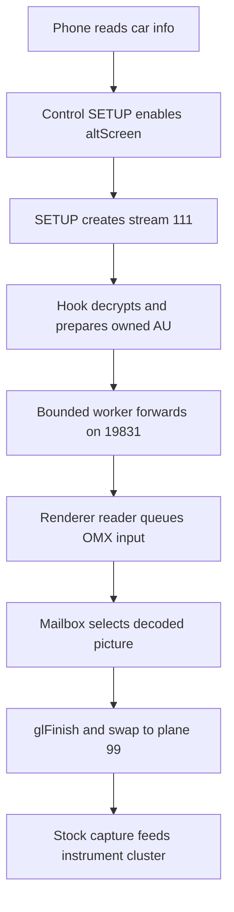

# AltScreen and Video

*Map of content for CarPlay's second screen: the instrument-cluster video (altScreen, stream 111) and the path from decode to panel.*

---

## 📋 What this section covers

CarPlay can drive a **second display**: the Audi instrument cluster (Virtual Cockpit). Apple calls it *altScreen*. On the wire it is AirPlay screen **stream type 111**. The phone offers it only when the head unit advertises the cluster display and negotiates the feature, so the whole feature depends on that gate. Once the phone streams H.264, the hook converts it to Annex-B and forwards it over localhost TCP `:19831` to `altscreen_render`. The renderer OMX-decodes it and draws it into the managed cluster displayable `99` (`altscreen_render/protocol.h:24`, `altscreen_render/screen_egl_present.c:45`).

Read [AltScreen Cluster Video](ALTSCREEN_CLUSTER_VIDEO.md) first for the activation gate and the cluster wiring. Then read [Video Pipeline](VIDEO_PIPELINE.md) for the decode and delivery internals, [Cluster Loader](CLUSTER_LOADER.md) for the PRISM waiting animation, and [Reconnect and Lifecycle](RECONNECT_AND_LIFECYCLE.md) for replug behaviour. [Home](../README.md) is the hub and [Landmines](../LANDMINES.md) holds the trap list. Cluster route-guidance graphics, the *other* frame source in the same cluster context, are covered in [Cluster and RGI overview](../cluster-and-rgi/README.md).

## 📊 The whole path

The 2026-10-06 source candidate adds shared recovery, idle EOF/status observation,
owned in-place conversion, batched I/O, end-to-end compressed age and decoded
mailbox selection. These changes passed offline tests and QNX builds; their
vehicle FPS and BSP mailbox behavior remain unmeasured. The stock capture clock,
`glFinish` and per-frame image refresh remain in place. **[code]**

Read [current pipeline and protocol](VIDEO_PIPELINE.md) for ownership,
HELLO/ACK/STATUS and FIFO fallback; read
[all six changes and validation](ALTSCREEN_FRAME_RATE.md#-six-follow-up-improvements-implemented--2026-10-06)
for operation counts and the test evidence.
[Input commands](ALTSCREEN_INPUT_COMMANDS.md) covers the separate native command
worker, roller cadence, immutable selected age, ACK/CF contracts and runtime
knobs. [Current pacing validation](ALTSCREEN_PACING_VALIDATION.md) collects video
and input review resolutions, reproducible commands and latest result limits.

## 🔗 The notes

| Note | What it covers |
|---|---|
| [AltScreen Cluster Video](ALTSCREEN_CLUSTER_VIDEO.md) | The activation gate — control-SETUP response `enabledFeatures` ∋ `altScreen` (the `/info` advert is also injected but does not set the flag) — then the hook's own stream-111 receiver. Also the iOS URL model, error codes, the 1440×542 panel, and the forceKeyFrame `uuid` fix (resolved). |
| [Video Pipeline](VIDEO_PIPELINE.md) | The OMX decode chain (native 32m buffers → EGLImage → RGBA plane 99), the Nagle/`TCP_NODELAY` fix, the load-bearing `glFinish` and per-frame rebind, owned buffers, v2/status protocol, mailbox/FIFO ownership, stream 110 and screen crypto for comparison. |
| [Cluster Loader](CLUSTER_LOADER.md) | The PRISM waiting animation: an embedded glass-Apple material shader in `altscreen_render/loader/`, drawn until the first decoded picture takes over. |
| [Reconnect and Lifecycle](RECONNECT_AND_LIFECYCLE.md) | Lifecycle churn on a fast replug, now absorbed by a 400 ms deactivate debounce. Also covers the advert correction, the main-screen UUID fix, and renderer supervision. |
| [AltScreen Input Commands](ALTSCREEN_INPUT_COMMANDS.md) | Canonical input path, paced zoom, reserved priority, state replacement, pre-commit/TTL cancellation, CF faults and runtime knobs. |
| [AltScreen Pacing Validation](ALTSCREEN_PACING_VALIDATION.md) | Current startup/steady, HELLO/STATUS, clock and input-command contracts; 25 sanitizer scenarios, paced zoom, command priority/coalescing, test commands and hardware limits. |
| [AltScreen Frame Rate](ALTSCREEN_FRAME_RATE.md) | Saved 20–27 fps evidence, sender/decoder/capture analysis, all six current pacing improvements, operation counts and offline validation limits. |
| [AltScreen RE History](ALTSCREEN_RE_HISTORY.md) | Every altScreen framing, gate theory, plan and verdict in order — what held and what was refuted. |
| [Cluster Video Encoder](CLUSTER_VIDEO_ENCODER.md) | DisplayManager, `videoencoderservice` and stock KOMO: how a cluster context becomes the VC's H.264. |
| [Cover Art Pipeline](COVER_ART_PIPELINE.md) | Stock MH2P cover-art design vs our MHI2Q hook, and the size-only Setup regression. |
| [CarPlay Video Playback](CARPLAY_VIDEO_PLAYBACK.md) | iOS 27 "Video in Car" (stream 130, URL playback). **Not planned:** only a partial build is possible (clear H.264); DRM needs Apple's receiver FairPlay module, and camera clips are HEVC. |
| [CarPlay Feature Survey](CARPLAY_FEATURE_SURVEY.md) | Stock baseline, features we added, tiered list of addable ones, the LOD widgets / Live Activities chain. |
| [Partial 360 Camera Preflight](PARTIAL_360_CAMERA_PREFLIGHT.md) | Deferred: CarPlay beside the top-view camera — contexts, crops, camera ownership, coordinator design. |

## 💡 Truth levels

Claims are tagged **[car]** for confirmed on the unit, **[decompile]** for reverse engineering, **[code]** for verified in the current source, and **[open]** for unverified. The earlier stream 111 path from decode to panel is **[car]**: one session ran 13,056 frames in 5 min. The 2026-10-06 pacing candidate is verified offline, not on the unit. The frame rate actually delivered, and what causes it, is still **[open]**. Provenance is listed in each note's Sources section; merged originals remain in git history.
