# Reconnect and Lifecycle

*Why CarPlay once took three replugs to come back (lifecycle churn with no debounce), how the debounce fixed it, plus the advert correction and the main-screen UUID fix.*

---

## 🔍 The symptom

An on-unit diagnosis (build `34c4c9d`, 2026-08-11) looked at an intermittent reconnect: "doesn't work after a replug", which took 3 replugs. The key finding: **the altScreen pipeline was not the problem**. Across 4 dio sessions the phone offered stream 111 reliably within 2–3 s, and video decoded and rendered fine; one session ran 13,056 frames in 5 min. The "no 111 stream in request" log lines are just the phone's *other* SETUP requests (main and audio), not a failure. **[car]**

## ⚠️ Root cause: lifecycle churn with no debounce

`TerminalModeBapCombi.updateActiveDeviceState()` drives `CarPlayApp.onActivate/onDeactivate` from the stock TMDevice ConnectionState (`java_patch/de/audi/app/terminalmode/combi/TerminalModeBapCombi.java:89-142`). On a fast replug the device bounces **ACTIVATING ↔ INVALID ↔ ACTIVE**. At the time, each edge made `CarPlayApp.lifecycleLoop` run a full `BAPBridge` takeover teardown and re-init, plus a cluster context flap **81 ↔ 74**. Ten `onActivate/onDeactivate` generations were observed. **[car]**

```mermaid
stateDiagram-v2
  accTitle: Reconnect device-state bounce and the deactivate debounce
  accDescr: A fast replug bounces the device through activating, invalid and active; a deactivate edge now waits up to 400 ms and is dropped if a newer activate edge arrives, otherwise it tears down.
  [*] --> activating
  activating --> active: settled
  activating --> invalid: fast replug bounce
  invalid --> grace: deactivate edge
  grace --> active: newer activate within 400 ms
  grace --> teardown: no newer edge in 400 ms
  teardown --> activating: next replug
  active --> [*]: session persists
  classDef danger_state fill:#fee2e2,stroke:#dc2626,stroke-width:2px,color:#7f1d1d
  classDef success_state fill:#dcfce7,stroke:#16a34a,stroke-width:2px,color:#14532d
  classDef warning_state fill:#fef9c3,stroke:#ca8a04,stroke-width:2px,color:#713f12
  class teardown danger_state
  class active success_state
  class grace warning_state
```

At that build, `lifecycleLoop` coalesced edges **only** when a newer edge landed while `applyLifecycle` was already running. A deactivate that was picked up first ran the full teardown and then re-initialised when the activate arrived. The 3rd replug worked only because the device state finally settled into a stable ACTIVE. **[car]**

### Implemented fix: deactivate debounce

The debounce is **implemented** in `lifecycleLoop` (`java_patch/com/luka/carplay/core/CarPlayApp.java:228-273`). **[code]**

- `DEACTIVATE_DEBOUNCE_MS = 400L` (`:230`). On `wantActive == false` the loop waits up to 400 ms on the lifecycle lock.
- If a newer generation (the re-activation) arrives within that window, the stale inactive edge is marked applied and dropped. The loop then re-snapshots the newer edge (`:252-265`).
- `applyLifecycle` runs under `lifecycleLock`. It re-checks that the edge is still current before and after each expensive step (`:182-222`), and it publishes `lifecycleAppliedGeneration` before releasing the lock.
- `updateActiveDeviceState` also re-arms from `ACTIVE` when dio returns straight to `ACTIVE` without a second `ACTIVATING` (`TerminalModeBapCombi.java:114-125`). It deactivates only when the device is no longer a CarPlay device (`:127-142`).

Java does not gate the `viewArea` send on `videoAvailable` (`java_patch/com/luka/carplay/core/AltScreenModule.java:204-215`). The hook covers that case instead: it caches the zone mode and replays it at the first IDR (`hook/altscreen/altscreen_hook.c:1425`). An early `viewArea ack status=-6735` therefore stays harmless. How well the debounce works on the unit under repeated fast replugs is **[open]**. See `memory/reconnect_flak_lifecycle_debounce.md`.

## 🔍 How the lifecycle worker behaves now

The 2026-09-14 review of `CarPlayApp` (baseline `630acd9`, byte-identical to the Friday 2026-09-11 baseline `59646e98`, SHA-256 `ba3536d8…ca19d`) checked the worker end to end. **[code]** unless marked.

- **Hot callbacks only publish.** `onActivate`/`onDeactivate` store the desired edge, bump `lifecycleGeneration` and `notifyAll()`; a repeated ACTIVATING for the same `IContext` is ignored (`java_patch/com/luka/carplay/core/CarPlayApp.java:83-115`). The persistent daemon `carplay-lifecycle` thread does all module work.
- **Module order is a dependency chain:** `AltScreenModule`, `RgdModule`, `SteeringWheelInputModule` (`:34-36`). A false `start()` breaks the pass, because RGI must not replay a snapshot before altScreen has reset `navActive` and owns ctx 81 (`:356-361`). Every new generation stops all modules in reverse order first (`:172-180`).
- **Late services retry forever.** `carplay-retry` re-runs the start pass every 200 ms for 50 tries, then every 2 s with a one-time warning at 10 s (`:370-404`) — Navigation can appear long after TerminalMode on a cold boot, so no fixed timeout.
- **`onDeactivateAndWait()`** (component teardown, not the hot callback) waits at most 3 s for the async cleanup before TerminalMode closes its trackers (`:120-137`).
- **Lock order.** Module `start()`/`stop()` run under `lifecycleLock` but never under the smaller `lock`; holding both in the old order made cold boot an ABBA deadlock with `AltScreenNavStatusGate` (`:328-333`).

**Publication race — found and fixed.** In `630acd9`, `applyLifecycle()` released `lifecycleLock` before `lifecycleLoop()` published `lifecycleAppliedGeneration`. A waiting `onNavigationServiceChanged()` could slip into that gap, see the old applied generation and return; the edge was not replayed, so RGD could keep a stale Navigation service until the next edge or reconnect. A controlled host reproducer (`build/carplayapp-audit/`, unchanged `CarPlayApp` plus stubs) showed no rebind in the gap and a rebind after publication. Frequency on the unit was never measured. Current code publishes the applied generation inside `lifecycleLock` in `applyLifecycle`'s `finally` (`:214-224`), and the rebind worker checks it under both locks (`:280-322`).

**What the debounce does not do.** A deactivate/reactivate of the same `IContext` within 400 ms drops the inactive edge, but the new active generation still calls `stopModules()` and restarts all three modules — a 25 ms bounce produced one extra start of each. The grace coalesces teardown; it does not keep running modules alive. That is intended: `IContext` cannot distinguish a genuinely new phone/session, so blindly skipping the restart could keep old route state.

| Commit | Date | Lifecycle change |
|---|---|---|
| before `65b44ec` | — | module start/stop ran synchronously on the stock callback under `lifecycleLock`; Navigation rebinding already had its own worker |
| `65b44ec` | 2026-08-09 | module work moved to the persistent lifecycle worker with generation checks (introducing the publication gap) |
| `349408f` | 2026-08-12 | 400 ms inactive-edge grace added; active generations still restart modules |
| `7fce1c4` | 2026-09-14 | cursor lifecycle callbacks — since removed with the cursor module |

These are source-history facts, not proof of which build ran on a given drive; the race also does not explain the native altScreen start/video lag seen around then.

Sources: `CARPLAYAPP_LIFECYCLE_REVIEW_2026_09_14`

## 🔧 Main-screen 110 black: the UUID fix

This is a separate failure mode that happened at the same time. iOS fetches `/info` **once** at session start and builds all display and stream config from that snapshot, with no re-fetch. The hook's `main_disp_modernize` used to inject a **fabricated** main `uid` / `initialVideoStreams` UUID (`A0000000-…`). iOS 26.1 routed main video on that uid while the stock decoder waited on the **real** `ScreenCopyMain` UUID, so main 110 stayed black. Cluster 111 worked because the hook owns both its descriptor and its receiver. **[decompile]**

The fix was implemented and verified on the unit on 2026-08-11. The live log confirmed the real uuid and a **stable** session: onActivate=1 / onDeactivate=0, no churn, no teardown, 1792+ frames. Luka confirmed 110 works. **[car]** Current code reads the real main uuid with `cf_getval(mainDisp, "uuid")` and sets `uid` + `initialVideoStreams` to it. If the stock uuid is missing there is **no fallback constant**: it refuses the altScreen advert (`hook/altscreen/altscreen_hook.c:547-581`). **[code]**

## 💡 The advert correction

An older hook-era note said "the altScreen advert must stay OFF or the cluster flaps 80 ↔ 74". That note is **superseded**. The shipped startup script exports `ALTSCREEN_HANDLE_ALT=1` and `ALTSCREEN_ADVERT_DISPLAYS=1`, so the advert is ON (`deploy/smartphone_integrator/carplay_startup.sh:53-54`), and altScreen streams with it on. Both gates check the value, so `=0` really disables them (`env_on`, `altscreen_hook.c:704-712`). The advert is **not** what drives reconnects; the lifecycle churn above was. Keep the old caveat in mind only for the pure-hook cluster-context path in [Cluster Contexts](../cluster-and-rgi/CLUSTER_CONTEXTS.md). **[car]** / **[code]**

## ⚡ Fast-replug recovery timing

Recovery took about 3 s because SI (Smartphone Integrator) serialises stop → relaunch (Controller state machine, DownTimer and RestartDeviceStack jobs). It waits for the old child to stop fully, plus `restartDelay`. It recovers, just slowly. **[car]** What the current source actually does:

| # | Item | Current state |
|---|---|---|
| 1 | Hook `read_exact` poll tick | **60 ms**, so the 111 receiver notices a teardown within 60 ms (`hook/altscreen/altscreen_hook.c:1207-1213`). **[code]** |
| 2 | Renderer stop on dio exit | **Renderers are not stopped.** They are persistent: every ordinary `dio_manager` exit leaves both alive, and only a missing renderer is restarted, after a 5 s backoff (`deploy/smartphone_integrator/README.md:72-89`, `carplay_monitor.sh:74`, `:117-124`). `SIGTERM` → grace → `SIGKILL` applies only to an adopted `altscreen_render` that is known to be wedged (`deploy/smartphone_integrator/carplay_processes.sh:143-168`). There is no `cp_stop_renderer_snapshot`. **[code]** |
| 3 | SI child timeouts | `carplay_child.json` sets `stopTimeout` **8000** and `restartDelay` **3000** (`deploy/smartphone_integrator/carplay_child.json:10`, `:20`). The stock reference is 3000 / 2000 (`carplay_child_stock.json:10`, `:20`). The earlier 2000 / 500 tuning is not in the tree. **[code]** |

Physical USB replug recovery is kept out of these scripts on purpose (`deploy/smartphone_integrator/README.md:95-97`). The shipping SI image carries the re-arm patch; the NCM generation fence stays experimental. See [USB Replug Recovery](../connect-and-usb/USB_REPLUG_RECOVERY.md) and [SI Stack and Replug Race](../connect-and-usb/SI_STACK_AND_REPLUG_RACE.md). The session-level (RTSP, port, advert, transport-generation) side of reconnects is in [Session Lifecycle](../connect-and-usb/SESSION_LIFECYCLE.md); why the cluster can appear before main 110 is in [HMI Startup and Identity](../connect-and-usb/HMI_STARTUP_AND_IDENTITY.md).

## 🎛️ Input command lifetime across reconnect

Pending commands and zoom are generation-bound. Retirement clears unsent work;
selected zoom retains its target before the final generation/revision/age/stop
check. A committed call may finish on its retained old session, while stale
view-area callbacks are suppressed. Reconnect does not turn the command worker
into an interruptible SDK sender. See [Input commands](ALTSCREEN_INPUT_COMMANDS.md)
for the ownership and ACK contracts.

## 🔄 AltScreen transport recovery in the current candidate

The 2026-10-06 changes affect stream continuity inside the persistent hook and
renderer; the SI stop/relaunch timings above remain the existing lifecycle
settings. The forwarder now detects renderer EOF while no phone AU arrives,
fences the producer epoch and shares a generation-scoped IDR/reconnect backoff.
New peers opt into actual-presentation STATUS before it can clear recovery;
older peers keep transport-success confirmation. STATUS without negotiated
capability is rejected. The 100 ms idle wait uses a monotonic QNX/Linux condition
or relative Darwin wait, so wall-clock correction does not postpone EOF
observation. Frame silence alone is valid.
**[code]**

See [IDR recovery rules](ALTSCREEN_CLUSTER_VIDEO.md#idr-recovery),
[negotiation/readiness sequence](VIDEO_PIPELINE.md#negotiation-and-presentation-readiness)
and [current offline validation](ALTSCREEN_PACING_VALIDATION.md). The current pacing candidate
was not deployed or measured on the car during this work.

---

## 📌 Deploy notes

- `deploy/smartphone_integrator/README.md` lists the install set for `/mnt/app/root/hooks/`: the startup/monitor/cleanup/process scripts, `libcarplay_hook.so`, both renderers, and so on. `children.carplay` in `smartphone_integrator.json` is replaced with `carplay_child.json`. The hook is `LD_PRELOAD`ed only into `dio_manager` (`carplay_startup.sh:45-50`).
- Renderers are built with `scripts/build_renderers.sh`. The note's old `scripts/deploy_unit.sh` does **not** exist in the tree, and the current per-file deploy helper is **[open]**.
- The unit's SSH target defaults to `root@10.173.189.1` (`scripts/carplay_state_trace.sh:5`). Pass ssh options inline, not through a shell variable, because macOS ssh breaks otherwise (operational note, **[open]**).
- The live Java tree is `java_patch/`. Never reboot the unit without asking.

**Related:** [Production Audits](../build-and-deploy/PRODUCTION_AUDITS.md) (the lifecycle deadlock and later audit findings) · [Architecture](../reference/ARCHITECTURE.md) (the process map).

## 📚 Sources

Merged originals were removed from the tree after this note absorbed them; they remain in git history (commit 23972aa).

- `CARPLAYAPP_LIFECYCLE_REVIEW_2026_09_14` — publication race, debounce semantics, lifecycle commit history.
- `CARPLAY_SESSION_LIFECYCLE_AUDIT` — Java activation cleared as a session killer; SI timing values (canonical: [Session Lifecycle](../connect-and-usb/SESSION_LIFECYCLE.md)).

Related notes: [Cluster Loader](CLUSTER_LOADER.md), [Video Pipeline](VIDEO_PIPELINE.md), [Deploy and Release](../build-and-deploy/DEPLOY_AND_RELEASE.md), [Session Lifecycle](../connect-and-usb/SESSION_LIFECYCLE.md), and the section map in [AltScreen and Video overview](README.md).
