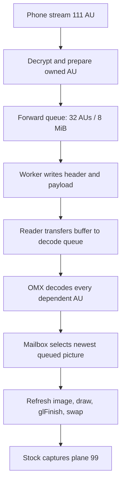
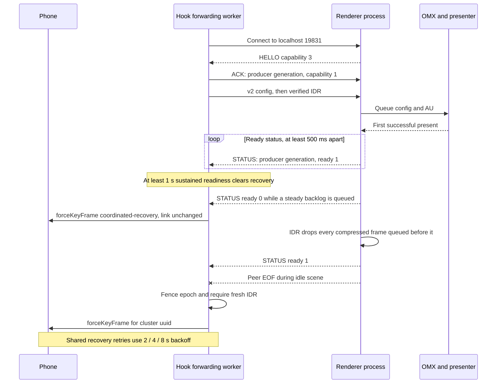
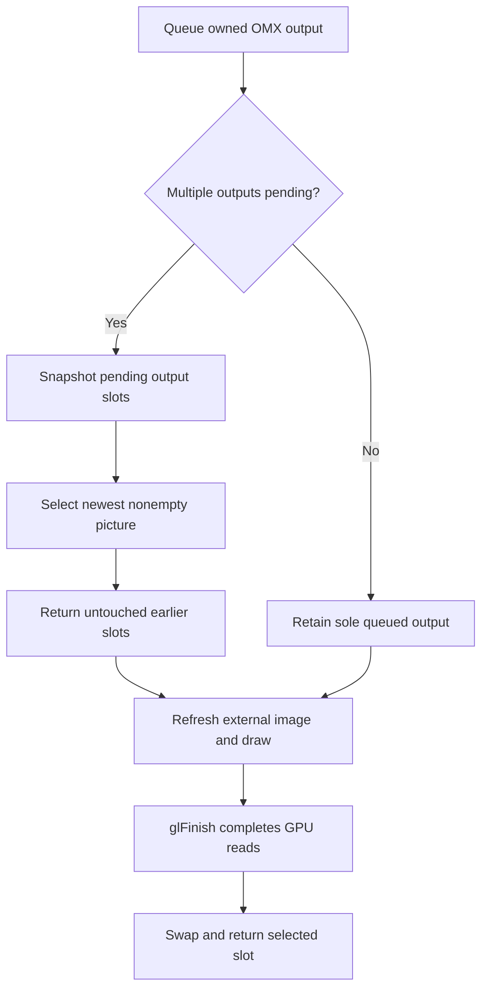

# Video Pipeline

*How a type-111 H.264 access unit becomes a pixel on the cluster panel, how stock stream 110 reaches the main screen for comparison, and which renderer operations are load-bearing.*

---

## ⚙️ The delivery path

The current source candidate receives stream 111 in the hook, decrypts each AU,
validates its complete NAL framing and converts AVCC to Annex-B. With
`lengthSize = 4`, validation, IDR classification and prefix rewriting share one
NAL-boundary pass. The receiver transfers its buffer to a bounded forwarder
queue and receives a spare; localhost I/O runs on another worker. The renderer
transfers its read buffer to the decode queue, feeds OMX and selects decoded
pictures through a mailbox presenter. **[code]**[^pacing_source]



This candidate was verified offline on 2026-10-06. The earlier phone-to-cluster
path has on-car evidence; the new ownership, control-channel and mailbox
behavior has host tests and QNX build evidence, with actual vehicle pacing
still unmeasured. See [AltScreen Frame Rate](ALTSCREEN_FRAME_RATE.md) for all
six changes and their validation limits.

The renderer reports `VIDEO_ON` (`0x81`) to Java only after a successful present
in the current generation, and `VIDEO_OFF` (`0x82`) when that readiness is lost.
It connects as a client to Java's `AltscreenControlServer` on `:19832`; Java
sends `ALTCMD_VIEW_AREA` (`0x01`, full/compact, style, raw preset) back over that
same four-byte control protocol. This is separate from hook/renderer status on
`:19831`. The external renderer continues to isolate OMX/GL from dio_manager.
**[code]**[^control_source]

The separate [input command worker](ALTSCREEN_INPUT_COMMANDS.md) sends semantic
roller/view/night/appearance commands through the stock SDK. Its reserved queue,
CF ownership and immutable selected-input age are independent of this compressed
AU queue, decoder and Java presentation-readiness channel. Input scheduling
changes are not a measurement of video frame pacing.

### The localhost link

| Property | Current source contract |
|---|---|
| Endpoint | Hook client → renderer server, `127.0.0.1:19831` |
| Legacy framing | Four-byte BE length followed by Annex-B payload |
| Negotiated v2 | Forty-byte BE metadata header followed by Annex-B payload; maximum payload 4 MiB |
| First H.264 record | Cached SPS/PPS marked config, then a verified IDR; status-capable peers exchange an opt-in ACK before config |
| Socket | Nonblocking, `SO_SNDBUF` 512 KiB, `TCP_NODELAY`; connect wait 250 ms; complete greeting collected within one 250 ms deadline (`hook/altscreen/altscreen_av.c:168`; 40 ms until 2026-10-09), also capped by the transaction deadline |
| I/O budget | One 1000 ms monotonic deadline covers connect, greeting, ACK, config replay and AU send |
| Batched I/O | `writev` handles header + payload without copying; known-v2 reader reads the complete header, then payload. Partial writes, EINTR and EAGAIN retain the same deadline |
| Hook queue | At most 32 AUs / 8 MiB of buffer capacity; overflow fences the epoch and clears the dependent chain |
| Renderer queue | At most 1024 items / 24 MiB of buffer capacity; startup retains this budget. A healthy, drained stream uses valid origin age to detect a multi-AU backlog over 1000 ms; that backlog is a latency condition, not a decoder fault: the frame is still queued, the picture stays, the 100 ms control tick reports STATUS 0 so the hook requests an IDR, and the IDR drops every compressed frame queued before it (`altscreen_render/main.c:435-486`, `:556-581`) |
| Idle observation | Hook worker checks control/EOF every 100 ms while idle using a monotonic condition on QNX/Linux and relative wait on macOS. Wall-clock corrections do not postpone the tick. Frame silence is valid; there is no static-scene receive timeout |
| Watchdogs | Screen/EGL startup: 15 s → `_exit(92)`; decode-worker exit wait: 1500 ms; OMX input-buffer wait 3000 ms on `CLOCK_MONOTONIC` (`ALT_INPUT_WAIT_MS`, `altscreen_render/pipeline_timing.h:14`, `sink_omx_qnx.c:453-472`); a stuck decoder worker is caught by the 20 s no-progress exit, not by the input wait |
| Process priority | `setprio(0, 15)` on QNX (`altscreen_render/main.c:799`), the same value as `maneuver_render`; below the hook's audio receiver at SCHED_RR 18, above the default that let the compositor starve every renderer thread at once |

Source: [hook forwarder](../../hook/altscreen/altscreen_av.c),
[renderer reader](../../altscreen_render/frame_io.c) and
[decode queue](../../altscreen_render/main.c). **[code]**

### Negotiation and presentation readiness



| Peer combination | AU framing | Recovery confirmation |
|---|---|---|
| New hook + HELLO capability 3 renderer | v2, with explicit hook ACK | Repeated ready status spanning at least 1 s |
| New hook + HELLO 2 renderer | v2, without status | Successful transport send |
| New hook + silent renderer | Legacy | Successful transport send |
| Older hook + new renderer | Legacy if its HELLO parser does not recognize capability 3 | No status unless the hook opts in |

The hook's ACK enables status traffic; it does not mean a picture has appeared.
STATUS `ready = 1` follows successful presentation. Status carries the producer's
generation; stale owners, invalid state values, STATUS without opt-in and
malformed records end the link. The greeting deadline is checked again after
`poll` before bytes are read, and again after a full greeting before capabilities
are enabled. A fully consumed late greeting is cleared before legacy fallback.
Negotiation accepts fragmented HELLO within its deadline. A timed-out partial
greeting stays aligned for later idle parsing without upgrading the legacy
connection. The idle worker accepts fragmented control records and drains at
most eight per observation. HELLO/ACK and partial I/O add calls beyond the
steady complete-AU count. **[code]**[^wire_source]

The startup-policy state machine and deadline/fallback sequence are in
[AltScreen Pacing Validation](ALTSCREEN_PACING_VALIDATION.md).

**2026-10-09, first car run of `ac992616`: two cluster blinks, both the steady-backlog rule.** The cluster went black at unit time 00:04:45 (1.8 s) and 00:06:25 (1.6 s). The phone and the hook were steady (hook `111 pace` ≈ 47 ms arrival, ≈ 21 fps, every AU forwarded); the renderer's own windows show all of its threads losing 285–624 ms at once (`full_present max_us=285034`, `present_queue p99_us=624456`, `input_wait max_us=368631`), process starvation of a default-priority renderer. The rule then turned that latency into a generation restart. Blink 1: `steady compressed backlog >1000 ms; config+IDR recovery` → `decoder lost frame continuity; reconnect generation=1` → `-> VIDEO_OFF` → hook `forceKeyFrame reason=coordinated-recovery`, 250 ms reconnect backoff → `hook connected generation=2` → PRISM loader → `-> VIDEO_ON`. Blink 2 took the control-tick path (same `lost frame continuity` line without the backlog line) and also hit `input-buffer wait TIMEOUT (1000 ms); marking decoder unhealthy` (a presenter pause of ~570 ms holds all 12 outputs, so the inputs run dry ~150 ms later, `pipeline_timing.h:7-13`), followed by `OMX_EventError 0x80001017` / `0x8000101c` because `_Teardown` stopped waiting for the Idle edge once an error was latched. The fix keeps latency apart from decoder faults: a steady backlog stays queued and is logged once per episode as `steady compressed backlog >1000 ms; keeping the picture, IDR requested` (`altscreen_render/main.c:435-486`); the 100 ms tick keeps reporting STATUS 0 while backlogged (`main.c:556-581`), which makes the hook's recovery policy request the IDR with no link change (`hook/altscreen/recovery_policy.h:67-84` → `alt_forward_failed`, `altscreen_hook.c:2567-2571`, 2/4/8 s backoff); when that IDR arrives, every compressed frame still queued before it is dropped and logged as `backlog IDR arrived; dropped N stale frames, picture jumps to the present` (`decode_queue_drop_frames_locked`, `main.c:411-431`); the video stays ON and the last picture stays on the panel. Hardening in the same change: renderer priority 15 (`main.c:799`), `ALT_INPUT_WAIT_MS` 3000 ms on `CLOCK_MONOTONIC` (`pipeline_timing.h:14`, `sink_omx_qnx.c:453-472`), `_Teardown` waits for the Idle and Loaded edges even with an error latched (`_WaitStateEx(..., ignoreError=1)`, `sink_omx_qnx.c:484-499`, `:792-796`), and the hook's greeting window is 250 ms instead of 40 ms (`altscreen_av.c:164-168`: the renderer's main thread was late to `accept()` during a recovery and both reconnects fell to legacy framing for the rest of the session). Logs: `local_logs/unit_altscreen_render_20261009_2235.log:394-434`, `:576-618`; `unit_hook_20261009_2256.log:939-944`, `:1391-1399`. Host regressions: [queue policy](../../tests/altscreen_queue_policy_test.c), [negotiation](../../tests/altscreen_negotiation_test.c), [sink](../../tests/altscreen_sink_test.c). The fix has not been driven yet. **[car]** / **[code]**

### V2 AU header

All integers use explicit big-endian byte encoding, without packed ARM structs.

| Offset | Bytes | Field |
|---|---:|---|
| 0 | 4 | Magic `0x41563246` (`AV2F`) |
| 4 | 2 | AU version `2`, even when HELLO advertises capability `3` |
| 6 | 2 | Flags: config `1`, IDR `2` |
| 8 | 4 | Payload length |
| 12 | 4 | Producer generation |
| 16 | 8 | AU sequence; config uses `0` |
| 24 | 8 | Phone sender NTP PTS |
| 32 | 8 | Hook receipt time, monotonic microseconds |

HELLO is eight bytes. ACK and STATUS are twelve bytes each: magic, producer
generation, and capabilities (`1`) or readiness (`0`/`1`). Future or unavailable
hook receipt times fall back to local enqueue time for compressed backlog policy.
Sender PTS remains diagnostic; it does not reorder decode or filter output age.
**[code]**[^wire_source]

## 🔍 Stock stream 110 for comparison

The main HU screen never passes through our renderers. Verified 2026-09-13 against the MU1316 binary (`libairplay.so` 210.81, SHA-256 `01c116b1…3656f2`, ELF32 ARM LE, VA = file offset in `.text`) and a saved car trace; no live check (SSH timed out). **[decompile]** / **[car]**

```text
iPhone H.264 -> RTSP SETUP streams[{type:110, streamConnectionID}]
  <- {type:110, dataPort} (preferred -6030, dynamic fallback)
  -> TCP to dataPort -> dio_manager / libairplay _ScreenThread
  -> ProcessFrames: 128-byte header + body, AES-CTR for video
  -> ScreenStreamProcessData: avcC/AVCC -> Annex-B
  -> dio::OmxVideoImpl -> COMXVideoDecoder -> OMX.qcom.video.decoder.avc
  -> native Qualcomm 32m Screen buffers -> FillBufferDone -> screenRenderThread
  -> CScreenRender::render -> screen_post_window -> displayable 59
Java/HMI: context 78 = {16 HMI + popups, 59 CarPlay video}
```

| Link | Stock evidence |
|---|---|
| Singleton screen setup | `_ScreenSetup` @ `0x26f9c`, slot `+5136/+5140`; key derive with `session+456` at `0x27094`-`0x270b0`; preferred port -6030 at `0x270e4`-`0x27118`; response `{type:110,dataPort}` at `0x27134`-`0x27160` |
| Receiver thread | `_ScreenThread` @ `0x24220`: `SocketAccept` 10 s timeout (`0x242a0`-`0x242b0`), `StartSession` @ `0x2a3b8` (main screen via `ScreenCopyMain`, call `0x2a414`), `ProcessFrames` @ `0x2b154`; on exit `StopSession` (call `0x24400`) then `NetSocket_Delete` |
| Decrypt / config | opcode 0 via `AES_CTR_Update` (call `0x2b7b0`); opcode 1 avcC unencrypted; `_ScreenStreamSetProperty` @ `0x85590` builds the Annex-B header (`H264ConvertAVCCtoAnnexBHeader` calls `0x85830`/`0x85884`) |
| Decoder | `ScreenStreamCreate` @ `0x85ce4` → `IVideoAbstraction::createVideoImpl`; `OmxVideoImpl::initialize` @ `0x8c638`; `COMXVideoDecoder::open` @ `0x871e8` (`OMX_GetHandle` call `0x87220`); `configure` @ `0x89ffc` requests `0x7f000004` (`0x8a148`-`0x8a17c`) |
| Window | `OmxVideoImpl::configure` @ `0x8c388` writes ID 59 (`0x8c4dc`-`0x8c4e0`); `convertColorFormatOMX2Screen` @ `0x8c184` → format `0x1000c` |
| Buffers | `setOutputBuffers` @ `0x86c4c` → `CScreenRender::sharedBuffers` @ `0x8b9e0`; `goToIdleState` @ `0x892fc` → `attachBuffers` @ `0x88f60` → `CBufferPool::attach` @ `0x88d40` (`UseBuffer` via slot `+0x34`) |
| Output | `onFillBufferDoneCallback` @ `0x86d18` → `onJob_renderFrame` @ `0x8af08` → `CRenderFrameCommand::execute` @ `0x8b754` → `CScreenRender::render` @ `0x8b5c0` (`screen_post_window` call `0x8b690`) → reuse callback (`0x8b78c`-`0x8b7a0`) |
| Window setup | `CScreenRender::config` @ `0x8bcc8`: context, window, group `dio_manager.airplay.qnx.screen_render`, class `media`; `selectDisplay` @ `0x8aa80` only picks QNX Screen displays (not MOST) |

Saved trace `log/live_20260812_black110_restart/sloginfo.txt:5422-5498` shows `NONE → INITIALIZING` with latency parameter **25 ms**, receiver/decoder priority 17, 4 decoder command slots, decoder and window **1024×480 @ 30 fps** at `(0,0)`, window 59, **12 input + 12 output buffers**, 12 WFD native images of format `0x1000c`, Loaded → Idle → Executing, then avcC and READY. `latency=25` is a parameter, not a measured phone-to-glass delay, and **READY is not the first shown frame**: `ProcessFrames` calls `ScreenStreamProcessData` (`0x2b7dc`) then `UpdateState` (`0x2b7f4`) while OMX runs asynchronously. There is no EGL/RGBA pass in the stock chain; the decoded buffer is posted directly. **[car]**

In the current hook, SETUP and TEARDOWN wrappers still call stock for 110; the hook's 111 receiver uses preferred port -6031 and creates no stock ScreenStream, so stopping only 110 does not stop 111, while a full AirPlay teardown clears both. The old main-screen loader and `CScreenRender` interposition are gone ([Cluster Loader](CLUSTER_LOADER.md)). HMI visibility loss and video teardown are different events. **[code]**

Sources: `STOCK_STREAM_110_HU` (its `output/r2/stock-stream110-20260913/` artefacts are not preserved)

## 🔐 Screen crypto variants

Stock MHI2Q 210 always uses the legacy AES-CTR screen key (session `+0x1c8` = 456). Newer libairplay builds can use ChaCha20-Poly1305 for paired sessions, so offsets and ciphers are **not portable**. The MH2P build `MH2p_US_LB636_P2712` (`libairplay.so` **320.17.1**, version strings at `0xc1e1c`/`0xc8014`, SHA-256 `f94f1b66…ddc5dc`, Thumb code, VA = file offset) was checked statically on 2026-09-16 for a friend's port. **[decompile]**

| Fact | Evidence (320.17.1) |
|---|---|
| Legacy AES session key moved to `session+0x1f8` (504), IV at `+0x208` | `AirPlayReceiverSessionSetSecurityInfo` @ `0x35894` |
| Screen setup tests `pairVerifySession` at `session+0x3e4` | `0x37382`-`0x3738a` |
| Paired branch: 32-byte key → `AirPlayReceiverSessionScreen_SetChaChaSecurityInfo` | helper `0x34d44` at `0x373a4`, setter call `0x373b4` |
| Unpaired branch: legacy AES | `0x3858a` forms `session+0x1f8`, `0x38594` `AirPlay_DeriveAESKeySHA512ForScreen`, `0x385a0` `SetSecurityInfo` |

Paired screen key: `HKDF-SHA512(IKM = pair-verify 32-byte shared secret, salt = "DataStream-Salt" + decimal streamConnectionID, info = "DataStream-Output-Encryption-Key", L = 32)`, no trailing NUL; use the **111 stream's own** connection ID; the label says "Output" even though the HU receives. Prefer the exported `PairingSessionDeriveKey(pairVerifySession, salt, saltLen, info, infoLen, 32, key)` (@ `0x81528`, secret at pairing object `+0x156`) over calling the compiler-specialised helper. AEAD framing for an opcode-0 record: AAD = the complete 128-byte header (whose `bodySize` still includes the tag), ciphertext = `body[0 : bodySize-16]`, tag = last 16 bytes, nonce = per-stream 8-byte little-endian counter from zero, incremented once per verified video record only (not for config records or TCP reads), algorithm `chacha20_poly1305_init_64x64` (key at screen `+0x2c4`, nonce `+0x2e4`, `ProcessFrames` @ `0x3bf70`, `0x3cd64`-`0x3cdd8`). Derivation details: the helper formats `%s%llu` (`0xc49e8`, prefix `0xc49f0`) and calls `PairingSessionDeriveKey` at `0x34d9e` with the 32-byte info string at `0xc4a00`; a separate input branch (31-byte label `0xc4a24`, call `0x34dc4`) is not used by screen setup, and `Control-Read-Encryption-Key` is a different derivation. `SetChaChaSecurityInfo` @ `0x3b74c` zeroes the cryptor (nonce included), copies exactly 32 key bytes and sets valid (`+0x1d4` tested at `0x3c630`); use the stock 64x64 API or an exactly compatible one, since generic ChaCha APIs frame the nonce/counter differently. Confirm by observing which setter stock calls for 110, and validate the first tag before parsing NALs; a single `forbidden_zero_bit` error is a downstream symptom, not a key test. radare2's PLT labels were wrong in this ELF; calls were re-resolved with Capstone and pyelftools (`output/r2/mh2p-screen-crypto-20260916/`, not preserved). No live decrypt was done.

The 2026-09-11 Showcase comparison reached the same conclusion from the other side: Showcase decrypts screens with ChaCha20-Poly1305 over the header AAD, while our 111 path keeps stock 210's AES-CTR; different negotiated protection, not a reason to change cipher.

Sources: `MH2P_SCREEN_CRYPTO_320_2026_09_16`, `SHOWCASE_AIRPLAY2_REVIEW`

## 🔧 The OMX decode chain

`altscreen_render` is a standalone receiver matched against stock libairplay 210's `dio::COMXVideoDecoder` chain. Its component is **`OMX.qcom.video.decoder.avc`** (`altscreen_render/sink_omx_qnx.c:1-24`, `:46`). **[code]**

| Aspect | Current implementation |
|---|---|
| AVCC → Annex-B | Done in the hook. Owned length-size-4 buffers are rewritten in place; length sizes 1–3 use expanding conversion. Cached SPS/PPS is the first H.264 record, flagged `CODECCONFIG`; an opt-in ACK may precede it. |
| Port definition | Native Qualcomm 32m tiled output, OMX `0x7F000004` (`sink_omx_qnx.c:52`). Explicit `xFramerate = 30<<16` on both ports, verified by readback (`sink_omx_qnx.c:427-470`). Linear NV12 `0x27` cannot leave Loaded on MU1316. |
| Decoder-order mode | `OMX.QCOM.index.config.video.DisplayPictureBuffer` through a **20-byte** `GetParameter` → set `+12`/`+16` → `SetParameter` → readback. This is the OEM ABI; the old 12-byte `SetConfig` was not equivalent (`sink_omx_qnx.c:53`, `:474-515`). Details in [AltScreen Frame Rate](ALTSCREEN_FRAME_RATE.md). |
| Output buffers | Native Screen WINDOW buffers bound with `OMX_UseBuffer` (`sink_omx_qnx.c:563-598`). After `FillBufferDone`, EGL imports the same buffer through a non-owning pixmap alias (`EGL_NATIVE_PIXMAP_KHR`). The GPU then de-tiles, converts YUV to RGB and draws into the RGBA8888 window of displayable `99` (`altscreen_render/screen_egl_present.c:1-21`). |
| Screen format/usage | `0x1000C` (qcom tiled NV12) and `USAGE = 0x484` exactly (Screen reports `0x487` after adding its own bits). Extra READ/WRITE/GLES bits split the chroma storage and gave a solid-green picture (`screen_egl_present.c:46-51`). |
| PortSettingsChanged | Ignored for stock-210 parity. Rebuilding live output buffers races `FillDone`/`FreeBuffer` (`sink_omx_qnx.c:141-145`). The early port's full output reconfig was dropped. |
| Start failures | Capped at 3 consecutive `_StartDecoder` failures, then a 30 s cooldown: each failed `GetHandle` can hold a hardware slot, and starving the pool made dio's own decoder fail (`kBadReferenceErr`) into a CarPlay crash loop. A session that reached Executing refreshes the budget (`sink_omx_qnx.c:948-968`, `:1007-1035`). |
| IDR gate | A new or rebuilt decoder refuses picture NALs until an IDR (`needsIDR`); SPS/PPS survive a failed start so the next IDR is not mislabeled `CODECCONFIG`; a latched decoder error ends the transport instead of rebuilding on a P-frame (`sink_omx_qnx.c:936-985`). |
| Reconnect | A normal TCP disconnect tears down OMX only; Screen buffers, pixmap aliases, EGLImages, context and the managed RGBA window persist ("reusing persistent EGL/Screen presenter across reconnect", `sink_omx_qnx.c:397`, `:992-1011`). |

Stock `screen_read_window` is deliberately unused: on this BSP it copied tiled bytes without YUV→RGBA conversion (`screen_egl_present.c:20-21`). The from-source `screenstream.c` parity work is a separate legacy experiment, now at `Patches/dio_asm_to_c/_legacy_attempt/libairplay-mhi2q/SCREENSTREAM_PARITY.md`. Running two AVC decoders at once (dio main 110 plus the cluster 111) is **safe**: firmware `libmmkiVdec_asic_AF.so` `sub_99F8` allows 4 concurrent decode clients. See `memory/screenstream_omx_parity.md`. **[decompile]**

### Stock native-buffer contract (why 32m)

| Stock address | Behaviour |
|---|---|
| `0x8a164`-`0x8a18c` | Requests Qualcomm output colour `0x7f000004` |
| `0x8b350`-`0x8b39c` | Creates Screen WINDOW buffers before OMX enters Idle |
| `0x8b4cc` | Reads each buffer's `SCREEN_PROPERTY_POINTER` |
| `0x88fa8` | Passes those pointers to OMX output headers |
| `0x86db0` | Delivers the filled output buffer to the consumer |
| `0x8b660`-`0x8b694` | Maps the filled pointer back to its Screen buffer |
| `0x86614` | Recycles it with `FillThisBuffer` |

The live `eglsub-screen.so` has an explicit format-`0x1000c` import branch at `0x691c`, reads planar offsets at `0x6344` and validates the UV offset at `0x6998`; `libEGL.so.1` exports `eglWaitNative` @ `0x51a8`, `eglCreateImageKHR` @ `0x5b3c`, `eglSwapBuffers` @ `0x5e48`. The accepted diagnostic run logged `source ABI fmt=0x1000c usage=0x487 size=1440x542 stride=1536 planar=0,835584,0`, `SOURCE PROBE ... UVavg=115 range=0..170`, `RGBA PROBE avg=44,70,106 range=0..255`. Those one-shot readbacks are removed from the frame path. **[car]** / **[decompile]**

Sources: `ALTSCREEN_BLACK_DIAGNOSIS`, `IOS26_ALTSCREEN_REWORK_PLAN`

## ✅ Receiver-robustness fixes (2026-09-11/12)

A review against Showcase (`4dbf3a2a…`, a full iOS CarPlay receiver), `airplay2` (`834c6c2e…`, Swift prototype whose mirroring/audio services only print) and `airplay2-receiver` (`6c343d36…`, Python handler without its `ap2` package) found five P2 continuity bugs, all fixed with host tests: **[code]**

| Trigger | Bug | Fix |
|---|---|---|
| New avcC mid-connection | cache updated but not re-fed to OMX once `fedConfig` was set | re-feed with `CODECCONFIG`; next picture must be IDR (replay: OMX now gets 3 packets, the last a whole 17-byte AU, instead of one 11-byte packet) |
| SPS/PPS and IDR in one AU | whole AU classified as config and the picture skipped | NAL scan separates parameter sets, pictures and IDR (3- and 4-byte start codes) |
| OMX rejects input or buffer too small | `_FeedInput` returned `void`; dependent P-frames kept coming | error reaches the decoder worker → queue cleared, socket `shutdown`, reader closes; the hook's config+IDR recovery takes over |
| Decoder (re)start | a fresh decoder could get config + P-frame without IDR | continuity loss ends the connection; explicit IDR gate; 3-start/30 s cap kept |
| Hook connect | `av_connect_locked` restored blocking mode, letting one send outlive the deadline | socket stays non-blocking |

A delayed error from an old decoder generation cannot clear the new queue; the worker only `shutdown`s, the reader owns `close` so the fd number is not reused mid-read. Showcase's buffered-audio framing (2-byte length + 12-byte RTP) differs from our captured APAP (BE32 length, 15-byte header, 24-bit sequence) and must not be copied. The Monocypher cross-check (1000 Poly1305, 5000 ChaCha20 incl. 32-bit counter carry, 4000 APAP AEAD with tampered-tag rejection, IETF nonce `[0,0,0,0] + nonce8` equivalence) passed on synthetic data. Reference locations used: Showcase `source/Showcase.m:4222-4258` (new config → new format description + IDR required), `:4339-4360` and `:4407` (dependent-frame chain), `source/carplay_services.m:2804-2833` (new UI connection requests config + IDR), `:3821-3968` (128-byte header, opcode 1 avcC, opcode 0 video), `:4653-4689` (selective and full TEARDOWN); Python `ap2-receiver.py:463/493/765/850` (FLUSHBUFFERED, SETUP, TEARDOWN, FLUSH); Swift `Mirroring.swift:18`. The full host suite passed including the new `altscreen_sink_test` and `altscreen_worker_test` (and the private APAC capture: 3980 authenticated frames, 3977 byte-identical packets, 64 decoded), Clang Static Analyzer was clean, and `LOG=0 bash scripts/build_hook.sh` kept 26 allowed interpose exports; artefact hashes were hook `b7569509…7b27`, APAC `a6a7bc8c…044f`, renderer `a2ce321a…6c9d`. Presentation still ignores sender timestamps (Showcase honours `RespectTimestamps`); that difference is not proven to cause any fault.

On 2026-09-12, after `a05f774`, a parser hardening in `13801f2` rejected two formats the iPhone really sends. The altScreen one: at stream start the phone sends opcode 1 with **`bodySize 0`** (flags `0x56`); the avcC parser failed and the receiver closed before the first frame. An empty VideoConfig now keeps the current avcC; a non-empty one must still carry whole SPS/PPS, including with ClearScreen set (seen live with a valid 40-byte avcC). This matches Apple's `AirPlayReceiverSessionScreen.c` `kAirPlayScreenOpCode_VideoConfig`, which calls `ScreenStreamSetAVCC` only when `bodySize > 0`. After the fix the HU got avcC, the first IDR and more than 1000 (later 1200) frames. The cover-art half of that regression is in [Cover Art Pipeline](COVER_ART_PIPELINE.md). Hook SHA-256 `a565332a…48557`. **[car]**

Sources: `SHOWCASE_AIRPLAY2_REVIEW`, `ALTSCREEN_COVERART_LIVE_REGRESSIONS`

## ⚡ Rubber-banding = missing TCP_NODELAY

Cluster video felt like rubber-banding (2026-09-06). Everything downstream looked innocent: EGL swap took 0.3 ms, there were no drops, and the decode queue never filled. Arrival at presentation was still avg 48 ms / max 204–233 ms against the advertised `maxFPS=30`. **[car]**

In the measured build, the hook wrote each frame as **two** writes, `[u32 BE len]` then the access unit, and the socket had no `TCP_NODELAY`. The header ships at once and leaves data unacked. Nagle then holds the sub-MSS access unit until the header is ACKed. That renderer did not write back, so nothing carried the ACK early, and the hold lasts the delayed-ACK timer. The fix sets `TCP_NODELAY` on the renderer link (`hook/altscreen/altscreen_av.c:135-142`, @`cb94115`). That historical fix retained separate header/body sends through `av_send_all_locked`. The current candidate uses `av_write_vectors_locked` to batch header and payload and still keeps `TCP_NODELAY`; it has no new on-car timing measurement. After the fix the arrival counters agree at **avg 34 / max 71–99 ms** (29.4 fps). **[car]** / **[code]**

The attribution is not airtight. The average had already recovered one window earlier, on the old hook, after a stream break. Something builds the 48 ms state during a session and resets it on reconnect, and that trigger is still **[open]**. Three arrival counters are in place to catch it:

| Counter | Where | Cadence | Build |
|---|---|---|---|
| Hook pace (arrival/read/work/pts) | `altscreen_hook.c`, `alt_pace_report` | every 300 AUs | bounded summary with verbose logging or pace trace |
| Render socket arrival | `altscreen_render/main.c`, `serve_client` | detailed summary every 300 video AUs | `carplay_verbose`; separate basic socket probe remains every 600 records |
| Render worker-entry and swap | `altscreen_render/screen_egl_present.c` | detailed steady summary every 300 successful presents | `carplay_verbose`; startup reported separately |

See `memory/altscreen_delivery_nagle.md`.

## 📦 Decoded-output mailbox ownership

`FillBufferDone` queues an owned native slot; it never performs GPU work.
The presenter selects the newest nonempty picture from a bounded snapshot and
returns only earlier slots that no GPU read has begun. A selected or in-flight
slot remains owned until `glFinish` completes its GPU reads. Synchronous OMX
refills cannot extend the snapshot and starve the retained picture. A sole old
picture is still shown, and a trailing empty output does not supersede a real
picture. **[code]**[^mailbox_source]



| Mode or failure | Behavior |
|---|---|
| Default | Mailbox enabled at `av_sink_open` |
| `ALTSCREEN_PRESENT_FIFO=1` | Presenter retains FIFO selection |
| All outputs empty | Returns older empty slots without inventing a picture |
| Recycle error | Latches OMX error and stops the presenter; readiness becomes false |
| Teardown | Stops and joins presenter before OMX state/free operations; pending slots remain on the client side for teardown |

Mailbox never skips compressed P-frames and never applies a decoded-age cutoff.
Host tests cover burst selection, empty outputs, sole old frames, synchronous
refills, GPU overlap, stop and recycle failures. Actual BSP buffer/reference
behavior remains unverified for this candidate. See
[frame-rate validation](ALTSCREEN_FRAME_RATE.md).

## 🔍 Load-bearing operations: do not remove

`_OnFillDone` only queues the output slot. A dedicated `_PresentThread` dequeues it, so `glFinish` and the swap can never block Qualcomm's component thread (`altscreen_render/sink_omx_qnx.c:222-264`, `:284-313`). Per frame the worker runs: loader stop/join → `eglMakeCurrent` → refresh the external EGLImage → draw → **`glFinish`** → `eglSwapBuffers` → `OMX_FillThisBuffer` (`screen_egl_present.c:961-998`, `sink_omx_qnx.c:236-247`). Two of these steps look redundant but are not: **[car]** / **[code]**

- **`glFinish`** (`screen_egl_present.c:993`) is the ownership barrier before OMX may overwrite the sampled source buffer. Removing it to look faster corrupts frames.
- **Re-targeting the external image each frame** (`screen_egl_present.c:966-979`) fixed verified stale-UV / solid-green frames on this Adreno 320 driver.

Neither has been proven redundant. The loader join at `:961` is also an ownership barrier: no loader draw can race the first decoded frame. Texture coordinates flip **only V** (Screen buffers are top-left origin); the first colour run proved an extra S flip mirrored the picture (`screen_egl_present.c:935-937`). See [Landmines](../LANDMINES.md).

## 📊 Frame rate

Recorded input ran at 20–27 fps against `maxFPS = 30`; there is no fixed 20 fps cap in the iOS sender, and the lower count was already present before our decoder. The renderer now matches the stock OEM decoder contract and presents from a worker, keeps swap interval 2, and has no output-age filter. The sender policy, the stock comparison, the age-filter regression, the capture-clock decision and the pace probe are all in [AltScreen Frame Rate](ALTSCREEN_FRAME_RATE.md). The live per-stage measurement is **[open]**.

<details>
<summary>History: the black/green renderer, crashes and supervisor races (2026-08-03)</summary>

---

- The first accepted colour run decoded real Maps video at 1440×542 and swapped more than 2,040 RGBA frames with readable road labels, closing the black/green renderer fault. **[car]**
- A fast unplug/replug exposed a supervisor race: the old cleanup took a fresh process snapshot after its 1 s SIGTERM wait and SIGKILLed the **new** renderer (old PIDs `16244865/16269442`, new `20762758/20803713`). The hook got `EPIPE`; the new decoder had SPS/PPS but no IDR and showed green (native probe `UVavg=0 range=0..38`). Fix: snapshot renderer PIDs when dio exits and signal only that immutable set (`deploy/smartphone_integrator/carplay_startup.sh`, `carplay_processes.sh`). Renderer PID files reduce `pidin ar` snapshots to at most one adoption per boot/upgrade.
- A reported whole-HU freeze ended in a full reboot, so the trigger is unrecoverable (RAM `/tmp` logs gone, clock reset, ~881 MiB of 2 GiB free after boot). Four persistent cores `/mnt/ota/system/core/altscreen_render{,.1,.2,.3}.core.gz` are all `SIGSEGV/MAPERR` in thread 1 at Qualcomm `egl14.so` `+0x16428`: evidence of EGL churn risk, not of the reboot. Mitigations: bounded IDR requests, persistent presenter across reconnect, no steady-state file I/O, no `fsync` after each hook log write, renderer keeps only current + one previous log (`altscreen_render/main.c:503`), counters every 600 frames.
- Main-screen startup was measured at 2.9–3.4 s from hook init to stock 110 READY; the 111 setup took 6 ms inside `alt_setup`. At the time the renderer waited 750 ms (`ALTSCREEN_MAIN_GRACE_MS`) before opening its OMX/EGL pipeline to give 110 priority; that knob is no longer in the source.

</details>

---

**Related:** [Archive and History](../reference/ARCHIVE_AND_HISTORY.md) — the earlier video designs and why they were dropped.


---

## 📚 Sources

Merged originals were removed from the tree after this note absorbed them; they remain in git history (commit 23972aa).

- `STOCK_STREAM_110_HU` — the stock main-screen 110 chain with addresses and a saved car trace.
- `MH2P_SCREEN_CRYPTO_320_2026_09_16` — MH2P 320.17.1 screen key offsets and ChaCha20-Poly1305 framing.
- `SHOWCASE_AIRPLAY2_REVIEW` — five continuity bugs found by comparing with Showcase/airplay2.
- `ALTSCREEN_COVERART_LIVE_REGRESSIONS` — empty VideoConfig regression.
- `ALTSCREEN_BLACK_DIAGNOSIS` — stock native-buffer contract, first colour frames, crash evidence.
- `IOS26_ALTSCREEN_REWORK_PLAN` — the 4-client OMX limit.
- `memory/altscreen_delivery_nagle.md`, `memory/screenstream_omx_parity.md`.

Related: [AltScreen Frame Rate](ALTSCREEN_FRAME_RATE.md), [AltScreen Cluster Video](ALTSCREEN_CLUSTER_VIDEO.md), [Cluster Loader](CLUSTER_LOADER.md), [Cluster Video Encoder](CLUSTER_VIDEO_ENCODER.md), [AltScreen and Video overview](README.md).

[^pacing_source]: Current receiver/forwarder: [altscreen_hook.c](../../hook/altscreen/altscreen_hook.c), [avcc_frame.h](../../hook/altscreen/avcc_frame.h), [altscreen_av.c](../../hook/altscreen/altscreen_av.c); offline result index: [summary.json](../../build/altscreen-pacing-validation/summary.json).
[^control_source]: [altctl.c](../../altscreen_render/altctl.c), [protocol.h](../../altscreen_render/protocol.h), [AltscreenControlServer.java](../../java_patch/com/luka/carplay/core/AltscreenControlServer.java).
[^wire_source]: [alt_video_wire.h](../../common/alt_video_wire.h), [frame_io.c](../../altscreen_render/frame_io.c), [control round-trip test](../../tests/altscreen_control_test.c), [fragmented control test](../../tests/altscreen_health_wire_test.c), [greeting negotiation test](../../tests/altscreen_negotiation_test.c).
[^mailbox_source]: [sink_omx_qnx.c](../../altscreen_render/sink_omx_qnx.c), [mailbox test](../../tests/altscreen_mailbox_test.c).
