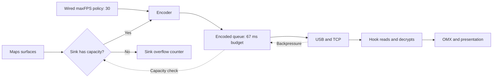
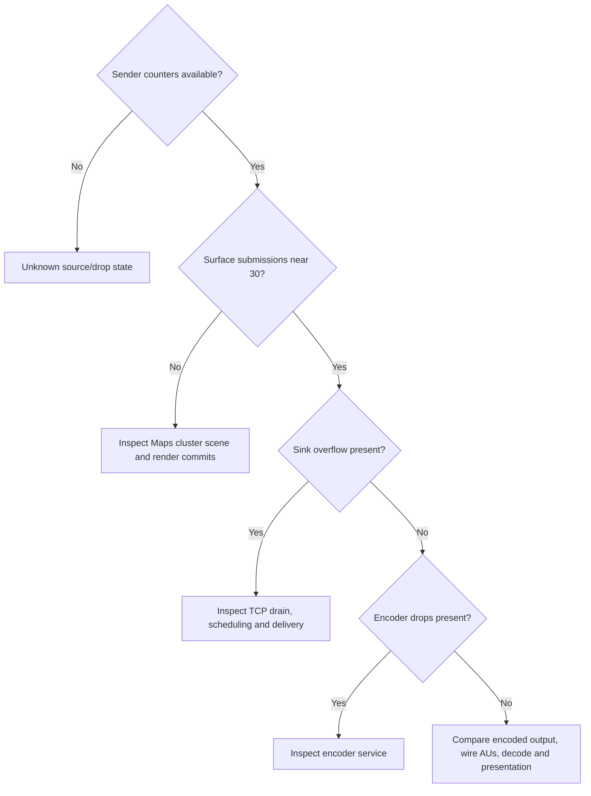
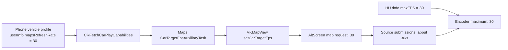

# Wired AltScreen 30 fps investigation

> `<AUDI_WORKSPACE>` denotes the external firmware/RE working set, not a directory shipped with this repository. Source filenames, builds and evidence offsets below identify the required artifacts.

_2026-10-21 · iOS sender code, saved HU logs, isolated QNX USB and native wired vphone experiments_

The subsequent [complete Maps vehicle-profile analysis](MAPS_FRAME_RATE_PROFILE_MECHANISM.md)
covers PPID parsing, asset matching and collisions, cache/notification lifecycle,
the native reconnect reversal, VectorKit rate scaling and the iOS 27 query path.

## 📋 Findings

Sustained 30 fps remains unverified on the vehicle. In the saved October 15 HU
capture, the lower delivered cadence already appears before OMX. That alone
does not identify its cause: slow HU reads can back-pressure iOS and cause
sender-side drops. New analysis of the saved USB laboratory capture does
identify actual sink overflow, separately for each display. An isolated QNX
test also reproduces approximately 2.4–2.6 Mbit/s TCP throughput through the
laboratory's OHCI/Full Speed path without iOS or CarPlay.[^hu][^telemetry][^probe]

A separate EHCI/High Speed guest now works. EHCI alone still delivers about
2.6 Mbit/s combined. Replacing macOS `g_poll()` with direct `poll()` in a copied
QEMU timer compilation unit raises the two-connection result to **7.73 Mbit/s**
for the same 512 KiB requests. This establishes a removable laboratory
bottleneck. A longer run with four 4 MiB transfers reaches **9.21 Mbit/s**
combined. Native follow-up below now receives and independently decodes actual
AltScreen. Lowering the diagnostic encoder bandwidth removes the measured
sink overflow and raises one 40-second AltScreen motion window from 16.39 to
23.90 AU/s. Those initial runs still have source submissions below 30.
The later phone-profile control reaches **1196 AltScreen AUs in 40 seconds
(29.9 AU/s)** after applying `CRCapabilitiesUserInfoKey.mapsRefreshRate=30`.
Its selected map camera requests 30 and submissions average 29.925/s. This
is a laboratory result from a temporary phone preference. A subsequent
**accessory-input-only** control adds iAP2 IdentificationInfo parameter 34
(`PPID`): the phone automatically selects that same 30-fps profile and receives
**1189 AltScreen AUs / 40 s (29.725 AU/s)**. This verifies an input reachable
from our hook; neither experiment is a physical-vehicle measurement or a
deployed hook fix.[^maps-capabilities]

The user reports that the **real primary screen is smooth while AltScreen is
not**. Treat this as the comparison to explain. These laboratory captures
do not demonstrate 30 distinct moving primary map pictures, and their
source counters must not be generalized to the physical phone. A shared USB
link can still have a per-stream receive/sink bottleneck. Low AltScreen sender
PTS cadence alone does not rule that out.[^sender][^processor]

The current candidate corrects one verified asymmetry: stock 210's primary TCP
receiver selects FIFO priority 17, while our old AltScreen receiver inherited
its creator's scheduling. The candidate now invokes the same stock helper and
records before/after readback plus the accepted socket's actual receive-buffer
size. This is a scheduling-parity correction, **not a verified 30-fps fix**.
The next candidate also drains available bytes before polling and reads the
phone's opcode-5 numeric submission/drop counters in diagnostic mode. Both
helpers pass in an isolated QNX runtime; physical-HU FPS remains unmeasured.

The later passive vphone readback identifies the exact 720 × 271-point
AltScreen canvas and its selected deferred camera requesting **15 fps**, while
the encoder still reports 30. Its MapView has no navigation camera attached.
This is a verified source-policy finding for the measured browsing scene;
the [effective-rate section](#-effective-maps-rate-in-the-running-vphone)
separates it from encoded cadence and the subsequent target-rate control.



## 🔬 Source comparison

Addresses are unslid virtual addresses unless explicitly marked runtime. AirPlaySender and
MediaToolbox are extracted Mach-O arm64e binaries. The 26.1 text dump is useful
for names and call relationships; numerical conclusions below were checked
against the 26.6 and 27.0 binaries.[^inputs]

| Input | Work performed |
|---|---|
| `Refferences/ios27_dsc/24A5418b__iPhone18,1/` | AirPlaySender and MediaToolbox decompilation; DashBoard symbol comparison |
| `Refferences/ios27_ff/24A5418b__iPhone18,1/` | AirPlay and CarPlay feature-flag plists inspected; these files provide no fixed-30-fps control |
| `Refferences/ios266_extract/dylibs/` | AirPlaySender wired policy, sink startup and drop predicate checked |
| `Refferences/iPhone18-3_26.1_23B85_Restore/` | AirPlaySender, MediaToolbox and DashBoard text decompilations cross-referenced |
| `Refferences/iPhone18,1_27.0_24A5418b_Restore.ipsw` | BuildManifest identifies iOS 27.0, build 24A5418b, iPhone18,1, matching the extracted corpus; no second full filesystem extraction |

### Wired policy already selects the maximum

| Function | iOS 26.6 VA / file offset | iOS 27.0 VA / file offset | Verified behavior |
|---|---|---|---|
| `screenstream_copyNetworkInfo` | `0x2276d5b9c` / `0x7b9c` | `0x250f4e9c0` / `0x199c0` | CarPlay plus USB selects display maximum directly into current/target FPS, bypassing the bandwidth FPS ladder |
| Production `vdsink_Start` | `0x2277ce374` / `0x100374` | `0x25104f33c` / `0x11a33c` | Default queue budget is `CMTimeMake(67, 1000)`; positive option/preference override is accepted |
| Production `vdsink_ShouldDropFrame` | `0x2276d9f44` / `0xbf44` | `0x250f52e80` / `0x1de80` | Queue media duration at or above the budget rejects a new frame and increments overflow |

In iOS 27, `APEndpointStreamScreenCreate` stores `IsConnectedOverUSB` at stream
storage `+389` and `IsCarPlay` at `+387`; the network-info function uses those
same bytes. Maximum FPS is `+464`, fixed preference `+468`, current `+472` and
target `+476`. `encoderFPSFixed` is read as a phone-side preference. Advertising
that string in HU `/info` is not a verified way to set it.[^sender]

Wired bandwidth selection is also separate from FPS selection: the sender uses
17.5 or 25 Mbit/s according to its pixel-rate threshold. Those are policy
estimates, not measured application payload rates. A charging cable does not
by itself establish that a particular live sender took the USB branch.[^sender]

### Fixed FPS does not disable drops

MediaToolbox's iOS 27 `fvdp_encoderControlSetFramerate` at `0x196e6d16c`
updates configured FPS and computes a nanosecond frame interval. Its separate
`fvdp_shouldDropFrame` at `0x197333ba4` calls the sink's `ShouldDropFrame` method
before encoding. The sink-overflow counter is distinct from encoder queue
drops. The 26.1 text dump shows the same call relationship.[^processor]

Changing the sink budget from 67 ms to a larger value can absorb a temporary
stall, with added latency. It cannot sustain an input rate above downstream
capacity. Selecting a different presentation mode to obtain the sender's
5000 ms branch would change buffering substantially; it is not a demonstrated
low-latency FPS fix.[^sender]

The previously verified thermal limits remain a separate layer. No thermal
event was established for the saved HU run. The stock VC capture timer and
decoded-output age-filter decisions in [AltScreen Frame Rate](ALTSCREEN_FRAME_RATE.md)
remain applicable.

## 📊 Evidence from complete sender telemetry

Screen opcode 5 carries a clear plist with per-stream counters. Previously the
PCAP reporter retained nominal FPS and network fields but discarded the
submission and drop counters. It now retains these fields, finite numeric
values only, plus receipt timestamps. Its requested capture window also
filters telemetry after TCP reassembly.[^analyzer]

| Counter | What to compare |
|---|---|
| `encoderCurrentFPS` | Configured rate |
| `submitSurfaceFPS` | Submitted surfaces; not independently verified distinct pictures |
| `beforeEncoderFPS` | Sender processor's pre-encode rate |
| `sinkOverflowDropFPS` | Rejections by the sink-capacity gate |
| `encoderQueueDropFPS`, `encoderDropFPS` | Separate encoder-side drop counters |
| `idleEncoderFPS`, `idleDropFPS` | Idle behavior; do not count repeats as unique map motion |

The existing `queues-usb-reviewed-ethernet.pcap` contains 103 telemetry records
for each screen. Main has 46 records with positive sink overflow; cluster has
47. Encoder queue-drop counters are zero in all these records. A concrete
cluster record reports:[^telemetry]

```text
encoderCurrentFPS=30
submitSurfaceFPS=30
beforeEncoderFPS=2
sinkOverflowDropFPS=28
encoderQueueDropFPS=0
encoderDropFPS=0
```

This establishes a real sender sink-drop episode with surface submission at
30. These counters describe native reporting windows; their sums are not a
per-frame event trace. Receipt times include transport delay, so matching one
telemetry row to one precise host interval requires additional clock/timing
evidence. `queuedFramesAvg` must not be interpreted as queue depth merely from
its name.

The HU hook currently consumes and ignores opcode 5. For vehicle diagnosis,
the same counters need a bounded diagnostic collection path, together with
the existing `111 pace` measurements. They can distinguish a low source
submission rate from sink drops without relying only on sender timestamp gaps.
The sender's `SupportsStatsAsBody` handling is at `0x250f3b180`: for CarPlay it
checks `keepAliveSendStatsAsBody` in endpoint info before its fallback.[^sender][^hook]

## 🔌 Independent USB transport experiment

Run from the repository root:

```sh
python3 -m tests.carplay_lab.qnx.usb_throughput_probe
```

The probe boots a separate 256 MiB QNX guest, with the corrected 62.5 MHz clock,
on host port 33550. It uses the same shared QEMU executable and stock
`devnp-ecmplus.so`, but starts only networking and a small TCP sink. It neither
uses nor resets vphone, MFi, the active receiver or their ports. Each request
transfers 512 KiB and waits for a guest byte-count/timing reply. The runner
terminates only the process it created.[^probe]

| Measurement from final baseline run | Result |
|---|---:|
| One connection, first transfer | 2.482 Mbit/s host, 2.509 Mbit/s guest |
| One connection, second transfer | 2.420 Mbit/s host, 2.460 Mbit/s guest |
| Two simultaneous connections, combined | 2.587 Mbit/s host |
| Actual accepted-socket receive buffer | 33,580 bytes |
| Sink worker priority in this probe | 10 |
| Request for 262,144-byte receive buffer | Failed with `ENOBUFS` (QNX errno 255) |

This is measured capacity of `host TCP → slirp → QEMU OHCI/usb-net → QNX ecmplus`
under this configuration, not a universal USB limit. It excludes the iOS bridge
and CarPlay workload. It does not establish the capacity or scheduling of the
real HU's NCM transport. The earlier timestamp-joined native capture separately
located substantial waiting between QEMU socket parsing and USB acceptance;
see [vphone timing](../carplay-lab/VPHONE_TIMING.md).

QEMU's current `usb-net` has only a Full Speed descriptor and 64-byte bulk
endpoints. It accepts one Ethernet frame into its device input buffer, and
flushes queued network packets when that buffer resets. Merely adding a larger
host queue does not change the service rate. The inspected ecmplus receive
callback has short sleeps on error paths; this inspection did not establish a
fixed 5 ms sleep on the successful receive path.[^qemu]

### High Speed controller experiment

The local builder recompiles copies of `hw/arm/virt.c` and
`hw/usb/dev-network.c`, then relinks to a new executable. It replaces the MMIO
OHCI with an EHCI controller and adds a High Speed descriptor tree with
512-byte bulk packets while preserving the Full Speed fallback. It installs
`usb_desc_attach` to select the correct active descriptor tree after speed
negotiation, and updates both IN and OUT short-packet boundaries. The guest
uses `devu-ehci.so`. Shared sources, objects and QEMU executable are preserved
and fingerprinted.[^highspeed]

```sh
python3 -m tests.carplay_lab.qnx.usb_highspeed_build
python3 -m tests.carplay_lab.qnx.usb_throughput_probe --highspeed
# Alternate operational-register layout:
python3 -m tests.carplay_lab.qnx.usb_highspeed_build --exynos
python3 -m tests.carplay_lab.qnx.usb_throughput_probe --exynos
```

The initial experiments crashed the host QEMU in `usb_desc_get_descriptor`:
the experimental device provided only a High Speed tree, while initialization
starts at Full Speed. This was a bug in this experiment, not evidence that
QNX cannot use EHCI. The corrected platform EHCI guest completes all transfers;
`info usb` confirms 480 Mbit/s. The earlier Exynos-layout failure has not been
retested with corrected descriptors and supplies no current compatibility
conclusion. Each run records explicit passed/failed status; a previous result
file must not override a failed current status.

### macOS wait behavior and measured improvement

The copied-source variant `--native-poll` additionally recompiles
`util/qemu-timer.c`. On macOS only, its non-`ppoll` fallback calls native
`poll()` instead of GLib `g_poll()`, with compile-time checks of every pollfd
field offset and structure size. The original shared QEMU remains unchanged.

A bounded host pipe test requesting a 1 ms timeout measured a median of
4.932 ms through the installed GLib, versus 1.131 ms through libc `poll()`.
Both correctly returned readiness for an injected byte. This is an observation
of this host and installed GLib build, not a universal GLib behavior.
Results and the GLib fingerprint are in `poll-wait-probe.json` under the
investigation build directory.

| Configuration; two sequential and two parallel 512 KiB transfers | Single connections, host Mbit/s | Combined parallel, host Mbit/s |
|---|---:|---:|
| Platform EHCI, default interrupt threshold | 2.50 / 2.45 | 2.59 |
| Platform EHCI, `int_thresh=1` | 2.50 / 2.44 | 2.67 |
| Same, macOS latency/throughput tiers zero | 2.45 / 2.52 | 2.64 |
| Same, asynchronous bulk-IN experiment | 2.54 / 2.30 | 2.69 |
| Same, native `poll()`, ordinary bulk-IN | **6.33 / 6.56** | **7.73** |

These are sequential diagnostic runs, not a statistical benchmark. Threshold,
task policy and asynchronous-IN changes alone did not remove the limitation.
The instrumented threshold-1 run joins 359 large packets in the first flow:
USB acceptance-to-completion median 4.682 ms, p95 5.212 ms. The trace has a
complete footer and is not truncated. It measures emulated USB completion,
before QNX TCP consumption. The native-poll run uses the same instrumentation.

The longer native-poll run completes two sequential 4 MiB transfers at
8.68 and 8.91 Mbit/s, then two simultaneous 4 MiB transfers at a combined
9.21 Mbit/s. Their guest receive intervals are 3.852 s, 3.760 s, 7.269 s and
7.270 s. Byte-count replies match all four requests. This is a short capacity
check, not a long-duration stability test or a video workload.
Across large packets in all four transfers, acceptance-to-completion median
is 1.235 ms (p95 1.303 ms), versus 4.598 ms (p95 5.217 ms) across the earlier
threshold-1 baseline. Both traces have matching row counts and complete,
non-truncated footers. `qemu-followup-validation.json` preserves these checks,
current binary hashes and the unchanged identities of the active QNX/vphone
processes. Earlier runner hashes differ because monitor validation and the
configurable transfer length were added; the final 4 MiB run matches current
runner and sink sources.

```sh
python3 -m tests.carplay_lab.qnx.usb_highspeed_build --native-poll
python3 -m tests.carplay_lab.qnx.usb_throughput_probe \
  --highspeed --ehci-int-thresh 1 --native-poll
# Longer capacity check, still in a separate guest:
python3 -m tests.carplay_lab.qnx.usb_throughput_probe \
  --highspeed --ehci-int-thresh 1 --native-poll --transfer-bytes 4194304
```

Per-run `result.json`, `status.json`, serial logs, USB speed and bounded packet
traces reside in `usb-highspeed-throughput-*` directories. This experiment
does not connect to or reset the active wireless QNX or vphone sessions.

The optional `--native-kqueue` variant preserves sub-millisecond deadlines with
a bounded Darwin `kevent` wait, then obtains readiness flags/counts from native
`poll`. Long waits, large descriptor arrays and extended event masks retain
the native-poll fallback. A 125 us empty wait averages 0.172 ms in the native
FD test; read/write readiness, delayed input, EOF, invalid/negative descriptors,
zero/infinite timeout and descriptor ownership checks pass under ASan/UBSan.
The 4 MiB QNX test reaches 9.58 Mbit/s combined, only a modest change from
9.21. Native bitrate comparisons below therefore retain the ordinary poll
backend. No stable-FPS claim follows from this timer experiment.

## 🖥️ Native wired follow-up

The [snapshot builder](../../tests/carplay_lab/qnx/usb_highspeed_receiver.py)
repackages the saved October 13 receiver image, freezing 878 manifest assets
and the already compiled hook/probe. Only the startup clock and USB driver
configuration select the corrected clock and EHCI `int_thresh=1`. This avoids
mixing concurrent wireless source edits into the measurement. The
[native adapter](../../tests/carplay_lab/vphone/wired_native.py) uses its own
receiver directory and port 33503 for input; shared wireless port 32503 and
its QEMU process are preserved. Native iAP2, MFi, Identification, availability
and StartSession complete through the real CoreAccessories API.

The initial live USB profile classified iOS `en2` as type `0x8`. No screen TCP
session followed StartSession. After saving its complete original description,
applying the already documented Direct NCM profile changed it to `0x10` and
both screen TCP sessions appeared. The guest remains iOS 26.6.2, build 23G90;
it is not the 26.6 binary corpus build. The wireless association adapter and
its configuration were not changed.

The baseline and first bitrate run each retain a complete 120-second PCAP,
with no BPF or interface drops, no reassembly sequence gap, and no unparsed
contiguous screen bytes. Their 40-second motion windows come from the actual
host stamps in `moving-route.json`, not from a nominal sleep duration.

| Forty-second Maps motion window | Main wire AU/s | AltScreen wire AU/s | AltScreen delivery p95 | Mean reported AltScreen sink-drop FPS |
|---|---:|---:|---:|---:|
| EHCI + native poll, default encoder bandwidth | 19.53 | 16.39 | 191.78 ms | 9.60 |
| Same receiver, temporary `encoderBWFixed=2000000` | 25.06 | 23.90 | 73.93 ms | 0 |
| Same bandwidth, one native locationd trajectory | 25.17 | 22.49 | 71.97 ms | 0 |

The preference is a phone-side diagnostic, read as a double in
`com.apple.airplay` into stream storage `+448`; the sender uses that value
directly as a bandwidth estimate in bits/s. It is not a receiver `/info` key.
The running guest's `airplayd` is uid 501; the preference was set/read back for
mobile. The original domain contained no keys and is retained in
`native/airplay-preferences-original.json` for restoration. The temporary preference was subsequently deleted and its
absence read back.

Both low-bandwidth motion windows have 40 native telemetry reports with
`sinkOverflowDropFPS=0` and `encoderQueueDropFPS=0` for each screen. In the
first, AltScreen submission averages 21.48 surfaces/s and wire delivery
23.90 AU/s, including idle encoding. In the native-trajectory run submission
averages 20.48/s and delivery 22.49 AU/s. Sender timestamp cadence agrees with
wire cadence, so receiver presentation cannot supply the missing source
pictures. `encoderCurrentFPS=30` remains a configuration value.

A low-bandwidth moving GOP independently decodes as 1440×542 H.264 with
FFmpeg's strict error mode: **59 decoded pictures, 59 distinct image hashes**.
Its bounded sample does not establish 40 seconds of continuous 30 fps.
The diagnostic explicitly requested an IDR during the first bitrate motion
run. The separate native-trajectory window has no diagnostic IDR request.
RAM capture bounds and mock OMX remain distinct from hardware decoding/output.

### Navigation and a renderer override experiment

A fourth run confirms active guidance from decoded CarPlay route/arrow images.
Only the first **20 seconds** of its trajectory are fully inside the capture:
AltScreen delivers **21.08 AU/s**, p95 delivery interval **74.80 ms**, mean
submission **17.95 surfaces/s**, and zero sink-overflow/encoder-queue drops.
This is a partial navigation measurement, not a second 40-second comparison.

The supplied 26.1 VectorKit text names a more direct diagnostic than the AirPlay
FPS preference. `VKDebugSettings` initializes `navDisplayRate` from the process's
standard user defaults key `VKNavDisplayRate`; `VKNavCameraController displayRate`
returns 30 for enum value **2**, 60 for **3**, and delegates to its normal policy
for **0**. This branch is independently checked in iOS 27 at
`0x1b61408e4` (30-return at `0x1b614098c`). It differs from the GEO config key
`NavCameraEnableDynamicFramerate` read by `setEnableDynamicFrameRate:` at
`0x1b6b62044`. The latter method passes key index 32 and metadata at
`0x1e139be00`; index 32 is not a preferences domain.

A fifth bounded test saves the absent original Maps preference, applies
`com.apple.Maps/VKNavDisplayRate=2` with the same 2 Mbit/s encoder diagnostic,
and terminates/relaunches Maps before connecting. The full 40-second native
trajectory is inside its complete 120-second capture. AltScreen delivers
**839 AUs / 21.02 AU/s**, p95 **70.20 ms**, source timestamp cadence **21.02/s**,
mean submission **18.40/s**, mean before-encoder **21.50/s**, with zero
sink-overflow/encoder-queue drops in all 40 reports. Main video supplies only
30 AUs over about one second of this window, then none; it is not a sustained
main-screen FPS result. No BPF/interface drops or reassembly gap occurs.

The applied preference did **not** produce a 30-fps result. Its settings
readback and Maps relaunch do not establish which controller the live
AltScreen uses, or that this controller consumed the override. A fresh cluster
snapshot requested after the measured window fails after transport shutdown;
the earlier memory capture must not be attributed to this run. The effective
controller rate and virtual rendering/compositor scheduling remain open.
The current telemetry proves a source deficit, not its particular cause.

A sixth run addresses the Maps **application-container plist** through an
absolute-path domain. [Icli's pinned preferences implementation](https://github.com/owngoal-dev/icli/blob/217dc37e55ef44bf6a0739358f2486e660b05d40/Sources/IcliKit/Preferences.swift)
accepts such paths and uses CFPreferences. Its successful RPC readback precedes
the actual file flush: the first direct binary-plist read is stale, while a
later read confirms `VKNavDisplayRate=2` before Maps is launched. This is why
the fifth run's domain-name readback alone was insufficient.

With the container key confirmed and the same receiver/bandwidth, another
complete 40-second trajectory delivers **861 AltScreen AUs / 21.59 AU/s**,
source timestamp cadence **21.59/s**, p95 delivery **74.14 ms**, mean submission
**18.35/s** and mean before-encoder **21.45/s**. All 40 reports have zero
sink-overflow and encoder-queue drops. The complete 120-second PCAP has no
BPF/interface drops or TCP reassembly gap. Primary video again supplies only
30 AUs near the window's start. A fresh cluster IDR before motion decodes the
map with a vehicle arrow; no IDR is requested inside the motion window. The
non-fresh post-motion request returns no bounded current GOP, so its retained
memory file is explicitly identified as the pre-motion snapshot.

This correctly addressed preference also does not establish 30 fps. Effective
controller/render-loop readback is still required; the code branch and stored
key do not prove a particular controller's runtime scheduling.

### Workload control

The ordinary `location.set` path in [Icli's implementation](https://github.com/owngoal-dev/icli/blob/217dc37e55ef44bf6a0739358f2486e660b05d40/Sources/IcliPrivate/Location.m)
stops, clears and restarts simulation for each fix, then vphoned verifies its
readback. Some measured RPCs take several seconds. The separate
[bounded native route helper](../../tests/carplay_lab/vphone/location_route.c)
queues 41 timestamped CLLocation points through the existing native
`CLSimulationManager`, flushes once and starts once. Its native process exits
successfully after returning to a stationary final point. Nine independent
readbacks observe nine progressing coordinates, all fresh and simulated.
This controls a straight laboratory trajectory; it is not road-matched driving.
Native trajectory timing and readbacks live in `native-moving-route.json`.

Artifacts are grouped under `build/wired-altscreen-30fps-re/native/`:
`baseline-poll/`, `bitrate-2mbit/`, `native-route-2mbit/`,
`navigation-partial-2mbit/`, `maps-forced30-2mbit/`, and
`maps-container30-2mbit/` preserve their individual
captures/reports. Failed bootstrap attempts are separate and are
not counted as video or FPS evidence. The host laboratory venv is required
because the common wire exchange imports PyUSB exception types even for its
native API transport.

### Restoration and scope

The private receiver is stopped. Both phone diagnostic preferences are restored
to their saved absence in the global domains and the Maps container; Maps is terminated so its cached override cannot survive
in that process. The native route helper finishes with a stationary final fix
and is removed. `restore-result.json` records RPC readbacks and direct verification of the
container plist after cfprefsd flushes it. The original complete
USB interface tree is restored, with one explicitly retained runtime addition:
`AllowMultipleCreates=true`. Removing that key through the guest USB API is
rejected with `0xe00002e2`; the failed exact-restore attempt successfully rolls
back. The VM is kept running instead of resetting it to remove this flag.

The shared QEMU binary retains SHA-256 `7866ac5f4c628263a4840e8bf9eb82b1ca4dcddc09c294ebfcb879e93303e2b9`;
the existing wireless QEMU and vphone VM processes are not stopped or rebooted.
No physical HU connection or deployment occurs.

## ⚖️ Real primary versus AltScreen: differential follow-up

### What the saved physical-HU logs establish

Only saved logs are available for this follow-up; there is no live-HU test.
In `logs/trace/2026-10-15_night_test/`, AltScreen negotiates 1440×542 at
maxFPS 30. The primary decoder is separately configured for 1024×480 at 30;
that configuration is not a measured sustained primary frame count.

| Hook window ending | Frames received / forwarded | Arrival intervals/s | Source PTS intervals/s |
|---|---:|---:|---:|
| 00:02:23.764 | 300 / 300 | 27.26 | 27.27 |
| 00:02:40.163 | 300 / 300 | 18.29 | 18.37 |
| 00:02:55.907 | 300 / 300 | 19.06 | 18.99 |
| 00:05:36.235 | 300 / 300 | 15.62 | 15.63 |
| 00:05:48.041 | 300 / 300 | 25.41 | 25.42 |
| 00:06:21.109 | 300 / 300 | 15.05 | 14.95 |

These rates are `1e6 / mean_us`, not final displayed-picture counts. Across
the full hook windows every received frame is forwarded and every attempted
forward is sent. The forward queue p95 is 2–8 ms. After startup, renderer
decode-queue means are 10–83 µs with maxima no greater than 10 ms in the
recorded full batches. The first batch of each session has separate startup
stalls of 426 ms and 223 ms respectively.
Steady full-present means span 5.4–12.6 ms; there are occasional longer stalls,
including cumulative EGL maxima above 100 ms. Those outliers must not be
erased by reporting just the means. Renderer batch counters lack wall-clock
timestamps, so they are not treated as exactly synchronized hook windows.

The persistent low cadence is already visible at the receiver, before OMX.
This does **not** distinguish low source-scene submission from sender drops
caused by TCP backpressure or a late-running receiver. It does make a claim
that the renderer alone consumes every missing frame unsupported by this trace.

The second session also records **94–100% overall CPU load** from 00:05:13
through 00:07:18. This field's meaning is verified against the extracted
MU1316 `sbin/heartbeat` embedded `QNX_usage`: its load is normalized across all
cores, and 100% means all cores are busy. Binary SHA-256 is
`62cad31ecda1857ef464f1823f016be7fd794562eee6e1e767f344a0eed288ed`;
usage begins at file offset `0xa45c`. For example, at 00:05:18 the trace shows
CPU 98%, navigation 22.42%, maneuver renderer 10.31%, and dio_manager 8.68%.
Its thread list identifies `AirPlayScreenReceiver (46)` at priority 17 and
audio at 18. An unnamed thread 44 runs at 10, but **the trace does not identify
it as the AltScreen receiver**. High load makes scheduling parity a concrete
candidate; it does not prove the receiver's inherited priority or its FPS impact.

CPU percentages need a common denominator. On this four-core HU, the user's
observation of dio at about 34% of one core corresponds to 8.5% of total CPU;
AltScreen at 14% of one core corresponds to 3.5%. Together that is 48% of one
core's capacity, or 12% of the machine, and does not establish that either
process is pinned to a particular core. The logged dio total also includes
stock audio and primary-video work: at 00:05:18 audio alone accounts for
3.27 percentage points of its 8.68% total. These process costs do not explain
the entire reported 98% system load. The user clarifies that their observed
`maneuver_render` load was also only about **12% of one core** (3% of this
four-core machine). The historical heartbeat separately has two samples at
8.49% and 10.31% of total CPU; these are not established as the same operating
condition or interval and must not replace the user's observation or justify
calling that process the current CPU bottleneck. Absence of an AltScreen line in the
heartbeat's default 5% process list is not a zero-CPU measurement.

`pidin_ar.txt` also lists `cpumeter -c 999999000 -n mmx -i 1000`. The extracted
firmware's embedded `cpumeter` usage identifies `-c` as a **measurement
calibration multiplier**, not a requested stress load, and `-i` as a polling
interval in milliseconds. Its presence is not evidence of a CPU stress test.
Finally, renderer full-present time includes GPU/swap waits; it cannot be
converted directly into CPU busy time. Optimize a measured CPU hotspot or
receiver scheduling delay, rather than treating wall-clock stage duration
or overall CPU load as proof of excessive AltScreen computation.

The first session switches from the cluster root URL to `/instrumentcluster/map`
at 00:02:21.820 (`RGI=1`), before the later 18–19 interval/s windows. There is
no complete 300-frame RGI=0 control window: the first batch straddles that
switch. In the second session RGI becomes 1 almost immediately, yet cadence
varies from about 15 to 25 interval/s. Thus these logs establish neither a
hard 20-fps cap nor a causal RGI effect. Scene mode remains a controlled
comparison to perform alongside receiver scheduling when the HU is available.

Reproducible line-numbered extracts, input hashes, all twelve hook records and
the heartbeat usage text are saved under
`build/wired-altscreen-30fps-re/primary-alt-diff/` as
`saved-hu-evidence.json` and `heartbeat.usage.txt`.

### Verified receiver scheduling difference

The physical MU1316 stock `libairplay.so` SHA-256 is
`01c116b1674215daa0602d556a6d9b2eb48c2113ca294ea1f5d58787e3f656f2`.
In this ELF32 ARM LE image these `.text` VAs also equal file offsets:

| Primary receiver evidence | Behavior |
|---|---|
| `_ScreenThread` `0x2425c`–`0x2427c` | Reads `SCREEN_RECEIVER_THREAD_PRIO`; default 17 |
| `0x24298`–`0x2429c` | Calls `SetCurrentThreadPriority` **before SocketAccept** |
| `SetCurrentThreadPriority` `0x97e14`–`0x97e64` | Reads current parameters, replaces priority, calls `pthread_setschedparam` with policy 1 (QNX FIFO) |
| Old `alt_setup` / `alt_thread_main` | `pthread_create(..., NULL, ...)`; no corresponding scheduling call |

The [candidate helper](../../hook/altscreen/receiver_runtime.h) applies the same
existing stock override/default and helper to the AltScreen receiver itself.
It retains the inherited setting if symbol resolution or the stock call fails,
and reports the failure instead of asserting a successful change. No
process-wide `setprio` is introduced. The separate renderer retains its existing
priority 15; default audio RR priority 18 remains above the receiver default.
A user-provided stock environment override still affects the requested value.

Two bounded startup records are added to the ordinary hook log:

```text
111 receiver schedule gen=... requested=17 rc=... before=policy/priority get=... after=policy/priority get=...
111 receiver socket gen=... rcvbuf=... get=... errno=... rcvlowat=... get=... errno=...
```

`before=2/10` is demonstrated in the **separate QNX test**, not measured on the
physical HU. The [runtime probe](../../tests/carplay_lab/qnx/alt_receiver_runtime.py)
loads the frozen fixture's libairplay and checks that all 84 bytes of its
scheduling helper equal the physical firmware helper. The complete fixture has
a different hash after laboratory preparation. Actual QNX results are:

```text
receiver requested=17 rc=0 before=2/10 get=0 after=1/17 get=0
receiver requested=16 rc=0 before=2/10 get=0 after=1/16 get=0
parent before=2/10 after=2/10
ALT_RX_RUNTIME_PASS
```

The missing-helper branch leaves the worker's scheduling intact. The probe
uses no external NICs/host ports or vphone calls and stops only its own QEMU. Candidate
compilation passes the existing QNX 8.5 emutls, initialization and export checks.
Artifacts, firmware disassembly, fingerprints and the candidate are under
`build/wired-altscreen-30fps-re/primary-alt-diff/`.
The follow-up validation passes 52 Python tests, five existing command-worker
suites and the isolated QNX runtime probe. These are implementation checks;
they do not establish a physical-HU frame-rate improvement.

### Drain ready data and retain the sender's own counters

The stock-binary socket audit rules out two speculative differences:

- Stock setup `0x270e4`–`0x27118` and our AltScreen both pass **-180224** as
  the advisory receive-buffer request to `ServerSocketOpen`. The helper calls
  `SocketSetBufferSize` at `0x7fb48`. Equal requests do not prove equal actual
  buffers; use the accepted-socket readback added above.
- Both paths use stock `SocketAccept`, which makes the accepted socket
  nonblocking (`0x7e50c`) and sets TCP_NODELAY (`0x7e52c`). Stock
  `ProcessFrames` opcode dispatch at `0x2b59c`–`0x2b5b0` frees opcodes 2/4/5
  without a network reply. There is no evidence of a missing opcode-5 ACK.

The old AltScreen read loop called `poll` before **every** header/body portion,
even when bytes were already buffered, and treated HUP as fatal before draining
pending bytes. The [new reader](../../hook/altscreen/receiver_io.h) attempts
`recv(MSG_DONTWAIT)` first and waits only after EAGAIN/EWOULDBLOCK, retaining
the 60 ms cancellation tick. It reads final pending bytes before EOF and keeps
record boundaries exact. This removes unnecessary readiness syscalls and a
teardown data-loss edge; **no measured 15→30-fps improvement is attributed to it**.
The previous `poll(...,60)` already woke immediately on data: its timeout was
not a mandatory 60 ms delay per frame. Read-first also adds an EAGAIN syscall
when nothing is ready, so the buffered-record result is not a general CPU or
throughput benchmark.
Verbose/pace summaries now include `recv_calls`, `poll_calls`, `would_block`
and `bytes` covering all stream records in that batch.

The [sender parser](../../hook/altscreen/sender_telemetry.h) reads plaintext
opcode 5 using the same library's CFLite. It retains the fourteen fields
already reviewed in the PCAP reporter, notably `submitSurfaceFPS`,
`beforeEncoderFPS`, `sinkOverflowDropFPS`, `encoderQueueDropFPS`,
`encoderDropFPS`, `sentFramesAvg` and idle counters. It never advances AES
for telemetry, changes sender settings or forwards telemetry as video. Parsing
is limited to binary plists up to 16 KiB and at most once per second, only with
`carplay_verbose` active at receiver startup or `ALTSCREEN_PACE_TRACE=1`.
Keys are allocated once per receiver and released at exit. Only finite numeric
values from 0 through 1e12 are retained; missing, boolean, string and invalid
values print `NA`, distinct from a measured zero. No media or arbitrary
dictionary content is logged. A final summary reports seen, parsed, invalid,
throttled and parser-availability counts; no sender messages means unknown,
not zero drops. Nearby one-second reports can be throttled; their original
reporting windows must not be interpreted as a continuous counter history.

```text
111 sender gen=... after_au=... valid=0x... sentFramesAvg=... ... submitSurfaceFPS=... ... sinkOverflowDropFPS=... encoderDropFPS=... encoderQueueDropFPS=... ...
111 sender summary gen=... seen=... parsed=... invalid=... throttled=... available=...
```

For a continuously moving scene, the next physical trace can distinguish:



The QNX probe verifies that the fixture's complete `0x4c000`–`0x63000`
CFLite/CFUtils region matches physical stock bytes, then checks integer/fractional values,
missing versus zero, booleans/strings, NaN/infinity, invalid roots/truncation,
bounds, repeated parsing and bounded formatting. It reads stored integers and
floats via `CFNumberGetValue` (types 4 and 13), avoiding an implicit integer
conversion through the old shared-library `CFGetDouble` EABI runtime. A real
local socket test in that same guest verifies buffered header/body drain with
**zero polls**, fragmented delivery, EOF and bounded cancellation. The same
reader test passes on the host under ASan/UBSan. These are parser/I/O checks,
not a phone or hardware video benchmark.

Current candidate and build evidence are in
`build/wired-altscreen-30fps-re/receive-parity/`; the extended runtime result
remains in `primary-alt-diff/runtime/result.json`. The separate original
priority-only candidate is retained. No HU installation or shared vphone/QEMU
session change is performed.

### Compare the same time interval, including idle periods

The [paired reporter](../../tests/carplay_lab/common/screen_pair_pacing.py)
measures ports 6030 and 6031 in one explicit window with five-second bins,
retaining sender counters and TCP evidence separately. It rejects a capture
that does not cover the whole window. Missing counters are null; it never
turns a brief 30-fps burst into a sustained-main-screen claim. Dynamic fallback
ports can be selected explicitly.

| Existing laboratory window | Primary AUs / full-window AU/s | AltScreen AUs / full-window AU/s | What it cannot prove |
|---|---:|---:|---|
| Reduced-bandwidth RPC trajectory | 1003 / 25.05 | 957 / 23.90 | Primary is not sustained 30 |
| Navigation, measured first 20 s | 0 / 0 | 422 / 21.10 | No moving-primary control |
| Verified Maps container override, 40 s | 30 / 0.75 | 861 / 21.525 | Primary has only a short initial burst; seven five-second bins have no primary video |

These full-window rates differ slightly from `(N-1)/(last-first)` interval
cadence elsewhere in this report. Both are labeled. The corrected paired
reports are `screen-pair-pacing.json` in each of the six archived native cases.

```bash
python3 -m tests.carplay_lab.common.screen_pair_pacing capture.pcap \
  --window-start-ms START --window-end-ms END \
  --output build/wired-altscreen-30fps-re/primary-alt-diff/pair.json
```

The next real comparison must keep the same moving scene on both displays and
join primary/AltScreen AU cadence, per-stream source/drop counters, receiver
scheduling and decoded/post counts. Interpret them per stream:

- AltScreen submissions near 30 plus sink overflow: investigate its drain and
  sender queue; a smooth primary is compatible with this failure.
- AltScreen submissions low with no sink overflow: inspect that display's
  scene/render commits; the main screen has a separate scene.
- AltScreen arrival near 30 but presentation low: inspect the AltScreen decoder,
  presenter and capture path; main uses native layer 59 and bypasses our renderer.

The already smooth stock map and primary screen remain controls. Do not retune
the shared stock capture clock or declare the phone/USB globally too slow from
these laboratory results. No corrected candidate has been deployed to the HU,
so a causal FPS improvement from scheduling parity remains unverified.

## 🔬 Effective Maps rate in the running vphone

The follow-up reads the **actual AltScreen map's requested rate: 15 fps**
in two snapshots during the native wired motion capture. This establishes a
Maps policy choice in this laboratory scene. It does not establish the full
cause of every missing encoded frame or the policy on the physical phone.
Sustained 30 fresh map pictures remains unverified.[^maps-runtime]

The new [passive native probe](../../tests/carplay_lab/vphone/maps_rate_probe.c)
uses the existing Maps PID and the exact guest's Objective-C class/ivar metadata.
It reads resident private writable pages within a bounded scan, then follows
identity-checked MapView → canvas → camera links. It does not suspend Maps,
execute code in it, inject a library, write target memory or change preferences.
An initially empty navigation-only scan was inconclusive; expanding the camera
and canvas families identifies the actual browsing controllers.

| Runtime observation, iOS 26.6.2 / 23G90 | Readback |
|---|---|
| AltScreen canvas | `VKMapCanvas`, 720 × 271 points, matching 1440 × 542 at scale 2 |
| Its selected camera | `VKDeferredCameraController` |
| Canvas and selected camera base / max | `15` / `-1`; the latter is a sentinel, not a negative FPS measurement |
| Shared run-loop requested display rate | `15`, in both snapshots two seconds apart |
| Associated MapView navigation controller | null; no `VKNavCameraController` is attached to this map |
| MapView low-power / thermal level / thermal pressure | `0` / `0` / `0` |
| Primary CarPlay map | 400 × 240 points, also base 15 and run-loop request 15 |
| Phone-screen map | 430 × 932 points, run-loop request `-1` |

The run-loop field is checked against executable code in the **current guest**,
rather than importing a struct offset from a different restore. The probe
reads `-[VKNavCameraController _endUpdateWithTimestamp:frameStamp:]`, finds the
store of the requested rate at run-loop offset 8 and its following call, and
checks that the callee consumes that field. The runtime method is at
`0x1ca8cee2c`, the callee at `0x1ca7483c0`; the observed instructions include
`str x8, [x0, #8]` and `ldr x1, [x8, #8]`. Captured code and disassembly are
`runtime_nav_end_update.bin`, `runtime_runloop_update.bin` and
`runtime-runloop.asm` under the source-policy artifact directory. These are
runtime addresses, not unslid addresses from the supplied restore.

Raw `_displayOptions` and `_carTargetFpsOverrideValue` blocks are retained as
layout candidates. The supplied 26.6 VectorKit code interprets the observed
header as CarPlay config 1 with no explicit target/override; the thermal-zero
table entries contain enabled base 15 and max `-1`. The separately read
runtime base and run-loop request 15 do not depend on interpreting those raw
blocks. Do not assign semantic names to the application-state enum from its
numeric value alone.

### Capture cadence alongside the camera readback

All cases below use the private native-poll EHCI stand and a temporary 2 Mbit/s
diagnostic encoder setting. The setting is restored after each run. Rates in
the first two columns use `(N-1)/(last-first)` within the same 40-second motion
window, not the nominal encoder FPS.

| Case | Primary AU/s | AltScreen AU/s | Main limitation |
|---|---:|---:|---|
| `live-auto` | 2.04, including a long idle gap | 21.84 | Initial navigation-only observer found no camera; no effective rate readback |
| `live-family-valid` | 29.44 | 21.55 | Base-15 MapView cameras found, canvas subclass not yet identified |
| `live-canvas` | 29.62 | 21.04 | AltScreen canvas and selected camera identified; observation is instrumented |

In `live-canvas`, the complete window contains 1169 primary and 842 AltScreen
AUs: **29.225 and 21.05 AU/s** when idle time at the window boundaries is
included. Forty telemetry reports per stream give:

| Counter mean | Primary | AltScreen |
|---|---:|---:|
| `encoderCurrentFPS` | 30 | 30 |
| `submitSurfaceFPS` | 7.05 | 19 |
| `beforeEncoderFPS` | 29.65 | 21.85 |
| `sentFramesAvg` | 29.475 | 20.9 |
| `idleEncoderFPS` | 22.6 | 2.875 |
| `sinkOverflowDropFPS` | 0 | 0 |
| `encoderQueueDropFPS` | 0 | 0 |
| `encoderDropFPS` | 0 | 0.85 |

Thus the sender has **not negotiated an encoder cap of 15 or 20** in this
window. Sparse source updates and idle encoding coexist with nominal 30.
The primary's near-30 encoded cadence contains extensive idle encoding; it
still does not prove 30 distinct moving primary map pictures. Conversely,
21 encoded AltScreen frames/s does not contradict a map-camera request of 15:
camera updates, composed surface submissions and encoded/idle frames are
different counters. No per-picture identity test is inferred from their means.

### Consequence for the next intervention

For this browsing scene, forcing a **navigation-camera-only** preference is
not a demonstrated intervention on the selected camera: its MapView has no
navigation controller. In the supplied 26.6 binary,
`-[VKMapView setCarTargetFps:]` (`0x1b4f1ccec`) and
`updateCarTargetFpsOverride` (`0x1b4f1cc88`) feed the display-options/thermal
rate policy. `-[VKMapView _configureDynamicFrameRateForCarDisplayConfig:]`
(`0x1b4f12db0`) enables navigation dynamic rate for config 1, but that alone
does not make this deferred browsing camera request 30. This distinction
explains why applying `VKNavDisplayRate=2` was insufficient evidence of an
effective 30-fps map policy.

The required causal control is a reversible **CarPlay target/base-rate**
intervention with a readback on the same 720 × 271 canvas. The subsequent
capabilities experiment below performs it and raises source submissions and
encoded cadence to approximately 30. Merely increasing the receiver's
already-30 `maxFPS` does not perform that intervention. Physical-HU
deployment remains unperformed.

The final probe builds with `-Wall -Wextra -Werror`; its helper-local known
object control passes, as does the live passive probe, with the Maps PID and
start time unchanged. Layout and two sample logs are read separately and
truncation fails the result. Temporary jobs/directories are removed, the
bounded motion helpers end at the original stationary location, exact original USB
descriptions and absent bandwidth overrides are restored, and each owned
QEMU exits. The shared wireless QEMU and existing vphone remain running.
The failed `live-family` preparation used the wrong Python environment,
produced no video and is excluded from FPS evidence; its restoration is also
verified.

## 🧪 CarPlay capabilities control reaches approximately 30 fps

The verified input is **`CRCapabilitiesUserInfoKey.mapsRefreshRate`** in the
phone's persisted vehicle profile. In the owned vphone, `.GlobalPreferences`
contains `CarCapabilities` with one vehicle entry and content version 40.
Its original user-info dictionary is empty. Changing only that dictionary
to include `mapsRefreshRate: 30`, then posting the CarKit capabilities-update
notification, changes the AltScreen map's base and run-loop request from 15
to 30 in two live snapshots. The 400 × 240 primary canvas remains at 15.
No target-process memory write or injected Maps code is used.[^maps-capabilities]



### Verified code path

In the supplied Maps 26.6 / 23G71 executable:

- `CarTargetFpsAuxiliaryTask.handleCarCapabilitiesUpdated` calls
  `CRFetchCarPlayCapabilities` at `0x1005a9d44`.
- Its callback at `0x1005a9e78` obtains `CRCapabilitiesUserInfoKey` and looks
  up the Swift string `mapsRefreshRate` at `0x1005aa2c4`–`0x1005aa2e4`.
  The value is cast to an integer. Missing/invalid input produces `-1`, with
  the literal log message `No mapsRefreshRate in capabilities, using -1`.
- The apply function `0x1005aaad4` obtains the current session configuration,
  checks `supportsHighFrameRateMaps`, and enumerates
  `_maps_activeCarPlayMapViews`. It calls `setCarTargetFps:` at
  `0x1005aad90` with the stored capability value, or `-1` when the gate is false.
- CarKit's configuration constructor explicitly writes true to that gate
  at `0x1cafbb828`–`0x1cafbb82c`; its getter reads byte `+0x1c` at
  `0x1cafe9fe4`. The supplied iOS 27 / 24A5418b binary also writes true at
  `0x1c200a7a8`–`0x1c200a7ac`, with getter `0x1c2036c1c`. These observed
  constructors do not require adding a guessed high-frame-rate flag to `/info`.

CarKit's `_newCapabilitiesFromGlobalDomainWithIdentifier:` at `0x1cafbc320`
reads the persisted `CarCapabilities` dictionary. The supplied 26.1 carkitd
code documents the upstream profile mechanism: `CRCarPlayAppServiceAgent`
loads `CarPlayCapabilities.plist` from a phone MobileAsset; the state machine
matches session configuration against vehicle entries and assigns their
`features.userInfo` dictionary.

The current guest's installed `CarExperienceAssets` asset was also read through
the guest API. Its `CarPlayCapabilities.plist` has version **40**, **165** vehicle
rules and an empty default user-info dictionary. Exactly one rule contains
`mapsRefreshRate`: rule 157 matches **`PPID = bf889dfdaea54096`** and supplies
`features.userInfo.mapsRefreshRate = 30`. This is evidence about this installed
asset, rather than a promise about all phones or future asset versions.

The supplied 26.1 CoreAccessories code identifies an actual accessory input:
`iap2_identification_paramName(34)` returns `PPID`; the IdentificationInfo
parser handles parameter `0x22` as a string at identification-info offset
`+64`. On accepted identification, that string becomes accessory-info slot 7.
`ACCExternalAccessory` copies slot 7 into `EAPPID`; ExternalAccessory forwards
it to `EAAccessory.ppid`, and `CARSessionConfiguration` obtains `PPID` from
`CRVehicleAccessory.vehicleAccessoryInfoKeys["ppid"]`. Thus this source path
starts at **iAP2 IdentificationInfo**, rather than the AirPlay `/info` reply.
The native guest experiment below confirms automatic selection through this
input without a pre-measurement capabilities-preference write.

### Matched motion comparison

Both runs use the same frozen QNX image SHA-256
`197cfc921c19fee37aeda7994ca0a988ef12b5fb83e1bb7a581cfa0b6b29aca9`,
private native-poll EHCI QEMU, unchanged 30-fps receiver advertisement,
2 Mbit/s diagnostic encoder bandwidth and the same bounded GPS trajectory.
The original native Maps PID/start time remains unchanged.

| AltScreen observation in the 40-second motion window | Empty original userInfo (`live-canvas`) | Temporary mapsRefreshRate 30 (`capabilities30`) |
|---|---:|---:|
| Selected map base / run-loop request | 15 / 15 | 30 / 30 |
| Received AUs | 842 | 1196 |
| AU/s over the entire window | 21.05 | 29.9 |
| Interval cadence `(N-1)/(last-first)` | 21.04 | 29.897 |
| Source submission counter mean | 19 | 29.925 |
| Before-encoder counter mean | 21.85 | 29.975 |
| Idle encoder counter mean | 2.875 | 0.05 |
| Encoder-drop counter mean | 0.85 | 0.025 |
| Sink overflow / encoder-queue drops | 0 / 0 | 0 / 0 |
| Receiver-delivery median / p95 | 52.15 / 75.55 ms | 33.38 / 42.30 ms |
| Delivery gaps over 100 ms | 19 | 0 |

The positive run's sender PTS median and p99 are both approximately 33.333 ms;
its maximum is about 69.3 ms. This is sustained **near-30 source delivery** in
the measured window, not a claim of an absolutely fixed interval at every
frame. Main encoded cadence stays near 29.5 AU/s with about 22 idle frames/s,
so it remains unsuitable as proof of 30 distinct moving primary map pictures.

A repeat (`capabilities30-gop`) receives **1192 AUs / 40 s = 29.8 AU/s**.
A short captured moving GOP passes strict FFmpeg decoding with **62 decoded
1440 × 542 pictures, 62 distinct image hashes and no identical adjacent
pictures**. The first/last decoded images visibly show the map panning.
This verifies useful changing video in that sample; it does not verify
physical presentation or decode every picture in the 40-second window.
The raw H.264 demuxer's reported `25/1` is its default time base, not a cadence
measurement; FPS comes from the motion-window PCAP.

This repeat requests one IDR and takes two snapshots during motion, and has
two delivery gaps above 100 ms. Use the first, unperturbed positive case for
the pacing comparison. An earlier snapshot attempt (`capabilities30-capture`)
exceeded the receiver's 2 MiB GOP-collection bound and produced no decodable
sample or full-window report; all temporary state was restored. The successful
repeat resets the collector with one explicit IDR before sampling.

### Accessory-input-only control

The `ppid34-only` case changes only the outgoing native wired iAP2
IdentificationInfo: it appends string parameter **34**, value
**`bf889dfdaea54096\0`**, preserving every existing raw parameter. The
authentication fixture, certificate, receiver image, `/info` advertisement and
diagnostic bandwidth are unchanged. Native authentication and identification
both succeed. No capabilities preference is set and no capabilities-update
notification is posted before measurement.

On connection the phone automatically changes its cached vehicle user-info
dictionary from `{}` to `{"mapsRefreshRate": 30}`. The entire cached
`CarCapabilities` delta is exactly this key; the profile's other features and
identifier remain unchanged. The linked AltScreen canvas and deferred camera
read base/request **30/30** in both snapshots. The 40-second motion window has:

| Measurement | PPID-only control |
|---|---:|
| AltScreen AUs / full-window cadence | 1189 / 29.725 AU/s |
| Source submission counter mean | 30.15/s |
| Sent counter mean | 29.7/s |
| Idle encoder counter mean | 0.075/s |
| Sink overflow / encoder-queue drops | 0 / 0 |
| Encoder-drop counter mean | 0.225/s |
| Delivery interval median / p95 / maximum | 33.24 / 44.86 / 117.53 ms |
| Delivery gaps over 100 ms | 2 |
| Strictly decoded short GOP / distinct hashes | 63 / 63 |

The captured 1440 × 542 GOP passes strict FFmpeg decoding with no errors or
identical adjacent pictures; first/last images show map panning. One explicit
IDR and two snapshots instrument this window. This establishes near-30 moving
source video, rather than perfectly uniform intervals or physical VC
presentation. The native Maps PID/start time remain unchanged. The runner
restores the automatically cached Maps-rate key, verifies exact original
capabilities and USB description, removes its bounded helpers, restores
bandwidth/location and stops only private QEMU PID 95101. Its journal has
`pending_restore=false`.

### What this establishes for the HU hook

The working target is in the phone's vehicle capabilities profile, and
**iAP2 IdentificationInfo PPID can select that profile** in the measured guest.
The verified Maps caller does not read the target from the receiver's
raw `/info` dictionary. Our hook already advertises `maxFPS=30`; that is the
separate video maximum. Adding a key named `mapsRefreshRate` to `/info` is
not a demonstrated way to write the profile value.

The existing hook already intercepts `NmeIAP2Message::Encode` and invokes
module `on_identify` callbacks for outgoing `0x1d01`; `hook_identify_grow`
provides checked NmeArray growth. This is the concrete integration seam for
an explicitly enabled physical test. Changing an accessory PPID selects a
vehicle profile; it is not a generic protocol command for arbitrary
`features.userInfo`. The exact profile comes from a phone MobileAsset and can
vary by installed version. No production default identity replacement is made.
Physical iPhone/HU behavior and the iOS 27 end-to-end path remain unmeasured.

The [profile helper](../../tests/carplay_lab/vphone/car_capabilities.py)
prepares and restores only the owned profile's Maps-rate key, and now also
provides the tested bounded IdentificationInfo transformation. Seven tests
cover restoration, unrelated/concurrent writes, preserved TLVs, idempotence,
existing foreign PPID rejection and malformed messages. The helper's emitted
bytes exactly match the live PPID control payload. All three completed positive
experiments verify exact global-profile and USB restoration, removal of the
temporary bandwidth setting and launchd helpers, original stationary
location, and shutdown of only its owned QEMU. Shared wireless QEMU and the
existing vphone remain running.

## 🎯 Path to a verified 30 fps result

1. **Measure source submission and drops together.** Use a continuously moving
   map with a fixed view, nominal 30, thermal state recorded, and main/cluster
   counters kept separate. A static map is not a sustained-animation benchmark.
2. **Check the wired receiver before tuning the GPU.** Record the actual
   `alt_thread_main` policy/priority, runnable stalls, actual `SO_RCVBUF`, and
   TCP delivery/window behavior. The current scheduling-parity candidate adds
   explicit stock-helper priority selection and actual readbacks. Its QNX test
   proves per-thread behavior, not physical-HU FPS improvement; compare it to
   the previous candidate under the same motion while preserving audio service.
3. **Use the measured faster laboratory transport.** Run the separate EHCI
   receiver with the native-poll binary. Native wired Maps now confirms both
   sink overflow at the original bandwidth and zero overflow at a reduced
   diagnostic bandwidth. The latter still lacks source submissions for 30 fps.
   The passive follow-up now reads 15 on the selected AltScreen browsing
   camera; a temporary phone capabilities-profile intervention now changes
   it to 30 and reaches 29.9 source AUs/s. An iAP2 PPID-only intervention then
   selects that profile automatically and reaches 29.725 source AUs/s. Continue
   by testing the existing Encode/on_identify seam on the physical phone/HU
   with the installed asset version recorded. Phone-side
   bitrate reduction is not automatically a production HU fix. Enlarging socket
   buffers must check stack limits and actual readback, including failure.
4. **Require evidence at each stage.** With source submissions near 30 and
   sink/encoder drops near zero, require AU arrival near 30 without growing
   delay, decoded output near 30 and unique moving pictures on the VC. Existing
   mean GPU cost does not establish its worst-case scheduling or final capture.

Retain the stock capture service, GPU ownership barrier and compressed-frame
continuity rules. Raising capture to 60, discarding arbitrary dependent
P-frames, or restoring a decoded-output age cutoff does not supply missing
source frames.[^hu][^hook]

## 📚 Evidence and validation

The wire reporter's 12 focused tests pass, including fragmented/retransmitted
telemetry, counter preservation, window selection and invalid numeric values.
Together with frame-pacing and capture-CLI checks, 22 tests pass.
The standalone sink compiles with QNX GCC 8.5 and `-Wall -Wextra -Werror` and
completes four transfers in each successful run. The corrected platform EHCI,
threshold-1, host-policy, async-IN and native-poll variants complete their
transfers. The final native-poll run transfers 16 MiB total in a separate guest.
The Darwin wait FD/deadline test passes under ASan/UBSan. The native iAP2,
MFi, Ethernet bridge, input/motion and wire reporter suite passes **48 tests**.
Native location helpers build with warnings treated as errors, exit zero and
have fresh moving-location readbacks. Five full motion captures and one partial
navigation window are reported with their limitations above. Strict independent
H.264 decoding is verified for the first bitrate run and the later short GOPs
from the Maps-rate and PPID controls, with sample scope stated separately.
No HU deployment is
performed. Empty live log queries are not treated as FPS or thermal evidence.

[^inputs]: VectorKit 27 SHA-256 `4d41d660c8ccc1a93d1ffeff0ba9b2be3b99e0369d2f92f88fe348d9882cb848`; targeted disassembly and config metadata under `build/wired-altscreen-30fps-re/vector27/`. Local input paths and SHA-256 fingerprints: `build/wired-altscreen-30fps-re/inputs.json`. AirPlaySender 27 SHA-256 `379fb232ff228287d3b11d1253b1b942e6c50dd633d150cfab6acb9d063bead1`; 26.6 `952d73f8e97d4697490f69bdf08067df6ccff29f5b44c60489eb117db015d832`.
[^sender]: Saved decompilation/disassembly under `build/wired-altscreen-30fps-re/ios27/` and `ios266/`, VA/file mappings in `symbol-offsets.json`; `create.asm` is used for the large creation function because the MCP pseudocode response was truncated. See also [sender-policy history](ALTSCREEN_FRAME_RATE.md#phone-sender-policy).
[^processor]: `build/wired-altscreen-30fps-re/ios27/processor-drop.c` and `processor-rate.c`; 26.1 `MediaToolbox_52.mm:3455` and `MediaToolbox_125.mm:1317` in the supplied restore text tree. MediaToolbox 27 SHA-256 `0213a91f451f319fb243a217d48c22d6408d257e6240cc3396132d5b07990c6e`.
[^hu]: `logs/trace/2026-10-15_night_test/`: sender gaps weighted mean 53.415 ms (18.72 intervals/s), socket arrivals 53.389 ms (18.73 intervals/s), 3298 intervals across 11 full windows; full-present mean 8.679 ms over 3300 presentations. Hook windows have received=forwarded and attempted=sent. The raw NCM generation evidence is in `carplay_hook.log`; these counts do not prove the exact live phone policy branch.
[^telemetry]: Reprocessed original PCAP: `build/wired-altscreen-30fps-re/usb-reviewed-6030-pacing.json` and `usb-reviewed-6031-pacing.json`. The quoted cluster record has capture time `1791943358248.105` ms; the original input is `build/vphone-lab/queues-usb-reviewed-ethernet.pcap`.
[^analyzer]: [Wire reporter](../../tests/carplay_lab/common/screen_wire_pacing.py), [focused tests](../../tests/carplay_lab/legacy_ios/test_screen_wire_pacing.py). `telemetry` remains a list of numeric dictionaries; `telemetry_samples` adds capture times. No secret or video decryption is required.
[^hook]: [Hook receiver](../../hook/altscreen/altscreen_hook.c), [frame-rate history and constraints](ALTSCREEN_FRAME_RATE.md), [video pipeline](VIDEO_PIPELINE.md).
[^maps-runtime]: Artifacts under `build/wired-altscreen-30fps-re/vphone-source-policy/`: `verified-source-policy.json`; `live-canvas/maps-probe/probe-result.json` and `full.log`; `live-canvas/motion-6030.json`, `motion-6031.json` and `journal.json`. Earlier cases retain the same files in their respective directories. Probe [driver](../../tests/carplay_lab/vphone/maps_rate_probe.py). Native guest iOS 26.6.2 / 23G90; extracted comparison VectorKit 26.6 / 23G71 SHA-256 `b16a0e0a2b223fdadf09fdc4fbc6f26ef8e53ba58ba005451f663d00c4289860`; final native C source SHA-256 `998e09264a23d751d8d41a8326f232947734b52b694992e7024cbfb04503ff46`. The helper-local control uses an allocated control object; its default zero is not the live Maps debug setting.
[^maps-capabilities]: Artifacts under `build/wired-altscreen-30fps-re/hook-fps-policy/`: `source-chain.json`, `maps-cap-read.asm`, `maps-apply-target.asm`, `CarKit-config-init.asm`, `CarKit-profile-storage.asm`, `CarKit27-config-init.asm`; `capabilities30/{summary.json,journal.json,motion-6030.json,motion-6031.json,maps-probe/full.log}`; `capabilities30-gop/{summary.json,decode-result.json}`; `phone-CarPlayCapabilities.json`, `phone-asset-summary.json`, `ppid-source-excerpts.txt`, `ppid-source-record.json`; `ppid34-only/{journal.json,summary.json,motion-6031.json,decode-result.json,identification-helper-parity.json,maps-probe/full.log}`. Static Maps input is `Refferences/ios266_extract/maps_rootfs/23G71__iPhone18,2/private/var/staged_system_apps/Maps.app/Maps`; runtime is the owned native iOS 26.6.2 / 23G90 vphone. The helper-local memory probe remains passive; preference changes are journaled separately by the case runner.
[^probe]: [Standalone sink](../../tests/carplay_lab/qnx/usb_throughput_probe.c), [build/run script](../../tests/carplay_lab/qnx/usb_throughput_probe.py); artifacts under `build/wired-altscreen-30fps-re/usb-throughput/`, including `result.json`, `status.json`, `probe.build` and serial/QEMU logs.
[^qemu]: `<AUDI_WORKSPACE>/Tools/qemu-src/hw/usb/dev-network.c:179`, `:257`, `:307`, `:1026`, `:1295`; isolated driver disassembly `build/wired-altscreen-30fps-re/ecmplus-rx.asm`. Shared QEMU SHA-256 at measurement: `7866ac5f4c628263a4840e8bf9eb82b1ca4dcddc09c294ebfcb879e93303e2b9`.
[^highspeed]: [Copied-source builder](../../tests/carplay_lab/qnx/usb_highspeed_build.py); `build/wired-altscreen-30fps-re/qemu-highspeed/` and `qemu-highspeed-exynos/` contain diffs, fingerprints and build commands. Guest status/logs are in the respective `usb-highspeed*-throughput/` directories.
