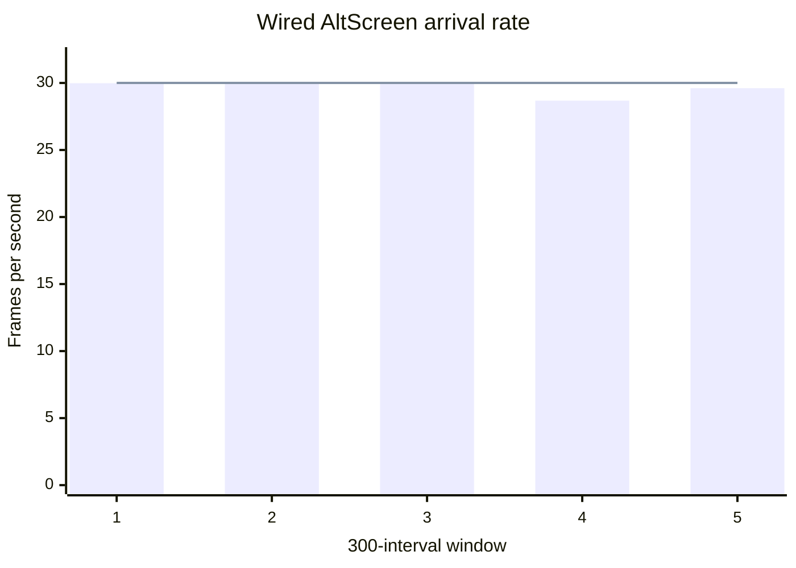

# Wired AltScreen performance — 2026-10-21

_Measured on the physical QNX 6.5 HU on 2026-10-21 local time
(2026-10-22 UTC), after deploying commit
[`ab2274e0`](https://github.com/luka-dev/mib2q-carplay-rgi/commit/ab2274e052779ec185978a2324d9b079bc7475a1)._

---

## 📊 Observed result

Wired AltScreen reached **29.64 FPS at the renderer's compressed-frame input**
in the saved sample, compared with 20.40–21.74 FPS in the earlier session.
Five successive 300-interval windows ranged from 28.68 to 30.00 FPS. This
establishes operation close to 30 FPS during a short physical-HU session;
continuous 30 FPS over a long drive remains unverified. These are arrival
measurements, not a camera measurement of the instrument-cluster panel.[^1][^2]

| Metric | Earlier session | Session after decoder fix |
|---|---:|---:|
| AltScreen arrival rate, range of window averages | 20.40–21.74 FPS | 28.68–30.00 FPS |
| Arrival interval, window averages | 46.00–49.01 ms | 33.33–34.86 ms |
| Source PTS interval, window averages | 46.00–49.00 ms | 33.33–34.89 ms |
| Full-present time, window averages | 7.28–7.98 ms | 6.04–6.88 ms |
| DIO CPU, 100% = one core / 400% = all cores | 44.46% | 39.39% |
| Maneuver renderer workload | Almost idle | Active |

The sessions were not a controlled A/B experiment: maneuver activity and
background diagnostic load differed. The observed improvement cannot be
attributed entirely to the decoder queue patch. That patch changes the stock
main-screen decoder; AltScreen has its own decoder/render path.[^1][^2][^3]

## 🎬 Simultaneous workload

The recorded CPU load was measured with all three workloads active together,
as confirmed by the operator:

| Workload | State during the measurement | Evidence |
|---|---|---|
| AltScreen | Screen in motion, approximately 30 FPS | Measured arrival rate: 28.68–30.00 FPS across the five windows |
| Main screen | Main screen in motion at the same time | Operator-confirmed activity; main-screen FPS was not timed separately |
| Audio | 5.1 playback / six-channel output active at the same time | Operator-confirmed playback and audio status `target=6ch`, with zero reported underruns |

These CPU figures therefore describe concurrent moving-screen and audio
playback activity. The captured audio status reports `source=2ch target=6ch`
with realtime upmix enabled; it confirms the six-channel output path rather
than identifying the media file's original channel layout.[^3]

## 📈 Five arrival windows

Each row contains 300 consecutive arrival intervals. The combined rate is
`1,000,000 / mean(window_mean_us) = 29.6416 FPS`, since all five windows have
the same sample count.[^1]

| Window | Arrival interval, mean | Arrival FPS | Source PTS interval, mean |
|---|---:|---:|---:|
| 1 | 33.354 ms | 29.98 | 33.333 ms |
| 2 | 33.331 ms | 30.00 | 33.333 ms |
| 3 | 33.368 ms | 29.97 | 33.333 ms |
| 4 | 34.862 ms | 28.68 | 34.888 ms |
| 5 | 33.767 ms | 29.61 | 33.777 ms |

_The bars show arrival FPS for five successive 300-interval windows. The
horizontal line marks the 30 FPS target. Window 4 dips to 28.68 FPS; the
combined rate is 29.64 FPS. The table above provides the same values as text._



Source timestamps were exactly 33.333 ms apart in the first three windows.
The last two also contained 66.666 ms gaps. Source cadence therefore accounts
for part of the remaining variation; the phone's effective Maps profile was
not inspected directly.[^1][^3]

## ⚙️ CPU consumption and denominator

The HU has four CPU cores. On the **one-core scale**, one fully occupied core
is 100% and all four cores together are 400%. The equivalent share of total
four-core capacity is the one-core percentage divided by four. For example,
DIO at 39.39% on the 400%-maximum scale occupies the equivalent of 0.3939
cores, or 9.85% of total four-core capacity.[^1]

| Process | Mean CPU, 400% maximum | Sample range, 400% maximum | Share of four-core capacity, 100% maximum |
|---|---:|---:|---:|
| `dio_manager` | 39.39% | 37.27–41.83% | 9.85% |
| `altscreen_render` | 11.43% | 10.23–12.80% | 2.86% |
| `maneuver_render` | 8.50% | 7.53–9.03% | 2.12% |
| `mcd` | 10.03% | 5.03–13.07% | 2.51% |
| `videoencoderservice` | 13.67% | 10.93–15.53% | 3.42% |
| Sum of these process means | 83.02% | — | 20.75% |

The sum covers these five processes only. It is not total HU utilization,
and the remaining capacity cannot be interpreted as idle. `top` also showed
activity in `io-pkt-v6-hc`, `displaymanager`, `traceserver`, `videoCore`, and
intermittent `grep`/`sloginfo` diagnostics. Its aggregate user-plus-kernel
readout averaged 88.13% during its sampling window; that separate aggregate
must not be confused with the five-process sum.[^1]

Process percentages were calculated from `hogs` runtime milliseconds using
its configured three-second interval:
`CPU_one_core_percent = runtime_ms / 3000 × 100`.
The `PIDS` column was not used: it describes the distribution among selected
processes. Values are approximate interval averages. There were ten runtime
samples for each listed process except `videoencoderservice`, which had nine;
the sum is a sum of means rather than a single synchronized sample.[^1]

## ⏱️ Decode and presentation timing

| Stage | Range of window means |
|---|---:|
| Hook to renderer socket | 1.56–2.59 ms |
| OMX decode | 12.66–14.91 ms |
| Full present | 6.04–6.88 ms |
| Hook to post | 21.02–28.60 ms |

These stage windows are separate observations and should not be added as
independent serial costs. Four full-present windows, each with 300 samples,
had a maximum of 26.187 ms and no samples above 33 ms. Recorded audio status
reported zero underrun frames and zero device underruns.[^1][^3]

Occasional stalls remain: one compressed-frame decode-queue sample reached
81 ms, and the cumulative mailbox `superseded` count increased from 4 to 17
across the recorded timing reports. Thus the short run demonstrates near-30
arrival cadence with mostly short processing times, not absence of jitter
or delivery of every source frame to the panel.[^3]

## 🧪 Setup, activation and remaining validation

The installed build included the always-enabled Maps-30 PPID addition,
MCD coalescing and lowered detector priority, and the
[stock decoder queue fix](DECODER_QUEUE_PATCH.md).
The new DIO process confirmed activation before the measurement:[^3]

```text
00:30:16.600 [WRN] [DECODER_OPTIMIZE] queue depth 2 already installed (decode feed +0x8c6f4, present +0x8c694)
```

The `top` capture lasted 47.34 seconds. Timing reports were emitted at their
existing 300-sample boundaries; their windows do not align exactly with the
CPU capture. The same measured processes remained running throughout.
`/tmp/carplay_verbose` was enabled temporarily for timing reports, then
removed. The owned `hogs` and `top` processes finished after collection.[^1]

The next validation is a longer session after a cold start, with comparable
map/maneuver activity and background log collection stopped. It should
measure arrival cadence, presentation stalls and CPU together. A panel/camera
check is needed to establish the final displayed frame rate; neither that
rate nor the phone's selected Maps profile is proven by the arrival logs.

## 🔗 Evidence

Committed snapshots preserve the numeric evidence without requiring access
to ignored local build artifacts. The validation snapshot records the
original artifact names and SHA-256 hashes of both source summaries.

[^1]: [After-fix summary](../sources/captures/hu-performance-20261022/after.json), copied from `build/hu-perf-decoder-20261022-024253/summary.json`: CPU runtime samples, timing means, capture duration and combined arrival FPS.
[^2]: [Earlier summary](../sources/captures/hu-performance-20261022/before.json), copied from `build/hu-perf-20261022-022053/summary.json`: earlier physical-HU measurements with the decoder optimization inactive.
[^3]: [Validation details](../sources/captures/hu-performance-20261022/validation.json): activation log, exact timing windows, audio status, original artifact identifiers and summary hashes. Remaining raw `capture.log` and before/after renderer logs are retained in the local artifact directory named in the snapshot.
