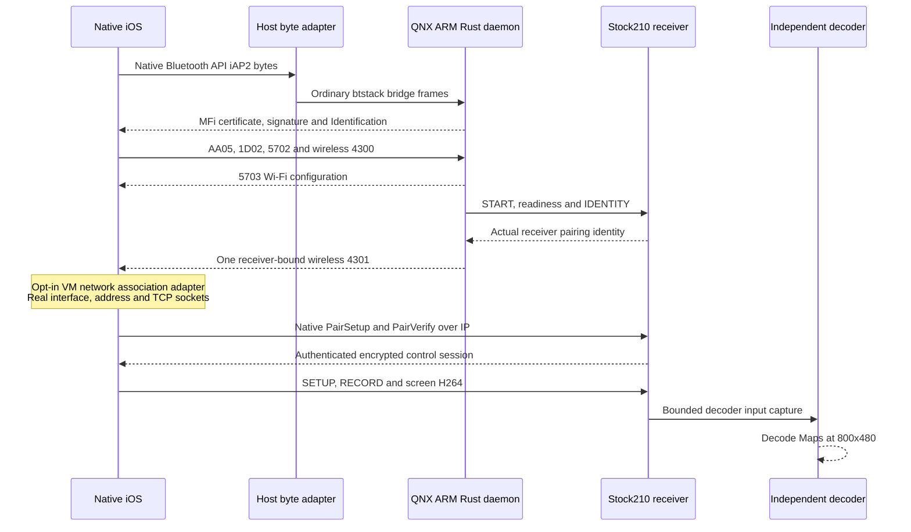

# Native wireless CarPlay with the QNX Rust daemon

> Historical snapshot, preserved on 2026-10-29. Commands, status and implementation claims below describe earlier revisions. Use the [current guide](../../../carplay-lab/NATIVE_WIRELESS_QNX.md) for maintained instructions.

_Owned iOS 26.6.2 / 23G90, vphone 2.9.2 and stock210 QNX/QEMU — 2026-10-18._

[Laboratory overview](../../../carplay-lab/README.md) · [vphone runbook](../../../carplay-lab/VPHONE_LAB.md) · [Production daemon](../../../wireless-carplay/IAP2_DAEMON.md)

## 📋 Verified result

Native iOS now completes the wireless CarPlay protocol with the **actual QNX/ARM Rust daemon and stock210 receiver**. The receiver captures genuine H.264; an independent FFmpeg decoder reads **31 frames at 800×480** without errors. The final captured frame shows the native Maps interface, search and CarPlay sidebar.

This is a protocol test over the VM's virtual Ethernet network. An explicit association adapter supplies the missing VM Wi-Fi network state. Physical Bluetooth/RFCOMM, radio association, HU rendering and Wi-Fi throughput remain separate hardware tests. No production authentication, pairing or media code is replaced by the association adapter.

| Stage | Observed result |
|---|---|
| Authentication | Native `AA00/AA02 → daemon AA01/AA03 → AA05`, public P-256 test fixture |
| Identification | Real daemon `1D01 → native 1D02`; base identity from factory JSON |
| Wi-Fi handover | Native `5702 → daemon 5703` with test AP parameters |
| Availability | Native `4300`, nested wireless Available = 1 |
| StartSession | Exactly one `4301`, real receiver pairing identity, wireless attributes, port 5000 |
| Native transport | `[Session/WiFi/USB]`, `WiFi eligible: Y`; USB remains ineligible |
| Authentication over IP | Native CoreUtils PairSetup authenticates the server; PairVerify completes |
| Media session | Native endpoint connects; receiver processes SETUP/RECORD and screen TCP |
| Video | 32 complete records per accepted capture; first 192790 bytes, recovered 271089 bytes; 31 independently decoded frames each |
| Picture | Maps, search, recent destination and CarPlay sidebar in the final decoded frame |
| Recovery | Native airplayd termination, clean DIO exit/restart, same receiver pi, PairVerify without a repeated PairSetup and new decoded video |

The first accepted H.264 capture SHA-256 is `769d13090430f36a95bac252c64eda1cc78c2dc7cf4b9b6b2ea99022638dfe11`.

## 🔗 Data paths



| Endpoint | Purpose |
|---|---|
| Host `192.168.64.1:32505` | Nonce-scoped helper stream; BE32 length and raw iAP2 bytes |
| Host `127.0.0.1:32504` | Owned QEMU forward to QNX `10.0.3.15:32504` |
| QNX `127.0.0.1:57342` | Real daemon btstack bridge ABI |
| Host `127.0.0.1:32502` | Public-fixture certificate, challenge signature and MFi-SAP service |
| QNX `192.168.64.200:5000` | Receiver control/pairing over vmnet, separate from the byte adapter |
| QNX ports `5001` / `6030` | Receiver event / primary screen TCP in the accepted capture |

The automatic vmnet link moves only the newly created QEMU virtual member onto the owned vphone NAT bridge. `stop` restores it before terminating QEMU. It refuses physical members, ambiguous membership and changed ownership; it does not move the vphone member. No BPF retransmission is used.

## 🖥️ Wireless AltScreen profile

The paired wireless checkpoint now passes initial connection and abrupt native
reconnection. Both final decoded images show native Maps; AltScreen is a separate
1440×542 map without the primary screen's sidebar.

| Run | Primary frames / bytes | AltScreen frames / bytes |
|---|---|---|
| Initial `d8230c33731333ba` | 31 / 335467 | 28 / 261863 |
| Recovered `ff69d226f3335f96` | 31 / 279869 | 29 / 140833 |

Both streams pass strict independent decoding without errors. The recovery
report records `recovery_verified`, `altscreen_verified`, `same_display_profile`,
`same_receiver_identity` and `dio_restarted` as true; `pair_setup_repeated` is
false. The owned QNX PID is 36455. The recovered H.264 hashes are:

- Primary: `1eb468ca760c028eeb0fb04031df7d385aa72f6dddf73e7fba922174fd84ff13`.
- AltScreen: `d7c84271b0034d556e071d72ebd8c155b7674fe1d45e44be7ca504d5952d7454`.

Reports, both run-specific traces, AVC captures, final PNGs, build manifest and
source hashes are preserved under `build/vphone-lab/wireless-alt-verified/`.
This profile passes 143 vphone tests, including real independent decoding of
two generated regression streams, and 11 common receiver build/network tests.

Build the explicit paired profile to advertise both the primary screen and
instrument cluster through the same native wireless session:

```sh
sudo scripts/carplay_lab.sh wireless-native stop
scripts/carplay_lab.sh wireless-native build --paired-altscreen
scripts/carplay_lab.sh wireless-native prepare-link
sudo scripts/carplay_lab.sh wireless-native start
```

The build entry point first compiles the dedicated `WIRELESS_ALT_QEMU` hook.
It selects authenticated paired stream 111 and capture-only AltScreen, with
bounded UART records for both screens. The default build remains primary-only.
Start the bounded signer, unlock vphone and use the same
`run --guest-logs --require-video` and `recover` commands below.

| Stream | Capture point | Required decoded dimensions |
|---|---|---|
| Primary | Genuine AVC input before fake OMX | 800×480 |
| AltScreen, type 111 | Authenticated/decrypted and validated Annex B from the paired receiver | 1440×542 |

AltScreen is handled by its own receiver; capture-only mode does not instantiate
a second fake OMX decoder or forward to an absent instrument-cluster renderer.
The independent host decoder checks each stream. In this profile,
`video_verified: true` requires **both** streams; primary video alone cannot pass.
The report additionally records `altscreen_verified`, and its nested
`video.altscreen` holds the cluster hash, decoded frame count and PNG path.
Recovery also requires the same display profile and fresh captures of both
screens with the same receiver identity.

This profile establishes protocol and video content. Physical RF, HU decoding,
instrument-cluster presentation and normal playback pacing need their separate
hardware checks. UART payload capture adds diagnostic overhead.

<a id="association-adapter"></a>

## 🔧 Association adapter

The native VM browser originally selected transport mask 1 and logged `WiFi eligible: N (<disabled>)`. Starting the original wifid alone did not establish a CarPlay network. The opt-in adapter now enables mask 3 in a private copy of the owned `airplayd` code pages and implements the missing network association notifications.

| Boundary | Implementation |
|---|---|
| Process and VM | `airplayd` only; explicit enabled config, exact owned UDID and FE01 chip |
| Current image | Byte-checked native browser branch and reviewed relocatable function prologues; refuse and roll back on mismatch |
| Network identity | Real CarKit vehicle's `carplayWiFiUUID`, read from `com.apple.carplay.plist`; not its different vehicle identifier |
| Actual transport | Existing `en0` and bindable guest NAT IP; all protocol sockets remain native |
| Missing association | Network available/power/network notifications and current network dictionary |
| Callback ABI | `(helper, event, info, client)`; validated against an original native IPv4 dynamic-store event |
| Loader | One weak dependency in the pinned vphone SystemHook, installed via official `environment.install` RPC |
| Scope | Shared-cache files, Apple launchd plists, authentication, pairing and codec code stay unchanged |
| Rollback | Verified original SystemHook backup, disabled config and restart of the exact owned airplayd process |

The tiny loader has only a libSystem dependency and loads the CF/IOKit adapter solely in airplayd. Other processes do not load its framework dependencies. A disposable native helper tests the five private network changes and independently checks the callback ABI before installation. The installer records source and binary hashes and refuses changed staged outputs.

The payload is deliberately pinned to this image. It is not a general iOS patch and must not be installed on a physical phone. `airplayd` is demand-launched by CarKit; manually starting its Apple launchd job failed and is not part of the recipe.

## 🧪 Reproduce

Run as the vphone owner from the repository root, with the owned guest running. The pinned QNX toolchains, factory inputs and vphone environment come from the [existing setup](../../../carplay-lab/VPHONE_LAB.md). `ffmpeg` and `ffprobe` must be available in PATH for automatic video verification.

```sh
scripts/carplay_lab.sh wireless-native build
scripts/carplay_lab.sh wireless-native prepare-link
sudo scripts/carplay_lab.sh wireless-native start
```

In another terminal keep the bounded public-fixture service running:

```sh
build/vphone-lab/venv/bin/python -m tests.carplay_lab.common.mfi_sap \
  --qnx-dir build/vphone-lab/qnx-wireless-native --seconds 300
```

For the first association-adapter installation, create the real CarKit vehicle with one bootstrap run, then stage and install the adapter:

```sh
scripts/carplay_lab.sh unlock
scripts/carplay_lab.sh wireless-native run --seconds 30 --guest-logs
scripts/carplay_lab.sh wireless-adapter stage
scripts/carplay_lab.sh wireless-adapter install
```

Expected installation state: `status: installed`, native probe exit status 0. Start the media attempt in this running guest. The weak dependency is read by newly launched airplayd; the loader adds no behavior to launchd itself.

The payload/config live under `/var/mobile/Library/Application Support/MHI2CarPlayLab`, so temporary-directory cleanup does not remove them. **Launchpad synchronizes its bundled SystemHook after each cold boot**, restoring its original hash. Reapply the opt-in loader after that sync with `scripts/carplay_lab.sh wireless-adapter install`; this checks both the journal and the current guest hash and is idempotent when already installed. The signed host bundle is never changed. Confirm the guest NAT IP still matches `config.LocalIP` in the journal.

The official environment RPC reports a reboot requirement for any SystemHook replacement and can leave `/` writable when APFS rejects its live read-only remount. A reboot followed by Launchpad sync can therefore remove this live experiment. Do not mistake the journal alone for a loaded adapter: the native probe, actual Wi-Fi eligibility and video checks establish runtime success.

Then run:

```sh
scripts/carplay_lab.sh unlock
scripts/carplay_lab.sh wireless-native run --seconds 65 --guest-logs --require-video
```

The report is `build/vphone-lab/wireless-native-daemon.json`. Successful video verification records `video_verified: true`, the native session checks, capture SHA-256, decoded stream properties and the final PNG path. Unlock immediately before starting: a locked guest did not emit the same native availability request. Restart the signer when its bounded lifetime expires.

Do not run another USB/native-peer action concurrently: they share `.usb.lock`. Closing the bootstrap helper does not necessarily terminate an already active wireless media connection; a second bootstrap can target the existing active endpoint rather than establish a fresh media session.

## ✅ Verify and repeat

`wireless_video.py` requires genuine native authentication/identification, 5702/5703, wireless availability, exactly one receiver-bound StartSession, native Wi-Fi eligibility, completed PairVerify, endpoint connection and fresh complete AVC records. It then runs ffprobe and a strict independent FFmpeg decode. A handshake alone cannot set `video_verified`.

Every new run records its QNX PID, IFS hash, start offset in the serial trace and a run-specific snapshot. Only bytes appended during that run are eligible. Old frames, missing logs, truncated records, decode failures and absent decoder tools leave verification false with a reason.

Primary UART capture stops after 32 records / 2 MiB per native session, with at most four captured sessions per DIO process (128 records / 8 MiB). AltScreen UART capture has its own 32-record / 2 MiB bound per DIO process; a normal DIO restart resets both counters. The fake output sink and buffer ownership fix remain active after that capture bound. A new AVC handle resets numbering within the next run-specific snapshot; an already active stream produces no fresh proof.

### Native disconnect and buffer ownership

The fake OMX backend originally acknowledged Idle/Loaded while still recycling artificial black output. A queued render command dereferenced the cleared decoder handle (`libairplay` offset `0x86608`, caller `0x8b7a4`), killed dio_manager and left a subsequent START with `Broken pipe`. The native-wireless profile now sinks fake output requests while retaining actual AVC input and strict independent host decoding.

A second teardown fault exposed fake `FreeBuffer` freeing external storage passed to `UseBuffer`. A bounded registry now leaves that storage with Screen while releasing the OMX-owned header. It handles shared allocations, registry exhaustion and concurrent lifetimes. Both adapters require the pinned fake backend marker; they make no QNX hardware decode/presentation claim.

After those fixes, stock dio_manager completes teardown and exits normally. The isolated `native-dio-owner` models service-manager respawn for **at most four normal DIO lifetimes**. It never restarts a signalled/crashed child or a nonzero exit. The executable is staged `data=copy` for repeated execution. Readiness waits for Bonjour and the guarded MFi request slot in the latest DIO epoch, so an exited process's markers cannot authorize a new test.

### Reconnect test

After one successful video run, with the same owned QNX VM and bounded MFi service still running:

```sh
scripts/carplay_lab.sh wireless-native recover --seconds 30
```

This deliberately terminates only the exact native airplayd process in the owned vphone. It preserves a disconnect trace, refuses fatal QNX diagnostics, waits for receiver readiness, unlocks the guest and performs a fresh native bootstrap/video capture. The test refuses an unverified previous run, changed QNX PID or an unexpected process identity.

The accepted result is `wireless-native-recovery.json`: `recovery_verified`, `receiver_ready_after_disconnect`, `dio_restarted`, `same_receiver_identity` and `video_verified` are all true; `pair_setup_repeated` is false. Runs `c90fbaefa3e02127` and `827c2ed5eb0a4a67` use the same actual receiver identity. The recovered stream contains 32 records / 271089 bytes and 31 error-free decoded frames, SHA-256 `cd4da133387b3c8497f5e7ae4c8fb82618a1e7338b5978bb564534a72eecfc70`.

Pairing persists across these DIO process lifetimes in the QNX RAM-backed store. A full QNX reboot resets that store and can legitimately require PairSetup again; persistence across receiver OS reboot is outside this result. After the owner/capture lifetime bound, stop QNX, prepare/start the link and repeat.

For manual extraction of a run-specific serial snapshot:

```sh
scripts/carplay_lab.sh extract build/vphone-lab/wireless-native-RUN_ID-serial.log \
  --output build/vphone-lab/wireless-native-manual.h264
```

The primary-only accepted IFS SHA-256 is `cfec2d862297d432629d99d699fe17b451ad92cf461ef1ad1c9200898fd7ad0f`. The paired AltScreen IFS SHA-256 is `c9d5d4f30ce9bd96c8d984d9ee8e550c0d5d2532a4adaa6b583e3ff6de96e524`.

The bounded UART capture is diagnostic and adds overhead. It does not establish physical Wi-Fi throughput or normal playback frame pacing.

## 🔄 Stop and restore

Stop through this entry point so network membership is restored before QEMU exits:

```sh
sudo scripts/carplay_lab.sh wireless-native stop
scripts/carplay_lab.sh wireless-adapter restore
```

The adapter restore disables its config, checks the current SystemHook hash against its journal, restores the verified original and terminates only the owned native airplayd. A cold boot reloads the original environment; check `environment.status` afterward, including the actual root mount state rather than assuming a read-only remount succeeded. Staged payload files remain disabled in the laboratory directory. To update an installed adapter, restore it before staging new output; never overwrite an in-use guest dylib.

`native-api-lab` is an explicit Cargo feature with separate build output. Only the test image selects the public-fixture MFi provider and `ecm0` discovery. The ordinary daemon retains hardware MFi and `uap0`. The lab ELF, public credentials and test AP identity are not HU deployment artifacts.

## 📁 Evidence and regression

Artifacts stay ignored under `build/vphone-lab/`:

| Artifact | Evidence |
|---|---|
| `wireless-alt-verified/` | Paired wireless primary/AltScreen, same-identity reconnect, both decoded streams and source/build evidence |
| `wireless-recovery-verified/` | Accepted reconnect, both run reports, native logs, source hashes, QNX build/trace and final decoded frame |
| `wireless-native-recovery.json` | Same-identity recovery and PairVerify without repeated PairSetup |
| `wireless-success-verified/` | Preserved automatic run with all native session checks and strict decoding |
| `native-omx-ownership-test.log` | ASan/UBSan: borrowed storage, owned storage, registry exhaustion and 4000 concurrent lifetimes |
| `wireless-loader-fuzz.json` | 20000 deterministic Mach-O mutations; no uncaught errors or out-of-padding writes |
| `wireless-success-first/` | Preserved first successful bootstrap, native logs, QNX trace and independently decoded H.264 |
| `wireless-native-daemon.json` | Latest run, directed packets, parsed CSM, run identity and fresh video validation |
| `wireless-native-RUN_ID*` | Current-run trace, H.264, ffprobe output, strict decode log and final PNG |
| `wireless-adapter-install.json` | Owned UDID, actual network config, staged hashes, native probe and restoration journal |
| `wireless-adapter-build.json` | Source/payload hashes and original/modified SystemHook hashes |
| `usb-wireless-adapter-probe.json` | Native network detours and independent callback ABI test |
| `qnx-wireless-native/build-record.json` | Opt-in QNX image and actual daemon hashes |
| `wireless-native-link-state.json` | Owned virtual network membership and restoration state |
| `wireless-final-tests.log` | 136 passing vphone Python tests |

The earlier `*-startsession.json` captures document the historical disabled VM browser. The abandoned `*-startsession-lab.json` unsolicited-start experiment is not the accepted checkpoint. The working path waits for genuine native `4300` and obtains the actual receiver pairing identity before sending `4301`.

Host checks cover stream/CSM framing, retransmission and checksums, actual message directions, nested availability, virtual bridge ownership/recovery, loader mutation bounds and refusal to count stale video. Earlier production-isolation validation passed 273 Rust workspace tests with `native-api-lab`, the 34 default daemon tests, 46 software-MFi tests, sanitizer/fuzzer checks and the ordinary QNX cross-build. The association adapter adds no production crypto change.
