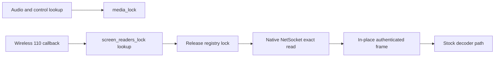
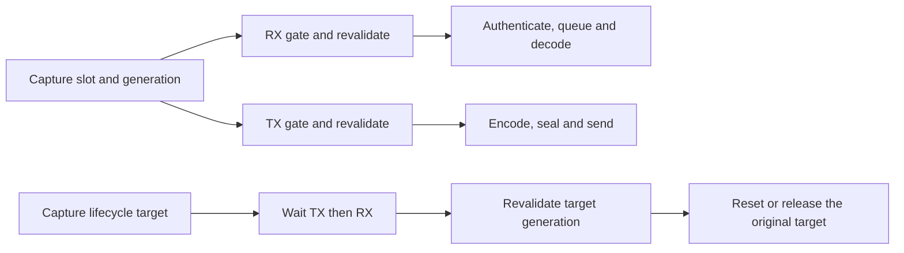
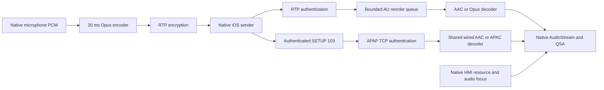

# Wireless media and native HMI validation

> Historical snapshot, preserved on 2026-10-29. Commands, status and implementation claims below describe earlier revisions. Use the [current guide](../../../carplay-lab/WIRELESS_MEDIA_VALIDATION.md) for maintained instructions.

_2026-10-22 · MHI2Q MU1316/P5087 · local development checkpoint, not release acceptance._

[Laboratory](../../../carplay-lab/README.md) · [Physical HU results](../../../wireless-carplay/WIRELESS_PRODUCTION_CHANNELS.md) · [SI implementation](../../../wireless-carplay/SI_STAGE2_OFFLINE.md)

## 🔎 Reason for this pass

The owner observed damaged cockpit pictures during very fast zoom, unavailable car audio/playback, and incomplete wireless behavior. The vehicle remains on the restored wired configuration. This work uses an isolated QNX receiver and the owned vphone; the existing QNX VM and vphone VM are preserved.

Evidence is under `build/wireless-validation-20261022/`. Receipts describe the boundary actually exercised. A decoder unit test, a native HMI boot and a full phone media session are separate acceptance results.

## 🧭 Wired and wireless parity target

Wireless must retain the wired feature set, including buffered 103 and discrete APAC 5.1. Stereo AAC is a fallback and a transport-isolation milestone. It is not the release target.

| Feature | Implementation / present evidence | Remaining acceptance |
| --- | --- | --- |
| Main display, rotary/buttons, AltScreen | Owner saw all three work wirelessly; independent video/overflow tests pass | Repeated full sessions, rapid zoom and physical OMX recovery |
| Realtime media 102 | Real vphone AAC → authenticated packets → native PCM tone oracle passes with named peripheral models | Production RTCP clock/retransmission, Java focus and physical audio |
| Buffered 103, AAC/APAC 5.1 | Paired admission delegates to the existing wired receiver; native CFLite preserves extended indices 65/23. Real vphone APAC/48000/5.1 → APAP → shared decoder → QSA tap passes the independent six-channel oracle | Buffered AAC, pause/seek/codec switch/reconnect and physical output |
| Stereo upmix | Existing wired renderer is shared; spatial fixture initially selects `off` to check discrete channel identity | Enable scene mode and validate both stereo sources and source/codec transitions |
| Calls, Siri, microphone | Main/alt Opus codec and microphone packet boundaries pass native ARM tests; wired route ownership tests remain green | Actual vphone speech/call lifecycle and microphone signal, then real HU call/Siri acceptance |
| GPS, speed, vehicle data | Native queue and semantic delivery have synthetic-peer acceptance | Genuine vphone consumption and sustained HU telemetry |
| Now Playing, artwork, manoeuvres/lanes | Existing native consumers and transport/parser tests | Sustained delivery from real vphone with Java HMI |
| Stored pairing and transport lifecycle | SI ownership/queue and bounded lifecycle checks exist | Boot with BT already connected, Wi-Fi loss/recovery without BT re-pair, wired priority and teardown |

Each row needs its own receipt. Advertising a format, decoding a packet and routing audible output are distinct checks. Nothing in this table declares production parity complete.

### Buffered wireless admission and the spatial fixture

`hook/audio/buffered_wireless.h` is an internal optional-module contract. The wireless final `/info` pass retains the audio module's type-103 descriptor verbatim only for the matching negotiated `mainBuffered` session with an installed buffered dispatcher. Admission validates its APAP descriptor through the same audio validator as wired. It does not invent a DataStream connection ID/key for 103: APAP uses the descriptor's authenticated 32-byte `shk`. Mixed SETUP requests validate before committing realtime stream state. Missing audio modules, duplicate 103 descriptors and malformed descriptors fail closed. Repeated `/info` passes retain their own normalized Opus masks.

The first spatial fixture revealed a test-boundary conflict: its software-MFi HTTP observer replaced the framework callback, so the buffered dispatcher correctly refused an unknown callback. The isolated `HTTP210_LAB=1` build composes named test callbacks behind pairing/admission and leaves the guarded router intact. Production builds contain neither callback lookup. The build flag is confined to `build/wireless-validation-*/hook-spatial-lab`; this is not a HU artifact. Unknown callbacks and conflicting fallback registrations still fail. Host ASan/UBSan checks cover shipping and lab composition separately.

The next native run exposed a real metadata error: Spatial globally forced SAD to 6 channels/24 bits even when realtime AAC selected 44.1-kHz stereo and QSA was not widened. Metadata now follows a READY, actually expanded matching 48-kHz sink. Stock 44.1-kHz media, voice rates and rejected-widening fallback retain their original geometry. Regression checks exercise all four cases. The peripheral distinguishes 24-bit MOST containers from S16 QSA samples, but still rejects channel-count mismatches.

`audio_playback.py --channels 6 --engine avplayer` supplies an explicit WAVE_FORMAT_EXTENSIBLE FL/FR/FC/LFE/SL/SR source with six distinct tones. AVQueuePlayer queues bounded one-second source items; AVAudioPlayer remains available for realtime isolation. The helper uses Apple's public [multichannel-content flag](https://developer.apple.com/documentation/avfaudio/avaudiosession/setsupportsmultichannelcontent(_:)) and [preferred output-channel request](https://developer.apple.com/documentation/avfaudio/avaudiosession/setpreferredoutputnumberofchannels(_:)); it records refusal and the actual route/channel count. A preferred request is not a forced route. The PCM oracle checks every source channel and rejects silence, missing channels, swapped channels and dropouts. A stereo output cannot pass the six-channel oracle.

The native iOS 26.6 sender's real APAC SETUP has index 65, APAP=true, spf=1024, ct=0 and audioFormat=0, with **no `isMedia` field**. The shared validator accepts omission only with mandatory `audioType=media`; an explicit false/malformed flag still fails. This preserves the pinned wired descriptor while accepting the observed sender contract.

The spatial hardware model must be a separate preload **after** the hook: hook-owned cold QSA opens use `RTLD_NEXT`, whereas the outer capture observer must precede pairing. Its private QSA handles must never reach native libasound implementations. A missing `snd_pcm_nonblock_mode` model reproduced writes of native flags into the model's `capture` field (0 → 4096), hiding all tapped playback; the model now owns nonblocking mode and device-capability queries too. This is a fixture ABI error, not evidence of broken production QSA.

The source uses mask `0x60f` (`5.1(side)`), independently identified by FFprobe. With the earlier BL/BR mask `0x3f`, this receiver decoded zero surround signals in the APAC path. With SL/SR all six native decoder tone counters agree with the source. This establishes the source-layout dependency for this test; it does not establish a general iOS remapping rule. Run 6 also switches from APAC back to realtime AAC: native SAD remains 2ch/16bit/44100Hz and the independent stereo PCM oracle passes (53.21/52.40 dB fitted-tone SNR). Six-channel independent tap acceptance is recorded separately below. Run 7's additional stereo tap initially captured only startup silence when changing geometry from a full PCM6 capture; its failure receipt is retained and the model now rechecks the nonzero-start gate after resetting geometry.

**Run 7: discrete APAC 5.1 PASS with the explicit peripheral models.** Real iOS 26.6.2 AVQueuePlayer sends format index 65, the shared receiver authenticates APAP and uses the existing APAC decoder, and the independent QSA tap obtains 65,532 bytes / 5,461 complete PCM6 frames at 48 kHz. Expected FL/FR/FC/LFE/SL/SR frequencies are 997/701/503/73/1103/1301 Hz. Every channel passes frequency, level, separation and fitted-tone SNR checks; steady SNR is 35.70/34.88/34.89/39.78/38.92/35.79 dB after the first 1,024 frames. The capture is approximately 114 ms, not a long-duration drift measurement. Physical speakers, amplifier routing, real HMI focus and full recovery are not accepted by this result.

**Run 8 repeats APAC → realtime AAC successfully.** A separate native ARM process first checks the exact peripheral model's nonblock handling, PCM6 copy and stereo transition/startup-silence gate. Only then does the new DIO process load its fresh model instance and the real vphone connect. Both independent PCM oracles pass: 48-kHz six-channel APAC, then 44.1-kHz stereo AAC on native AudioStream/SoundIF. The saved source WAV, source hash, player receipt, PCM receipt and IFS hash are correlated. The test canary's monotonically increasing samples are not the phone source's six tones and are not shared with the DIO process.

Builds pass for shipping wireless+audio (`hook-spatial`), the isolated peripheral build (`hook-spatial-lab`), ordinary wired (`hook-wired`) and wireless without the buffered module (`hook-wireless-noaudio`). Shipping binaries contain no lab HTTP callback lookup. Real audio interposer tests and HTTP composition tests pass under ASan/UBSan; 30 Python oracle/protocol tests and the three wireless admission variants pass. These are local compatibility results, not a release verdict. Artifacts: `native-spatial/run7-apac-discrete-pass/` and `native-spatial/run8-apac-aac-pass/` under the validation directory.

### Network budget for two 30-fps screens, APAC and microphone

The [concurrent transport stress test](../../../carplay-lab/MEDIA_STRESS_TEST.md) now exercises the shared-capacity model and production AltAV/Opus under load. Its APAC reserve and 110 boundary are modeled; it does not close simultaneous native vphone/QNX or physical Wi-Fi acceptance.

An engineering target is **30–40 Mbit/s sustained application goodput**, preferably at least 40 Mbit/s of measured headroom. This is a capacity target, not a measured simultaneous 110+111@30-fps requirement or an encoded-rate cap. Screen compression, IDR bursts, content and the phone's encoder settings determine the actual rate.

For planning, reserve 15–20 Mbit/s for the two compressed screens together, 1–2 Mbit/s for compressed APAC 5.1, 0.06–0.1 Mbit/s for microphone RTP and about 0.2–0.5 Mbit/s for control/metadata. This is roughly 16–23 Mbit/s before capacity margin, not an independently measured per-stream breakdown. The APAC reserve deliberately exceeds the six-tone vector: run 8 receives 586,091 APAP bytes over 1,171 × 1,024/48,000 = 24.9813 seconds of encoded media, about **0.188 Mbit/s**, excluding TCP/IP/radio overhead. Tones do not establish a music bitrate or peak. The microphone encoder is configured to 32 kbit/s Opus; headers, encryption and packet frequency raise its transport budget.

The earlier wired observation was 15–19.5 Mbit/s for the whole session (110+111+audio), without a verified concurrent 30-fps stress condition. Mac→HU reached 36.9 Mbit/s TCP and 42.8 Mbit/s UDP; these support average-capacity feasibility, not equivalent iPhone radio throughput. See [the Wi-Fi audit](../../../stock-patches/README.md). Acceptance still requires simultaneous 110/111 pacing and short-window throughput/latency under zoom, map movement, audio and microphone load.

### Receiver queue copy reduction

The compressed realtime wireless AAC/Opus queue now keeps its 64 AU payloads in fixed slots. A 64-byte permutation stores active slots in timestamp order and free slots in its tail. Insert/pop move indices; reset keeps the permutation and clears the active count. This removes whole-payload shifts under the shared audio mutex without changing the negotiated latency, decoder history, duplicate/late filtering, overflow recovery or RTP wrap handling. Buffered 103/APAC uses its separate existing path; ordinary wired PCM bypasses this queue.

| Check | Before | After |
| --- | --- | --- |
| Maximum pop shift at 64 AUs | 89,712 bytes | 63 bytes |
| Total pop bytes in the same 30,000-operation differential run | 23,352,176 | 16,399 |
| PCM across 9,093 differential reads with real host Opus | Identical | Identical |
| Additional queue storage | — | 64 bytes |

The byte counters instrument pop only; insertion savings are not included. The 1,424× reduction applies to shifted bytes, **not total receiver CPU or frame latency**. No HU frame-pacing improvement has been measured from this change.

Verification: [real-codec regression](../../../../tests/wireless_audio_codec_test.c) fills all slots, shuffles timestamps, injects duplicates, reuses storage and resets nonempty queues across timestamp wrap, comparing exact PCM with a sequential decoder. Host ASan/UBSan, native ARM/QNX full-queue tests, native AAC/Opus stream tests with independent AAC alignment, the three media admission variants and the shipping hook build pass. Reproduction: `python3 -m unittest tests.test_wireless_audio_codec tests.test_wireless_hook_contract`; native runners: `python3 -m tests.carplay_lab.qnx.wireless_audio_runtime` and the same command with `--streams`.

Artifacts: `build/wireless-validation-20261022/receiver-queue/comparison.json` and `compare.py` (saved pre-change source, instrumented before/after shared libraries and source hashes); native receipts: `audio-qnx/result.json` and `audio-stream-qnx/result.json` under the same validation directory. The next performance check remains simultaneous native 110/111 + APAC + microphone with queue/decode/presentation timing; the transport model alone cannot locate a production bottleneck.

### Wireless 110 read isolation from audio/control

The paired primary-screen `screen_read` callback previously acquired `media_lock` for its reader lookup on every header and body read. The same mutex then covered authenticated audio reception and microphone encode/encrypt/send. A stalled audio/control operation could therefore prevent 110 from reaching its underlying NetSocket read even though the screen's key and nonce live in its own reader. The following RX/TX change also removes audio processing from that registry mutex.

The lookup now uses `screen_readers_lock`. Registration/removal acquire `media_lock` then `screen_readers_lock`; the callback releases the registry lock before network I/O and AEAD. The native synchronous `ProcessFrames` invocation still owns the stack reader until it returns. This changes lock contention, not the stock framing, read timeout/cancellation, key/nonce handling, decoder or wired routing.



Evidence: all three ASan/UBSan admission variants pass a header/body test while another thread deliberately owns `media_lock`. Restoring the old callback lock makes that regression fail after its bounded wait; the worker is released/joined before the assertion. Native ARM/QNX additionally passes two frames through the production callback with the real SDK AEAD while `media_lock` is held, then rejects a corrupted third tag and erases its plaintext. That probe models the NetSocket byte source in memory; it does not run an iPhone, actual socket, stock `ProcessFrames`, OMX or presentation. A shipping wireless hook build also passes. No HU frame-pacing or CPU gain is asserted.

Run: `python3 -m unittest tests.test_wireless_hook_contract` and `python3 -m tests.carplay_lab.qnx.wireless_screen_runtime`. Source: [media adapter](../../../../hook/wireless/media.c), [host contention regression](../../../../tests/wireless_media_contract_test.c), [native probe](../../../../tests/carplay_lab/qnx/wireless_screen_reader_probe.c). Receipts/logs and the saved pre-change source are under `build/wireless-validation-20261022/receiver-video/`; the native receipt pins the adapter, SDK archive, probe and IFS. Native QEMU uses its own process with `-nic none`; no existing VM or HU is modified.

### Wireless audio RX/TX isolation and reuse protection

The realtime audio adapters now have independent fixed RX and TX gates at both layers. In [media.c](../../../../hook/wireless/media.c), RX owns packet authentication/queue submission and TX owns microphone sequence/nonce reservation, encoding and sending. In [audio_stream.c](../../../../hook/wireless/audio_stream.c), RX owns the AU queue/decoder and TX owns the Opus encoder/partial PCM frame. Registry mutexes protect only lookup and publication. Blocking microphone sends no longer hold either registry mutex or the RX gates. Packets within each direction retain their existing serialization and ordering.



Init/free/reset and media publication/teardown/forget acquire their layer's gates in **TX → RX → registry** order. They never hold a registry mutex while waiting for a direction gate. Media data paths acquire the media direction gate before the corresponding codec gate. Emit callbacks may send but must not synchronously call jitter or media lifecycle functions. Native workers still stop/join before their session/jitter memory is destroyed; the gates do not replace native socket cancellation or make a blocked syscall finish immediately.

Generation tickets cover both data and cleanup. Receive snapshots its route before the native blocking receive; it rejects a delayed old packet after fd/session reuse, before applying replacement keys. Codec calls reject a replaced jitter slot instead of falling through into native freed/reused memory. A delayed `free`, `reset`, media teardown or owner cleanup also rechecks its original generation, so it cannot destroy a replacement. Selective teardown checks the individual stream generation inside a continuing session. Nonce reservation remains under TX and a failed/short send still consumes its nonce. Counters fail closed on exhaustion; initialization rejects an already tracked jitter before touching its native pool.

| Executed check | Evidence and boundary |
| --- | --- |
| Stalled microphone TX with simultaneous RX | Production media/codec adapters and real Opus; RX PCM matches an independent decoder while free/reset/forget waits for TX |
| Delayed receive, fd/session/jitter address reuse | Old packet returns state error; replacement continues receiving |
| Delayed lifecycle after replacement | Old free/reset/forget/full teardown leave replacement intact; selective teardown also preserves a new stream in the same session |
| Short microphone send | Next packet uses the next nonce and sequence |
| Host sanitizers | ASan/UBSan regressions pass; focused concurrency test also passes TSan |
| Six negative controls | Reintroducing media/codec RX-TX coupling, or removing data/lifecycle generation checks, makes the test fail |
| ARM/QNX concurrency probe | Real Opus and private SDK AEAD pass the same races; native socket/jitter resource functions are fixtures |
| ARM/QNX stock/Cinemo probe | Real native jitter init/free/reset and AAC decoding continue during a held Opus emit; PCM matches sequential AAC output, timestamp oracle passes; rejected init permits clean reuse and ordinary wired fallthrough passes |
| Shipping builds | Wireless with the buffered audio module and wireless without that module both pass; static analysis of the two changed adapters is clean |

The host packet crypto canary is explicitly a fixture; the QNX concurrency probe uses real SDK crypto. Neither probe is full vphone/physical-radio acceptance or a measured HU CPU/FPS improvement. This change concerns realtime 100/101 and the admitted 102 alias; buffered 103/APAC retains its separate existing receiver.

Run host regressions with `python3 -m unittest tests.test_wireless_audio_codec tests.test_wireless_hook_contract`; the new test is [wireless_audio_concurrency_test.c](../../../../tests/wireless_audio_concurrency_test.c). Native commands: `python3 -m tests.carplay_lab.qnx.wireless_audio_concurrency_runtime` and `python3 -m tests.carplay_lab.qnx.wireless_audio_runtime --streams`. Both use owned, bounded QEMU processes without external interfaces. Artifacts and negative-control reproducer: `build/wireless-validation-20261023/receiver-audio/`; the stock/Cinemo receipt remains at `build/wireless-validation-20261022/audio-stream-qnx/result.json`. The combined receipt pins the current sources and build hashes. No HU deployment or unrelated VM changes were performed.

## 🎵 Audio protocol and receiver findings

The physical `/info` capture announced PCM formats only. The local iOS sender's `APCarPlayAudioFormatsCopyFormatsForAudioType` filters wireless formats with `0xF7FE0F8FFFFC0000`, excluding those PCM bits. A real vphone run reproduced audio staying on `Speaker`.

The sender's `carPlayAudioFormat_repackageFormatsForStream` selects capability **102 for wireless media**. A subsequent real playback request confirms **wire transport 102**, AAC `0x00400000`; the earlier inference that only the capability changed while transport stayed 100 was wrong. Voice uses main/alt capabilities 100/101. Main media requires AAC-LC; voice requires Opus or AAC-ELD. These codec families cannot be merged into one capability entry. This music transport does not establish a type-102 call requirement; the [call/Siri contract](../../../audio/CALL_AND_SIRI_ROUTING.md) remains applicable.

Pinned stock `libairplay.so` SHA-256: `01c116b1674215daa0602d556a6d9b2eb48c2113ca294ea1f5d58787e3f656f2`. Its main/alt worker at `0x261C4` unconditionally swaps incoming PCM bytes before native jitter insertion. `AudioConverterNew_compat`/`FillComplexBuffer_compat` return unsupported and have no decoder call path from this worker. Advertising AAC alone cannot fix playback.

The new opt-in path (`MHI2Q_CP_WIRELESS_AUDIO=1`, admitted wireless owner only) therefore:

1. Advertises actual probed AAC-LC stereo support in capability 102, and Opus mono in 100/101.
2. Authenticates encrypted RTP before queueing compressed access units.
3. Reorders access units before predictive decoding and supplies S16 through the native jitter-read boundary.
4. Encodes microphone PCM into complete 20 ms Opus packets before sealing RTP.
5. Retains native AudioStream/QSA/resource routing and ordinary wired jitter behavior.
6. Maps admitted wireless AAC main-high 102 to stock210's native main100 context, restores 102 in the response, and maps that session's 102 teardown back to the same native context. The whole request validates before mutation; IDs/keys remain unchanged and retired IDs cannot be reused.
7. Retains independently negotiated buffered 103 through the existing wired APAP receiver and AAC/APAC decoder, with its own key, TCP transport and lifecycle.



Opus 1.5.2 is built from the pinned upstream archive, SHA-256 `65c1d2f78b9f2fb20082c38cbe47c951ad5839345876e46941612ee87f9a7ce1`, as a PIC fixed-point static library. The build records its toolchain/image/archive hashes and copies its license beside the hook.

### Native evidence

| Check | Result and limit |
| --- | --- |
| Host codec/queue | ASan/UBSan: real Opus encode/decode at 16/24/48 kHz, reordering, duplicate/wrap/reset/bounds and 5,000 malformed AU inputs |
| ARM/QNX codec/queue | Real ARM execution with the same codec/queue sources; independent of host Opus build |
| ARM/QNX stock boundary | Real stock jitter allocation/free, compressed read, Opus microphone accumulation, reset and wired fallthrough pass |
| AAC reference | Real Cinemo AAC decodes eight nonzero-output AUs; independent FFmpeg reference places every returned block at the current AU, with priming AU suppressed |
| Native advertisement | Target CFLite constructs and retains actual dictionaries; assertions verify Opus 100/101 and AAC 102 |
| Integrated DIO codec and sender | Native AAC registration succeeds after correcting IFS delivery. vphone creates main/alt audio devices and selects AAC media / Opus alt audio |
| vphone codec isolation | PASS with explicit HMI/QSA/receive-only RTCP models: AVAudioPlayer plays for 45 s on CarAudio/CarPlay; actual native PCM contains the independent left/right test tones |
| Complete production playback | **Open:** native Java focus, real RTCP timing/retransmission, amplifier routing and full recovery remain required |

Do not hold a QNX `pthread_once` initializer around Cinemo configuration/codec creation: configuration starts a worker and synchronously waits for it. A private mutex fixes the reproduced initialization deadlock. The remaining `pthread_once` in the AAC bridge performs symbol resolution only.

Do not defer later AAC timestamps to the first zero-output AU. Independent decoding shows that native Cinemo suppresses the priming AU; subsequent PCM belongs to the current AU. The queue preserves those source timestamps and represents missing intervals as silence.

The first integration blocker was IFS delivery. At approximately 147 MiB into this native image, the class XML opens and seeks correctly but reads fail with QNX `ESRVRFAULT` (312), including in an independent process using 4 KiB reads. Destination pre-touching did not help. Moving the identical runtime files before the large factory archive (approximately 21 MiB) makes the full 90,231-byte XML read and native codec initialization succeed. The lab now checks that its three audio assets occupy the verified front region and records delivered offsets/hashes. This establishes the layout-dependent fixture failure, not a general QNX image-size limit or a hardware audio-resource failure. Diagnostic interposers live only in the QEMU capture build.

Run `native-audio/run09-aac-ready-audio-setup-rejected/` accepts native StartSession, PairSetup/PairVerify and independently decoded primary video. iOS creates audio devices and selects AAC-LC 44.1 kHz stereo (`0x00400000`) for main media, Opus 48 kHz mono for alternate default audio. The known-waveform player then reaches a receiver SETUP rejection (`kUnsupportedErr`); playback returns false. This remains a failure receipt, not audio acceptance.

After the 102→native100 alias, `run11-type102-alias-HMI-ack-timeout/` reaches native AudioStreamPrepare and correctly times out after five seconds without an HMI ACK. The explicit test peripheral supplies an ACK through native `CDSICarplayImpl::responseUpdateMainAudioType` (`dio_manager+0x167B90`) and provides absent QSA hardware. It does not establish real Java focus or amplifier routing.

`run12-trace-callback-abi-failure/` exposed an independent observer defect: historical `libdioprobe.so` wraps delegate slot 9 (`waitAudioAvailableAck`) as `void`, discarding its native Boolean return. The native callback at `0x157438` returns the Event wait result (`0x176488`); AudioStreamPrepare requires exactly 1. The audio owner is now compiled without this legacy trace preload. The native wait and DSI ACK remain unchanged; no forced-success callback is used. This is a fixture correction, not evidence that the same trace library was deployed on the HU.

`run14-native-HMI-ACK-QSA-open/` confirms ACK=1 and native QSA preparation at 44.1 kHz, stereo, 16 bit. Playback still fails. `run15-missing-controlPort/` and `run15-airplayd.json` identify the next exact protocol gap: iOS accepts dataPort 7070, then `carAudioStream_setupTransportStreams:2566` fails with `kNotFoundErr`. In the actual iOS 26.6 AirPlaySender (`952d73f8e97d4697490f69bdf08067df6ccff29f5b44c60489eb117db015d832`), `0x2276E87E4` loads mandatory `NetworkPortControl`, and `0x2276E8800` branches to the line-2566 error on a missing value. Stock main100 returns no controlPort. The 102 alias alone is therefore **not a complete production implementation**.

The explicit audio peripheral can provide a receive-only MainHigh UDP control endpoint to isolate codec/transport validation. This lives solely in the QEMU capture build. It does **not** establish RTCP clock handling, retransmission or long-term audio synchronization. PCM receipts list that endpoint as modeled and retain `rtcp_clock_retransmission_verified: false`. Keep production wireless audio disabled until a real control engine and synchronization/loss acceptance are implemented.

With that declared model, run 16 produces actual wireless AAC playback: AVAudioPlayer returns true, exits successfully after 45 seconds, and reports `CarAudio` / `CarPlay` at every five-second observation. The QSA tap captures 65,536 bytes of native 44.1 kHz stereo PCM (16,384 frames). An independent NumPy oracle finds 995.91 Hz left and 699.83 Hz right, matching the known 997/701 Hz source within FFT resolution. After one 1,024-frame AAC startup interval, fitted-tone SNR is 53.08/52.38 dB. This is a short PCM quality window, not a 45-second loss/drift measurement. The oracle's negative controls reject silence, swapped channels and a mid-stream 500-frame dropout.

The same run's primary AVC independently decodes 31 frames at 800×480 with FFmpeg `explode`/`xerror`. Its broad `video_verified` gate remains false because the run omitted time-aligned iOS discovery/PairVerify logs; the separate decode receipt is not substituted for that stricter gate. Codec-isolation evidence is collected in `native-audio/run16-codec-isolation/`; no physical audio, radio or OMX acceptance is implied.

The RPC harness also needed correction: repeated Launchpad `vm list` calls can exceed 30 seconds and abort an otherwise valid media run. A bounded, thread-local batch verifies the owned VM once, then keeps every RPC bound to that exact name/library; unrelated profiles and expired batches are rejected. Helper staging has its own bounded deadline before the socket-connect deadline starts. These host orchestration changes do not change Bluetooth reconnection behavior on the HU.

<a id="native-hmi-si"></a>

## 🖥️ Real Java HMI with native SI

`tests/carplay_lab/qnx/hmi_si.py` builds a separate overlay for `Tools/mhi2q-qemu`. It uses the supported `scripts/run/run_hmi.sh`, release J9/LSD/Screen and the native EGL/GLES/KGSL path. Release app/system images remain unchanged. There is no replacement Java SI/CarPlay provider.

Fresh acceptance (`hmi-si/acceptance.json`) passes eight checks: both payload readbacks, adapter publication, native NOOP dispatch, native deleting destructor, client completion, actual frame swaps, native SI process and concurrent Java process. Boot SHA-256: `23912d0d20b5279bdddbb757886aa9075e091d5f675a089d22ce03ef7aa50876`. The bounded `hmi_si run` validates the current image against its build receipt and stops its owned launcher, removing its temporary RAM. This rerun includes the diagnostic logging/path edits.

Required environment corrections were a consistent private ramdisk DLL set and a real QNX random service for `/dev/urandom`. The adapter now distinguishes entropy failure from an immutable-image guard mismatch in diagnostics.

**This proves startup and the SI controller queue with a live HMI.** Wireless discovery/ACTIVATE, SI-owned DIO media and audio focus are not yet connected to this HMI fixture.

## 🎞️ Rapid-zoom corruption boundary

`tests.carplay_lab.common.alt_forward_stress` generates 90 valid 1440×542 AVC frames with rapid zoom and passes them through the production AltAV asynchronous queue, TCP transport and renderer framing. An independent FFmpeg decoder uses `explode`/`xerror`; decoded pixels must match the corresponding ordered source frames.

| Scenario | Result |
| --- | --- |
| Continuous input | 90/90 frames, exact decoded pixel hashes |
| Blocked sender and queue overflow | Old connection ends after one complete picture; recovery connection begins at IDR and decodes 45 pictures; every accepted picture matches its source |
| Largest AU in this vector | 72,352 bytes |
| Existing sanitized checks | Wire, async forwarder, synchronous forwarder, decoder queue, sink and presentation policy pass |
| Existing fuzz runs | Command 3,383,156; parser 7,618,914; control 2,949,091 inputs |

This has not reproduced the owner's corruption. It does not exercise the physical OMX decoder, native-32m surface/cache ownership or physical presentation. The renderer rejects an AU larger than its OMX input allocation; it does not submit a clipped picture. There is no evidence yet to justify changing that rule or silently dropping predictive frames.

One renderer defect was found independently: `FillBufferDone` ignored `OMX_BUFFERFLAG_DATACORRUPT` and could post a decoder-marked damaged picture without a separate `OMX_EventError`. It now marks video unhealthy and stops queued presentation so the existing bounded transport/decoder recovery obtains a fresh IDR. Returned buffers remain client-owned until normal teardown. An actual-sink callback test under ASan/UBSan verifies no draw, no duplicate recycle, closed health and drained callbacks. The modified sink also compiles with QNX ARM `-Wall -Wextra -Werror`. This fixes marked-output handling; it is not proof that this flag caused the owner's observed fast-zoom incident.

## 🧪 Reproduction and remaining acceptance

```sh
python3 -m unittest discover -s tests -p test_wireless_audio_codec.py
python3 -m tests.carplay_lab.qnx.wireless_audio_runtime
python3 -m tests.carplay_lab.qnx.wireless_audio_runtime --streams
python3 -m tests.carplay_lab.common.alt_forward_stress
python3 -m tests.carplay_lab.qnx.hmi_si
python3 -m tests.carplay_lab.qnx.hmi_si run --seconds 240
```

The isolated audio lab is `tests.carplay_lab.vphone.wireless_audio_lab`. Build, prepare the owned virtual link, start QNX, run the software-MFi service and then use the bounded native Bluetooth API run. `audio_playback` supplies a known stereo waveform through real AVAudioPlayer and records actual AVAudioSession output routes. It does not synthesize a CarPlay audio endpoint.

Next work follows the [wireless completion plan](../../../carplay-lab/WIRELESS_COMPLETION_PLAN.md): real MainHigh RTCP, user-facing HMI and per-phone transport/consent policy, native audio focus, then simultaneous media and full-cycle acceptance. Playback controls/Now Playing, voice/microphone and continuous vphone AltScreen zoom through the production forwarder remain required. None of the local results accepts a physical amplifier, radio link or OMX presentation.
