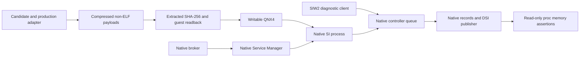
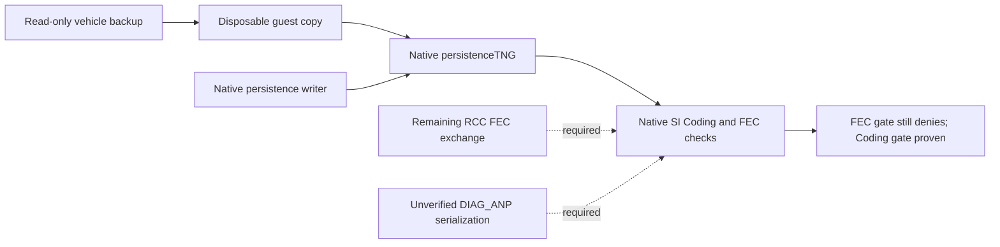
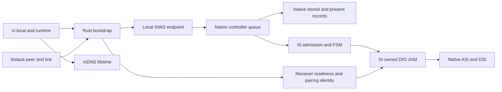
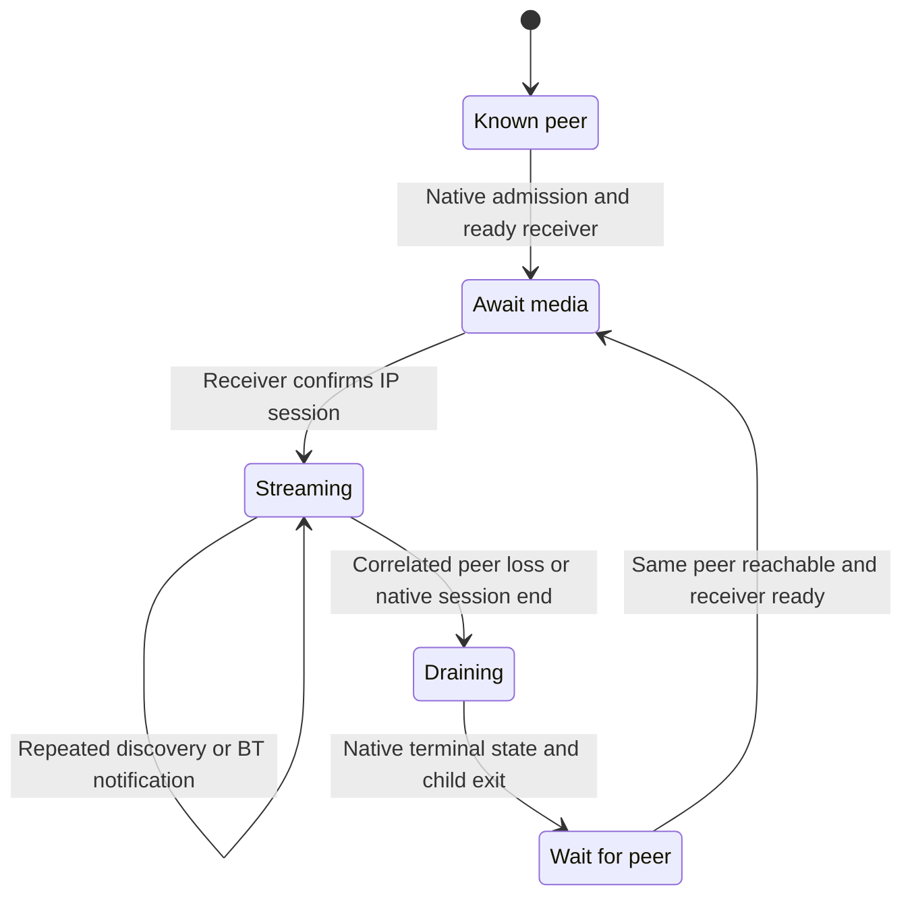
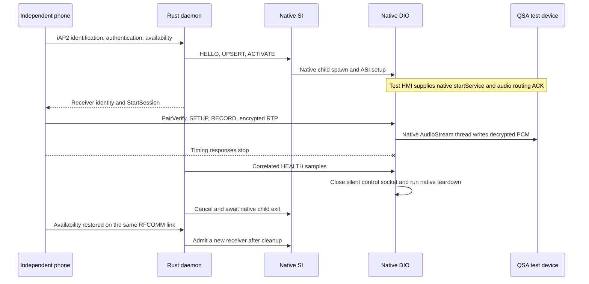
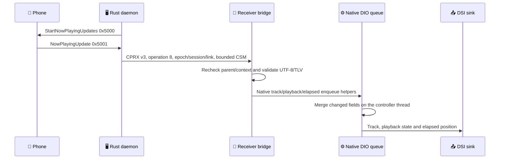

# SI-owned wireless: offline implementation

> Historical snapshot, preserved on 2026-10-29. Commands, status and implementation claims below describe earlier revisions. Use the [current guide](../../../wireless-carplay/SI_STAGE2_OFFLINE.md) for maintained instructions.

_2026-10-21 · MHI2Q MU1316/P5087 · main/input/AltScreen physically verified; audio and reconnect open._

[Plan](../../../wireless-carplay/SI_WIRELESS_EXTENSION_PLAN.md) · [Stage 1 on HU](../../../wireless-carplay/SI_STAGE1_HU_TEST.md) · [Sources](../../../../wireless/si/README.md)

## 📡 Current channel implementation

The [October 22 native HMI checkpoint](../../../carplay-lab/WIRELESS_MEDIA_VALIDATION.md#native-hmi-si)
also runs the actual SI alongside release J9/LSD/Screen: adapter publication,
native NOOP/deletion and rendered frames pass concurrently. Wireless media
admission and audio focus are not yet connected in that HMI profile.

The latest [physical HU acceptance and wired restoration](../../../wireless-carplay/WIRELESS_PRODUCTION_CHANNELS.md#-hu-acceptance-and-return-to-wired-operation) supersedes older vehicle reports below. The phone rejected the new Identify capability list until the missing Now Playing stop command `5002` was added. After that daemon hotfix, the owner confirmed working wireless main display, input and cockpit AltScreen. Audio remained unavailable (only iPhone shown as an output); startup auto-reconnect and sustained semantic delivery remain open. At the owner's request, investigation moved offline and the boot files were returned to USB re-arm SI plus stock Bluetooth with no wireless daemon autostart. The owner's reboot confirms those code bytes in the actual SI/BT processes and no wireless daemon/runtime/adapter; physical USB playback still awaits the owner's check. The hotfix passes 301 workspace tests but is newer than the archived QNX evidence.

Final local acceptance: **nine profiles, 26 cycles, 256/256 checks**; Rust workspace 300/300, daemon library 61/61. The matched kit and independent audit are recorded in [wireless channel results](../../../wireless-carplay/WIRELESS_PRODUCTION_CHANNELS.md#-matched-review-result). This supersedes the historical kit hashes and implementation gaps below; it does not supersede the last physical HU failure report.

The later [wireless channel implementation](../../../wireless-carplay/WIRELESS_PRODUCTION_CHANNELS.md) supersedes historical statements below that production AltScreen is disabled, semantic iAP2 is absent or ASI source correlation is unimplemented. Paired stream 111 now uses the production AltAV worker. Authenticated RGI/manoeuvres/lanes, artwork file transfer, status, speed and native GPS use the existing feature consumers. Wireless ASI state/watchdog/flush/teardown/restart carry a bound source tuple through the native controller queue. Exact retry/ACK handling prevents TCP reconnects from duplicating artwork input or dropping pending output.

`qemu_full_cycle.py --fault features` exercises these channels together; the review builder includes that profile and both Java variants. Require a fresh PASS receipt with matching source/payload hashes. The sections below retain the chronology of earlier evidence. **Physical acceptance remains open** for all fixes made after the last HU run, including real Siri/focus and full wired/wireless reconnect cycles.

## Status and evidence

Native discovery bindings, controller admission, transport routing and Rust integration are implemented and cross-built for QNX. **Stage 2 runs inside the actual SI process in a disposable QNX/QEMU fixture:** native startup, NOOP/deletion, SIW2 discovery, stored identity reuse and coding refusal pass. An explicitly simulated RCC FEC peer enables the real SI-owned DIO receiver lifecycle: native prepare, child spawn, ASI initialization, `/info`/CPRX v3, cancel and reconnect with retained pairing identity. The matched kit was subsequently activated on HU and produced real wireless main video; input, audio, AltScreen and metadata failed physical acceptance. The HU is now off; the later configuration-order and HTTP-composition fixes below have only offline evidence. USB reconnect acceptance remains open.

| Check | Evidence | Limit |
|---|---|---|
| ABI 2 trampolines | 320 ARM executions, original prologue oracle, registers/stack/arguments; connect and transport-predicate CMP flags | Does not start SI services |
| Runtime fingerprint/readiness | 35 cases executing the actual C guard | Modeled address space |
| Native device helpers | Original ARM constructors/copy, present insert/remove/pool reuse | UnicodeString calls modeled; stored-ID allocation and DSI publication inspected statically |
| Native completion | Original ARM checkRunningJob, outcomes 17/11/20/19 | Event delivery and ASI notification modeled |
| Controller/protocol | Actual C with ASan/UBSan, 20,000 parser mutations, duplicate/replay/stale/full queue cases | Native operations modeled |
| Rust | Lost acknowledgement/PENDING exact replay, epoch change, CPRX v3 binding, bounded metadata/semantic forwarding and file-transfer handshake tests | Protocol peers modeled; current count is in the fresh test log |
| Runtime/owner | Real host processes: mDNS recovery without bootstrap restart, USB priority, owner locks, wrapper, SI wireless renderer monitor | Host DIO stand-in |
| Bluetooth callback | Actual ARM: peer metadata, disconnect, absent identity, wrong channel, overflow | Physical SDK event still to confirm |
| QNX build | Adapter, daemon, bridge, owner/runtime and wireless hook compiled | Compilation is not runtime success |
| Native QNX process | Actual broker and Service Manager spawn SI, deliver init/run; guard publishes; native NOOP executes and is deleted | Watchdog disabled only in the disposable fixture; no physical USB cycle |
| Native discovery | SIW2 HELLO/UPSERT/rename/REMOVE/reconnect/replay/stale epoch; read-only checks of actual stored/present vectors and WLAN metadata; native DSI publication logs | No connected HMI or successful media admission |
| Native UTF-8 regression | Old adapter fails byte-exact Cyrillic name assertion; fixed adapter passes against real libutil | Host UnicodeString models alone missed this bug |
| Native positive receiver lifecycle | Real stock DIO/SDK, wrapper PID ownership, ASI INITIALIZED, `/info`, CPRX v3 stale rejection, two child/session generations, pairing identity retained, external mDNS survives, clean cancel | C bootstrap peer and simulated RCC grants; no physical iPhone media session |
| Native admission refusal | ACTIVATE is denied by the actual Coding gate; context stays idle and no child exists; idle CANCEL succeeds | FEC admission and successful prepare/spawn are not tested by this refusal |

Run `python3 wireless/si/test_si_stage2.py` for host/Unicorn checks. The separate native QEMU command below produces `run-receipt.json`; the review builder runs both suites. Results and hashes are under `build/si-wireless-stage2/`.

## Native QEMU bootstrap and discovered UTF-8 bug

```sh
bash wireless/si/build_si_adapter.sh --stage2
python3 wireless/si/qemu_stage1.py --stage2 \
  --workdir build/si-wireless-stage2/qemu-acceptance
```

The runner creates and stops its own bounded QEMU process. It does not connect to HU or change the existing vphone/QNX VM. The default acceptance profile uses the native Service Manager, whose isolated `startup` list contains SI init/run. SI is its real child, with manager-generated arguments and the original per-process environment. Broker uses `--node mmx --name broker`. Firmware configuration and binaries are inputs, never edited in place.



The old `libcomm.so+0x9DDC4` diagnosis is corrected. Logs preceding the null CoreApi dereference contained `the bundle loader commandline is invalid`: the fixture omitted `-sm-name`, `-sm-id`, nonzero `-sm-time` and `-sm-restart`. In libcomm, `CoreApi::getInstance` (`0x798E8`, singleton `0xC86B8`) depends on AgentCommon initialization, not proof of broker readiness. Valid arguments moved the original SI past that crash to an explicit missing BundleLoader factory (`14400653-…`). Native Service Manager startup now supplies the arguments and actual init/run transactions.

The fixture also needs MU1316 libc, the required COMM factories and production configurations. The BSP libc previously crashed loading the byte-exact graft; the MU1316 libc accepts it. This identifies a fixture/library difference, not the precise faulty loader instruction. Candidate and adapter are compressed before mkifs, extracted and SHA-256 checked on the host, then unpacked on QNX4 with size, CRC32 and byte-for-byte readback checks. No guest ELF patcher is used. Executables use `data=copy`: RAM IFS otherwise defaults to data in place and permits only one execution. See the [QNX 6.5 mkifs reference](https://www.qnx.com/developers/docs/6.5.0SP1/neutrino/utilities/m/mkifs.html).

The native run exposed a real adapter bug: `UnicodeString8::setString` was called with encoding 2. In the matching libutil (`SHA-256 45a4964721d4854a76054a6aae76685dbf354ad5082689e727a6ddeaab4079a8`, function `0x402A8`), that branch appends each input byte as a codepoint. Encoding 3 preserves UTF-8 through `0x311EC`. The fix changes this argument in `si_native.c`. The diagnostic client independently reads the real UnicodeString8 byte length and buffer, and checks Cyrillic insertion, ASCII rename and reconnect. The old adapter fails `native UTF-8 name preserved`; the fixed adapter publishes `deviceName=QEMU Телефон` correctly.

Successful acceptance requires `published=1`, advanced `job_noop` and `job_deleted`, native discovery and admission-refusal markers, `LIVE ready=1` and matching immutable candidate bytes. SIGSEGV/SIGABRT, transport/probe failures and missing markers fail the run. `--diagnose` and `--debug-broker` only collect debugger snapshots; their completion does not constitute acceptance. `--no-adapter` checks native fallback startup separately.

The default isolated mesh lacks coding, persistence and FEC providers. A deliberate ACTIVATE request reaches the native Coding gate and returns DENIED (`Access ... not granted by Coding`), with no active app or child. No admission gate is bypassed. DSI list publication is native, but HMI consumption, video, audio and AltScreen remain untested here.

### Vehicle backup and native provider diagnostic

The backup is an input from the actual vehicle. No defect in that dump has been established. Missing configuration in the minimal VM must not be described as missing or invalid configuration on HU.

An opt-in profile now starts the unchanged firmware `persistenceTNG_mibhigh`, `diagnosis` and `fec` under native Service Manager before SI:

```sh
python3 wireless/si/test_qemu_vehicle_providers.py
python3 wireless/si/qemu_stage1.py --stage2 --vehicle-providers \
  --workdir build/si-native-qemu/vehicle-providers-10 --timeout 170
# positive-boundary variant (see below):
python3 wireless/si/qemu_stage1.py --stage2 --vehicle-providers --carplay-coded \
  --workdir build/si-native-qemu/vehicle-providers-11-carplay-coded --timeout 170
```

This is a native vehicle-data delivery acceptance, not positive media admission. Each service ELF and the backed-up MMX database use the same SHA-256 checked compressed delivery as SI. Only disposable guest files are writable. `vehicle-inputs.json` records input provenance. The two original RCC `storage1.raw`/`storage2.raw` copies must agree on `VW_Coding`; missing, ambiguous, short or conflicting values stop the build. The previous VM seed contains a different coding value and is not used as the vehicle configuration.

The RCC transport backend is replaced by local SQLite **only in the disposable persistence configuration**. Namespace mapping and SI's native Coding/FEC gates remain unchanged. The unchanged firmware `dumb_persistence_writer --flush` writes the backed-up values through the native persistence API, including registration and subscription behavior; the completion marker is gated on native `dumb_persistence_reader` readbacks. The original MMX database is copied, never edited in place.

**DIAG partition mapping (restored from the production configuration):** the `persistence.json` mapping comments name `28180695` = `DIAG_COD` and `28442848` = `DIAG_ANP`, both routed to the `rcc` backend. SI subscribes `28180695:1` (coding, exactly 25 bytes) and `28442848:100` (adaptation blob). Native decoders agree on the layout: SI `onCodingChanged` (`0x1919F8`) reads `coding[19]>>6` as the USB mode (needs >24 bytes); MMXDiagService (`diagnosis` binary, `SystemDiagModuleThread` at `0x166A18`) reads telephone/BT/WLAN/navigation/SDS/brand/RVC bits and the same USB adaptation bytes `[30..33]`; SI `onAdaptationChanged` (`0x19180C`) reads the USB port mask from `[30..33]&1`, `[43]>>7`, `[43]&0x40`, the CarPlay coding bit `[51]&1`, wireless bits `[51]&0x60` and `[70]&4` (needs >70 bytes, otherwise it logs `Invalid size!`).

**Adaptation serialization is unverified.** The earlier claim that RCC MIBRoot was absent was incorrect: `MIBRoot_RCC` and `rootifs_out/usr/apps/MIBRoot` exist in the firmware root, outside `advanced/`. Its `DIAG_ANP:100` serialization has not yet been verified. The profile assembles the blob from the backed-up `Car_Function_Adaptations` + `Car_Function_Adaptations_Gen2_Extended` pair (60+60=120 bytes) — the only vehicle-data assembly consistent with the MMX consumer schema — and `vehicle-inputs.json` marks it unverified. Ground truth from the vehicle owner: wired CarPlay worked on this car, while the assembled blob decodes CarPlay coding bit 0. This falsifies the assembly as the true RCC serialization; it also makes the FEC path (below) the better candidate for CarPlay enablement.

**FEC findings (read-only).** The backed-up `FecContainer.fec` is parsed (`vehicle_fec_container`): format 1, VIN `VWAUC4CF55JA099137`, seven active FSIDs — `00040100`, `02310026`, `00050000`, `00070200`, `00030000`, `00060800`, `00060900` — with matching BE and LE lists and a 128-byte signature. SI's FEC gate (`0x169498`) requires global FEC state `DataProxy+1028 == 1` plus the per-app state (`+1020` for CarPlay); the states come from the `fec` app, which receives them over `asi.fec` from its RCC peer. Without that peer the service logs `FecSwapHndlThr::handleRegisterForFec: received NULL value (currentStatevector)` and SI's FEC states stay 0. No FEC value is fabricated.

**Fixture note.** The disposable SQLite stand-in for the `rcc` backend refuses writer opens of partitions no client created yet (runs 05–09: exactly one new-partition write per service lifetime, everything else fails with `PERS_STATUS_VERSION_MISMATCH`). The profile therefore pre-registers the two DIAG partition rows — schema-identical to the vehicle database, **no values** — in the shadow store (`persistence_rcc_seed.sqlite`, recorded in `vehicle-inputs.json` as `rcc_shadow_seed`). Every vehicle value still enters exclusively through the native `dumb_persistence_writer`; the stock `--version`/`--version-tag`/reader-prep orderings are documented in the seed script history and do not work around this.



Observed in `build/si-native-qemu/vehicle-providers-10/` (strict vehicle data) and `-11-carplay-coded/` (positive boundary):

| Observation | Result and boundary |
|---|---|
| Native persistence, diagnosis and fec startup | All three report `AS_RUNNING`; this does not establish their RCC peers are available |
| Vehicle Coding delivery | SI opens `28180695:1`, subscribes and executes `onCodingChanged: size=25`; native writer and reader round-trip succeeds; probe reads `usb_mode=3` in the DataProxy |
| Vehicle adaptation delivery | SI opens `28442848:100` and executes `onAdaptationChanged: size=120`; the previously failing `VERSION_MISMATCH`/`INVALID_HANDLE` open is resolved by the pre-registered shadow rows |
| Reconstructed-input decode | Probe: `usb_mode=3 carplay_coding=0`; ACTIVATE denied by the actual Coding gate (`not granted by Coding`) from the unverified assembled adaptation; this does not establish the actual HU coding bit |
| Positive boundary (`--carplay-coded`) | Only the CarPlay coding bit is set through the native writer (dealer-coding simulation, labelled in the receipt); probe reads `carplay_coding=1` and the denial moves to the FEC gate (`errorCode=2 ... not granted by FEC`) — the Coding gate passes natively |
| FEC states | `fec_carplay=0 fec_usb=0` in both profiles; requires the native MMX fec ↔ RCC FEC exchange (these negative profiles do not run an RCC peer) |
| Overall diagnostic | **PASS** for native vehicle-data delivery; positive media admission remains unproven and is not claimed |

At `0x16925C` the unchanged app-0 Coding gate requires DataProxy USB mode 3 plus the CarPlay coding bit; at `0x169498` the unchanged FEC gate requires native grant state 1. Neither gate is patched. Authentic RCC serialization and FEC/license validation remain separate from testing the downstream lifecycle.

### Positive SI-owned receiver lifecycle

```sh
python3 wireless/si/qemu_stage1.py --stage2 --vehicle-providers \
  --carplay-coded --rcc-fec-fixture \
  --workdir build/si-native-qemu/positive --timeout 210
```

`si_qemu_fec_peer.c` uses real libcomm AgentStarter/Proxy and the `asi.fec.FecClient` service. It sends explicitly simulated grant states through native `updateFECs`; the unchanged MMX fec service notifies the actual SI subscriber. FSIDs come from the backup, but the grant responses are test inputs: no cryptographic FEC/license validation is claimed. Source and delivered adaptation hashes are recorded separately.

The positive fixture starts the exact firmware DIO (`e9862680…`) and libairplay 210.81 (`01c116b1…`) through SI's actual ProcessTNG child, using the production wrapper and owner helper. The adapter injects the SI epoch/session/link/parent into the explicit child envv. `/proc` confirms the executable and real SI parent. Native ASI notifications, rather than synthetic writes into SI, advance its state.

```mermaid
sequenceDiagram
    accTitle: Native SI-owned receiver lifecycle in QEMU
    accDescr: A simulated RCC grant reaches native FEC through COMM. SI owns the real DIO child, which reports transport setup through ASI. An explicit HMI test input calls native startService before AirPlay creates Screen and HID. Cancel and reconnect preserve the responder and pairing identity.
    participant Peer as SIW2 test peer
    participant SI as Native SI
    participant DIO as Native DIO and transport adapter
    participant HMI as Explicit HMI test input
    participant SDK as Stock AirPlay SDK
    Note over SI: Coding/FEC gates consume explicit fixture inputs
    Peer->>SI: UPSERT and ACTIVATE
    SI->>DIO: Native prepare then ProcessTNG spawn
    SI->>DIO: ASI initService and setupService
    DIO-->>SI: Native ASI SETUP_COMPLETED
    HMI->>DIO: Native DSICarplay startService with display, HID and modes
    DIO->>SDK: Native queued StartAirPlay
    SDK-->>DIO: Actual server-running event
    Peer->>DIO: CPRX v3 START and IDENTITY
    DIO->>SDK: Validate real /info and Bonjour identity
    DIO-->>Peer: Ready; stale epoch rejected
    Peer->>SI: CANCEL
    SI->>DIO: Native teardown
    DIO-->>SI: Native terminal states; child exits
    Note over Peer,SDK: Repeat with a new child/session and the same pairing identity
```

The lab uses real IPv6 io-pkt, a dedicated virtual USB ECM interface, factory DNS-SD/mdnsd and QNX4 persistence. Primary MAC, display/OMX and audio hardware have explicit test backends. `si_qemu_hmi.c` supplies a simulated HMI configuration through the real native DSI object; it is compiled only with `MHI2Q_SI_QEMU_HMI`. Production waits for the actual HMI. The test supplies empty initial app/resource vectors, so audio focus is not established. The native startup budget is **30 seconds only in this TCG fixture**, because the simultaneously running user VMs and emulation make 10-second timing nondeterministic. Production remains 10 seconds; this run is functional evidence, not a HU startup-speed measurement.

Acceptance requires two actual receiver-ready acknowledgements, native cancel/reconnect and reaped children, stable pairing identity and mDNS PID, zero SI USB-operation counters and matching immutable SI bytes. Startup timeout, native Cinemo connect/restartMdnsd, signals or missing assertions fail the positive profile. The independent default Coding-denial profile remains required. The canonical logs/receipts are `build/si-wireless-stage2/qemu-acceptance/` and `qemu-positive/`, rebuilt together by the review builder.

This profile uses a C bootstrap peer. Full Rust Bluetooth/iAP2 bootstrap, real iPhone StartSession, media, HMI, audio and AltScreen under SI ownership remain unproven here.

## Ownership and routing



Rust is not an SI child. In SI mode the runtime runs the daemon directly, without `wireless_dio_supervisor`. Wired ownership does not suspend bootstrap. An owned mDNS responder can be replaced without restarting bootstrap; external responders are preserved.

ABI 2 uses five hooks: central connect, prepare, cleanup, job dispatch and the native CarPlay transport predicate (`0x169518`, table offset 28). The last predicate otherwise requires a physical USB connector; only an already-admitted native WLAN record returns true through the adapter. All Coding/FEC/method checks remain native, and USB follows the original predicate. Root remains RW at `0x1C5E00`; the hook page remains R+X at `0x1C6000`. Default builds preserve stage 1. Candidate and adapter require explicit `--stage2`; `MHI2Q_SI_HOOK_WIRELESS=1` enables mutations.

Discovery alone does not admit media. Premature HMI connects for unadmitted WLAN records are consumed before creating an SI context. Bootstrap ACTIVATE retains native presence, capability, coding, FEC, method and single-session checks. Unknown WLAN attempts cannot fall through into stock USB prepare/cleanup.

## Verified native ABI

Base: USB re-arm SI SHA-256 `606236a81c7c4dafda6fdd08fe6eb27c43252796784da25d9760a7d552ee2af3`; its existing re-arm instruction is retained. IDA uses the matching stock image; its four-byte difference is outside these discovery helpers.

| Primitive | VA / layout | Contract |
|---|---|---|
| DataProxy | controller +264 | Embedded object, not the controller pointer |
| Present vector | DataProxy +440 count, +444 pool size, +448 pointers | 208-byte native records; DeviceInfo at record +8 |
| Stored identities | DataProxy +544 count, +552 pointers | Separate from present list |
| Constructor | `0x169850` | Four 40-byte UnicodeString8 fields |
| DeviceInfo copy | `0x1698D0` | Native string assignments |
| Stored upsert | `0x16EEF4` | Returns numeric deviceID, not a pointer; native uniqueID from vendor/product/address |
| Present insertion | `0x16EC90` | Copies into native owned/reused storage |
| Present removal | `0x169984` | Resets strings, retains object in unused pool |
| Discovery publication | `0x183678` | Native DSI serialization; states 0 and 2 included |
| Completion | `0x17F2B8` | Native PREPARED, START_RETRY, CLEANUP_DONE |
| Connect | `0x165390` | Current FSM listener vslot +28 |
| Disconnect | Current FSM vslot +32 | deviceID, removal=1; slot +48 is finalize |

WLAN uses connectionType 2 and CarPlay mask 2. The address is an opaque `bt:XX:...` peer key, copied from SDK remote-device +13 following native HfRfCallback. Presentation MAC byte order is not assumed. Name currently defaults to iPhone; IPC accepts validated UTF-8 updates. A present identity is updated directly: calling stored upsert on an already-present identity would deliberately allocate a duplicate ID.

Legacy metadata readers index three USB configuration slots without checking transport. DeviceInfo +188 is bounded to zero; transport hooks bypass physical USB operations. Correct native ASI/HMI interpretation of that compatibility metadata remains a live test.

## DIO transport adapter and cold-start fixes

Stock `CSIService::initService` (`0x165348`) stores SDeviceInfo and restarts mDNS; subsequent setup starts Cinemo USB iAP2. SI-side prepare alone cannot turn that into wireless. The stock210 bridge now includes `si_transport.c`: only a valid SI-bound wireless child replaces CSIService's init/setup slots and notification entries. Wired and standalone generations keep their previous paths. The guard verifies all 15 primary vtable entries and the secondary `this-44` notification thunk (`0x1A4E80`); absent/malformed context, wrong parent or mismatched layout cannot install it. ASan/UBSan tests cover these failures and idempotence.

Wireless init retains the native SharedPtr/reply client, then posts native AirPlay startup. Early CPRX START waits for native SI initialization; generic prestart is disabled for SI-owned children. The real AirPlay-running notification publishes native ASI SETUP_COMPLETED; actual media-start notifications remain owned by DIO. A late running event after cancellation cannot report setup completion. No fake SERVICE_STARTED is emitted merely because the receiver is listening.

Cold START previously held `bridge_lock` while server creation needed the same lock. Server retention now uses a separate lock, with release outside both locks; first-start publication is atomic. The mDNS kill interposer was accidentally nested under the experimental-start preprocessor flag: moving it into the stock210 build fixes external responder termination across native SI teardown/reconnect. Production builds now assert that the required `kill`/SI transport exports are present.

SI state **3 is SERVICE_STARTED**, while **5 is INITIALIZED**. Rust verifies that bridge STOP reports active media before DETACH, accepting both states to cover a queued native media notification. SI retains that admitted generation until native termination; receiver-ready alone does not prove media.

## Protocol and session lifetime

SIW2 is a fixed 192-byte little-endian frame on `/tmp/mhi2q_si_control.sock`, mode 0600. No network SI-control listener. A CLOEXEC kernel lock `/mnt/persist/.mhi2q_si_adapter.lock` prevents a second adapter from removing an active endpoint.

| Operation | Meaning |
|---|---|
| HELLO / SNAPSHOT | SI epoch and native context |
| UPSERT_PHONE | Native identity and presence, without activation |
| ACTIVATE | Admit the peer/link and call native connect |
| CANCEL | Native disconnect for this admitted attempt |
| REMOVE_PHONE | Deferred presence removal, stored identity retained |
| DETACH_PEER | Keep established IP media after bootstrap loss |

The bounded ledger holds 32 requests, eight phones and eight daemon epochs. Saturation returns BUSY; restarting SI resets these tables. Completed results can be evicted, but per-daemon high-water marks reject old replays. SI and daemon epochs are random; request IDs increase monotonically. Parser checks reserved bytes, UTF-8, termination and ranges.

Parsing and bounded waits run outside the controller. Native jobs validate again on dispatch. Lost acknowledgements/PENDING replay exactly the same request ID/payload; conflicting reuse is rejected. Native callbacks run without the ledger mutex, allowing prepare/spawn re-entry. A new Bluetooth link cannot steal an active IP session.

Explicit child envv carries mode, SI epoch/session, link and SI parent PID. Other SI children receive no hook namespace. The wireless wrapper sources per-unit configuration because ProcessTNG constructs a separate envv. Wired hook/APAC files are preserved; wireless uses separate libraries. SI-owned wireless retains the renderer monitor for the existing main/AltScreen path. Spawn transport is read from the native SI context independently of admission: a cancelled/stale WLAN spawn is rejected, never relabeled wired.

CPRX v3 binds START/STOP/IDENTITY to epoch/session/link and actual parent. Legacy v2 starts, stale context and replaced parent are rejected by an SI-owned receiver. v2 QUIESCE/WIRED_DRAIN remains available for guarded owner handoff, including orphan recovery by a wired owner. DRAIN independently checks the wired-priority kernel lock.

On Bluetooth loss the daemon asks the receiver to stop only if idle. Explicit receiver BUSY confirms active media, permitting DETACH; SI INITIALIZED (state 5) alone is insufficient. Unknown receiver state preserves the lease instead of force-closing media. Deferred presence removal follows native terminal state.

## Remaining acceptance gates

HU blocker reproduced 2026-10-21: the exec-only stage-1 SI launcher is now installed and verified after two owner-operated HU reboots. Native image guard, NOOP/deletion and first wired connection pass. Reconnect fails with the native iAP driver's interface-enable timeout, followed by DIO TIMEOUT_STARTUP; SI itself remains ready. The second reboot restores the first connection, but does not close reconnect acceptance. This USB/iAP reconnect issue remains open. At the owner’s request the matched full Stage-2 kit was subsequently installed for a separate wireless test; the exact HU failure archives and deployment receipt are linked in the [stage-1 boot audit](../../../wireless-carplay/SI_STAGE1_HU_TEST.md).

Before any HU functional check, establish the running SI generation after an agreed HU restart: record PID/arguments, compare immutable candidate guard ranges in process memory, verify the published adapter and require fresh NOOP/deletion counter increments. Installed file hashes alone do not attest activation. The owner reports SI currently restarts with the vehicle; hot-restart and cold-boot behavior remain unverified. The earlier stage-1 USB cycle has separate runtime evidence ([audit](../../../wireless-carplay/SI_STAGE1_HU_TEST.md#-уточнение-активации-si-2026-10-21)); it does not validate later builds or boot integration.

1. **HU discovery/queue:** repeat the now-proven native QEMU HELLO, UPSERT, rename, native DSI list, REMOVE and NOOP/deletion on HU. Check HMI consumption and stored/present counts. Keep synthetic activation out of HU discovery diagnostics; the QEMU refusal test relies on its explicitly absent coding provider.
2. **Physical peer/admission:** confirm six SDK address bytes against the connected iPhone, then bootstrap → SI child → receiver /info/Bonjour pi → StartSession. Observe native appState and unchanged 10-second startup budget.
3. **Native HMI/media:** phone model, screen context, main stream 110, AltScreen 111, PCM, focus, Siri/mic, teardown and wired priority. Standalone media evidence does not establish this path.
4. **Late ASI events:** native appState payload lacks sender/session identity. Tagged controller/receiver requests do not fix that channel. Waiting for old-child exit and native terminal state is a safeguard, not proof of a drained broker queue. A delayed-event fixture or verified native sender/barrier contract is still required.
5. **Orphans:** an existing kernel DIO owner blocks wireless admission/prepare after SI restart. No PID-file authority or arbitrary kill. Automatic wireless orphan recovery is not implemented; guarded wired takeover and manual recovery remain available.
6. **Authentic vehicle licensing/configuration:** the positive lifecycle uses explicit RCC grant simulation. Verify MIBRoot's adaptation serialization and authentic FEC exchange independently; these are not prerequisites for repeating the now-working downstream functional fixture.

## Build and next HU session

```sh
python3 wireless/si/build_si_review.py
```

Output: `build/si-wireless-stage2/mhi2q-si-owned-review.tar`, with file/source hashes, independent negative and positive native QEMU receipts/logs and extracted-byte verification. The builder requires native QEMU PASS against the exact packaged SI/adapter hashes and current fixture sources. It contains review wrappers and an incomplete per-unit environment template; **no automatic installer or rollback timer**. The standalone DIO supervisor is excluded. Reconcile live SI/wrapper, firewall/AP, identity/MFi and USB renderer baselines before deployment. The archive was rebuilt on 2026-10-21 with independent native negative and positive acceptances. The per-unit HU payload additionally preserves the live wrapper’s `AUDIO_SCENE_CENTRE=1` calibration.

Diagnostic client: `si_control_client op req epoch_hex daemon link session key name [socket]`. Operations are numeric 1–7 as above. Use a dedicated diagnostic daemon epoch while real bootstrap is stopped, and increasing request IDs. Copy HELLO's SI epoch into later requests. A timeout requires reconciliation before another activation.

## HU installation, 2026-10-21

The full matched Stage-2 kit is installed and **activated after an owner-operated HU reboot**. Actual ABI-2 SI PID `1015899` passes the immutable image guard, readiness and fresh native NOOP/deletion. The control socket, Rust bootstrap, Bluetooth graft and mDNS are running. The graft’s complete executable code also matches the installed production payload.

| Component | Published payload / evidence |
| --- | --- |
| SI candidate | `/mnt/app/root/si-wireless-stage2/smartphone_integrator`, SHA-256 `56898710fbab39e63c2b961a6cfbff85e40bf083adc50502ed7a60b7b67e0eca` |
| ABI-2 adapter | Same directory, `libsi_adapter.so`, SHA-256 `7196b6bd195864f9e042c5d4e776b16e8a5a0f928a7bf0a9908181d0b71623c1` |
| Native exec launcher | `/mnt/app/eso/bin/apps/smartphone_integrator`, SHA-256 `5020101cc16ae5ceb014869683e4742e5c9dd086e8f0dab968cd123c3c5505b6`; published last |
| Bluetooth graft | Production `btstack`, SHA-256 `9905d70479a64f9762eed7f05883bcd5f3778932479fc65abd8a148cb19578c4`; previous graft matched the older installed kit byte-for-byte |
| Bootstrap | Production Rust daemon, `wireless_runtime`, `wireless_si_runtime.sh`, native mDNS probe and per-unit config in `/mnt/app/root/hooks`; exact live `rc.local` extended with one respawn command |
| Media child | Mode-aware `carplay_startup.sh`, owner helper, separate wireless hook/APAC and receiver bridge; SI owns DIO |
| Preflight | All 16 payloads read back byte-for-byte; native daemon `--check-config` PASS without radio/MFi operations |
| Preserved | Actual wired hook/APAC, firmware libairplay, all four installed PF profiles, AP credentials/channel and the HU vocal-centre calibration |

Local records: `build/si-wireless-stage2/hu-20261021/{payload-manifest.json,deploy-full-receipt.json,deploy_full.py,baseline/}`. Review archive SHA-256: `daf5f1ad686b8dfb487913795de6b3d307ff10c21d53b5f3cf6f8c813cddebb7`. Remote backups of replaced existing files: `/mnt/app/root/si-wl-hu-20261021/backup/`. Private config and captured identities stay outside tracked documentation. `/mnt/app` was returned to read-only. No process was killed, no reboot command or automatic rollback was issued; no commit/push.

Physical bootstrap now passes real MFi (`AA05`), identification (`1D02`) and Wi-Fi configuration (`5702/5703`). With the prior Bluetooth bond the phone sent `4E0D available=1` but no `4300`; forgetting and recreating the Bluetooth pair produced the CarPlay consent prompt. SI then spawned actual DIO PID `9842830`, parent `1015899`, and the owner confirmed main-screen video without USB. This establishes wireless video, not complete functional acceptance.

Observed gaps in that deployed build: main video is 800×480 rather than the required 1024×480; input fails; audio remains on the phone; AltScreen, phone data and Now Playing are absent. That build explicitly blocked wireless AltScreen; the later local [channel implementation](../../../wireless-carplay/WIRELESS_PRODUCTION_CHANNELS.md) replaces that restriction. Logs also show the decoder anchor check rejecting bridge interpositions and the audio dispatcher rejecting the wireless HTTP router. After Wi-Fi-off the screen eventually closed, DIO exited and native SI returned to idle; permanent teardown failure is not established.

At the owner’s request, the last repeat attempt was captured for offline diagnosis: SI spawned DIO `21131409`, then it exited. The phase named `active/` was already idle and is not evidence of active repeat media. Captures contain 53 packets from fresh pairing, 48 from the repeat bootstrap and 3934 AP packets (snaplen 160). Complete packet/hash manifests, process/thread/slog/hook/Java/renderer logs, native SI/BT snapshots, owner reports and an exact 276-file source snapshot are in private `build/si-wireless-stage2/hu-20261021/run-02/`, with `HANDOFF.md`. No functional fix was deployed during evidence collection. Owned capture processes were stopped; no SI/DIO kill or radio reset. The next work is offline resolution/configuration, input/audio and iAP2 metadata integration, then production AltScreen and timed disconnect validation.


### Third physical wireless run: live objects

A further owner-authorized run on the unchanged build captured actual DIO `29528204`, parent SI `1015899`, at seven points during media. The owner again reports main video with no input/AltScreen, Bluetooth reconnect needed for each attempt, and an MMI activation prompt as if the phone were new. Wi-Fi-off eventually closes the screen; native DIO exit and SI idle are recorded separately.

Live data corrects two hypotheses: CSIService **does receive event 6** after event 4, while sampled native SI remains app=0/state=5; and all manager display snapshots contain **1024×480**, even though the early bridge fallback and this session’s decoder/window are **800×480**. Trace startup/configuration propagation and enum semantics before replacing callbacks or forcing SI state. A simple claim that the correct dimensions never reach DIO is disproved.

Private evidence: `build/si-wireless-stage2/hu-20261021/run-03/`. It includes seven manager/CSIService/DataProxy snapshots, before/active/after complete logs, 46 iAP2 bridge packets, 4765 AP packets (snaplen 192), owner reports and the exact source snapshot. DIO absence was observed at host 15:12:09.101479 UTC, native SI idle at 15:12:10.651912 UTC; message receipt times are not exact physical Wi-Fi/UI timestamps. Both capture processes were stopped. No functional update was deployed during this test.

### Offline fixes after HU shutdown

The owner switched off HU and requested local work only. No subsequent SSH connection, installation, radio change or HU restart was performed. Private captures remain outside Git. Results are under `build/si-wireless-offline-re/`.

**Configuration ordering.** On the pinned native DIO (`e9862680d76ca2e6bb2eed067658f2ca8fa9b71b5446322384b76c9735c0e794`), `DSICarplay::startService` at `0x16A7CC` writes the screen dimensions, physical dimensions, HID mask, touch resolution and initial resource modes before queuing `StartAirPlay` at `0x157460`. Its argument is a borrowed `SharedPtr<ServiceConfiguration>`; app and resource vectors are inside that configuration at offsets 0 and 12, not additional call arguments. The actual DSI object is manager+480. `AirPlayThread::run` (`0x15C214`) then creates the Screen/HID objects from those values. Updating the manager afterwards does not recreate those objects.

The old bridge queued AirPlay from transport initialization, before HMI configuration. This explains the observed combination of a 1024×480 manager and an already-created 800×480 Screen; the missing knob/trackpad registrations are the corresponding input failure mechanism. The adapter now reports `SERVICESTATE_SETUP_COMPLETED=1` through the native ASI path and waits for native HMI `startService`. CPRX readiness requests cannot initiate the first AirPlay thread for an SI-bound child. Standalone startup retains its previous behavior. No native session-start event or SI appState is synthesized.

| Native DIO field | Purpose | HU run 03 |
| --- | --- | --- |
| manager+548/+552, +556/+560 | Resolution and window dimensions | 1024×480 in all seven snapshots |
| manager byte+372 | HID mask | 9: knob and trackpad |
| manager+364/+368 | Touch resolution | 1024/1024 |
| manager+564/+568 | Physical width/height | 188/88 |
| manager+580 | Initial resource modes | Must come from native HMI configuration |

**HTTP composition.** `AirTunesServer_EnsureCreated` previously found the framework's wireless request router instead of the original stock callback and refused the buffered audio dispatcher. The framework now accepts one verified fallback behind its module/pairing router. Audio still verifies the original private-library prologues and exact stock callback; unknown routers, different originals and competing replacements are rejected. Framework modules run first, buffered methods run next, and other methods reach stock once. Wired installation keeps its direct stock path.

**Decoder anchors.** Resolve the three anchors through an explicit `dlopen("libairplay.so")` handle. Both global and next-object lookup can otherwise select the bridge's interpositions. The anchor-delta, readable ELF identity and two exact patch signatures remain mandatory. In QEMU this now reaches the text-protection step, which returns `EACCES`; **queue depth remains stock in this run**. Enabling depth 2 on a read-only text mapping remains separate work, not a successful optimization claim.

| Check | Result | Boundary |
| --- | --- | --- |
| `test_dio_hmi_start_arm.py` | PASS: actual compiled adapter and pinned native DSI instructions; modes 800×480, 960×540, 1024×480 and custom 1280×720; no early start; zero-width refusal; parent change rejected | libc, ASI delivery, SharedPtr retention, BT list copy and AirPlay queue boundary modeled |
| `test_si_stage2.py` | OFFLINE_PASS: 320 ARM trampoline cases, 35 runtime guards, 20,000 parser mutations, Rust and owner/runtime tests | Does not establish physical media |
| Native QEMU with the rebuilt complete wireless hook | PASS, 32/32 assertions; two DIO generations, actual 1024×480 Screen and `Eso_Knob`/`Eso_TrackPad` registrations, ready/cancel/reconnect and retained identity | Simulated HMI/RCC inputs; no real phone video, input or audio |
| Buffered HTTP router | Actual QNX log confirms composition in both children; host ASan/UBSan checks module-first dispatch, stock fallback, mismatch/conflict refusal, idempotence and server recreation | Not a buffered audio playback test |
| Audio interposer regression | ASan/UBSan PASS, including setup/teardown and stale-generation races | Native codec/device boundaries modeled |
| Decoder resolver regression | PASS with colliding global exports and existing fingerprint/protection-failure tests | Actual QNX text writes still refused |

Reproduce the new native configuration check and the QEMU acceptance with a selected hook:

```sh
python3 wireless/si/test_dio_hmi_start_arm.py
python3 wireless/si/qemu_stage1.py --stage2 --vehicle-providers \
  --carplay-coded --rcc-fec-fixture \
  --receiver-hook build/si-wireless-offline-re/hook/libcarplay_hook.so \
  --workdir build/si-wireless-offline-re/qemu-hmi-start --timeout 210
```

`--receiver-hook` records the selected path and SHA-256 and rejects a changed binary with `--skip-build`. The receiver bridge and hook at this historical checkpoint were local candidates; the previously installed HU payload did not contain these fixes. Later sections and [wireless channels](../../../wireless-carplay/WIRELESS_PRODUCTION_CHANNELS.md) supersede the implementation gaps for AltScreen and metadata. Physical audio focus/microphone and real input/video with the corrected configuration remain open. Automatic Wi-Fi-only reconnection is implemented locally in the later recovery section; it has not been tested on HU.

### Wi-Fi recovery and slow teardown: reference comparison

The owner clarifies that restoring Wi-Fi did nothing until Bluetooth was disconnected/reconnected, and the resulting activation looked like connecting an already-known phone. The native QEMU reconnect acceptance above uses explicit CANCEL/ACTIVATE commands. **It does not prove automatic Wi-Fi recovery or suppression of repeated activation prompts.** The configuration/HTTP fixes do not implement that missing lifecycle.

Slow teardown is now attributed to an observed native watchdog, not just a presumed UI delay. In run 03, `after/sloginfo.log:9721` records `_PerformPeriodTasks: Idle timeout after 30 seconds with no audio - stop session!`, then `kTimeoutErr`, TCP close and native teardown. The PCAP's last incoming control payload is at HU clock `00:37:37.698292`; the watchdog fires at `00:38:07.780954`, **30.082662 seconds later**. Both timestamps use HU time. This is not an exact timestamp of the owner's physical Wi-Fi toggle. The bounded analysis receipt is `build/si-wireless-offline-re/reconnect-comparison.json`.

Code comparison used local DiPlay revision `9e244d958afe6b8fd79ade49769ce25a944f397b` (read-only) and LIVI revision `82e54499db69d3088696fd22fc14c9cde3715c3e` (68 selected source files saved under the local analysis directory). No reference or production source was changed during this comparison.

| Concern | Implementation at the saved HU capture | Relevant reference behavior |
| --- | --- | --- |
| BT connection versus media | `ConnectorSlot` starts after a gated StartSession reply. It receives no native session-ended notification. `SiReceiverControl::poll` checks the SI snapshot but does not report media state or re-arm a completed lease. | LIVI [reconnect.rs](https://github.com/f-io/LIVI/blob/82e54499db69d3088696fd22fc14c9cde3715c3e/native/livi-helperd/crates/livi-runtime/src/reconnect.rs) distinguishes BlueZ Connected from `link_active`. Its Linux profile reconnection/disconnection mechanism is not a QNX implementation. |
| Duplicate discovery/connect | Our connector loops DNS discovery even after the native receiver has a phone session. After HTTP success it returns but leaves its slot's `active` flag true; another `start` then cannot replace that completed task. | LIVI [bonjour.rs](https://github.com/f-io/LIVI/blob/82e54499db69d3088696fd22fc14c9cde3715c3e/native/livi-helperd/crates/livi-runtime/src/bonjour.rs) deduplicates discovery by phone BT identifier or address and endpoint. This is endpoint deduplication, not itself proof of active media. |
| Discovery addresses | QNX resolver requests IPv4 only and rejects link-local IPv4. | DiPlay `CarPlayBonjour.kt` prefers scoped link-local IPv6 and binds the source address to the selected AP. LIVI also handles scoped IPv6. This is a capability gap; the capture does not establish it as the cause of this incident. |
| Fast peer disappearance | No correlated station-departure path currently closes the native session. STOP intentionally defers while a native context still exists. | LIVI [manager.rs](https://github.com/f-io/LIVI/blob/82e54499db69d3088696fd22fc14c9cde3715c3e/native/livi-helperd/crates/livi-cp/src/manager.rs) maps a Wi-Fi MAC departure to its matching wireless session and preserves sessions on cable. |
| Silence fallback | The observed stock watchdog expires at 30 seconds. | LIVI [stack.rs](https://github.com/f-io/LIVI/blob/82e54499db69d3088696fd22fc14c9cde3715c3e/native/livi-helperd/crates/livi-cp/src/stack.rs) compares both timing responses and control traffic against its 10-second bound. DiPlay `TcpLiveness.kt` configures TCP peer health rather than a video-idle deadline. |

The completed-slot defect is proven from code, but the saved HU log contains DNS discovery timeouts, not an accepted HTTP connect. It therefore cannot be named as the sole observed cause. Likewise, native SI appState 5 does not prove active IP media. Those distinctions require a read-only receiver observation contract.

The comparison identified the need for a coordinator keyed by the existing authenticated peer and native SI session. An active media observation suppresses discovery/connect and repeated ACTIVATE. A confirmed session end releases that generation; recovery waits for the same peer to be reachable and for native cleanup before admitting another generation. Stored phone identity and MFi/CarPlay consent survive this process. A Wi-Fi departure must be correlated to the actual session's network identity; Bluetooth MAC and Wi-Fi MAC must not be assumed equal. Loss of a picture or one missed packet is insufficient authority to close a session.



Required local cases: already-connected phone produces no second connect/activation; Wi-Fi off/on with unchanged BT recovers; loss while the picture is static still closes promptly; a static but reachable screen remains open; old-generation callbacks cannot close a new session; reconnect waits for native cleanup and preserves wired priority. On QNX 6.5, the SDK header exposes `TCP_KEEPALIVE` but not Linux's `TCP_KEEPIDLE`/`TCP_KEEPINTVL`/`TCP_KEEPCNT` set. Copying Linux option numbers or reducing the stock no-audio watchdog is not an implementation of these guarantees. This reference comparison alone did not establish a fix. The implementation and separate acceptance evidence follow below.

## 🔄 Automatic media recovery with unchanged Bluetooth

Local implementation, 2026-10-21; **not deployed to HU**. Review archive: wireless-recovery.review.tar (`build/si-wireless-offline-re/wireless-recovery.review.tar`; local generated artifact), manifest `build/si-wireless-offline-re/recovery-fix-manifest.json`. This incremental archive needs the matched SI integration kit; it is not a standalone installer. A media session now has its own lifecycle within an authenticated RFCOMM generation. Duplicate `4300` messages cannot re-activate a streaming or draining receiver. When Wi-Fi returns, a cached original StartSession reply can be reused after an authenticated `4E0D available` update; no new Bluetooth pair, MFi exchange or `4300` is required within that retained link.

| Boundary | Implemented contract |
| --- | --- |
| Native observation | CPRX `STATUS=6` reads state without stopping admission. `HEALTH=7` samples liveness. Both require the exact SI epoch/session/link and active receiver generation. Flags are strict: `0/5` waiting, `7` started, `4` ended; unknown/reserved encodings fail. |
| Silent peer | After native session start, unchanged data, HTTP/screen activity **and validated timing-response** counters for 10 seconds authorize one `shutdown` of that authenticated control socket. Sampling runs on the retained native HTTP queue. Native finalization and ASI own teardown. |
| Static picture | No frame-rate deadline exists. Valid timing replies reset the liveness age even if video, audio and control traffic are otherwise unchanged. |
| Cleanup authority | Native SI must report `app=-1` **and retained child PID=0**. Socket errors, `INITIALIZED`, and an idle app with a still-live child cannot authorize a new DIO. Native-ended observation issues bound CANCEL and waits. |
| Same phone | DNS-SD resolves TXT `id=` against the authenticated RFCOMM peer, then makes a bounded TCP reachability probe before a new ACTIVATE. Foreign/missing/duplicate IDs fail. IPv4 and scoped IPv6 link-local addresses are supported. |
| Identity representation | Existing `bt:` keys retain raw SDK byte order. Stock btstack formatter `0x157A8C` prints bytes `[5]..[0]`; reverse only for comparison with conventional Bonjour MAC text. Changing SI keys would lose remembered identity/consent. |
| Task lifetime | Native Streaming/Draining/Ended/Blocked cancels obsolete discovery/connect work. Canceled tasks retire before successors start. Successful HTTP tasks release the connector slot. Generation checks reject stale results; an already transmitted GET cannot be retracted. |
| Availability and priority | A false `4E0D` cancels probes. Wired ownership blocks re-admission. No recovery uses WIRED_DRAIN to force wireless cleanup. Startup with no media is canceled only after a serialized idle STOP accepts it. |

The 10-second timer uses stock-210 session fields: data receive `+488`, activity `+496`, accepted timing responses `+564`, correlated high-RTT responses `+612`, native-started byte `+702`. RE is pinned to `libairplay.so` SHA-256 `01c116b1674215daa0602d556a6d9b2eb48c2113ca294ea1f5d58787e3f656f2`: `_TimingThread` at `0x24EC8` schedules probes every 2–3 seconds; the successful path of `0x24748` increments `+564` at `0x24C04`. The high-RTT path increments `+612` at `0x24C1C` only after header/type/length and saved request-origin validation; these responses also prove reachability even if clock adjustment is deferred. Sending a probe increments the different field `+560` and is not proof of peer liveness. No TCP sysctl or stock 30-second watchdog constant was changed.

Implementation: [`recovery.rs`](../../../../wireless/daemon/src/recovery.rs), [`si_control.rs`](../../../../wireless/daemon/src/si_control.rs), [`carplay_control.rs`](../../../../wireless/daemon/src/carplay_control.rs), [`qnx_dns_sd.rs`](../../../../wireless/daemon/src/carplay_control/qnx_dns_sd.rs), [`peer_health.h`](../../../../hook/wireless/peer_health.h), [`wireless_hook.c`](../../../../hook/wireless/wireless_hook.c), [`bridge.c`](../../../../wireless/receiver_bridge/bridge.c).

| Acceptance | Evidence and boundary |
| --- | --- |
| Host/ARM | Rust 47/47; SI native ARM/guard suite; ASan/UBSan liveness, strict status decoding, wrong generation, native child-exit authority, duplicate suppression, stale callbacks and wired blocking. Full host suite passes; unavailable APAC capture is an explicit existing skip. |
| QNX daemon, unchanged BT | Two SI admissions, two receiver STARTs and two `4301` replies on RFCOMM generation 1 with one MFi exchange. Wi-Fi unavailable/available transitions do not resend `4300`. Duplicate availability while streaming produces no second activation. Real production daemon/iAP2/worker/DNS parser/TCP connector; SI/DIO, phone, MFi hardware and Bonjour service are modeled. Receipt: `wireless/daemon/out/qemu_daemon_same_bt_recovery.json`. |
| Native SI/DIO boundary | Separate baseline acceptance 33/33 checks real SI, DIO, ASI, status/health idle safety, wrong-epoch rejection and two native child generations. This C peer does not exercise the full Rust bootstrap. Receipt: `build/si-wireless-offline-re/qemu-recovery-native/run-receipt.json`. |
| Native paired timing peer | **35/35 checks PASS.** Independent SRP/PairVerify and real stock SETUP/RECORD. No further audio/video/control for 14 seconds while real timing replies keep control open. Then the bound UDP endpoint remains silent; control closes after **10,485 ms**, read-only STATUS confirms Ended, SI cancels/reaps the old child and creates a new session/child with the same stored device ID. Receipt: `build/si-wireless-offline-re/qemu-native-peer-health-v7/run-receipt.json`. This is guest-clock functional evidence, not a physical HU timing measurement. |

Reproduction:

```bash
python3 wireless/daemon/probes/qemu_daemon_bridge.py --phone-probe --control-probe --recovery-qemu
python3 wireless/si/qemu_stage1.py --stage2 --vehicle-providers --carplay-coded --rcc-fec-fixture --peer-health --timeout 180 --receiver-hook build/wireless/libcarplay_hook.so --workdir build/si-wireless-offline-re/qemu-native-peer-health-v7
```

The paired health profile uses the existing **input-only fake OMX** backend: borrowed Screen buffers are not freed by fake OMX, and fabricated output callbacks are suppressed. It validates native protocol/lifetime, not decoded images. The silent UDP endpoint stays bound until native Ended, avoiding ICMP port-unreachable and avoiding a test-client exit racing native timing teardown. Earlier diagnostic attempts with a closed UDP endpoint stalled the native fixture; this separate error path is not accepted as a Wi-Fi-loss test. The final run has no SIGSEGV/loader failure and all native cleanup/reconnect checks pass.

Remaining physical acceptance: actual iPhone Wi-Fi off/on with RFCOMM retained, repeated recoveries without a new Yes prompt, concurrent USB priority, and reboot. Reopening a lost RFCOMM connection while ordinary Bluetooth remains bonded is a different path and is not established by this same-link test. The standalone receiver control does not enable this SI-owned recovery coordinator. Production AltScreen, audio focus/microphone, metadata and corrected physical input/video retain their separate open acceptance items.

## 📱 Transport prefixes, phone name and remembered consent

Offline change, 2026-10-21; **not deployed to HU**. The owner requests two transport entries, labelled `Wired - <phone name>` and `Wireless - <phone name>`. Display text never becomes the identity. The existing native USB record and the WLAN record keyed by `bt:…` remain separate; no MH2p-style transport merge is introduced. Unseen or disconnected USB hardware is not fabricated as present.

| Concern | Implemented behavior | Boundary |
| --- | --- | --- |
| Phone name | Advertise/parse iAP2 `DeviceInformationUpdate` (`4E09`, parameter 0). Publish only after identification and MFi authentication both complete. A new RFCOMM generation has a new name buffer. | `iPhone` remains a fallback until the phone supplies its name. Test names, including Cyrillic, are test vectors only. Phone emission on this HU is not yet observed. |
| Name validation | Strict TLV lengths, duplicate-field and UTF-8 checks; reject control characters; truncate on a UTF-8 boundary to SIW2's 95-byte limit. Optional final NUL is accepted. | The vendored iAP2 codec is unchanged. |
| Live rename | The ordered receiver worker sends UPSERT for the same SI epoch, BT key, link and session. Check the returned native device/session IDs; no ACTIVATE and no second child. | Display-name updates do not migrate identities or manufacture consent. |
| Transport label | A copied DSI payload is prefixed at the stock `PhysicalDevice` constructor. Device ID, address, method and transport are unchanged; other DSI consumers retain their original object. | The exact temporary USB placeholder `Apple Inc.-iPhone` is preserved so stock `TMDeviceControl` can retain a learned real name. Other projection types are untouched. |
| Repeated Yes | Stock `TMDeviceControl.DiscoveredState.enter` resets acceptance to INITIAL when `isStoreUserAcceptState()` is false. Stock `NewDeviceHMIHandler.storeAcceptSelection()` uses configuration or checkbox model `3200034`; `hideScreen` resets that checkbox to zero. | This is a proven repeat-prompt path, not proof that it is the only cause in the saved HU run. Native failure code 6 can also clear acceptance. |
| Remember default | Before a wireless-only popup or its disclaimer, preselect the native remember checkbox. Stock Yes/No handlers, persistence and automatic activator still run. | First explicit agreement is required. Unchecking remains effective; No does not activate. Wired and mixed-device popups retain the stock default. |

The SI identity path was rechecked in stock ELF: `addUniqueID` (`0x16EEF4`) hashes VID/PID and the ASCII address at info+68, independently of the name. A matching *present* record intentionally receives a randomized identity, so a live rename must use the existing-record branch. The publisher (`0x183678`) sends name from record+36 and address from record+116. Java `TMDeviceID` equality uses address and smartphone type. Prefixing/renaming therefore does not itself allocate another phone.

Implementation: [`device_name.rs`](../../../../wireless/daemon/src/device_name.rs), [`si_control.rs`](../../../../wireless/daemon/src/si_control.rs), [`TransportDevicePolicy.java`](../../../../java_patch/com/luka/carplay/core/TransportDevicePolicy.java), [`TransportDevicePatch.java`](../../../../tools/java/TransportDevicePatch.java). The Java build pins the exact US/EU/CN input class hashes and inserts three calls across two stock classes. A reverse-edit check proves canonical stock bytecode is unchanged outside these inserts and stack limits; output targets Java 1.4. Synthetic accessors and stock FSM bodies are retained.

Validation uses actual stock `PhysicalDevice`, popup/disclaimer methods, Yes/No consumers, `TMDeviceControl` jobs, `TMDevice` stream write/read and the rediscovery state method. Only model-bank, hardware and dispatcher boundaries are substituted. It covers separate IDs, shared DSI immutability, conservative multi-mode disconnect ownership, default remember, persisted Yes, explicit opt-out, No, wired and mixed popups on US/EU/CN. Reconstructed stock J9 classes use the same isolated host `-Xverify:none` exception as existing stock-chain tests; this is not a J9-on-HU acceptance.

The Rust suite also covers authentication ordering, failed-link isolation, Unicode/malformed names and a live rename over an actual Unix socket with unchanged SI binding. QNX/ARM cross-build succeeds. These checks do **not** prove automatic Wi-Fi recovery, prompt suppression under every native error, media/HMI resource completeness, or a physical HU reboot cycle. The subsequent recovery coordinator has separate local evidence; physical HU recovery remains unverified.


## 🧪 Integrated daemon, SI and native audio cycle (2026-10-21)

The local acceptance stand now runs the production Rust daemon and the actual SI/DIO together. The independent phone supplies iAP2 identification/authentication, CarPlay Control, SRP/PairVerify, encrypted screen/audio and timing. It never binds SIW2/CPRX or sends ACTIVATE/CANCEL/HEALTH; those operations belong to the production daemon. Native SI owns discovery, child creation, ASI state and cleanup. This supersedes the earlier limitation that the daemon and native media lifecycle had only separate fixtures.



### Audio boundary and independent oracle

[`si_qemu_audio.c`](../../../../wireless/si/si_qemu_audio.c) substitutes the QSA device boundary and the absent HMI's explicit `responseUpdateMainAudioType`. It does not replace `AudioStreamPrepare`, `AudioStreamStart`, the stock audio threads, timing, decryption or jitter buffering. The HMI ACK travels through native DSI `0x167B90` and the manager's ACK event; native Prepare waits for that event. CQNXSoundIF's metadata call reaches its real `devctl(fd, 0x8018FA01, data, 24, NULL)` edge, verified in stock libairplay at `0x4891C`.

The baseline negotiates real-time main audio: 48 kHz, 16-bit, two channels. The disposable wrapper explicitly selects stereo and disables the optional upmix policy. Eighty valid encrypted packets contain 56,320 nonzero samples; deliberately corrupted tag/AAD packets use a different sample value and must never reach QSA. The peripheral checks every sample, and the phone-side Rust fixture independently verifies the final counters. Checkpoints live on the disposable QNX4 filesystem; `/dev/shmem` does not provide the atomic rename required by this oracle. Serial output alone is insufficient because native logs can interleave individual writes.

The device backend is not linked into the HU bridge. This proves native transport/playback plumbing; it does not prove amplifier routing, physical audio focus or Siri interaction with the actual Java HMI. Buffered/APAC audio and the vehicle's multichannel policy retain separate acceptance.

### Fault handling changes

| Trigger | Implementation | Boundary |
| --- | --- | --- |
| Closed timing UDP port / ICMP | `SocketRecvFrom` yields 100 ms only for errors on the timing descriptor of a tracked paired native media session; native return value and socket ownership are preserved | Descriptor cached after successful native SETUP, retained through native teardown, erased at finalization; no session pointer read from the timing thread |
| SETUP without RECORD | Authenticated pre-RECORD context has a 30 s total deadline; timing activity cannot extend it | Healthy started sessions keep the independent 10 s silence policy; no frame-rate deadline |
| Native SI replaces crashed DIO | Rust observes a different retained child under the same device/session/epoch, retires its lease, probes the phone and checks the new receiver identity before another StartSession | Wired/other-device contexts remain blocked; a changing PID alone cannot bypass SI admission |
| RFCOMM/TCP bootstrap loss | Main daemon owns one receiver worker across accepted bridge streams; BUSY idle-stop retains the native binding and its HEALTH observation | Native IP media survives bootstrap reset; old native ownership still blocks a replacement |

The first ICMP candidate cleared its descriptor cache in HTTP `on_close` and hung during stock teardown: that callback precedes native audio/timing joins. Keeping the cache in the media-session lifetime fixed the reproduced failure. The native priority settings are unchanged.

The later matched rebuild found a separate crash-recovery failure: after DIO SIGKILL, its replacement advertised a random TCP port (`65367`) instead of 5000, so the fixed-port bridge correctly refused START and recovery stalled. The SI-owned wireless bridge now sets `SO_REUSEADDR` immediately before native TCP bind on port 5000 (IPv4/IPv6). The policy is disabled for wired/unbound/other processes, UDP and other ports; it never enables `SO_REUSEPORT`. A real host TCP-close/rebind test verifies TIME_WAIT reuse and refusal of a competing active listener. `build/si-wireless-offline-re/full-port-recovery-01/integrated-receipt.json` then passes 24/24 native checks: both children advertise 5000, SI replaces the killed DIO, and the second admitted session delivers audio/HID/metadata before clean teardown. Earlier green receipts predate this fix and retain their own snapshots.

### Acceptance receipts

[`qemu_full_cycle.py`](../../../../wireless/si/qemu_full_cycle.py) builds a separate bounded VM, verifies byte-exact ELF delivery and records source hashes, a source archive, firmware/payload hashes and the log hash. It stops only its own VM. Its `--fault` modes include `blackhole`, `icmp`, `partial-record`, `dio-crash` and `microphone`.

| Run under `build/si-wireless-offline-re/` | Result |
| --- | --- |
| `full-cycle-03/integrated-receipt.json` | Initial integrated proof: two real SI/DIO sessions, same stored phone, one RFCOMM/MFi exchange; no audio in this profile |
| `full-audio-02/integrated-receipt.json` | Two native stereo playback sessions; 56,320 nonzero samples per session, no corrupt samples; before strengthened negative controls/oracle |
| `full-audio-icmp-02/integrated-receipt.json` | PASS: two audio sessions with negative crypto controls; ICMP no longer prevents native cleanup/reconnect; first control EOF after 10,566 ms |
| `full-partial-01/integrated-receipt.json` | Not accepted: lifecycle recovered from missing RECORD after 32,467 ms, but strict audio receipt failed because serial interleaving damaged the QSA counter line. Replaced by the QNX4 checkpoint oracle |
| `full-microphone-02/integrated-receipt.json` | PASS: native 16 kHz mono speech playback (12,800 samples), native `mic2_dio` capture encrypted and verified by the phone, then 48 kHz stereo (56,320 samples) after recovery |
| `full-dio-crash-03/integrated-receipt.json` | PASS: deliberate first-child SIGKILL, native SI runtime retry, Rust `Restarted` recovery, second media/audio session under the retained SI session, then normal cleanup; separate guest audio oracle passed |

Host Rust suite at this checkpoint: 49 tests pass. New cases verify that losing bootstrap retains the active SI binding/health, and that a native child restart rechecks reachability before reusing the StartSession template.

### Remaining scope

The `full-microphone-02/integrated-receipt.json` run passes native speech playback and microphone transport at 16 kHz mono, followed by 48 kHz stereo after recovery. Native QSA capture feeds the unchanged AudioStream input thread; the independent phone verifies encrypted upstream RTP, sequence and PCM content. This uses the pinned native `audioType=speechRecognition` spelling; an unknown spelling falls back to media. Subsequent local evidence below connects real DSI input and Now Playing to native protocol/queue paths. Physical HMI resource/focus behavior, amplifier routing, actual iPhone acceptance and production wireless AltScreen remain unverified.

Daemon/SI restart with an already-active orphan receiver and sustained repeated cycles now have explicit integrated local acceptance; the corrected RFCOMM reopening profile remains to be rerun. All changes here remain local; no HU installation or commit was performed.

## 🧪 Final integrated fault and stress evidence

The later integrated runner uses the production Rust daemon, actual SI and stock DIO together, while an independent paired phone drives iAP2/MFi and encrypted CarPlay traffic. Its QSA/HMI edge is deliberately modeled, so these results prove native transport and lifecycle behaviour but not physical focus, amplifier routing, Siri, input or pixels on the vehicle.

| Receipt | Result | Verified consequence |
| --- | --- | --- |
| `full-cycle-stress-10/integrated-receipt.json` | PASS 17/17 | Ten sequential stereo sessions with one stored wireless phone identity and ten native SI/DIO child generations; each has 56,320 nonzero PCM samples and no corrupt sample |
| `full-si-crash-01/integrated-receipt.json` | PASS 17/17 | SI SIGKILL causes the old wireless receiver to exit on parent change; SM starts a fresh epoch and the same phone reconnects |
| `full-daemon-crash-01/integrated-receipt.json` | PASS 17/17 | Daemon SIGKILL leaves native media cleanup to the SI/DIO safety net; a new daemon/RFCOMM generation recovers |
| `full-dio-crash-03/integrated-receipt.json` | PASS 13/13 | SI runtime replaces a crashed DIO child within the retained native session and Rust rechecks reachability/receiver identity |
| `full-audio-icmp-02/integrated-receipt.json` | PASS 13/13 | Timing-port ICMP does not spin or prevent native cleanup and audio reconnection |
| `full-microphone-02/integrated-receipt.json` | PASS 14/14 | Native 16 kHz mono `speechRecognition` capture/RTP verification, followed by recovered 48 kHz stereo playback |

The source snapshot and immutable payload hashes for the ten-cycle evidence are stored inside `full-cycle-stress-10/integrated-receipt.json` and its `source-snapshot.tar`. The tree is no longer byte-identical: `hook/altscreen/altscreen_hook.c` was modified after that receipt. Rebuild and revalidate from current sources before treating a new kit as equivalent.

The corrected `full-partial-02` and `full-rfcomm-gap-02` runs subsequently passed. The partial-RECORD profile uses the QNX4 file oracle. The RFCOMM profile reopens bootstrap after a three-second gap while native IP media remains alive; subsequent Wi-Fi silence still causes cleanup and recovery. These earlier receipts retain their own source snapshots and do not certify newly built payloads.

<a id="native-now-playing-and-hid"></a>

## 🎵 Native Now Playing and exact HID reports

Local implementation and acceptance, 2026-10-21. The production Rust daemon advertises accessory-sent `0x5000` and accessory-received `0x5001`. After SI admission and receiver identity binding, it requests track/playback attributes. Only authenticated iAP2 updates enter a bounded backlog; a separate bounded receiver-worker queue keeps metadata IPC off the link/timer thread. Reset/start clears pending updates, and the SI controller identity is checked again before forwarding.



The new bridge files are [`now_playing.c`](../../../../wireless/receiver_bridge/now_playing.c) and [`now_playing.h`](../../../../wireless/receiver_bridge/now_playing.h). CPRX operation 8 requires an active admitted generation, v3 epoch/session/link and the original SI parent. The bridge reads at most 4096 bytes before locking and rechecks authorization after reading the body. Malformed framing, duplicate known attributes, invalid UTF-8/control characters and oversized text are rejected before native enqueue. Host ASan/UBSan checks include an independent codec golden vector, every truncation and 20,000 deterministic mutations.

Native routing is pinned to the MU1316 DIO hash `e9862680…e794`. Manager constructor `0x15A064` registers `CIAP2ClientEventListener(manager+8)` through `0x12A334`; its event token resides at `manager+16/+20`. This is **not** the job-listener token at `manager+232+16/+20`. The bridge reads the existing event token and requires native resolver `0x12A254` to return that exact listener. It copies routing values only; it does not manufacture a registration, invoke USB connect or mutate manager state from its IPC thread. Native helpers `0x129C00`, `0x129BAC` and `0x129B7C` copy borrowed Unicode arguments and transfer allocated events to the mediator. The native manager performs track merging; the bridge retains playback fields omitted by partial updates.

`build/si-wireless-offline-re/full-metadata-12/integrated-receipt.json` passes two complete native cycles: Cyrillic title `QNX Песня`, duration 123000 ms, album/artist, PLAYING and app name; title-only `QNX Следующая` preserves the other track fields, PAUSED preserves the app name. A test-only observer forwards the unchanged native DSI elapsed sink calls and verifies 4200/5600 ms. Its copied DSI vtable is confined to the disposable HMI peer; no such observer is linked into the production bridge.

The HMI peer calls public DSI rotary and SELECT press/release entrypoints. The independent phone decrypts and authenticates Events traffic, parses the binary plist `type=hidSendReport`, extracts the `hidReport` data object and requires the exact three reports in order: `00 00 00 03`, `01 00 00 00`, `00 00 00 00`. It acknowledges each over the encrypted channel. Searching arbitrary plaintext for four-byte patterns was removed because plist offset tables could satisfy that weak oracle. This establishes native input transport with simulated HMI actions, not the physical vehicle controls.

The review builder now supports `python3 wireless/si/build_si_review.py --full-cycle`. It rebuilds production payloads, runs the native integrated fault/stress matrix and includes receipts, logs and source snapshots in the review archive. Each accepted receipt must match the delivered SI, adapter, wireless hook and production daemon hashes; QEMU-only bridge/QSA/HMI/OMX binaries are excluded from delivery. Missing evidence or any failed check prevents packaging. The archive remains a review artifact: vehicle installation and physical acceptance are separate.
