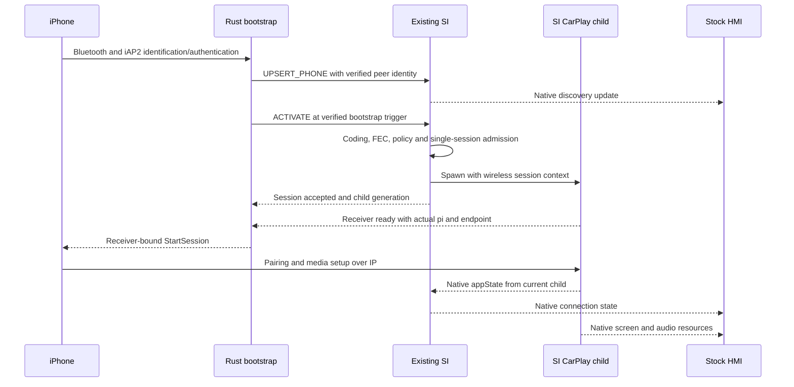
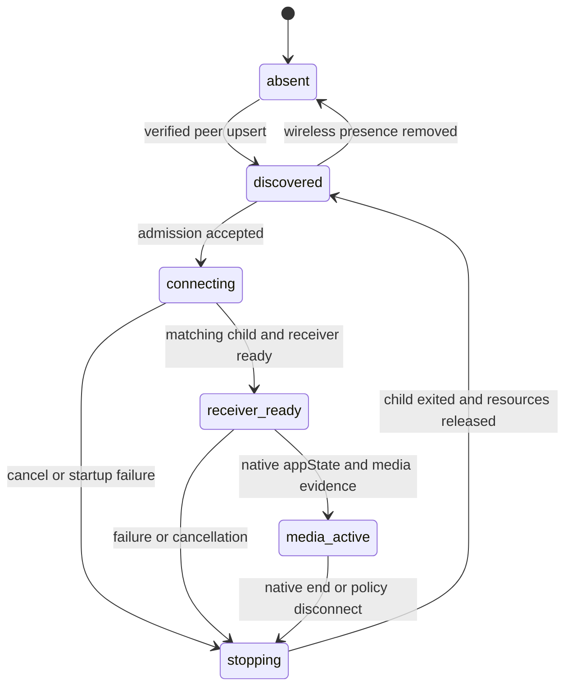

# SI wireless extension plan

> Historical design record. Use the [current SI contract](../../../wireless-carplay/SI_STAGE2_OFFLINE.md) and its acceptance ledger for present status.

_MHI2Q MU1316 / P5087 — MH2p-guided plan, updated October 20, 2026. Stage 1 checked on HU; stage-2 discovery/lifecycle code implemented and cross-built, live execution pending._

The [stage-2 implementation record](../../../wireless-carplay/SI_STAGE2_OFFLINE.md) supersedes implementation-status wording below. It maps code to evidence and remaining acceptance gates; full SI-owned wireless success is not yet established.

---

[Wireless overview](../../../wireless-carplay/README.md) · [Ownership decision](../../../wireless-carplay/DIO_OWNERSHIP.md) · [USB lifecycle](../../../connect-and-usb/SI_STACK_AND_REPLUG_RACE.md) · [Native phone laboratory](../../../carplay-lab/NATIVE_WIRELESS_QNX.md)

## 🎯 Target and evidence boundary

Extend the existing, continuously running **USB re-arm patched SI** so it can register a wireless phone and own its CarPlay child. Use MH2p SI as the behavioral reference for discovery, connection and teardown. Keep the Rust bootstrap service outside the media-child lifetime. Native SI and DIO notifications must drive HMI, resource negotiation and the existing Java/AltScreen lifecycle.

The implementation target is one SI, one active CarPlay child, and a transport selected for each session. The current standalone supervisor remains laboratory evidence and a separate fallback recipe; it must not launch DIO concurrently with SI integration.

| Evidence | Current status | What it establishes |
|---|---|---|
| Local stock/re-arm SI images | Hashes and four changed bytes rechecked | Exact base and existing patch |
| MHI2Q connect/FakeConnect paths | Previously traced in [ownership notes](DIO_OWNERSHIP.md#si-request-paths-traced-so-far) | A connect request requires an existing device record |
| Owner-supplied insertion/ASI analysis | Detailed research leads | Must reproduce structures, callers and ownership in the selected image |
| Three local MH2p SI images | Strings, dynamic symbols, dependencies inspected this turn | Wireless-related classes/events exist; complete execution paths remain to be mapped |
| Rust asynchronous receiver gate | Present in [daemon code](../../../../wireless/daemon/src/lib.rs) | StartSession can wait for receiver readiness and actual pairing identity |
| Native vphone/QNX media | Laboratory evidence in [native QNX record](../../../carplay-lab/NATIVE_WIRELESS_QNX.md) | Receiver/bootstrap compatibility after current explicit startup |
| SI stage-1 shell | [Physical HU proof](../../../wireless-carplay/SI_STAGE1_HU_TEST.md): publish, native NOOP/deletion, USB connect/disconnect/reconnect | Native queue and wired compatibility for the tested cycle |
| SI-owned wireless lifecycle | Implemented offline; [evidence and gaps](../../../wireless-carplay/SI_STAGE2_OFFLINE.md) | ARM helpers/controller tested; live discovery/media/HMI pending |

Completion requires actual SI device discovery and session state, native DSI screen/audio resources, main video, AltScreen, disconnect, reconnect, and wired priority. An IPC acknowledgement, StartSession transmission and decoded video are separate milestones.

### Pinned base and donor images

Paths below are relative to this repository unless stated otherwise. Firmware donors are external local inputs, not new deployment payloads.

| Image | Size, bytes | SHA-256 |
|---|---:|---|
| MHI2Q stock | 802798 | `a25dc981e5591cb3c6b09f00fd95de23803dd3daa0f562e7e8d60b6d0e1b0d02` |
| MHI2Q USB re-arm, implementation base | 802798 | `606236a81c7c4dafda6fdd08fe6eb27c43252796784da25d9760a7d552ee2af3` |
| MH2p US LB636 P2712, primary reference | 1086372 | `e7d9480f5952884d00e12aa94a8552b8a4ae4de6b24e58127d783aeb7724cdc7` |
| MH2p US AUG35 P2873, cross-check | 1090576 | `1d3c35d18b4eef7938a348424c6fe888d4ef4e6cbb9c4e5f8fe91883eef56c72` |
| MH2p ER PO416 P9830, cross-check | 1040972 | `65fb15072b2aa9d34ee4e9ec9894945817e6cdf95638a68cfaf8b9ec219f30b2` |

The base is [deploy/smartphone_integrator/smartphone_integrator](../../../../deploy/smartphone_integrator/smartphone_integrator). Its stock counterpart is under `deploy/experimental/usb_replug_recovery/bundle_mu1316_p5087/stock/`.

The re-arm patch is at **file offset `0x7FDB4`, VA `0x17FDB4`**: `00 30 A0 E3` becomes `2E 33 09 E0`. A previous supplied report said `0x7FD34`; that offset is not the local patch. The [existing patcher](../../../../deploy/experimental/usb_replug_recovery/patch_si_rearm.py) and a direct byte comparison agree on `0x7FDB4`. Preserve these four bytes in every wireless candidate. The actual HU image still requires readback before an install manifest is accepted.

The primary donor is `../../Firmwares/HU/MH2p_US_LB636_P2712/extracted/app/eso/bin/apps/smartphone_integrator`; a sibling `.i64` exists. Cross-check donors use the equivalent `extracted/app/eso/bin/apps/` path in the other two firmware directories.

## 🔍 MH2p comparison before patch design

The first work package is a focused MHI2Q/MH2p comparison. It should determine how much of the native wireless model can be backported before committing to a custom implementation.

### What the initial donor inspection found

These are **string/symbol anchors**, not recovered handler entry addresses. All addresses in this table are P2712 ELF virtual addresses.

| Anchor | VA | Investigation purpose |
|---|---|---|
| `CDeviceDetectionEvent_BluetoothDeviceInserted` string | `0xDB104` | Native discovery producer and record creation |
| `CDeviceDetectionEvent_BluetoothDeviceRemoved` string | `0xDB134` | Presence removal versus media termination |
| `CDeviceDetectionEvent_CarPlayDNSServiceDetected` string | `0xDB164` | DNS-to-device association |
| `CDeviceDetectionEvent_CarPlayWifiDeviceDisconnected` string | `0xDB194` | Loss of Wi-Fi during startup and active media |
| `CControllerInternalEvent_Iap2WirelessCarPlayUpdate` string | `0xDD078` | iAP2 availability/capability entering the SI controller |
| `CSmartphoneBluetoothWrapper` string | `0xF1738` | Ownership of Bluetooth-side service/session |
| `addCarPlayWifiDevice` string | `0xFA350` | Wi-Fi identity and device table relationship |
| `CDNSServiceDiscoveryService::dnsServiceCarPlayBrowseReply` symbol | `0xCDC8C` | Actual callback entry to trace |
| `CDNSServiceDiscoveryService::dnsServiceCarPlayResolveReply` symbol | `0xCDFB8` | Resolved service, port and peer identity |
| `CSmartphoneBluetoothWrapper` vtable symbol | `0x106A70` | Recover interface and event handlers |

P2712 also contains `5GHz access point is not available to activate Wireless CarPlay for deviceID=%i.` at `0xEDE50`. Determine its caller, condition and failure policy. The proposed MHI2Q experiment uses the existing AP configuration, including 2.4 GHz; a donor's 5 GHz platform policy must not silently become an admission requirement. This inspection does not establish whether the physical iPhone will accept every AP/profile combination.

Both platforms use ARM ELF32 little-endian with `/usr/lib/ldqnx.so.2`. MHI2Q has image base `0x100000`, GCC 4.4.2 metadata and `libecpp-ne.so.4`. The primary donor is Thumb/PIE, GCC 4.9.2 metadata, SDK paths naming `qnx660_mmx2p`, and `libcpp-ne.so.5`; it additionally needs `libusbdi.so.2`, `libdns_sd.so.1` and `libsocket.so.3`. `rabin2` reports Thumb as `bits: 16`; this does not make it a 16-bit operating-system executable. Its generic `os: linux` label is not a QNX platform determination.

These differences require dependency, object ABI, DSI/ASI and configuration checks before considering a donor executable on MHI2Q. The planned default is to **backport behavior into our SI**, keeping the current platform libraries and wired path.

The whole-donor route remains a real comparison option: if a small adapter to existing MHI2Q services can preserve native wireless discovery and its FSM, that could cost less than reconstructing those transitions. Measure the missing interfaces and demonstrate both wired and wireless lifecycle in a disposable QNX instance before choosing it. Initial strings/dependencies do not establish which route is easier.

### Questions the comparison must answer

1. Which Bluetooth/iAP2 event inserts a stored record and which event makes it present? What stable key joins USB, Bluetooth and DNS identities?
2. Which connection-method values and record capability bits represent wireless CarPlay? Are they supported by MHI2Q Java/DSI or translated internally?
3. When does MH2p start its CarPlay child relative to Bluetooth authentication, Wi-Fi credentials, availability, DNS discovery and StartSession?
4. Which branch bypasses MediaConnector, and what happens on startup timeout, child crash and final cleanup?
5. How are wired preference, user disconnect, disabled wireless, and a second phone handled?
6. Which native notifications produce discovered devices, connecting/started/disconnected state and HMI activation? How is appState bound to the actual child?
7. Does the donor require services absent from MHI2Q, especially smartphone-Bluetooth, WLAN/AP information and newer iAP2 infrastructure? Can Rust supply those native events through a narrow adapter instead of a new registration interface?

Trace the donor's iAP2 ownership as part of this work. Only one component may own a phone's bootstrap transport/authentication at a time; preserving Rust must not also activate a donor iAP2 stack against the same link. Record which native wireless events can be supplied by our already-tested bootstrap and which depend on donor-only services.

Produce a correspondence table: donor function/event, MHI2Q counterpart, input fields, state changes, external services, reusable behavior and required adaptation. Map small call chains and validate disassembly; names and strings alone are insufficient.

### Implementation strategy decision

| Option | Investigation | Selection criterion |
|---|---|---|
| Extend MHI2Q SI with selected wireless transitions | Primary path | Keeps existing wired behavior and native HMI contracts |
| Interpose exported seams with a small library | Check feasibility | Required control points must actually be interposable; initialization must occur after SI setup |
| Guarded ELF graft with C adapter and narrow trampolines | Preferred fallback for internal seams | Exact bytes, ABI and controller queue integration are demonstrated |
| Run complete MH2p SI | Disposable QNX experiment only if promising | Dependencies, DSI/ASI, USB backend and configuration all match or have a bounded adapter |

Do not replace the platform C++ runtime or import a donor's C++ objects as an incidental part of the SI extension. Select the smallest mechanism after the donor comparison. A socket thread must enqueue controller work; it must not call SI's FSM directly.

## ⚙️ Responsibilities and injection boundaries

| Component | Responsibility | Current code to reuse or adapt |
|---|---|---|
| Rust service | RFCOMM/iAP2/MFi, AP credentials, activation request, receiver gate | [daemon](../../../../wireless/daemon/src) |
| SI wireless adapter | Normalize identity/events and enqueue bounded controller jobs | New code; location proposed below |
| Existing SI controller | Device list, coding/FEC, admission, child/FSM, native HMI state | Re-arm SI plus guarded extension |
| SI child launcher | Per-generation transport, preload/config selection, final `exec` | [wrapper builder](../../../../wireless/integration/build_wrapper_candidate.py) |
| DIO/receiver | Actual media, pairing identity, DSI resources and appState | [receiver bridge](../../../../wireless/receiver_bridge), existing hook |
| Runtime service | Bootstrap/mDNS lifetime, restart and boot ordering | [runtime](../../../../wireless/integration/wireless_runtime.c), refactor its current supervisor ownership |

The adapter needs narrow seams for initialization after SI objects exist, controller job submission/dispatch, discovery insertion/removal, transport-specific prepare/retry/cleanup, child launch parameters, and child/appState correlation. Existing MHI2Q addresses in [ownership notes](DIO_OWNERSHIP.md#si-request-paths-traced-so-far) are anchors for inspection, not a final hook list.

Build requirements follow [Landmines](../../../LANDMINES.md): no eager constructor that starts threads under the loader lock; no emulated TLS in a preloaded library; retain ARM calling convention, register/flag liveness and stack alignment; use bounded allocations and existing platform ABI. Verify displaced instructions and return paths per trampoline. The default with the feature disabled must execute the original wired path.

Select wireless behavior from a positively identified native device/session, never just a global enable flag. Unknown or inconsistent transport metadata must reject that wireless attempt without rerouting a wired record. If an SI preload is selected, prevent its library from leaking into DIO or unrelated spawned processes; build each child's preload chain explicitly.

Proposed source layout, **not yet created**:

```text
wireless/si/
  README.md                    evidence and build recipe
  build_candidate.py           pinned input, guarded changes, manifest, reverse recipe
  si_adapter.c                 lifecycle, local endpoint, bounded job handoff
  si_controller.c              discovery/transport adapters after native ABI recovery
  si_protocol.h                versioned local control contract
  si_graft.ld                  only if the ELF-graft option is selected
  tests/                       host protocol/model tests and original-instruction fixtures
tests/carplay_lab/qnx/
  si_wireless_fixture.py        actual SI candidate plus dependency fixtures
```

Use existing packaging/toolchain helpers where applicable. This is a logical split, not a requirement to add every file before the first milestone.

## 💾 Identity and session model

### Separate phone, accessory and process identities

| Identity | Meaning | Lifetime |
|---|---|---|
| Phone key | Paired peer identity, initially from verified Bluetooth-side data | Survives a link reconnect |
| Native SI `deviceID` | Assigned by SI's own device machinery | Follow native persistence semantics |
| Accessory `deviceID` and receiver `pi` | Head-unit identity and actual receiver pairing identifier | Existing DIO JSON/pairing storage |
| SI epoch | Identifies one initialized SI instance | Changes after SI restart |
| Daemon epoch and link generation | Identifies bootstrap owner and RFCOMM link | Changes after daemon/link restart |
| SI session generation | Identifies one admitted child/media attempt | Changes for each new attempt |

The [factory identity reader](../../../../wireless/daemon/src/factory_identity.rs) remains the base for accessory configuration. The phone must not be registered under the HU's receiver identity. Do not fabricate a USB insertion structure or derive a fake USB serial from an arbitrary Bluetooth address.

Use native stored/present record ownership and ID allocation after confirming its ABI. Keep transport metadata in an extension side table if adding fields would alter native object layout. A wireless record supports discover/update/remove, name changes and reconnect without duplicate stored entries. Presence removal does not necessarily mean forgetting a paired phone.

Initially permit one active CarPlay session. A second phone receives a deterministic busy/selection result and cannot evict the active one implicitly. Preserve stock coding/FEC and user connection policy. Reconcile wired/wireless identities using verified native behavior; if a cross-transport identity is unavailable, keep separate records and serialize admission rather than merging by display name.

Treat transport presence separately from the Bluetooth bootstrap link. A lost RFCOMM link invalidates that link's pending requests, but must not remove a device/session still represented by active native IP media. Reconcile Bluetooth, Wi-Fi/DNS and DIO observations before publishing absence; retain the session record until its native teardown finishes.

The existing receiver protocol uses a 32-bit generation. Map it explicitly to the SI session/epoch; do not truncate a wider identifier and assume it remains unique. PID is diagnostic information, not sufficient session identity.

## 🌐 Local control contract

The donor comparison may reveal an existing usable MHI2Q service seam. If it does not, add a local versioned endpoint between Rust and the SI adapter. The following is the proposed semantic contract; wire encoding and socket availability must be verified on QNX 6.5 before implementation.

| Request | Controller action | Successful result |
|---|---|---|
| `HELLO` / `SNAPSHOT` | Return supported protocol, SI epoch, current device/session state | Authoritative reconciliation data |
| `UPSERT_PHONE` | Insert/update a wireless discovery record | Native `deviceID`, presence and capability result |
| `ACTIVATE` | Run admission and start one transport-specific attempt | Accepted session generation, later state events |
| `CANCEL` | Cancel only the matching startup/active attempt | Quiescing or already-terminal result |
| `REMOVE_PHONE` | Remove wireless presence after appropriate teardown | Removal applied; stored pairing retained by policy |

Events report discovery applied, connecting, child spawned, receiver ready, native appState changes, teardown and failure with a reason. Rust cannot send an authoritative `MEDIA_STARTED` command. DIO/receiver evidence supplies that fact.

Every mutation carries protocol version, request ID, daemon epoch, SI epoch, phone key and the applicable link/session generation. A duplicate request returns its prior result without creating another child. A stale epoch or generation is rejected without touching the current session. `ACCEPTED` means queued; `APPLIED` means the controller performed the action. Neither means media is active.

Prefer an `AF_UNIX` stream endpoint with explicit length framing if supported in the target configuration. Use bytewise decoding with fixed integer endianness, a proposed maximum frame of 16 KiB, bounded queues and bounded work per controller dispatch. Reject malformed lengths, unsupported versions and excessive strings. Verify pathname ownership/permissions and supported peer-identity checks. There is no unauthenticated network listener for SI control.

Socket parsing and blocking I/O stay outside the controller; all state changes occur in its queue. Controller responses are sent asynchronously. Queue saturation returns busy rather than dropping a disconnect invisibly or blocking SI. Native shutdown/timeout work must retain priority over discovery updates.

A local request timeout means the result is unknown: reconcile with `SNAPSHOT`, not a blind second activation. On SI restart, discard stale replies and re-register current peers. On daemon restart, obtain a snapshot before attempting ownership of an existing session.

## 🔄 Cold connection and native state

### Connection sequence



The activation trigger is a research gate. Start with the donor's actual ordering and test a cold native iOS connection **with no prestarted DIO**. Do not require DNS/availability as a universal prerequisite if the phone needs an advertised receiver before emitting it. Conversely, a generic Bluetooth pairing alone must not auto-launch an unauthorized or unsupported phone. Respect existing user authorization and auto-connect settings.

The current [Rust gate](../../../../wireless/daemon/src/lib.rs) schedules receiver start on a worker, discards stale link-generation results, binds actual `pi`, then transmits StartSession. Insert SI admission/child readiness into that asynchronous path. Keep the [receiver protocol](../../../../wireless/receiver_bridge/protocol.h) distinct from the new SI control contract. Ensure no direct receiver START can bypass SI admission, including the CarPlay Control discovery worker.

### State semantics

This state machine describes extension-level observations; names do not replace native SI enum values.



Native SI appState remains authoritative for native device connection notifications. Trace the ASI subscription and child identity rules: delayed events from an old DIO must not mutate a new wired/wireless session. If the current ASI payload lacks usable sender/generation identity, the implementation must establish a queue/drain barrier or a narrow source-binding adapter before new child admission. Adding generation fields only to our IPC does not solve uncorrelated stock ASI events.

Define readiness levels separately: child exec, bridge responsiveness, receiver endpoint/Bonjour and `pi`, native SI appState, HMI resource grants, first decoded frame and AltScreen stream. Do not fabricate STARTED to satisfy a watchdog. The [current child configuration](../../../../deploy/smartphone_integrator/carplay_child.json) has a 10000 ms startup timeout; first map which native event stops that timer. Keep existing wired budgets. If wireless needs a different budget, derive a per-session value from measured phases rather than raising the global timeout.

## 🔧 Teardown, wired priority and boot

### Wireless-specific failure handling

The transport choice must remain available through every native cleanup branch, including failed admission before a child exists, startup timeout, runtime error, child crash, watchdog, user disconnect and final retry exhaustion. Read it before the native context is reset.

| Trigger | Required wireless action | Required invariant |
|---|---|---|
| Native media TEARDOWN | Propagate native end and release session resources | No false started state remains |
| Startup timeout / failed setup | Cancel attempt and terminate/reap its child | No USB stack recovery |
| Runtime error / child crash | Native error transition plus wireless cleanup | No OTG or MediaConnector transaction |
| Bluetooth link loss | Invalidate bootstrap replies; inspect receiver/native media | Do not infer media ended from RFCOMM alone |
| Wi-Fi loss | Request correlated stop, then confirm native end/timeout | No stale discovery-induced restart storm |
| User disconnect | Cancel auto-reconnect for that user action | A background availability event cannot undo it |
| SI/daemon restart | Reconcile epochs, child ownership and actual media | No second DIO and no orphan advertised receiver |

Wireless cleanup must bypass `SwitchPort`, `RestartDeviceStack`, `start_stack::*`, port reset, `stopncm.sh` and `carplay0` destruction. It must also choose the appropriate child cleanup script: the current [production cleanup](../../../../deploy/smartphone_integrator/carplay_cleanup.sh) calls stock mDNS/PPS cleanup and is not automatically safe for a persistent wireless runtime. Preserve USB re-arm behavior for wired sessions.

### Wired priority

On wired insertion, SI stops admitting wireless work, invalidates pending StartSession/CarPlay Control actions, quiesces the receiver and drains the current generation. Only after the wireless child exits and releases ownership may SI start the wired child. Handle the case where the wireless child is not yet spawned. Existing owner locks and [QUIESCE/WIRED_DRAIN behavior](../../../wireless-carplay/STOCK210_RECEIVER_LIFECYCLE.md) are reusable mechanisms, but must not introduce a circular wait with SI's own controller queue.

If quiesce fails, keep one owner and report failure; do not launch a second receiver. Establish a bounded, identity-checked escalation policy in the fixture. After wired removal, reconsider wireless only if policy allows it and the peer is still eligible. A user-initiated wireless disconnect must not be treated like a temporary wired preemption.

### Boot and per-child mode

The target boot path starts the bootstrap/mDNS runtime independently and leaves SI under its existing service manager. Rust tolerates SI starting later and SI tolerates no Rust service. SI initializes the extension after its controller is valid; the daemon obtains `HELLO` before registering a phone. Refactor the current runtime, which starts the standalone DIO/daemon generation supervisor, so SI mode starts no competing DIO and Rust survives child exit.

Select wired/wireless mode in each native child spawn specification: explicit argument or copied child environment, verified against the actual ProcessTNG API. Do not temporarily change process-global environment or a shared mode file while SI may launch another child. If a launch descriptor is needed, bind its consumption to SI epoch/session and make it single use.

Retain the final wrapper-to-DIO `exec` so SI watches the actual child PID. The wireless wrapper must preserve/adapt the persistent renderer monitor: the current standalone candidate suppresses that monitor in wireless mode, so it cannot be reused unchanged for native HMI/AltScreen integration. Keep renderer startup outside the synchronous SI deadline and maintain one renderer owner across transport changes.

Give AP configuration, Device IE, mDNS, pairing storage and firewall changes explicit owners. A stale child cleanup must not stop a responder adopted by a new session. Preserve paired receiver identity across DIO restarts and keep temporary session state out of persistent identity data.

## 📋 Implementation milestones

Implement in reviewable stages with artifacts and exit criteria. Later stages depend on the evidence from earlier ones; do not describe model tests as execution of native SI.

| Stage | Deliverable | Exit criterion |
|---|---|---|
| 0. Donor correspondence | MHI2Q/MH2p call chains, object fields, service dependencies and ordering | Discovery/connect/timeout/disconnect mapped; injection strategy selected |
| 1. Guarded candidate shell | Disabled-by-default extension, manifest, reverse recipe, loader fixture | Original SI boots; disabled feature preserves wired paths and re-arm bytes |
| 2. Discovery only | Local control, controller jobs, stable record insertion/update/removal | Native SI discovery observer sees a phone; no DIO or USB operation |
| 3. Native child ownership | Wireless admission/prepare/spawn/cleanup and mode selection | SI starts one child; timeout/crash/cancel never touch USB |
| 4. Rust and receiver | SI-aware asynchronous gate and correlated readiness | Native StartSession waits for the admitted receiver; old replies discarded |
| 5. Full QNX lifecycle | Actual candidate SI + actual DIO, external-service fixtures | Connect/end/reconnect/USB priority and native appState pass |
| 6. Native vphone | Cold phone bootstrap, media, resources where modeled | Main and AltScreen decode; full provenance of synthetic services recorded |
| 7. Physical HU | Manual-start candidate, native HMI/audio/AltScreen and rollback | Wired regression and actual wireless connect/disconnect pass |
| 8. Boot integration | SI-mode runtime/service launch and recovery | Cold boot, SI/daemon restart and disabled-mode rollback pass |

Stage 0 must settle the unavailable-service adapters and whether a whole-donor experiment is useful. Stage 2 is the first functional milestone: **a wireless phone in the native SI discovery output, updated and removed without a USB insertion**. Stage 3 proves actual SI ownership before introducing phone timing.

Proposed artifact directory: `build/si-wireless-<run>/`, containing input/output SHA-256, hook/context manifest, disassembly excerpts, donor correspondence, test configuration, native event trace and forbidden-USB-operation counters. Keep generated ELF/libraries, firmware copies and raw phone traces outside source control.

Candidate generation is reversible and refuses unknown input hashes/bytes. Installation verifies the actual HU baseline, backs up the matching SI/config, prepares payloads before activation, and has a coherent disable/restore path. Define activation order for the SI image, mode-aware wrapper and runtime so a partial update cannot launch competing owners. First test manually with persistent autostart disabled. File restoration and runtime activation are separate operations: the owner reports SI currently restarts with the vehicle. Do not assume service-manager respawn as a recovery mechanism. After an agreed HU restart, attest PID/arguments, immutable candidate memory and live adapter NOOP/deletion counters before attributing functional results to the installed build; repeat runtime verification after rollback. See the [stage-1 activation audit](../../../wireless-carplay/SI_STAGE1_HU_TEST.md#-уточнение-активации-si-2026-10-21).

## ✅ Validation and acceptance

### Test layers

| Layer | Real implementation | Permitted fixtures and limits |
|---|---|---|
| Host protocol/policy | IPC parser, request ledger and generation logic | No proof of native SI object/FSM behavior |
| Original-instruction harness | Selected SI record/dispatch/cleanup instructions | Imported services modeled and listed explicitly |
| Disposable QNX | Actual candidate SI and target loader/runtime | USB, ASI/DSI peers and MediaConnector can be fixtures; count calls |
| Native vphone + QNX | Actual Rust, iOS bootstrap and DIO media | Virtual Ethernet is not physical Wi-Fi/RFCOMM; HU resources may be modeled |
| Physical HU | SI, service manager, radio, HMI, amplifier, microphone and VC | Final proof of in-car behavior |

Observe SI DSI discovery and connection outputs directly before relying on Java display changes. Keep a native wired baseline under the same fixture. A stub returning success for USB operations cannot prove wireless avoids them: forbidden operations must fail the test immediately.

### Required scenarios

| Group | Scenarios | Assertion |
|---|---|---|
| Discovery | Duplicate upsert, name update, remove/reinsert, two phones, record limit | Stable IDs and native notifications; no duplicate child |
| Admission | Coding/FEC denied, SI not running-ready, user refusal, active wired phone | Normal denial with no receiver start |
| Cold start | SI first, Rust first, phone first; no existing DIO | No bootstrap dependency cycle |
| Startup | Receiver slow/missing, bad `pi`, exec failure, timeout before/after spawn | Correlated terminal result; zero wireless USB recovery |
| Generation races | Old READY/appState/stop after reconnect; PID reuse; mode changes | Old work cannot mutate the new owner |
| Teardown | Phone end, HMI end, Wi-Fi loss, RFCOMM loss with media alive, child crash | Correct native state and complete cleanup |
| Restart | SI restart, daemon restart, responder loss, duplicate service start | Snapshot/reconciliation, no two DIOs |
| USB priority | Insert during discovery/prepare/ready/media/stop; remove during drain | One owner and correct subsequent transport |
| Interface parsing | Partial frames, malformed lengths, queue overflow, invalid UTF-8/IDs | Bounded rejection, SI controller stays responsive |
| Media and HMI | Screen/audio/Siri/mic, main 110, AltScreen 111, VC state, return to stock | Native resource grants and observable recovery |
| Wired regression | Cold USB, clean disconnect, rapid replug, existing re-arm path | No wireless policy leaks into wired mode |

Run deterministic state/event fuzzing with recorded seeds, including cancel-before-spawn, cancellation racing readiness, late native appState and reversed teardown ordering. Check useful invariants: at most one child/owner; no StartSession before admission/readiness; no old-generation state writes; no wireless USB recovery; no paired identity loss; native shutdown remains responsive. Complement model fuzzing with selected native traces rather than duplicating implementation assertions alone.

For latency, record monotonic timestamps for registration, admission, spawn, exec, receiver readiness, StartSession, native appState, resource grants and first main/AltScreen frame. Measure queue delay, memory/FD growth and repeated reconnect behavior. Keep traces bounded and redact credentials/link keys; SI extension carries control state, not media frames, and must stay out of the video/frame-pacing path.

## 📍 Next work and unresolved decisions

The immediate next task is **stage 0 using P2712 as the primary donor**: recover Bluetooth insertion, `Iap2WirelessCarPlayUpdate`, DNS association, native child preparation and wireless error cleanup; match them to MHI2Q; inspect which imported services must be adapted. Use P2873/P9830 to distinguish stable design from one-version behavior.

Resolve these before stage 3: native method/capability representation visible to MHI2Q HMI; child/appState source correlation; activation ordering with cold iOS; whether the receiver can become ready within the applicable native SI timer; wireless ownership of mDNS/cleanup/renderers; and the donor's 5 GHz policy. These are investigation tasks with local inputs, not requests for user permission.

Local primary-source triage for this plan is under `build/si-integration-plan-20261018/triage.json` with raw per-image JSON. Reproduce metadata, library, string and symbol inventories with `rabin2 -Ij`, `rabin2 -lj`, `rabin2 -zj` and `rabin2 -sj` against the pinned images. No donor or MHI2Q binary was edited, no IDA database was modified, no emulator was restarted and no HU operation was performed while writing this plan.
