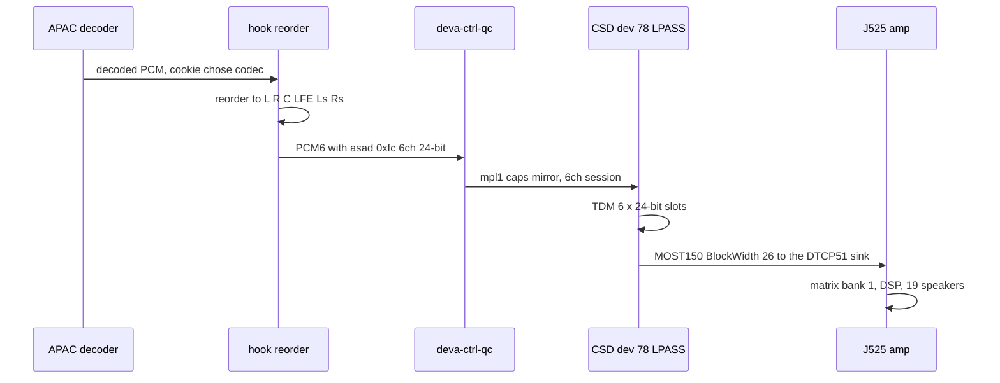
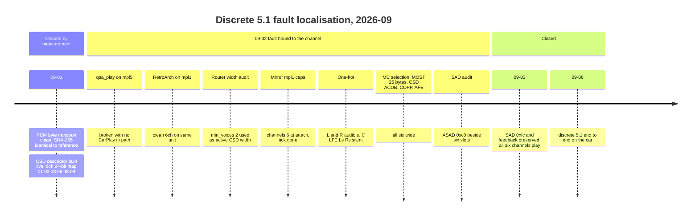

# Discrete 5.1 Routing — archived documentation

> Historical snapshot before the current-state documentation restructure. Commands, status and measurements below belong to their recorded revisions.

*The native 5.1 CarPlay path: how decoded multichannel reaches the amp through the deva mirror driver, the CSD width fix, the SAD header, the 8→6 fold, and the magic-cookie codec authority — plus the month-long fault hunt that closed every other layer.*

---

## 🎯 The discrete path in one line

Native decoded APAC 5.1 (from the buffered type-103 path) is reordered byte-identically to `L R C LFE Ls Rs` and **bypasses the upmixer** — it does not touch [HSSR](../../../audio/archive/HSSR_MODEL.md). Discrete 5.1 CarPlay works end to end in the vehicle `[car]` (2026-09-06). The last two faults were both declaration/control mismatches rather than PCM corruption: the SAD header announced two active channels over six populated slots, and the hook blanked `updateFeedback`, removing the sender's clock reference. Both are corrected and vehicle-confirmed.

Layer-by-layer reference for the head unit (deva, CSD, LPASS, AFE, MOST) lives in [QNX Audio Topology](../../../audio/QNX_AUDIO_TOPOLOGY.md); the RCC/internal-amp side in [Internal Amp Path](../../../audio/INTERNAL_AMP_PATH.md); the amp in [Virtual Cabin and Amp RE](../../../audio/VIRTUAL_CABIN_AND_AMP_RE.md); where discrete vs upmix splits in [Stereo to 5.1 Upmix](../../../audio/STEREO_TO_5_1_UPMIX.md).

## ⚙️ The path, end to end

## 🔍 The symptom and the hunt

What the driver heard on the broken six-channel path, across several sessions: a **constant tick** (a "tsyk tsyk tsyk" click, continuous, not once a second), **very low-pitched voices**, tempo only mildly off (explicitly not 3× or 4×), sound from the **correct speakers**, content still **recognisable**, and stereo CarPlay always clean. "Recognisable but wrong" excluded every waveform-destroying hypothesis; clean stereo on the same device excluded anything shared by both widths.

*Timeline: how each layer was cleared in September 2026 until only the two declaration faults remained.*

### Proven clean, do not re-investigate

| Layer | Evidence |
|---|---|
| APAC decode | decoded PCM confirmed good by ear offline |
| Hook fragment expansion | `frag=1920->9216` = 768 frames × 6 voices × 2 bytes |
| deva DMA ring | `DSP_VERIFY ring=0 source=resmgr voices=6 fragments=62 bytes=1142784 mismatches=0` |
| Consumption | 62 cursor advances, every delta `0x4800`, each region submitted once |
| Submitted stream | bit-identical to the reference, PCM SHA-256 `f0f37e6c…c312` |
| CSD descriptor | live: 48000 Hz, 6 voices, 24-in-32, 18432-byte buffer, 768 frames, 16 ms, map `01 02 03 06 08 09` |
| CSD device id, ACDB, COPP, AFE slots, MOST allocation, amp sink/Connect, SHARC matrix | see [QNX Audio Topology](../../../audio/QNX_AUDIO_TOPOLOGY.md) and [Virtual Cabin and Amp RE](../../../audio/VIRTUAL_CABIN_AND_AMP_RE.md) |

### Ruled out by ear

Known-good 5.1 was corrupted on purpose, folded to stereo and auditioned (renders in `build/qsa-emu/renders/`, gitignored):

| Candidate | Verdict |
|---|---|
| hard clipping | not it |
| low-24-bit extraction, 20 s with voice | far too broken (peak pinned, RMS 3.5×) |
| centre into the low-passed path | sounds normal |
| stream order read as context order | sounds normal |
| fragment repeated ×3, ×4 | too much slowdown |
| **fragment repeated ×2** | **closest match ever — "incredibly similar"** |

The ×2 match pointed at fragment-level repetition; the router-width audit later showed the real mechanism (a third of each fragment copied, source samples tripled, 62.5 Hz seam).

### The decisive control

`qsa_play` wrote a known-good six-channel file straight into `/dev/snd/mpl5_dio_ent` with CarPlay, libairplay, the decoder, the ring and the hook all out of the path: `device limits: voices 2..6 … frag 6144..18432`, `6 voices, 48000 Hz, frag 9216, frags 10`, **48,115 frames/s** — and it sounded broken exactly like CarPlay (channel-ID track announced "Front Right"). RetroArch writing six voices to `mpl1_int_ent` sounded correct. Same deva, DSP, MOST and amp: **the fault was bound to the CarPlay virtual channel**, which exonerated the whole CarPlay stack. Two superseded hypotheses from this phase: "stock provisions DIO media as a stereo MOST sink" (falsified — the HU already selects the MC pair) and "the 3× fix may never have run" (it ran; the CSD session was the problem).

Sources: `AUDIO_5_1_STATE` §1–13, `CODEX_PROMPT_DEVICE_TOPOLOGY`, `CODEX_PROMPT_ROUTER_INPUT_WIDTH`

## 🔧 The two closing fixes

Getting six channels to play took two months because the head unit silently collapsed to stereo through **two independent mechanisms**, each masquerading as a fault somewhere downstream. Both are `[car]`-confirmed.

### The CSD width bug (Qualcomm side)

Both `mpl1_int_ent` and the CarPlay device `mpl5_dio_ent` route to the **same** CSD device 78 (48 kHz / 24-bit). The active width is chosen at route-attach from the driver's static capability record. `mpl5` shipped `min_voices=2, min_fragsize=0x1800`; `mpl1` had `6, 0x4800`. The bug: `deva_update_session_info_from_list @0x54848` copies the record's **minimum** voices/fragsize into the *active* CSD session.

So even after widening the DMA side to 6 voices, CSD advanced `0x4800` bytes/tick while submitting only `0x1800` — one third of each fragment — **tearing at 62.5 Hz** with the sample clock still perfectly correct. Worse, Audioman attaches the route ~14 s **before the PCM channel exists** (slog: `00:00:38 … channels=2`, `00:00:52 setup actual=6ch`), so any patch that "reads the live channel" takes its fallback. Same-device A/B: two voices 48,107 frames/s excellent, six voices 48,129 frames/s broken, discrete and fully-correlated content equally broken.

The fixed timer arithmetic (16 ms period) shows why only 6/`0x4800` is correct:

| voices | fragment | frames / 16 ms | effective rate |
|---|---|---|---|
| 2 | `0x1800` | 768 | 48000 — correct |
| 2 | `0x4800` | 2304 | 144000 — 3× fast |
| 6 | `0x1800` | 256 | 16000 — 3× slow |
| 6 | `0x4800` | 768 | 48000 — correct |

**The fix (2026-09-02, confirmed by ear):** make `mpl5`'s caps record **mirror `mpl1` field-for-field** (min/max voices = 6, fragsize `0x4800`). The CSD session is then built six-channel at attach time and the unit logs `pcm format => sample_rate=48000, channels=6`. Stereo still opens because **QSA inserts a channel conversion** rather than refusing a below-min open — confirmed with `AUDIO_SPATIAL=0` on the same driver. The month-long belief "widening the minima breaks stereo" was simply false. Field offsets and the call chain are in [QNX Audio Topology](../../../audio/QNX_AUDIO_TOPOLOGY.md).

### The SAD header (libairplay side)

Beside the PCM on MOST rides a **speaker-allocation (SAD) header**: six slots are always physically formed; the SAD says how many are *meaningful*. `asad=0xfc` = slots 1..6 (5.1); `asad=0xc0` = slots 1..2 (stereo). `dio::CQNXSoundIF::createMetadata` described AirPlay's *native* input (2ch/16-bit) and wrote `asad=0xc0` even after the PCM stream was widened to six channels — six sent, two declared, the amp kept L/R. The intermediate one-hot test (`voices 6..6`, 48,243 frames/s) showed exactly that: L and R audible, C/LFE/Ls/Rs silent. **Fix:** interpose `createMetadata` to announce the requested output width (6) and 24 bits so deva emits `asad=0xfc` (`hook/audio/audio_hook.c:5123-5198`; `AUDIO_SAD_CHANNELS` / `AUDIO_SAD_BITS` override, 0 disables) **[code]**. `[car]` 2026-09-03: centre + surrounds reach the speakers.

A second independent control mismatch was also real: the hook's experimental `updateFeedback` rewrite replaced the stock stream list with an empty list, removing the clock/rate reference — delivery collapsed to ~one packet per second. Production preserves the stock feedback, and when stock has none (type 100 torn down while type 103 plays, or a cold start) it publishes a `{type:100, sr}` clock from the detached QSA sink or the nominal 48 kHz (inside `AirPlayReceiverSessionControl`, `hook/audio/audio_hook.c:8768-8958`). Blanking survives only as an A/B switch, `AUDIO_FEEDBACK_BLANK=1` (`audio_hook.c:8846`, `:8902`). The vehicle reports `sr=48004.0625`, type 100, normal delivery.

### The two-day retraction

`tools/qsa_play.c` sets no SAD header, so it *inherited* the previous session's `0xc0`. Its L/R-only output was misread as "the amp is innocent", sending the search deep into ADSP/MOST/SHARC/COPP — all found **correct**. The rule that came out of it: **verify through CarPlay, never through `qsa_play`.**

Sources: `ROUTER_INPUT_WIDTH_AUDIT`, `CODEX_PROMPT_CSD_REPROVISION`, `AFE_TDM_MOST_SLOT_AUDIT`, `AUDIO_5_1_STATE` §14–19

## 💾 The mirror driver

The selected driver is reproduced by `deploy/deva-ctrl-qc/build_final.py`. Its caps, DMA helper and CSD helper are documented together in the [canonical driver description](../../../stock-patches/deva-ctrl-qc.so.md). The former three-step scripts were consolidated without changing the selected binary.

Ships as `deploy/deva-ctrl-qc/deva-ctrl-qc.so.patched` → `/mnt/app/armle/lib/dll/deva-ctrl-qc.so`. `io-audio` maps the driver, so an in-place overwrite is refused: copy to `<path>.new`, `chmod 755`, `mv` over it; active at the **next reboot** (ask first — [Landmines](../../../LANDMINES.md)). Rollback: `AUDIO_SPATIAL=0` in `carplay_startup.sh` gives stock stereo on the next connect; restoring the stock driver is only cleanup, since the mirror driver serves stereo correctly. The old `install_spatial_5_1.sh` was removed because it staged the intermediate step-1 driver.

**Ceiling: 6 is the max a byte can reach** (`deva_csd_start_csd_session_playback` hardcodes 6; no 8-channel output node exists), so CarPlay's 5.1.2 = 8 channels needs an 8→6 fold on the hook side. The deva output order is Apple canonical `L R C LFE Ls Rs` (`hook/audio/audio_hook.c:419-420`); the reorder happens before it, on the decoder side.

Sources: `spatial_5_1/README`, `ROUTER_INPUT_WIDTH_AUDIT`

## 📊 The 8→6 fold and the amp sink table

5.1.2 height is a hard ceiling — see [Dolby Atmos](../../../audio/DOLBY_ATMOS.md) and [Virtual Cabin and Amp RE](../../../audio/VIRTUAL_CABIN_AND_AMP_RE.md). The APAC decoder emits native order `C L R Ls Rs LFE`, permuted to CarPlay order `L R C LFE Ls Rs` (`hook/audio/spatial_downmix.h:15-35`). For index 66 (5.1.2), the fold: L/R/C unchanged, LFE −6 dB, each height folded into its matching surround at −6 dB (`hook/audio/spatial_downmix.c:71-97`).

The fold runs only on the experimental `AUDIO_SPATIAL_ATMOS=1` path (`AUDIO_SPATIAL_ATMOS_MODE=downmix|drop|passthrough`, `hook/audio/audio_hook.c:3386-3394`). The shipped startup sets `AUDIO_SPATIAL_ATMOS=0` (`deploy/smartphone_integrator/carplay_startup.sh:61`), so index 66 is never advertised, and a decoded 5.1.2 stream outside a SETUP-66 session is rejected as `unsupported-layout` (`audio_hook.c:3227-3240`).

Selectable MOST sinks on the amp `8W0035465`:

| Sink | Profile | BlockWidth | Format |
|---|---|---|---|
| `0x21` | Entertainment_2.0 | 4 | 2 × 16-bit |
| `0x26` | Entertainment_5.1_SAD | 14 | 6 × 16-bit |
| `0x2A` | Entertainment_2.0_SAD | 8 | 2 × 24-bit |
| `0x32` | Entertainment_7.1_SAD | 26 | 8 × 24-bit |

The 5.1 sink is 16-bit while deva runs 24-in-32 internally; LPASS carries S16 in the top of a 24-bit slot, so this is not a fault. Positions 7/8 of `0x32` are BCL/BCR and no profile carries height codes `0x0D`/`0x0F` — discrete 5.1.2 is impossible on this amp.

The HU-side MOST audit derived **`SinkNr 0x26, BlockWidth 0x001a` (26)** for connection 162; the amp's V850 Connect handler checks only that the width is in `1..372` and stores it, never comparing against the profile's own 14. ⚠️ The later AudioProcess RE maps XML `MULTICHANNEL` (= `eSNK_DTCP51`) to external sink **`0x32`**, whose advertised width is exactly 26 — the sink number is therefore `[open]` until a live `raiseConnSR` trace; either way the amp accepts it. Details in [QNX Audio Topology](../../../audio/QNX_AUDIO_TOPOLOGY.md).

Sources: `MOST_SOURCE_BLOCKWIDTH_AUDIT`, `CONNECT_BLOCKWIDTH_VALIDATION_AUDIT`, `INTERNAL_AMP_AUDIOPROCESS_SINKS`, `AUDIO_5_1_STATE` §4, §12, §16

## 🔍 Magic-cookie codec authority

The codec authority on the buffered path is the **inline magic cookie**, not any APAP format index. iOS may alternate AAC-LC (index 23) ↔ APAC (index 65) *inside one session*; the receiver observes the change through the **new inline cookie**, tries the current decoder then its alternate, and the successful decoder plus decoded channels/rate/layout selects stereo upmix or APAC 5.1 reorder.

- **AAC-LC (index 23)** — decoded in-hook via Cinemo `libNmeSDK.so`, reached by `dlsym` (`hook/audio/aac_bridge.c:15-18`, `:122`); APAP time scale `0x0000bb80`, a distinct 39-byte magic cookie, ASC `11 90`; needs no resampling. Vehicle capture: 601 raw AUs (376..1322 B) → exactly `601 × 1024` frames / 12.821333 s once ADTS headers are added without touching AU bytes. The AAC plugin takes media type 5 / subtype `0x101a`, one AU per `Write(…, 1, pts=0, 1)`. `dio_manager` does not import `CinemoCreateAudioCodec`, the registry is mutex-protected and ref-counted, and the AAC plugin has no OMX imports, so one decoder can be owned by the existing APAP receiver thread — no new thread.
- **APAC (index 65/66)** — decoded via `libcarplay_apac.so` (ABI v1, `hook/audio/apac_bridge.h:52`; default path `/mnt/app/root/hooks/libcarplay_apac.so`, `hook/audio/apac_codec_loader.h:15`).
- **The trap:** an early `[65,23]` run looked session-constant because the instrumentation read `spf` (=1024, APAP field 8) as an index; APAP field 2 is the active `APAudioFormatIndex`.

This cookie-driven APAC ↔ AAC switching has played in **both directions** on the vehicle inside one type-103 session with no dropout `[car]`. The checked-in startup advertises `[65,23]` with `AUDIO_SPATIAL=1` (`deploy/smartphone_integrator/carplay_startup.sh:60`, `:92`; `hook/audio/audio_hook.c:785-788`); stereo synthesis can be disabled live with **CarPlay UpMix → Off** in MMI. The old `AUDIO_STEREO_UPMIX` export is no longer parsed. See [Landmines](../../../LANDMINES.md) for the E2P 0xFC gate that decides whether the 6-channel route exists at all, and [Internal Amp Path](../../../audio/INTERNAL_AMP_PATH.md) for why.

Sources: `AUDIO_5_1_STATE` §19–20

## 🔄 Buffered session lifecycle ledger

The type-103 stream is hook-owned, so its lifecycle against stock type 100 had to be rebuilt piece by piece. Durable results from the ledger (full traces in the lifecycle sources it cites):

| Finding | Resolution | State |
|---|---|---|
| Phone lock / backgrounding: stock type 100 released `mpl5_dio_ent` while 103 decoded; ring hit 24000 frames, feedback went null, iOS tore 103 down ~8 s later | hand the configured QSA handle to the APAP thread during the gap; reuse the last measured feedback; no second handle | `[car]` 2412 detached writes, no stop |
| Interruption at lock/unlock traced to QSA close-adjacent flush (`libairplay` `0x47744`/`0x48a94` → close) | suppress only that flush while 103 is active and hand the live handle back | `[car]` one handle through lock/unlock/lock |
| AAC SETUP answered with APAC's `audioBufferSize` | AAC-only 5,000,000; any offer containing APAC 21,168,000 (`hook/audio/audio_hook.h:153-154`) **[code]** | `[car]` APAC→AAC in place |
| STOP→prepare→GO at 98 % CPU; writer at QNX priority 10 vs stock 18, 8-fragment queue = 128 ms | receiver/QSA writer `SCHED_RR` 18 (`hook/audio/audio_hook.c:7778-7790`, env `AUDIO_BUFFERED_THREAD_PRIO`) **[code]** | `[car]` 16,384 periods, 0 underruns |
| Feedback replayed a transient 48080 Hz for ~276 s after a flush storm | 256-write nominal warm-up, then measure 1024 detached 768-frame periods against `CLOCK_MONOTONIC` | deployed, handoff untested |
| Silent cold start: direct QSA skipped the media-route declaration | call exported `s_audioTypeCallback(kAudioTypeMedia)` before opening, release with the torn-down callback | `[car]` 2026-09-05, 2560 clean periods |
| Stock→hook inverse transition missing | re-request Media 50 ms after a retained stock close — now part of [Call and Siri Routing](../../../audio/CALL_AND_SIRI_ROUTING.md) | host/QNX tested |
| Ring drained to 0/256/512 frames; post-flush gaps | render pump holds ~12,000 frames (250 ms); cold prime 400 ms, post-flush re-prime 7,680 frames (160 ms) | `[car]` >6 min near 11–13k |
| Repeated seeks lagged: stale AAC packets discarded at realtime pace | discard the invalid FLUSH range without pacing | deployed, multi-seek run pending |
| Type-100 PCM substituted under 103 ownership when the ring was short | single owner: buffered PCM or a whole silent period (`QSA_BUFFERED_SILENCE`, `audio_hook.c:6492`) | local candidate |
| Renderer started `playing=1` before rate 1; AUs dropped under `rate=0` (30 AUs / 640 ms lost) | one lifecycle object initialised stopped; queue raw records under rate 0, drain once under rate 1; exact inclusive FLUSH ranges | local, not deployed |
| SoundCheck: SETUP `soundCheckMediaKind={"1":-16}` + APAP 11/12 | Pioneer MainLoudnessParameters gain (AAC −9 dB, APAC +1 dB), 20 ms ramp, before trim/reorder/upmix | host-verified |

The adopted shipping policy stays **one fixed PCM6 / 48 kHz / S16 stream with `ASAD=0xfc` for the whole buffered session**: only the decoder changes between tracks, never the amp/SAD configuration. The amp's bank-0 "stereo" mode (SHARC control `0x10` = 2.0) is unreachable on the 5.1 sink — see [Virtual Cabin and Amp RE](../../../audio/VIRTUAL_CABIN_AND_AMP_RE.md).

Pre-HSSR stereo renderers recorded in the 5.1 ledger (superseded)

Before [HSSR](../../../audio/archive/HSSR_MODEL.md) the ledger tracked three renderers behind the same PCM6 adapter; none is selectable now (the current source uses SCENE; after its Off fade, the dry path is `L,R,0,0,0,0`).

- **Universal profile (2026-09-04):** C zero; bounded separated objects to Ls/Rs; fixed Ls/Rs-only +3 dB high shelf, 4 kHz midpoint, before a linked rear limiter; **Cabin-Aware LFE V2** — phase-safe 48 Hz LR4 sub-band, V11 bass/drum steering, Q15 ceiling 4096, paired front trim 0.958; the per-sample limiter accounted for every recovered J525 bus gain including the bank-1 +6 dB surround gain. Pioneer's verified CarPlay stereo→5.0 engine was kept as a host oracle only; its centre is not mapped because bank 1 already derives it. Vehicle policy then: `AUDIO_STEREO_UPMIX=on`, rear 0.25, `AUDIO_STEREO_LFE=assist`.
- **HQ:** causal 1024-point sqrt-Hann STFT, hop 256, 24 Bark-like bands, confidence-weighted principal-image subtraction, 120 Hz–7 kHz rear mask, unequal Schroeder decorrelation; rear latency 1024 frames / 21.333 ms, fronts and LFE undelayed. State/runtime 59,432/55,304 B, QNX frame 208 B, text/unstripped 8,180/72,904 B; host 1024-frame mean/p99 144,015/162,042 ns; QEMU icount 4,034,828/4,035,856 instructions (not Krait cycles). Final fold rendered very quiet Ls/Rs (peak −40.398/−43.864 dBFS, RMS −68.918/−71.926); on `spatial_aac.wav` HQ Ls/Rs RMS −37.827/−37.436 vs lite −39.803/−40.183. The denormal snap (<1e-20) cost +1.44 % instructions.
- **HSR-TD:** per-sample per-band covariance, principal projector at a 6 kHz control rate, residual straight to Ls/Rs (no FFT, no Schroeder, no block latency); attack/release ~1/8 ms; residual tail 20–100 ms after diffuse→mono fell −48.07 → −61.92 dB; QEMU 1,089,350/1,091,467 instructions (3.62× fewer than HQ). Nine dev genres + 24 held-out fold-downs: rear correlation 0.395 / SI-SDR −8.20 dB vs lite −0.010 / −14.98 dB, but lite won envelope, image error, energy restraint and fold-back. Shared LFE assist: envelope correlation 0.603, SI-SDR 1.13 dB, energy ratio 0.769, max bus peak 0.503 (it follows L/R bass; it cannot recover LFE absent from the stereo fold). The user picked `hsr-td` for the A/B (later `hsr-td-active`, surround 0.20) without a quality verdict. Bench: `tools/stereo-upmix-render/bench/results/2026-09-04-hsr-td.md`.

---

Sources: `AUDIO_5_1_STATE` §21–22 and the dated sections after it

## ⚠️ What is confirmed and what stays open

**[car] confirmed:** discrete 5.1 end to end (2026-09-06); buffered stereo (AAC-LC index 23) beside APAC 5.1 (index 65); cookie-driven APAC↔AAC switch both directions, no dropout; phone-lock/background lifecycle survives (the QSA handle transfers to the APAP thread during the type-100 release gap); cold-connect media route.

**External amplifier support:** B&O and Bose are confirmed. The [cross-amplifier analysis](../../../audio/ODIS_AMP_MAPPING.md#external-amplifier-support) covers the external six-channel inputs and DSP matrices; the earlier Bose audit gap is closed.

**[open] / not done:** internal 6ch CarPlay (no stock route exists — see [Internal Amp Path](../../../audio/INTERNAL_AMP_PATH.md)); the index-66 native channel order is unverified; the exact MOST sink number (`0x26` vs `0x32`); whether the INIC honours inactive ASAD bits (moot while we send `0xfc`). Historical fault-localisation (byte transport, CSD topology, AFE slot packing, MOST allocation, amp sink selection, SHARC matrix) is closed — do not re-derive.

**Related:** [Buffered Audio Path](../../../audio/BUFFERED_AUDIO_PATH.md) · [APAC Codec](../../../audio/APAC_CODEC.md) (the type-103 transport and decoder) · [Virtual Cabin and Amp RE](../../../audio/VIRTUAL_CABIN_AND_AMP_RE.md#the-lpass-copp-topology-ab-a-side-experiment) · [Virtual Cabin and Amp RE](../../../audio/VIRTUAL_CABIN_AND_AMP_RE.md#the-8-channel-sink-is-rear-71-not-512).

## 📚 Sources

Merged originals were removed from the tree after this note absorbed them; they remain in git history (commit 23972aa).

- `AUDIO_5_1_STATE` — the full 5.1 ledger: symptom, cleared layers, every audit's verdict, the lifecycle follow-ups.
- `ROUTER_INPUT_WIDTH_AUDIT` — the `min_voices` root cause and the six-only vs dual-mode fix analysis.
- `CODEX_PROMPT_CSD_REPROVISION` — the 14 s route-before-open slog that forced the mirror approach.
- `AFE_TDM_MOST_SLOT_AUDIT` — the SAD/ASAD mechanism behind the second fix.
- `MOST_SOURCE_BLOCKWIDTH_AUDIT`, `CONNECT_BLOCKWIDTH_VALIDATION_AUDIT` — the 26-byte source and the amp's width check.
- `spatial_5_1/README` — the historical deploy bundle (hook + deva), rollback.
- Also consulted, canonical homes elsewhere: `DEVICE_TOPOLOGY_AUDIT`, `CSD_ACDB_CHANNEL_AUDIT`, `LPASS_COPP_TOPOLOGY_AUDIT`, `reference/HU_AUDIO_CEILING` → [QNX Audio Topology](../../../audio/QNX_AUDIO_TOPOLOGY.md); `MC_SELECTION_AUDIT`, `INTERNAL_AMP_PATH_KNOWLEDGE` → [Internal Amp Path](../../../audio/INTERNAL_AMP_PATH.md); `AUDIO_CALL_ROUTING` → [Call and Siri Routing](../../../audio/CALL_AND_SIRI_ROUTING.md).
- [VIRTUAL_CABIN](../../../research/VIRTUAL_CABIN.md), [UPMIX](../../../research/UPMIX.md) — the research papers this path feeds.
